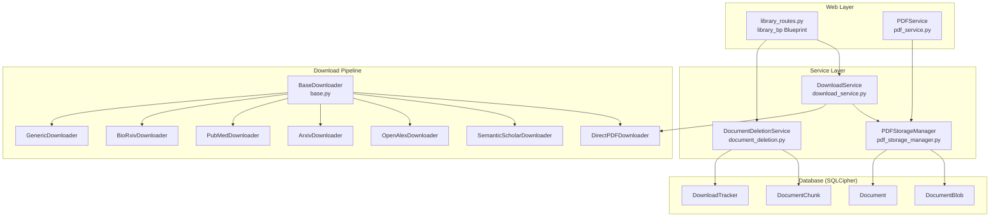
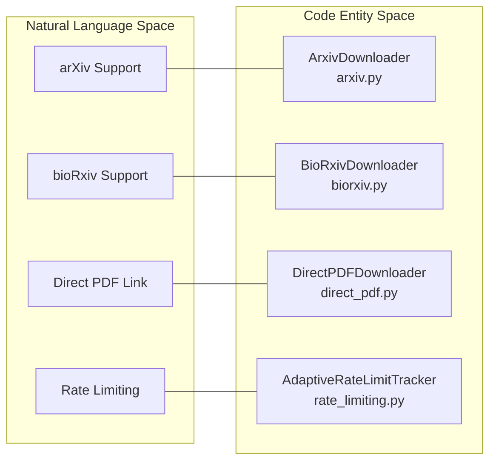

<!-- source: DeepWiki mcp.deepwiki.com · repo LearningCircuit/local-deep-research · page 6.4 Document Download and Management · fetched 2026-10-29 -->

# Document Download and Management

Relevant source files

The following files were used as context for generating this wiki page:

- [src/local_deep_research/constants.py](src/local_deep_research/constants.py)
- [src/local_deep_research/exporters/__init__.py](src/local_deep_research/exporters/__init__.py)
- [src/local_deep_research/exporters/base.py](src/local_deep_research/exporters/base.py)
- [src/local_deep_research/exporters/latex_exporter.py](src/local_deep_research/exporters/latex_exporter.py)
- [src/local_deep_research/exporters/odt_exporter.py](src/local_deep_research/exporters/odt_exporter.py)
- [src/local_deep_research/exporters/pdf_exporter.py](src/local_deep_research/exporters/pdf_exporter.py)
- [src/local_deep_research/exporters/quarto_exporter.py](src/local_deep_research/exporters/quarto_exporter.py)
- [src/local_deep_research/exporters/ris_exporter.py](src/local_deep_research/exporters/ris_exporter.py)
- [src/local_deep_research/research_library/deletion/services/collection_deletion.py](src/local_deep_research/research_library/deletion/services/collection_deletion.py)
- [src/local_deep_research/research_library/deletion/services/document_deletion.py](src/local_deep_research/research_library/deletion/services/document_deletion.py)
- [src/local_deep_research/research_library/deletion/utils/cascade_helper.py](src/local_deep_research/research_library/deletion/utils/cascade_helper.py)
- [src/local_deep_research/research_library/downloaders/__init__.py](src/local_deep_research/research_library/downloaders/__init__.py)
- [src/local_deep_research/research_library/downloaders/arxiv.py](src/local_deep_research/research_library/downloaders/arxiv.py)
- [src/local_deep_research/research_library/downloaders/base.py](src/local_deep_research/research_library/downloaders/base.py)
- [src/local_deep_research/research_library/downloaders/biorxiv.py](src/local_deep_research/research_library/downloaders/biorxiv.py)
- [src/local_deep_research/research_library/downloaders/direct_pdf.py](src/local_deep_research/research_library/downloaders/direct_pdf.py)
- [src/local_deep_research/research_library/downloaders/generic.py](src/local_deep_research/research_library/downloaders/generic.py)
- [src/local_deep_research/research_library/downloaders/openalex.py](src/local_deep_research/research_library/downloaders/openalex.py)
- [src/local_deep_research/research_library/downloaders/pubmed.py](src/local_deep_research/research_library/downloaders/pubmed.py)
- [src/local_deep_research/research_library/downloaders/semantic_scholar.py](src/local_deep_research/research_library/downloaders/semantic_scholar.py)
- [src/local_deep_research/web/services/pdf_service.py](src/local_deep_research/web/services/pdf_service.py)
- [tests/deletion/test_cascade_integration.py](tests/deletion/test_cascade_integration.py)
- [tests/deletion/test_collection_deletion.py](tests/deletion/test_collection_deletion.py)
- [tests/deletion/test_document_deletion.py](tests/deletion/test_document_deletion.py)
- [tests/exporters/test_latex_exporter.py](tests/exporters/test_latex_exporter.py)
- [tests/exporters/test_odt_exporter.py](tests/exporters/test_odt_exporter.py)
- [tests/exporters/test_pdf_exporter.py](tests/exporters/test_pdf_exporter.py)
- [tests/exporters/test_quarto_exporter.py](tests/exporters/test_quarto_exporter.py)
- [tests/exporters/test_ris_exporter.py](tests/exporters/test_ris_exporter.py)
- [tests/research_library/deletion/utils/test_cascade_helper.py](tests/research_library/deletion/utils/test_cascade_helper.py)
- [tests/research_library/deletion/utils/test_cascade_helper_edge_cases.py](tests/research_library/deletion/utils/test_cascade_helper_edge_cases.py)
- [tests/research_library/services/test_pdf_storage_manager.py](tests/research_library/services/test_pdf_storage_manager.py)
- [tests/research_library/services/test_pdf_storage_manager_edge_cases.py](tests/research_library/services/test_pdf_storage_manager_edge_cases.py)
- [tests/research_library/test_utils.py](tests/research_library/test_utils.py)
- [tests/security/test_pdf_path_traversal.py](tests/security/test_pdf_path_traversal.py)
- [tests/test_search_system_factory_high_value.py](tests/test_search_system_factory_high_value.py)
- [tests/web/services/test_pdf_service.py](tests/web/services/test_pdf_service.py)

This page covers how local-deep-research downloads, stores, and manages research documents — primarily PDFs — from academic sources. It describes the modular downloader chain, the `PDFStorageManager`, the `DownloadTracker`, and the lifecycle of document deletion and cleanup.

For RAG indexing of downloaded documents, see [6.1](). For the broader library and collections data model, see [3.7](). For configuration keys that affect this subsystem, see [4.4]().

---

## System Overview

When a research session completes, the sources it found (papers, PDFs, academic articles) are recorded as `ResearchResource` records. The download subsystem allows users to retrieve the actual binary content of those sources, extract their text, and add the results to the library for later searching.

**Architecture overview — Document Management and its collaborators**

Sources: [src/local_deep_research/research_library/downloaders/base.py:38-56](), [src/local_deep_research/research_library/deletion/services/document_deletion.py:24-36](), [src/local_deep_research/web/services/pdf_service.py:97-102]()

---

## Modular Downloader Chain

All downloaders inherit from `BaseDownloader` [src/local_deep_research/research_library/downloaders/base.py:38-39](). This base class provides a `SafeSession` [src/local_deep_research/research_library/downloaders/base.py:49]() for secure HTTP requests and an `AdaptiveRateLimitTracker` [src/local_deep_research/research_library/downloaders/base.py:54]() to manage domain-specific rate limits.

### Specialized Downloader Logic

*   **ArxivDownloader**: Identifies arXiv URLs and converts them to direct PDF links (e.g., `https://arxiv.org/pdf/{id}.pdf`) [src/local_deep_research/research_library/downloaders/arxiv.py:97-100](). It also fetches metadata via the arXiv Atom API [src/local_deep_research/research_library/downloaders/arxiv.py:152-162]().
*   **BioRxivDownloader**: Handles bioRxiv and medRxiv preprints by converting landing page URLs to `.full.pdf` targets [src/local_deep_research/research_library/downloaders/biorxiv.py:126-143]().
*   **DirectPDFDownloader**: A high-priority downloader that checks for `.pdf` extensions, `/pdf/` path segments, or `format=pdf` query parameters [src/local_deep_research/research_library/downloaders/direct_pdf.py:15-39]().
*   **GenericDownloader**: A fallback that attempts to download any URL. It uses `stream=True` to inspect `Content-Type` headers before committing to a full download, preventing memory spikes from large non-PDF files [src/local_deep_research/research_library/downloaders/generic.py:94-111]().

**Downloader to Code Entity Mapping**

Sources: [src/local_deep_research/research_library/downloaders/arxiv.py:13-34](), [src/local_deep_research/research_library/downloaders/biorxiv.py:15-40](), [src/local_deep_research/research_library/downloaders/direct_pdf.py:12-39](), [src/local_deep_research/research_library/downloaders/generic.py:13-33]()

---

## PDF Storage Manager

The `PDFStorageManager` abstracts the physical storage of PDF binaries [tests/research_library/services/test_pdf_storage_manager.py:9-11](). It supports three modes defined in the system settings:

| Mode | Description | Implementation Detail |
|------|-------------|-----------------------|
| `database` | Stores PDF as an encrypted blob. | Uses `DocumentBlob` table [tests/research_library/services/test_pdf_storage_manager.py:57-69](). |
| `filesystem` | Stores PDF as a file on disk. | Uses `library_root` path [tests/research_library/services/test_pdf_storage_manager.py:73-91](). |
| `none` | Discards binary after text extraction. | Returns `None` during save [tests/research_library/services/test_pdf_storage_manager.py:44-55](). |

The manager enforces a `max_pdf_size_bytes` limit (default 100MB) to prevent resource exhaustion [tests/research_library/services/test_pdf_storage_manager.py:22-23]().

Sources: [tests/research_library/services/test_pdf_storage_manager.py:14-39](), [src/local_deep_research/research_library/deletion/utils/cascade_helper.py:102-109]()

---

## Document Deletion and Cleanup

Deletion is handled by the `DocumentDeletionService` [src/local_deep_research/research_library/deletion/services/document_deletion.py:24](), which ensures that all related data is purged across the database and filesystem.

### Deletion Lifecycle
1.  **Metadata Cleanup**: Removes the `Document` record.
2.  **Binary Cleanup**: Deletes the `DocumentBlob` (if in database mode) or unlinks the file (if in filesystem mode) [src/local_deep_research/research_library/deletion/services/document_deletion.py:104-123]().
3.  **Chunk Cleanup**: Manually deletes `DocumentChunk` records. Because `DocumentChunk.source_id` lacks a Foreign Key constraint, this must be handled explicitly by the `CascadeHelper` [src/local_deep_research/research_library/deletion/utils/cascade_helper.py:31-49]().
4.  **Index Cleanup**: Deletes associated FAISS `.faiss` and `.pkl` files [src/local_deep_research/research_library/deletion/utils/cascade_helper.py:169-205]().
5.  **Tracker Update**: Updates the `DownloadTracker` to reflect that the resource is no longer locally available [src/local_deep_research/research_library/deletion/services/document_deletion.py:128]().

### Blob-Only Deletion
The service provides a `delete_blob_only` method [src/local_deep_research/research_library/deletion/services/document_deletion.py:152](). This removes the heavy PDF binary but preserves the extracted `text_content` and metadata, allowing the document to remain searchable in the RAG system while freeing up disk space [tests/deletion/test_document_deletion.py:175-193]().

Sources: [src/local_deep_research/research_library/deletion/services/document_deletion.py:36-150](), [src/local_deep_research/research_library/deletion/utils/cascade_helper.py:27-65](), [tests/deletion/test_document_deletion.py:123-147]()

---

## PDF Generation Service

For exporting research reports, the `PDFService` utilizes **WeasyPrint** to convert Markdown to PDF [src/local_deep_research/web/services/pdf_service.py:4-10]().

*   **Security**: It implements a `_safe_url_fetcher` to block SSRF attacks by validating all URLs (images, stylesheets) before WeasyPrint attempts to fetch them [src/local_deep_research/web/services/pdf_service.py:53-60]().
*   **Styling**: A `minimal_css` profile is used to ensure readability, setting A4 margins and standard typography [src/local_deep_research/web/services/pdf_service.py:102-155]().
*   **Process**: The service first converts Markdown to HTML via the `markdown` library [src/local_deep_research/web/services/pdf_service.py:185-187]() and then renders the PDF into a `BytesIO` buffer [src/local_deep_research/web/services/pdf_service.py:201-203]().

Sources: [src/local_deep_research/web/services/pdf_service.py:97-214](), [tests/web/services/test_pdf_service.py:151-163]()

---

