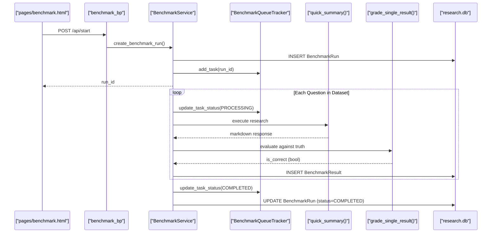

<!-- source: DeepWiki mcp.deepwiki.com · repo LearningCircuit/local-deep-research · page 6.5 Benchmarking System · fetched 2026-10-29 -->

# Benchmarking System

<details>
<summary>Relevant source files</summary>

The following files were used as context for generating this wiki page:

- [community_benchmark_results/COMMON_ISSUES.md](community_benchmark_results/COMMON_ISSUES.md)
- [community_benchmark_results/README.md](community_benchmark_results/README.md)
- [community_benchmark_results/benchmark_template.yaml](community_benchmark_results/benchmark_template.yaml)
- [examples/benchmarks/run_gemini_benchmark.py](examples/benchmarks/run_gemini_benchmark.py)
- [examples/optimization/browsecomp_optimization.py](examples/optimization/browsecomp_optimization.py)
- [examples/optimization/example_multi_benchmark.py](examples/optimization/example_multi_benchmark.py)
- [examples/optimization/gemini_optimization.py](examples/optimization/gemini_optimization.py)
- [examples/optimization/multi_benchmark_simulation.py](examples/optimization/multi_benchmark_simulation.py)
- [examples/optimization/multi_benchmark_speed_demo.py](examples/optimization/multi_benchmark_speed_demo.py)
- [examples/optimization/run_multi_benchmark.py](examples/optimization/run_multi_benchmark.py)
- [src/local_deep_research/benchmarks/evaluators/__init__.py](src/local_deep_research/benchmarks/evaluators/__init__.py)
- [src/local_deep_research/benchmarks/evaluators/base.py](src/local_deep_research/benchmarks/evaluators/base.py)
- [src/local_deep_research/benchmarks/evaluators/browsecomp.py](src/local_deep_research/benchmarks/evaluators/browsecomp.py)
- [src/local_deep_research/benchmarks/evaluators/composite.py](src/local_deep_research/benchmarks/evaluators/composite.py)
- [src/local_deep_research/benchmarks/evaluators/simpleqa.py](src/local_deep_research/benchmarks/evaluators/simpleqa.py)
- [src/local_deep_research/benchmarks/optimization/api.py](src/local_deep_research/benchmarks/optimization/api.py)
- [src/local_deep_research/benchmarks/optimization/optuna_optimizer.py](src/local_deep_research/benchmarks/optimization/optuna_optimizer.py)
- [src/local_deep_research/benchmarks/web_api/benchmark_routes.py](src/local_deep_research/benchmarks/web_api/benchmark_routes.py)
- [src/local_deep_research/benchmarks/web_api/benchmark_service.py](src/local_deep_research/benchmarks/web_api/benchmark_service.py)
- [src/local_deep_research/database/library_init.py](src/local_deep_research/database/library_init.py)
- [src/local_deep_research/exceptions.py](src/local_deep_research/exceptions.py)
- [src/local_deep_research/security/data_sanitizer.py](src/local_deep_research/security/data_sanitizer.py)
- [src/local_deep_research/web/queue/processor_v2.py](src/local_deep_research/web/queue/processor_v2.py)
- [src/local_deep_research/web/templates/pages/benchmark_results.html](src/local_deep_research/web/templates/pages/benchmark_results.html)
- [src/local_deep_research/web/templates/pages/benchmark_simple.html](src/local_deep_research/web/templates/pages/benchmark_simple.html)
- [tests/benchmarks/web_api/__init__.py](tests/benchmarks/web_api/__init__.py)
- [tests/benchmarks/web_api/test_benchmark_routes.py](tests/benchmarks/web_api/test_benchmark_routes.py)
- [tests/database/test_session_passwords.py](tests/database/test_session_passwords.py)
- [tests/news/test_api_functions.py](tests/news/test_api_functions.py)
- [tests/security/test_data_sanitizer.py](tests/security/test_data_sanitizer.py)
- [tests/security/test_url_builder.py](tests/security/test_url_builder.py)
- [tests/security/test_url_validator.py](tests/security/test_url_validator.py)
- [tests/web/auth/__init__.py](tests/web/auth/__init__.py)
- [tests/web/queue/test_processor_v2.py](tests/web/queue/test_processor_v2.py)
- [tests/web/queue/test_processor_v2_concurrency.py](tests/web/queue/test_processor_v2_concurrency.py)
- [tests/web/queue/test_processor_v2_coverage.py](tests/web/queue/test_processor_v2_coverage.py)
- [tests/web/queue/test_processor_v2_real.py](tests/web/queue/test_processor_v2_real.py)
- [tests/web/routes/test_research_routes_start_research_coverage.py](tests/web/routes/test_research_routes_start_research_coverage.py)
- [tests/web_search_engines/engines/__init__.py](tests/web_search_engines/engines/__init__.py)
- [tests/web_search_engines/rate_limiting/__init__.py](tests/web_search_engines/rate_limiting/__init__.py)
- [tests/web_search_engines/rate_limiting/test_tracker.py](tests/web_search_engines/rate_limiting/test_tracker.py)

</details>


## Purpose and Scope

The Benchmarking System provides automated evaluation of the Local Deep Research (LDR) system against standardized datasets such as **SimpleQA** (fact-checking) and **BrowseComp** (complex browsing). It executes research queries from benchmark datasets, evaluates the generated responses against ground truth answers using an evaluation LLM, and tracks accuracy metrics over time. This infrastructure allows systematic testing of different configurations, models, and search strategies to ensure high performance [src/local_deep_research/benchmarks/web_api/benchmark_service.py:1-25]().

The system is designed for both web-based interactive benchmarking via the Flask UI and high-throughput CLI/script-based optimization using **Optuna** to find ideal hyperparameters for specific hardware or model combinations [src/local_deep_research/benchmarks/web_api/benchmark_routes.py:63-132](), [src/local_deep_research/benchmarks/optimization/optuna_optimizer.py:51-138]().

---

## System Architecture

The benchmarking architecture bridges high-level evaluation requirements with low-level research execution. It utilizes a dedicated `BenchmarkService` to orchestrate runs and an in-memory `BenchmarkQueueTracker` for task lifecycle management.

### Logic Flow and Component Interaction

The following diagram illustrates the relationship between the benchmarking routes, the service layer, and the core research execution engine.

**Diagram: Benchmarking System Data Flow**
```mermaid
graph TB
    subgraph "Web_Interface_Layer"
        ["benchmark_routes.py"] -- "Blueprint" --> BenchmarkRoutes["benchmark_bp"]
        ["benchmark.html"] -- "UI" --> BenchmarkDashboard["BenchmarkDashboard"]
    end
    
    subgraph "Service_Layer"
        BS["BenchmarkService"]
        BQT["BenchmarkQueueTracker"]
        RF["quick_summary()"]
    end
    
    subgraph "Execution_Layer"
        ASS["AdvancedSearchSystem"]
        SSF["SearchSystemFactory"]
        FIS["FocusedIterationStrategy"]
    end
    
    subgraph "Evaluation_&_Optimization"
        OO["OptunaOptimizer"]
        GR["grade_single_result()"]
        DS["load_dataset()"]
    end
    
    subgraph "Persistence_Layer"
        UDB[("research.db")]
        BRM["BenchmarkRun"]
        BRS["BenchmarkResult"]
    end
    
    BenchmarkRoutes --> BS
    BenchmarkDashboard --> BenchmarkRoutes
    BS --> BQT
    BS --> RF
    RF --> ASS
    ASS --> SSF
    SSF --> FIS
    
    OO --> RF
    BS --> GR
    BS --> DS
    BS --> BRM
    GR --> BRS
    BRM --> UDB
    BRS --> UDB
```

**Sources:** [src/local_deep_research/benchmarks/web_api/benchmark_service.py:125-134](), [src/local_deep_research/benchmarks/web_api/benchmark_routes.py:17-62](), [src/local_deep_research/api/research_functions.py:13-13](), [src/local_deep_research/database/models/benchmark.py:16-21]()

---

## Core Components

### Benchmark Service and Queue Tracking
The `BenchmarkService` manages the lifecycle of a benchmark run, including dataset loading, configuration hashing, and result persistence [src/local_deep_research/benchmarks/web_api/benchmark_service.py:125-126]().

*   **Task Tracking:** The `BenchmarkQueueTracker` provides a thread-safe in-memory store for task status using `BenchmarkTaskStatus` (e.g., `QUEUED`, `PROCESSING`, `COMPLETED`, `FAILED`, `CANCELLED`) [src/local_deep_research/benchmarks/web_api/benchmark_service.py:29-50](). It includes an opportunistic cleanup mechanism for old tasks via `cleanup_completed_tasks()` to prevent memory bloat [src/local_deep_research/benchmarks/web_api/benchmark_service.py:92-93]().
*   **Configuration Hashing:** `generate_config_hash()` creates an MD5 hash of search parameters like `iterations`, `model_name`, and `search_strategy`. This ensures that benchmark results are only compared against compatible system configurations [src/local_deep_research/benchmarks/web_api/benchmark_service.py:148-167]().
*   **Run Orchestration:** `create_benchmark_run()` initializes the database record in the user's encrypted `research.db` using `get_user_db_session` and prepares the environment for execution [src/local_deep_research/benchmarks/web_api/benchmark_service.py:185-188]().

**Sources:** [src/local_deep_research/benchmarks/web_api/benchmark_service.py:29-193](), [src/local_deep_research/database/session_context.py:8-8]()

### Datasets and Evaluation
The system supports multiple benchmark datasets and automated grading through LLM-based verification.

*   **Dataset Loading:** `load_dataset()` handles retrieval of benchmark data. It currently supports `SimpleQA` and `BrowseComp` [src/local_deep_research/benchmarks/web_api/benchmark_service.py:23-23]().
*   **Automated Grading:** `grade_single_result()` uses an evaluation LLM to compare research output against the `ground_truth` answer [src/local_deep_research/benchmarks/web_api/benchmark_service.py:24-24](). Structured answers are extracted from raw LLM responses using `extract_answer_from_response()` [src/local_deep_research/benchmarks/web_api/benchmark_service.py:24-24]().
*   **Composite Evaluator:** The `CompositeBenchmarkEvaluator` allows combining multiple benchmark types with specific weights to calculate a unified quality score for optimization trials [src/local_deep_research/benchmarks/optimization/optuna_optimizer.py:115-117]().

**Sources:** [src/local_deep_research/benchmarks/web_api/benchmark_service.py:23-25](), [src/local_deep_research/benchmarks/optimization/optuna_optimizer.py:113-118]()

### Optuna-Based Optimization
The `OptunaOptimizer` provides automated hyperparameter tuning to find optimal settings for research quality and speed [src/local_deep_research/benchmarks/optimization/optuna_optimizer.py:51-52]().

*   **Search Space:** It explores parameters such as `search.iterations` and `search.questions_per_iteration` via `_get_default_param_space()` [src/local_deep_research/benchmarks/optimization/optuna_optimizer.py:153-153]().
*   **Multi-Metric Optimization:** It balances `quality` and `speed` using configurable weights (default 60% quality, 40% speed) to ensure the system is both accurate and responsive [src/local_deep_research/benchmarks/optimization/optuna_optimizer.py:109-110]().
*   **Persistence:** Optimization studies are stored in a SQLite database to allow pausing and resuming trials over long periods [src/local_deep_research/benchmarks/optimization/optuna_optimizer.py:156-163]().

**Sources:** [src/local_deep_research/benchmarks/optimization/optuna_optimizer.py:51-142]()

---

## Performance Measurement

### Resource Tracking and Concurrency
Benchmarks are subject to the same resource constraints as standard research tasks to ensure realistic performance profiles.

*   **Concurrency Control:** Benchmark execution is governed by the `_global_research_semaphore`, ensuring benchmarks do not overwhelm the server's LLM or search capacity [src/local_deep_research/benchmarks/web_api/benchmark_service.py:15-15](), [src/local_deep_research/web/services/research_service.py:15-15]().
*   **Latency Profiling:** The `SpeedProfiler` measures execution time for each trial, which is integrated into the Optuna objective function to penalize excessively slow configurations [src/local_deep_research/benchmarks/optimization/optuna_optimizer.py:26-28]().

**Diagram: Benchmark Execution Sequence**


**Sources:** [src/local_deep_research/benchmarks/web_api/benchmark_service.py:125-185](), [src/local_deep_research/database/models/benchmark.py:16-50](), [src/local_deep_research/web/services/research_service.py:15-15]()

---

## Community Benchmark Results

Community-contributed benchmark results are archived to facilitate cross-hardware performance comparisons. Note that new results are now directed to a dedicated external repository [community_benchmark_results/README.md:3-10]().

### Result Format
Submissions typically follow a structured format to allow for automated aggregation:

| Category | Metric | Purpose |
| :--- | :--- | :--- |
| **Model Metadata** | `provider`, `model_name` | Identify the LLM configuration [src/local_deep_research/benchmarks/web_api/benchmark_service.py:157-158](). |
| **Search Config** | `iterations`, `strategy` | Identify the search complexity and logic [src/local_deep_research/benchmarks/web_api/benchmark_service.py:151-156](). |
| **Accuracy** | `is_correct` percentage | Core quality metric (Pass@1) [src/local_deep_research/database/models/benchmark.py:17-17](). |
| **Efficiency** | `avg_time_per_question` | Execution speed metric [src/local_deep_research/benchmarks/comparison/results.py:29-29](). |

The `Benchmark_results` class handles loading and saving these results locally in `benchmark_results.json` [src/local_deep_research/benchmarks/comparison/results.py:4-10]().

**Sources:** [src/local_deep_research/database/models/benchmark.py:16-21](), [src/local_deep_research/benchmarks/web_api/benchmark_service.py:148-160](), [src/local_deep_research/benchmarks/comparison/results.py:4-39](), [community_benchmark_results/README.md:1-32]()

---

