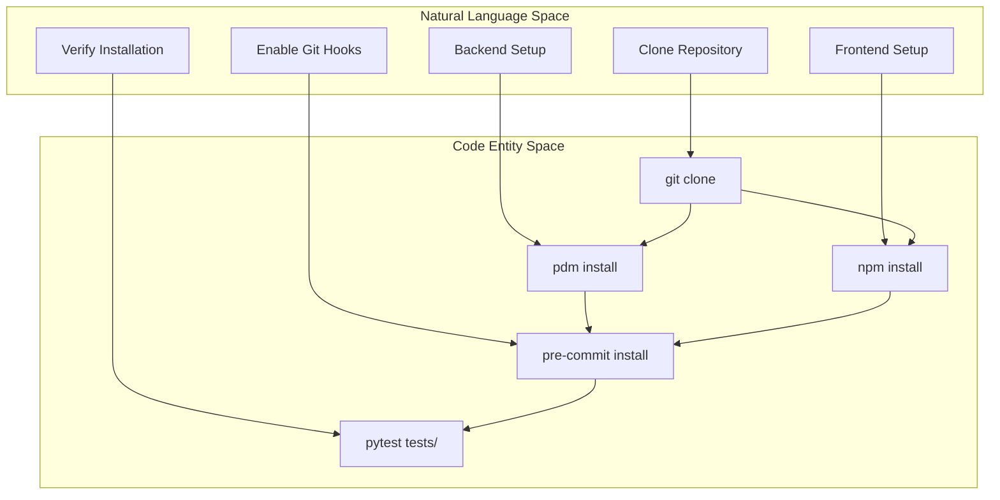
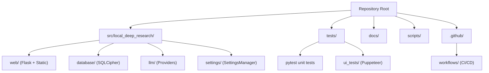
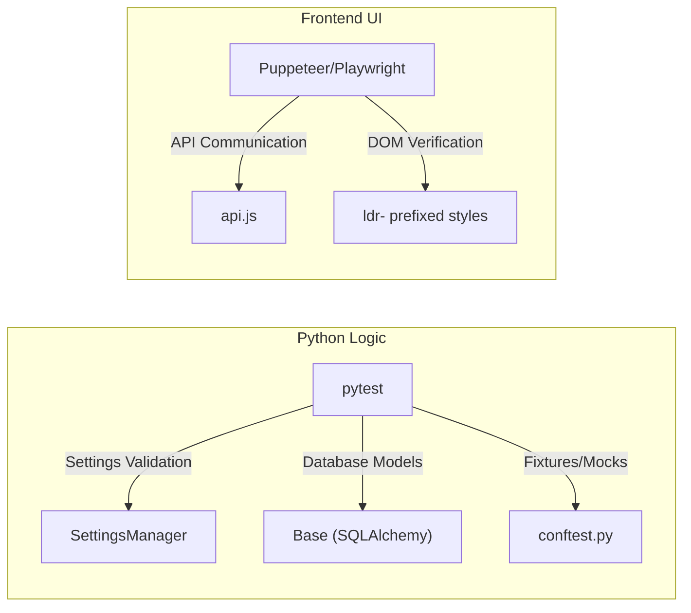

<!-- source: DeepWiki mcp.deepwiki.com · repo LearningCircuit/local-deep-research · page 7 Development Guide · fetched 2026-10-29 -->

# Development Guide

<details>
<summary>Relevant source files</summary>

The following files were used as context for generating this wiki page:

- [.file-whitelist.txt](.file-whitelist.txt)
- [.github/CODEOWNERS](.github/CODEOWNERS)
- [.github/scripts/file-whitelist-check.sh](.github/scripts/file-whitelist-check.sh)
- [.gitignore](.gitignore)
- [.gitleaks.toml](.gitleaks.toml)
- [.gitleaksignore](.gitleaksignore)
- [.pre-commit-config.yaml](.pre-commit-config.yaml)
- [.pre-commit-hooks/check-absolute-module-paths.py](.pre-commit-hooks/check-absolute-module-paths.py)
- [.pre-commit-hooks/check-pathlib-usage.py](.pre-commit-hooks/check-pathlib-usage.py)
- [.pre-commit-hooks/check-session-context-manager.py](.pre-commit-hooks/check-session-context-manager.py)
- [.pre-commit-hooks/file-whitelist-check.sh](.pre-commit-hooks/file-whitelist-check.sh)
- [.pre-commit-hooks/recommend-release-notes.py](.pre-commit-hooks/recommend-release-notes.py)
- [CONTRIBUTING.md](CONTRIBUTING.md)
- [README.md](README.md)
- [changelog.d/3670.breaking.1.md](changelog.d/3670.breaking.1.md)
- [changelog.d/3670.breaking.md](changelog.d/3670.breaking.md)
- [changelog.d/3670.feature.md](changelog.d/3670.feature.md)
- [changelog.d/3773.feature.md](changelog.d/3773.feature.md)
- [changelog.d/README.md](changelog.d/README.md)
- [docker-compose.gpu.override.yml](docker-compose.gpu.override.yml)
- [docs/CI_CD_INFRASTRUCTURE.md](docs/CI_CD_INFRASTRUCTURE.md)
- [docs/RELEASE_GUIDE.md](docs/RELEASE_GUIDE.md)
- [docs/SECURITY_REVIEW_PROCESS.md](docs/SECURITY_REVIEW_PROCESS.md)
- [docs/SQLCIPHER_INSTALL.md](docs/SQLCIPHER_INSTALL.md)
- [docs/decisions/0001-remove-detect-secrets.md](docs/decisions/0001-remove-detect-secrets.md)
- [docs/developing.md](docs/developing.md)
- [docs/docker-compose-guide.md](docs/docker-compose-guide.md)
- [docs/install-pip.md](docs/install-pip.md)
- [docs/installation.md](docs/installation.md)
- [examples/benchmarks/browsecomp/run_browsecomp_fixed_v2.py](examples/benchmarks/browsecomp/run_browsecomp_fixed_v2.py)
- [examples/benchmarks/gemini/run_gemini_benchmark_fixed.py](examples/benchmarks/gemini/run_gemini_benchmark_fixed.py)
- [examples/benchmarks/scripts/run_benchmark_with_claude_grading.py](examples/benchmarks/scripts/run_benchmark_with_claude_grading.py)
- [examples/optimization/llm_multi_benchmark.py](examples/optimization/llm_multi_benchmark.py)
- [pdm.lock](pdm.lock)
- [pyproject.toml](pyproject.toml)
- [src/local_deep_research/database/sqlcipher_compat.py](src/local_deep_research/database/sqlcipher_compat.py)
- [src/local_deep_research/web/static/js/services/api.js](src/local_deep_research/web/static/js/services/api.js)
- [tests/api_tests/fix_search_engines.py](tests/api_tests/fix_search_engines.py)
- [tests/api_tests/migrate_research_mode.py](tests/api_tests/migrate_research_mode.py)
- [tests/api_tests/populate_search_engines.py](tests/api_tests/populate_search_engines.py)
- [tests/api_tests/run_basic_api_tests.py](tests/api_tests/run_basic_api_tests.py)
- [tests/conftest.py](tests/conftest.py)
- [tests/infrastructure_tests/test_csrf_api.test.js](tests/infrastructure_tests/test_csrf_api.test.js)
- [tests/security/test_absolute_module_paths_hook.py](tests/security/test_absolute_module_paths_hook.py)
- [tests/test_settings_manager.py](tests/test_settings_manager.py)
- [tests/ui_tests/test_direct_uuid_insert.py](tests/ui_tests/test_direct_uuid_insert.py)
- [tests/ui_tests/test_mixed_id_handling.py](tests/ui_tests/test_mixed_id_handling.py)
- [tests/ui_tests/test_trace_error.py](tests/ui_tests/test_trace_error.py)
- [tests/ui_tests/test_uuid_fresh_db.py](tests/ui_tests/test_uuid_fresh_db.py)
- [tests/ui_tests/test_uuid_research.py](tests/ui_tests/test_uuid_research.py)

</details>


This document provides comprehensive guidance for contributors to Local Deep Research. It covers development environment setup, code quality standards, testing infrastructure, and security review processes.

**Scope**: This page focuses on the practical aspects of developing and contributing code. For architectural design patterns and system internals, see [Architecture](#3). For CI/CD pipeline details, see [CI/CD and Release Pipeline](#8). For production deployment configuration, see [Deployment Strategies](#9).

---

## Development Environment Setup

### Prerequisites

Local Deep Research requires the following tools for development:

| Tool | Version | Purpose |
|------|---------|---------|
| Python | 3.12+ | Backend runtime and service logic [[pyproject.toml:10]()] |
| Node.js | Latest | Frontend build tooling and UI tests [[.pre-commit-config.yaml:37-47]()] |
| PDM | Latest | Python dependency and virtualenv management [[pyproject.toml:1-3]()] |
| SQLCipher | System library | AES-256 database encryption [[docs/SQLCIPHER_INSTALL.md:1-15]()] |

### Initial Setup Workflow

The following diagram maps the setup process to the underlying tools and scripts.

**Development Onboarding Flow**

**Sources**: [tests/conftest.py:22-25](), [.pre-commit-config.yaml:1-45]()

### Backend Setup with PDM

PDM is the Python dependency manager used by this project. It provides deterministic builds via `pdm.lock` and manages virtual environments automatically [[pyproject.toml:143-150]()].

```bash
# Install PDM
pip install pdm

# Install project dependencies including dev groups
pdm install
```

Always commit `pdm.lock` alongside `pyproject.toml` changes to ensure reproducible builds [[pyproject.toml:52-52]()]. The repository uses a whitelist approach in `.gitignore` to ensure only critical project files are tracked [[.gitignore:1-61]()].

**Sources**: [pyproject.toml:143-150](), [.gitignore:1-61](), [pdm.lock:1-10]()

### Frontend Setup

The frontend uses Vite for development and build tooling. Assets are served via Flask but managed through `package.json`. CSRF protection is required for all API communication via `getCsrfToken` [[src/local_deep_research/web/static/js/services/api.js:17-20]()].

```bash
# Install dependencies
npm install

# Production build
npm run build
```

**Sources**: [.pre-commit-config.yaml:37-47](), [src/local_deep_research/web/static/js/services/api.js:1-11]()

---

## Project Structure and File Organization

### Repository Layout

The project follows a standard Python package structure with a frontend integrated into the web module.



**Sources**: [.github/CODEOWNERS:1-30](), [.gitignore:1-100](), [pyproject.toml:110-123]()

### Critical Path Owners

Specific modules require maintainer approval due to their impact on security or data integrity.

- **Security/Auth**: `src/local_deep_research/web/auth/` [[.github/CODEOWNERS:24]()]
- **Database**: `src/local_deep_research/database/` [[.github/CODEOWNERS:20]()]
- **CI/CD & Pre-commit**: `.github/workflows/` and `.pre-commit-hooks/` [[.github/CODEOWNERS:34-35]()]

---

## Code Quality and Static Analysis

### Pre-commit Hook Infrastructure

The repository enforces quality via 26+ hooks configured in `.pre-commit-config.yaml`.

| Hook ID | Tool/Script | Purpose |
|---------|-------------|---------|
| `gitleaks` | Gitleaks | Secret scanning (API keys, tokens) [[.pre-commit-config.yaml:24-30]()] |
| `ruff` | Ruff | Python linting and auto-fixing [[.pre-commit-config.yaml:53-54]()] |
| `check-env-vars` | `check-env-vars.py` | Ensure env vars use `SettingsManager` [[.pre-commit-config.yaml:73-78]()] |
| `check-ldr-db-usage` | `check-ldr-db.py` | Prevent shared `ldr.db` usage [[.pre-commit-config.yaml:92-98]()] |
| `check-pathlib-usage`| `check-pathlib-usage.py` | Enforce `pathlib.Path` over `os.path` [[.pre-commit-config.yaml:141-147]()] |
| `check-datetime-timezone` | `check_datetime_timezone.py` | Enforce `UtcDateTime` in models/migrations [[.pre-commit-config.yaml:120-125]()] |
| `file-whitelist-check` | `file-whitelist-check.sh` | Restrict binary and large file commits [[.pre-commit-hooks/file-whitelist-check.sh:1-20]()] |

**Sources**: [.pre-commit-config.yaml:1-168](), [.pre-commit-hooks/file-whitelist-check.sh:1-50](), [scripts/pre_commit/check_datetime_timezone.py:1-10]()

### Python Coding Standards

Custom checks enforce specific architectural patterns:
- **Logging**: Use `loguru` instead of standard `logging` [[.pre-commit-config.yaml:66-72]()].
- **SQL**: Prevent raw SQL usage in favor of SQLAlchemy ORM [[.pre-commit-config.yaml:66-72]()].
- **UTC Datetime**: All `DateTime` columns must use `UtcDateTime` from `sqlalchemy_utc` [[.pre-commit-config.yaml:120-125]()].
- **Settings**: All environment variables must be accessed through `SettingsManager` [[.pre-commit-config.yaml:73-78]()].

---

## Testing Infrastructure

### Test Execution

The project maintains a comprehensive test suite across Python and JavaScript.

**Testing Entity Map**


- **Backend**: Executed via `pytest` [[pyproject.toml:180-190]()].
- **Mocking**: Tests utilize a robust set of mock fixtures for external services like arXiv, PubMed, and LLM providers [[tests/conftest.py:28-42]()].
- **Isolation**: Singletons like `SocketIOService` and `BackgroundJobScheduler` are reset between tests using the `reset_all_singletons` fixture [[tests/conftest.py:57-130]()].
- **Timeout**: Database operations are limited to 5 seconds in tests to prevent hanging [[tests/conftest.py:133-145]()].

**Sources**: [tests/conftest.py:1-205](), [pyproject.toml:180-190](), [.pre-commit-config.yaml:156-163]()

---

## Security Best Practices

### Secret Scanning

`gitleaks` is the primary tool for secret detection [[.gitleaks.toml:3-8]()]. It uses regex-based rules for GitHub PATs, Google API keys, and SQLCipher keys [[.gitleaks.toml:15-55]()]. Known false positives are managed in `.gitleaksignore` [[.gitleaksignore:1-16]()].

### File Whitelist Policy

A strict whitelist approach is used for the repository to prevent accidental commitment of research data, databases, or large binaries [[.gitignore:1-10]()].

- **Large Files**: Blocked if > 1MB [[.pre-commit-hooks/file-whitelist-check.sh:47-50]()].
- **Binary Files**: Only explicitly allowed file types (e.g., favicons, error sounds) are permitted [[.gitignore:284-286]()].
- **Entropy Check**: Custom checks look for high-entropy strings (potential keys) in non-test files [[.github/scripts/file-whitelist-check.sh:193-208]()].

### Security Review Gates

The release process enforces security gates before any artifact is published [[.github/CODEOWNERS:10]()]. This includes strict reviews of database migrations [[.github/CODEOWNERS:15-17]()] and authentication logic [[.github/CODEOWNERS:23-25]()].

**Sources**: [.pre-commit-config.yaml:1-168](), [.gitleaks.toml:1-160](), [.github/scripts/file-whitelist-check.sh:1-220]()

---

## Child Pages

For detailed information on specific development topics, see the following child pages:

- [Project Structure](#7.1) — Repository organization, module layout, and the 26 custom pre-commit hooks.
- [Testing Infrastructure](#7.2) — Detailed pytest setup, Playwright/Puppeteer UI tests, and test data management.
- [Code Quality and Static Analysis](#7.3) — Linting rules (Ruff, ESLint), type checking (Mypy), and custom project-specific hooks.
- [Security Best Practices](#7.4) — Secret scanning with Gitleaks, file whitelisting, and the release security gate process.

---

