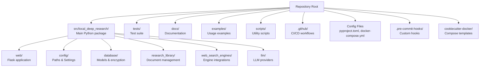
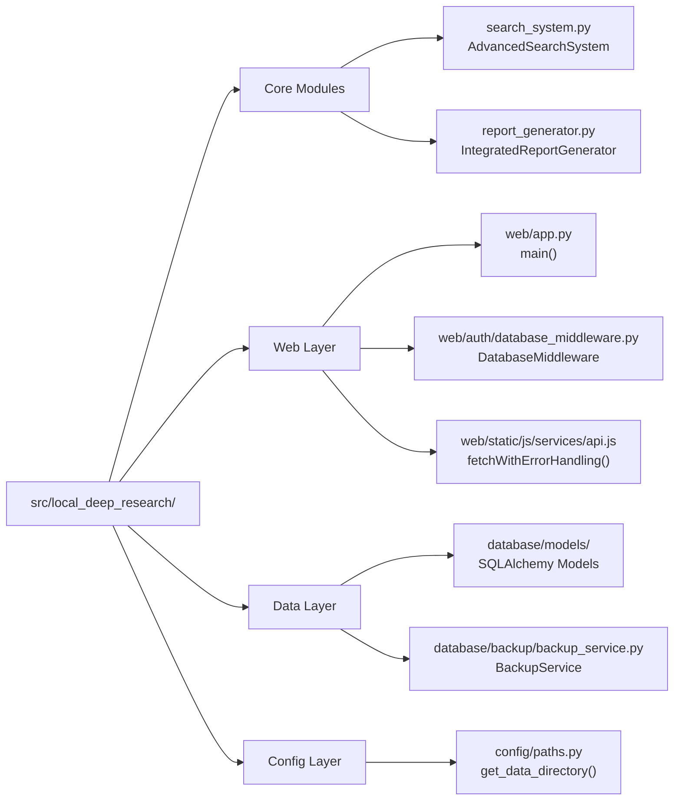
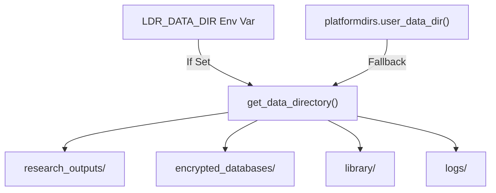

<!-- source: DeepWiki mcp.deepwiki.com · repo LearningCircuit/local-deep-research · page 7.1 Project Structure · fetched 2026-10-29 -->

# Project Structure

Relevant source files

The following files were used as context for generating this wiki page:

- [.file-whitelist.txt](.file-whitelist.txt)
- [.github/scripts/file-whitelist-check.sh](.github/scripts/file-whitelist-check.sh)
- [.gitignore](.gitignore)
- [.gitleaks.toml](.gitleaks.toml)
- [.gitleaksignore](.gitleaksignore)
- [.pre-commit-config.yaml](.pre-commit-config.yaml)
- [.pre-commit-hooks/check-absolute-module-paths.py](.pre-commit-hooks/check-absolute-module-paths.py)
- [.pre-commit-hooks/check-env-vars.py](.pre-commit-hooks/check-env-vars.py)
- [.pre-commit-hooks/custom-checks.py](.pre-commit-hooks/custom-checks.py)
- [.pre-commit-hooks/file-whitelist-check.sh](.pre-commit-hooks/file-whitelist-check.sh)
- [.pre-commit-hooks/recommend-release-notes.py](.pre-commit-hooks/recommend-release-notes.py)
- [CONTRIBUTING.md](CONTRIBUTING.md)
- [changelog.d/3670.breaking.1.md](changelog.d/3670.breaking.1.md)
- [changelog.d/3670.breaking.md](changelog.d/3670.breaking.md)
- [changelog.d/3670.feature.md](changelog.d/3670.feature.md)
- [changelog.d/3773.feature.md](changelog.d/3773.feature.md)
- [changelog.d/README.md](changelog.d/README.md)
- [docs/RELEASE_GUIDE.md](docs/RELEASE_GUIDE.md)
- [docs/security/database-backup.md](docs/security/database-backup.md)
- [pdm.lock](pdm.lock)
- [pyproject.toml](pyproject.toml)
- [src/local_deep_research/config/paths.py](src/local_deep_research/config/paths.py)
- [src/local_deep_research/database/backup/__init__.py](src/local_deep_research/database/backup/__init__.py)
- [src/local_deep_research/database/backup/backup_service.py](src/local_deep_research/database/backup/backup_service.py)
- [src/local_deep_research/settings/env_definitions/__init__.py](src/local_deep_research/settings/env_definitions/__init__.py)
- [src/local_deep_research/web/routes/globals.py](src/local_deep_research/web/routes/globals.py)
- [src/local_deep_research/web/static/js/services/api.js](src/local_deep_research/web/static/js/services/api.js)
- [tests/benchmarks/test_graders_extra_coverage.py](tests/benchmarks/test_graders_extra_coverage.py)
- [tests/core/test_citation_handler_extended.py](tests/core/test_citation_handler_extended.py)
- [tests/database/backup/test_backup_service.py](tests/database/backup/test_backup_service.py)
- [tests/hooks/test_check_env_vars.py](tests/hooks/test_check_env_vars.py)
- [tests/hooks/test_custom_checks_raw_sql.py](tests/hooks/test_custom_checks_raw_sql.py)
- [tests/infrastructure_tests/test_csrf_api.test.js](tests/infrastructure_tests/test_csrf_api.test.js)
- [tests/js/components/logpanel.test.js](tests/js/components/logpanel.test.js)
- [tests/js/services/socket.test.js](tests/js/services/socket.test.js)
- [tests/research_library/downloaders/test_html_downloader.py](tests/research_library/downloaders/test_html_downloader.py)
- [tests/security/test_absolute_module_paths_hook.py](tests/security/test_absolute_module_paths_hook.py)
- [tests/security/test_security_import_fallbacks_coverage.py](tests/security/test_security_import_fallbacks_coverage.py)
- [tests/settings/env_vars/test_env_var_usage.py](tests/settings/env_vars/test_env_var_usage.py)
- [tests/utilities/test_log_utils.py](tests/utilities/test_log_utils.py)
- [tests/utilities/test_log_utils_coverage.py](tests/utilities/test_log_utils_coverage.py)
- [tests/utilities/test_log_utils_deep_coverage.py](tests/utilities/test_log_utils_deep_coverage.py)
- [tests/utilities/test_log_utils_extended.py](tests/utilities/test_log_utils_extended.py)
- [tests/web/routes/test_globals_extended.py](tests/web/routes/test_globals_extended.py)
- [tests/web/routes/test_globals_gaps.py](tests/web/routes/test_globals_gaps.py)
- [tests/web/routes/test_research_routes_extra_coverage.py](tests/web/routes/test_research_routes_extra_coverage.py)
- [tests/web/routes/test_route_registry_extended.py](tests/web/routes/test_route_registry_extended.py)
- [tests/web/services/test_research_service.py](tests/web/services/test_research_service.py)
- [tests/web/services/test_research_service_coverage.py](tests/web/services/test_research_service_coverage.py)
- [tests/web/services/test_research_service_deep_coverage.py](tests/web/services/test_research_service_deep_coverage.py)
- [tests/web/services/test_research_service_errors.py](tests/web/services/test_research_service_errors.py)
- [tests/web/services/test_research_service_extra_coverage.py](tests/web/services/test_research_service_extra_coverage.py)
- [tests/web/services/test_research_service_lifecycle.py](tests/web/services/test_research_service_lifecycle.py)

This page documents the physical organization of the Local Deep Research repository, including directory structure, module layout, package organization, and file naming conventions. For information about specific architectural patterns or component responsibilities, see [Architecture](#3). For testing infrastructure details, see [Testing Infrastructure](#7.2).

---

## Repository Root Structure

The repository follows a standard Python package layout with additional directories for documentation, tests, CI/CD, and frontend assets.

Title: Repository Directory Layout

**Sources:** [.github/CODEOWNERS:1-100](), [.gitignore:1-100](), [pyproject.toml:143-145]()

### Top-Level Directory Table

| Directory | Purpose | Key Files |
|-----------|---------|-----------|
| `src/local_deep_research/` | Main Python package source code | `__init__.py`, `__version__.py` |
| `tests/` | Pytest test suite, UI tests, accessibility | `conftest.py`, `ui_tests/`, `puppeteer/` |
| `docs/` | Markdown documentation | `CONFIGURATION.md`, `architecture/`, `developing/` |
| `examples/` | Code examples and tutorials | `api_usage/`, `benchmarks/`, `elasticsearch/` |
| `scripts/` | Build and maintenance scripts | `pre_commit/`, `ci/`, `dev/` |
| `.github/` | GitHub Actions workflows, security policies | `workflows/`, `CODEOWNERS`, `scripts/` |
| `.pre-commit-hooks/` | Custom pre-commit hooks implementation | `check-env-vars.py`, `custom-checks.py` |
| `cookiecutter-docker/` | Docker Compose generation templates | `cookiecutter.json`, `hooks/` |
| `changelog.d/` | Towncrier news fragments for releases | `README.md`, `+slug.feature.md` |

**Sources:** [.github/CODEOWNERS:1-100](), [.gitignore:1-100](), [.pre-commit-hooks/recommend-release-notes.py:11-13]()

---

## Source Code Organization

The `src/local_deep_research/` directory contains all application code organized into functional modules.

Title: Code Entity Mapping (NL to Code)

**Sources:** [src/local_deep_research/config/paths.py:14-46](), [.github/CODEOWNERS:12-30](), [src/local_deep_research/web/static/js/services/api.js:38-72](), [src/local_deep_research/database/backup/backup_service.py:1-20](), [pyproject.toml:110-112]()

### Core Module Breakdown

| Module Path | Primary Classes/Functions | Responsibility |
|-------------|---------------------------|----------------|
| `config/paths.py` | `get_data_directory`, `get_encrypted_database_path` | Centralized path resolution for app data and DBs using `platformdirs` |
| `database/backup/` | `BackupService` | Atomic, encrypted database backups using `sqlcipher_export` |
| `web/app.py` | `main` | Entry point for the Flask web server |
| `web/static/js/` | `api.js`, `security/url-validator.js` | Frontend service layer and security validators |
| `main.py` | `main` | CLI entry point (`ldr` command) |
| `mcp.py` | `run_server` | Model Context Protocol (MCP) server entry point |

**Sources:** [src/local_deep_research/config/paths.py:14-106](), [.github/CODEOWNERS:27-28](), [src/local_deep_research/web/static/js/services/api.js:1-100](), [pyproject.toml:109-112]()

---

## Pre-Commit Hook Organization

The repository employs 26+ custom hooks to enforce security and code quality standards. These are configured in `.pre-commit-config.yaml` and implemented as Python or Shell scripts.

| Hook ID | Implementation | Purpose |
|---------|----------------|---------|
| `custom-code-checks` | `.pre-commit-hooks/custom-checks.py` | Enforces `loguru` usage, prevents raw SQL, and checks UTC datetime usage |
| `check-env-vars` | `.pre-commit-hooks/check-env-vars.py` | Ensure environment variables are accessed through `SettingsManager` |
| `check-ldr-db-usage` | `.pre-commit-hooks/check-ldr-db.py` | Prevent usage of shared `ldr.db` database in favor of encrypted per-user DBs |
| `check-datetime-timezone` | `scripts/pre_commit/check_datetime_timezone.py` | Enforces `UtcDateTime` from `sqlalchemy_utc` for all DB columns |
| `file-whitelist-check` | `.github/scripts/file-whitelist-check.sh` | Only allow approved file types and block large files (>1MB) |
| `check-pathlib-usage` | `.pre-commit-hooks/check-pathlib-usage.py` | Enforce `pathlib.Path` over `os.path` for cross-platform compatibility |
| `check-no-external-resources` | `.pre-commit-hooks/check-external-resources.py` | Prevents referencing external CDNs to maintain no-CDN policy |
| `check-css-class-prefix` | `.pre-commit-hooks/check-css-class-prefix.py` | Ensures all CSS classes are prefixed with `ldr-` |
| `gitleaks` | `.gitleaks.toml` | Sole secret scanner detecting API keys, tokens, and SQLCipher keys |
| `recommend-release-notes` | `.pre-commit-hooks/recommend-release-notes.py` | Reminds contributors to add news fragments for substantial changes |

**Sources:** [.pre-commit-config.yaml:1-161](), [.pre-commit-hooks/custom-checks.py:1-25](), [.pre-commit-hooks/check-env-vars.py:1-68](), [.github/scripts/file-whitelist-check.sh:106-130](), [.gitleaks.toml:1-69](), [.pre-commit-hooks/recommend-release-notes.py:1-13]()

---

## Configuration and Path Management

The system uses `platformdirs` to determine standard data locations, which can be overridden by environment variables. 

Title: Path Resolution Flow

**Sources:** [src/local_deep_research/config/paths.py:14-46](), [src/local_deep_research/config/paths.py:113-122]()

### Key Path Mappings

| Function | Default Location (Linux) | Environment Override |
|----------|--------------------------|----------------------|
| `get_data_directory` | `~/.local/share/local-deep-research` | `LDR_DATA_DIR` |
| `get_encrypted_database_path` | `.../encrypted_databases` | Subdirectory of `LDR_DATA_DIR` |
| `get_user_database_filename` | `ldr_user_[hash].db` | (Derived from username hash) |
| `get_library_directory` | `.../library` | Subdirectory of `LDR_DATA_DIR` |

**Sources:** [src/local_deep_research/config/paths.py:14-152](), [src/local_deep_research/config/paths.py:134-136]()

---

## Development Guidelines

*   **Cursor Rules:** The `.cursorrules` file provides context-specific instructions for AI-assisted development, ensuring path conventions and security requirements are followed.
*   **Security Baseline:** The project maintains strict security scanning via `gitleaks` for secrets and custom pre-commit hooks for infrastructure safety.
*   **Secret Management:** `gitleaks` is the sole secret scanner. It uses `.gitleaks.toml` for stable, path-based allowlists to avoid the merge conflicts associated with line-number-based scanners.
*   **File Whitelisting:** A strict whitelist approach is used in `.gitignore` and enforced by `file-whitelist-check.sh` to prevent repository bloat from binary files or large data.
*   **Coding Standards:** Enforced via `ruff` (Python) and `eslint` (JS). Raw SQL is strictly forbidden; all database access must use ORM methods.
*   **Changelog Management:** Uses `towncrier`. Contributors must add fragments to `changelog.d/` for user-facing changes. Fragments are validated by `recommend-release-notes.py` for correct category naming.

**Sources:** [.pre-commit-config.yaml:13-30](), [.pre-commit-hooks/custom-checks.py:1-10](), [.gitignore:1-38](), [.gitleaks.toml:1-9](), [.pre-commit-hooks/recommend-release-notes.py:103-141]()

---

