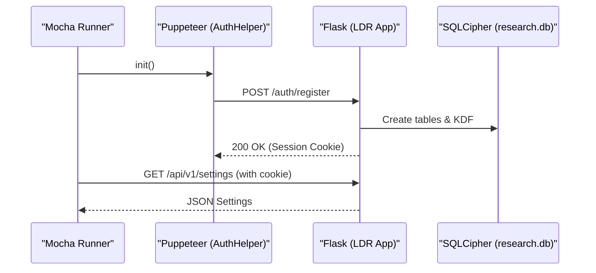

<!-- source: DeepWiki mcp.deepwiki.com · repo LearningCircuit/local-deep-research · page 7.2 Testing Infrastructure · fetched 2026-10-29 -->

# Testing Infrastructure

<details>
<summary>Relevant source files</summary>

The following files were used as context for generating this wiki page:

- [.pre-commit-hooks/check-pathlib-usage.py](.pre-commit-hooks/check-pathlib-usage.py)
- [.pre-commit-hooks/check-session-context-manager.py](.pre-commit-hooks/check-session-context-manager.py)
- [examples/benchmarks/browsecomp/run_browsecomp_fixed_v2.py](examples/benchmarks/browsecomp/run_browsecomp_fixed_v2.py)
- [examples/benchmarks/gemini/run_gemini_benchmark_fixed.py](examples/benchmarks/gemini/run_gemini_benchmark_fixed.py)
- [examples/benchmarks/scripts/run_benchmark_with_claude_grading.py](examples/benchmarks/scripts/run_benchmark_with_claude_grading.py)
- [examples/optimization/llm_multi_benchmark.py](examples/optimization/llm_multi_benchmark.py)
- [tests/api_tests/fix_search_engines.py](tests/api_tests/fix_search_engines.py)
- [tests/api_tests/migrate_research_mode.py](tests/api_tests/migrate_research_mode.py)
- [tests/api_tests/populate_search_engines.py](tests/api_tests/populate_search_engines.py)
- [tests/api_tests/run_basic_api_tests.py](tests/api_tests/run_basic_api_tests.py)
- [tests/api_tests_with_login/package-lock.json](tests/api_tests_with_login/package-lock.json)
- [tests/api_tests_with_login/package.json](tests/api_tests_with_login/package.json)
- [tests/conftest.py](tests/conftest.py)
- [tests/infrastructure_tests/package-lock.json](tests/infrastructure_tests/package-lock.json)
- [tests/infrastructure_tests/package.json](tests/infrastructure_tests/package.json)
- [tests/package-lock.json](tests/package-lock.json)
- [tests/package.json](tests/package.json)
- [tests/performance/api_auth/__init__.py](tests/performance/api_auth/__init__.py)
- [tests/performance/api_auth/conftest.py](tests/performance/api_auth/conftest.py)
- [tests/performance/api_auth/test_research_validation.py](tests/performance/api_auth/test_research_validation.py)
- [tests/performance/content_fetcher/__init__.py](tests/performance/content_fetcher/__init__.py)
- [tests/performance/content_fetcher/test_extraction_benchmark.py](tests/performance/content_fetcher/test_extraction_benchmark.py)
- [tests/performance/database/__init__.py](tests/performance/database/__init__.py)
- [tests/performance/database/scripts/__init__.py](tests/performance/database/scripts/__init__.py)
- [tests/performance/database/scripts/create_compat_db.py](tests/performance/database/scripts/create_compat_db.py)
- [tests/performance/database/test_backwards_compatibility.py](tests/performance/database/test_backwards_compatibility.py)
- [tests/performance/mcp/__init__.py](tests/performance/mcp/__init__.py)
- [tests/puppeteer/eslint.config.js](tests/puppeteer/eslint.config.js)
- [tests/puppeteer/package-lock.json](tests/puppeteer/package-lock.json)
- [tests/puppeteer/package.json](tests/puppeteer/package.json)
- [tests/run_all_tests.py](tests/run_all_tests.py)
- [tests/test_settings_manager.py](tests/test_settings_manager.py)
- [tests/ui_tests/auth_helper.js](tests/ui_tests/auth_helper.js)
- [tests/ui_tests/browser_config.js](tests/ui_tests/browser_config.js)
- [tests/ui_tests/test_api_key_inputs.js](tests/ui_tests/test_api_key_inputs.js)
- [tests/ui_tests/test_auth_flow.js](tests/ui_tests/test_auth_flow.js)
- [tests/ui_tests/test_change_password_validation.js](tests/ui_tests/test_change_password_validation.js)
- [tests/ui_tests/test_concurrent_limit.js](tests/ui_tests/test_concurrent_limit.js)
- [tests/ui_tests/test_direct_uuid_insert.py](tests/ui_tests/test_direct_uuid_insert.py)
- [tests/ui_tests/test_export_functionality.js](tests/ui_tests/test_export_functionality.js)
- [tests/ui_tests/test_metrics_full_flow.js](tests/ui_tests/test_metrics_full_flow.js)
- [tests/ui_tests/test_mixed_id_handling.py](tests/ui_tests/test_mixed_id_handling.py)
- [tests/ui_tests/test_queue_simple.js](tests/ui_tests/test_queue_simple.js)
- [tests/ui_tests/test_register_full_flow.js](tests/ui_tests/test_register_full_flow.js)
- [tests/ui_tests/test_register_validation.js](tests/ui_tests/test_register_validation.js)
- [tests/ui_tests/test_research_form_validation.js](tests/ui_tests/test_research_form_validation.js)
- [tests/ui_tests/test_research_submit.js](tests/ui_tests/test_research_submit.js)
- [tests/ui_tests/test_settings_validation.js](tests/ui_tests/test_settings_validation.js)
- [tests/ui_tests/test_trace_error.py](tests/ui_tests/test_trace_error.py)
- [tests/ui_tests/test_uuid_fresh_db.py](tests/ui_tests/test_uuid_fresh_db.py)
- [tests/ui_tests/test_uuid_research.py](tests/ui_tests/test_uuid_research.py)

</details>


This document describes the testing infrastructure for Local Deep Research, including pytest configuration, fixtures, mocking strategies, database setup, Puppeteer and Playwright UI testing, and security test suites. The project maintains a comprehensive suite of over 1700 tests across unit, integration, and end-to-end layers.

---

## Overview

Local Deep Research uses **pytest** as its primary Python testing framework and a combination of **Puppeteer** and **Mocha** for frontend and UI automation. The infrastructure is designed for high concurrency using `pytest-xdist` and strict isolation via temporary encrypted databases and singleton reset mechanisms.

**Key Features:**
- **Pytest-based** Python test framework with extensive function-scoped fixtures [tests/conftest.py:10-221]().
- **UI Testing Stack:** Puppeteer for functional UI, SSRF, and deep functionality tests [tests/puppeteer/package.json:1-35](), using `Mocha` and `Chai` for assertions [tests/puppeteer/package.json:19-22]().
- **Parallel Execution:** Support for `pytest -n auto` with unique UUID-based test users to prevent collisions [tests/conftest.py:48-54]().
- **Database Isolation:** Automatic creation of temporary SQLCipher databases per test with enforced busy timeouts [tests/conftest.py:143-157, 195-202]().
- **Mocking Infrastructure:** Centralized mock data for LLMs (Ollama, OpenAI) and search engines (arXiv, PubMed, Wikipedia, etc.) [tests/conftest.py:28-42]().
- **Security Testing:** Dedicated suites for SSRF protection, XSS prevention, and API key UI validation [tests/puppeteer/package.json:10-11]().

**Sources:** [tests/conftest.py:1-221](), [tests/puppeteer/package.json:1-35](), [tests/ui_tests/auth_helper.js:1-103]()

---

## Pytest Configuration and Markers

### Custom Markers and Environment

The test suite defines markers for conditional execution based on external dependency availability.

| Marker | Purpose | Usage |
|--------|---------|-------|
| `requires_llm` | Test requires a real LLM (not a mock/fallback) | Skipped if `LDR_TESTING_WITH_MOCKS=true` [tests/conftest.py:165-170]() |
| `integration` | Test requires live network access | Skipped by default in mock mode [tests/conftest.py:173-180]() |

The `pytest_configure` hook enforces a mock-first approach by default to ensure tests can run without API keys or local LLM instances [tests/conftest.py:148-163]().

---

## Core Python Fixtures

### Application and Database Lifecycle

#### Diagram: Test Environment Initialization

```mermaid
graph TD
    "pytest" --> "reset_all_singletons"
    "reset_all_singletons" --> "temp_data_dir"
    "temp_data_dir" --> "app_fixture"
    "app_fixture" --> "init_auth_database()"
    "app_fixture" --> "cleanup_database_connections"
    "cleanup_database_connections" --> "authenticated_client"
    
    subgraph "Isolation_Mechanisms"
        "reset_all_singletons"["reset_all_singletons<br/>Resets SocketIOService, BackgroundJobScheduler,<br/>ProviderDiscovery, etc."]
        "temp_data_dir"["temp_data_dir<br/>tempfile.mkdtemp()"]
        "cleanup_database_connections"["cleanup_database_connections<br/>db_utils.close_all_databases()"]
    end
```
**Sources:** [tests/conftest.py:56-133](), [tests/conftest.py:183-221]()

### Singleton Reset Mechanism
To support parallel testing (`pytest-xdist`), an `autouse` fixture resets global state before and after every test. This prevents state leakage between tests running on the same worker.

| Entity | Reset Target |
|--------|--------------|
| `SocketIOService` | `SocketIOService._instance = None` [tests/conftest.py:68-72]() |
| `BackgroundJobScheduler` | `background.BackgroundJobScheduler._instance.stop()`, then `None` [tests/conftest.py:77-89]() |
| `ProviderDiscovery` | `ProviderDiscovery._instance = None`, `_providers = {}` [tests/conftest.py:98-112]() |
| `AccountLockoutManager` | `account_lockout._manager = None` [tests/conftest.py:117-122]() |

**Sources:** [tests/conftest.py:56-141]()

### Database Configuration
Tests use a shorter `LDR_DB_BUSY_TIMEOUT` (5 seconds) compared to production to ensure tests fail fast during contention rather than hanging [tests/conftest.py:133-146]().

---

## UI and Frontend Testing

The project uses a multi-tier UI testing strategy primarily driven by Puppeteer.

### Puppeteer Functional Tests
Located in `tests/puppeteer/` and `tests/ui_tests/`, these tests cover critical paths like research submission, export functionality, and SSRF protection [tests/puppeteer/package.json:5-17](), [tests/ui_tests/test_export_functionality.js:53-113]().

#### Auth Helper and Performance Tracking
UI tests utilize a custom `AuthHelper` to handle the complexity of SQLCipher-backed registration, which involves CPU-intensive key derivation (KDF) and table creation (58+ tables) [tests/ui_tests/auth_helper.js:61-64]().

A `Timer` class tracks specific milestones during UI interactions to identify performance regressions in CI [tests/ui_tests/auth_helper.js:11-37]().

```javascript
const AUTH_CONFIG = {
    timeouts: {
        navigation: process.env.CI ? 60000 : 30000,
        submitNavigation: process.env.CI ? 60000 : 60000 // Fast KDF allows shorter timeout
    },
    ci: { 
        waitUntil: 'domcontentloaded', 
        maxLoginAttempts: 10,
        maxNavigationRetries: 3
    }
};
```
[tests/ui_tests/auth_helper.js:52-87]()

### Test Execution Profiles
The `tests/run_all_tests.py` script provides different profiles for running the suite [tests/run_all_tests.py:11-18]():

| Profile | Description |
|---------|-------------|
| `fast` | Quick health checks and unit tests (< 30s) |
| `standard` | Standard development testing (< 5min) |
| `full` | Optimized full testing, no redundant runs (< 10min) |
| `ci` | CI/CD optimized tests |

**Sources:** [tests/run_all_tests.py:1-18]()

---

## API Testing with Authentication

The `tests/api_tests_with_login/` directory contains integration tests that require a valid session. These tests use Puppeteer to establish a session and then execute API requests against the running Flask app [tests/api_tests_with_login/package.json:1-33]().

### Diagram: API Test Flow


**Sources:** [tests/api_tests_with_login/package.json:5-17](), [tests/ui_tests/auth_helper.js:52-87]()

---

## Mocking Strategies

### Search Engine Mocks
The system provides fixtures to mock responses from over a dozen search providers. These are centralized in `tests/conftest.py` and imported from `mock_fixtures.py`.

| Fixture Name | Target Service |
|--------------|----------------|
| `get_mock_arxiv_response` | arXiv API [tests/conftest.py:30-30]() |
| `get_mock_pubmed_response` | PubMed API [tests/conftest.py:36-36]() |
| `get_mock_wikipedia_response` | Wikipedia API [tests/conftest.py:41-41]() |
| `get_mock_google_pse_response` | Google Programmable Search [tests/conftest.py:33-33]() |

### LLM Response Mocks
LLM interactions are mocked via `get_mock_ollama_response` to avoid external API costs and latency during standard CI runs [tests/conftest.py:34-34]().

---

## Test Organization

The project organizes its 1700+ tests into a structured hierarchy:

```text
tests/
├── api_tests/              # REST API unit tests
├── api_tests_with_login/   # Authenticated API integration tests [tests/api_tests_with_login/package.json:1-33]
├── infrastructure_tests/   # Environment and deployment validation
├── puppeteer/              # Functional UI, Deep, and SSRF protection tests [tests/puppeteer/package.json:1-35]
├── ui_tests/               # Comprehensive UI flow and responsive tests
└── conftest.py             # Global pytest configuration and fixtures [tests/conftest.py:1-221]
```

**Sources:** [tests/api_tests_with_login/package.json:1-33](), [tests/puppeteer/package.json:1-35](), [tests/conftest.py:1-221]()

---

