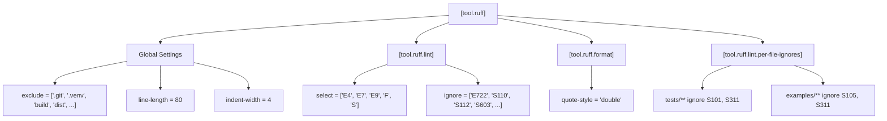
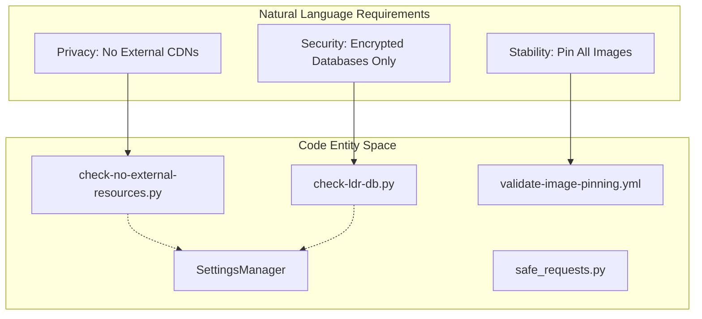
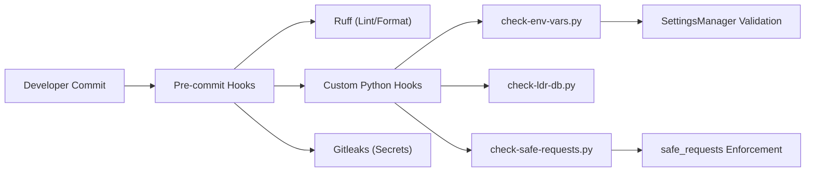

<!-- source: DeepWiki mcp.deepwiki.com · repo LearningCircuit/local-deep-research · page 7.3 Code Quality and Static Analysis · fetched 2026-10-29 -->

# Code Quality and Static Analysis

Relevant source files

The following files were used as context for generating this wiki page:

- [.file-whitelist.txt](.file-whitelist.txt)
- [.github/scripts/file-whitelist-check.sh](.github/scripts/file-whitelist-check.sh)
- [.gitignore](.gitignore)
- [.gitleaks.toml](.gitleaks.toml)
- [.gitleaksignore](.gitleaksignore)
- [.pre-commit-config.yaml](.pre-commit-config.yaml)
- [.pre-commit-hooks/check-absolute-module-paths.py](.pre-commit-hooks/check-absolute-module-paths.py)
- [.pre-commit-hooks/check-deprecated-db.py](.pre-commit-hooks/check-deprecated-db.py)
- [.pre-commit-hooks/check-env-vars.py](.pre-commit-hooks/check-env-vars.py)
- [.pre-commit-hooks/check-ldr-db.py](.pre-commit-hooks/check-ldr-db.py)
- [.pre-commit-hooks/check-service-context-managers.py](.pre-commit-hooks/check-service-context-managers.py)
- [.pre-commit-hooks/custom-checks.py](.pre-commit-hooks/custom-checks.py)
- [.pre-commit-hooks/file-whitelist-check.sh](.pre-commit-hooks/file-whitelist-check.sh)
- [.pre-commit-hooks/recommend-release-notes.py](.pre-commit-hooks/recommend-release-notes.py)
- [CONTRIBUTING.md](CONTRIBUTING.md)
- [changelog.d/3670.breaking.1.md](changelog.d/3670.breaking.1.md)
- [changelog.d/3670.breaking.md](changelog.d/3670.breaking.md)
- [changelog.d/3670.feature.md](changelog.d/3670.feature.md)
- [changelog.d/3773.feature.md](changelog.d/3773.feature.md)
- [changelog.d/README.md](changelog.d/README.md)
- [docs/RELEASE_GUIDE.md](docs/RELEASE_GUIDE.md)
- [docs/security/database-backup.md](docs/security/database-backup.md)
- [pdm.lock](pdm.lock)
- [pyproject.toml](pyproject.toml)
- [src/local_deep_research/config/paths.py](src/local_deep_research/config/paths.py)
- [src/local_deep_research/database/backup/__init__.py](src/local_deep_research/database/backup/__init__.py)
- [src/local_deep_research/database/backup/backup_service.py](src/local_deep_research/database/backup/backup_service.py)
- [src/local_deep_research/news/core/card_factory.py](src/local_deep_research/news/core/card_factory.py)
- [src/local_deep_research/news/core/search_integration.py](src/local_deep_research/news/core/search_integration.py)
- [src/local_deep_research/news/recommender/topic_based.py](src/local_deep_research/news/recommender/topic_based.py)
- [src/local_deep_research/settings/env_definitions/__init__.py](src/local_deep_research/settings/env_definitions/__init__.py)
- [src/local_deep_research/web/auth/cleanup_middleware.py](src/local_deep_research/web/auth/cleanup_middleware.py)
- [src/local_deep_research/web/auth/database_middleware.py](src/local_deep_research/web/auth/database_middleware.py)
- [src/local_deep_research/web/auth/queue_middleware.py](src/local_deep_research/web/auth/queue_middleware.py)
- [src/local_deep_research/web/auth/queue_middleware_v2.py](src/local_deep_research/web/auth/queue_middleware_v2.py)
- [src/local_deep_research/web/routes/globals.py](src/local_deep_research/web/routes/globals.py)
- [src/local_deep_research/web/static/js/services/api.js](src/local_deep_research/web/static/js/services/api.js)
- [tests/auth_tests/test_auth_decorators.py](tests/auth_tests/test_auth_decorators.py)
- [tests/benchmarks/test_graders_extra_coverage.py](tests/benchmarks/test_graders_extra_coverage.py)
- [tests/core/test_citation_handler_extended.py](tests/core/test_citation_handler_extended.py)
- [tests/database/backup/test_backup_service.py](tests/database/backup/test_backup_service.py)
- [tests/hooks/test_check_deprecated_db.py](tests/hooks/test_check_deprecated_db.py)
- [tests/hooks/test_check_env_vars.py](tests/hooks/test_check_env_vars.py)
- [tests/hooks/test_custom_checks_raw_sql.py](tests/hooks/test_custom_checks_raw_sql.py)
- [tests/infrastructure_tests/test_csrf_api.test.js](tests/infrastructure_tests/test_csrf_api.test.js)
- [tests/js/components/logpanel.test.js](tests/js/components/logpanel.test.js)
- [tests/js/services/socket.test.js](tests/js/services/socket.test.js)
- [tests/research_library/downloaders/test_html_downloader.py](tests/research_library/downloaders/test_html_downloader.py)
- [tests/security/test_absolute_module_paths_hook.py](tests/security/test_absolute_module_paths_hook.py)
- [tests/security/test_security_import_fallbacks_coverage.py](tests/security/test_security_import_fallbacks_coverage.py)
- [tests/settings/env_vars/test_env_var_usage.py](tests/settings/env_vars/test_env_var_usage.py)
- [tests/utilities/test_log_utils.py](tests/utilities/test_log_utils.py)
- [tests/utilities/test_log_utils_coverage.py](tests/utilities/test_log_utils_coverage.py)
- [tests/utilities/test_log_utils_deep_coverage.py](tests/utilities/test_log_utils_deep_coverage.py)
- [tests/utilities/test_log_utils_extended.py](tests/utilities/test_log_utils_extended.py)
- [tests/utilities/test_search_utilities_extended.py](tests/utilities/test_search_utilities_extended.py)
- [tests/web/auth/test_cleanup_middleware.py](tests/web/auth/test_cleanup_middleware.py)
- [tests/web/auth/test_database_middleware.py](tests/web/auth/test_database_middleware.py)
- [tests/web/auth/test_queue_middleware.py](tests/web/auth/test_queue_middleware.py)
- [tests/web/auth/test_session_cleanup.py](tests/web/auth/test_session_cleanup.py)
- [tests/web/routes/test_globals_extended.py](tests/web/routes/test_globals_extended.py)
- [tests/web/routes/test_globals_gaps.py](tests/web/routes/test_globals_gaps.py)
- [tests/web/routes/test_research_routes_extra_coverage.py](tests/web/routes/test_research_routes_extra_coverage.py)
- [tests/web/routes/test_route_registry_extended.py](tests/web/routes/test_route_registry_extended.py)
- [tests/web/services/test_research_service.py](tests/web/services/test_research_service.py)
- [tests/web/services/test_research_service_coverage.py](tests/web/services/test_research_service_coverage.py)
- [tests/web/services/test_research_service_deep_coverage.py](tests/web/services/test_research_service_deep_coverage.py)
- [tests/web/services/test_research_service_errors.py](tests/web/services/test_research_service_errors.py)
- [tests/web/services/test_research_service_extra_coverage.py](tests/web/services/test_research_service_extra_coverage.py)
- [tests/web/services/test_research_service_lifecycle.py](tests/web/services/test_research_service_lifecycle.py)
- [tests/web/utils/test_rate_limiter_ip.py](tests/web/utils/test_rate_limiter_ip.py)

This page documents the static analysis tools and automated checks that enforce code quality, type safety, and security linting in the Local Deep Research codebase. The system relies on a multi-layered approach involving Ruff, ESLint, Mypy, Semgrep, and a suite of 26 custom pre-commit hooks that enforce project-specific architectural and security constraints.

All tools are integrated into the pre-commit hook system, ensuring that code quality gates are passed before every commit.

---

## Ruff: Linting and Formatting

Ruff serves as the primary Python linter and formatter. It is configured to maintain strict standards across the codebase, replacing multiple older tools with a single, high-performance engine.

**Ruff Configuration Structure**

Sources: `pyproject.toml:222-250`(), `.pre-commit-config.yaml:48-56`()

### Core Linting Rules
Ruff is configured to automatically fix issues where possible using the `--fix` argument in the pre-commit hook [[.pre-commit-config.yaml:54]](). It specifically targets:
*   **Security (Bandit)**: Scans for hardcoded passwords, unsafe `subprocess` usage, and weak cryptographic primitives.
*   **Logical Errors (Pyflakes)**: Catches unused imports, undefined variables, and syntax errors.
*   **Style (pycodestyle)**: Enforces basic PEP 8 compliance.

---

## Type Checking: Mypy

The project enforces static typing across the `src/` directory using Mypy. This ensures that data structures, particularly research settings and database models, are used consistently. The project uses `pdm` to manage `mypy` and its associated type stubs like `types-requests` and `types-flask` [[pyproject.toml:171-174]]().

**Mypy Execution Flow**
*   **Configuration**: Rules are defined in `pyproject.toml`.
*   **Environment**: Requires a full PDM sync to resolve type stubs for dependencies.
*   **CI Enforcement**: Type checking is a mandatory gate in the CI pipeline, ensuring no type regressions reach the main branch.

Sources: `pyproject.toml:171-174`(), `.pre-commit-config.yaml:171-174`()

---

## Frontend Linting: ESLint

JavaScript and module files are linted using ESLint with a focus on security and modern standards.

**ESLint Security Configuration**
*   **Execution**: Runs as a local hook to resolve plugins from the project's `node_modules` (mirrors-eslint is avoided to ensure flat config compatibility) [[.pre-commit-config.yaml:37-45]]().
*   **Configuration**: Uses `eslint.config.js` for modern flat config support [[.pre-commit-config.yaml:44]]().
*   **Scope**: Targets `.js` and `.mjs` files while excluding `node_modules`, `dist`, and minified assets [[.pre-commit-config.yaml:46-47]]().

Sources: `.pre-commit-config.yaml:37-47`()

---

## Custom Pre-commit Hooks

The project utilizes 26 custom hooks to enforce architectural boundaries and project-specific security constraints. These hooks are primarily implemented as Python scripts in the `.pre-commit-hooks/` directory.

### Architectural Enforcement Hooks

| Hook ID | Implementation | Purpose |
|---|---|---|
| `check-env-vars` | `.pre-commit-hooks/check-env-vars.py` | Ensures environment variables are accessed through `SettingsManager` instead of `os.environ` to maintain a single source of truth [[.pre-commit-hooks/check-env-vars.py:70-183]](). |
| `custom-code-checks` | `.pre-commit-hooks/custom-checks.py` | Enforces `loguru` usage over standard `logging`, UTC datetimes, and prevents raw SQL usage in favor of ORM methods [[.pre-commit-hooks/custom-checks.py:23-180]](). |
| `check-ldr-db-usage` | `.pre-commit-hooks/check-ldr-db.py` | Blocks usage of shared `ldr.db`; enforces per-user encrypted databases [[.pre-commit-config.yaml:92-98]](). |
| `check-pathlib-usage` | `.pre-commit-hooks/check-pathlib-usage.py` | Enforces `pathlib.Path` over `os.path` for better cross-platform compatibility [[.pre-commit-config.yaml:141-147]](). |
| `check-session-context-manager` | `.pre-commit-hooks/check-session-context-manager.py` | Ensures SQLAlchemy sessions use context managers instead of try/finally blocks [[.pre-commit-config.yaml:126-132]](). |
| `check-settings-manager-thread-safety` | `.pre-commit-hooks/check-settings-manager-thread-safety.py` | Ensures `get_settings_manager()` passes `db_session` in background-thread code [[.pre-commit-config.yaml:133-140]](). |
| `check-datetime-timezone` | `scripts/pre_commit/check_datetime_timezone.py` | Enforces `UtcDateTime` from `sqlalchemy_utc` for all DB columns [[.pre-commit-config.yaml:120-125]](). |

Sources: `.pre-commit-config.yaml:64-147`(), `.pre-commit-hooks/check-env-vars.py:21-68`(), `.pre-commit-hooks/custom-checks.py:1-10`()

### Security and Resource Hooks

| Hook ID | Implementation | Purpose |
|---|---|---|
| `check-url-security` | `.pre-commit-hooks/check-url-security.py` | Ensures JS code validates URLs to prevent XSS and SSRF [[.pre-commit-config.yaml:171-175]](). |
| `check-sensitive-logging`| `.pre-commit-hooks/check-sensitive-logging.py` | Scans for potential PII or secrets in log statements [[.pre-commit-config.yaml:164-170]](). |
| `check-no-external-resources`| `.pre-commit-hooks/check-external-resources.py` | Enforces the "no-CDN" policy for privacy and offline support [[.pre-commit-config.yaml:148-155]](). |
| `check-css-class-prefix`| `.pre-commit-hooks/check-css-class-prefix.py` | Enforces the `ldr-` prefix for all custom CSS classes [[.pre-commit-config.yaml:156-163]](). |
| `file-whitelist-check` | `.pre-commit-hooks/file-whitelist-check.sh` | Enforces a whitelist approach to file types and sizes using `.file-whitelist.txt` [[.pre-commit-hooks/file-whitelist-check.sh:5-18]](). |
| `check-safe-requests` | `.pre-commit-hooks/check-safe-requests.py` | Enforces use of `safe_requests` wrapper for all outgoing HTTP calls [[.pre-commit-config.yaml:176-180]](). |

Sources: `.pre-commit-config.yaml:148-180`(), `.pre-commit-hooks/file-whitelist-check.sh:26-50`()

---

## Semgrep and Secret Scanning

### Semgrep Custom Rules
The codebase uses Semgrep for semantic analysis, with custom rules stored in `.semgrep/rules/`.
*   **LDR Security**: Custom patterns target project-specific vulnerabilities such as incorrect SQLCipher PRAGMA order or unsafe session handling.
*   **Safe Requests**: Rules enforce usage of the internal `safe_requests` utilities to prevent SSRF.

### Gitleaks Secret Detection
Gitleaks is the primary secret scanner, replacing `detect-secrets` to avoid merge conflicts from line-number-based baselines [[.gitleaks.toml:3-8]]().
*   **Configuration**: Uses `.gitleaks.toml` for path/regex-based allowlists [[.gitleaks.toml:11-69]]().
*   **Custom Rules**: Includes specific patterns for GitHub tokens, Google API keys, Brave Search keys, and SQLCipher keys [[.gitleaks.toml:15-56]]().
*   **Allowlist**: Extensive allowlist excludes common false positives like SHA256 hashes in `pdm.lock`, test credentials in `tests/`, and documentation examples [[.gitleaks.toml:71-158]]().

Sources: `.gitleaks.toml:1-158`(), `.pre-commit-config.yaml:13-30`()

---

## Code Quality Gates and CI Workflows

The system bridges natural language requirements (like "No CDNs") to code entities through automated verification scripts.

**Automated Review and Validation Pipeline**

### Security Gates and Enforcement
The project employs several specialized CI workflows to ensure code quality and security:
1.  **File Whitelist**: Pull requests are scanned via `.github/scripts/file-whitelist-check.sh` to ensure no unauthorized file types or oversized binaries (>1MB) are committed [[.github/scripts/file-whitelist-check.sh:119-125]]().
2.  **Environment Variable Integrity**: `check-env-vars.py` ensures all `LDR_` prefixed variables are accessed via `SettingsManager`, preventing fragmented configuration [[.pre-commit-hooks/check-env-vars.py:158-165]]().
3.  **Release Notes Nudge**: `recommend-release-notes.py` reminds contributors to add news fragments to `changelog.d/` for substantial changes (>20 lines) [[.pre-commit-hooks/recommend-release-notes.py:25-26]]().

**Static Analysis Data Flow**

Sources: `.github/scripts/file-whitelist-check.sh:1-125`(), `.pre-commit-hooks/check-env-vars.py:1-183`(), `.pre-commit-hooks/recommend-release-notes.py:1-200`()

---

