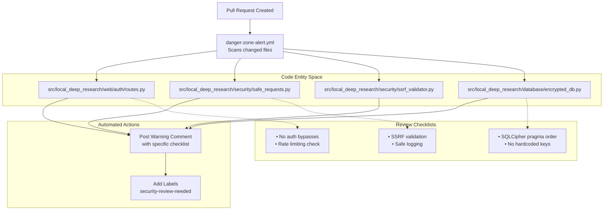
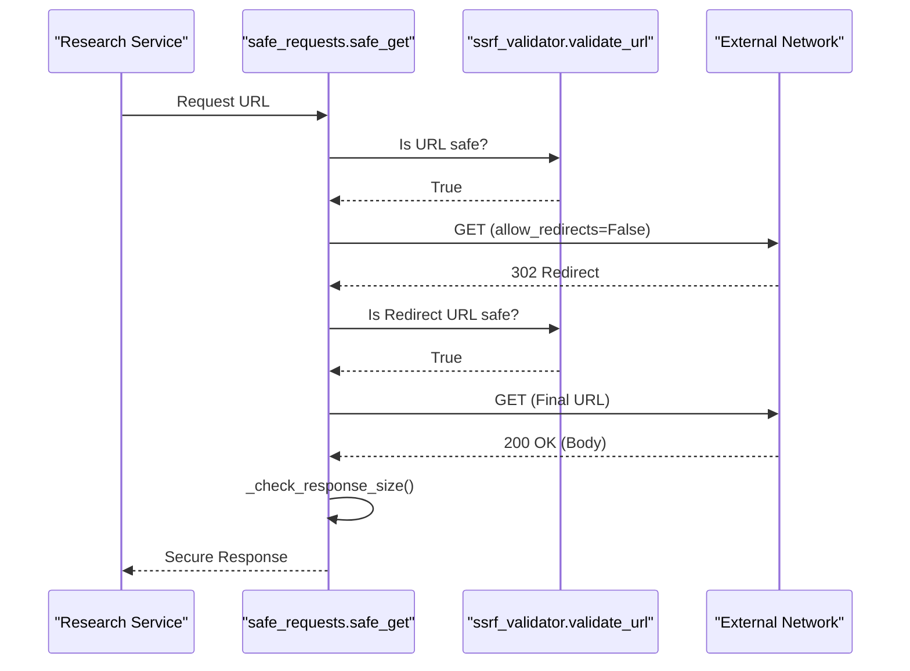

<!-- source: DeepWiki mcp.deepwiki.com · repo LearningCircuit/local-deep-research · page 7.4 Security Best Practices · fetched 2026-10-29 -->

# Security Best Practices

Relevant source files

The following files were used as context for generating this wiki page:

- [.pre-commit-hooks/check-url-security.py](.pre-commit-hooks/check-url-security.py)
- [SECURITY.md](SECURITY.md)
- [docs/NOTIFICATIONS.md](docs/NOTIFICATIONS.md)
- [src/local_deep_research/notifications/manager.py](src/local_deep_research/notifications/manager.py)
- [src/local_deep_research/notifications/service.py](src/local_deep_research/notifications/service.py)
- [src/local_deep_research/security/account_lockout.py](src/local_deep_research/security/account_lockout.py)
- [src/local_deep_research/security/log_sanitizer.py](src/local_deep_research/security/log_sanitizer.py)
- [src/local_deep_research/security/notification_validator.py](src/local_deep_research/security/notification_validator.py)
- [src/local_deep_research/security/safe_requests.py](src/local_deep_research/security/safe_requests.py)
- [src/local_deep_research/security/ssrf_validator.py](src/local_deep_research/security/ssrf_validator.py)
- [src/local_deep_research/security/url_validator.py](src/local_deep_research/security/url_validator.py)
- [src/local_deep_research/settings/env_definitions/security.py](src/local_deep_research/settings/env_definitions/security.py)
- [src/local_deep_research/web/auth/routes.py](src/local_deep_research/web/auth/routes.py)
- [tests/api_tests/test_all_apis.py](tests/api_tests/test_all_apis.py)
- [tests/auth_tests/test_auth_rate_limiting.py](tests/auth_tests/test_auth_rate_limiting.py)
- [tests/content_fetcher/test_mcp_integration.py](tests/content_fetcher/test_mcp_integration.py)
- [tests/hooks/test_check_url_security.py](tests/hooks/test_check_url_security.py)
- [tests/notifications/conftest.py](tests/notifications/conftest.py)
- [tests/notifications/test_manager.py](tests/notifications/test_manager.py)
- [tests/notifications/test_service.py](tests/notifications/test_service.py)
- [tests/security/test_account_lockout.py](tests/security/test_account_lockout.py)
- [tests/security/test_api_security.py](tests/security/test_api_security.py)
- [tests/security/test_auth_security.py](tests/security/test_auth_security.py)
- [tests/security/test_cookie_security.py](tests/security/test_cookie_security.py)
- [tests/security/test_csrf_protection.py](tests/security/test_csrf_protection.py)
- [tests/security/test_input_validation.py](tests/security/test_input_validation.py)
- [tests/security/test_log_sanitizer.py](tests/security/test_log_sanitizer.py)
- [tests/security/test_network_utils.py](tests/security/test_network_utils.py)
- [tests/security/test_notification_validator.py](tests/security/test_notification_validator.py)
- [tests/security/test_rate_limiter.py](tests/security/test_rate_limiter.py)
- [tests/security/test_safe_requests.py](tests/security/test_safe_requests.py)
- [tests/security/test_ssrf_redirect_bypass.py](tests/security/test_ssrf_redirect_bypass.py)
- [tests/security/test_ssrf_response_size.py](tests/security/test_ssrf_response_size.py)
- [tests/security/test_ssrf_validator.py](tests/security/test_ssrf_validator.py)
- [tests/security/test_ssrf_validator_behavior.py](tests/security/test_ssrf_validator_behavior.py)
- [tests/security/test_ssrf_validator_extended.py](tests/security/test_ssrf_validator_extended.py)
- [tests/security/test_ssrf_validator_high_value.py](tests/security/test_ssrf_validator_high_value.py)
- [tests/security/test_url_validator_behavior.py](tests/security/test_url_validator_behavior.py)
- [tests/security/test_xss_prevention.py](tests/security/test_xss_prevention.py)
- [tests/web/auth/test_auth_routes.py](tests/web/auth/test_auth_routes.py)
- [tests/web/routes/__init__.py](tests/web/routes/__init__.py)
- [tests/web/routes/test_api_routes.py](tests/web/routes/test_api_routes.py)
- [tests/web/services/test_notification_coverage.py](tests/web/services/test_notification_coverage.py)

## Purpose and Scope

This page documents security best practices for contributors to Local Deep Research. It covers the security review process, critical security patterns (SSRF, XSS, CSRF), input validation, SQLCipher implementation details, and account lockout mechanisms. The codebase prioritizes encryption-at-rest, SSRF prevention, and strict input validation to maintain its privacy-focused, zero-knowledge architecture.

---

## Security Review Process

The repository uses an automated system to flag PRs that modify security-critical files. This provides warnings and checklists to ensure that changes to authentication, encryption, or core security logic undergo rigorous scrutiny.

### Automatic Detection Flow

**Sources:** [src/local_deep_research/web/auth/routes.py:1-43](), [src/local_deep_research/security/safe_requests.py:1-28](), [src/local_deep_research/security/ssrf_validator.py:1-22]()

---

## Critical Security Patterns

### SSRF Protection (`safe_requests` and `ssrf_validator`)

Local Deep Research enforces strict Server-Side Request Forgery (SSRF) protection for all outbound HTTP requests. This is critical as the application fetches data from user-provided URLs and third-party search engines.

#### SSRF Validation Logic
The `validate_url` function in `ssrf_validator.py` performs the following checks:
1.  **Scheme Check:** Only `http` and `https` are permitted [src/local_deep_research/security/ssrf_validator.py:21-21](), [src/local_deep_research/security/ssrf_validator.py:136-140]().
2.  **IP Blocklist:** Hostnames are resolved to IPs and checked against `BLOCKED_IP_RANGES` [src/local_deep_research/security/ssrf_validator.py:14-15](), [src/local_deep_research/security/ssrf_validator.py:164-185]().
3.  **AWS Metadata Protection:** The AWS metadata IP (`169.254.169.254`) is explicitly and always blocked [src/local_deep_research/security/ssrf_validator.py:18-18](), [src/local_deep_research/security/ssrf_validator.py:78-79]().
4.  **Private Network Restrictions:** Loopback and private RFC1918 ranges are blocked by default unless `allow_private_ips` is True for trusted internal services like Ollama [src/local_deep_research/security/ssrf_validator.py:52-67](), [src/local_deep_research/security/ssrf_validator.py:85-89]().

#### Safe Request Execution
The `safe_get` function wraps the `requests` library with additional guards:
*   **Manual Redirect Handling:** Standard `requests` auto-redirects are disabled. Each hop is manually validated against SSRF rules [src/local_deep_research/security/safe_requests.py:177-195]().
*   **Response Size Guard:** A `MAX_RESPONSE_SIZE` (1GB) is enforced to prevent memory exhaustion [src/local_deep_research/security/safe_requests.py:27-27]().
*   **Bounded Reader:** The `_install_body_guard` function wraps the raw reader to terminate connections if the size limit is exceeded during streaming [src/local_deep_research/security/safe_requests.py:44-70]().
*   **User-Agent Injection:** Identifies the project to academic API endpoints (arXiv, PubMed, etc.) [src/local_deep_research/security/safe_requests.py:35-41]().

**Sources:** [src/local_deep_research/security/safe_requests.py:1-183](), [src/local_deep_research/security/ssrf_validator.py:1-188]()

---

### Notification Security and Webhooks

Outbound notifications via Apprise carry a residual SSRF risk due to a DNS-rebinding TOCTOU window. To mitigate this, the system implements multi-layered gates.

| Security Layer | Implementation | Purpose |
| :--- | :--- | :--- |
| **Master Switch** | `LDR_NOTIFICATIONS_ALLOW_OUTBOUND` | Env-only gate; disables outbound requests by default [src/local_deep_research/notifications/manager.py:103-105](). |
| **URL Validation** | `NotificationURLValidator` | Blocks unsafe schemes (`file`, `data`, `javascript`) and private IPs [src/local_deep_research/security/notification_validator.py:28-58](). |
| **Private IP Toggle** | `LDR_NOTIFICATIONS_ALLOW_PRIVATE_IPS` | Env-only switch to allow local network notifications [src/local_deep_research/notifications/manager.py:93-95](). |
| **Service Isolation** | `NotificationService` | Enforces master switch and performs validation before every send [src/local_deep_research/notifications/service.py:154-161](). |

**Sources:** [src/local_deep_research/notifications/manager.py:86-110](), [src/local_deep_research/security/notification_validator.py:24-59](), [src/local_deep_research/notifications/service.py:149-180]()

---

### File Write Verification

To maintain the encryption-at-rest model, unencrypted file writes are strictly controlled. The system uses a "default-deny" approach for writing user data to disk.

*   **`write_file_verified`**: Checks a specific configuration setting (e.g., `api.allow_file_output`) before performing a write [src/local_deep_research/security/file_write_verifier.py:64-128]().
*   **`write_json_verified`**: Automatically redacts sensitive keys (passwords, API keys) from dictionaries before serialization [src/local_deep_research/security/file_write_verifier.py:130-180]().
*   **Sensitive Keys**: `SENSITIVE_KEYS` includes `api_key`, `secret`, `token`, `credentials`, etc [src/local_deep_research/security/file_write_verifier.py:14-32]().
*   **Automated Scanning**: The `.github/scripts/check-file-writes.sh` script scans for unauthorized uses of `open()`, `.write()`, or `Path.write_text()` in the codebase [github/scripts/check-file-writes.sh:13-40]().

**Sources:** [src/local_deep_research/security/file_write_verifier.py:1-180](), [.github/scripts/check-file-writes.sh:1-217]()

---

### Input Validation and XSS Prevention

*   **URL Sanitization:** `URLValidator` identifies unsafe schemes (e.g., `javascript:`, `data:`, `file:`) and suspicious patterns like double encoding, null bytes, or HTML entity encoding [src/local_deep_research/security/url_validator.py:24-31](), [src/local_deep_research/security/url_validator.py:162-188]().
*   **Log Sanitization:** `sanitize_for_log` redacts sensitive information before writing to system logs to prevent log injection or accidental secret leakage [src/local_deep_research/web/auth/routes.py:109-111]().
*   **Pre-commit Validation:** The `check-url-security.py` hook scans JavaScript files for `.href` or `.src` assignments lacking `URLValidator` calls [ .pre-commit-hooks/check-url-security.py:64-99]().

**Sources:** [src/local_deep_research/security/url_validator.py:1-230](), [src/local_deep_research/web/auth/routes.py:109-111](), [.pre-commit-hooks/check-url-security.py:1-181]()

---

## Authentication and Web Security

### Account Lockout and Brute Force Prevention
The system implements a robust lockout mechanism to prevent credential stuffing:
*   **`AccountLockoutManager`**: Records failures and successes per username via `record_failure` and `record_success` [src/local_deep_research/web/auth/routes.py:147-159]().
*   **Lockout Check**: The login route checks `lockout_mgr.is_locked(username)` before verifying credentials [src/local_deep_research/web/auth/routes.py:107-117]().
*   **Rate Limiting**: Custom decorators like `@login_limit` restrict login attempts per IP [src/local_deep_research/web/auth/routes.py:86-87]().
*   **Session Management**: `session.clear()` is called during login to prevent session fixation [src/local_deep_research/web/auth/routes.py:162-162]().

### CSRF Protection
*   **Flask-WTF**: All POST requests require a CSRF token.
*   **Token Endpoint**: A dedicated `/auth/csrf-token` endpoint allows frontend components to fetch tokens programmatically [src/local_deep_research/web/auth/routes.py:47-60]().

### SQLCipher Encryption
*   **Password-Derived Keys**: Per-user databases are encrypted using the login password via PBKDF2-HMAC-SHA512 with 256,000 iterations [SECURITY.md:59-62]().
*   **Error Handling**: `DatabaseInitializationError` is handled specifically to avoid locking users out for server-side configuration issues (like world-writable migration directories) while still failing securely [src/local_deep_research/web/auth/routes.py:126-143]().
*   **Memory Security**: The `cipher_memory_security` pragma can be enabled via `LDR_DB_CONFIG_CIPHER_MEMORY_SECURITY=ON` to zero internal buffers and prevent swapping, requiring `IPC_LOCK` capability in Docker [SECURITY.md:75-106]().

**Sources:** [src/local_deep_research/web/auth/routes.py:47-175](), [SECURITY.md:59-106]()

---

## Security Testing

The codebase includes comprehensive security tests to verify these protections:
*   **CSRF Tests**: `TestGetCsrfToken` ensures tokens are generated and returned correctly [tests/web/auth/test_auth_routes.py:21-41]().
*   **Login Security**: Tests for 400 errors on missing fields, 401 on invalid credentials, and 503 on DB init failures [tests/web/auth/test_auth_routes.py:103-191]().
*   **OWASP Top 10**: `TestAPISecurityOWASPTop10` verifies protections against BOLA, broken authentication, and mass assignment [tests/security/test_api_security.py:14-103]().
*   **SSRF Response Guard**: `TestSafeGetResponseSize` verifies that oversized payloads are rejected and connections closed even if `Content-Length` headers are malformed or missing [tests/security/test_ssrf_response_size.py:34-194]().

**Sources:** [tests/web/auth/test_auth_routes.py:1-191](), [tests/security/test_api_security.py:1-103](), [tests/security/test_ssrf_response_size.py:1-194]()

---

