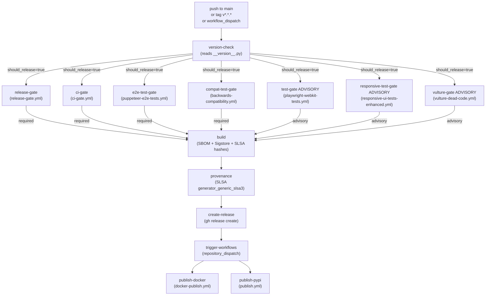
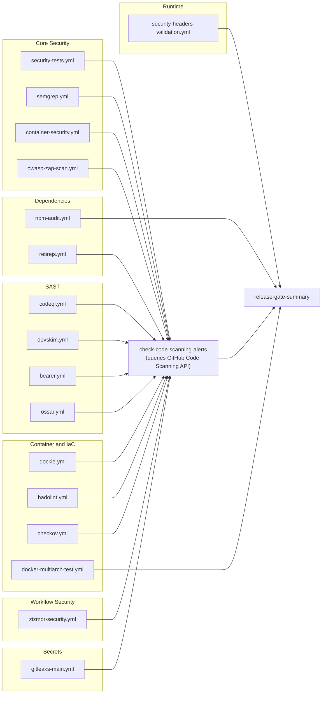
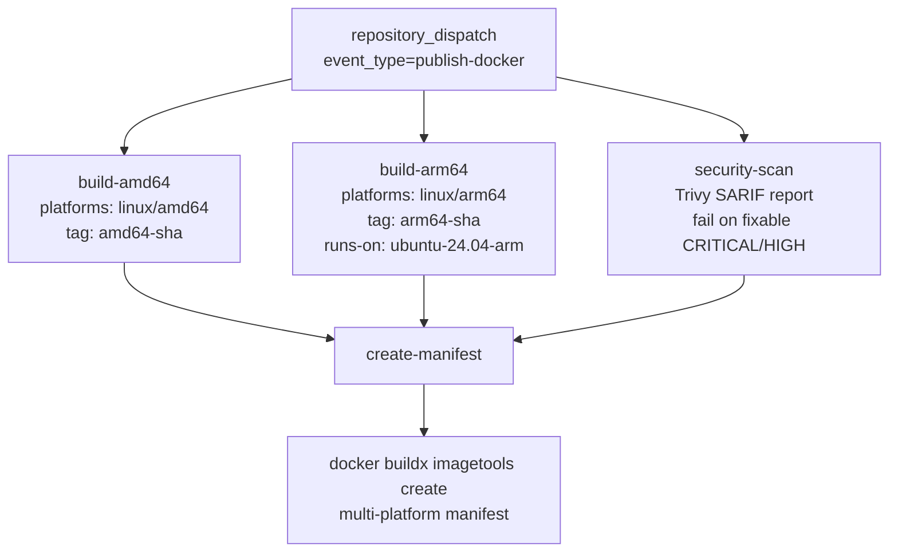
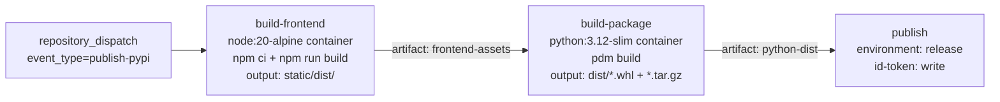

<!-- source: DeepWiki mcp.deepwiki.com · repo LearningCircuit/local-deep-research · page 8 CI/CD and Release Pipeline · fetched 2026-10-29 -->

# CI/CD and Release Pipeline

<details>
<summary>Relevant source files</summary>

The following files were used as context for generating this wiki page:

- [.github/release.yml](.github/release.yml)
- [.github/workflows/README.md](.github/workflows/README.md)
- [.github/workflows/advanced-search-reminder.yml](.github/workflows/advanced-search-reminder.yml)
- [.github/workflows/ai-code-reviewer.yml](.github/workflows/ai-code-reviewer.yml)
- [.github/workflows/backwards-compatibility.yml](.github/workflows/backwards-compatibility.yml)
- [.github/workflows/bearer.yml](.github/workflows/bearer.yml)
- [.github/workflows/check-env-vars.yml](.github/workflows/check-env-vars.yml)
- [.github/workflows/checkov.yml](.github/workflows/checkov.yml)
- [.github/workflows/claude-code-review.yml](.github/workflows/claude-code-review.yml)
- [.github/workflows/codeql.yml](.github/workflows/codeql.yml)
- [.github/workflows/container-security.yml](.github/workflows/container-security.yml)
- [.github/workflows/danger-zone-alert.yml](.github/workflows/danger-zone-alert.yml)
- [.github/workflows/devskim.yml](.github/workflows/devskim.yml)
- [.github/workflows/docker-multiarch-test.yml](.github/workflows/docker-multiarch-test.yml)
- [.github/workflows/docker-publish.yml](.github/workflows/docker-publish.yml)
- [.github/workflows/docker-tests.yml](.github/workflows/docker-tests.yml)
- [.github/workflows/dockle.yml](.github/workflows/dockle.yml)
- [.github/workflows/e2e-research-test.yml](.github/workflows/e2e-research-test.yml)
- [.github/workflows/file-whitelist-check.yml](.github/workflows/file-whitelist-check.yml)
- [.github/workflows/fuzz.yml](.github/workflows/fuzz.yml)
- [.github/workflows/gitleaks.yml](.github/workflows/gitleaks.yml)
- [.github/workflows/grype.yml](.github/workflows/grype.yml)
- [.github/workflows/hadolint.yml](.github/workflows/hadolint.yml)
- [.github/workflows/label-fixed-in-dev.yml](.github/workflows/label-fixed-in-dev.yml)
- [.github/workflows/mypy-type-check.yml](.github/workflows/mypy-type-check.yml)
- [.github/workflows/npm-audit.yml](.github/workflows/npm-audit.yml)
- [.github/workflows/nuclei.yml](.github/workflows/nuclei.yml)
- [.github/workflows/ossf-scorecard.yml](.github/workflows/ossf-scorecard.yml)
- [.github/workflows/owasp-zap-scan.yml](.github/workflows/owasp-zap-scan.yml)
- [.github/workflows/playwright-webkit-tests.yml](.github/workflows/playwright-webkit-tests.yml)
- [.github/workflows/pre-commit.yml](.github/workflows/pre-commit.yml)
- [.github/workflows/publish.yml](.github/workflows/publish.yml)
- [.github/workflows/puppeteer-e2e-tests.yml](.github/workflows/puppeteer-e2e-tests.yml)
- [.github/workflows/release-gate.yml](.github/workflows/release-gate.yml)
- [.github/workflows/release.yml](.github/workflows/release.yml)
- [.github/workflows/responsive-ui-tests-enhanced.yml](.github/workflows/responsive-ui-tests-enhanced.yml)
- [.github/workflows/retirejs.yml](.github/workflows/retirejs.yml)
- [.github/workflows/sbom.yml](.github/workflows/sbom.yml)
- [.github/workflows/security-file-write-check.yml](.github/workflows/security-file-write-check.yml)
- [.github/workflows/security-headers-validation.yml](.github/workflows/security-headers-validation.yml)
- [.github/workflows/security-tests.yml](.github/workflows/security-tests.yml)
- [.github/workflows/semgrep.yml](.github/workflows/semgrep.yml)
- [.github/workflows/sync-main-to-dev.yml](.github/workflows/sync-main-to-dev.yml)
- [.github/workflows/update-dependencies.yml](.github/workflows/update-dependencies.yml)
- [.github/workflows/update-npm-dependencies.yml](.github/workflows/update-npm-dependencies.yml)
- [.github/workflows/update-precommit-hooks.yml](.github/workflows/update-precommit-hooks.yml)
- [.github/workflows/validate-image-pinning.yml](.github/workflows/validate-image-pinning.yml)
- [.github/workflows/version_check.yml](.github/workflows/version_check.yml)
- [.github/workflows/zizmor-security.yml](.github/workflows/zizmor-security.yml)

</details>


This page covers the GitHub Actions workflow ecosystem for Local Deep Research: how code flows from a pull request through quality gates to a published release. It describes the orchestration workflow, gate structure, version management, Docker publishing, PyPI publishing, and automated maintenance schedules.

For details on individual security scanning tools (Bandit, CodeQL, OWASP ZAP, etc.) referenced here, see [Security Scanning Infrastructure](#8.2). For information on the test suite itself, see [Continuous Integration Workflows](#8.1).

---

## Workflow Architecture

All workflows live in `.github/workflows/`. The ecosystem follows a hub-and-spoke model: `release.yml` is the orchestrator, and it calls specialized reusable workflows (`workflow_call`) via aggregator gates.

**Diagram: Release Pipeline Overview**



Sources: [.github/workflows/release.yml:1-180](), [.github/workflows/release.yml:197-451]()

---

## Version Management

The version source of truth is `src/local_deep_research/__version__.py`. The `package.json` version is kept in sync automatically.

### Auto-Bump Workflow

`version_check.yml` triggers on every push to `main` that modifies source files, and opens a PR against `main` with the bumped version. It uses the `pdm-bump` plugin.

| Input | Bump type |
|---|---|
| Automatic (push to main) | `patch` |
| `workflow_dispatch` with `minor` | `minor` |
| `workflow_dispatch` with `major` | `major` |

The job skips itself when the triggering commit already contains `chore: auto-bump version` to prevent infinite loops [[.github/workflows/version_check.yml:42]]().

After bumping, `package.json` is updated with `jq` to keep the NPM version field in sync [[.github/workflows/version_check.yml:119-121]]().

### Release Trigger Logic

The `version-check` job in `release.yml` reads `__version__.py`, extracts the version, and checks whether a GitHub release for that tag already exists using `gh release view`. If it does, `should_release=false` is set and no further jobs run. Tag pushes and `workflow_dispatch` bypass this check and always proceed [[.github/workflows/release.yml:57-79]]().

```bash
VERSION=$(grep -oP '(?<=__version__ = ")[^"]*' src/local_deep_research/__version__.py)
TAG="v${VERSION}"
```

Sources: [.github/workflows/version_check.yml:1-180](), [.github/workflows/release.yml:28-79]()

---

## Gate Structure

The `build` job's `if` condition explicitly lists which gates are blocking. Failure in any required gate prevents the release from proceeding.

```yaml
if: >-
  !cancelled() &&
  needs.release-gate.result == 'success' &&
  needs.ci-gate.result == 'success' &&
  needs.e2e-test-gate.result == 'success' &&
  needs.compat-test-gate.result == 'success'
```
[[.github/workflows/release.yml:197-202]]()

| Gate job | Workflow called | Blocking? |
|---|---|---|
| `release-gate` | `release-gate.yml` | **Yes** |
| `ci-gate` | `ci-gate.yml` | **Yes** |
| `e2e-test-gate` | `puppeteer-e2e-tests.yml` | **Yes** |
| `compat-test-gate` | `backwards-compatibility.yml` | **Yes** |
| `test-gate` | `playwright-webkit-tests.yml` | No (advisory) |
| `responsive-test-gate` | `responsive-ui-tests-enhanced.yml` | No (advisory) |
| `vulture-gate` | `vulture-dead-code.yml` | No (advisory) |

Advisory gates run in parallel but their failure does not prevent the release. This is intentional for tests that detect cosmetic rendering differences (like `responsive-ui-tests-enhanced.yml`) where fixes are not urgent [[.github/workflows/release.yml:120-133]]().

Sources: [.github/workflows/release.yml:93-197](), [.github/workflows/responsive-ui-tests-enhanced.yml:1-11]()

---

## Security Gate (`release-gate.yml`)

`release-gate.yml` is a reusable workflow aggregator. It calls 17+ individual security scan workflows and then checks the GitHub Code Scanning API for open alerts.

**Diagram: Security Gate Job Graph**



The `owasp-zap-scan.yml` workflow executes both baseline and API scans against a live instance of the `local_deep_research.web.app` server [[.github/workflows/owasp-zap-scan.yml:56-85]](). Similarly, `zizmor-security.yml` audits the security posture of the GitHub Actions themselves [[.github/workflows/zizmor-security.yml:35-41]]().

For details on security infrastructure, see [Security Scanning Infrastructure](#8.2).

Sources: [.github/workflows/owasp-zap-scan.yml:1-203](), [.github/workflows/zizmor-security.yml:1-66]()

---

## Build Job: SBOM and Supply Chain Artifacts

If all required gates pass, the `build` job in `release.yml` runs to generate supply chain security artifacts:

1. **SBOM generation** — Trivy generates SBOM files (SPDX/CycloneDX).
2. **Sigstore signing** — Cosign signs artifacts using keyless signing (GitHub OIDC).
3. **SLSA hash generation** — SHA256 hashes of all artifacts are passed to the `provenance` job.

The `provenance` job calls `slsa-framework/slsa-github-generator` at SLSA level 3 to produce `provenance.intoto.jsonl` [[.github/workflows/release.yml:384-393]](). The `create-release` job assembles all artifacts and calls `gh release create` with auto-generated release notes [[.github/workflows/release.yml:395-406]]().

Sources: [.github/workflows/release.yml:265-393]()

---

## Publishing Trigger Model

Publishing to Docker Hub and PyPI is **not** triggered by creating a GitHub release through the UI. It is triggered exclusively by `repository_dispatch` events sent from `trigger-workflows` in `release.yml`. This design prevents bypassing the security gate [[.github/workflows/release.yml:89-91]]().

```yaml
- name: Trigger Publishing Workflows
  uses: actions/github-script@ed597411d8f924073f98dfc5c65a23a2325f34cd # v8.0.0
  with:
    script: |
      github.rest.repos.createDispatchEvent({
        owner: context.repo.owner,
        repo: context.repo.repo,
        event_type: 'publish-docker',
        client_payload: { ... }
      });
```
[[.github/workflows/release.yml:408-440]]()

---

## Docker Publishing (`docker-publish.yml`)

The Docker pipeline builds multi-arch images (AMD64 and ARM64) and performs a final security scan before manifest creation.

**Diagram: Docker Publish Job Sequence**



The `security-scan` job uses Trivy to check for fixable HIGH/CRITICAL vulnerabilities and uploads a SARIF report to the GitHub Security tab [[.github/workflows/docker-publish.yml:147-175]]().

For details, see [Docker Image Publishing](#8.4).

Sources: [.github/workflows/docker-publish.yml:1-393]()

---

## PyPI Publishing (`publish.yml`)

The PyPI publishing workflow uses an isolated three-job structure to ensure frontend assets are correctly bundled.

**Diagram: PyPI Publish Job Chain**



The `build-frontend` job executes the Vite build and verifies the `manifest.json` location at `src/local_deep_research/web/static/dist/.vite/manifest.json` [[.github/workflows/publish.yml:73-95]](). The `build-package` job downloads these assets before running `pdm build` to ensure the wheel contains the UI [[.github/workflows/publish.yml:141-148]]().

For details, see [PyPI Package Publishing](#8.5).

Sources: [.github/workflows/publish.yml:1-466]()

---

## Automated Maintenance

Workflows run on schedules to keep dependencies and security metadata current.

| Workflow | File | Schedule | Purpose |
|---|---|---|---|
| Update PDM dependencies | `update-dependencies.yml` | Wednesday 08:00 UTC | Bump Python deps in `pdm.lock` |
| Update NPM dependencies | `update-npm-dependencies.yml` | Thursday 08:00 UTC | Bump JS deps in `package-lock.json` |
| Update pre-commit hooks | `update-precommit-hooks.yml` | Friday 08:00 UTC | Bump hook versions |
| Zizmor Security Scan | `zizmor-security.yml` | Monday 09:00 UTC | Weekly GitHub Actions security audit [[.github/workflows/zizmor-security.yml:8]]() |
| File Whitelist Check | `file-whitelist-check.yml` | On PR | Ensures no unauthorized file types enter the repo [[.github/workflows/file-whitelist-check.yml:46-47]]() |

For details, see [Automated Dependency Maintenance](#8.6).

---

## Security Design Principles

The pipeline is designed so that the release process is immutable and verified:

1. **No Manual Publishing**: Publishing jobs are triggered **only** via `repository_dispatch`. They have no `workflow_dispatch` trigger [[.github/workflows/docker-publish.yml:3-9]](), [[.github/workflows/publish.yml:3-9]]().
2. **Commit Pinning**: All GitHub Actions are pinned to exact commit SHAs (e.g., `actions/checkout@de0fac2e4500dabe0009e67214ff5f5447ce83dd`) to prevent supply chain attacks.
3. **Runner Hardening**: All jobs use `step-security/harden-runner` with `egress-policy: audit` to log and control outbound network calls [[.github/workflows/release.yml:36]]().
4. **Least Privilege**: Minimal top-level `permissions: {}` is declared on each workflow, with jobs defining only the specific permissions they need [[.github/workflows/release.yml:11]]().
5. **Path Filtering**: Workflows like `docker-tests.yml` use `dorny/paths-filter` to optimize resource usage by only running jobs relevant to the changed files [[.github/workflows/docker-tests.yml:57-91]]().

Sources: [.github/workflows/release.yml:1-20](), [.github/workflows/docker-publish.yml:1-11](), [.github/workflows/publish.yml:1-11](), [.github/workflows/docker-tests.yml:39-92]()

---

