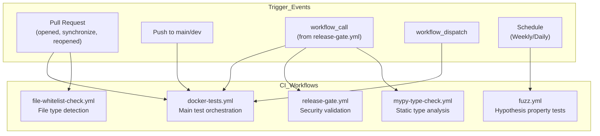
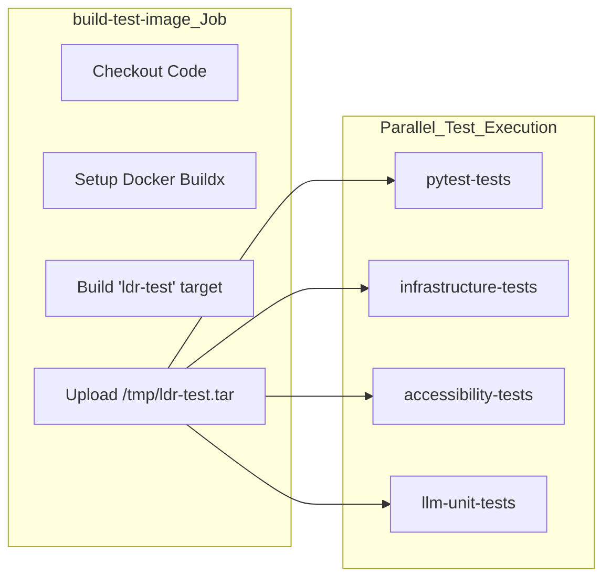
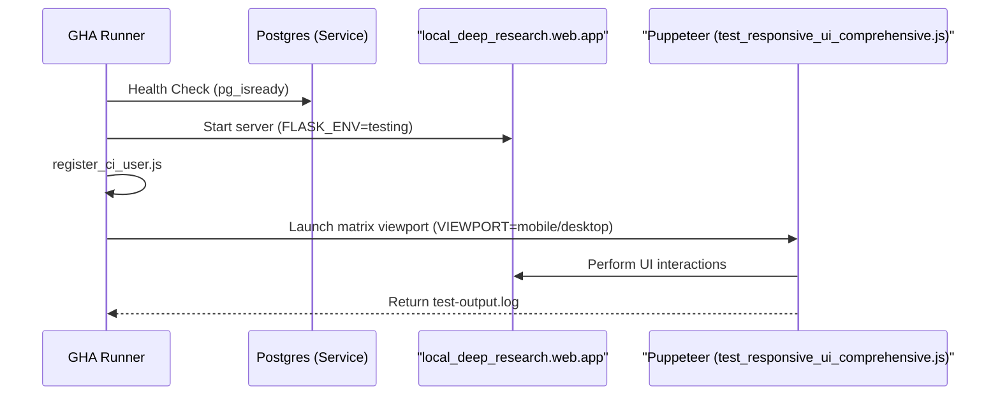
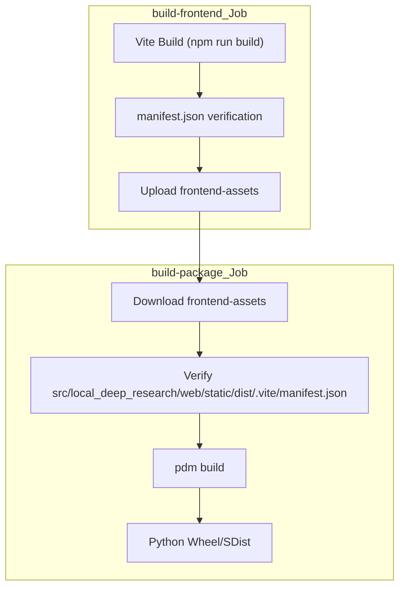

<!-- source: DeepWiki mcp.deepwiki.com · repo LearningCircuit/local-deep-research · page 8.1 Continuous Integration Workflows · fetched 2026-10-29 -->

# Continuous Integration Workflows

Relevant source files

The following files were used as context for generating this wiki page:

- [.github/release.yml](.github/release.yml)
- [.github/workflows/README.md](.github/workflows/README.md)
- [.github/workflows/advanced-search-reminder.yml](.github/workflows/advanced-search-reminder.yml)
- [.github/workflows/ai-code-reviewer.yml](.github/workflows/ai-code-reviewer.yml)
- [.github/workflows/backwards-compatibility.yml](.github/workflows/backwards-compatibility.yml)
- [.github/workflows/check-env-vars.yml](.github/workflows/check-env-vars.yml)
- [.github/workflows/claude-code-review.yml](.github/workflows/claude-code-review.yml)
- [.github/workflows/danger-zone-alert.yml](.github/workflows/danger-zone-alert.yml)
- [.github/workflows/docker-multiarch-test.yml](.github/workflows/docker-multiarch-test.yml)
- [.github/workflows/docker-publish.yml](.github/workflows/docker-publish.yml)
- [.github/workflows/docker-tests.yml](.github/workflows/docker-tests.yml)
- [.github/workflows/e2e-research-test.yml](.github/workflows/e2e-research-test.yml)
- [.github/workflows/file-whitelist-check.yml](.github/workflows/file-whitelist-check.yml)
- [.github/workflows/fuzz.yml](.github/workflows/fuzz.yml)
- [.github/workflows/gitleaks.yml](.github/workflows/gitleaks.yml)
- [.github/workflows/label-fixed-in-dev.yml](.github/workflows/label-fixed-in-dev.yml)
- [.github/workflows/mypy-type-check.yml](.github/workflows/mypy-type-check.yml)
- [.github/workflows/npm-audit.yml](.github/workflows/npm-audit.yml)
- [.github/workflows/owasp-zap-scan.yml](.github/workflows/owasp-zap-scan.yml)
- [.github/workflows/playwright-webkit-tests.yml](.github/workflows/playwright-webkit-tests.yml)
- [.github/workflows/pre-commit.yml](.github/workflows/pre-commit.yml)
- [.github/workflows/publish.yml](.github/workflows/publish.yml)
- [.github/workflows/puppeteer-e2e-tests.yml](.github/workflows/puppeteer-e2e-tests.yml)
- [.github/workflows/release-gate.yml](.github/workflows/release-gate.yml)
- [.github/workflows/release.yml](.github/workflows/release.yml)
- [.github/workflows/responsive-ui-tests-enhanced.yml](.github/workflows/responsive-ui-tests-enhanced.yml)
- [.github/workflows/sbom.yml](.github/workflows/sbom.yml)
- [.github/workflows/security-file-write-check.yml](.github/workflows/security-file-write-check.yml)
- [.github/workflows/security-headers-validation.yml](.github/workflows/security-headers-validation.yml)
- [.github/workflows/sync-main-to-dev.yml](.github/workflows/sync-main-to-dev.yml)
- [.github/workflows/update-dependencies.yml](.github/workflows/update-dependencies.yml)
- [.github/workflows/update-npm-dependencies.yml](.github/workflows/update-npm-dependencies.yml)
- [.github/workflows/update-precommit-hooks.yml](.github/workflows/update-precommit-hooks.yml)
- [.github/workflows/validate-image-pinning.yml](.github/workflows/validate-image-pinning.yml)
- [.github/workflows/version_check.yml](.github/workflows/version_check.yml)
- [.github/workflows/zizmor-security.yml](.github/workflows/zizmor-security.yml)
- [Dockerfile](Dockerfile)
- [cookiecutter-docker/cookiecutter.json](cookiecutter-docker/cookiecutter.json)
- [cookiecutter-docker/hooks/post_gen_project.py](cookiecutter-docker/hooks/post_gen_project.py)
- [cookiecutter-docker/hooks/pre_prompt.py](cookiecutter-docker/hooks/pre_prompt.py)
- [cookiecutter-docker/{{cookiecutter.config_name}}/docker-compose.{{cookiecutter.config_name}}.yml](cookiecutter-docker/{{cookiecutter.config_name}}/docker-compose.{{cookiecutter.config_name}}.yml)
- [docker-compose.yml](docker-compose.yml)
- [scripts/.gitkeep](scripts/.gitkeep)
- [scripts/ollama_entrypoint.sh](scripts/ollama_entrypoint.sh)
- [tests/api_tests_with_login/puppeteer_config.js](tests/api_tests_with_login/puppeteer_config.js)
- [tests/ui_tests/puppeteer_config.js](tests/ui_tests/puppeteer_config.js)
- [tests/ui_tests/test_login_validation.js](tests/ui_tests/test_login_validation.js)

## Purpose and Scope

This document details the continuous integration (CI) workflows that automate testing, Docker image construction, and code quality validation for every pull request and push to the `main` or `dev` branches. The CI architecture ensures code correctness across Python and JavaScript components, maintains high test coverage, and enforces security standards before code is merged.

The system utilizes a "Build Once, Test Many" strategy, where a single test-ready Docker image is built and shared across parallel specialized test jobs.

## Workflow Architecture

The CI system is composed of several modular GitHub Actions workflows. The primary orchestrator for testing is `docker-tests.yml`, while `release.yml` orchestrates production readiness.

### Workflow Trigger Events

"Trigger Events to CI Workflows Mapping"

Sources: [.github/workflows/docker-tests.yml:3-24](), [.github/workflows/release.yml:93-118](), [.github/workflows/fuzz.yml:3-12](), [.github/workflows/file-whitelist-check.yml:4-14]()

### Permission Model

All workflows implement the principle of least privilege. Top-level permissions are set to `{}`, with specific jobs elevating permissions only when necessary.

| Permission | Scope | Jobs Requiring Elevation |
|------------|-------|--------------------------|
| `contents: read` | Default | Most jobs |
| `contents: write` | Elevation | `pytest-tests` (for gh-pages deployment), `release.yml` (for tag creation), `version-bump` |
| `pull-requests: write` | Elevation | `pytest-tests` (for coverage comments), `ai-code-reviewer`, `sync-main-to-dev` |
| `security-events: write` | Elevation | `security-scan` (for SARIF upload), `release-gate`, `zizmor-scan`, `owasp-zap-scan` |
| `id-token: write` | Elevation | `create-manifest` (for Sigstore signing), `claude-review` |

Sources: [.github/workflows/docker-tests.yml:32-32](), [.github/workflows/docker-publish.yml:18-19](), [.github/workflows/docker-publish.yml:183-183](), [.github/workflows/release.yml:11-11](), [.github/workflows/claude-code-review.yml:21-25](), [.github/workflows/version_check.yml:43-45](), [.github/workflows/zizmor-security.yml:18-21]()

## Build Once, Test Many Strategy

To ensure environment parity and reduce total CI time, the system builds a single `ldr-test` Docker image and exports it as a workflow artifact.

### Docker Test Image Pipeline

"Build Once Test Many Execution Flow"

The `Dockerfile` defines the `ldr-test` stage specifically for this purpose, including dependencies for both Python `pytest` and Node.js-based infrastructure testing.

Sources: [.github/workflows/docker-tests.yml:94-132](), [.github/workflows/docker-tests.yml:135-162](), [Dockerfile:105-169]()

## Path-Based Filtering

The `detect-changes` job uses `dorny/paths-filter` to optimize CI by skipping irrelevant tests based on modified files.

| Filter Name | Paths Monitored | Impact |
|-------------|-----------------|--------|
| `llm` | `src/.../llm/**`, `src/.../config/llm_config.py`, `tests/test_llm/**` | Triggers LLM unit and example tests |
| `infrastructure` | `src/.../web/routes/**`, `src/.../web/static/js/**`, `tests/infrastructure_tests/**` | Triggers JavaScript infrastructure tests |
| `docker` | `Dockerfile`, `scripts/*.sh`, `pdm.lock`, `package.json` | Triggers production smoke tests |
| `accessibility` | `src/.../web/templates/**`, `src/.../web/static/css/**`, `tests/accessibility_tests/**` | Triggers accessibility audit tests |

Sources: [.github/workflows/docker-tests.yml:40-91]()

## Test Suites Implementation

### 1. Pytest and Coverage
The `pytest-tests` job executes the core Python logic tests. It uses the pre-built Docker image to ensure environment consistency.

- **Mocking**: `LDR_TESTING_WITH_MOCKS=true` ensures tests do not attempt real network calls to LLM providers [[.github/workflows/docker-tests.yml:185]]().
- **Environment**: `PYTHONPATH=/app/src` is set to ensure the package is correctly importable within the container [[.github/workflows/docker-tests.yml:187]]().
- **Coverage**: Generates both XML and HTML reports using `pytest-cov`, which are then used for PR comments and GitHub Pages deployment [[.github/workflows/docker-tests.yml:192-194]]().

### 2. UI and Responsive Testing
UI tests use Puppeteer to interact with a live Flask server. The `Responsive UI Tests` workflow specifically targets mobile and desktop viewports using a matrix strategy.

"UI Test Environment Lifecycle"

Sources: [.github/workflows/responsive-ui-tests-enhanced.yml:23-40](), [.github/workflows/responsive-ui-tests-enhanced.yml:114-145](), [.github/workflows/responsive-ui-tests-enhanced.yml:151-161]()

### 3. Security and Release Gates
The `release.yml` workflow acts as the final orchestrator for production readiness, implementing several "gates" that must pass before a release is finalized.

- **Version Check**: A lightweight job reads `src/local_deep_research/__version__.py` and checks if a GitHub release for that tag already exists [[.github/workflows/release.yml:28-79]]().
- **Security Gate**: Runs 17 security checks (SAST, Secret detection, etc.) via `release-gate.yml` [[.github/workflows/release.yml:93-102]]().
- **E2E Gate**: Required functional tests using `puppeteer-e2e-tests.yml` with real API keys [[.github/workflows/release.yml:140-152]]().
- **Docker Publish**: Triggered via `repository_dispatch` only after all gates pass, preventing bypass of security checks [[.github/workflows/docker-publish.yml:3-9]]().

Sources: [.github/workflows/release.yml:21-152](), [.github/workflows/docker-publish.yml:1-9]()

## Automated Maintenance and Reviews

### AI Code Review
The repository integrates two AI-driven review workflows:
1. **AI Code Reviewer**: Triggered on PR open or `ai_code_review` label. It fetches the PR diff and uses a thinking model (e.g., `moonshotai/kimi-k2-thinking`) to post comments and add labels [[.github/workflows/ai-code-reviewer.yml:1-162]]().
2. **Claude Code Review**: An opt-in workflow triggered by the `claude-review` label, utilizing `anthropics/claude-code-action` [[.github/workflows/claude-code-review.yml:1-51]]().

### Security Monitoring
- **Zizmor Security**: Scans GitHub Actions workflows for template injection, over-privileged tokens, and unpinned actions [[.github/workflows/zizmor-security.yml:1-65]]().
- **OWASP ZAP**: Performs baseline and API security scans against a running instance of the application [[.github/workflows/owasp-zap-scan.yml:1-207]]().
- **Fuzzing**: Weekly `Hypothesis` fuzz tests target security and utility modules to find edge-case crashes [[.github/workflows/fuzz.yml:1-83]]().
- **File Whitelist**: Validates that no unauthorized file types are introduced in PRs [[.github/workflows/file-whitelist-check.yml:1-47]]().

Sources: [.github/workflows/zizmor-security.yml:50-59](), [.github/workflows/owasp-zap-scan.yml:78-86](), [.github/workflows/fuzz.yml:3-12](), [.github/workflows/ai-code-reviewer.yml:1-6]()

## Release and Publishing

The publishing process is strictly gated and utilizes a "Build Once" approach for artifacts.

### PyPI Publishing Workflow
The `publish.yml` workflow separates frontend and backend builds to ensure clean integration.

"PyPI Publishing Data Flow"

Sources: [.github/workflows/publish.yml:15-115](), [.github/workflows/publish.yml:117-180]()

### Docker Publishing Workflow
The `docker-publish.yml` workflow builds multi-architecture images (`amd64` and `arm64`) and performs a final security scan before creating the manifest.

- **Multi-arch Build**: Uses `docker/build-push-action` with `linux/amd64` and `linux/arm64` platforms [[.github/workflows/docker-publish.yml:44-53, 87-96]]().
- **Final Security Scan**: Runs `aquasecurity/trivy-action` on the built image, failing on fixable `HIGH` or `CRITICAL` vulnerabilities [[.github/workflows/docker-publish.yml:147-166]]().
- **Manifest Creation**: Combines architecture-specific images into a single tag and signs them using Cosign [[.github/workflows/docker-publish.yml:176-199]]().

Sources: [.github/workflows/docker-publish.yml:13-199]()

## Automated Versioning
The `version_check.yml` workflow automates version bumping after merges to `main`.

- **Auto-Bump**: Detects if a version bump is needed and creates a PR with the updated `__version__.py` and `package.json` [[.github/workflows/version_check.yml:69-123]]().
- **Documentation**: Regenerates configuration documentation using `scripts/generate_config_docs.py` as part of the bump [[.github/workflows/version_check.yml:124-126]]().

Sources: [.github/workflows/version_check.yml:1-180]()

---

