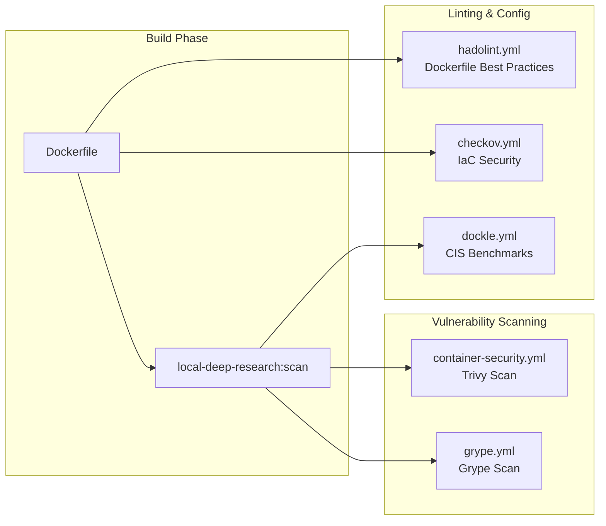
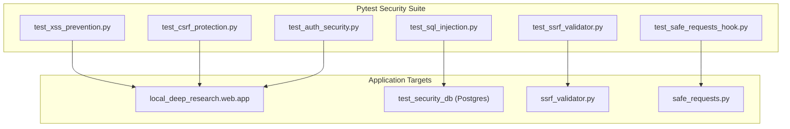

<!-- source: DeepWiki mcp.deepwiki.com · repo LearningCircuit/local-deep-research · page 8.2 Security Scanning Infrastructure · fetched 2026-10-29 -->

# Security Scanning Infrastructure

<details>
<summary>Relevant source files</summary>

The following files were used as context for generating this wiki page:

- [.github/release.yml](.github/release.yml)
- [.github/workflows/README.md](.github/workflows/README.md)
- [.github/workflows/advanced-search-reminder.yml](.github/workflows/advanced-search-reminder.yml)
- [.github/workflows/ai-code-reviewer.yml](.github/workflows/ai-code-reviewer.yml)
- [.github/workflows/backwards-compatibility.yml](.github/workflows/backwards-compatibility.yml)
- [.github/workflows/bearer.yml](.github/workflows/bearer.yml)
- [.github/workflows/check-env-vars.yml](.github/workflows/check-env-vars.yml)
- [.github/workflows/checkov.yml](.github/workflows/checkov.yml)
- [.github/workflows/claude-code-review.yml](.github/workflows/claude-code-review.yml)
- [.github/workflows/codeql.yml](.github/workflows/codeql.yml)
- [.github/workflows/container-security.yml](.github/workflows/container-security.yml)
- [.github/workflows/danger-zone-alert.yml](.github/workflows/danger-zone-alert.yml)
- [.github/workflows/devskim.yml](.github/workflows/devskim.yml)
- [.github/workflows/docker-multiarch-test.yml](.github/workflows/docker-multiarch-test.yml)
- [.github/workflows/docker-publish.yml](.github/workflows/docker-publish.yml)
- [.github/workflows/docker-tests.yml](.github/workflows/docker-tests.yml)
- [.github/workflows/dockle.yml](.github/workflows/dockle.yml)
- [.github/workflows/e2e-research-test.yml](.github/workflows/e2e-research-test.yml)
- [.github/workflows/file-whitelist-check.yml](.github/workflows/file-whitelist-check.yml)
- [.github/workflows/fuzz.yml](.github/workflows/fuzz.yml)
- [.github/workflows/gitleaks.yml](.github/workflows/gitleaks.yml)
- [.github/workflows/grype.yml](.github/workflows/grype.yml)
- [.github/workflows/hadolint.yml](.github/workflows/hadolint.yml)
- [.github/workflows/label-fixed-in-dev.yml](.github/workflows/label-fixed-in-dev.yml)
- [.github/workflows/mypy-type-check.yml](.github/workflows/mypy-type-check.yml)
- [.github/workflows/npm-audit.yml](.github/workflows/npm-audit.yml)
- [.github/workflows/nuclei.yml](.github/workflows/nuclei.yml)
- [.github/workflows/ossf-scorecard.yml](.github/workflows/ossf-scorecard.yml)
- [.github/workflows/owasp-zap-scan.yml](.github/workflows/owasp-zap-scan.yml)
- [.github/workflows/playwright-webkit-tests.yml](.github/workflows/playwright-webkit-tests.yml)
- [.github/workflows/pre-commit.yml](.github/workflows/pre-commit.yml)
- [.github/workflows/publish.yml](.github/workflows/publish.yml)
- [.github/workflows/puppeteer-e2e-tests.yml](.github/workflows/puppeteer-e2e-tests.yml)
- [.github/workflows/release-gate.yml](.github/workflows/release-gate.yml)
- [.github/workflows/release.yml](.github/workflows/release.yml)
- [.github/workflows/responsive-ui-tests-enhanced.yml](.github/workflows/responsive-ui-tests-enhanced.yml)
- [.github/workflows/retirejs.yml](.github/workflows/retirejs.yml)
- [.github/workflows/sbom.yml](.github/workflows/sbom.yml)
- [.github/workflows/security-file-write-check.yml](.github/workflows/security-file-write-check.yml)
- [.github/workflows/security-headers-validation.yml](.github/workflows/security-headers-validation.yml)
- [.github/workflows/security-tests.yml](.github/workflows/security-tests.yml)
- [.github/workflows/semgrep.yml](.github/workflows/semgrep.yml)
- [.github/workflows/sync-main-to-dev.yml](.github/workflows/sync-main-to-dev.yml)
- [.github/workflows/update-dependencies.yml](.github/workflows/update-dependencies.yml)
- [.github/workflows/update-npm-dependencies.yml](.github/workflows/update-npm-dependencies.yml)
- [.github/workflows/update-precommit-hooks.yml](.github/workflows/update-precommit-hooks.yml)
- [.github/workflows/validate-image-pinning.yml](.github/workflows/validate-image-pinning.yml)
- [.github/workflows/version_check.yml](.github/workflows/version_check.yml)
- [.github/workflows/zizmor-security.yml](.github/workflows/zizmor-security.yml)

</details>


## Purpose and Scope

This document describes the automated security scanning infrastructure that runs during continuous integration and release processes for Local Deep Research. It covers the configuration, execution, and integration of security scanners that detect vulnerabilities across the entire stack: source code (SAST), dependencies (SCA), containers, infrastructure-as-code (IaC), and runtime behavior (DAST).

The infrastructure is designed to be "secure by default," utilizing the GitHub Security tab as a centralized dashboard via SARIF uploads. High-severity findings act as blocking gates for the release pipeline.

## Security Scanning Architecture

The security scanning infrastructure operates at multiple stages of the development lifecycle. All scanners are configured to upload results to the GitHub Security tab via the SARIF (Static Analysis Results Interchange Format) standard.

**Security Scanning Pipeline Overview**

```mermaid
graph TB
    subgraph "Developer Workflow"
        PreCommit["pre-commit hooks<br/>gitleaks, ruff, eslint"]
        LocalTests["Local test execution<br/>pytest security tests"]
    end
    
    subgraph "Pull Request Triggers"
        PR["Pull Request<br/>or Push to main/dev"]
    end
    
    subgraph "SAST Scanners"
        CodeQL["codeql.yml<br/>Semantic analysis"]
        Semgrep["semgrep.yml<br/>Pattern matching"]
        Bandit["security-tests.yml<br/>Bandit Python linter"]
        DevSkim["devskim.yml<br/>Security patterns"]
        Bearer["bearer.yml<br/>Data flow analysis"]
        Zizmor["zizmor-security.yml<br/>GitHub Actions linter"]
    end
    
    subgraph "Dependency Scanners"
        OSVScanner["osv-scanner.yml<br/>Python + npm vulns"]
        NpmAudit["update-npm-dependencies.yml<br/>JavaScript deps"]
        RetireJS["retirejs.yml<br/>Vulnerable JS libs"]
    end
    
    subgraph "Container Scanners"
        Trivy["container-security.yml<br/>Trivy Image Scan"]
        Grype["grype.yml<br/>Grype Scan"]
        Dockle["dockle.yml<br/>CIS benchmarks"]
        Hadolint["hadolint.yml<br/>Dockerfile linting"]
        Checkov["checkov.yml<br/>IaC scanning"]
    end
    
    subgraph "DAST and Runtime"
        SecurityTests["security-tests.yml<br/>Pytest security suite"]
        OWASP["owasp-zap-scan.yml<br/>ZAP Baseline/API"]
    end
    
    subgraph "Results Aggregation"
        GitHubSecurity["GitHub Security Tab<br/>Code Scanning Alerts"]
        SARIF["SARIF Upload<br/>github/codeql-action/upload-sarif"]
        Artifacts["Workflow Artifacts<br/>JSON/HTML reports"]
    end
    
    PreCommit --> PR
    LocalTests --> PR
    
    PR --> CodeQL
    PR --> Semgrep
    PR --> Bandit
    PR --> DevSkim
    PR --> Bearer
    PR --> Zizmor
    PR --> OSVScanner
    PR --> NpmAudit
    PR --> RetireJS
    PR --> Trivy
    PR --> Grype
    PR --> Dockle
    PR --> Hadolint
    PR --> Checkov
    PR --> SecurityTests
    PR --> OWASP
    
    CodeQL --> SARIF
    Semgrep --> SARIF
    Bandit --> SARIF
    DevSkim --> SARIF
    Bearer --> SARIF
    Zizmor --> SARIF
    Trivy --> SARIF
    Grype --> SARIF
    Dockle --> SARIF
    Checkov --> SARIF
    
    SARIF --> GitHubSecurity
    
    SecurityTests --> Artifacts
    RetireJS --> Artifacts
    OWASP --> Artifacts
```



**Sources:** [.github/workflows/security-tests.yml:1-173](), [.github/workflows/container-security.yml:1-167](), [.github/workflows/semgrep.yml:1-210](), [.github/workflows/zizmor-security.yml:1-65](), [.github/workflows/dockle.yml:1-180]()

## Static Application Security Testing (SAST)

### CodeQL
GitHub's semantic analysis engine builds a database of the codebase to query for security patterns. It is the primary engine for detecting complex data-flow vulnerabilities like Cross-Site Scripting (XSS) and SQL Injection.
*   **Workflow:** `.github/workflows/codeql.yml` [[.github/workflows/codeql.yml:12-115]()]
*   **Languages:** `javascript-typescript`, `python` [[.github/workflows/codeql.yml:51-53]()]
*   **Configuration:** Uses `.github/codeql/codeql-config.yml` for custom query selection [[.github/workflows/codeql.yml:87]()]

### Semgrep
Pattern-based static analysis using curated security rulesets.
*   **Workflow:** `.github/workflows/semgrep.yml` [[.github/workflows/semgrep.yml:1-210]()]
*   **Rulesets:** Uses managed rulesets `p/security-audit` and `p/secrets`, along with custom rules stored in `.semgrep/rules/` [[.github/workflows/semgrep.yml:44-60]()]
*   **Implementation:** The workflow merges results from standard and custom scans using an inline Python script before converting the final output to SARIF [[.github/workflows/semgrep.yml:71-175]()]

### Bandit
A Python-specific security linter that detects common issues like the use of `eval()`, weak cryptography, and insecure file permissions.
*   **Workflow:** `.github/workflows/security-tests.yml` [[.github/workflows/security-tests.yml:71-83]()]
*   **Configuration:** Runs with `-lll` to report only high-severity issues and outputs both JSON and SARIF formats [[.github/workflows/security-tests.yml:76-77]()]

### DevSkim
Microsoft's security linter for detecting hardcoded credentials and insecure coding patterns.
*   **Workflow:** `.github/workflows/devskim.yml` [[.github/workflows/devskim.yml:1-141]()]
*   **Exclusions:** Specifically excludes rules that produce false positives, such as `DS162092` (Hardcoded URL) for research API endpoints and `DS148264` (Use cryptographic random) for non-security ML jitter [[.github/workflows/devskim.yml:50-80]()]

### Zizmor
A security linter for GitHub Actions workflows that detects template injection, excessive permissions, and unpinned actions.
*   **Workflow:** `.github/workflows/zizmor-security.yml` [[.github/workflows/zizmor-security.yml:1-65]()]
*   **Scope:** Scans all files in `.github/workflows/` [[.github/workflows/zizmor-security.yml:38]()]

**SAST Implementation Detail (Semgrep SARIF Conversion)**
```python
# .github/workflows/semgrep.yml:108-121
sarif = {
    '\$schema': 'https://json.schemastore.org/sarif-2.1.0',
    'version': '2.1.0',
    'runs': [{
        'tool': {
            'driver': {
                'name': 'Semgrep',
                'version': '1.87.0',
                'informationUri': 'https://semgrep.dev'
            }
        },
        'results': []
    }]
}
```

**Sources:** [.github/workflows/semgrep.yml:1-210](), [.github/workflows/security-tests.yml:71-90](), [.github/workflows/devskim.yml:50-80](), [.github/workflows/codeql.yml:12-115](), [.github/workflows/zizmor-security.yml:1-65]()

## Dependency and Supply Chain Security

### OSV-Scanner
Scans dependencies against the Google OSV database.
*   **Integration:** Directly reads `pdm.lock` to avoid the dependency resolution conflicts often encountered with `pip-audit` in PDM-managed environments [[.github/workflows/security-tests.yml:92-94]()]

### NPM Security Audit
Automated dependency maintenance for the frontend and UI test suites.
*   **Workflow:** `.github/workflows/update-npm-dependencies.yml` [[.github/workflows/update-npm-dependencies.yml:1-146]()]
*   **Integrity:** Uses `npm ci` to install from lockfiles with integrity hash verification, satisfying OSSF Scorecard requirements [[.github/workflows/update-npm-dependencies.yml:78-85]()]
*   **Audit:** Runs `npm audit --audit-level moderate` during every update cycle [[.github/workflows/update-npm-dependencies.yml:52-58]()]

### OSSF Scorecard
Assesses the security posture of the repository based on OpenSSF best practices.
*   **Workflow:** `.github/workflows/ossf-scorecard.yml`
*   **Permissions:** Operates with minimal top-level permissions [[.github/workflows/container-security.yml:7](), [.github/workflows/dockle.yml:10]()]

**Sources:** [.github/workflows/security-tests.yml:92-94](), [.github/workflows/update-npm-dependencies.yml:52-85](), [.github/workflows/container-security.yml:7]()

## Container Security Scanning

**Container Security Analysis Flow**



### Trivy
Performs vulnerability scans on built images and configuration scans on Dockerfiles.
*   **Image Scan:** Targets `CRITICAL,HIGH,MEDIUM` severities and ignores unfixed vulnerabilities via `.trivyignore` [[.github/workflows/container-security.yml:53-63]()]
*   **Config Scan:** Analyzes the repository for security misconfigurations in Docker and Kubernetes manifests [[.github/workflows/container-security.yml:125-133]()]

### Dockle
Checks built images for CIS benchmarks and security best practices.
*   **Workflow:** `.github/workflows/dockle.yml` [[.github/workflows/dockle.yml:1-180]()]
*   **Suppression:** Ignores `CIS-DI-0001` (Create a user) because the image uses a `setpriv` entrypoint pattern in `scripts/ldr_entrypoint.sh` to drop privileges at runtime [[.github/workflows/dockle.yml:53-55]()]
*   **Logic:** If the scanner crashes (non-zero exit code without findings), the workflow fails to ensure SARIF production is not silently skipped [[.github/workflows/dockle.yml:89-92]()]

### Hadolint
Lints the Dockerfile for efficiency and security.
*   **Workflow:** `.github/workflows/hadolint.yml` [[.github/workflows/hadolint.yml:1-112]()]
*   **Checks:** Validates version pinning, root user usage, and layer optimization [[.github/workflows/hadolint.yml:86-102]()]

### Checkov
Scans Infrastructure-as-Code (IaC) files including Dockerfiles and GitHub Actions.
*   **Workflow:** `.github/workflows/checkov.yml` [[.github/workflows/checkov.yml:1-64]()]

**Sources:** [.github/workflows/container-security.yml:53-133](), [.github/workflows/dockle.yml:53-92](), [.github/workflows/hadolint.yml:1-112](), [.github/workflows/checkov.yml:1-64]()

## DAST and Dynamic Testing

### Pytest Security Suite
The `security-tests.yml` workflow executes specialized security tests against a live Postgres service using `pytest`.

| Test Category | File Path | Scope |
| :--- | :--- | :--- |
| **SQL Injection** | `tests/security/test_sql_injection.py` | ORM safety and query parameterization [[.github/workflows/security-tests.yml:96-101]()] |
| **XSS Prevention** | `tests/security/test_xss_prevention.py` | Jinja2 auto-escaping and input sanitization [[.github/workflows/security-tests.yml:107-109]()] |
| **CSRF Protection** | `tests/security/test_csrf_protection.py` | Token validation on POST/PUT requests [[.github/workflows/security-tests.yml:115-117]()] |
| **Auth Security** | `tests/security/test_auth_security.py` | Password hashing and session security [[.github/workflows/security-tests.yml:123-125]()] |
| **Cookie Security** | `tests/security/test_cookie_security.py` | Secure/HttpOnly/SameSite flag validation [[.github/workflows/security-tests.yml:134-136]()] |
| **SSRF Validation** | `tests/security/test_ssrf_validator.py` | URL filtering and `safe_requests_hook` [[.github/workflows/security-tests.yml:157-160]()] |

**Security Test Execution (Code Entity Space)**


**Sources:** [.github/workflows/security-tests.yml:96-171]()

## Secret Detection and Prevention

The infrastructure employs multiple layers to prevent credential leakage.

### Gitleaks
The primary secret scanner for the repository. It uses regex-based rules to detect API keys, private keys, and tokens.
*   **Configuration:** `.gitleaks.toml` defines rules for GitHub tokens, Google API keys, and SQLCipher database keys.
*   **Allowlist:** A comprehensive allowlist excludes false positives in test files and documentation.

### Manual Grep Check
A fallback check in the security workflow specifically looks for `api_key`, `secret_key`, and `token` assignments that are not environment variable lookups.

**Hardcoded Secret Detection Logic**
```bash
# .github/workflows/security-tests.yml:169-171
grep -r -E "(api[_-]?key|secret[_-]?key|password|token)" src/ --include="*.py" | \
  grep -v -E "(os\.environ|getenv|config\[|placeholder|example|test)" | \
  grep -E "=\s*['\"]" || echo "No hardcoded secrets found"
```

**Sources:** [.github/workflows/security-tests.yml:166-171]()

## Automated Maintenance and Sync

### Staggered Dependency Updates
To maintain a secure supply chain, dependencies are updated on a staggered weekly schedule:
1.  **Wednesdays:** PDM (Python) updates via `.github/workflows/update-dependencies.yml` [[.github/workflows/update-dependencies.yml:15-16]()]
2.  **Thursdays:** NPM (JavaScript) updates via `.github/workflows/update-npm-dependencies.yml` [[.github/workflows/update-npm-dependencies.yml:15-16]()]
3.  **Fridays:** Pre-commit hook updates via `.github/workflows/update-precommit-hooks.yml`.

### Dual-Token Sync Strategy
The `sync-main-to-dev.yml` workflow uses a dual-token strategy to securely handle workflow modifications:
*   **PAT_TOKEN:** Used for checkout to allow git push operations that modify `.github/workflows/*` [[.github/workflows/sync-main-to-dev.yml:34-52]()]
*   **GITHUB_TOKEN:** Used for PR creation to ensure the PR is created by `github-actions[bot]`, allowing maintainers to approve it without self-approval issues [[.github/workflows/sync-main-to-dev.yml:141-146]()]

**Sources:** [.github/workflows/update-dependencies.yml:1-74](), [.github/workflows/update-npm-dependencies.yml:1-146](), [.github/workflows/sync-main-to-dev.yml:1-170]()

---

