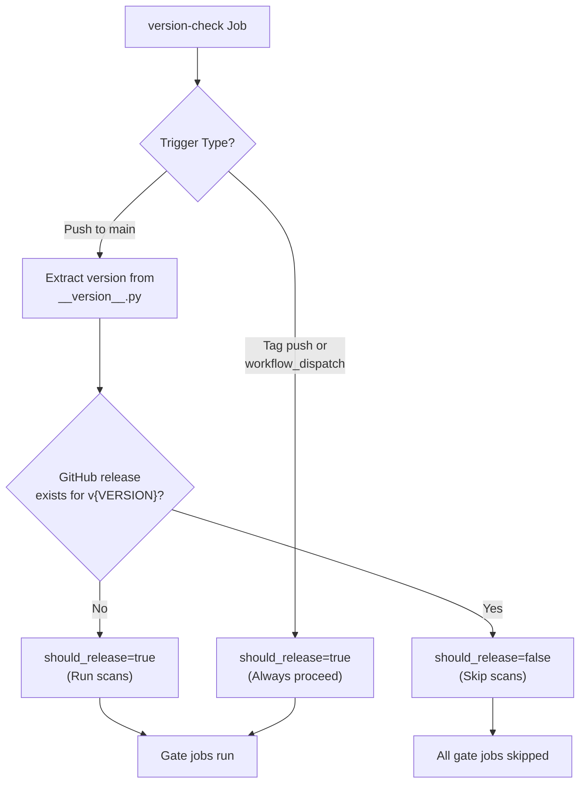
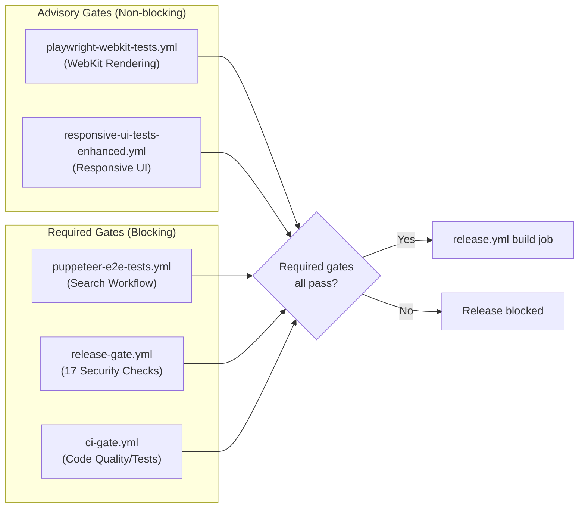
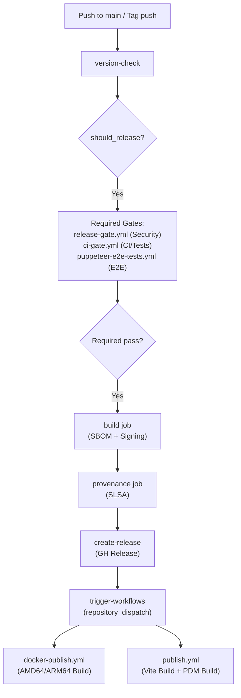

<!-- source: DeepWiki mcp.deepwiki.com · repo LearningCircuit/local-deep-research · page 8.3 Release Process and Gates · fetched 2026-10-29 -->

# Release Process and Gates

<details>
<summary>Relevant source files</summary>

The following files were used as context for generating this wiki page:

- [.github/release.yml](.github/release.yml)
- [.github/workflows/README.md](.github/workflows/README.md)
- [.github/workflows/advanced-search-reminder.yml](.github/workflows/advanced-search-reminder.yml)
- [.github/workflows/ai-code-reviewer.yml](.github/workflows/ai-code-reviewer.yml)
- [.github/workflows/backwards-compatibility.yml](.github/workflows/backwards-compatibility.yml)
- [.github/workflows/check-env-vars.yml](.github/workflows/check-env-vars.yml)
- [.github/workflows/claude-code-review.yml](.github/workflows/claude-code-review.yml)
- [.github/workflows/danger-zone-alert.yml](.github/workflows/danger-zone-alert.yml)
- [.github/workflows/docker-multiarch-test.yml](.github/workflows/docker-multiarch-test.yml)
- [.github/workflows/docker-publish.yml](.github/workflows/docker-publish.yml)
- [.github/workflows/docker-tests.yml](.github/workflows/docker-tests.yml)
- [.github/workflows/e2e-research-test.yml](.github/workflows/e2e-research-test.yml)
- [.github/workflows/file-whitelist-check.yml](.github/workflows/file-whitelist-check.yml)
- [.github/workflows/fuzz.yml](.github/workflows/fuzz.yml)
- [.github/workflows/gitleaks.yml](.github/workflows/gitleaks.yml)
- [.github/workflows/label-fixed-in-dev.yml](.github/workflows/label-fixed-in-dev.yml)
- [.github/workflows/mypy-type-check.yml](.github/workflows/mypy-type-check.yml)
- [.github/workflows/npm-audit.yml](.github/workflows/npm-audit.yml)
- [.github/workflows/owasp-zap-scan.yml](.github/workflows/owasp-zap-scan.yml)
- [.github/workflows/playwright-webkit-tests.yml](.github/workflows/playwright-webkit-tests.yml)
- [.github/workflows/pre-commit.yml](.github/workflows/pre-commit.yml)
- [.github/workflows/publish.yml](.github/workflows/publish.yml)
- [.github/workflows/puppeteer-e2e-tests.yml](.github/workflows/puppeteer-e2e-tests.yml)
- [.github/workflows/release-gate.yml](.github/workflows/release-gate.yml)
- [.github/workflows/release.yml](.github/workflows/release.yml)
- [.github/workflows/responsive-ui-tests-enhanced.yml](.github/workflows/responsive-ui-tests-enhanced.yml)
- [.github/workflows/sbom.yml](.github/workflows/sbom.yml)
- [.github/workflows/security-file-write-check.yml](.github/workflows/security-file-write-check.yml)
- [.github/workflows/security-headers-validation.yml](.github/workflows/security-headers-validation.yml)
- [.github/workflows/sync-main-to-dev.yml](.github/workflows/sync-main-to-dev.yml)
- [.github/workflows/update-dependencies.yml](.github/workflows/update-dependencies.yml)
- [.github/workflows/update-npm-dependencies.yml](.github/workflows/update-npm-dependencies.yml)
- [.github/workflows/update-precommit-hooks.yml](.github/workflows/update-precommit-hooks.yml)
- [.github/workflows/validate-image-pinning.yml](.github/workflows/validate-image-pinning.yml)
- [.github/workflows/version_check.yml](.github/workflows/version_check.yml)
- [.github/workflows/zizmor-security.yml](.github/workflows/zizmor-security.yml)

</details>


This document describes the automated release pipeline that enforces 17 security checks, runs comprehensive tests, and publishes artifacts only after all required gates pass. The release workflow orchestrates Docker image publishing and PyPI package publishing via `repository_dispatch` events to prevent security gate bypass.

---

## Release Trigger Mechanisms

The release workflow [.github/workflows/release.yml:1-10]() supports three trigger methods:

| Trigger | When Used | Behavior |
|---------|-----------|----------|
| `push` to `main` | Every merge to main | Automatic version detection from `__version__.py` |
| `push` to `v*.*.*` tag | Manual version tag | Uses tag version, bypasses duplicate check |
| `workflow_dispatch` | Manual re-run | Uses `__version__.py`, bypasses duplicate check |

The workflow implements a concurrency policy [.github/workflows/release.yml:16-18]() that prevents multiple releases from running simultaneously but queues new runs rather than canceling them:

```yaml
concurrency:
  group: ${{ github.workflow }}-${{ github.ref }}
  cancel-in-progress: false
```

**Sources:** [.github/workflows/release.yml:1-19]()

---

## Version Detection and Duplicate Prevention

### Version Check Job

The `version-check` job [.github/workflows/release.yml:28-79]() is a lightweight pre-flight check that reads `src/local_deep_research/__version__.py` and determines if a GitHub release already exists for that version. This prevents expensive security scans from running unnecessarily when the version hasn't changed.

Title: Version Check Logic Flow


**Key Implementation Details:**
- Uses sparse checkout [.github/workflows/release.yml:40-47]() to only fetch `src/local_deep_research/__version__.py` [.github/workflows/release.yml:44](), minimizing checkout time.
- Checks GitHub API via `gh release view` [.github/workflows/release.yml:73]() to detect existing releases.
- All subsequent jobs depend on the `should_release` output [.github/workflows/release.yml:95]().

**Sources:** [.github/workflows/release.yml:28-79]()

---

## The 17 Security Gates

### Security Gate Architecture

The `release-gate` job [.github/workflows/release.yml:93-101]() is a reusable workflow that invokes `.github/workflows/release-gate.yml`. This gate runs 17 distinct security checks that **must all pass** before any release can proceed.

Title: Security Gate Toolchain Mapping

```mermaid
flowchart TB
    subgraph "release-gate.yml Workflow"
        direction TB
        
        CodeQL["CodeQL SAST<br/>(.github/workflows/codeql.yml)"]
        Semgrep["Semgrep SAST<br/>(.github/workflows/semgrep.yml)"]
        DevSkim["DevSkim Linter<br/>(.github/workflows/devskim.yml)"]
        Bearer["Bearer Scan<br/>(.github/workflows/bearer.yml)"]
        
        npmAudit["npm audit<br/>(.github/workflows/npm-audit.yml)"]
        RetireJS["RetireJS<br/>(.github/workflows/retirejs.yml)"]
        Grype["Grype Scan<br/>(.github/workflows/grype.yml)"]
        
        Trivy["Trivy<br/>(.github/workflows/container-security.yml)"]
        Hadolint["Hadolint<br/>(.github/workflows/hadolint.yml)"]
        Dockle["Dockle<br/>(.github/workflows/dockle.yml)"]
        Checkov["Checkov<br/>(.github/workflows/checkov.yml)"]
        
        Gitleaks["Gitleaks<br/>(.github/workflows/gitleaks-main.yml)"]
        Zizmor["Zizmor<br/>(.github/workflows/zizmor-security.yml)"]
        OWASPZAP["OWASP ZAP<br/>(.github/workflows/owasp-zap-scan.yml)"]
        Nuclei["Nuclei DAST<br/>(.github/workflows/nuclei.yml)"]
        
        MultiArch["Multi-arch Test<br/>(.github/workflows/docker-multiarch-test.yml)"]
        LicenseCheck["License Compliance<br/>(release-gate.yml:186)"]
    end
    
    GatePasses{"All 17 checks<br/>pass?"} --> |"Yes"| BuildPhase["Proceed to build"]
    GatePasses --> |"No"| Block["Release blocked"]
```


**Security Categories:**

| Category | Tools | Purpose |
|----------|-------|---------|
| **SAST** | CodeQL, Semgrep, Bearer, DevSkim | Static code analysis for vulnerabilities [.github/workflows/release-gate.yml:69-90]() |
| **Dependency** | npm audit, RetireJS, Grype | Detect vulnerable dependencies [.github/workflows/release-gate.yml:105-115, 155-161]() |
| **Container** | Trivy, Hadolint, Dockle, Checkov | Container and IaC security [.github/workflows/release-gate.yml:53-59, 119-136]() |
| **Secrets** | Gitleaks | Prevent leaked credentials in main branch [.github/workflows/release-gate.yml:165-171]() |
| **DAST** | OWASP ZAP, Nuclei | Dynamic security testing of running app [.github/workflows/release-gate.yml:60-65, 175-181]() |
| **Workflow** | Zizmor | Security linter for GitHub Actions [.github/workflows/zizmor-security.yml:1-15]() |

**Sources:** [.github/workflows/release-gate.yml:1-186](), [.github/workflows/owasp-zap-scan.yml:1-10](), [.github/workflows/zizmor-security.yml:1-15]()

---

## CI Gate and Quality Validation

The `ci-gate` job [.github/workflows/release.yml:109-118]() invokes `.github/workflows/ci-gate.yml`, which runs:

- **Mypy type checking:** Python type analysis via `.github/workflows/mypy-type-check.yml`.
- **Docker Tests:** A consolidated suite running all pytest tests with coverage inside a container [.github/workflows/docker-tests.yml:129-131]().
- **Path Filtering:** Uses `dorny/paths-filter` [.github/workflows/docker-tests.yml:57]() to detect changes in LLM, infrastructure, or Docker configurations [.github/workflows/docker-tests.yml:61-91]().

**Sources:** [.github/workflows/release.yml:109-118](), [.github/workflows/docker-tests.yml:1-131]()

---

## Test Gates: Advisory vs Required

The release workflow runs several test gate jobs with different enforcement levels. Functional tests often involve `xvfb` and Chromium dependencies [.github/workflows/responsive-ui-tests-enhanced.yml:74-97]().

Title: Release Gate Enforcement Logic


### Gate Details

| Gate | Workflow | Required | Purpose |
|------|----------|----------|---------|
| `test-gate` | `playwright-webkit-tests.yml` | ❌ Advisory | WebKit rendering (cosmetic differences acceptable) [.github/workflows/release.yml:120-125]() |
| `e2e-test-gate` | `puppeteer-e2e-tests.yml` | ✅ Required | Functional UI search workflow via real API calls [.github/workflows/release.yml:140-144]() |
| `responsive-test-gate` | `responsive-ui-tests-enhanced.yml` | ❌ Advisory | Responsive UI across mobile/desktop viewports [.github/workflows/release.yml:154-157]() |

The build job condition [.github/workflows/release.yml:197]() enforces that required gates succeed:
```yaml
if: ${{ !cancelled() && needs.release-gate.result == 'success' && needs.ci-gate.result == 'success' && needs.e2e-test-gate.result == 'success' }}
```

**Sources:** [.github/workflows/release.yml:120-197](), [.github/workflows/responsive-ui-tests-enhanced.yml:17-18]()

---

## Build Job and Artifact Generation

### Version Extraction
The build job [.github/workflows/release.yml:193-330]() extracts the release version from `src/local_deep_research/__version__.py` [.github/workflows/release.yml:228-235]().

### SBOM and Sigstore Signing
The pipeline generates Software Bill of Materials (SBOM) using Trivy in both SPDX and CycloneDX formats [.github/workflows/release.yml:265-287](). These are signed using **Cosign** with GitHub OIDC keyless signing [.github/workflows/release.yml:293-306]().

### SLSA Provenance
The `provenance` job [.github/workflows/release.yml:332-345]() generates SLSA Level 3 build provenance using the official `slsa-framework/slsa-github-generator`. This attestation enables consumers to verify the build process was not tampered with.

**Sources:** [.github/workflows/release.yml:209-345]()

---

## Dual-Token Strategy and Downstream Orchestration

### Dual-Token Strategy
The pipeline uses two types of tokens to balance security and automation [.github/workflows/sync-main-to-dev.yml:34-52]():
1. **`GITHUB_TOKEN`**: Used for standard operations, repository checks, and PR creation to ensure proper bot attribution [.github/workflows/release.yml:54](), [.github/workflows/sync-main-to-dev.yml:141-146]().
2. **`PAT_TOKEN`**: A Personal Access Token used to trigger downstream workflows [.github/workflows/release.yml:391]() via `repository_dispatch` and to modify workflow files during sync operations [.github/workflows/sync-main-to-dev.yml:52]().

### Repository Dispatch Orchestration
Publishing to Docker Hub and PyPI is handled via `repository_dispatch` [.github/workflows/release.yml:395-451](). This ensures that publishing only occurs after all gates in `release.yml` have passed.

**Dispatch Types:**
- `publish-docker`: Triggers `.github/workflows/docker-publish.yml` [.github/workflows/docker-publish.yml:9]().
- `publish-pypi`: Triggers `.github/workflows/publish.yml` [.github/workflows/publish.yml:9]().

**Docker Publishing Process:**
1. **Multi-arch Build:** Builds `amd64` [.github/workflows/docker-publish.yml:14]() and `arm64` [.github/workflows/docker-publish.yml:57]() images using `docker buildx` [.github/workflows/docker-publish.yml:35, 79]().
2. **Security Scan:** Performs a final Trivy scan on the release image [.github/workflows/docker-publish.yml:148-155](), failing on fixable HIGH/CRITICAL vulnerabilities [.github/workflows/docker-publish.yml:158-166]().
3. **Manifest Creation:** Combines architectures into a single multi-platform manifest [.github/workflows/docker-publish.yml:176-200]().

**PyPI Publishing Process:**
1. **Frontend Build:** Runs `npm run build` to generate Vite assets and `manifest.json` [.github/workflows/publish.yml:70-100]().
2. **Package Build:** Uses `pdm build` to create the wheel, verifying frontend artifacts and the `.frontend-built` marker are present [.github/workflows/publish.yml:141-174]().

**Sources:** [.github/workflows/release.yml:391-451](), [.github/workflows/docker-publish.yml:1-200](), [.github/workflows/publish.yml:1-174](), [.github/workflows/sync-main-to-dev.yml:34-146]()

---

## Release Pipeline Flow Summary

Title: Full Release Orchestration Sequence


**Key Code Entities:**
- `version-check`: Job in [.github/workflows/release.yml:28]().
- `release-gate`: Reusable workflow call in [.github/workflows/release.yml:93]().
- `create-release`: Job in [.github/workflows/release.yml:347]().
- `trigger-workflows`: Job in [.github/workflows/release.yml:395]().
- `publish-docker`: Event type in [.github/workflows/docker-publish.yml:9]().
- `publish-pypi`: Event type in [.github/workflows/publish.yml:9]().

**Sources:** [.github/workflows/release.yml:1-451](), [.github/workflows/docker-publish.yml:1-15](), [.github/workflows/publish.yml:1-15]()

---

