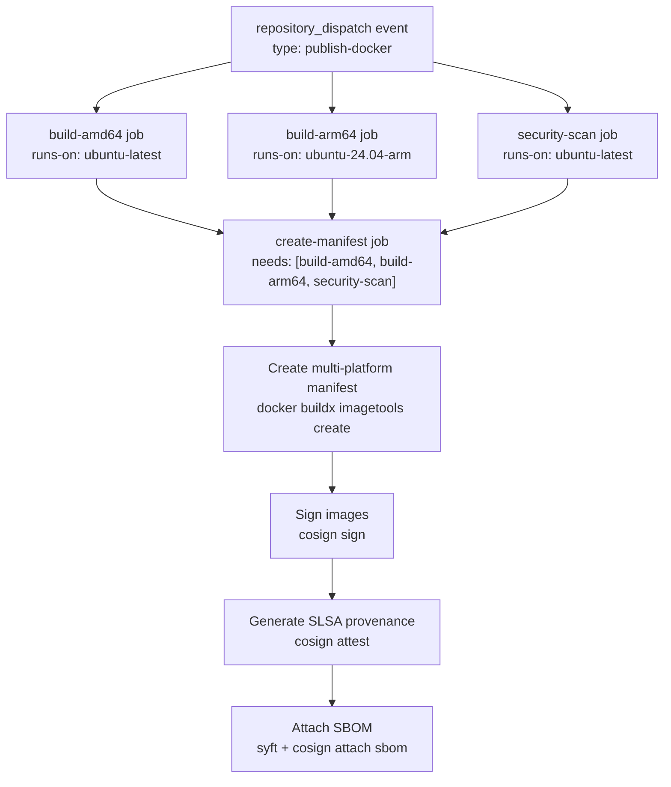
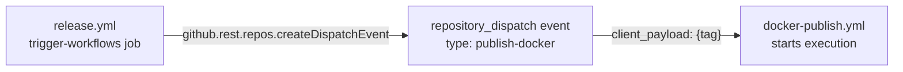
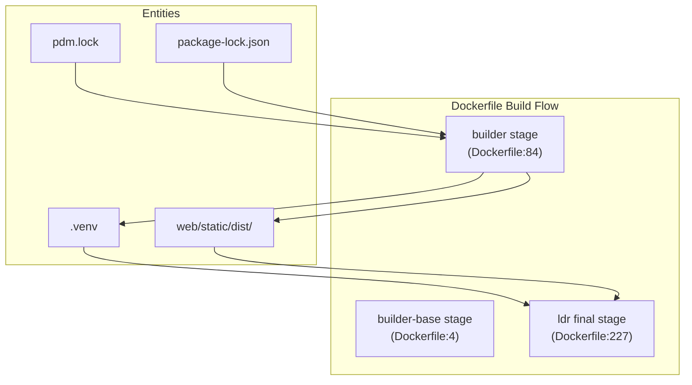
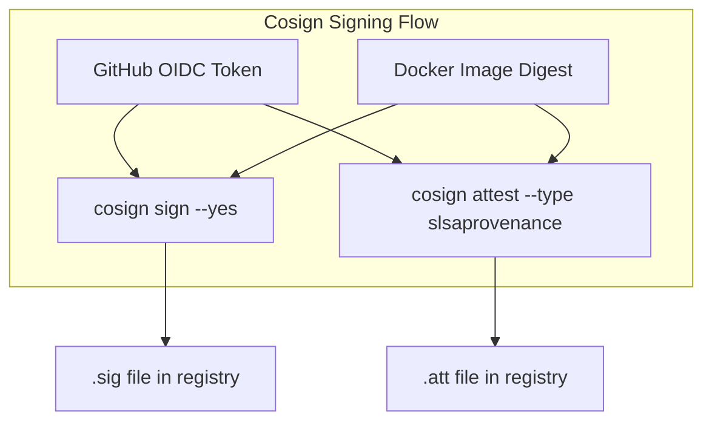

<!-- source: DeepWiki mcp.deepwiki.com · repo LearningCircuit/local-deep-research · page 8.4 Docker Image Publishing · fetched 2026-10-29 -->

# Docker Image Publishing

<details>
<summary>Relevant source files</summary>

The following files were used as context for generating this wiki page:

- [.github/workflows/backwards-compatibility.yml](.github/workflows/backwards-compatibility.yml)
- [.github/workflows/docker-publish.yml](.github/workflows/docker-publish.yml)
- [.github/workflows/docker-tests.yml](.github/workflows/docker-tests.yml)
- [.github/workflows/owasp-zap-scan.yml](.github/workflows/owasp-zap-scan.yml)
- [.github/workflows/playwright-webkit-tests.yml](.github/workflows/playwright-webkit-tests.yml)
- [.github/workflows/publish.yml](.github/workflows/publish.yml)
- [.github/workflows/puppeteer-e2e-tests.yml](.github/workflows/puppeteer-e2e-tests.yml)
- [.github/workflows/release-gate.yml](.github/workflows/release-gate.yml)
- [.github/workflows/release.yml](.github/workflows/release.yml)
- [.github/workflows/responsive-ui-tests-enhanced.yml](.github/workflows/responsive-ui-tests-enhanced.yml)
- [.github/workflows/sbom.yml](.github/workflows/sbom.yml)
- [Dockerfile](Dockerfile)
- [cookiecutter-docker/cookiecutter.json](cookiecutter-docker/cookiecutter.json)
- [cookiecutter-docker/hooks/post_gen_project.py](cookiecutter-docker/hooks/post_gen_project.py)
- [cookiecutter-docker/hooks/pre_prompt.py](cookiecutter-docker/hooks/pre_prompt.py)
- [cookiecutter-docker/{{cookiecutter.config_name}}/docker-compose.{{cookiecutter.config_name}}.yml](cookiecutter-docker/{{cookiecutter.config_name}}/docker-compose.{{cookiecutter.config_name}}.yml)
- [docker-compose.yml](docker-compose.yml)
- [scripts/.gitkeep](scripts/.gitkeep)
- [scripts/ollama_entrypoint.sh](scripts/ollama_entrypoint.sh)
- [tests/api_tests_with_login/puppeteer_config.js](tests/api_tests_with_login/puppeteer_config.js)
- [tests/ui_tests/puppeteer_config.js](tests/ui_tests/puppeteer_config.js)
- [tests/ui_tests/test_login_validation.js](tests/ui_tests/test_login_validation.js)

</details>


This document describes the Docker image publishing pipeline, which builds multi-architecture container images, performs security scanning, signs artifacts with Cosign, and publishes to Docker Hub. For information about the release workflow that triggers Docker publishing, see [Release Process (8.3)](). For PyPI package publishing, see [PyPI Package Publishing (8.5)]().

## Overview

The Docker publishing workflow [[.github/workflows/docker-publish.yml:1-395]]() is a security-gated pipeline that only executes after all release checks pass. It performs the following operations:

1.  **Multi-architecture builds**: Builds separate images for `linux/amd64` and `linux/arm64` platforms.
2.  **Security scanning**: Scans built images with Trivy, blocking publication on fixable HIGH/CRITICAL vulnerabilities.
3.  **Image signing**: Signs images using Cosign with keyless OIDC authentication.
4.  **SBOM generation**: Attaches Software Bill of Materials (SPDX) to images via Syft.
5.  **SLSA provenance**: Generates build provenance attestations.
6.  **Manifest creation**: Creates multi-platform manifests using `docker buildx imagetools`.

The workflow is **intentionally restricted** to `repository_dispatch` events only, preventing direct invocation and ensuring all releases go through the security gate in `release.yml` [[.github/workflows/docker-publish.yml:3-9]]().

### Job Dependency Graph

Detailed relationship between jobs in the publishing pipeline:


Sources: [[.github/workflows/docker-publish.yml:14-178]]()

## Trigger Mechanism and Security Model

### Repository Dispatch Pattern

The workflow uses GitHub's `repository_dispatch` mechanism to enforce security boundaries. This design **explicitly excludes** `workflow_dispatch` and `release` triggers to prevent bypassing the security gate [[.github/workflows/docker-publish.yml:3-9]]().

1.  `release.yml` completes all security scans via `release-gate.yml` [[.github/workflows/release.yml:93-96]]().
2.  `trigger-workflows` job in `release.yml` dispatches the event using `publish-docker` type [[.github/workflows/release.yml:302-317]]().
3.  `docker-publish.yml` receives the tag in the `client_payload` and begins the build pipeline [[.github/workflows/docker-publish.yml:8-9]]().


Sources: [[.github/workflows/docker-publish.yml:3-9]](), [[.github/workflows/release.yml:289-334]]()

## Multi-Architecture Build Pipeline

### Platform-Specific Builds

The workflow builds each architecture independently to leverage native runners [[.github/workflows/docker-publish.yml:14-99]]():

| Job | Runner | Platform | Cache Scope |
| :--- | :--- | :--- | :--- |
| `build-amd64` | `ubuntu-latest` | `linux/amd64` | `gha,scope=linux-amd64` [[.github/workflows/docker-publish.yml:52-53]]() |
| `build-arm64` | `ubuntu-24.04-arm` | `linux/arm64` | `gha,scope=linux-arm64` [[.github/workflows/docker-publish.yml:95-96]]() |

Both jobs utilize `docker/build-push-action` to build and push platform-specific images tagged with the commit SHA (e.g., `amd64-${{ github.sha }}`) [[.github/workflows/docker-publish.yml:44-56]]().

### Dockerfile Build Stages

The `Dockerfile` is structured for efficient caching and multi-stage production builds:

1.  **`builder-base`**: Installs system dependencies (`libsqlcipher-dev`, `sqlcipher`, `build-essential`) and Node.js 24.x LTS [[Dockerfile:4-45]](). It includes GPG fingerprint verification for the NodeSource repository [[Dockerfile:29-39]]().
2.  **`builder`**: Performs `npm ci`, `npm run build` (Vite), and `pdm install --prod` [[Dockerfile:84-100]]().
3.  **`ldr` (Final Stage)**: A minimal runtime environment based on `python:3.14.4-slim` that copies only the virtual environment and built frontend assets [[Dockerfile:227-286]]().


Sources: [[Dockerfile:1-286]](), [[.github/workflows/docker-publish.yml:14-99]]()

## Security Scanning

### Trivy Vulnerability Analysis

The `security-scan` job performs two separate Trivy scans [[.github/workflows/docker-publish.yml:100-175]]():

1.  **SARIF Report**: Generates a full report for the GitHub Security tab. It does not fail the build (`exit-code: '0'`) [[.github/workflows/docker-publish.yml:147-155]]().
2.  **Blocking Scan**: Checks for fixable `HIGH` and `CRITICAL` vulnerabilities. It fails the build (`exit-code: '1'`) if any are found [[.github/workflows/docker-publish.yml:158-166]]().

The scanner uses a `.trivyignore` file to exclude known vulnerabilities in bundled libraries that cannot be fixed by the maintainers [[.github/workflows/docker-publish.yml:164]]().

### Disk Space Management
GitHub runners have limited space. The scan job removes unnecessary packages (`/usr/share/dotnet`, `/usr/local/lib/android`, etc.) and prunes Docker images before building the scan target to ensure Trivy has enough room to export the image [[.github/workflows/docker-publish.yml:119-128]]().

Sources: [[.github/workflows/docker-publish.yml:100-175]]()

## Manifest Creation and Tagging

### Multi-Platform Manifest Creation

The `create-manifest` job determines version tags (e.g., `v1.2.3`, `v1.2`, `latest`) based on the release tag and combines the architecture-specific images [[.github/workflows/docker-publish.yml:176-269]]().

It uses `docker buildx imagetools create` to build the manifest list:
```bash
docker buildx imagetools create -t "$tag" \
  "${DOCKER_USERNAME}/local-deep-research:amd64-${GITHUB_SHA}" \
  "${DOCKER_USERNAME}/local-deep-research:arm64-${GITHUB_SHA}"
```
Sources: [[.github/workflows/docker-publish.yml:242-269]]()

## Cosign Signing and Attestation

### Keyless OIDC Signing
The workflow uses **keyless signing** with Sigstore/Cosign. It leverages GitHub's OIDC provider (requiring `id-token: write` permission) to sign images without managing private keys [[.github/workflows/docker-publish.yml:183]](), [[.github/workflows/docker-publish.yml:271-285]]().

### SLSA Provenance
The pipeline generates SLSA (Supply-chain Levels for Software Artifacts) provenance attestations. This records the build invocation details, including the source repository and commit SHA [[.github/workflows/docker-publish.yml:287-335]]().


Sources: [[.github/workflows/docker-publish.yml:181-184]](), [[.github/workflows/docker-publish.yml:271-335]]()

## SBOM Generation

The workflow generates a Software Bill of Materials in SPDX format using `syft` and attaches it to the image via `cosign attach sbom` [[.github/workflows/docker-publish.yml:367-389]]().

1.  **Generate**: `syft "$IMAGE_REF" -o spdx-json > sbom.spdx.json` [[.github/workflows/docker-publish.yml:379]]().
2.  **Attach**: `cosign attach sbom --sbom sbom.spdx.json "$IMAGE_REF"` [[.github/workflows/docker-publish.yml:382]]().
3.  **Sign**: The SBOM attachment is itself signed to ensure integrity [[.github/workflows/docker-publish.yml:385]]().

Additionally, a separate `sbom.yml` workflow runs weekly to generate SBOMs for source code and Python dependencies (SPDX and CycloneDX formats) [[.github/workflows/sbom.yml:1-82]]().

Sources: [[.github/workflows/docker-publish.yml:367-390]](), [[.github/workflows/sbom.yml:1-82]]()

## Permissions and Environment

The workflow utilizes the `release` environment to manage Docker Hub credentials (`DOCKER_USERNAME`, `DOCKER_PASSWORD`) [[.github/workflows/docker-publish.yml:17]]().

| Job | Permissions Required | Reason |
| :--- | :--- | :--- |
| `build-*` | `contents: read` | To check out the repository [[.github/workflows/docker-publish.yml:19]](). |
| `create-manifest` | `id-token: write` | Required for Sigstore keyless signing [[.github/workflows/docker-publish.yml:183]](). |
| `create-manifest` | `packages: write` | Required to push manifests/attestations [[.github/workflows/docker-publish.yml:184]](). |

Sources: [[.github/workflows/docker-publish.yml:11-12]](), [[.github/workflows/docker-publish.yml:18-19]](), [[.github/workflows/docker-publish.yml:181-184]]()

---

