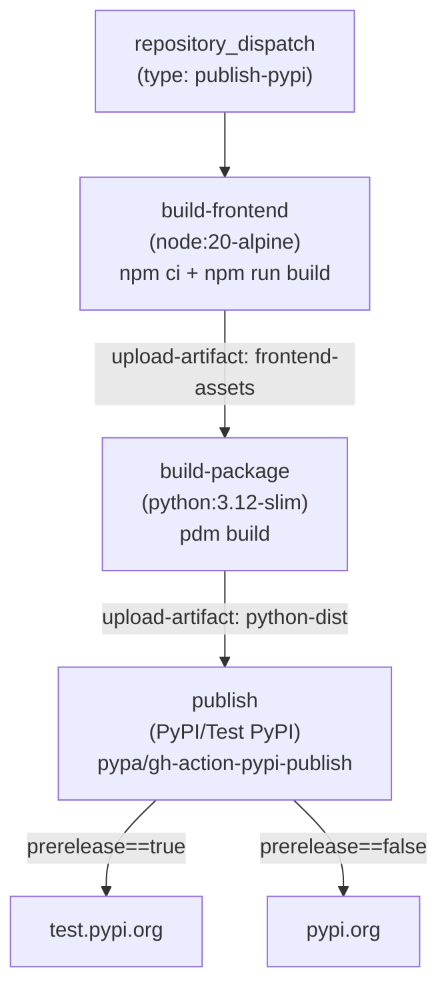

<!-- source: DeepWiki mcp.deepwiki.com · repo LearningCircuit/local-deep-research · page 8.5 PyPI Package Publishing · fetched 2026-10-29 -->

# PyPI Package Publishing

<details>
<summary>Relevant source files</summary>

The following files were used as context for generating this wiki page:

- [.file-whitelist.txt](.file-whitelist.txt)
- [.github/scripts/file-whitelist-check.sh](.github/scripts/file-whitelist-check.sh)
- [.github/workflows/backwards-compatibility.yml](.github/workflows/backwards-compatibility.yml)
- [.github/workflows/docker-publish.yml](.github/workflows/docker-publish.yml)
- [.github/workflows/docker-tests.yml](.github/workflows/docker-tests.yml)
- [.github/workflows/owasp-zap-scan.yml](.github/workflows/owasp-zap-scan.yml)
- [.github/workflows/playwright-webkit-tests.yml](.github/workflows/playwright-webkit-tests.yml)
- [.github/workflows/publish.yml](.github/workflows/publish.yml)
- [.github/workflows/puppeteer-e2e-tests.yml](.github/workflows/puppeteer-e2e-tests.yml)
- [.github/workflows/release-gate.yml](.github/workflows/release-gate.yml)
- [.github/workflows/release.yml](.github/workflows/release.yml)
- [.github/workflows/responsive-ui-tests-enhanced.yml](.github/workflows/responsive-ui-tests-enhanced.yml)
- [.github/workflows/sbom.yml](.github/workflows/sbom.yml)
- [.gitignore](.gitignore)
- [.gitleaks.toml](.gitleaks.toml)
- [.gitleaksignore](.gitleaksignore)
- [.pre-commit-config.yaml](.pre-commit-config.yaml)
- [.pre-commit-hooks/check-absolute-module-paths.py](.pre-commit-hooks/check-absolute-module-paths.py)
- [.pre-commit-hooks/file-whitelist-check.sh](.pre-commit-hooks/file-whitelist-check.sh)
- [.pre-commit-hooks/recommend-release-notes.py](.pre-commit-hooks/recommend-release-notes.py)
- [CONTRIBUTING.md](CONTRIBUTING.md)
- [changelog.d/3670.breaking.1.md](changelog.d/3670.breaking.1.md)
- [changelog.d/3670.breaking.md](changelog.d/3670.breaking.md)
- [changelog.d/3670.feature.md](changelog.d/3670.feature.md)
- [changelog.d/3773.feature.md](changelog.d/3773.feature.md)
- [changelog.d/README.md](changelog.d/README.md)
- [docs/CONFIGURATION.md](docs/CONFIGURATION.md)
- [docs/RELEASE_GUIDE.md](docs/RELEASE_GUIDE.md)
- [package-lock.json](package-lock.json)
- [package.json](package.json)
- [pdm.lock](pdm.lock)
- [pyproject.toml](pyproject.toml)
- [src/local_deep_research/__version__.py](src/local_deep_research/__version__.py)
- [src/local_deep_research/web/static/js/mobile-navigation.js](src/local_deep_research/web/static/js/mobile-navigation.js)
- [src/local_deep_research/web/static/js/security/url-validator.js](src/local_deep_research/web/static/js/security/url-validator.js)
- [src/local_deep_research/web/static/js/services/api.js](src/local_deep_research/web/static/js/services/api.js)
- [src/local_deep_research/web/static/js/services/formatting.js](src/local_deep_research/web/static/js/services/formatting.js)
- [tests/infrastructure_tests/test_csrf_api.test.js](tests/infrastructure_tests/test_csrf_api.test.js)
- [tests/infrastructure_tests/test_urls.test.js](tests/infrastructure_tests/test_urls.test.js)
- [tests/security/test_absolute_module_paths_hook.py](tests/security/test_absolute_module_paths_hook.py)
- [vite.config.js](vite.config.js)

</details>


This page documents the PyPI publishing workflow for `local-deep-research`, covering how the Python package is built, verified, and published to both Test PyPI and production PyPI. This process is managed primarily by the `publish.yml` workflow file.

For the upstream release process that triggers this workflow, see [8.3 Release Process and Gates](). For Docker image publishing (which runs in parallel with this workflow), see [8.4 Docker Image Publishing](). For the project's dependency declarations and package metadata, see [1.2 Project Structure and Dependencies]().

---

## Security Model and Trigger Mechanism

The PyPI publishing workflow is deliberately restricted to a single trigger: a `repository_dispatch` event of type `publish-pypi`, sent by `release.yml` after all security and CI gates have passed.

[.github/workflows/publish.yml:1-9]()

`workflow_dispatch` (manual trigger) is intentionally not supported to prevent bypassing security checks. Publishing can only happen after the full release pipeline runs. Creating a GitHub release manually through the UI does **not** trigger publishing.

The dispatch event is sent by `release.yml` in the `trigger-workflows` job:

[.github/workflows/release.yml:425-440]()

The `client_payload` includes:
- `tag`: the release tag (e.g., `v1.6.9`)
- `prerelease`: boolean flag controlling whether to publish to Test PyPI or production PyPI

Sources: [.github/workflows/publish.yml:1-9](), [.github/workflows/release.yml:425-440]()

---

## Workflow Overview

**Workflow file:** [.github/workflows/publish.yml]()

The workflow has three jobs that run in sequence to ensure isolation between the frontend build environment, the Python packaging environment, and the credentialed publishing environment.

**PyPI Publish Pipeline**



Sources: [.github/workflows/publish.yml:13-465]()

---

## Job 1: build-frontend

Runs in a pinned `node:20-alpine` container with no access to secrets.

[.github/workflows/publish.yml:15-114]()

| Step | Action |
|------|--------|
| Check for `package.json` | Fails with error if missing (frontend is mandatory) |
| `npm ci --ignore-scripts` | Installs from `package-lock.json` with integrity verification |
| `npm run build` | Invokes Vite; outputs to `src/local_deep_research/web/static/dist/` |
| Verify `manifest.json` | Checks `src/local_deep_research/web/static/dist/.vite/manifest.json` exists |
| Upload artifacts | Uploads `src/local_deep_research/web/static/` as `frontend-assets` |

The build marker file `src/local_deep_research/web/static/.frontend-built` is written to confirm a successful build. The artifact upload uses `include-hidden-files: true` to preserve the `.vite/` directory containing `manifest.json`.

Sources: [.github/workflows/publish.yml:49-114](), [.github/workflows/publish.yml:37-47](), [package.json:12-12](), [package-lock.json:1-9]()

---

## Job 2: build-package

Runs in a pinned `python:3.12-slim` container. Depends on `build-frontend`.

[.github/workflows/publish.yml:116-286]()

**Steps:**

1.  **System Dependencies**: Installs `libsqlcipher-dev` and `build-essential` required for compiling `sqlcipher3` bindings.
2.  **PDM Setup**: Installs `pdm==2.26.2` (pinned version for reproducibility).
3.  **Artifact Integration**: Downloads `frontend-assets` artifact into `src/local_deep_research/web/static/`.
4.  **Validation**: Verifies artifact contents (manifest, JS files, CSS files) to ensure the wheel won't be broken.
5.  **Build**: Runs `pdm build` to produce both a wheel (`.whl`) and source distribution (`.tar.gz`).
6.  **Upload**: Uploads `dist/` as artifact `python-dist`.

PDM reads the version from [src/local_deep_research/__version__.py]() via the `pyproject.toml` configuration:

[pyproject.toml:143-145]()

```toml
[tool.pdm]
distribution = true
version = { source = "file", path = "src/local_deep_research/__version__.py" }
```

The build system is `pdm-backend`:

[pyproject.toml:1-3]()

**Frontend artifact verification** checks for:
- `src/local_deep_research/web/static/dist/` directory.
- `.vite/manifest.json`.
- Presence of `.js` and `.css` files.

[.github/workflows/publish.yml:149-263]()

Sources: [.github/workflows/publish.yml:116-286](), [pyproject.toml:1-3](), [pyproject.toml:143-145](), [src/local_deep_research/__version__.py:1-1]()

---

## Job 3: publish

Runs on `ubuntu-latest` in the `release` GitHub environment, which holds the trusted publisher configuration. This is the only job with PyPI access.

[.github/workflows/publish.yml:288-465]()

### Wheel Verification

Before publishing, the job inspects the downloaded wheel using `python -m zipfile -l` to count and verify internal paths:
- Python files (`.py`)
- JavaScript files (`.js`)
- CSS files (`.css`)
- JSON files (`.json`)
- HTML files (`.html`)

It specifically confirms that `local_deep_research/web/static/dist/` is present in the wheel. If frontend assets are missing, the job aborts before publishing.

[.github/workflows/publish.yml:320-421]()

### Build Attestations and SLSA

[.github/workflows/publish.yml:422-425]()

The workflow generates a provenance attestation for both the wheel and the source distribution using `actions/attest-build-provenance`. This provides a cryptographically verifiable link between the PyPI artifact and the GitHub Actions run that produced it.

### Trusted Publisher Authentication (OIDC)

No PyPI API token is stored as a secret. The workflow uses [PyPI Trusted Publishers](https://docs.pypi.org/trusted-publishers/), which relies on GitHub's OIDC token. This requires specific permissions:

[.github/workflows/publish.yml:289-295]()

```yaml
permissions:
  id-token: write      # Required for OIDC token exchange
  attestations: write  # Required for SLSA provenance
  contents: read       # Required for checking out code
```

The `id-token: write` permission allows the `pypa/gh-action-pypi-publish` action to exchange a short-lived GitHub OIDC token for PyPI upload credentials at runtime.

Sources: [.github/workflows/publish.yml:288-465](), [.github/workflows/publish.yml:422-425]()

---

## Package Metadata and Entry Points

Defined in [pyproject.toml]():

| Field | Value |
|-------|-------|
| `name` | `local-deep-research` |
| `version` | Dynamic — read from `src/local_deep_research/__version__.py` |
| `requires-python` | `\>=3.12,<3.15` |
| `license` | MIT |
| `build-backend` | `pdm.backend` |

**CLI entry points** registered in the package:

[pyproject.toml:109-112]()

| Command | Entry point |
|---------|-------------|
| `ldr` | `local_deep_research.main:main` |
| `ldr-web` | `local_deep_research.web.app:main` |
| `ldr-mcp` | `local_deep_research.mcp:run_server` |

**Static file inclusion** configured via `package-data`:

[pyproject.toml:120-123]()

```toml
[tool.setuptools]
include-package-data = true

[tool.setuptools.package-data]
"local_deep_research.web" = ["templates/*", "static/*", "static/**/*"]
"local_deep_research.defaults" = ["*.toml", "*.py", "*.template", ".env.template", "*.json"]
"local_deep_research.notifications" = ["templates/*.jinja2"]
```

This ensures templates, built Vite assets in `static/dist/`, and default configuration files (including `.env.template` and `*.json`) are bundled into the wheel.

Sources: [pyproject.toml:5-21](), [pyproject.toml:109-112](), [pyproject.toml:117-123](), [src/local_deep_research/__version__.py:1-1]()

---

## Build Artifact Flow

**Artifact Data Flow**

```mermaid
flowchart LR
    subgraph "build-frontend (node:20-alpine)"
        N1["package.json"]
        N2["npm ci\n--ignore-scripts"]
        N3["npm run build\n(Vite)"]
        N4["static/dist/\n.vite/manifest.json"]
        N5["upload-artifact:\nfrontend-assets"]
        N1 --> N2 --> N3 --> N4 --> N5
    end

    subgraph "build-package (python:3.12-slim)"
        P1["download-artifact:\nfrontend-assets"]
        P2["Verify manifest.json\nJS/CSS presence"]
        P3["pdm build"]
        P4["local_deep_research-*.whl\nlocal_deep_research-*.tar.gz"]
        P5["upload-artifact:\npython-dist"]
        P1 --> P2 --> P3 --> P4 --> P5
    end

    subgraph "publish (ubuntu-latest, release env)"
        Q1["download-artifact:\npython-dist"]
        Q2["python -m zipfile -l\nwheel inspection"]
        Q3["attest-build-provenance"]
        Q4["pypa/gh-action-pypi-publish\n(OIDC trusted publisher)"]
        Q1 --> Q2 --> Q3 --> Q4
    end

    N5 -->|"GitHub artifact store"| P1
    P5 -->|"GitHub artifact store"| Q1
```



Sources: [.github/workflows/publish.yml:13-465]()

---

## Key Constraints and Design Decisions

| Constraint | Reason |
|------------|--------|
| No `workflow_dispatch` trigger | Prevents bypassing the security gate in `release.yml`. |
| `npm ci --ignore-scripts` | Prevents arbitrary code execution from npm lifecycle scripts during build. |
| Pinned container images | Supply chain integrity; prevents tag mutation attacks via SHA256 pinning. |
| `skip-existing: true` | Safe re-runs without failure if a version has already been partially published. |
| Wheel inspection | Catches packaging errors (e.g., empty `static/dist`) before the package reaches PyPI. |

Sources: [.github/workflows/publish.yml:1-9](), [.github/workflows/publish.yml:20](), [.github/workflows/publish.yml:61](), [.github/workflows/publish.yml:121](), [.github/workflows/publish.yml:320-421]()

---

