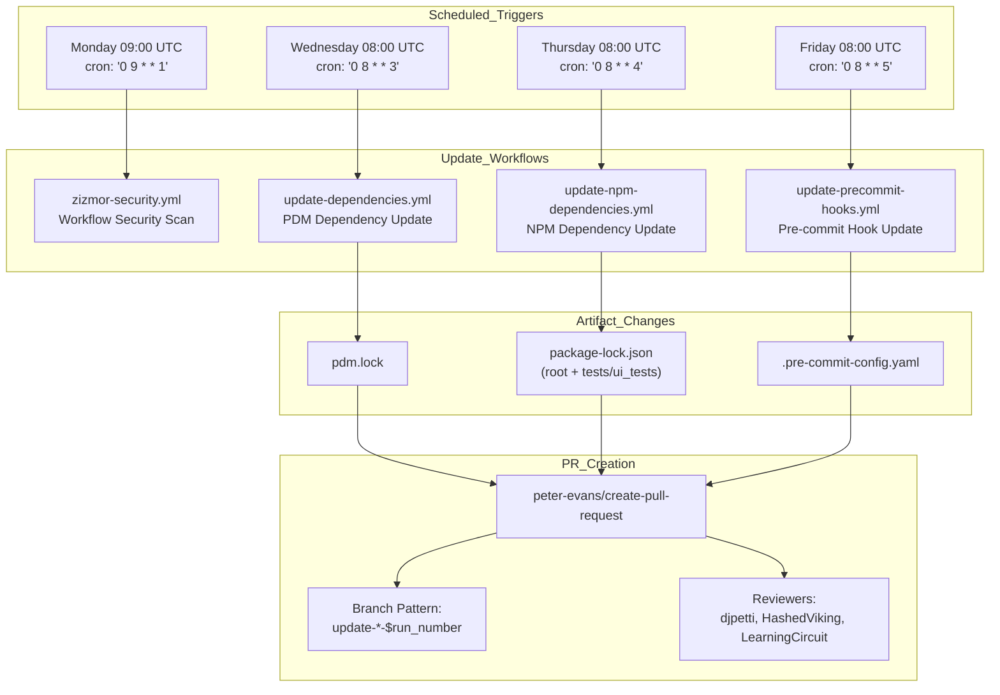
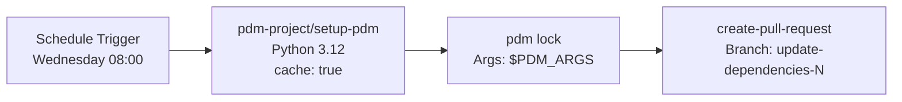
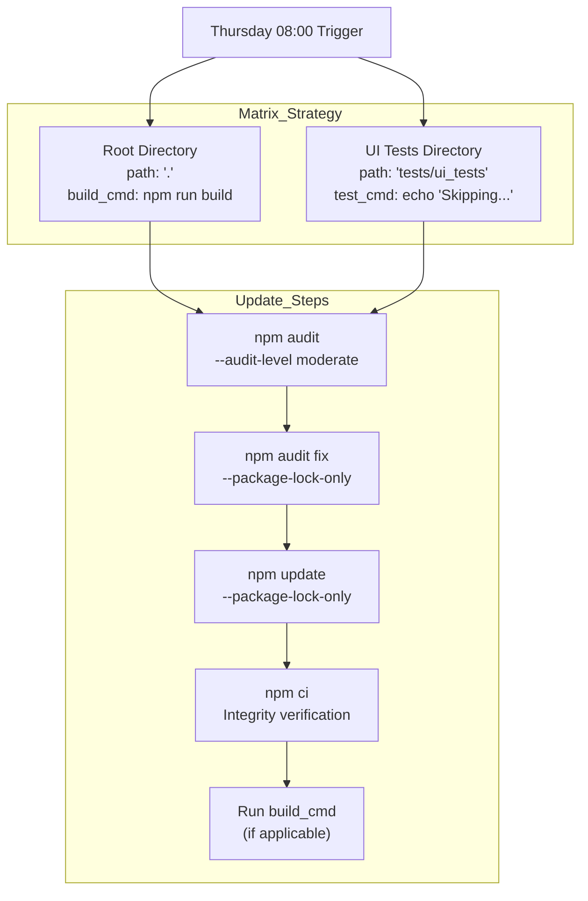
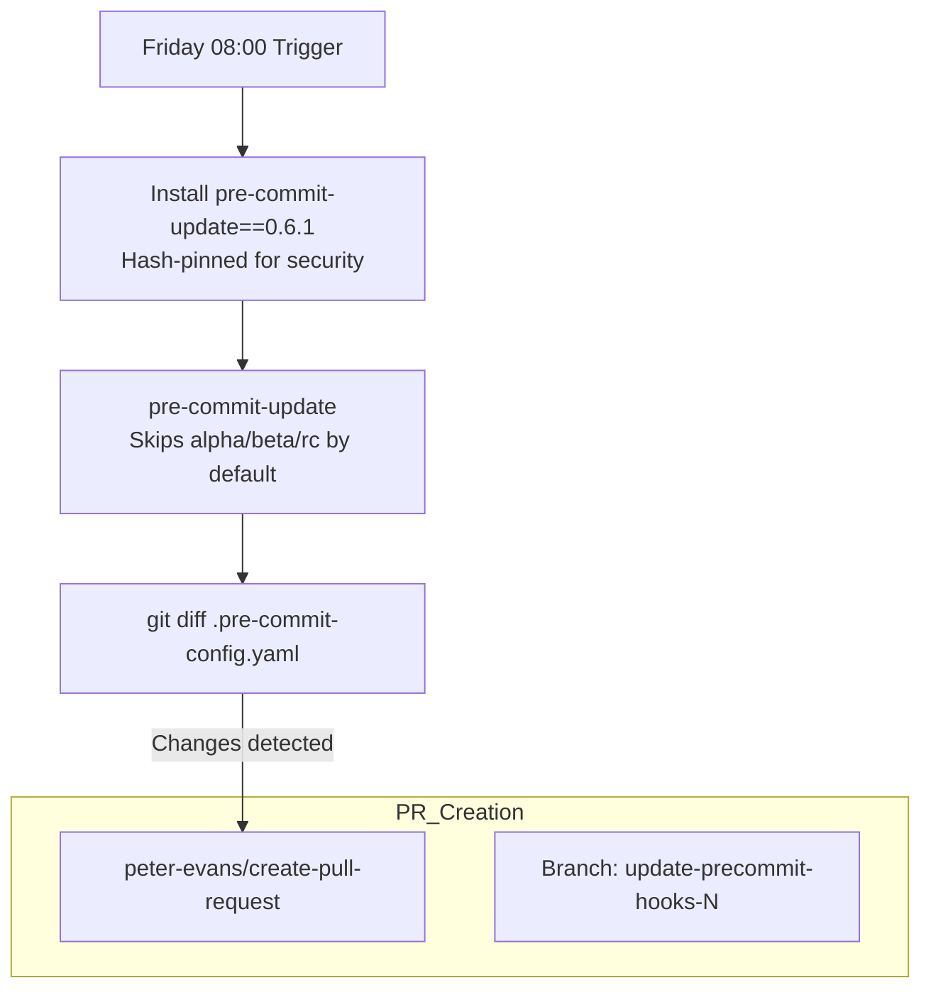
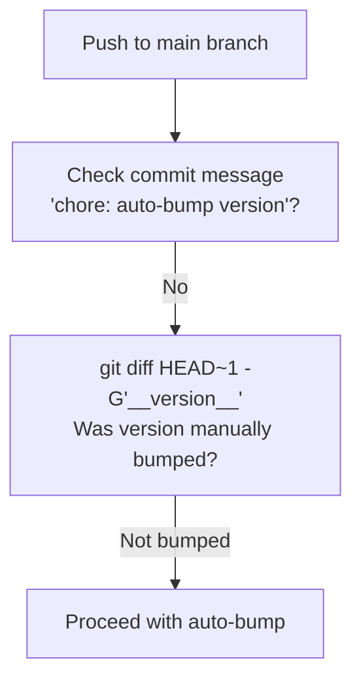

<!-- source: DeepWiki mcp.deepwiki.com · repo LearningCircuit/local-deep-research · page 8.6 Automated Dependency Maintenance · fetched 2026-10-29 -->

# Automated Dependency Maintenance

Relevant source files

The following files were used as context for generating this wiki page:

- [.github/release.yml](.github/release.yml)
- [.github/workflows/README.md](.github/workflows/README.md)
- [.github/workflows/advanced-search-reminder.yml](.github/workflows/advanced-search-reminder.yml)
- [.github/workflows/ai-code-reviewer.yml](.github/workflows/ai-code-reviewer.yml)
- [.github/workflows/check-env-vars.yml](.github/workflows/check-env-vars.yml)
- [.github/workflows/claude-code-review.yml](.github/workflows/claude-code-review.yml)
- [.github/workflows/danger-zone-alert.yml](.github/workflows/danger-zone-alert.yml)
- [.github/workflows/dependency-review.yml](.github/workflows/dependency-review.yml)
- [.github/workflows/docker-multiarch-test.yml](.github/workflows/docker-multiarch-test.yml)
- [.github/workflows/e2e-research-test.yml](.github/workflows/e2e-research-test.yml)
- [.github/workflows/file-whitelist-check.yml](.github/workflows/file-whitelist-check.yml)
- [.github/workflows/fuzz.yml](.github/workflows/fuzz.yml)
- [.github/workflows/gitleaks.yml](.github/workflows/gitleaks.yml)
- [.github/workflows/label-fixed-in-dev.yml](.github/workflows/label-fixed-in-dev.yml)
- [.github/workflows/mypy-type-check.yml](.github/workflows/mypy-type-check.yml)
- [.github/workflows/npm-audit.yml](.github/workflows/npm-audit.yml)
- [.github/workflows/osv-scanner-scheduled.yml](.github/workflows/osv-scanner-scheduled.yml)
- [.github/workflows/osv-scanner.yml](.github/workflows/osv-scanner.yml)
- [.github/workflows/pre-commit.yml](.github/workflows/pre-commit.yml)
- [.github/workflows/security-file-write-check.yml](.github/workflows/security-file-write-check.yml)
- [.github/workflows/security-headers-validation.yml](.github/workflows/security-headers-validation.yml)
- [.github/workflows/sync-main-to-dev.yml](.github/workflows/sync-main-to-dev.yml)
- [.github/workflows/update-dependencies.yml](.github/workflows/update-dependencies.yml)
- [.github/workflows/update-npm-dependencies.yml](.github/workflows/update-npm-dependencies.yml)
- [.github/workflows/update-precommit-hooks.yml](.github/workflows/update-precommit-hooks.yml)
- [.github/workflows/validate-image-pinning.yml](.github/workflows/validate-image-pinning.yml)
- [.github/workflows/version_check.yml](.github/workflows/version_check.yml)
- [.github/workflows/zizmor-security.yml](.github/workflows/zizmor-security.yml)

## Purpose and Scope

This document describes the automated dependency maintenance system that keeps Local Deep Research's dependencies up-to-date. The system uses a staggered weekly schedule to update PDM dependencies, NPM dependencies, and pre-commit hooks through automated pull requests. Additionally, an auto-versioning workflow creates pull requests for version bumps after merges to the main branch, while image pinning validation ensures supply chain security.

For information about the broader CI/CD pipeline, see [Continuous Integration Workflows](8.1). For details on security scanning of dependencies, see [Security Scanning Infrastructure](8.2).

---

## Maintenance Schedule and Strategy

Local Deep Research uses a **staggered weekly update strategy** where different dependency types are updated on specific days. This approach prevents conflicts between concurrent updates and allows each update to be tested in isolation.

### Weekly Schedule

| Day | Time (UTC) | Workflow | Artifacts Updated |
|-----|-----------|----------|-------------------|
| Monday | 09:00 | Zizmor Security Scan | Workflow security audit [.github/workflows/zizmor-security.yml:8-8]() |
| Wednesday | 08:00 | PDM Dependency Update | `pdm.lock` [.github/workflows/update-dependencies.yml:16-16]() |
| Thursday | 08:00 | NPM Dependency Update | `package-lock.json` (Root & UI Tests) [.github/workflows/update-npm-dependencies.yml:16-16]() |
| Friday | 08:00 | Pre-commit Hook Update | `.pre-commit-config.yaml` [.github/workflows/update-precommit-hooks.yml:5-5]() |

### Schedule Architecture

Title: Dependency Maintenance Workflow Orchestration

**Sources:**
- [.github/workflows/update-dependencies.yml:16-16]()
- [.github/workflows/update-npm-dependencies.yml:15-16]()
- [.github/workflows/update-precommit-hooks.yml:4-5]()
- [.github/workflows/zizmor-security.yml:8-8]()

---

## PDM Dependency Update System

The PDM update workflow runs every Wednesday and updates Python dependencies. It focuses on the lockfile to ensure reproducible builds while allowing compatible version upgrades within the constraints defined in `pyproject.toml`.

### PDM Update Logic Flow

Title: PDM Update Logic Flow

The workflow uses `pdm lock` to refresh the dependency tree [.github/workflows/update-dependencies.yml:57-57](). It pins the Python version to `3.12` during this process to ensure the chosen package versions remain compatible with the project's floor requirement [.github/workflows/update-dependencies.yml:42-48]().

**Sources:**
- [.github/workflows/update-dependencies.yml:40-74]()

---

## NPM Dependency Update System

The NPM update workflow runs every Thursday and handles JavaScript dependencies. It uses a **matrix strategy** to update dependencies in multiple directories: the root project and the `tests/ui_tests` suite [.github/workflows/update-npm-dependencies.yml:27-31]().

### NPM Update Matrix Strategy

Title: NPM Matrix Update Strategy

### Security-First Update Process

The NPM update workflow prioritizes security by performing vulnerability fixes before general updates:

1. **Security Audit**: Checks for vulnerabilities at moderate severity or higher using `npm audit` [.github/workflows/update-npm-dependencies.yml:57-57]().
2. **Vulnerability Fix**: Applies automatic fixes to the lockfile using `npm audit fix --package-lock-only` [.github/workflows/update-npm-dependencies.yml:65-65]().
3. **Version Update**: Updates to latest compatible versions with `npm update --package-lock-only` [.github/workflows/update-npm-dependencies.yml:76-76]().
4. **Integrity Verification**: Installs from lockfile with `npm ci` to verify package integrity hashes [.github/workflows/update-npm-dependencies.yml:85-85]().

**Sources:**
- [.github/workflows/update-npm-dependencies.yml:52-86]()

---

## Pre-commit Hook Update System

The pre-commit hook update workflow runs every Friday to update hook versions in `.pre-commit-config.yaml`.

### Pre-commit Update Implementation

Title: Pre-commit Hook Update Process

The workflow installs `pre-commit-update` using SHA256 hash pinning to ensure the tool itself has not been tampered with [.github/workflows/update-precommit-hooks.yml:33-38]().

**Sources:**
- [.github/workflows/update-precommit-hooks.yml:1-79]()

---

## Version Auto-Bump System

The version auto-bump workflow runs after merges to `main` and creates a pull request to bump the version number across the codebase.

### Version Bump Trigger Logic

Title: Version Bump Conditionals

The workflow detects if a version bump is necessary by checking the commit message [.github/workflows/version_check.yml:42-42]() and scanning for manual version changes in the pushed commits [.github/workflows/version_check.yml:74-80]().

### Version Synchronization

The workflow synchronizes the version across multiple files and regenerates documentation:
1. **Python Version**: Updated via `pdm bump` which modifies `src/local_deep_research/__version__.py` [.github/workflows/version_check.yml:112-112]().
2. **Frontend Version**: Updated in `package.json` using `jq` to match the new Python version [.github/workflows/version_check.yml:120-121]().
3. **Documentation**: Regenerates configuration docs via `scripts/generate_config_docs.py` [.github/workflows/version_check.yml:126-126]().

**Sources:**
- [.github/workflows/version_check.yml:99-126]()

---

## Security and Compliance Summary

The automated maintenance system incorporates multiple security measures to protect the software supply chain:

| Feature | Implementation |
|---------|----------------|
| **Harden Runner** | All maintenance workflows use `step-security/harden-runner` with `egress-policy: audit` to monitor outbound network calls [.github/workflows/update-npm-dependencies.yml:35-37](). |
| **Integrity Checks** | `npm ci` verifies lockfile integrity hashes against the downloaded packages [.github/workflows/update-npm-dependencies.yml:85-85](). |
| **Hash Pinning** | Tools like `pip` and `pre-commit-update` are installed with fixed versions and hashes in CI workflows [.github/workflows/update-precommit-hooks.yml:35-38](). |
| **Workflow Security** | `zizmor` scans GitHub Actions workflows for template injection, excessive permissions, and unpinned actions [.github/workflows/zizmor-security.yml:35-58](). |
| **Dual-Token Strategy** | Uses `PAT_TOKEN` for workflow modifications and `GITHUB_TOKEN` for PR creation to prevent self-approval issues [.github/workflows/sync-main-to-dev.yml:34-52](). |

**Sources:**
- [.github/workflows/update-npm-dependencies.yml:35-85]()
- [.github/workflows/update-precommit-hooks.yml:35-38]()
- [.github/workflows/zizmor-security.yml:35-65]()
- [.github/workflows/sync-main-to-dev.yml:34-52]()

---

