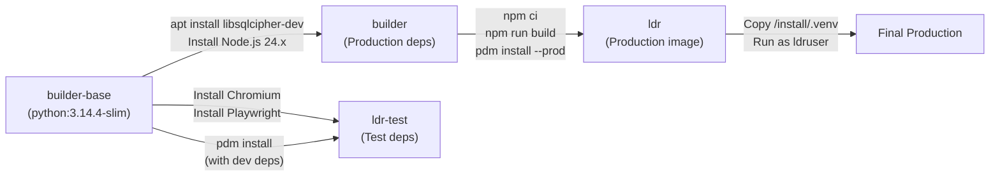
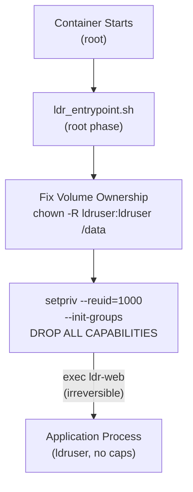
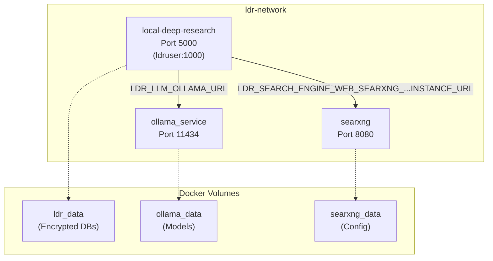

<!-- source: DeepWiki mcp.deepwiki.com · repo LearningCircuit/local-deep-research · page 9 Deployment Strategies · fetched 2026-10-29 -->

# Deployment Strategies

Relevant source files

The following files were used as context for generating this wiki page:

- [.github/CODEOWNERS](.github/CODEOWNERS)
- [Dockerfile](Dockerfile)
- [README.md](README.md)
- [cookiecutter-docker/cookiecutter.json](cookiecutter-docker/cookiecutter.json)
- [cookiecutter-docker/hooks/post_gen_project.py](cookiecutter-docker/hooks/post_gen_project.py)
- [cookiecutter-docker/hooks/pre_prompt.py](cookiecutter-docker/hooks/pre_prompt.py)
- [cookiecutter-docker/{{cookiecutter.config_name}}/docker-compose.{{cookiecutter.config_name}}.yml](cookiecutter-docker/{{cookiecutter.config_name}}/docker-compose.{{cookiecutter.config_name}}.yml)
- [docker-compose.gpu.override.yml](docker-compose.gpu.override.yml)
- [docker-compose.unraid.yml](docker-compose.unraid.yml)
- [docker-compose.yml](docker-compose.yml)
- [docs/CI_CD_INFRASTRUCTURE.md](docs/CI_CD_INFRASTRUCTURE.md)
- [docs/CUSTOM_LLM_INTEGRATION.md](docs/CUSTOM_LLM_INTEGRATION.md)
- [docs/SECURITY_REVIEW_PROCESS.md](docs/SECURITY_REVIEW_PROCESS.md)
- [docs/SQLCIPHER_INSTALL.md](docs/SQLCIPHER_INSTALL.md)
- [docs/analytics-dashboard.md](docs/analytics-dashboard.md)
- [docs/architecture.md](docs/architecture.md)
- [docs/architecture/DATABASE_SCHEMA.md](docs/architecture/DATABASE_SCHEMA.md)
- [docs/architecture/OVERVIEW.md](docs/architecture/OVERVIEW.md)
- [docs/decisions/0001-remove-detect-secrets.md](docs/decisions/0001-remove-detect-secrets.md)
- [docs/decisions/0004-nullpool-for-sqlcipher.md](docs/decisions/0004-nullpool-for-sqlcipher.md)
- [docs/deployment/unraid.md](docs/deployment/unraid.md)
- [docs/developing.md](docs/developing.md)
- [docs/developing/EXTENDING.md](docs/developing/EXTENDING.md)
- [docs/docker-compose-guide.md](docs/docker-compose-guide.md)
- [docs/env_configuration.md](docs/env_configuration.md)
- [docs/faq.md](docs/faq.md)
- [docs/features.md](docs/features.md)
- [docs/install-pip.md](docs/install-pip.md)
- [docs/installation.md](docs/installation.md)
- [docs/library-and-rag.md](docs/library-and-rag.md)
- [docs/mcp-server.md](docs/mcp-server.md)
- [docs/search-engines.md](docs/search-engines.md)
- [docs/troubleshooting.md](docs/troubleshooting.md)
- [scripts/.gitkeep](scripts/.gitkeep)
- [scripts/ollama_entrypoint.sh](scripts/ollama_entrypoint.sh)
- [src/local_deep_research/database/sqlcipher_compat.py](src/local_deep_research/database/sqlcipher_compat.py)
- [src/local_deep_research/web/database/README.md](src/local_deep_research/web/database/README.md)
- [tests/api_tests_with_login/puppeteer_config.js](tests/api_tests_with_login/puppeteer_config.js)
- [tests/database/test_post_login_settings_atomicity.py](tests/database/test_post_login_settings_atomicity.py)
- [tests/mcp/test_mcp_strategy.py](tests/mcp/test_mcp_strategy.py)
- [tests/ui_tests/puppeteer_config.js](tests/ui_tests/puppeteer_config.js)
- [tests/ui_tests/test_login_validation.js](tests/ui_tests/test_login_validation.js)
- [tests/web/routes/test_history_routes_extended.py](tests/web/routes/test_history_routes_extended.py)
- [unraid-templates/local-deep-research.xml](unraid-templates/local-deep-research.xml)

## Purpose and Scope

This document provides an overview of deployment strategies for Local Deep Research (LDR) across different environments and platforms. It covers container-based deployment (Docker and Docker Compose), multi-architecture support, GPU acceleration, and the CI/CD pipeline that ensures secure, reproducible builds.

For detailed Docker Compose configuration, see [Docker Compose Deployment](#9.1). For GPU setup, see [GPU-Accelerated Deployment](#9.2). For production security practices, see [Production Configuration and Hardening](#9.3).

## Deployment Options

Local Deep Research supports several primary deployment methods, each suited to different use cases:

| Method | Use Case | Complexity | Encryption Support | Dependencies Bundled |
|--------|----------|------------|-------------------|---------------------|
| **Docker Compose** | Production, self-hosting | Low | Yes (built-in) | Yes (Ollama, SearXNG) |
| **Docker Run** | Quick testing, single-user | Medium | Yes (built-in) | No (manual setup) |
| **pip Install** | Development, integration | High | Yes (via wheels) | No |
| **Unraid** | Home server (NAS) | Low | Yes (built-in) | Yes (via template) |

**Recommended**: Docker Compose for most users. It bundles all dependencies into a single orchestrated stack [docker-compose.yml:19-132]().

Sources: [README.md:50-91](), [docs/docker-compose-guide.md:5-27](), [docker-compose.yml:1-17]()

## Multi-Stage Container Build

The production container is built using a multi-stage `Dockerfile` that optimizes for both testing and production deployment:

Title: LDR Docker Build Lifecycle (Code Entities)

### Stage Responsibilities:

*   **`builder-base`**: Base stage with system dependencies shared by all builds, including `libsqlcipher-dev`, `sqlcipher`, and Node.js 24.x [Dockerfile:4-45](). It pins critical tools like `pdm==2.26.2` and `playwright==1.58.0` [Dockerfile:51-52]().
*   **`builder`**: Production dependency installation. Runs `npm ci`, `npm run build` for the frontend (Vite), and `pdm install --prod` for the Python backend [Dockerfile:84-100]().
*   **`ldr-test`**: Testing infrastructure used in CI. Includes Chromium, Playwright, and XVFB for UI and accessibility tests [Dockerfile:105-196]().
*   **`ldr`**: Final production image. Minimal footprint, runs as a non-root `ldruser` (UID 1000) [Dockerfile:229-283]().

Sources: [Dockerfile:1-283]()

## Container Privilege Model

The production container implements a defense-in-depth privilege model to minimize the attack surface:

Title: LDR Container Security Escalation/De-escalation (System Flow)

The container drops all capabilities (`cap_drop: ALL`) and uses `setpriv` to irreversibly switch to a non-privileged user [cookiecutter-docker/{{cookiecutter.config_name}}/docker-compose.{{cookiecutter.config_name}}.yml:37-48](). The entrypoint script handles necessary root-level tasks like directory ownership before de-escalating [Dockerfile:245-256]().

Sources: [Dockerfile:229-283](), [cookiecutter-docker/{{cookiecutter.config_name}}/docker-compose.{{cookiecutter.config_name}}.yml:37-48]()

## Docker Compose Orchestration

Docker Compose orchestrates three primary services on a shared network:

1.  **`local-deep-research`**: The main Flask web application [docker-compose.yml:20-173]().
2.  **`ollama`**: Local LLM inference engine [docker-compose.yml:175-201]().
3.  **`searxng`**: Privacy-focused meta search engine [docker-compose.yml:203-209]().

Title: LDR Service Architecture (Docker Space)

Sources: [docker-compose.yml:19-218](), [docs/docker-compose-guide.md:41-50](), [cookiecutter-docker/{{cookiecutter.config_name}}/docker-compose.{{cookiecutter.config_name}}.yml:1-128]()

## Override Pattern for GPU Support

GPU acceleration uses Docker Compose's override pattern. This allows the same base configuration to work on all platforms while opting into hardware acceleration where available.

*   **NVIDIA GPU**: Handled via `docker-compose.gpu.override.yml` using the `nvidia` driver and `gpu` capabilities [docs/docker-compose-guide.md:15-25](), [docker-compose.yml:10-13]().
*   **AMD GPU**: Supported via `rocm` images and device passthrough (`/dev/kfd`, `/dev/dri`) [cookiecutter-docker/{{cookiecutter.config_name}}/docker-compose.{{cookiecutter.config_name}}.yml:63-98]().
*   **Cookiecutter Detection**: The `cookiecutter-docker` system includes logic in `pre_prompt.py` to detect GPU types via `check_gpu_linux` and `check_gpu_windows` [cookiecutter-docker/hooks/pre_prompt.py:27-90]().

Sources: [docs/docker-compose-guide.md:15-25](), [cookiecutter-docker/{{cookiecutter.config_name}}/docker-compose.{{cookiecutter.config_name}}.yml:63-98](), [cookiecutter-docker/hooks/pre_prompt.py:27-90](), [docker-compose.yml:10-13]()

## Multi-Architecture Support

LDR supports both `amd64` and `arm64` architectures. The Docker build process utilizes `builder-base` to handle platform-specific SQLCipher requirements:

*   **Architecture Detection**: PDM automatically selects the correct Python binding (e.g., `sqlcipher3-binary` for x86_64 Linux vs building from source for ARM64) [docs/SQLCIPHER_INSTALL.md:21-25]().
*   **Buildx Support**: Docker images are published with multi-arch manifests for `amd64` and `arm64` [README.md:24]().

Sources: [Dockerfile:11-45](), [docs/SQLCIPHER_INSTALL.md:21-25](), [README.md:24]()

## Build and Release Pipeline

The CI/CD pipeline enforces rigorous security gates before publishing:

1.  **Security Scanning**: Includes CodeQL, Semgrep, and other static analysis tools to maintain OSSF Scorecard compliance [README.md:17-25](), [docs/CI_CD_INFRASTRUCTURE.md:90-109]().
2.  **Container Security**: Scans for vulnerabilities (Grype, Dockle) and ensures non-root execution [Dockerfile:229-283](), [docs/CI_CD_INFRASTRUCTURE.md:100-101]().
3.  **Automated Testing**: Runs unit tests via `pytest` and UI tests via `Puppeteer` in the `ldr-test` stage [Dockerfile:105-196](), [docs/CI_CD_INFRASTRUCTURE.md:81-87]().

Sources: [Dockerfile:105-283](), [docs/CI_CD_INFRASTRUCTURE.md:1-154](), [README.md:17-25]()

## Platform-Specific Considerations

*   **Unraid**: Deployment is supported via the Docker Compose Manager plugin and dedicated templates [docker-compose.yml:8](), [docker-compose.unraid.yml:1-50]().
*   **Windows/macOS**: Supported via Docker Desktop; use `host.docker.internal` to reach services running on the host machine (like LM Studio) [docker-compose.yml:26-30]().
*   **Headless CI**: `puppeteer_config.js` is tuned for resource-constrained CI environments, including a 10-minute protocol timeout for encrypted DB initialization [tests/ui_tests/puppeteer_config.js:27-43]().

Sources: [docs/docker-compose-guide.md:1-110](), [tests/ui_tests/puppeteer_config.js:27-43](), [docker-compose.yml:26-30](), [docker-compose.unraid.yml:1-50]()

---

