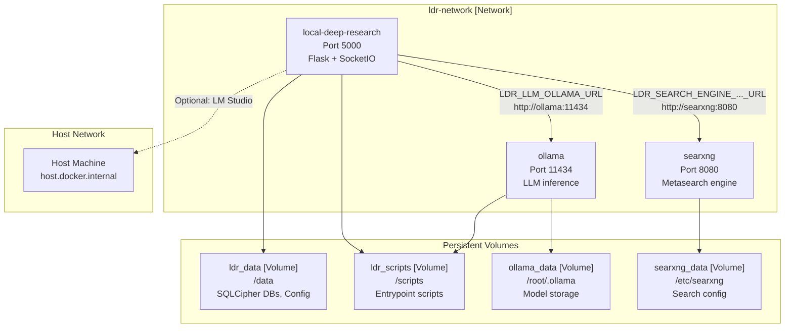
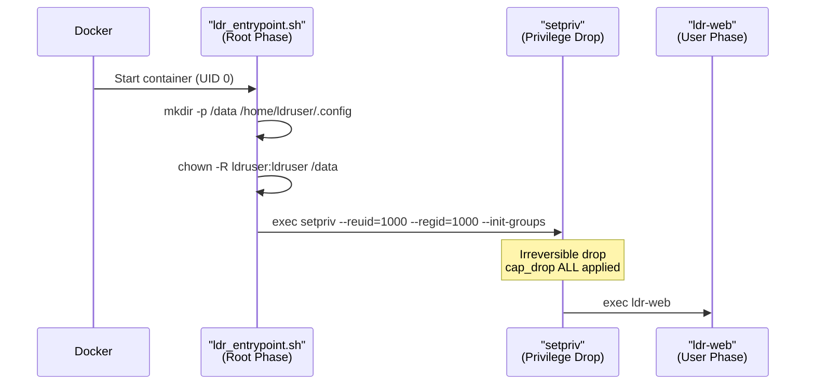
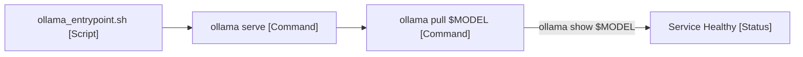
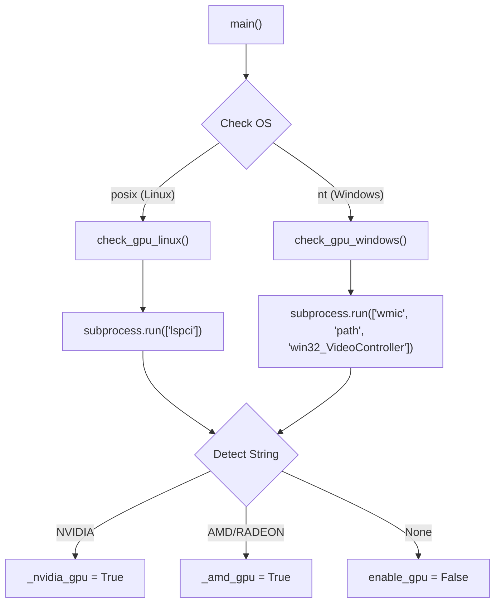

<!-- source: DeepWiki mcp.deepwiki.com · repo LearningCircuit/local-deep-research · page 9.1 Docker Compose Deployment · fetched 2026-10-29 -->

# Docker Compose Deployment

<details>
<summary>Relevant source files</summary>

The following files were used as context for generating this wiki page:

- [.github/CODEOWNERS](.github/CODEOWNERS)
- [Dockerfile](Dockerfile)
- [README.md](README.md)
- [cookiecutter-docker/cookiecutter.json](cookiecutter-docker/cookiecutter.json)
- [cookiecutter-docker/hooks/post_gen_project.py](cookiecutter-docker/hooks/post_gen_project.py)
- [cookiecutter-docker/hooks/pre_prompt.py](cookiecutter-docker/hooks/pre_prompt.py)
- [cookiecutter-docker/{{cookiecutter.config_name}}/docker-compose.{{cookiecutter.config_name}}.yml](cookiecutter-docker/{{cookiecutter.config_name}}/docker-compose.{{cookiecutter.config_name}}.yml)
- [docker-compose.gpu.override.yml](docker-compose.gpu.override.yml)
- [docker-compose.yml](docker-compose.yml)
- [docs/CI_CD_INFRASTRUCTURE.md](docs/CI_CD_INFRASTRUCTURE.md)
- [docs/SECURITY_REVIEW_PROCESS.md](docs/SECURITY_REVIEW_PROCESS.md)
- [docs/SQLCIPHER_INSTALL.md](docs/SQLCIPHER_INSTALL.md)
- [docs/decisions/0001-remove-detect-secrets.md](docs/decisions/0001-remove-detect-secrets.md)
- [docs/developing.md](docs/developing.md)
- [docs/docker-compose-guide.md](docs/docker-compose-guide.md)
- [docs/install-pip.md](docs/install-pip.md)
- [docs/installation.md](docs/installation.md)
- [scripts/.gitkeep](scripts/.gitkeep)
- [scripts/ollama_entrypoint.sh](scripts/ollama_entrypoint.sh)
- [src/local_deep_research/database/sqlcipher_compat.py](src/local_deep_research/database/sqlcipher_compat.py)
- [tests/api_tests_with_login/puppeteer_config.js](tests/api_tests_with_login/puppeteer_config.js)
- [tests/ui_tests/puppeteer_config.js](tests/ui_tests/puppeteer_config.js)
- [tests/ui_tests/test_login_validation.js](tests/ui_tests/test_login_validation.js)

</details>


This page documents the base Docker Compose configuration for Local Deep Research, covering service orchestration, networking, volume management, and container security. For GPU acceleration, see [9.2 GPU-Accelerated Deployment](). For production hardening and monitoring, see [9.3 Production Configuration and Hardening]().

## Architecture Overview

The Docker Compose deployment orchestrates three primary services on a shared internal network, ensuring privacy and local-first data flow.

Title: Docker Compose Service Orchestration


**Sources:** [docker-compose.yml:19-215](), [README.md:68-82](), [docs/docker-compose-guide.md:43-50]()

## Service Definitions

### local-deep-research Service

The main application service runs the Flask web application. It handles research logic, user authentication via SQLCipher, and real-time updates via SocketIO.

| Setting | Value | Purpose |
|---------|-------|---------|
| `image` | `localdeepresearch/local-deep-research:latest` | Multi-arch production image [docker-compose.yml:21]() |
| `ports` | `5000:5000` | Expose web interface [docker-compose.yml:32]() |
| `networks` | `ldr-network` | Isolated bridge network [docker-compose.yml:24]() |
| `restart` | `unless-stopped` | Persistence across reboots [docker-compose.yml:168]() |
| `depends_on` | `ollama` (healthy), `searxng` | Boot order management [docker-compose.yml:170-173]() |

**Sources:** [docker-compose.yml:20-173](), [Dockerfile:199-283]()

#### Entrypoint and Privilege Management

The service utilizes a non-root user `ldruser` (UID 1000) for application execution, following the principle of least privilege. The entrypoint script performs initial setup before dropping privileges via `setpriv`.

Title: Container Startup and Privilege Escalation/Reduction Flow


**Sources:** [Dockerfile:278-282](), [docker-compose.yml:144-165](), [cookiecutter-docker/{{cookiecutter.config_name}}/docker-compose.{{cookiecutter.config_name}}.yml:37-48]()

### ollama Service

The `ollama` service provides local LLM inference. It uses a custom entrypoint `ollama_entrypoint.sh` to ensure the specified model is pulled before the service is marked healthy.

Title: Ollama Model Initialization Sequence


**Key Parameters:**
- **`OLLAMA_KEEP_ALIVE`**: Set to `30m` to keep models resident in VRAM/RAM for 30 minutes after the last request [docker-compose.yml:191]().
- **Healthcheck**: Uses `ollama show` to verify the model is fully loaded [docker-compose.yml:184]().
- **Entrypoint**: Runs `ollama serve` and `ollama pull` in sequence [scripts/ollama_entrypoint.sh:25-37]().

**Sources:** [docker-compose.yml:175-198](), [scripts/ollama_entrypoint.sh:1-46]()

### searxng Service

A privacy-respecting metasearch engine. In the standard `docker-compose.yml`, it is configured to be accessible only within the `ldr-network` and is not exposed to the host by default [docker-compose.yml:200-208]().

## Network and Connectivity

### Internal DNS Resolution
Docker Compose provides automatic service discovery. The LDR service is pre-configured via environment variables to reach its dependencies using their service names:
- `LDR_LLM_OLLAMA_URL=http://ollama:11434` [docker-compose.yml:75]()
- `LDR_SEARCH_ENGINE_WEB_SEARXNG_DEFAULT_PARAMS_INSTANCE_URL=http://searxng:8080` [docker-compose.yml:76]()

### Host Gateway
To allow the container to reach services running directly on the host (like LM Studio), `extra_hosts` maps `host.docker.internal` to `host-gateway` [docker-compose.yml:28-29]().

## Volume and Data Management

| Volume | Mount Point | Content |
|--------|-------------|---------|
| `ldr_data` | `/data` | `ldr.db` (SQLCipher), research outputs, logs [docker-compose.yml:123]() |
| `ldr_scripts` | `/scripts` | Shared entrypoint scripts [docker-compose.yml:124]() |
| `ollama_data` | `/root/.ollama` | Downloaded LLM weights [docker-compose.yml:192]() |
| `searxng_data` | `/etc/searxng` | Search engine configuration [docker-compose.yml:206]() |

**Sources:** [docker-compose.yml:122-124](), [docker-compose.yml:211-215]()

## Security and Resource Limits

### Capability Management
The LDR service is hardened by dropping all Linux capabilities and adding back only the minimum required for the entrypoint to manage permissions and switch users.

- **`cap_drop: ALL`**: Removes all default capabilities [docker-compose.yml:144]().
- **`cap_add`**: Includes `CHOWN`, `FOWNER`, `DAC_OVERRIDE`, `SETUID`, and `SETGID` [docker-compose.yml:146-150]().
- **`no-new-privileges: true`**: Prevents the container process from gaining new privileges [docker-compose.yml:142]().

**Sources:** [docker-compose.yml:139-165](), [cookiecutter-docker/{{cookiecutter.config_name}}/docker-compose.{{cookiecutter.config_name}}.yml:37-48]()

### SQLCipher Memlock Ulimits
To support SQLCipher's security features, the `memlock` ulimit is set to unlimited. This allows the `mlock()` system call to succeed, which prevents encryption keys from being swapped to disk when `cipher_memory_security` is enabled (an opt-in feature for enhanced database security) [docs/docker-compose-guide.md:87-92]().

```yaml
ulimits:
  memlock:
    soft: -1
    hard: -1
```

**Sources:** [docker-compose.yml:134-137](), [docs/docker-compose-guide.md:87-92]()

## Configuration via Environment Variables

Environment variables in `docker-compose.yml` serve as **forced overrides**. When a setting is defined in the compose file, it is locked in the Web UI and cannot be changed by users [docker-compose.yml:39-42]().

- **`LDR_WEB_HOST=0.0.0.0`**: Required for Docker networking [docker-compose.yml:55]().
- **`LDR_WEB_PORT=5000`**: Internal port must match Docker's expectation [docker-compose.yml:56]().
- **`LDR_DATA_DIR=/data`**: Aligns application data path with volume mount [docker-compose.yml:57]().
- **`LDR_APP_ALLOW_REGISTRATIONS`**: Recommended to set to `false` for public deployments after initial account creation [docker-compose.yml:83]().

**Sources:** [docker-compose.yml:33-133](), [docs/docker-compose-guide.md:55-65]()

## Deployment Workflows

### Standard Deployment
```bash
curl -O https://raw.githubusercontent.com/LearningCircuit/local-deep-research/main/docker-compose.yml
docker compose up -d
```
**Sources:** [README.md:68-72](), [docs/docker-compose-guide.md:7-13]()

### Custom Model Deployment
To specify a model during startup:
```bash
LDR_LLM_MODEL=gemma3:4b docker compose up -d
```
**Sources:** [docs/docker-compose-guide.md:31-37]()

### Cookiecutter Generator
For advanced users, the `cookiecutter-docker/` directory contains a generator for tailored compose files based on GPU type and network preferences. It includes logic to detect NVIDIA/AMD GPUs on Linux and Windows via `check_gpu_linux` and `check_gpu_windows` functions in `cookiecutter-docker/hooks/pre_prompt.py`.

Title: Cookiecutter GPU Detection Logic


**Sources:** [docs/docker-compose-guide.md:97-129](), [cookiecutter-docker/{{cookiecutter.config_name}}/docker-compose.{{cookiecutter.config_name}}.yml:1-128](), [cookiecutter-docker/hooks/pre_prompt.py:27-111]()

---

