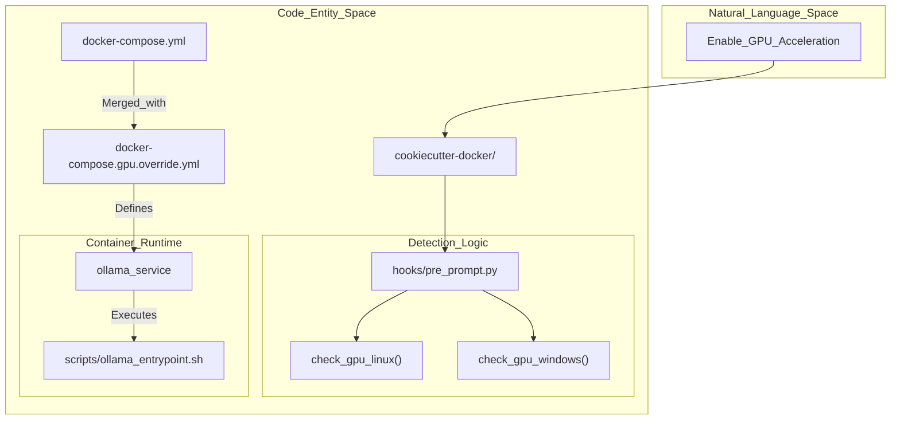
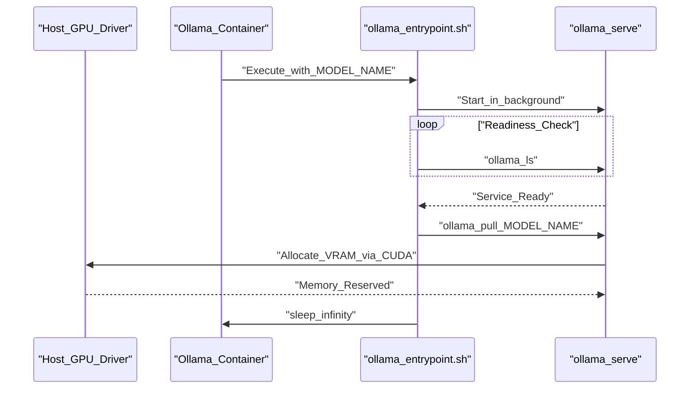
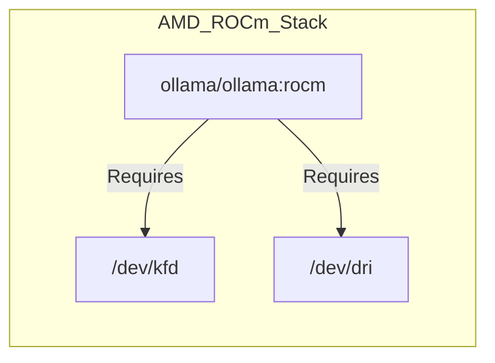

<!-- source: DeepWiki mcp.deepwiki.com · repo LearningCircuit/local-deep-research · page 9.2 GPU-Accelerated Deployment · fetched 2026-10-29 -->

# GPU-Accelerated Deployment

Relevant source files

The following files were used as context for generating this wiki page:

- [.github/CODEOWNERS](.github/CODEOWNERS)
- [Dockerfile](Dockerfile)
- [README.md](README.md)
- [cookiecutter-docker/cookiecutter.json](cookiecutter-docker/cookiecutter.json)
- [cookiecutter-docker/hooks/post_gen_project.py](cookiecutter-docker/hooks/post_gen_project.py)
- [cookiecutter-docker/hooks/pre_prompt.py](cookiecutter-docker/hooks/pre_prompt.py)
- [cookiecutter-docker/{{cookiecutter.config_name}}/docker-compose.{{cookiecutter.config_name}}.yml](cookiecutter-docker/{{cookiecutter.config_name}}/docker-compose.{{cookiecutter.config_name}}.yml)
- [docker-compose.gpu.override.yml](docker-compose.gpu.override.yml)
- [docker-compose.yml](docker-compose.yml)
- [docs/CI_CD_INFRASTRUCTURE.md](docs/CI_CD_INFRASTRUCTURE.md)
- [docs/SECURITY_REVIEW_PROCESS.md](docs/SECURITY_REVIEW_PROCESS.md)
- [docs/SQLCIPHER_INSTALL.md](docs/SQLCIPHER_INSTALL.md)
- [docs/decisions/0001-remove-detect-secrets.md](docs/decisions/0001-remove-detect-secrets.md)
- [docs/developing.md](docs/developing.md)
- [docs/docker-compose-guide.md](docs/docker-compose-guide.md)
- [docs/install-pip.md](docs/install-pip.md)
- [docs/installation.md](docs/installation.md)
- [scripts/.gitkeep](scripts/.gitkeep)
- [scripts/ollama_entrypoint.sh](scripts/ollama_entrypoint.sh)
- [src/local_deep_research/database/sqlcipher_compat.py](src/local_deep_research/database/sqlcipher_compat.py)
- [tests/api_tests_with_login/puppeteer_config.js](tests/api_tests_with_login/puppeteer_config.js)
- [tests/ui_tests/puppeteer_config.js](tests/ui_tests/puppeteer_config.js)
- [tests/ui_tests/test_login_validation.js](tests/ui_tests/test_login_validation.js)

## Purpose and Scope

This page documents the GPU-accelerated deployment of Local Deep Research, specifically for running **Ollama** with hardware acceleration. It covers the `docker-compose.gpu.override.yml` architecture, NVIDIA GPU passthrough, AMD GPU support, and the `cookiecutter-docker` configuration generator which features automatic GPU detection via `check_gpu_linux` and `check_gpu_windows`.

GPU acceleration significantly improves LLM inference speed for research synthesis and question generation. While the base configuration is CPU-only for maximum compatibility, hardware acceleration is enabled via Docker Compose overrides or custom-generated configurations.

---

## GPU Deployment Architecture

Hardware acceleration is implemented using a "layered" Compose strategy. The base `docker-compose.yml` [docker-compose.yml:1-17]() provides the service definitions and networking, while GPU-specific overrides inject the necessary device reservations and drivers.

### Configuration Stack and Code Entities

The following diagram maps the configuration flow from the natural language intent (e.g., "Enable GPU") to the specific code entities and scripts that manage the hardware lifecycle.

Title: "GPU Configuration and Execution Flow"

**Sources:**
- [docker-compose.yml:1-17]()
- [cookiecutter-docker/hooks/pre_prompt.py:27-90]()
- [cookiecutter-docker/{{cookiecutter.config_name}}/docker-compose.{{cookiecutter.config_name}}.yml:85-99]()

---

## NVIDIA GPU Passthrough

NVIDIA acceleration is the primary supported method for Linux and Windows (via WSL2) environments. It requires the **NVIDIA Container Toolkit** on the host [docs/docker-compose-guide.md:25-26]().

### Implementation Details

The passthrough is defined in the deployment configuration [cookiecutter-docker/{{cookiecutter.config_name}}/docker-compose.{{cookiecutter.config_name}}.yml:86-93](). It targets the `ollama` service and specifies a `deploy` reservation:

- **Driver:** `nvidia` [cookiecutter-docker/{{cookiecutter.config_name}}/docker-compose.{{cookiecutter.config_name}}.yml:91-91]()
- **Capabilities:** `[gpu]` [cookiecutter-docker/{{cookiecutter.config_name}}/docker-compose.{{cookiecutter.config_name}}.yml:93-93]()
- **Count:** `all` [cookiecutter-docker/{{cookiecutter.config_name}}/docker-compose.{{cookiecutter.config_name}}.yml:92-92]()

### Service Initialization Flow

When the GPU-enabled container starts, it executes `scripts/ollama_entrypoint.sh` [scripts/ollama_entrypoint.sh:1-46](). This script handles the background process management for `ollama serve` and the initial model pull.

Title: "GPU Service Initialization Sequence"

**Sources:**
- [scripts/ollama_entrypoint.sh:24-45]()
- [cookiecutter-docker/{{cookiecutter.config_name}}/docker-compose.{{cookiecutter.config_name}}.yml:69-69]()

---

## Automatic GPU Detection (Cookiecutter)

The `cookiecutter-docker/` directory provides a way to generate deployment files tailored to the user's hardware. The logic resides in `hooks/pre_prompt.py` [cookiecutter-docker/hooks/pre_prompt.py:1-112]().

### Detection Logic by Platform

The system attempts to identify hardware before prompting the user for configuration values.

| Function | Platform | Implementation Detail | Code Reference |
| :--- | :--- | :--- | :--- |
| `check_gpu_linux` | Linux | Parses `lspci` output for "vga" and "NVIDIA"/"AMD" | [cookiecutter-docker/hooks/pre_prompt.py:27-58]() |
| `check_gpu_windows` | Windows | Uses `wmic path win32_VideoController get name` | [cookiecutter-docker/hooks/pre_prompt.py:60-90]() |

### Context Mapping

Based on detection, the following context variables are updated:
- `_nvidia_gpu`: Boolean flag for NVIDIA hardware [cookiecutter-docker/hooks/pre_prompt.py:45-45]().
- `_amd_gpu`: Boolean flag for AMD hardware [cookiecutter-docker/hooks/pre_prompt.py:50-50]().
- `enable_gpu`: Final toggle for including GPU blocks in the generated YAML [cookiecutter-docker/hooks/pre_prompt.py:52-52]().

**Sources:**
- [cookiecutter-docker/hooks/pre_prompt.py:92-108]()
- [cookiecutter-docker/cookiecutter.json:1-9]()

---

## AMD GPU Support (ROCm)

The codebase includes support for AMD GPUs using the ROCm (Radeon Open Compute) platform. This is handled dynamically in the `cookiecutter` templates.

### Template Logic for AMD

In the generated `docker-compose.yml`, the image and device mapping change if an AMD GPU is detected [cookiecutter-docker/{{cookiecutter.config_name}}/docker-compose.{{cookiecutter.config_name}}.yml:63-98]():

1. **Image Selection:** Uses `ollama/ollama:rocm` instead of `latest` [cookiecutter-docker/{{cookiecutter.config_name}}/docker-compose.{{cookiecutter.config_name}}.yml:64-64]().
2. **Device Mapping:** Maps `/dev/kfd` (Kernel Fusion Driver) and `/dev/dri` (Direct Rendering Infrastructure) directly into the container [cookiecutter-docker/{{cookiecutter.config_name}}/docker-compose.{{cookiecutter.config_name}}.yml:96-97]().

Title: "AMD ROCm Device Mapping"

**Sources:**
- [cookiecutter-docker/{{cookiecutter.config_name}}/docker-compose.{{cookiecutter.config_name}}.yml:63-67]()
- [cookiecutter-docker/{{cookiecutter.config_name}}/docker-compose.{{cookiecutter.config_name}}.yml:94-98]()

---

## GPU-Accelerated LLM Inference Configuration

Hardware acceleration performance is tuned via environment variables passed to the Ollama service.

### Key Performance Variables

| Variable | Default | Role |
| :--- | :--- | :--- |
| `OLLAMA_KEEP_ALIVE` | `30m` | Keeps the model in VRAM to avoid reload latency between research steps [cookiecutter-docker/{{cookiecutter.config_name}}/docker-compose.{{cookiecutter.config_name}}.yml:77-77](). |
| `MODEL` | `gemma3:12b` | The default model targeted for hardware acceleration [cookiecutter-docker/hooks/pre_prompt.py:16-16](). |

### Resource Lifecycle in Compose

The `ollama` service includes a healthcheck that verifies model availability [cookiecutter-docker/{{cookiecutter.config_name}}/docker-compose.{{cookiecutter.config_name}}.yml:70-75](). This ensures the `local-deep-research` service (which `depends_on` ollama) only starts once the GPU has successfully loaded the model into VRAM [cookiecutter-docker/{{cookiecutter.config_name}}/docker-compose.{{cookiecutter.config_name}}.yml:50-54]().

**Sources:**
- [cookiecutter-docker/{{cookiecutter.config_name}}/docker-compose.{{cookiecutter.config_name}}.yml:70-75]()
- [cookiecutter-docker/{{cookiecutter.config_name}}/docker-compose.{{cookiecutter.config_name}}.yml:50-54]()

---

## Testing Environment GPU Restrictions

In CI and Docker-based testing environments, GPU acceleration is explicitly disabled for the browser components (Puppeteer/Playwright) to prevent resource contention and ensure stability in headless environments.

- **Puppeteer Config:** The `--disable-gpu` flag is passed to the browser launch options [tests/ui_tests/puppeteer_config.js:41-41]().
- **Detection:** The configuration helper `getPuppeteerLaunchOptions` detects the environment using `process.env.DOCKER_ENV` [tests/ui_tests/puppeteer_config.js:50-50]().

**Sources:**
- [tests/ui_tests/puppeteer_config.js:27-47]()
- [tests/api_tests_with_login/puppeteer_config.js:5-17]()

---

