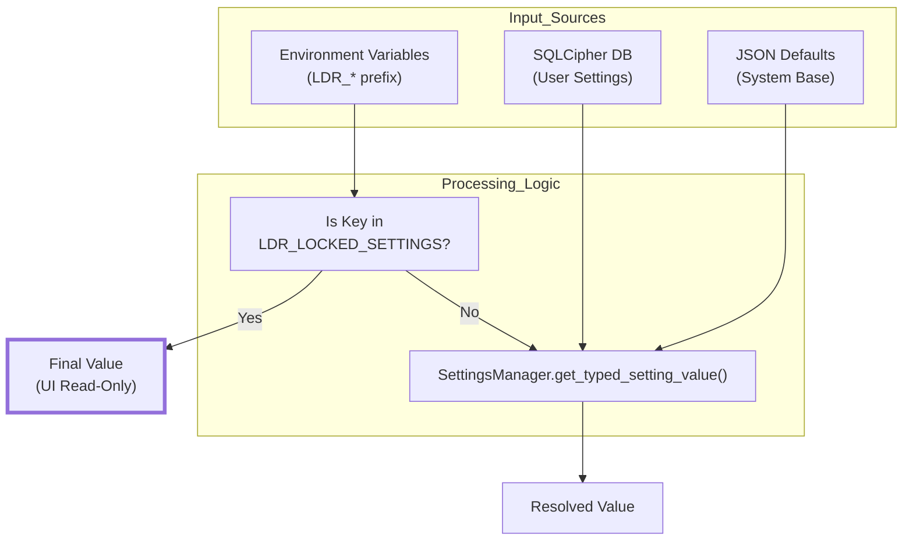
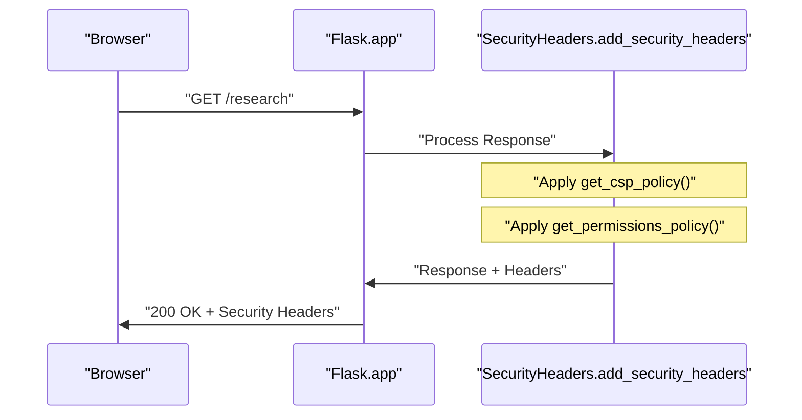
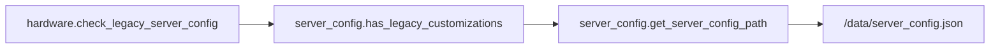

<!-- source: DeepWiki mcp.deepwiki.com · repo LearningCircuit/local-deep-research · page 9.3 Production Configuration and Hardening · fetched 2026-10-29 -->

# Production Configuration and Hardening

Relevant source files

The following files were used as context for generating this wiki page:

- [.semgrep/rules/README.md](.semgrep/rules/README.md)
- [.semgrep/rules/ldr-security.yaml](.semgrep/rules/ldr-security.yaml)
- [.zap/rules.tsv](.zap/rules.tsv)
- [docker-compose.unraid.yml](docker-compose.unraid.yml)
- [docs/CUSTOM_LLM_INTEGRATION.md](docs/CUSTOM_LLM_INTEGRATION.md)
- [docs/analytics-dashboard.md](docs/analytics-dashboard.md)
- [docs/architecture.md](docs/architecture.md)
- [docs/architecture/DATABASE_SCHEMA.md](docs/architecture/DATABASE_SCHEMA.md)
- [docs/architecture/OVERVIEW.md](docs/architecture/OVERVIEW.md)
- [docs/decisions/0004-nullpool-for-sqlcipher.md](docs/decisions/0004-nullpool-for-sqlcipher.md)
- [docs/deployment/unraid.md](docs/deployment/unraid.md)
- [docs/developing/EXTENDING.md](docs/developing/EXTENDING.md)
- [docs/env_configuration.md](docs/env_configuration.md)
- [docs/faq.md](docs/faq.md)
- [docs/features.md](docs/features.md)
- [docs/library-and-rag.md](docs/library-and-rag.md)
- [docs/mcp-server.md](docs/mcp-server.md)
- [docs/search-engines.md](docs/search-engines.md)
- [docs/troubleshooting.md](docs/troubleshooting.md)
- [src/local_deep_research/defaults/settings_security.json](src/local_deep_research/defaults/settings_security.json)
- [src/local_deep_research/security/__init__.py](src/local_deep_research/security/__init__.py)
- [src/local_deep_research/security/security_headers.py](src/local_deep_research/security/security_headers.py)
- [src/local_deep_research/utilities/formatting.py](src/local_deep_research/utilities/formatting.py)
- [src/local_deep_research/web/database/README.md](src/local_deep_research/web/database/README.md)
- [src/local_deep_research/web/server_config.py](src/local_deep_research/web/server_config.py)
- [src/local_deep_research/web/warning_checks/__init__.py](src/local_deep_research/web/warning_checks/__init__.py)
- [src/local_deep_research/web/warning_checks/backup.py](src/local_deep_research/web/warning_checks/backup.py)
- [src/local_deep_research/web/warning_checks/hardware.py](src/local_deep_research/web/warning_checks/hardware.py)
- [tests/database/test_post_login_settings_atomicity.py](tests/database/test_post_login_settings_atomicity.py)
- [tests/library/download_management/test_database_init.py](tests/library/download_management/test_database_init.py)
- [tests/mcp/test_mcp_strategy.py](tests/mcp/test_mcp_strategy.py)
- [tests/news/subscription_manager/test_scheduler_coverage.py](tests/news/subscription_manager/test_scheduler_coverage.py)
- [tests/news/test_scheduler.py](tests/news/test_scheduler.py)
- [tests/news/test_scheduler_comprehensive.py](tests/news/test_scheduler_comprehensive.py)
- [tests/news/test_scheduler_extended.py](tests/news/test_scheduler_extended.py)
- [tests/search_engines/test_search_engine_serper.py](tests/search_engines/test_search_engine_serper.py)
- [tests/search_engines/test_search_engine_wayback.py](tests/search_engines/test_search_engine_wayback.py)
- [tests/search_engines/test_search_engine_wikinews.py](tests/search_engines/test_search_engine_wikinews.py)
- [tests/security/test_check_response_size.py](tests/security/test_check_response_size.py)
- [tests/security/test_security_headers.py](tests/security/test_security_headers.py)
- [tests/web/routes/test_backup_status_api.py](tests/web/routes/test_backup_status_api.py)
- [tests/web/routes/test_history_routes_extended.py](tests/web/routes/test_history_routes_extended.py)
- [tests/web/routes/test_settings_validation_edge_cases.py](tests/web/routes/test_settings_validation_edge_cases.py)
- [tests/web/services/test_socket_service.py](tests/web/services/test_socket_service.py)
- [tests/web/test_app_factory.py](tests/web/test_app_factory.py)
- [tests/web/test_server_config.py](tests/web/test_server_config.py)
- [tests/web/themes/test_loader.py](tests/web/themes/test_loader.py)
- [tests/web/warning_checks/test_backup.py](tests/web/warning_checks/test_backup.py)
- [tests/web/warning_checks/test_hardware.py](tests/web/warning_checks/test_hardware.py)
- [tests/web/warning_checks/test_orchestrator.py](tests/web/warning_checks/test_orchestrator.py)
- [tests/web_search_engines/engines/test_search_engine_wayback.py](tests/web_search_engines/engines/test_search_engine_wayback.py)
- [tests/web_search_engines/engines/test_search_engine_wayback_coverage.py](tests/web_search_engines/engines/test_search_engine_wayback_coverage.py)
- [tests/web_search_engines/engines/test_search_engine_wikinews.py](tests/web_search_engines/engines/test_search_engine_wikinews.py)
- [unraid-templates/local-deep-research.xml](unraid-templates/local-deep-research.xml)

## Purpose and Scope

This page documents the production-specific configuration and security hardening measures for Local Deep Research (LDR). It covers the hierarchical settings system, HTTP security middleware, container isolation strategies, and deployment-specific best practices for Unraid and Docker environments.

---

## Environment Variable Configuration System

Local Deep Research employs a robust configuration system where environment variables (prefixed with `LDR_`) interact with a per-user encrypted database.

### Configuration Hierarchy and Locking

The system differentiates between standard overrides and security-critical locks. Environment variables always take precedence over database values or defaults [docs/env_configuration.md:27-29]().

1.  **Override Mode**: Non-empty environment variables override UI settings and lock them as read-only in the interface [docs/env_configuration.md:27-29]().
2.  **Locked Mode**: Administrators can specify a list of settings in `LDR_LOCKED_SETTINGS` to prevent any modification via the Web UI, ensuring infrastructure stability in multi-user deployments.

### Essential Production Overrides
In production and containerized environments, specific variables are used to ensure network stability and data persistence:

| Setting Path | Environment Variable | Production Purpose |
|--------------|---------------------|--------------------|
| `web.host` | `LDR_WEB_HOST` | Set to `0.0.0.0` to allow external connections to the container [src/local_deep_research/web/server_config.py:24](). |
| `web.port` | `LDR_WEB_PORT` | Internal port (usually `5000`) for the Flask WSGI server [src/local_deep_research/web/server_config.py:25](). |
| `data_dir` | `LDR_DATA_DIR` | Defines the persistent path for SQLCipher databases and logs [docs/env_configuration.md:168-179](). |
| `app.allow_registrations` | `LDR_APP_ALLOW_REGISTRATIONS` | Disables public sign-ups in exposed instances [src/local_deep_research/web/server_config.py:28-32](). |

Sources: [src/local_deep_research/web/server_config.py:22-66](), [docs/env_configuration.md:1-51](), [src/local_deep_research/web/server_config.py:149-210]()

---

## Security Hardening and Middleware

### HTTP Security Headers
The `SecurityHeaders` class implements a middleware stack that injects defensive headers into every Flask response to mitigate XSS, Clickjacking, and MIME-sniffing [src/local_deep_research/security/security_headers.py:13-24]().

**Key Directives:**
- **Content-Security-Policy (CSP)**: Restricts `script-src` and `style-src` to `'self'`. It specifically includes `'unsafe-inline'` to maintain compatibility with Socket.IO real-time updates but removes `'unsafe-eval'` to block common XSS vectors [src/local_deep_research/security/security_headers.py:103-133]().
- **X-Frame-Options**: Forced to `SAMEORIGIN` to prevent the UI from being embedded in malicious iframes [src/local_deep_research/security/security_headers.py:18-18]().
- **Permissions-Policy**: Disables high-risk browser features like `camera`, `microphone`, and `geolocation` by default [src/local_deep_research/security/security_headers.py:135-156]().
- **COEP**: Cross-Origin-Embedder-Policy is set to `credentialless` by default to allow cross-origin requests without credentials [src/local_deep_research/security/security_headers.py:83-83]().

Sources: [src/local_deep_research/security/security_headers.py:1-133](), [src/local_deep_research/security/__init__.py:17-17](), [tests/security/test_security_headers.py:102-147]()

### Container Hardening
Production Docker images are hardened to minimize the attack surface:
- **Non-Root User**: Containers are configured to run as a non-privileged user (typically `ldruser`) to prevent host-level compromise.
- **Resource Limits**: Production deployments are advised to set `memlock` to unlimited to allow SQLCipher's `mlock()` to protect encryption keys in RAM.
- **Volume Persistence**: Critical data including the SQLCipher database (`ldr.db`) and the secret key must be mapped to persistent volumes to prevent session loss or data corruption [docs/env_configuration.md:168-179]().

Sources: [docs/env_configuration.md:109-118](), [docs/deployment/unraid.md:110-122]()

### Rate Limiting
Production instances use `Flask-Limiter` (configured via `LDR_SECURITY_RATE_LIMIT_*`) to prevent brute-force attacks on sensitive endpoints:
- **Login**: Defaults to `5 per 15 minutes` [src/local_deep_research/web/server_config.py:63]().
- **Registration**: Defaults to `3 per hour` [src/local_deep_research/web/server_config.py:64]().
- **Settings**: Defaults to `30 per minute` [src/local_deep_research/web/server_config.py:65]().

Sources: [src/local_deep_research/web/server_config.py:56-66](), [src/local_deep_research/defaults/settings_security.json:2-49]()

---

## Unraid and Specialized Deployments

### Unraid Deployment Best Practices
Unraid deployments utilize specialized templates or the Docker Compose Manager plugin to manage the interaction between LDR, local LLMs (Ollama), and search aggregators (SearXNG) [docs/deployment/unraid.md:15-93]().

| Feature | Recommendation | Implementation |
|---------|----------------|----------------|
| **Persistence** | AppData Path | Map `/data` to `/mnt/user/appdata/local-deep-research/data` [docs/deployment/unraid.md:112-116](). |
| **GPU Acceleration** | NVIDIA Runtime | Use `docker-compose.gpu.override.yml` for passthrough [docs/deployment/unraid.md:85-88](). |
| **Networking** | Custom Network | Create shared networks (e.g., `ldr-network`) to allow container communication via service names [docs/deployment/unraid.md:44-48](). |

### Hardware Warnings
The system includes proactive checks to prevent production crashes due to resource exhaustion. The `check_high_context` and `check_model_mismatch` functions trigger UI warnings if a user attempts to run a large model (e.g., 70B) with a context window exceeding 8192 tokens on local providers (`ollama`, `llamacpp`, `lmstudio`), which might lead to VRAM OOM (Out of Memory) errors [src/local_deep_research/web/warning_checks/hardware.py:12-64]().

Sources: [src/local_deep_research/web/warning_checks/hardware.py:1-64](), [docs/deployment/unraid.md:1-172](), [src/local_deep_research/web/warning_checks/hardware.py:9-10]()

---

## Monitoring and Health Checks

### Legacy Configuration Warnings
To ensure a smooth transition from older versions, the system detects if a legacy `server_config.json` exists. If it contains non-default values, a warning is displayed in the Web UI via `check_legacy_server_config` urging the administrator to migrate those settings to environment variables [src/local_deep_research/web/warning_checks/hardware.py:67-85]().

Sources: [src/local_deep_research/web/server_config.py:74-95](), [src/local_deep_research/web/warning_checks/hardware.py:67-85](), [docs/env_configuration.md:120-137](), [tests/web/test_server_config.py:18-19]()

---

