# Page: Overview

# Overview

<details>
<summary>Relevant source files</summary>

The following files were used as context for generating this wiki page:

- [.file-whitelist.txt](.file-whitelist.txt)
- [.github/CODEOWNERS](.github/CODEOWNERS)
- [.github/scripts/file-whitelist-check.sh](.github/scripts/file-whitelist-check.sh)
- [.gitignore](.gitignore)
- [.gitleaks.toml](.gitleaks.toml)
- [.gitleaksignore](.gitleaksignore)
- [.pre-commit-config.yaml](.pre-commit-config.yaml)
- [.pre-commit-hooks/check-absolute-module-paths.py](.pre-commit-hooks/check-absolute-module-paths.py)
- [.pre-commit-hooks/file-whitelist-check.sh](.pre-commit-hooks/file-whitelist-check.sh)
- [.pre-commit-hooks/recommend-release-notes.py](.pre-commit-hooks/recommend-release-notes.py)
- [CONTRIBUTING.md](CONTRIBUTING.md)
- [README.md](README.md)
- [changelog.d/3670.breaking.1.md](changelog.d/3670.breaking.1.md)
- [changelog.d/3670.breaking.md](changelog.d/3670.breaking.md)
- [changelog.d/3670.feature.md](changelog.d/3670.feature.md)
- [changelog.d/3773.feature.md](changelog.d/3773.feature.md)
- [changelog.d/README.md](changelog.d/README.md)
- [docker-compose.gpu.override.yml](docker-compose.gpu.override.yml)
- [docs/CI_CD_INFRASTRUCTURE.md](docs/CI_CD_INFRASTRUCTURE.md)
- [docs/CONFIGURATION.md](docs/CONFIGURATION.md)
- [docs/RELEASE_GUIDE.md](docs/RELEASE_GUIDE.md)
- [docs/SECURITY_REVIEW_PROCESS.md](docs/SECURITY_REVIEW_PROCESS.md)
- [docs/SQLCIPHER_INSTALL.md](docs/SQLCIPHER_INSTALL.md)
- [docs/decisions/0001-remove-detect-secrets.md](docs/decisions/0001-remove-detect-secrets.md)
- [docs/developing.md](docs/developing.md)
- [docs/docker-compose-guide.md](docs/docker-compose-guide.md)
- [docs/install-pip.md](docs/install-pip.md)
- [docs/installation.md](docs/installation.md)
- [package-lock.json](package-lock.json)
- [package.json](package.json)
- [pdm.lock](pdm.lock)
- [pyproject.toml](pyproject.toml)
- [src/local_deep_research/__version__.py](src/local_deep_research/__version__.py)
- [src/local_deep_research/database/sqlcipher_compat.py](src/local_deep_research/database/sqlcipher_compat.py)
- [src/local_deep_research/web/static/js/mobile-navigation.js](src/local_deep_research/web/static/js/mobile-navigation.js)
- [src/local_deep_research/web/static/js/security/url-validator.js](src/local_deep_research/web/static/js/security/url-validator.js)
- [src/local_deep_research/web/static/js/services/api.js](src/local_deep_research/web/static/js/services/api.js)
- [src/local_deep_research/web/static/js/services/formatting.js](src/local_deep_research/web/static/js/services/formatting.js)
- [tests/infrastructure_tests/test_csrf_api.test.js](tests/infrastructure_tests/test_csrf_api.test.js)
- [tests/infrastructure_tests/test_urls.test.js](tests/infrastructure_tests/test_urls.test.js)
- [tests/security/test_absolute_module_paths_hook.py](tests/security/test_absolute_module_paths_hook.py)
- [vite.config.js](vite.config.js)

</details>


## Purpose and Scope

This document provides a high-level introduction to Local Deep Research (LDR), its core capabilities, architectural philosophy, and major system components. It serves as the entry point for understanding the system's design and how the pieces fit together.

**For detailed information about specific subsystems:**
- Core terminology and encrypted databases → [Key Concepts](#1.1)
- Repository organization and dependencies → [Project Structure and Dependencies](#1.2)
- Research execution → [Research Service and Execution Lifecycle](#3.3)
- RAG implementation → [Research Library and RAG System](#3.7)
- Deployment strategies → [Deployment Strategies](#9)

**Sources:** [README.md:1-45](), [src/local_deep_research/__version__.py:1-1]()

---

## What is Local Deep Research?

Local Deep Research is an AI-powered research assistant that performs deep, agentic research using multiple LLMs and search engines with proper citations [README.md:32-34](). It is designed to be "local-first" for privacy, allowing users to build a searchable knowledge base from research findings while maintaining ownership of their data [README.md:42-45]().

The system is accessible through multiple interfaces:
- **Web UI**: Primary interface for research and settings (default port 5000) [docs/CONFIGURATION.md:65-69](), accessible via the `ldr-web` entry point [pyproject.toml:111-111]().
- **REST API**: Authenticated endpoints for programmatic integration using Flask blueprints.
- **Python API**: Programmatic access via the core library for enterprise integration.
- **MCP Server**: Model Context Protocol integration via `ldr-mcp` for tools like Claude Desktop [pyproject.toml:112-112]().

The application version is currently **1.6.9**, tracked in [src/local_deep_research/__version__.py:1]().

**Sources:** [README.md:32-45](), [src/local_deep_research/__version__.py:1-1](), [package.json:3-3](), [pyproject.toml:110-112](), [docs/CONFIGURATION.md:65-69]()

---

## Core Architecture

The system bridges natural language queries to a structured research execution pipeline involving LLMs, search engines, and a RAG-enabled library.

### System Flow: Natural Language to Code Entity Space

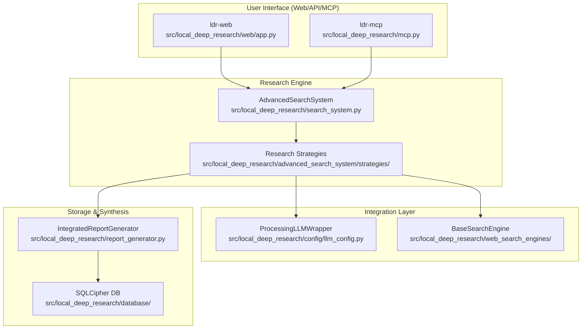

**Sources:** [pyproject.toml:110-112](), [README.md:93-115]()

---

## Key Features

### Local-First and Privacy-Focused
LDR prioritizes privacy by supporting fully local stacks. Users can run LLMs via **Ollama** and search via **SearXNG** [README.md:50-65](). Every user's data is isolated in a per-user **SQLCipher** database [README.md:15](). Encryption parameters like `LDR_DB_CONFIG_KDF_ITERATIONS` (default 256,000) and `LDR_DB_CONFIG_HMAC_ALGORITHM` (default HMAC_SHA512) are configurable via bootstrap settings [docs/CONFIGURATION.md:44-47]().

### Multi-Strategy Research
The system coordinates different search strategies via the `AdvancedSearchSystem`.
- **langgraph-agent**: Autonomous research mode where the LLM decides search tools (arXiv, PubMed, etc.) and synthesis timing [README.md:104]().
- **20+ Strategies**: Choose from specialized strategies for quick facts, deep analysis, or academic research [README.md:102]().
- **Citation-Heavy**: Every research session finds valuable sources, extracts text, and indexes them for compound knowledge [README.md:117-118]().

### Research Library and RAG
Research findings become part of a compound knowledge base. LDR can download sources into an encrypted library, index them using **FAISS**, and use them for future RAG-based queries [README.md:106-115](), [pyproject.toml:49-49]().

**Sources:** [README.md:93-115](), [docs/CONFIGURATION.md:42-49](), [pyproject.toml:49-49]()

---

## Architectural Philosophy

### 1. Zero-Knowledge and Isolation
The system uses a per-user database architecture powered by **SQLCipher**. Access is protected by password-derived keys; the system is designed so that data remains encrypted at rest [README.md:15](), [docs/CONFIGURATION.md:39-40]().

### 2. Thread-Safe Settings and Context
Research tasks run in background threads. LDR uses a settings management system that handles thread-local contexts and database session management to ensure safe execution during concurrent research tasks [docs/CONFIGURATION.md:11-13]().

### 3. Resource Lifecycle Management
The system includes automated schedulers for managing background tasks like news subscriptions [docs/CONFIGURATION.md:51-52](). Concurrency is strictly managed via limits like `LDR_SERVER_MAX_CONCURRENT_RESEARCH` [docs/CONFIGURATION.md:57]().

### 4. Pluggable Integration
The architecture uses a strategy pattern for search engines and LLMs. The `AdvancedSearchSystem` allows selecting from various strategies, while abstractions in the `web_search_engines` layer handle provider-specific logic for engines like arXiv, PubMed, and Wikipedia [pyproject.toml:45-47]().

**Sources:** [docs/CONFIGURATION.md:1-60](), [pyproject.toml:45-50]()

---

## Deployment and Build Pipeline

LDR utilizes modern Python and Frontend tooling for reproducible builds and deployment flexibility.

### Deployment Flow: Build to Execution

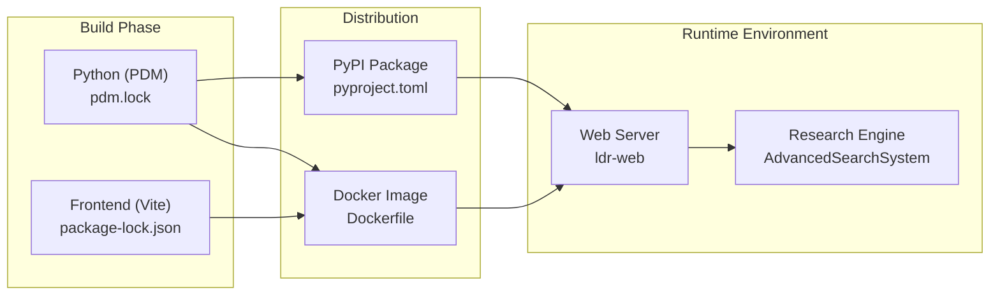

**Sources:** [package.json:1-50](), [README.md:50-89](), [pyproject.toml:1-112]()

---

## Next Steps

To begin exploring or contributing to the codebase:
- See **[Key Concepts](#1.1)** for a deep dive into the encryption and RAG models.
- Review **[Project Structure and Dependencies](#1.2)** to understand the file layout and package management (PDM and npm).
- Follow the **Getting Started** guide in the README to launch your first research session using Docker or pip [README.md:46-49]().

**Sources:** [README.md:46-49]()

---

# Page: Key Concepts

# Key Concepts

<details>
<summary>Relevant source files</summary>

The following files were used as context for generating this wiki page:

- [.github/CODEOWNERS](.github/CODEOWNERS)
- [README.md](README.md)
- [docker-compose.gpu.override.yml](docker-compose.gpu.override.yml)
- [docs/BENCHMARKING.md](docs/BENCHMARKING.md)
- [docs/CI_CD_INFRASTRUCTURE.md](docs/CI_CD_INFRASTRUCTURE.md)
- [docs/SECURITY_REVIEW_PROCESS.md](docs/SECURITY_REVIEW_PROCESS.md)
- [docs/SQLCIPHER_INSTALL.md](docs/SQLCIPHER_INSTALL.md)
- [docs/decisions/0001-remove-detect-secrets.md](docs/decisions/0001-remove-detect-secrets.md)
- [docs/developing.md](docs/developing.md)
- [docs/docker-compose-guide.md](docs/docker-compose-guide.md)
- [docs/install-pip.md](docs/install-pip.md)
- [docs/installation.md](docs/installation.md)
- [src/local_deep_research/advanced_search_system/questions/browsecomp_question.py](src/local_deep_research/advanced_search_system/questions/browsecomp_question.py)
- [src/local_deep_research/advanced_search_system/questions/flexible_browsecomp_question.py](src/local_deep_research/advanced_search_system/questions/flexible_browsecomp_question.py)
- [src/local_deep_research/advanced_search_system/strategies/langgraph_agent_strategy.py](src/local_deep_research/advanced_search_system/strategies/langgraph_agent_strategy.py)
- [src/local_deep_research/advanced_search_system/strategies/topic_organization_strategy.py](src/local_deep_research/advanced_search_system/strategies/topic_organization_strategy.py)
- [src/local_deep_research/advanced_search_system/tools/fetch/__init__.py](src/local_deep_research/advanced_search_system/tools/fetch/__init__.py)
- [src/local_deep_research/advanced_search_system/tools/fetch/prompts.py](src/local_deep_research/advanced_search_system/tools/fetch/prompts.py)
- [src/local_deep_research/benchmarks/models/__init__.py](src/local_deep_research/benchmarks/models/__init__.py)
- [src/local_deep_research/database/auth_db.py](src/local_deep_research/database/auth_db.py)
- [src/local_deep_research/database/encrypted_db.py](src/local_deep_research/database/encrypted_db.py)
- [src/local_deep_research/database/migrations/versions/0009_default_fetch_mode_summary.py](src/local_deep_research/database/migrations/versions/0009_default_fetch_mode_summary.py)
- [src/local_deep_research/database/pool_config.py](src/local_deep_research/database/pool_config.py)
- [src/local_deep_research/database/sqlcipher_compat.py](src/local_deep_research/database/sqlcipher_compat.py)
- [src/local_deep_research/database/sqlcipher_utils.py](src/local_deep_research/database/sqlcipher_utils.py)
- [src/local_deep_research/database/thread_local_session.py](src/local_deep_research/database/thread_local_session.py)
- [src/local_deep_research/defaults/default_settings.json](src/local_deep_research/defaults/default_settings.json)
- [src/local_deep_research/search_system_factory.py](src/local_deep_research/search_system_factory.py)
- [src/local_deep_research/settings/env_definitions/bootstrap.py](src/local_deep_research/settings/env_definitions/bootstrap.py)
- [src/local_deep_research/settings/env_definitions/db_config.py](src/local_deep_research/settings/env_definitions/db_config.py)
- [src/local_deep_research/settings/env_settings.py](src/local_deep_research/settings/env_settings.py)
- [src/local_deep_research/web/auth/connection_cleanup.py](src/local_deep_research/web/auth/connection_cleanup.py)
- [tests/advanced_search_system/tools/test_fetch_modes.py](tests/advanced_search_system/tools/test_fetch_modes.py)
- [tests/database/test_database_manager_extended.py](tests/database/test_database_manager_extended.py)
- [tests/database/test_encrypted_db_coverage.py](tests/database/test_encrypted_db_coverage.py)
- [tests/database/test_encrypted_db_manager.py](tests/database/test_encrypted_db_manager.py)
- [tests/database/test_migration_0009_default_fetch_mode.py](tests/database/test_migration_0009_default_fetch_mode.py)
- [tests/database/test_pool_config.py](tests/database/test_pool_config.py)
- [tests/database/test_sqlcipher_connection_factory.py](tests/database/test_sqlcipher_connection_factory.py)
- [tests/database/test_sqlcipher_integration.py](tests/database/test_sqlcipher_integration.py)
- [tests/database/test_sqlcipher_utils.py](tests/database/test_sqlcipher_utils.py)
- [tests/database/test_thread_local_session.py](tests/database/test_thread_local_session.py)
- [tests/database/test_thread_local_session_coverage.py](tests/database/test_thread_local_session_coverage.py)
- [tests/database/test_thread_local_session_deep_coverage.py](tests/database/test_thread_local_session_deep_coverage.py)
- [tests/settings/golden_master_settings.json](tests/settings/golden_master_settings.json)
- [tests/settings/test_settings_defaults_integrity.py](tests/settings/test_settings_defaults_integrity.py)
- [tests/strategies/test_langgraph_agent_strategy.py](tests/strategies/test_langgraph_agent_strategy.py)

</details>


## Purpose and Scope

This document defines the core architectural concepts of Local Deep Research (LDR). It outlines the system's "zero-knowledge" security model, the iterative research execution flow, the unified document management system (Library/RAG), and the hierarchical configuration system. This page serves as a technical foundation for understanding how data flows from a user query to an encrypted, searchable knowledge base.

---

## Zero-Knowledge Architecture

LDR is designed with a **zero-knowledge architecture** where user data is isolated into per-user encrypted databases. The system does not store a central password hash; instead, the user's password is used directly as the decryption key for their SQLCipher database [src/local_deep_research/database/sqlcipher_utils.py:172-192]().

### Per-User Encrypted Databases
Each user has a dedicated `.db` file located in the `encrypted_databases` directory within the data root [src/local_deep_research/database/encrypted_db.py:54-55](). If a user forgets their password, the data is mathematically unrecoverable because the encryption key is derived from that password.

| Property | Implementation |
|----------|----------------|
| **Encryption Engine** | SQLCipher (AES-256-CBC) [src/local_deep_research/database/encrypted_db.py:2-4]() |
| **Key Derivation** | PBKDF2-HMAC-SHA512 [src/local_deep_research/database/sqlcipher_utils.py:132-169]() |
| **KDF Iterations** | Configurable (Default: 256,000) [src/local_deep_research/database/sqlcipher_utils.py:191-192]() |
| **Salt Management** | Per-database random `.salt` files [src/local_deep_research/database/sqlcipher_utils.py:76-116]() |
| **Isolation** | One SQLite file per username [src/local_deep_research/database/encrypted_db.py:18-18]() |

### Connection Pooling and FD Management
LDR uses `QueuePool` for production environments to handle concurrent web requests while limiting File Descriptor (FD) usage [src/local_deep_research/database/encrypted_db.py:61-94](). To prevent FD leaks in SQLCipher's WAL mode, the system implements a `pool_size=20` and periodic disposal of pooled connections [src/local_deep_research/database/encrypted_db.py:68-81](). The `ThreadLocalSessionManager` further ensures that each background thread maintains its own session to avoid expensive decryption on every access [src/local_deep_research/database/thread_local_session.py:18-37]().

**Diagram: Authentication and Database Access Flow**
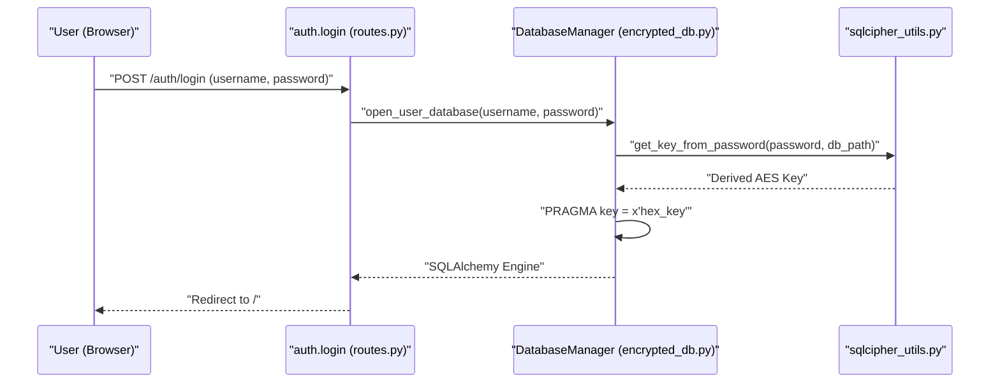
**Sources:** [src/local_deep_research/database/encrypted_db.py:48-113](), [src/local_deep_research/database/sqlcipher_utils.py:172-214](), [src/local_deep_research/database/thread_local_session.py:1-40]()

---

## Research Execution Lifecycle

### Multi-Strategy Research
Research is not a single LLM call but an iterative loop. LDR supports over 30 strategies (e.g., `focused-iteration`, `source-based`, `langgraph-agent`) created via the `create_strategy` factory [src/local_deep_research/search_system_factory.py:32-177]().

### Thread-Safe Settings Snapshots
To prevent race conditions where a user changes settings while a research task is running, the system captures a snapshot. This is an immutable dictionary of all settings at the moment the research thread is spawned [src/local_deep_research/api/research_functions.py:20-20](). The `_get_setting` utility handles the extraction of values from this nested dictionary structure [src/local_deep_research/search_system_factory.py:19-30]().

### Strategy Factory
The `create_strategy` function in `search_system_factory.py` instantiates specific strategy classes based on the user's selected `strategy_name`. It handles mapping settings from the `settings_snapshot` (like `knowledge_summary_limit` or `adaptive_questions`) to the strategy's internal configuration [src/local_deep_research/search_system_factory.py:83-145]().

**Diagram: Research Strategy Creation and Execution**
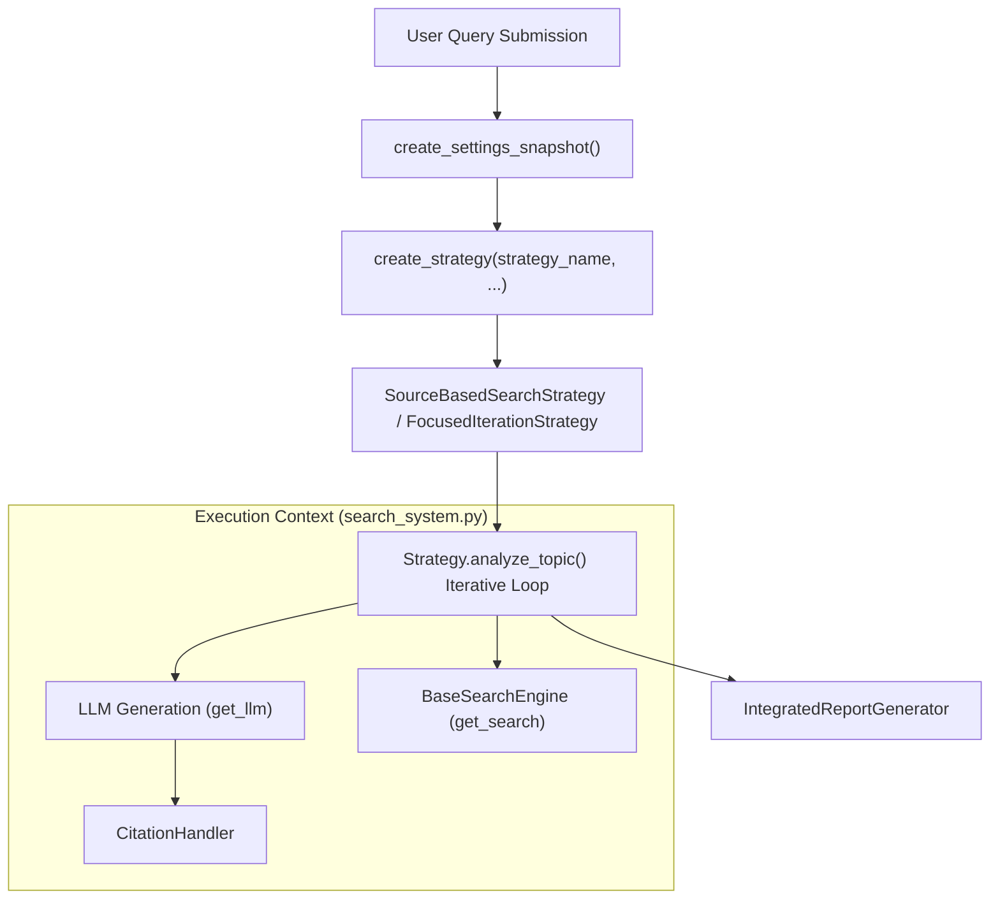
**Sources:** [src/local_deep_research/search_system_factory.py:32-177](), [src/local_deep_research/api/research_functions.py:34-163](), [src/local_deep_research/search_system.py:20-148]()

---

## The Library and RAG System

### Unified Document Model
The **Library** is a collection of document entities. A document can originate from a research download (e.g., an ArXiv PDF) or a manual user upload. Every research session finds valuable sources which are downloaded and indexed into an encrypted library [README.md:108-118]().

### Strategy-Specific Performance
Certain strategies are optimized for specific benchmarks or data structures. For example, `TopicOrganizationStrategy` organizes search results into topic clusters with lead sources [src/local_deep_research/advanced_search_system/strategies/topic_organization_strategy.py:16-23]().

| Entity | Role |
|--------|-------------|
| **SourceBasedSearchStrategy** | Iterative question generation → parallel search → final synthesis [src/local_deep_research/advanced_search_system/strategies/source_based_strategy.py:22-57](). |
| **FocusedIterationStrategy** | Progressive entity-focused exploration optimized for SimpleQA; uses adaptive questions [src/local_deep_research/advanced_search_system/strategies/focused_iteration_strategy.py:40-51](). |
| **TopicOrganizationStrategy** | Organizes sources into topics using a `TopicGraph` and `FindingsRepository` [src/local_deep_research/advanced_search_system/strategies/topic_organization_strategy.py:148-150](). |
| **LangGraph Agent** | Autonomous agentic research mode where the LLM decides search engine selection [README.md:104-104](). |

**Sources:** [src/local_deep_research/advanced_search_system/strategies/source_based_strategy.py:22-57](), [src/local_deep_research/advanced_search_system/strategies/focused_iteration_strategy.py:2-51](), [src/local_deep_research/advanced_search_system/strategies/topic_organization_strategy.py:16-150](), [README.md:108-118]()

---

## Settings Hierarchy and Priority

LDR employs a multi-layered configuration system. Settings are often read from a frozen `settings_snapshot` to ensure thread safety during long-running research tasks [src/local_deep_research/api/research_functions.py:98-111]().

1.  **Bootstrap Settings**: Environment variables required before the database is opened (e.g., `LDR_BOOTSTRAP_ALLOW_UNENCRYPTED`) [README.md:89-89]().
2.  **Environment Overrides**: Prefixed with `LDR_`, these can override database values (e.g., `LDR_MAX_CONCURRENT`) [src/local_deep_research/defaults/default_settings.json:122-122]().
3.  **Database Settings**: Values stored in the user's encrypted database.
4.  **Settings Snapshot**: A frozen dictionary passed to components like `AdvancedSearchSystem` to ensure consistent behavior throughout a research session [src/local_deep_research/search_system.py:93-94]().

**Sources:** [src/local_deep_research/api/research_functions.py:98-111](), [src/local_deep_research/search_system.py:93-94](), [src/local_deep_research/defaults/default_settings.json:1-132](), [README.md:89-89]()

---

## Terminology Glossary

| Term | Definition | Code Pointer |
|------|------------|--------------|
| **SQLCipher** | Extension providing transparent 256-bit AES encryption for SQLite. | `encrypted_db.py` [src/local_deep_research/database/encrypted_db.py:2-4]() |
| **IterDRAG** | Iterative Dense Retrieval Augmented Generation; an iterative research strategy. | `search_system.py` [src/local_deep_research/search_system.py:49-49]() |
| **QueuePool** | A SQLAlchemy pooling strategy used to manage concurrent connections to encrypted databases. | `encrypted_db.py` [src/local_deep_research/database/encrypted_db.py:63-94]() |
| **SearXNG** | The default privacy-respecting meta-search engine used by the system. | `README.md` [README.md:56-57]() |
| **Thread-Local Session** | A database session management pattern to ensure thread safety in background tasks. | `thread_local_session.py` [src/local_deep_research/database/thread_local_session.py:1-22]() |
| **LangGraph Agent** | An autonomous research mode where the LLM adaptively switches between specialized search engines. | `README.md` [README.md:104-104]() |
| **Settings Snapshot** | An immutable capture of user settings used to maintain consistency during long-running research tasks. | `research_functions.py` [src/local_deep_research/api/research_functions.py:20-20]() |
| **Auth DB** | A central unencrypted SQLite database (`ldr_auth.db`) used for tracking usernames. | `auth_db.py` [src/local_deep_research/database/auth_db.py:1-33]() |

**Sources:** [src/local_deep_research/database/encrypted_db.py:2-94](), [src/local_deep_research/api/research_functions.py:20-20](), [README.md:56-104](), [src/local_deep_research/search_system.py:49-49](), [src/local_deep_research/database/auth_db.py:1-33]()

---

# Page: Project Structure and Dependencies

# Project Structure and Dependencies

<details>
<summary>Relevant source files</summary>

The following files were used as context for generating this wiki page:

- [.file-whitelist.txt](.file-whitelist.txt)
- [.github/CODEOWNERS](.github/CODEOWNERS)
- [.github/scripts/file-whitelist-check.sh](.github/scripts/file-whitelist-check.sh)
- [.gitignore](.gitignore)
- [.gitleaks.toml](.gitleaks.toml)
- [.gitleaksignore](.gitleaksignore)
- [.pre-commit-config.yaml](.pre-commit-config.yaml)
- [.pre-commit-hooks/check-absolute-module-paths.py](.pre-commit-hooks/check-absolute-module-paths.py)
- [.pre-commit-hooks/file-whitelist-check.sh](.pre-commit-hooks/file-whitelist-check.sh)
- [.pre-commit-hooks/recommend-release-notes.py](.pre-commit-hooks/recommend-release-notes.py)
- [CONTRIBUTING.md](CONTRIBUTING.md)
- [README.md](README.md)
- [changelog.d/3670.breaking.1.md](changelog.d/3670.breaking.1.md)
- [changelog.d/3670.breaking.md](changelog.d/3670.breaking.md)
- [changelog.d/3670.feature.md](changelog.d/3670.feature.md)
- [changelog.d/3773.feature.md](changelog.d/3773.feature.md)
- [changelog.d/README.md](changelog.d/README.md)
- [docker-compose.gpu.override.yml](docker-compose.gpu.override.yml)
- [docs/CI_CD_INFRASTRUCTURE.md](docs/CI_CD_INFRASTRUCTURE.md)
- [docs/CONFIGURATION.md](docs/CONFIGURATION.md)
- [docs/RELEASE_GUIDE.md](docs/RELEASE_GUIDE.md)
- [docs/SECURITY_REVIEW_PROCESS.md](docs/SECURITY_REVIEW_PROCESS.md)
- [docs/SQLCIPHER_INSTALL.md](docs/SQLCIPHER_INSTALL.md)
- [docs/decisions/0001-remove-detect-secrets.md](docs/decisions/0001-remove-detect-secrets.md)
- [docs/developing.md](docs/developing.md)
- [docs/docker-compose-guide.md](docs/docker-compose-guide.md)
- [docs/install-pip.md](docs/install-pip.md)
- [docs/installation.md](docs/installation.md)
- [package-lock.json](package-lock.json)
- [package.json](package.json)
- [pdm.lock](pdm.lock)
- [pyproject.toml](pyproject.toml)
- [src/local_deep_research/__version__.py](src/local_deep_research/__version__.py)
- [src/local_deep_research/database/sqlcipher_compat.py](src/local_deep_research/database/sqlcipher_compat.py)
- [src/local_deep_research/web/static/js/mobile-navigation.js](src/local_deep_research/web/static/js/mobile-navigation.js)
- [src/local_deep_research/web/static/js/security/url-validator.js](src/local_deep_research/web/static/js/security/url-validator.js)
- [src/local_deep_research/web/static/js/services/api.js](src/local_deep_research/web/static/js/services/api.js)
- [src/local_deep_research/web/static/js/services/formatting.js](src/local_deep_research/web/static/js/services/formatting.js)
- [tests/infrastructure_tests/test_csrf_api.test.js](tests/infrastructure_tests/test_csrf_api.test.js)
- [tests/infrastructure_tests/test_urls.test.js](tests/infrastructure_tests/test_urls.test.js)
- [tests/security/test_absolute_module_paths_hook.py](tests/security/test_absolute_module_paths_hook.py)
- [vite.config.js](vite.config.js)

</details>


This page documents the repository organization and the complete dependency ecosystem for Local Deep Research, including production dependencies, development tools, and their architectural roles. The project uses [PDM](https://pdm-project.org/) for Python dependency management with explicit version constraints and hash verification to ensure security and reproducibility.

---

## Repository Structure

The repository follows a modern Python project layout with source code contained within a `src/` directory to ensure tests run against the installed package.

```text
.
├── src/local_deep_research/       # Main package source [pyproject.toml:114-123]()
│   ├── advanced_search_system/    # Research logic and quality filters
│   ├── config/                    # Configuration logic (LLM, search, etc.)
│   ├── database/                  # SQLCipher and SQLAlchemy integration
│   ├── defaults/                  # Default TOML/env configurations [pyproject.toml:122]()
│   ├── journal_quality/           # Bibliometric data and scoring [pyproject.toml:126]()
│   ├── library/                   # RAG, FAISS, and document management
│   ├── web/                       # Flask application, blueprints, and static assets [pyproject.toml:121]()
│   │   ├── static/                # Frontend assets (JS/CSS/Images) [pyproject.toml:121]()
│   │   └── templates/             # Jinja2 HTML templates [pyproject.toml:121]()
│   ├── __version__.py             # Single source of truth for versioning [src/local_deep_research/__version__.py:1]()
│   └── main.py                    # CLI entry point [pyproject.toml:110]()
├── tests/                         # Pytest suite (unit, integration, UI) [pyproject.toml:179-185]()
├── scripts/                       # Maintenance and setup scripts
├── examples/                      # API usage and programmatic examples
├── pyproject.toml                 # Project metadata and dependencies [pyproject.toml:1-101]()
└── pdm.lock                       # Content-hashed dependency lockfile [pdm.lock:1-8]()
```

**Sources:** [pyproject.toml:1-127](), [src/local_deep_research/__version__.py:1]()

---

## Dependency Management Architecture

Local Deep Research uses **PDM (Python Development Master)** as its package manager, with a strict versioning strategy enforced through `pyproject.toml` and `pdm.lock`.

### Package Management Flow

Title: PDM Build and Dependency Flow
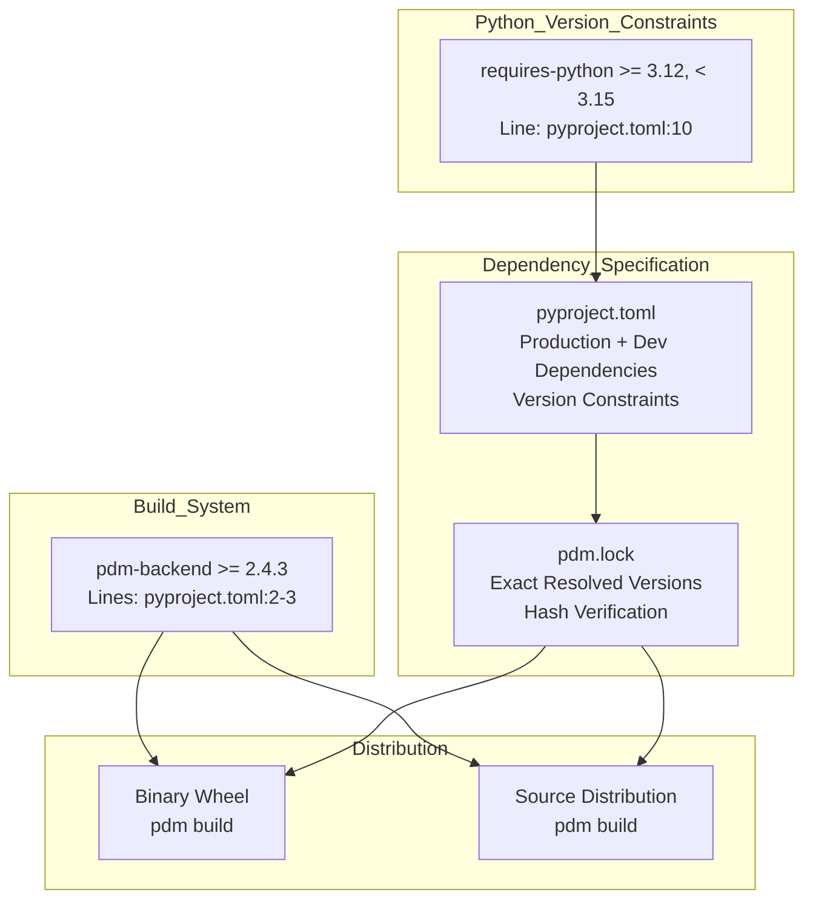

**Sources:** [pyproject.toml:1-10](), [pyproject.toml:143-145](), [pdm.lock:1-12]()

---

## Production Dependencies by Category

### 1. LLM Integration Layer

The application uses the **LangChain** ecosystem as its LLM abstraction layer.

| Package | Version | Role |
|---------|---------|------|
| `langchain` | ~1.2 | Core framework and chains [pyproject.toml:23]() |
| `langchain-community` | ~0.4 | Community integrations [pyproject.toml:24]() |
| `langchain-core` | ~1.2 | Base abstractions [pyproject.toml:25]() |
| `langchain-ollama` | ~1.0 | Local LLM support via Ollama [pyproject.toml:26]() |
| `langchain-openai` | ~1.1 | OpenAI and compatible endpoints [pyproject.toml:27]() |
| `langchain-anthropic` | ~1.3 | Claude 3 family integration [pyproject.toml:28]() |
| `langchain-experimental`| ~0.4 | Experimental research strategies [pyproject.toml:97]() |
| `tiktoken` | ~0.12 | Token counting for context management [pyproject.toml:57]() |

**Sources:** [pyproject.toml:23-28](), [pyproject.toml:57](), [pyproject.toml:97]()

### 2. Search and Academic Intelligence

Multiple engines and scrapers are integrated to provide comprehensive web and academic research capabilities.

Title: Search System Entity Mapping
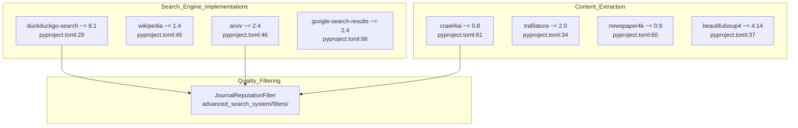

**Sources:** [pyproject.toml:29-66]()

### 3. Web Framework Stack

The web application uses **Flask** with security-hardened configurations and fixed versions for critical CVEs.

| Package | Version | Role | Security Note |
|---------|---------|------|---------------|
| `flask` | ~3.1.3 | Core web framework [pyproject.toml:38]() | **CVE-2026-27205 fix** |
| `werkzeug` | ~3.1.6 | WSGI utilities [pyproject.toml:39]() | **CVE-2026-27199 fix** |
| `flask-cors` | ~6.0 | CORS management [pyproject.toml:40]() | - |
| `flask-socketio` | ~5.6.1 | Real-time progress updates [pyproject.toml:41]() | Flask 3.1.3 compatibility |
| `flask-wtf` | ~1.2 | CSRF protection [pyproject.toml:68]() | - |
| `flask-login` | ~0.6 | User session management [pyproject.toml:83]() | - |
| `flask-limiter` | ~4.1 | Rate limiting [pyproject.toml:84]() | - |

**Sources:** [pyproject.toml:38-41](), [pyproject.toml:68](), [pyproject.toml:83-84]()

### 4. Data Persistence & Security Layer

The database layer uses **SQLCipher** for AES-256 encrypted per-user databases. The PDM configuration includes platform-specific selectors for the binary packages.

Title: Database Security Stack
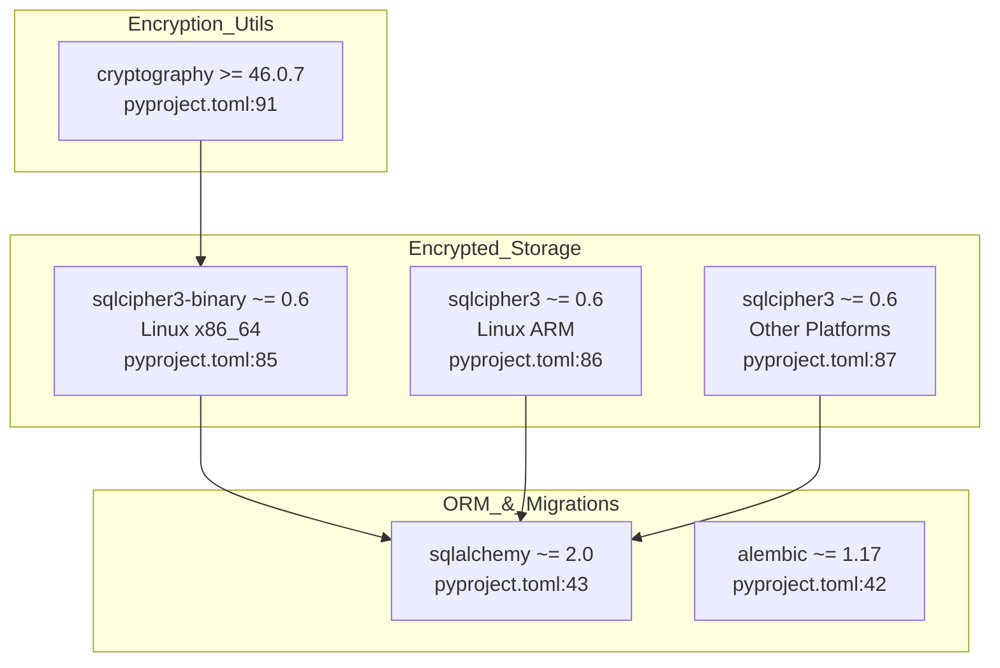

**Sources:** [pyproject.toml:42-43](), [pyproject.toml:85-87](), [pyproject.toml:91]()

---

## Frontend Dependencies (npm/Vite)

The frontend is a Vite-based application built from `package.json`. It adheres to a strict no-CDN policy for privacy [package.json:22-36]().

| Package | Version | Role |
|---------|---------|------|
| `vite` | ^8.0.10 | Build tool and dev server [package.json:44]() |
| `bootstrap` | ^5.3.8 | CSS framework [package.json:24]() |
| `socket.io-client` | ^4.8.3 | WebSocket client for research updates [package.json:35]() |
| `chart.js` | ^4.5.1 | Research metrics visualization [package.json:26]() |
| `dompurify` | ^3.4.1 | Frontend HTML sanitization [package.json:30]() |
| `marked` | ^18.0.2 | Markdown rendering [package.json:34]() |

**Sources:** [package.json:22-48]()

---

## Development and Test Infrastructure

### Testing Framework
- **Pytest**: Core framework with parallel execution (`pytest-xdist`) and async support (`pytest-asyncio`) [pyproject.toml:163-168]().
- **Coverage**: Omission rules exclude CLI entry points, migrations, and experimental strategies [pyproject.toml:190-206]().
- **Static Analysis**: Uses `ruff` for linting/formatting [pyproject.toml:169]() and `mypy` for type checking [pyproject.toml:171]().

**Sources:** [pyproject.toml:158-177](), [pyproject.toml:179-215]()

### CLI and Programmatic Entrypoints

| Command | Module | Purpose |
|---------|--------|---------|
| `ldr` | `local_deep_research.main:main` | CLI research queries [pyproject.toml:110]() |
| `ldr-web` | `local_deep_research.web.app:main` | Start Flask web server [pyproject.toml:111]() |
| `ldr-mcp` | `local_deep_research.mcp:run_server` | MCP Server for Claude [pyproject.toml:112]() |

**Sources:** [pyproject.toml:110-112]()

### Security-Critical Pins

The project enforces minimum versions for libraries with known vulnerabilities:

| Package | Version | Fixed Vulnerability |
|---------|---------|---------------------|
| `pypdf` | ~6.10.1 | CVE-2026-33123, CVE-2026-31826 [pyproject.toml:47]() |
| `urllib3` | ~2.6 | CVE-2026-21441 (Header injection) [pyproject.toml:56]() |
| `Pillow` | >=12.1.1 | CVE-2026-25990 (Out-of-bounds write) [pyproject.toml:90]() |
| `cryptography` | >=46.0.7 | CVE-2026-26007 (Subgroup attack) [pyproject.toml:91]() |
| `lxml-html-clean`| >=0.4.4 | CVE-2026-28350 (Base tag injection) [pyproject.toml:88]() |

**Sources:** [pyproject.toml:47](), [pyproject.toml:56](), [pyproject.toml:88](), [pyproject.toml:90-91]()

---

# Page: Getting Started

# Getting Started

<details>
<summary>Relevant source files</summary>

The following files were used as context for generating this wiki page:

- [.github/CODEOWNERS](.github/CODEOWNERS)
- [Dockerfile](Dockerfile)
- [README.md](README.md)
- [cookiecutter-docker/cookiecutter.json](cookiecutter-docker/cookiecutter.json)
- [cookiecutter-docker/hooks/post_gen_project.py](cookiecutter-docker/hooks/post_gen_project.py)
- [cookiecutter-docker/hooks/pre_prompt.py](cookiecutter-docker/hooks/pre_prompt.py)
- [cookiecutter-docker/{{cookiecutter.config_name}}/docker-compose.{{cookiecutter.config_name}}.yml](cookiecutter-docker/{{cookiecutter.config_name}}/docker-compose.{{cookiecutter.config_name}}.yml)
- [docker-compose.gpu.override.yml](docker-compose.gpu.override.yml)
- [docker-compose.unraid.yml](docker-compose.unraid.yml)
- [docker-compose.yml](docker-compose.yml)
- [docs/CI_CD_INFRASTRUCTURE.md](docs/CI_CD_INFRASTRUCTURE.md)
- [docs/CUSTOM_LLM_INTEGRATION.md](docs/CUSTOM_LLM_INTEGRATION.md)
- [docs/SECURITY_REVIEW_PROCESS.md](docs/SECURITY_REVIEW_PROCESS.md)
- [docs/SQLCIPHER_INSTALL.md](docs/SQLCIPHER_INSTALL.md)
- [docs/analytics-dashboard.md](docs/analytics-dashboard.md)
- [docs/architecture.md](docs/architecture.md)
- [docs/architecture/DATABASE_SCHEMA.md](docs/architecture/DATABASE_SCHEMA.md)
- [docs/architecture/OVERVIEW.md](docs/architecture/OVERVIEW.md)
- [docs/decisions/0001-remove-detect-secrets.md](docs/decisions/0001-remove-detect-secrets.md)
- [docs/decisions/0004-nullpool-for-sqlcipher.md](docs/decisions/0004-nullpool-for-sqlcipher.md)
- [docs/deployment/unraid.md](docs/deployment/unraid.md)
- [docs/developing.md](docs/developing.md)
- [docs/developing/EXTENDING.md](docs/developing/EXTENDING.md)
- [docs/docker-compose-guide.md](docs/docker-compose-guide.md)
- [docs/env_configuration.md](docs/env_configuration.md)
- [docs/faq.md](docs/faq.md)
- [docs/features.md](docs/features.md)
- [docs/install-pip.md](docs/install-pip.md)
- [docs/installation.md](docs/installation.md)
- [docs/library-and-rag.md](docs/library-and-rag.md)
- [docs/mcp-server.md](docs/mcp-server.md)
- [docs/search-engines.md](docs/search-engines.md)
- [docs/troubleshooting.md](docs/troubleshooting.md)
- [scripts/.gitkeep](scripts/.gitkeep)
- [scripts/ollama_entrypoint.sh](scripts/ollama_entrypoint.sh)
- [src/local_deep_research/database/sqlcipher_compat.py](src/local_deep_research/database/sqlcipher_compat.py)
- [src/local_deep_research/web/database/README.md](src/local_deep_research/web/database/README.md)
- [tests/api_tests_with_login/puppeteer_config.js](tests/api_tests_with_login/puppeteer_config.js)
- [tests/database/test_post_login_settings_atomicity.py](tests/database/test_post_login_settings_atomicity.py)
- [tests/mcp/test_mcp_strategy.py](tests/mcp/test_mcp_strategy.py)
- [tests/ui_tests/puppeteer_config.js](tests/ui_tests/puppeteer_config.js)
- [tests/ui_tests/test_login_validation.js](tests/ui_tests/test_login_validation.js)
- [tests/web/routes/test_history_routes_extended.py](tests/web/routes/test_history_routes_extended.py)
- [unraid-templates/local-deep-research.xml](unraid-templates/local-deep-research.xml)

</details>


This page guides you through initial setup and running your first research query. It covers deployment method selection, installation, and basic configuration to get Local Deep Research (LDR) running on your system.

**Scope**: This page provides quick-start instructions for all deployment methods. For detailed deployment configuration, see [Docker Deployment](#2.1). For environment variable reference, see [Environment Configuration](#2.2). For development from source, see [Local Development Setup](#2.3).

---

## Choosing Your Deployment Method

Local Deep Research supports multiple deployment methods. Choose based on your use case:

| Method | Best For | Complexity | Encryption |
|--------|----------|------------|------------|
| **Docker Compose** | Most users, production | Low | ✅ Built-in |
| **Docker Run** | Quick testing | Low | ✅ Built-in |
| **pip install** | Developers, integration | Medium | ✅ Pre-built wheels |
| **Unraid** | Home server users | Low | ✅ Built-in |

### Deployment Selection Logic

"Natural Language Space" to "Code Entity Space" bridge:
- `docker-compose.yml`: Base CPU configuration.
- `docker-compose.gpu.override.yml`: NVIDIA hardware acceleration.
- `sqlcipher3-binary`: Pre-built encrypted database drivers.
- `ldr-web`: The Flask entry point [pyproject.toml:111]().

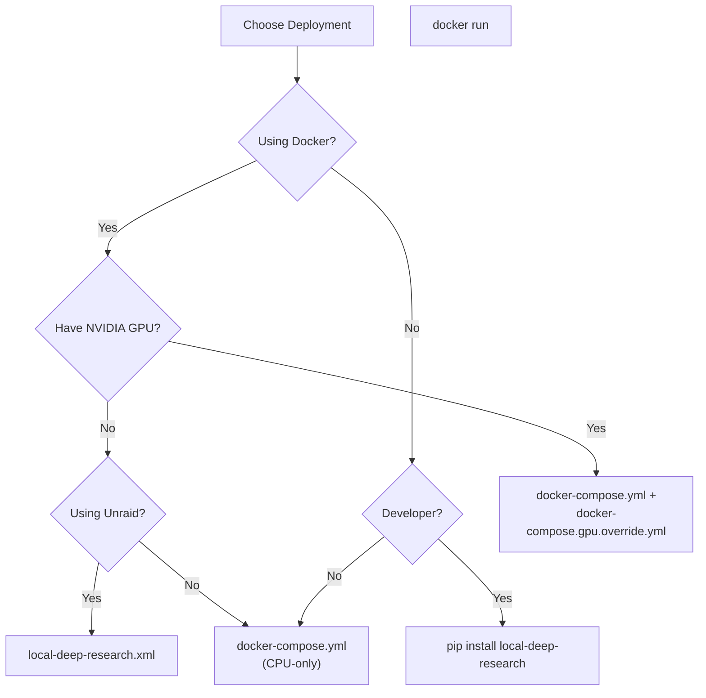
**Sources**: [README.md:46-91](), [docker-compose.yml:1-17](), [docs/docker-compose-guide.md:7-24](), [pyproject.toml:111](), [unraid-templates/local-deep-research.xml:1-10]()

---

## Prerequisites

### For Docker Deployment
- **Docker Engine**: 20.10+ (Docker Desktop on macOS/Windows) [Dockerfile:4-52]().
- **Docker Compose**: V2 (included with Docker Desktop) [docker-compose.yml:1-17]().
- **System Memory**: 8GB minimum (16GB recommended for larger models) [docs/faq.md:55-61]().
- **Disk Space**: ~10-20GB for images and models [docs/faq.md:62-66]().

### For pip Installation
- **Python**: 3.12+ (supports up to 3.14.4) [pyproject.toml:10](), [Dockerfile:4]().
- **SQLCipher**: System library required for database encryption. [README.md:87](), [docs/SQLCIPHER_INSTALL.md:1-10]().
- **Node.js**: 24.x LTS (required for building the frontend from source) [Dockerfile:23-44]().
- **PDM**: Python package manager [pyproject.toml:1-3](), [Dockerfile:51-52]().

---

## Quick Start: Docker Compose (Recommended)

Docker Compose orchestrates the `local-deep-research` service, `ollama` (LLM), and `searxng` (search).

### Step 1: Download Configuration
**Linux/macOS/Windows**:
```bash
curl -O https://raw.githubusercontent.com/LearningCircuit/local-deep-research/main/docker-compose.yml && docker compose up -d
```
For NVIDIA GPU (Linux):
```bash
curl -O https://raw.githubusercontent.com/LearningCircuit/local-deep-research/main/docker-compose.yml && \
curl -O https://raw.githubusercontent.com/LearningCircuit/local-deep-research/main/docker-compose.gpu.override.yml && \
docker compose -f docker-compose.yml -f docker-compose.gpu.override.yml up -d
```
**Sources**: [README.md:67-81](), [docs/docker-compose-guide.md:7-24]()

### Step 2: Initialization Flow
The first startup pulls the LLM model (default: `gemma3:12b`) [docs/docker-compose-guide.md:66]().

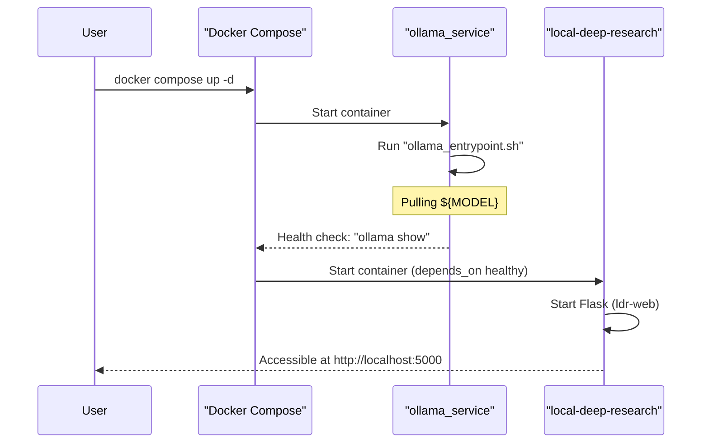
**Sources**: [docker-compose.yml:19-77](), [cookiecutter-docker/{{cookiecutter.config_name}}/docker-compose.{{cookiecutter.config_name}}.yml:61-103](), [scripts/ollama_entrypoint.sh:25-42]()

### Step 3: Access Web Interface
Open `http://localhost:5000` after ~30 seconds [README.md:81]().
1. **Register**: Create your account. This process creates an encrypted database using `SQLCipher` and derives a key from your password [tests/ui_tests/puppeteer_config.js:31-33]().
2. **Login**: Access the dashboard.
⚠️ **Warning**: No password recovery exists due to the zero-knowledge encryption architecture [docs/SQLCIPHER_INSTALL.md:105]().

---

## Quick Start: Docker Run

For minimal setup without a compose file:
```bash
# 1. Run Ollama
docker run -d -p 11434:11434 --name ollama ollama/ollama
docker exec ollama ollama pull gpt-oss:20b

# 2. Run SearXNG
docker run -d -p 8080:8080 --name searxng searxng/searxng

# 3. Run LDR
docker run -d -p 5000:5000 --network host \
  --name local-deep-research \
  --volume "deep-research:/data" \
  -e LDR_DATA_DIR=/data \
  localdeepresearch/local-deep-research
```
**Sources**: [README.md:50-65]()

---

## Quick Start: pip Install

```bash
pip install local-deep-research
```
- **Windows/macOS/Linux**: Includes pre-built SQLCipher wheels (`sqlcipher3-binary` or `sqlcipher3`) for major platforms [pyproject.toml:85-87](), [README.md:87]().
- **Unencrypted Fallback**: If encryption fails or is not desired for development, set `export LDR_BOOTSTRAP_ALLOW_UNENCRYPTED=true` to use standard SQLite [README.md:89](), [docs/developing.md:83-86]().
- **PDF Export**: Windows requires Pango [README.md:88]().

---

## Running Your First Research Query

### Research Execution Lifecycle
When you submit a query, the system follows this internal path:


1. **Submit**: Go to `http://localhost:5000/research`.
2. **Configure**: Select a strategy (e.g., `Standard`, `Academic`, or `langgraph-agent`) [README.md:102-104]().
3. **Execute**: Monitor real-time logs via WebSockets.
4. **Result**: View the generated Markdown report with citations [README.md:100]().

**Sources**: [README.md:93-116](), [docs/architecture.md:1-20]()

---

## Basic Configuration

### Environment Overrides
Environment variables starting with `LDR_` override and **lock** settings in the UI, making them read-only [docs/env_configuration.md:27-29](), [docs/docker-compose-guide.md:53-57]().

| Variable | Description | Default |
|----------|-------------|---------|
| `LDR_WEB_PORT` | Internal server port | `5000` |
| `LDR_DATA_DIR` | Storage location | `/data` (Docker) |
| `LDR_LLM_MODEL` | Default model name | `gemma3:12b` |
| `LDR_LLM_OLLAMA_URL` | Ollama API endpoint | `http://ollama:11434` |

**Sources**: [docker-compose.yml:55-77](), [docs/docker-compose-guide.md:57-65](), [docs/env_configuration.md:122-135]()

### External Providers
To use cloud models like Claude or GPT-4, configure these in the UI or via env:
```bash
export LDR_LLM_PROVIDER=openai_endpoint
export LDR_LLM_OPENAI_ENDPOINT_URL=https://openrouter.ai/api/v1
export LDR_LLM_OPENAI_ENDPOINT_API_KEY=your_key
```
**Sources**: [docker-compose.yml:95-104](), [docs/env_configuration.md:71-77]()

---

## Next Steps
- **[Docker Deployment](#2.1)**: Deep dive into GPU setup, volume management, and `cookiecutter` configuration.
- **[Environment Configuration](#2.2)**: Full list of `LDR_*` variables and the bootstrap system.
- **[Local Development Setup](#2.3)**: How to build from source using `PDM`, manage Node.js assets, and run tests.

---

# Page: Docker Deployment

# Docker Deployment

<details>
<summary>Relevant source files</summary>

The following files were used as context for generating this wiki page:

- [.github/CODEOWNERS](.github/CODEOWNERS)
- [Dockerfile](Dockerfile)
- [README.md](README.md)
- [cookiecutter-docker/cookiecutter.json](cookiecutter-docker/cookiecutter.json)
- [cookiecutter-docker/hooks/post_gen_project.py](cookiecutter-docker/hooks/post_gen_project.py)
- [cookiecutter-docker/hooks/pre_prompt.py](cookiecutter-docker/hooks/pre_prompt.py)
- [cookiecutter-docker/{{cookiecutter.config_name}}/docker-compose.{{cookiecutter.config_name}}.yml](cookiecutter-docker/{{cookiecutter.config_name}}/docker-compose.{{cookiecutter.config_name}}.yml)
- [docker-compose.gpu.override.yml](docker-compose.gpu.override.yml)
- [docker-compose.yml](docker-compose.yml)
- [docs/CI_CD_INFRASTRUCTURE.md](docs/CI_CD_INFRASTRUCTURE.md)
- [docs/SECURITY_REVIEW_PROCESS.md](docs/SECURITY_REVIEW_PROCESS.md)
- [docs/SQLCIPHER_INSTALL.md](docs/SQLCIPHER_INSTALL.md)
- [docs/decisions/0001-remove-detect-secrets.md](docs/decisions/0001-remove-detect-secrets.md)
- [docs/developing.md](docs/developing.md)
- [docs/docker-compose-guide.md](docs/docker-compose-guide.md)
- [docs/install-pip.md](docs/install-pip.md)
- [docs/installation.md](docs/installation.md)
- [scripts/.gitkeep](scripts/.gitkeep)
- [scripts/ollama_entrypoint.sh](scripts/ollama_entrypoint.sh)
- [src/local_deep_research/database/sqlcipher_compat.py](src/local_deep_research/database/sqlcipher_compat.py)
- [tests/api_tests_with_login/puppeteer_config.js](tests/api_tests_with_login/puppeteer_config.js)
- [tests/ui_tests/puppeteer_config.js](tests/ui_tests/puppeteer_config.js)
- [tests/ui_tests/test_login_validation.js](tests/ui_tests/test_login_validation.js)

</details>


## Purpose and Scope

This document explains Docker deployment for Local Deep Research (LDR), covering container architecture, deployment methods, and configuration. LDR is designed as a local-first, privacy-focused AI research assistant that orchestrates LLMs and search engines within a containerized environment.

---

## Deployment Methods

### Docker Run (Quick Start)

The simplest deployment uses three containers with host networking (Linux only) to allow seamless communication via `localhost`.

```bash
# Step 1: Pull and run Ollama
docker run -d -p 11434:11434 --name ollama ollama/ollama
docker exec ollama ollama pull gpt-oss:20b

# Step 2: Pull and run SearXNG for optimal search results
docker run -d -p 8080:8080 --name searxng searxng/searxng

# Step 3: Pull and run Local Deep Research
docker run -d -p 5000:5000 --network host \
  --name local-deep-research \
  --volume "deep-research:/data" \
  -e LDR_DATA_DIR=/data \
  localdeepresearch/local-deep-research
```

**Key characteristics:**
- `--network host` allows containers to reach each other via `localhost` (Linux only) [README.md:60-60]().
- Named volume `deep-research` persists user databases and configuration [README.md:62-62]().
- `LDR_DATA_DIR=/data` maps to the container volume mount point [README.md:63-63]().

Sources: [README.md:50-65]()

---

### Docker Compose (Recommended)

Docker Compose orchestrates the full service stack with proper networking and dependency management.

#### Base Configuration (CPU-only)

The base configuration works on all platforms (macOS M1-M4, Windows, Linux) [docker-compose.yml:4-9]().

```bash
curl -O https://raw.githubusercontent.com/LearningCircuit/local-deep-research/main/docker-compose.yml && docker compose up -d
```

**Service definitions:**

| Service | Image | Purpose |
|---------|-------|---------|
| `local-deep-research` | `localdeepresearch/local-deep-research:latest` | Main web application [docker-compose.yml:21-21]() |
| `ollama` | `ollama/ollama:latest` | Local LLM inference engine [docs/docker-compose-guide.md:48-48]() |
| `searxng` | `searxng/searxng:latest` | Privacy-focused meta search engine [docs/docker-compose-guide.md:49-49]() |

**Container-specific endpoints:**
```yaml
environment:
  - LDR_LLM_OLLAMA_URL=http://ollama:11434
  - LDR_SEARCH_ENGINE_WEB_SEARXNG_DEFAULT_PARAMS_INSTANCE_URL=http://searxng:8080
```
These settings override UI configuration to ensure containers communicate via Docker's internal DNS rather than `localhost` [docker-compose.yml:69-76]().

Sources: [docker-compose.yml:1-76](), [docs/docker-compose-guide.md:7-50](), [README.md:67-72]()

---

#### GPU-Accelerated Deployment

For hardware-accelerated inference using NVIDIA GPUs (Linux):

```bash
curl -O https://raw.githubusercontent.com/LearningCircuit/local-deep-research/main/docker-compose.yml && \
curl -O https://raw.githubusercontent.com/LearningCircuit/local-deep-research/main/docker-compose.gpu.override.yml && \
docker compose -f docker-compose.yml -f docker-compose.gpu.override.yml up -d
```

The `docker-compose.gpu.override.yml` adds NVIDIA device reservations to the `ollama` service [docker-compose.yml:13-13]().

Sources: [README.md:74-79](), [docs/docker-compose-guide.md:15-25]()

---

#### Cookiecutter Configuration Generator

For custom configurations, the `cookiecutter-docker` template provides an interactive setup to generate a tailored `docker-compose.yml` [docs/docker-compose-guide.md:97-111]().

**Generated configuration options:**

| Prompt | Purpose |
|--------|---------|
| `config_name` | Name for the configuration folder [cookiecutter-docker/cookiecutter.json]() |
| `enable_gpu` | Enable NVIDIA/AMD GPU support [cookiecutter-docker/cookiecutter.json]() |
| `host_network` | Use `network_mode: host` for Linux [cookiecutter-docker/{{cookiecutter.config_name}}/docker-compose.{{cookiecutter.config_name}}.yml:11-12]() |

**Hardware Support Logic:**
The generated configuration handles multiple GPU backends:
- **NVIDIA**: Uses the `nvidia` driver and `gpu` capabilities reservation [cookiecutter-docker/{{cookiecutter.config_name}}/docker-compose.{{cookiecutter.config_name}}.yml:87-93]().
- **AMD (ROCm)**: Uses the `ollama/ollama:rocm` image and passes through `/dev/kfd` and `/dev/dri` devices [cookiecutter-docker/{{cookiecutter.config_name}}/docker-compose.{{cookiecutter.config_name}}.yml:63-64](), [cookiecutter-docker/{{cookiecutter.config_name}}/docker-compose.{{cookiecutter.config_name}}.yml:95-97]().
- **Detection**: Logic in `pre_prompt.py` uses `lspci` (Linux) or `wmic` (Windows) to identify hardware [cookiecutter-docker/hooks/pre_prompt.py:27-90]().

Sources: [docs/docker-compose-guide.md:97-129](), [cookiecutter-docker/{{cookiecutter.config_name}}/docker-compose.{{cookiecutter.config_name}}.yml:1-128](), [cookiecutter-docker/hooks/pre_prompt.py:1-112]()

---

## Container Architecture

### Multi-Stage Build

The `Dockerfile` uses a multi-stage approach to separate build-time dependencies (Node.js, compilers) from the slim production runtime.

**Build-to-Code Mapping Diagram**
This diagram associates Docker build stages with specific code entities and output artifacts.

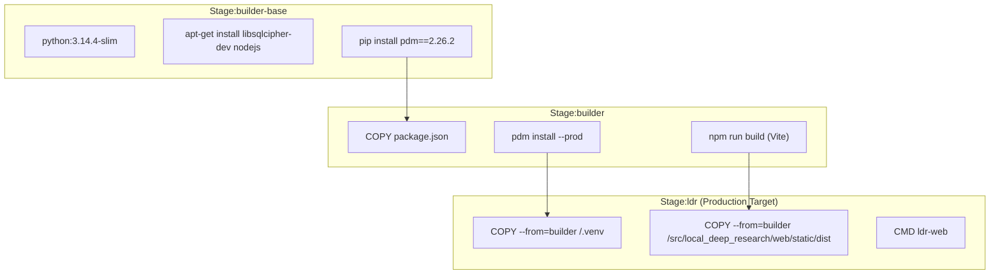

**Build Stages:**
1.  **`builder-base`**: Installs `libsqlcipher-dev`, `sqlcipher`, and Node.js 24.x LTS [Dockerfile:4-45](). Pins `pdm`, `pip`, and `playwright` for reproducibility [Dockerfile:51-52]().
2.  **`builder`**: Runs `npm ci` and `npm run build` to compile the Vite frontend into static assets [Dockerfile:90-91](). Executes `pdm install --prod` to create the production virtual environment [Dockerfile:93-99]().
3.  **`ldr-test`**: Specialized stage for CI. Installs Chromium dependencies and Playwright for UI testing [Dockerfile:116-151](). It installs test-specific npm packages in `tests/ui_tests` and `tests/accessibility_tests` [Dockerfile:154-166]().
4.  **`ldr`**: The final production target. It copies the pre-built `.venv` and static assets from the `builder` stage.

Sources: [Dockerfile:4-166]()

---

### Security Model

The deployment implements defense-in-depth through capability dropping and privilege separation.

**Security Execution Flow**
This diagram maps the security lifecycle from Docker configuration to the runtime execution.

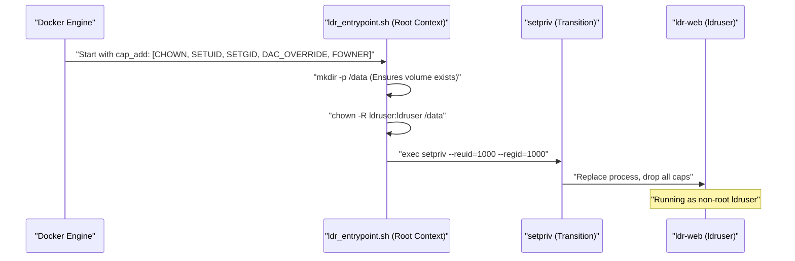

**Key Security Features:**
- **Capability Management**: `cap_drop: ALL` is used in Compose, with only specific capabilities (`CHOWN`, `SETUID`, `SETGID`, `DAC_OVERRIDE`, `FOWNER`) added back to allow the entrypoint to fix volume permissions [cookiecutter-docker/{{cookiecutter.config_name}}/docker-compose.{{cookiecutter.config_name}}.yml:40-47]().
- **Privilege Escalation Prevention**: `security_opt: ["no-new-privileges:true"]` prevents the process from regaining root [cookiecutter-docker/{{cookiecutter.config_name}}/docker-compose.{{cookiecutter.config_name}}.yml:38-39]().
- **Memory Security**: `memlock: -1` (unlimited) allows SQLCipher's `mlock()` to protect encryption keys in RAM when memory security features are utilized [docs/docker-compose-guide.md:89-91]().

Sources: [cookiecutter-docker/{{cookiecutter.config_name}}/docker-compose.{{cookiecutter.config_name}}.yml:38-47](), [docs/docker-compose-guide.md:85-91]()

---

## Service Orchestration

### Ollama Initialization

The `ollama` service uses a custom entrypoint to ensure the required model is available before the research engine attempts to connect.

- **`ollama_entrypoint.sh`**: Starts `ollama serve`, waits for readiness via `ollama ls`, and then executes `ollama pull` for the specified model [scripts/ollama_entrypoint.sh:25-37]().
- **Health Checks**: The service is marked "healthy" once `ollama show` for the specified model succeeds [cookiecutter-docker/{{cookiecutter.config_name}}/docker-compose.{{cookiecutter.config_name}}.yml:70-75]().
- **Dependencies**: `local-deep-research` uses `depends_on: service_healthy` for Ollama to prevent startup failures [cookiecutter-docker/{{cookiecutter.config_name}}/docker-compose.{{cookiecutter.config_name}}.yml:50-54]().

Sources: [scripts/ollama_entrypoint.sh:1-46](), [cookiecutter-docker/{{cookiecutter.config_name}}/docker-compose.{{cookiecutter.config_name}}.yml:50-75]()

### Network and Volume Configuration

**Network**: Containers are joined to `ldr-network` [docker-compose.yml:23-24](). `extra_hosts` is used to map `host.docker.internal` to the host gateway, enabling access to host-resident LLM providers like LM Studio [docker-compose.yml:28-29]().

**Volumes**:
- **`ldr_data`**: Persists the SQLCipher database and application configuration [docker-compose.yml:123-123]().
- **`ollama_data`**: Persists downloaded GGUF models [cookiecutter-docker/{{cookiecutter.config_name}}/docker-compose.{{cookiecutter.config_name}}.yml:79-79]().
- **`searxng_data`**: Stores SearXNG configuration [cookiecutter-docker/{{cookiecutter.config_name}}/docker-compose.{{cookiecutter.config_name}}.yml:114-114]().

Sources: [docker-compose.yml:23-123](), [docs/docker-compose-guide.md:75-83](), [cookiecutter-docker/{{cookiecutter.config_name}}/docker-compose.{{cookiecutter.config_name}}.yml:79-114]()

---

## Environment Variable Configuration

Environment variables starting with `LDR_` override and **lock** settings in the Web UI [docs/docker-compose-guide.md:53-55]().

| Variable | Purpose | Default in Docker |
|----------|---------|-------------------|
| `LDR_WEB_PORT` | Internal port mapping | `5000` [docker-compose.yml:56-56]() |
| `LDR_WEB_HOST` | Bind address | `0.0.0.0` [docker-compose.yml:55-55]() |
| `LDR_DATA_DIR` | Internal data path | `/data` [docker-compose.yml:57-57]() |
| `LDR_LLM_OLLAMA_URL` | Ollama API endpoint | `http://ollama:11434` [docker-compose.yml:75-75]() |
| `LDR_SEARCH_ENGINE_WEB_SEARXNG_DEFAULT_PARAMS_INSTANCE_URL` | SearXNG API endpoint | `http://searxng:8080` [docker-compose.yml:76-76]() |

Sources: [docker-compose.yml:33-121](), [docs/docker-compose-guide.md:57-65]()

---

# Page: Environment Configuration

# Environment Configuration

<details>
<summary>Relevant source files</summary>

The following files were used as context for generating this wiki page:

- [docker-compose.unraid.yml](docker-compose.unraid.yml)
- [docs/CONFIGURATION.md](docs/CONFIGURATION.md)
- [docs/CUSTOM_LLM_INTEGRATION.md](docs/CUSTOM_LLM_INTEGRATION.md)
- [docs/analytics-dashboard.md](docs/analytics-dashboard.md)
- [docs/architecture.md](docs/architecture.md)
- [docs/architecture/DATABASE_SCHEMA.md](docs/architecture/DATABASE_SCHEMA.md)
- [docs/architecture/OVERVIEW.md](docs/architecture/OVERVIEW.md)
- [docs/decisions/0004-nullpool-for-sqlcipher.md](docs/decisions/0004-nullpool-for-sqlcipher.md)
- [docs/deployment/unraid.md](docs/deployment/unraid.md)
- [docs/developing/EXTENDING.md](docs/developing/EXTENDING.md)
- [docs/env_configuration.md](docs/env_configuration.md)
- [docs/faq.md](docs/faq.md)
- [docs/features.md](docs/features.md)
- [docs/library-and-rag.md](docs/library-and-rag.md)
- [docs/mcp-server.md](docs/mcp-server.md)
- [docs/search-engines.md](docs/search-engines.md)
- [docs/troubleshooting.md](docs/troubleshooting.md)
- [package-lock.json](package-lock.json)
- [package.json](package.json)
- [src/local_deep_research/__version__.py](src/local_deep_research/__version__.py)
- [src/local_deep_research/defaults/settings_security.json](src/local_deep_research/defaults/settings_security.json)
- [src/local_deep_research/utilities/formatting.py](src/local_deep_research/utilities/formatting.py)
- [src/local_deep_research/web/database/README.md](src/local_deep_research/web/database/README.md)
- [src/local_deep_research/web/server_config.py](src/local_deep_research/web/server_config.py)
- [src/local_deep_research/web/static/js/mobile-navigation.js](src/local_deep_research/web/static/js/mobile-navigation.js)
- [src/local_deep_research/web/static/js/security/url-validator.js](src/local_deep_research/web/static/js/security/url-validator.js)
- [src/local_deep_research/web/static/js/services/formatting.js](src/local_deep_research/web/static/js/services/formatting.js)
- [src/local_deep_research/web/warning_checks/__init__.py](src/local_deep_research/web/warning_checks/__init__.py)
- [src/local_deep_research/web/warning_checks/backup.py](src/local_deep_research/web/warning_checks/backup.py)
- [src/local_deep_research/web/warning_checks/hardware.py](src/local_deep_research/web/warning_checks/hardware.py)
- [tests/database/test_post_login_settings_atomicity.py](tests/database/test_post_login_settings_atomicity.py)
- [tests/infrastructure_tests/test_urls.test.js](tests/infrastructure_tests/test_urls.test.js)
- [tests/mcp/test_mcp_strategy.py](tests/mcp/test_mcp_strategy.py)
- [tests/security/test_check_response_size.py](tests/security/test_check_response_size.py)
- [tests/web/routes/test_backup_status_api.py](tests/web/routes/test_backup_status_api.py)
- [tests/web/routes/test_history_routes_extended.py](tests/web/routes/test_history_routes_extended.py)
- [tests/web/routes/test_settings_validation_edge_cases.py](tests/web/routes/test_settings_validation_edge_cases.py)
- [tests/web/test_server_config.py](tests/web/test_server_config.py)
- [tests/web/warning_checks/test_backup.py](tests/web/warning_checks/test_backup.py)
- [tests/web/warning_checks/test_hardware.py](tests/web/warning_checks/test_hardware.py)
- [tests/web/warning_checks/test_orchestrator.py](tests/web/warning_checks/test_orchestrator.py)
- [unraid-templates/local-deep-research.xml](unraid-templates/local-deep-research.xml)
- [vite.config.js](vite.config.js)

</details>


This page covers how Local Deep Research reads its configuration from environment variables, the naming rules that govern variable names, and the full catalogue of variables by category. It focuses on the environment variable layer specifically. For the full layered settings system (including the per-user encrypted database and the web UI), see **Settings Management (4.1)**. For Docker-specific deployment configuration, see **Docker Deployment (2.1)**.

---

## Naming Convention

All application settings follow a dot-separated key format (e.g., `llm.provider`, `search.tool`). To address a setting via an environment variable, apply this transformation:

1. Prepend `LDR_`
2. Convert to uppercase
3. Replace every `.` with `_`

**Examples:**

| Setting Key | Env Var |
|---|---|
| `llm.provider` | `LDR_LLM_PROVIDER` |
| `llm.openai.api_key` | `LDR_LLM_OPENAI_API_KEY` |
| `app.max_concurrent_researches` | `LDR_MAX_CONCURRENT` (Explicit mapping) |
| `web.port` | `LDR_WEB_PORT` |

The system also supports deprecated aliases for backward compatibility (e.g., `LDR_ALLOW_UNENCRYPTED` for `LDR_BOOTSTRAP_ALLOW_UNENCRYPTED`) [docs/CONFIGURATION.md:34-54](). 

The conversion and lookup are handled by `SettingsManager` in `src/local_deep_research/settings/manager.py` [src/local_deep_research/settings/manager.py:19-26](). The `get_typed_setting_value` function specifically checks `os.environ` for these prefixed keys using `check_env` logic [src/local_deep_research/settings/manager.py:188-204]().

Sources: [docs/CONFIGURATION.md:8-12](), [src/local_deep_research/settings/manager.py:187-204](), [docs/env_configuration.md:14-25](), [src/local_deep_research/web/server_config.py:22-53]()

---

## Configuration Priority

When a setting is requested (via `SettingsManager.get_setting()`), the following priority order applies. Higher entries win. Note that environment variables act as "locks" — if a non-empty environment variable exists, it overrides the database value and makes the setting read-only in the UI [docs/env_configuration.md:27-29](). Empty environment variables (e.g., `LDR_LLM_PROVIDER=""`) are treated as not set and will not override the UI [docs/env_configuration.md:29-29]().

Title: Configuration Resolution Order
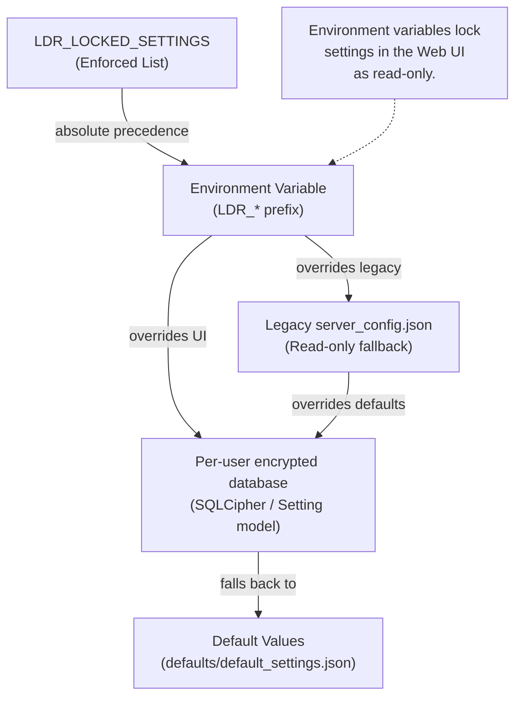

Sources: [docs/CONFIGURATION.md:11-25](), [src/local_deep_research/settings/manager.py:187-204](), [docs/env_configuration.md:27-30](), [src/local_deep_research/web/server_config.py:149-162]()

---

## Pre-Database (Bootstrap) Settings

Bootstrap settings are resolved before the database is initialized and can only be set via environment variables. These are required for the application to start and locate its data [docs/CONFIGURATION.md:27-31]().

| Env Var | Type | Default | Description |
|---|---|---|---|
| `LDR_BOOTSTRAP_DATA_DIR` | Path | `None` | Root data directory for DB, logs, and cache [docs/CONFIGURATION.md:37-37](). |
| `LDR_BOOTSTRAP_ENCRYPTION_KEY` | Secret | `None` | Master key for database encryption [docs/CONFIGURATION.md:39-39](). |
| `LDR_BOOTSTRAP_ALLOW_UNENCRYPTED` | Boolean | `False` | Allow unencrypted DB (dev only) [docs/CONFIGURATION.md:34-34](). |
| `LDR_DB_CONFIG_KDF_ITERATIONS` | Integer | `256000` | PBKDF2 iterations for SQLCipher [docs/CONFIGURATION.md:47-47](). |
| `LDR_DB_CONFIG_CIPHER_MEMORY_SECURITY` | Enum | `'OFF'` | `ON` clears memory after use (requires `mlock`/`IPC_LOCK`) [docs/CONFIGURATION.md:43-43](). |
| `LDR_BOOTSTRAP_SECRET_KEY` | Secret | `None` | Application secret key for session encryption [docs/CONFIGURATION.md:41-41](). |

Sources: [docs/CONFIGURATION.md:32-49](), [src/local_deep_research/settings/manager.py:101-104]()

---

## Application Behaviour Settings

These settings control the web server and global application limits. Server-level settings like `web.port` are managed in `server_config.py` and are loaded during early startup [src/local_deep_research/web/server_config.py:1-10]().

| Env Var | Setting Key | Default | Notes |
|---|---|---|---|
| `LDR_APP_DEBUG` | `app.debug` | `false` | Produces informative errors; may expose sensitive data [docs/CONFIGURATION.md:66-66](). |
| `LDR_WEB_PORT` | `web.port` | `5000` | Port the server listens on [src/local_deep_research/web/server_config.py:58-58](). |
| `LDR_MAX_CONCURRENT` | `app.max_concurrent_researches` | `3` | Max simultaneous research threads per user [docs/CONFIGURATION.md:114-128](). |
| `LDR_SERVER_MAX_CONCURRENT_RESEARCH` | `app.max_global_concurrent_researches` | `10` | Server-wide concurrency limit [docs/CONFIGURATION.md:57-57](). |
| `LDR_APP_ALLOW_REGISTRATIONS` | `app.allow_registrations` | `true` | Disabling this blocks new account creation [docs/CONFIGURATION.md:65-65](). |
| `LDR_APP_LOCK_SETTINGS` | `app.lock_settings` | `false` | Freezes all settings globally via UI [docs/CONFIGURATION.md:100-113](). |

Sources: [docs/CONFIGURATION.md:54-71](), [docs/env_configuration.md:120-135](), [src/local_deep_research/web/server_config.py:56-66]()

---

## LLM Provider Settings

The following variables configure which LLM provider is active. These are read at research-thread startup time via the `settings_snapshot` mechanism [src/local_deep_research/settings/manager.py:220-225]().

### Provider and Model Selection

| Env Var | Setting Key | Default | Description |
|---|---|---|---|
| `LDR_LLM_PROVIDER` | `llm.provider` | `ollama` | Active provider (e.g., `ollama`, `openai`, `anthropic`, `google`) [docs/CONFIGURATION.md:76-76](). |
| `LDR_LLM_MODEL` | `llm.model` | `gemma3:12b` | Model name string [docs/CONFIGURATION.md:75-75](). |

### Endpoint URLs and Keys

| Env Var | Setting Key | Default | Description |
|---|---|---|---|
| `LDR_LLM_OLLAMA_URL` | `llm.ollama.url` | `http://localhost:11434` | Ollama server URL [docs/CONFIGURATION.md:80-80](). |
| `LDR_LLM_OPENAI_API_KEY` | `llm.openai.api_key` | `None` | OpenAI API key [docs/CONFIGURATION.md:82-82](). |
| `LDR_LLM_ANTHROPIC_API_KEY` | `llm.anthropic.api_key` | `None` | Anthropic API key [docs/CONFIGURATION.md:78-78](). |

Sources: [docs/CONFIGURATION.md:75-85](), [docs/env_configuration.md:33-52]()

---

## System Locking (LDR_LOCKED_SETTINGS)

Administrators can strictly enforce specific settings using the `LDR_LOCKED_SETTINGS` variable.

*   **Format**: Comma-separated list of setting keys (e.g., `llm.model,app.port`) [docs/CONFIGURATION.md:18-18]().
*   **Behavior**:
    1.  Listed settings **MUST** have a corresponding `LDR_` environment variable defined [docs/CONFIGURATION.md:20-20]().
    2.  Settings become **read-only** in the Web UI [docs/CONFIGURATION.md:21-21]().
    3.  Environment variable values take absolute precedence, ignoring any value in the database [docs/CONFIGURATION.md:22-22]().

Sources: [docs/CONFIGURATION.md:14-25]()

---

## End-to-End Variable Resolution

The diagram below maps the code path from an environment variable to the value used inside a research thread.

Title: Environment to Research Execution Flow
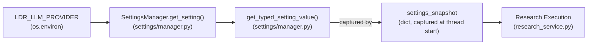

Sources: [src/local_deep_research/settings/manager.py:188-204](), [src/local_deep_research/settings/manager.py:25-26]()

---

## Quick Reference: Complete Category Map

Title: Environment Variable Categories and Code Entities
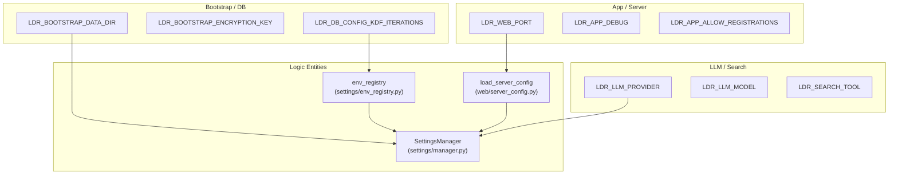

Sources: [docs/CONFIGURATION.md:32-100](), [src/local_deep_research/settings/manager.py:188-204](), [src/local_deep_research/web/server_config.py:149-162](), [src/local_deep_research/settings/env_registry.py:26-26]()

---

# Page: Local Development Setup

# Local Development Setup

<details>
<summary>Relevant source files</summary>

The following files were used as context for generating this wiki page:

- [.file-whitelist.txt](.file-whitelist.txt)
- [.github/CODEOWNERS](.github/CODEOWNERS)
- [.github/scripts/file-whitelist-check.sh](.github/scripts/file-whitelist-check.sh)
- [.gitignore](.gitignore)
- [.gitleaks.toml](.gitleaks.toml)
- [.gitleaksignore](.gitleaksignore)
- [.pre-commit-config.yaml](.pre-commit-config.yaml)
- [.pre-commit-hooks/check-absolute-module-paths.py](.pre-commit-hooks/check-absolute-module-paths.py)
- [.pre-commit-hooks/file-whitelist-check.sh](.pre-commit-hooks/file-whitelist-check.sh)
- [.pre-commit-hooks/recommend-release-notes.py](.pre-commit-hooks/recommend-release-notes.py)
- [CONTRIBUTING.md](CONTRIBUTING.md)
- [README.md](README.md)
- [changelog.d/3670.breaking.1.md](changelog.d/3670.breaking.1.md)
- [changelog.d/3670.breaking.md](changelog.d/3670.breaking.md)
- [changelog.d/3670.feature.md](changelog.d/3670.feature.md)
- [changelog.d/3773.feature.md](changelog.d/3773.feature.md)
- [changelog.d/README.md](changelog.d/README.md)
- [docker-compose.gpu.override.yml](docker-compose.gpu.override.yml)
- [docs/CI_CD_INFRASTRUCTURE.md](docs/CI_CD_INFRASTRUCTURE.md)
- [docs/RELEASE_GUIDE.md](docs/RELEASE_GUIDE.md)
- [docs/SECURITY_REVIEW_PROCESS.md](docs/SECURITY_REVIEW_PROCESS.md)
- [docs/SQLCIPHER_INSTALL.md](docs/SQLCIPHER_INSTALL.md)
- [docs/decisions/0001-remove-detect-secrets.md](docs/decisions/0001-remove-detect-secrets.md)
- [docs/developing.md](docs/developing.md)
- [docs/docker-compose-guide.md](docs/docker-compose-guide.md)
- [docs/install-pip.md](docs/install-pip.md)
- [docs/installation.md](docs/installation.md)
- [pdm.lock](pdm.lock)
- [pyproject.toml](pyproject.toml)
- [src/local_deep_research/database/auth_db.py](src/local_deep_research/database/auth_db.py)
- [src/local_deep_research/database/encrypted_db.py](src/local_deep_research/database/encrypted_db.py)
- [src/local_deep_research/database/pool_config.py](src/local_deep_research/database/pool_config.py)
- [src/local_deep_research/database/sqlcipher_compat.py](src/local_deep_research/database/sqlcipher_compat.py)
- [src/local_deep_research/database/sqlcipher_utils.py](src/local_deep_research/database/sqlcipher_utils.py)
- [src/local_deep_research/database/thread_local_session.py](src/local_deep_research/database/thread_local_session.py)
- [src/local_deep_research/settings/env_definitions/bootstrap.py](src/local_deep_research/settings/env_definitions/bootstrap.py)
- [src/local_deep_research/settings/env_definitions/db_config.py](src/local_deep_research/settings/env_definitions/db_config.py)
- [src/local_deep_research/settings/env_settings.py](src/local_deep_research/settings/env_settings.py)
- [src/local_deep_research/web/auth/connection_cleanup.py](src/local_deep_research/web/auth/connection_cleanup.py)
- [src/local_deep_research/web/static/js/services/api.js](src/local_deep_research/web/static/js/services/api.js)
- [tests/database/test_database_manager_extended.py](tests/database/test_database_manager_extended.py)
- [tests/database/test_encrypted_db_coverage.py](tests/database/test_encrypted_db_coverage.py)
- [tests/database/test_encrypted_db_manager.py](tests/database/test_encrypted_db_manager.py)
- [tests/database/test_pool_config.py](tests/database/test_pool_config.py)
- [tests/database/test_sqlcipher_connection_factory.py](tests/database/test_sqlcipher_connection_factory.py)
- [tests/database/test_sqlcipher_integration.py](tests/database/test_sqlcipher_integration.py)
- [tests/database/test_sqlcipher_utils.py](tests/database/test_sqlcipher_utils.py)
- [tests/database/test_thread_local_session.py](tests/database/test_thread_local_session.py)
- [tests/database/test_thread_local_session_coverage.py](tests/database/test_thread_local_session_coverage.py)
- [tests/database/test_thread_local_session_deep_coverage.py](tests/database/test_thread_local_session_deep_coverage.py)
- [tests/infrastructure_tests/test_csrf_api.test.js](tests/infrastructure_tests/test_csrf_api.test.js)
- [tests/security/test_absolute_module_paths_hook.py](tests/security/test_absolute_module_paths_hook.py)

</details>


This page covers setting up Local Deep Research (LDR) to run from source without Docker: installing system dependencies, configuring the Python environment with PDM, building or hot-reloading the Vite frontend, and running the Flask development server.

---

## Prerequisites

| Tool | Minimum Version | Purpose |
|------|----------------|---------|
| Python | 3.12 (up to 3.14) | Runtime for the Flask application [pyproject.toml:10]() |
| Node.js | 24.x LTS | Frontend build via Vite |
| PDM | 2.26.2+ | Python dependency and virtualenv manager [pyproject.toml:143-145]() |
| SQLCipher | System library | AES-256 encrypted per-user databases [src/local_deep_research/database/encrypted_db.py:2]() |
| Playwright | 1.58.0 | UI and Browser-based research [pyproject.toml:36]() |

---

## Step 1: Clone the Repository

```bash
git clone https://github.com/LearningCircuit/local-deep-research.git
cd local-deep-research
```

---

## Step 2: Install SQLCipher System Libraries

SQLCipher is the AES-256 encrypted database engine used for every user's data store. The Python binding (`sqlcipher3` or `sqlcipher3-binary`) is declared as a dependency in [pyproject.toml:85-87]() and selected automatically by PDM based on platform:

| Platform | System Package Required | Python Package Selected by PDM |
|----------|------------------------|-------------------------------|
| Linux x86_64 | `libsqlcipher-dev`, `sqlcipher` | `sqlcipher3-binary` [pyproject.toml:85]() |
| Linux ARM64 | `libsqlcipher-dev`, `sqlcipher` | `sqlcipher3` [pyproject.toml:86]() |
| macOS / Other | Homebrew `sqlcipher` | `sqlcipher3` [pyproject.toml:87]() |

**Linux (Debian/Ubuntu):**
```bash
sudo apt update
sudo apt install sqlcipher libsqlcipher-dev build-essential pkg-config
```

**Skipping SQLCipher (unencrypted mode):**
If SQLCipher installation is not feasible, set the following environment variable before starting the application:

```bash
export LDR_BOOTSTRAP_ALLOW_UNENCRYPTED=true
```

> ⚠ This stores all user data — including API keys — in plaintext SQLite. Never use this in a production or shared environment [README.md:89]().

Sources: [pyproject.toml:85-87](), [README.md:89](), [src/local_deep_research/database/encrypted_db.py:58-60]()

---

## Step 3: Install Python Dependencies with PDM

PDM installs the exact versions pinned in [pdm.lock]() into a project-local virtualenv at `.venv/`.

```bash
pip install pdm
pdm install
```

The CLI entry points registered in `project.scripts` are available after installation:

| Command | Entry Point | File Reference |
|---------|-------------|----------------|
| `ldr` | `local_deep_research.main:main` | [pyproject.toml:110]() |
| `ldr-web` | `local_deep_research.web.app:main` | [pyproject.toml:111]() |
| `ldr-mcp` | `local_deep_research.mcp:run_server` | [pyproject.toml:112]() |

Sources: [pyproject.toml:110-112](), [pdm.lock:1-12]()

---

## Step 4: Install Frontend Dependencies and Build Assets

The frontend is managed by `npm` and bundled by `Vite`.

**Install dependencies:**
```bash
npm install
```

**Production build (required for Flask to serve assets):**
```bash
npm run build
```

This writes bundled assets into `src/local_deep_research/web/static/dist/`, which Flask serves as static files. These files are explicitly included in the package data [pyproject.toml:121]().

Sources: [pyproject.toml:121](), [.gitignore:251-253]()

---

## Running the Application

### Setup Flow Diagram

"Natural Language Space" to "Code Entity Space" mapping:

| Concept | Code Entity / Command |
|---------|-----------------------|
| Python Manager | `pdm` [pyproject.toml:3]() |
| Web Server | `ldr-web` [pyproject.toml:111]() |
| CLI Client | `ldr` [pyproject.toml:110]() |
| Test Runner | `pytest` [pyproject.toml:164]() |

**Development Setup Lifecycle**
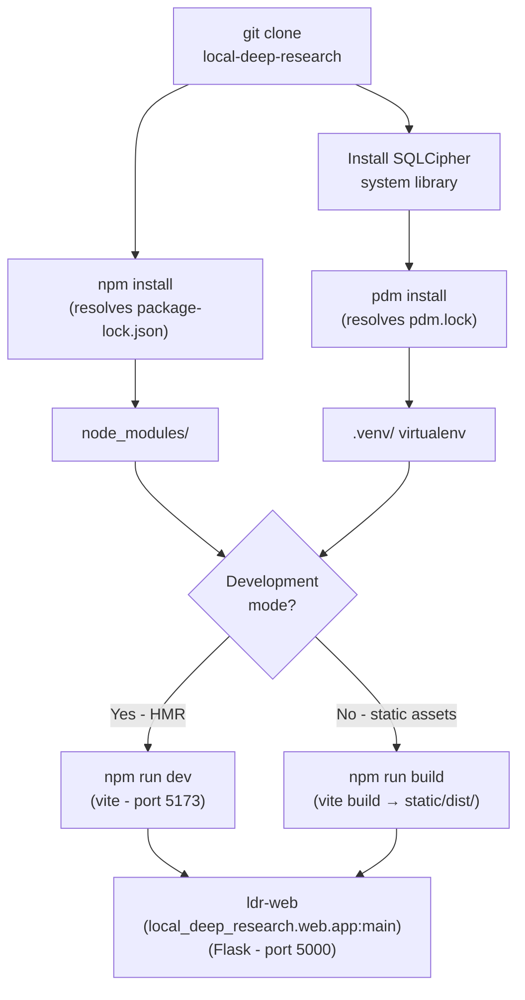

Sources: [pyproject.toml:110-112](), [pdm.lock:1-10]()

### Two-server Architecture in Development

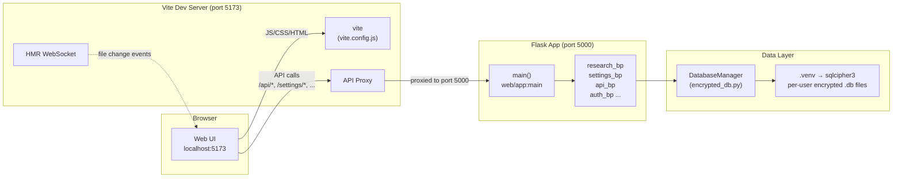

Sources: [pyproject.toml:111](), [pyproject.toml:85-87](), [src/local_deep_research/database/encrypted_db.py:48-52]()

---

## Testing

### Backend Tests (Pytest)
Run all tests using the virtual environment:
```bash
pdm run pytest tests/
```
Specific markers are available for `requires_llm`, `integration`, `slow`, and `asyncio` [pyproject.toml:180-185](). The global timeout is set to 60 seconds [pyproject.toml:187-189]().

### UI and E2E Tests
The project uses `Playwright` and `pytest` for UI and End-to-End testing. 

1. Ensure the app is running on port 5000.
2. Run UI tests: `pdm run pytest tests/ui_tests/`.
3. The test suite uses `isolated_db_manager` fixtures to manage unique test users and force `QueuePool` for concurrent-write integration [tests/database/test_sqlcipher_integration.py:27-50]().

Sources: [pyproject.toml:159-178](), [pyproject.toml:180-189](), [tests/database/test_sqlcipher_integration.py:27-50]()

---

## Troubleshooting

**SQLCipher "ModuleNotFoundError"**
Ensure system libraries (`libsqlcipher-dev`) are installed *before* `pdm install`. PDM uses specific logic to select `sqlcipher3-binary` on Linux x86_64 to simplify setup [pyproject.toml:85]().

**Lockfile Mismatch**
If `pyproject.toml` is updated without updating the lockfile, run `pdm lock` to synchronize.

**Environment Overrides**
Environment variables prefixed with `LDR_` will force settings. To use unencrypted SQLite during development if SQLCipher is missing, use `LDR_BOOTSTRAP_ALLOW_UNENCRYPTED=true` [README.md:89]().

**Pre-commit Hooks**
The repository uses 26+ custom pre-commit hooks for security and quality, including `check-env-vars`, `check-ldr-db-usage`, and `file-whitelist-check` [.pre-commit-config.yaml:73-163](). Run them manually via:
```bash
pdm run pre-commit run --all-files
```

Sources: [pyproject.toml:85-87](), [README.md:89](), [.pre-commit-config.yaml:73-163]()

---

# Page: Architecture

# Architecture

<details>
<summary>Relevant source files</summary>

The following files were used as context for generating this wiki page:

- [.github/CODEOWNERS](.github/CODEOWNERS)
- [README.md](README.md)
- [docker-compose.gpu.override.yml](docker-compose.gpu.override.yml)
- [docker-compose.unraid.yml](docker-compose.unraid.yml)
- [docs/CI_CD_INFRASTRUCTURE.md](docs/CI_CD_INFRASTRUCTURE.md)
- [docs/CUSTOM_LLM_INTEGRATION.md](docs/CUSTOM_LLM_INTEGRATION.md)
- [docs/SECURITY_REVIEW_PROCESS.md](docs/SECURITY_REVIEW_PROCESS.md)
- [docs/SQLCIPHER_INSTALL.md](docs/SQLCIPHER_INSTALL.md)
- [docs/analytics-dashboard.md](docs/analytics-dashboard.md)
- [docs/architecture.md](docs/architecture.md)
- [docs/architecture/DATABASE_SCHEMA.md](docs/architecture/DATABASE_SCHEMA.md)
- [docs/architecture/OVERVIEW.md](docs/architecture/OVERVIEW.md)
- [docs/decisions/0001-remove-detect-secrets.md](docs/decisions/0001-remove-detect-secrets.md)
- [docs/decisions/0004-nullpool-for-sqlcipher.md](docs/decisions/0004-nullpool-for-sqlcipher.md)
- [docs/deployment/unraid.md](docs/deployment/unraid.md)
- [docs/developing.md](docs/developing.md)
- [docs/developing/EXTENDING.md](docs/developing/EXTENDING.md)
- [docs/docker-compose-guide.md](docs/docker-compose-guide.md)
- [docs/env_configuration.md](docs/env_configuration.md)
- [docs/faq.md](docs/faq.md)
- [docs/features.md](docs/features.md)
- [docs/install-pip.md](docs/install-pip.md)
- [docs/installation.md](docs/installation.md)
- [docs/library-and-rag.md](docs/library-and-rag.md)
- [docs/mcp-server.md](docs/mcp-server.md)
- [docs/search-engines.md](docs/search-engines.md)
- [docs/troubleshooting.md](docs/troubleshooting.md)
- [src/local_deep_research/__init__.py](src/local_deep_research/__init__.py)
- [src/local_deep_research/api/__init__.py](src/local_deep_research/api/__init__.py)
- [src/local_deep_research/config/llm_config.py](src/local_deep_research/config/llm_config.py)
- [src/local_deep_research/database/sqlcipher_compat.py](src/local_deep_research/database/sqlcipher_compat.py)
- [src/local_deep_research/news/__init__.py](src/local_deep_research/news/__init__.py)
- [src/local_deep_research/utilities/log_utils.py](src/local_deep_research/utilities/log_utils.py)
- [src/local_deep_research/web/app.py](src/local_deep_research/web/app.py)
- [src/local_deep_research/web/app_factory.py](src/local_deep_research/web/app_factory.py)
- [src/local_deep_research/web/database/README.md](src/local_deep_research/web/database/README.md)
- [src/local_deep_research/web/models/database.py](src/local_deep_research/web/models/database.py)
- [src/local_deep_research/web/routes/api_routes.py](src/local_deep_research/web/routes/api_routes.py)
- [src/local_deep_research/web/routes/history_routes.py](src/local_deep_research/web/routes/history_routes.py)
- [src/local_deep_research/web/routes/research_routes.py](src/local_deep_research/web/routes/research_routes.py)
- [src/local_deep_research/web/routes/settings_routes.py](src/local_deep_research/web/routes/settings_routes.py)
- [src/local_deep_research/web/services/research_service.py](src/local_deep_research/web/services/research_service.py)
- [src/local_deep_research/web/services/socket_service.py](src/local_deep_research/web/services/socket_service.py)
- [src/local_deep_research/web/static/js/components/settings.js](src/local_deep_research/web/static/js/components/settings.js)
- [tests/config/test_llm_config_extra_coverage.py](tests/config/test_llm_config_extra_coverage.py)
- [tests/database/test_post_login_settings_atomicity.py](tests/database/test_post_login_settings_atomicity.py)
- [tests/mcp/test_mcp_strategy.py](tests/mcp/test_mcp_strategy.py)
- [tests/web/routes/test_history_routes_extended.py](tests/web/routes/test_history_routes_extended.py)
- [tests/web/services/test_socket_service_coverage.py](tests/web/services/test_socket_service_coverage.py)
- [tests/web/services/test_socket_service_extra_coverage.py](tests/web/services/test_socket_service_extra_coverage.py)
- [tests/web_services/test_socket_service.py](tests/web_services/test_socket_service.py)
- [unraid-templates/local-deep-research.xml](unraid-templates/local-deep-research.xml)

</details>


This document provides a comprehensive overview of Local Deep Research's system architecture, describing how major components interact to deliver AI-powered research capabilities. It covers the multi-layered design, component relationships, data flow patterns, and key architectural decisions that enable per-user data isolation, concurrent research execution, and extensible search strategies.

For deployment-specific details, see [Docker Deployment](#2.1) and [Production Configuration and Hardening](#9.3). For development setup and contribution guidelines, see [Development Guide](#7). For user-facing interface details, see [User Interfaces](#5).

---

## System Overview

Local Deep Research implements a four-layer architecture: **User Interface Layer** (web UI, REST API, Python API, MCP server), **Application Layer** (Flask routes, service classes, queue processor), **Core Engine Layer** (search system, LLM integration, report generation), and **Data Layer** (per-user encrypted SQLCipher databases, FAISS vector stores).

### High-Level Component Diagram

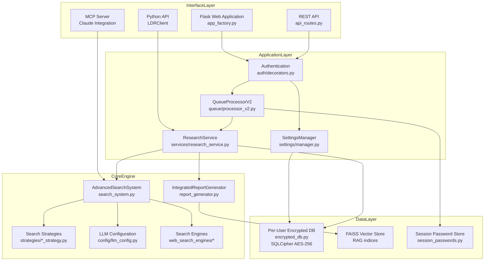

**Sources:** [src/local_deep_research/web/app_factory.py:60-124](), [src/local_deep_research/web/services/socket_service.py:14-131]()

---

## Flask Application Initialization

The Flask application is created via `create_app()` in `app_factory.py`, which configures middleware, security headers, rate limiting, CSRF protection, and registers blueprints. The application uses a custom request class (`DiskSpoolingRequest`) to prevent memory exhaustion from large file uploads.

### Application Factory Flow

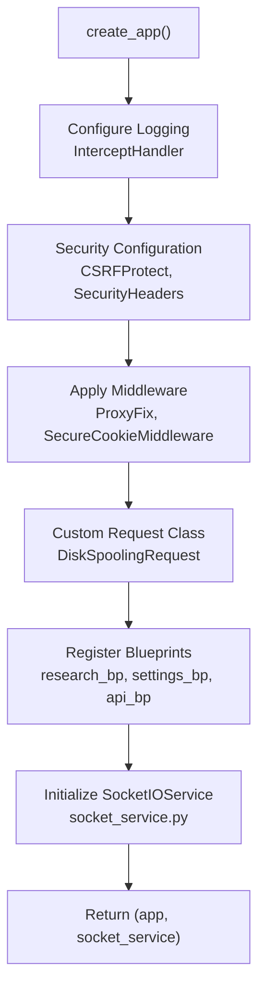

Key initialization steps:

1. **Logging Setup** ([src/local_deep_research/web/app_factory.py:67-91]()): Routes stdlib loggers (`werkzeug`, `apscheduler`) through `loguru` via `InterceptHandler`.
2. **Security Configuration** ([src/local_deep_research/web/app_factory.py:126-140]()): Configures proxy support via `ProxyFix` and dynamic cookie security via `SecureCookieMiddleware`.
3. **Middleware Stack** ([src/local_deep_research/web/app_factory.py:129-140]()): Middleware layers wrap the application to handle `X-Forwarded-For` and secure session cookies.
4. **Disk Spooling** ([src/local_deep_research/web/app_factory.py:45-57]()): The `DiskSpoolingRequest` class ensures that files larger than 5MB are spooled to disk rather than held in memory.

For details, see [Flask Web Application](#3.1).

**Sources:** [src/local_deep_research/web/app_factory.py:45-140]()

---

## Research Execution Architecture

Research execution follows a multi-stage pipeline coordinated by the `AdvancedSearchSystem`. The system uses a global semaphore `_global_research_semaphore` to limit concurrent research across all users and provides real-time updates via `SocketIOService`.

### Research Execution Flow

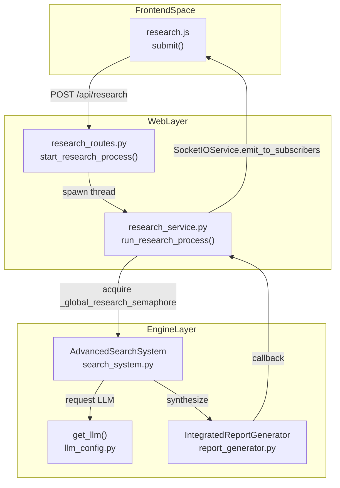

**Key Components:**

1. **Dynamic Provider Loading** ([src/local_deep_research/config/llm_config.py:159-191]()): The system dynamically fetches available LLM providers (Ollama, OpenAI, Anthropic, Google, etc.) using `get_available_providers`.
2. **Real-time Updates** ([src/local_deep_research/web/services/socket_service.py:171-210]()): `SocketIOService` handles targeted emission of research progress to specific subscribers using unique research IDs.
3. **Concurrency Control** ([src/local_deep_research/web/services/research_service.py:36-40]()): A global semaphore `_global_research_semaphore` limits the total number of active research tasks server-wide.
4. **Throttled Emission** ([src/local_deep_research/web/services/research_service.py:42-47]()): Socket.IO emissions are throttled using `_EMIT_THROTTLE_SECONDS` to prevent UI lag during high-frequency research updates.

For details, see [Research Service and Execution Lifecycle](#3.3) and [Search System Architecture](#3.5).

**Sources:** [src/local_deep_research/config/llm_config.py:159-191](), [src/local_deep_research/web/services/socket_service.py:171-210](), [src/local_deep_research/web/services/research_service.py:36-60]()

---

## Database Architecture and Per-User Isolation

Local Deep Research uses per-user encrypted SQLCipher databases. Authentication is tied directly to the ability to decrypt the database file using a password-derived key.

### Database Connection Lifecycle

```mermaid
graph TD
    Start["main()<br/>app.py"]
    Cleanup["start_connection_cleanup_scheduler()"]
    UserDB["get_user_db_session()"]
    Close["db_manager.close_all_databases()"]
    
    Start --> Cleanup
    Cleanup -- "Periodic Task" --> IdleCheck["Close Idle Connections"]
    UserDB -- "with get_user_db_session(username)" --> SQLite["SQLCipher DB"]
    Exit["atexit.register"] --> Close
```

**Isolation Strategy:**
- **Per-User DBs**: Each user has a unique database file that remains encrypted at rest via SQLCipher.
- **Session Context Management** ([src/local_deep_research/database/session_context.py:19-20]()): The system uses context managers to ensure database sessions are properly opened and closed within the request lifecycle or background threads.
- **Cleanup Schedulers** ([src/local_deep_research/web/app.py:107-120]()): A periodic background task (`start_connection_cleanup_scheduler`) ensures idle database connections are closed to free file descriptors.
- **Graceful Shutdown** ([src/local_deep_research/web/app.py:132-140]()): The system registers `atexit` handlers to close all database connections via `db_manager.close_all_databases()` when the server stops.

For details, see [Database Architecture and Security](#3.8) and [Thread-Safe Settings and Context Management](#3.4).

**Sources:** [src/local_deep_research/web/app.py:107-160](), [src/local_deep_research/database/session_context.py:19-62]()

---

## Settings and Configuration System

The application uses a robust settings management system that supports environment variable overrides, per-user database persistence, and thread-safe snapshots.

- **Dual-Mode Submission** ([src/local_deep_research/web/routes/settings_routes.py:6-38]()): Settings can be saved via AJAX/JSON (primary) or traditional POST (fallback for accessibility).
- **Validation** ([src/local_deep_research/web/routes/settings_routes.py:158-202]()): Settings are validated against their defined types (checkbox, number, slider, select) and constraints (min/max).
- **Snapshots** ([src/local_deep_research/web/services/research_service.py:12-13]()): Before a research task starts, a `SnapshotSettingsContext` is created to ensure the research uses a consistent set of parameters even if the user changes settings mid-execution.
- **Namespace Validation** ([src/local_deep_research/web/routes/settings_routes.py:93-131]()): New settings are validated against `ALLOWED_SETTING_PREFIXES` and `BLOCKED_SETTING_PREFIXES` to prevent unauthorized configuration changes.

For details, see [Thread-Safe Settings and Context Management](#3.4) and [Settings Management](#4.1).

**Sources:** [src/local_deep_research/web/routes/settings_routes.py:6-202](), [src/local_deep_research/web/services/research_service.py:12-13]()

---

## Frontend Build and Design System

The frontend is built with a focus on local-first accessibility and consistent styling.

- **Vite-based architecture**: Handles asset bundling and CSS management.
- **LDR Prefix**: CSS classes use an `ldr-` prefix to provide a clean namespace.
- **Dynamic Dropdowns** ([src/local_deep_research/web/static/js/components/settings.js:59-103]()): Custom dropdowns for model and search engine selection are rendered dynamically to handle provider-specific options.
- **Theme System**: Themes (system, dark, sepia) are applied before content visibility to prevent flashes of unstyled content.

### UI Layout Structure

| Component | Route | Responsibility |
|-----------|------|----------------|
| **Research Form** | `/` | Main research interface [src/local_deep_research/web/routes/research_routes.py:88-92]() |
| **History Viewer** | `/history` | View past research sessions [src/local_deep_research/web/routes/history_routes.py:33-37]() |
| **Settings Dashboard**| `/settings` | Configuration management [src/local_deep_research/web/routes/research_routes.py:117-121]() |
| **Research Details** | `/details/<id>` | Detailed progress and logs [src/local_deep_research/web/routes/research_routes.py:95-99]() |

For details, see [Frontend Build System](#3.2).

**Sources:** [src/local_deep_research/web/routes/research_routes.py:88-121](), [src/local_deep_research/web/routes/history_routes.py:33-37](), [src/local_deep_research/web/static/js/components/settings.js:59-103]()

---

## Report Generation and Export

Reports are synthesized into Markdown and can be exported to various formats using the `IntegratedReportGenerator`.

- **Export Formats** ([src/local_deep_research/web/services/research_service.py:83-128]()): The `export_report_to_memory` function uses an `ExporterRegistry` to support formats like PDF, LaTeX, ODT, and RIS.
- **Citation Handling** ([src/local_deep_research/web/services/research_service.py:64-80]()): The `CitationFormatter` manages various citation modes (number hyperlinks, domain hyperlinks, etc.) based on user settings like `report.citation_format`.
- **Think-Tag Removal** ([src/local_deep_research/config/llm_config.py:10]()): The system automatically cleanses LLM output of internal "thought" tokens before synthesis using `remove_think_tags`.

For details, see [Report Generation and Export System](#3.9).

**Sources:** [src/local_deep_research/web/services/research_service.py:64-128](), [src/local_deep_research/config/llm_config.py:10]()

---

This architecture enables Local Deep Research to provide privacy-focused, concurrent AI research capabilities while maintaining security through per-user database isolation and robust request handling. For implementation details of specific subsystems, see the child pages (3.1-3.9).

---

# Page: Flask Web Application

# Flask Web Application

<details>
<summary>Relevant source files</summary>

The following files were used as context for generating this wiki page:

- [.semgrep/rules/README.md](.semgrep/rules/README.md)
- [.semgrep/rules/ldr-security.yaml](.semgrep/rules/ldr-security.yaml)
- [.zap/rules.tsv](.zap/rules.tsv)
- [src/local_deep_research/__init__.py](src/local_deep_research/__init__.py)
- [src/local_deep_research/api/__init__.py](src/local_deep_research/api/__init__.py)
- [src/local_deep_research/config/llm_config.py](src/local_deep_research/config/llm_config.py)
- [src/local_deep_research/defaults/settings_security.json](src/local_deep_research/defaults/settings_security.json)
- [src/local_deep_research/news/__init__.py](src/local_deep_research/news/__init__.py)
- [src/local_deep_research/security/__init__.py](src/local_deep_research/security/__init__.py)
- [src/local_deep_research/security/security_headers.py](src/local_deep_research/security/security_headers.py)
- [src/local_deep_research/utilities/formatting.py](src/local_deep_research/utilities/formatting.py)
- [src/local_deep_research/utilities/log_utils.py](src/local_deep_research/utilities/log_utils.py)
- [src/local_deep_research/web/app.py](src/local_deep_research/web/app.py)
- [src/local_deep_research/web/app_factory.py](src/local_deep_research/web/app_factory.py)
- [src/local_deep_research/web/models/database.py](src/local_deep_research/web/models/database.py)
- [src/local_deep_research/web/routes/api_routes.py](src/local_deep_research/web/routes/api_routes.py)
- [src/local_deep_research/web/routes/history_routes.py](src/local_deep_research/web/routes/history_routes.py)
- [src/local_deep_research/web/routes/research_routes.py](src/local_deep_research/web/routes/research_routes.py)
- [src/local_deep_research/web/routes/settings_routes.py](src/local_deep_research/web/routes/settings_routes.py)
- [src/local_deep_research/web/server_config.py](src/local_deep_research/web/server_config.py)
- [src/local_deep_research/web/services/research_service.py](src/local_deep_research/web/services/research_service.py)
- [src/local_deep_research/web/services/socket_service.py](src/local_deep_research/web/services/socket_service.py)
- [src/local_deep_research/web/static/js/components/settings.js](src/local_deep_research/web/static/js/components/settings.js)
- [src/local_deep_research/web/warning_checks/__init__.py](src/local_deep_research/web/warning_checks/__init__.py)
- [src/local_deep_research/web/warning_checks/backup.py](src/local_deep_research/web/warning_checks/backup.py)
- [src/local_deep_research/web/warning_checks/hardware.py](src/local_deep_research/web/warning_checks/hardware.py)
- [tests/config/test_llm_config_extra_coverage.py](tests/config/test_llm_config_extra_coverage.py)
- [tests/library/download_management/test_database_init.py](tests/library/download_management/test_database_init.py)
- [tests/news/subscription_manager/test_scheduler_coverage.py](tests/news/subscription_manager/test_scheduler_coverage.py)
- [tests/news/test_scheduler.py](tests/news/test_scheduler.py)
- [tests/news/test_scheduler_comprehensive.py](tests/news/test_scheduler_comprehensive.py)
- [tests/news/test_scheduler_extended.py](tests/news/test_scheduler_extended.py)
- [tests/search_engines/test_search_engine_serper.py](tests/search_engines/test_search_engine_serper.py)
- [tests/search_engines/test_search_engine_wayback.py](tests/search_engines/test_search_engine_wayback.py)
- [tests/search_engines/test_search_engine_wikinews.py](tests/search_engines/test_search_engine_wikinews.py)
- [tests/security/test_check_response_size.py](tests/security/test_check_response_size.py)
- [tests/security/test_security_headers.py](tests/security/test_security_headers.py)
- [tests/web/routes/test_backup_status_api.py](tests/web/routes/test_backup_status_api.py)
- [tests/web/routes/test_settings_validation_edge_cases.py](tests/web/routes/test_settings_validation_edge_cases.py)
- [tests/web/services/test_socket_service.py](tests/web/services/test_socket_service.py)
- [tests/web/services/test_socket_service_coverage.py](tests/web/services/test_socket_service_coverage.py)
- [tests/web/services/test_socket_service_extra_coverage.py](tests/web/services/test_socket_service_extra_coverage.py)
- [tests/web/test_app_factory.py](tests/web/test_app_factory.py)
- [tests/web/test_server_config.py](tests/web/test_server_config.py)
- [tests/web/themes/test_loader.py](tests/web/themes/test_loader.py)
- [tests/web/warning_checks/test_backup.py](tests/web/warning_checks/test_backup.py)
- [tests/web/warning_checks/test_hardware.py](tests/web/warning_checks/test_hardware.py)
- [tests/web/warning_checks/test_orchestrator.py](tests/web/warning_checks/test_orchestrator.py)
- [tests/web_search_engines/engines/test_search_engine_wayback.py](tests/web_search_engines/engines/test_search_engine_wayback.py)
- [tests/web_search_engines/engines/test_search_engine_wayback_coverage.py](tests/web_search_engines/engines/test_search_engine_wayback_coverage.py)
- [tests/web_search_engines/engines/test_search_engine_wikinews.py](tests/web_search_engines/engines/test_search_engine_wikinews.py)
- [tests/web_services/test_socket_service.py](tests/web_services/test_socket_service.py)

</details>


This page documents the Flask web application structure, including the application factory pattern, WSGI middleware layers, service initialization, blueprint registration, and request lifecycle.

## Application Factory Pattern

The Flask application is created using the factory pattern via the `create_app()` function in [src/local_deep_research/web/app_factory.py:60-60](). This function returns a tuple of `(app, socket_service)` where `app` is the configured Flask instance and `socket_service` is the initialized `SocketIOService` [src/local_deep_research/web/app_factory.py:65-66]().

```mermaid
graph TD
    create_app["create_app()"]
    
    subgraph Phase_1["Phase 1: Flask Instance Creation"]
        resolve["importlib_resources.files()<br/>Package directory resolution"]
        flask_init["Flask(__name__)<br/>static_folder=None"]
        request_class["app.request_class = DiskSpoolingRequest"]
    end
    
    subgraph Phase_2["Phase 2: WSGI Middleware Wrapping"]
        proxy["ProxyFix(app.wsgi_app)<br/>x_for=1, x_proto=1"]
        secure["SecureCookieMiddleware(wsgi_app, app)"]
        server["ServerHeaderMiddleware(wsgi_app)"]
    end
    
    subgraph Phase_3["Phase 3: Configuration"]
        secret["SECRET_KEY from .secret_key file"]
        session["SESSION_COOKIE_* settings"]
        csrf["CSRFProtect(app)"]
        limiter_init["limiter.init_app(app)"]
        headers["SecurityHeaders(app)"]
    end
    
    subgraph Phase_4["Phase 4: Service Initialization"]
        vite["vite.init_app(app)"]
        theme["theme_helper.init_app(app)"]
        themes_css["theme_registry.get_combined_css()"]
        socketio["SocketIOService(app=app)"]
        scheduler["get_news_scheduler().start()"]
    end
    
    subgraph Phase_5["Phase 5: Middleware & Blueprints"]
        apply_mid["apply_middleware(app)"]
        register_bp["register_blueprints(app)"]
        error_handlers["register_error_handlers(app)"]
    end
    
    subgraph Phase_6["Phase 6: Queue Processor"]
        queue_start["start_log_queue_processor(app)"]
        atexit["atexit.register(shutdown_databases)"]
    end
    
    create_app --> resolve
    resolve --> flask_init
    flask_init --> request_class
    request_class --> proxy
    proxy --> secure
    secure --> server
    server --> secret
    secret --> session
    session --> csrf
    csrf --> limiter_init
    limiter_init --> headers
    headers --> vite
    vite --> theme
    theme --> themes_css
    themes_css --> socketio
    socketio --> scheduler
    scheduler --> apply_mid
    apply_mid --> register_bp
    register_bp --> error_handlers
    error_handlers --> queue_start
    queue_start --> atexit
```

**Diagram: create_app() Initialization Sequence with Code Entities**

**Key Initialization Steps:**

| Step | Code Entity | Location | Purpose |
|------|-------------|----------|---------|
| 1 | `importlib_resources.files()` | [src/local_deep_research/web/app_factory.py:97-98]() | Locate package `static/` and `templates/` directories |
| 2 | `DiskSpoolingRequest` class | [src/local_deep_research/web/app_factory.py:45-58]() | Spool uploads >5MB to disk to prevent memory exhaustion |
| 3 | `ProxyFix`, `SecureCookieMiddleware` | [src/local_deep_research/web/app_factory.py:129-213]() | WSGI middleware stack for proxy support and dynamic cookie security |
| 4 | `SECRET_KEY` generation | [src/local_deep_research/web/app_factory.py:248-268]() | Generate or load secret key from `.secret_key` file with 0600 permissions |
| 5 | `CSRFProtect(app)`, `limiter.init_app(app)` | [src/local_deep_research/web/app_factory.py:306-320]() | Initialize CSRF protection and rate limiting |
| 6 | `SocketIOService(app)`, `get_news_scheduler()` | [src/local_deep_research/web/app_factory.py:425-464]() | Initialize WebSocket service and news subscription scheduler |
| 7 | `apply_middleware(app)` | [src/local_deep_research/web/app_factory.py:499-544]() | Register before_request handlers for auth, database, cleanup |
| 8 | `register_blueprints(app)` | [src/local_deep_research/web/app_factory.py:614-759]() | Register all Flask blueprints with URL prefixes |

**Sources:** [src/local_deep_research/web/app_factory.py:60-759](), [src/local_deep_research/web/app.py:74-81]()

### Directory Resolution

The application determines its static and template directories based on whether it's running from an installed package or development environment:

```
Try: importlib.resources.files() for package paths
Fallback: Path("templates").resolve() for development
```

Static folder is explicitly set to `None` to disable Flask's built-in static handling, allowing custom static route logic at [src/local_deep_research/web/app_factory.py:105-120]().

**Sources:** [src/local_deep_research/web/app_factory.py:97-120]()

### Request Class Customization

A custom `DiskSpoolingRequest` class replaces Flask's default Request class to prevent memory exhaustion from large file uploads:

```python
class DiskSpoolingRequest(Request):
    max_form_memory_size = 5 * 1024 * 1024  # 5MB threshold
```

This prevents memory exhaustion from large multipart uploads by writing files larger than the threshold to temporary files on disk instead of keeping them in memory [src/local_deep_research/web/app_factory.py:45-58]().

**Sources:** [src/local_deep_research/web/app_factory.py:45-58](), [src/local_deep_research/web/app_factory.py:124-124]()

## WSGI Middleware Stack

The application is wrapped by multiple WSGI middleware layers, applied in this specific order (outermost to innermost). Each middleware implements the WSGI `__call__(environ, start_response)` interface:

```mermaid
graph LR
    Client["HTTP Client<br/>TCP Connection"]
    
    subgraph WSGI_Stack["WSGI Middleware Stack (Outer → Inner)"]
        ServerHeader["ServerHeaderMiddleware<br/>__call__() filters 'server' header"]
        SecureCookie["SecureCookieMiddleware<br/>__call__() adds Secure flag"]
        ProxyFix["ProxyFix<br/>x_for=1, x_proto=1"]
    end
    
    Flask["Flask.wsgi_app<br/>Request handling"]
    
    Client -->|"REMOTE_ADDR<br/>wsgi.url_scheme"| ServerHeader
    ServerHeader -->|"modified headers"| SecureCookie
    SecureCookie -->|"modified Set-Cookie"| ProxyFix
    ProxyFix -->|"X-Forwarded-For/Proto<br/>to request.remote_addr"| Flask
```

**Diagram: WSGI Middleware Wrapping with Code Entities**

### Wrapping Order

The middleware is applied in this order in `create_app()`:

1.  **ProxyFix** (Innermost): [src/local_deep_research/web/app_factory.py:129-136]()
2.  **SecureCookieMiddleware**: [src/local_deep_research/web/app_factory.py:141-213]()
3.  **ServerHeaderMiddleware** (Outermost): [src/local_deep_research/web/app_factory.py:215-241]()

**Sources:** [src/local_deep_research/web/app_factory.py:129-241]()

### ProxyFix Middleware

Werkzeug's `ProxyFix` middleware handles `X-Forwarded-For` and `X-Forwarded-Proto` headers for deployments behind reverse proxies. Configuration at [src/local_deep_research/web/app_factory.py:129-136]():

```python
ProxyFix(
    app.wsgi_app,
    x_for=1,      # Trust 1 proxy for X-Forwarded-For
    x_proto=1,    # Trust 1 proxy for X-Forwarded-Proto (http/https)
    x_host=0,     # Don't trust X-Forwarded-Host
    x_port=0,     # Don't trust X-Forwarded-Port
    x_prefix=0    # Don't trust X-Forwarded-Prefix
)
```

This ensures rate limiting and security checks use the real client IP, not the proxy IP [src/local_deep_research/web/app_factory.py:128-128]().

**Sources:** [src/local_deep_research/web/app_factory.py:129-136]()

### SecureCookieMiddleware

A custom WSGI middleware class at [src/local_deep_research/web/app_factory.py:141-213]() that dynamically adds the `Secure` flag to `Set-Cookie` headers based on request context:

```mermaid
graph TD
    call["SecureCookieMiddleware.__call__()"]
    
    should_add["_should_add_secure_flag(environ)"]
    
    test_mode{"app.config['LDR_TESTING_MODE']"}
    https{"wsgi.url_scheme == 'https'"}
    remote_addr["environ['REMOTE_ADDR']"]
    is_private{"_is_private_ip(REMOTE_ADDR)"}
    
    add_secure["Add '; Secure' to Set-Cookie"]
    no_secure["Leave Set-Cookie unchanged"]
    
    call --> should_add
    should_add --> test_mode
    test_mode -->|True| no_secure
    test_mode -->|False| https
    https -->|True| add_secure
    https -->|False| remote_addr
    remote_addr --> is_private
    is_private -->|False<br/>public IP| add_secure
    is_private -->|True<br/>localhost/LAN| no_secure
```

**Diagram: SecureCookieMiddleware Decision Logic**

**Decision Logic:**

| Condition | Result | Rationale |
|-----------|--------|-----------|
| `LDR_TESTING_MODE` is active | No Secure flag | CI/development compatibility [src/local_deep_research/web/app_factory.py:148-148]() |
| `wsgi.url_scheme` == 'https' | Add Secure flag | HTTPS connections are secure [src/local_deep_research/web/app_factory.py:146-146]() |
| `_is_private_ip(REMOTE_ADDR)` == True | No Secure flag | Localhost/LAN HTTP is safe [src/local_deep_research/web/app_factory.py:30-37]() |
| Non-localhost HTTP | Add Secure flag | Enforce HTTPS for public traffic [src/local_deep_research/web/app_factory.py:147-147]() |

**Sources:** [src/local_deep_research/web/app_factory.py:30-42](), [src/local_deep_research/web/app_factory.py:141-213]()

### ServerHeaderMiddleware

The outermost middleware layer that removes the `Server` header from all responses to prevent information disclosure about the underlying web server implementation [src/local_deep_research/web/app_factory.py:215-241]().

**Sources:** [src/local_deep_research/web/app_factory.py:215-241]()

## Configuration and Security

### SecurityHeaders Middleware

The `SecurityHeaders` class [src/local_deep_research/security/security_headers.py:13-24]() provides comprehensive HTTP security headers. It is initialized in the application factory [src/local_deep_research/web/app_factory.py:315-315]().

| Header | Purpose | Configuration Site |
|--------|---------|-------------------|
| `Content-Security-Policy` | Prevents XSS/injection | [src/local_deep_research/security/security_headers.py:103-133]() |
| `X-Frame-Options` | Clickjacking protection | [src/local_deep_research/security/security_headers.py:18-18]() |
| `Permissions-Policy` | Disables dangerous features | [src/local_deep_research/security/security_headers.py:135-156]() |
| `Cross-Origin-Embedder-Policy` | Spectre protection | [src/local_deep_research/security/security_headers.py:48-49]() |

**Sources:** [src/local_deep_research/security/security_headers.py:1-174](), [src/local_deep_research/web/app_factory.py:315-315]()

### CSRF Protection

Flask-WTF's `CSRFProtect` is initialized globally [src/local_deep_research/web/app_factory.py:306-306](). Specific blueprints or routes are exempted where necessary, such as API endpoints that use alternative authentication [src/local_deep_research/web/app_factory.py:720-729]().

**Sources:** [src/local_deep_research/web/app_factory.py:306-306](), [src/local_deep_research/web/app_factory.py:720-729]()

## Blueprint Architecture

Blueprints organize routes into logical modules with URL prefixes.

```mermaid
graph TD
    register_blueprints["register_blueprints(app)"]
    
    subgraph Blueprint_Registration["Blueprint Registration"]
        direction TB
        reg_auth["app.register_blueprint(auth_bp)"]
        reg_research["app.register_blueprint(research_bp)"]
        reg_history["app.register_blueprint(history_bp)"]
        reg_settings["app.register_blueprint(settings_bp)"]
        reg_api["app.register_blueprint(api_bp)"]
        reg_benchmark["app.register_blueprint(benchmark_bp)"]
    end
    
    register_blueprints --> reg_auth
    reg_auth --> reg_research
    reg_research --> reg_history
    reg_history --> reg_settings
    reg_settings --> reg_api
    reg_api --> reg_benchmark
```

**Diagram: Blueprint Registration Flow**

**Key Registered Blueprints:**

| Blueprint | URL Prefix | Purpose |
|-----------|------------|---------|
| `auth_bp` | `/auth` | Authentication and user management [src/local_deep_research/web/app_factory.py:710]() |
| `research_bp` | `/` | Core research interface and execution [src/local_deep_research/web/routes/research_routes.py:72]() |
| `history_bp` | `/history` | Research history and results retrieval [src/local_deep_research/web/routes/history_routes.py:23]() |
| `settings_bp` | `/settings` | Application configuration management [src/local_deep_research/web/routes/settings_routes.py:84]() |
| `api_bp` | `/api` | REST API for external integrations [src/local_deep_research/web/routes/api_routes.py:30]() |

**Sources:** [src/local_deep_research/web/app_factory.py:614-764](), [src/local_deep_research/web/routes/settings_routes.py:84](), [src/local_deep_research/web/routes/api_routes.py:30]()

## Settings Handling and Validation

The settings system utilizes a dual-mode submission pattern to handle checkboxes correctly, ensuring compatibility with and without JavaScript [src/local_deep_research/web/routes/settings_routes.py:6-39]().

- **AJAX Mode**: JSON submission where JavaScript reads `checkbox.checked` directly [src/local_deep_research/web/routes/settings_routes.py:10-15]().
- **Traditional POST**: Uses a hidden fallback input pattern to ensure unchecked checkboxes are captured (submitting "false") [src/local_deep_research/web/routes/settings_routes.py:17-23]().

Settings are validated against their defined `ui_element` type (e.g., checkbox, number, slider, select) and constraints like `min_value` or `max_value` [src/local_deep_research/web/routes/settings_routes.py:158-202](). Namespace validation restricts the creation of new settings to allowed prefixes like `llm.`, `search.`, or `rag.` [src/local_deep_research/web/routes/settings_routes.py:93-131]().

**Sources:** [src/local_deep_research/web/routes/settings_routes.py:6-39](), [src/local_deep_research/web/routes/settings_routes.py:158-202](), [src/local_deep_research/web/routes/settings_routes.py:93-145]()

## Request Lifecycle and Middleware Chain

The request lifecycle consists of multiple middleware functions registered via `@app.before_request`, `@app.teardown_appcontext`, and the WSGI middleware stack.

```mermaid
graph TD
    Request["HTTP Request"]
    
    subgraph WSGI_Middleware["WSGI Middleware"]
        WSGIServer["ServerHeaderMiddleware"]
        WSGISecure["SecureCookieMiddleware"]
        WSGIProxy["ProxyFix"]
    end
    
    subgraph Flask_Hooks["Flask before_request Hooks"]
        CleanupSessions["cleanup_stale_sessions()"]
        EnsureDB["ensure_user_database()"]
        InjectUser["inject_current_user()"]
        FlushLogs["flush_log_queue()"]
    end
    
    subgraph Route_Handler["Route Handler"]
        Blueprint["Route Function"]
    end
    
    subgraph Flask_Teardown["Flask teardown_appcontext"]
        CleanupDB["cleanup_db_session()"]
        RollbackClose["session.rollback() / close()"]
        ThreadCleanup["cleanup_current_thread()"]
    end
    
    Response["HTTP Response"]
    
    Request --> WSGIServer --> WSGISecure --> WSGIProxy
    WSGIProxy --> CleanupSessions --> EnsureDB --> InjectUser --> FlushLogs
    FlushLogs --> Blueprint --> CleanupDB
    CleanupDB --> RollbackClose --> ThreadCleanup --> Response
```

**Diagram: Complete Request Processing Pipeline**

### Teardown Cleanup

The `cleanup_db_session(exception=None)` function [src/local_deep_research/web/app_factory.py:547-596]() ensures that database sessions are rolled back and closed after every request, and that thread-local engines are disposed of to prevent memory leaks [src/local_deep_research/web/app_factory.py:575-585](). Final cleanup is registered via `atexit` to close all databases on server shutdown [src/local_deep_research/web/app.py:132-160]().

**Sources:** [src/local_deep_research/web/app_factory.py:547-596](), [src/local_deep_research/web/app.py:132-160]()

## SocketIO Integration

The `SocketIOService` manages WebSocket connections and subscriptions [src/local_deep_research/web/services/socket_service.py:14-17](). It is implemented as a singleton and handles events like `subscribe_to_research` and `leave` [src/local_deep_research/web/services/socket_service.py:105-122]().

- **Throttling**: Progress emissions are throttled using `_EMIT_THROTTLE_SECONDS` (0.2s) per research to prevent UI flooding [src/local_deep_research/web/services/research_service.py:42-43]().
- **Concurrency**: Global research concurrency is controlled via `_global_research_semaphore`, defaulting to 10 concurrent tasks [src/local_deep_research/web/services/research_service.py:37-40]().
- **CORS Policy**: WebSocket origins are restricted via `LDR_SECURITY_WEBSOCKET_ALLOWED_ORIGINS` [src/local_deep_research/web/services/socket_service.py:54-74]().

**Sources:** [src/local_deep_research/web/services/socket_service.py:14-131](), [src/local_deep_research/web/services/research_service.py:36-47]()

---

# Page: Frontend Build System

# Frontend Build System

<details>
<summary>Relevant source files</summary>

The following files were used as context for generating this wiki page:

- [docs/CONFIGURATION.md](docs/CONFIGURATION.md)
- [eslint.config.js](eslint.config.js)
- [package-lock.json](package-lock.json)
- [package.json](package.json)
- [src/local_deep_research/__version__.py](src/local_deep_research/__version__.py)
- [src/local_deep_research/web/static/css/mobile-navigation.css](src/local_deep_research/web/static/css/mobile-navigation.css)
- [src/local_deep_research/web/static/css/mobile-responsive.css](src/local_deep_research/web/static/css/mobile-responsive.css)
- [src/local_deep_research/web/static/css/news-enhanced.css](src/local_deep_research/web/static/css/news-enhanced.css)
- [src/local_deep_research/web/static/css/news.css](src/local_deep_research/web/static/css/news.css)
- [src/local_deep_research/web/static/css/settings-mobile-fix.css](src/local_deep_research/web/static/css/settings-mobile-fix.css)
- [src/local_deep_research/web/static/css/settings.css](src/local_deep_research/web/static/css/settings.css)
- [src/local_deep_research/web/static/css/styles.css](src/local_deep_research/web/static/css/styles.css)
- [src/local_deep_research/web/static/css/subscriptions.css](src/local_deep_research/web/static/css/subscriptions.css)
- [src/local_deep_research/web/static/js/components/fallback/ui.js](src/local_deep_research/web/static/js/components/fallback/ui.js)
- [src/local_deep_research/web/static/js/components/history.js](src/local_deep_research/web/static/js/components/history.js)
- [src/local_deep_research/web/static/js/components/library_search.js](src/local_deep_research/web/static/js/components/library_search.js)
- [src/local_deep_research/web/static/js/components/logpanel.js](src/local_deep_research/web/static/js/components/logpanel.js)
- [src/local_deep_research/web/static/js/components/research.js](src/local_deep_research/web/static/js/components/research.js)
- [src/local_deep_research/web/static/js/components/settings_sync.js](src/local_deep_research/web/static/js/components/settings_sync.js)
- [src/local_deep_research/web/static/js/components/subscription-manager.js](src/local_deep_research/web/static/js/components/subscription-manager.js)
- [src/local_deep_research/web/static/js/mobile-navigation.js](src/local_deep_research/web/static/js/mobile-navigation.js)
- [src/local_deep_research/web/static/js/news-enhancements.js](src/local_deep_research/web/static/js/news-enhancements.js)
- [src/local_deep_research/web/static/js/pages/news.js](src/local_deep_research/web/static/js/pages/news.js)
- [src/local_deep_research/web/static/js/pages/subscriptions.js](src/local_deep_research/web/static/js/pages/subscriptions.js)
- [src/local_deep_research/web/static/js/research_form.js](src/local_deep_research/web/static/js/research_form.js)
- [src/local_deep_research/web/static/js/security/url-validator.js](src/local_deep_research/web/static/js/security/url-validator.js)
- [src/local_deep_research/web/static/js/security/xss-protection.js](src/local_deep_research/web/static/js/security/xss-protection.js)
- [src/local_deep_research/web/static/js/services/formatting.js](src/local_deep_research/web/static/js/services/formatting.js)
- [src/local_deep_research/web/static/js/services/socket.js](src/local_deep_research/web/static/js/services/socket.js)
- [src/local_deep_research/web/static/js/services/theme.js](src/local_deep_research/web/static/js/services/theme.js)
- [src/local_deep_research/web/static/js/services/ui.js](src/local_deep_research/web/static/js/services/ui.js)
- [src/local_deep_research/web/static/js/utils/log-helpers.js](src/local_deep_research/web/static/js/utils/log-helpers.js)
- [src/local_deep_research/web/templates/base.html](src/local_deep_research/web/templates/base.html)
- [src/local_deep_research/web/templates/pages/research.html](src/local_deep_research/web/templates/pages/research.html)
- [src/local_deep_research/web/utils/theme_helper.py](src/local_deep_research/web/utils/theme_helper.py)
- [tests/infrastructure_tests/test_urls.test.js](tests/infrastructure_tests/test_urls.test.js)
- [tests/infrastructure_tests/test_xss_protection.test.js](tests/infrastructure_tests/test_xss_protection.test.js)
- [tests/js/utils/form-validation.test.js](tests/js/utils/form-validation.test.js)
- [tests/theme_tests/test_theme_system.py](tests/theme_tests/test_theme_system.py)
- [tests/ui_tests/playwright/playwright.config.js](tests/ui_tests/playwright/playwright.config.js)
- [tests/ui_tests/playwright/tests/auth.setup.js](tests/ui_tests/playwright/tests/auth.setup.js)
- [tests/ui_tests/playwright/tests/helpers/auth.js](tests/ui_tests/playwright/tests/helpers/auth.js)
- [tests/ui_tests/playwright/tests/theme-visual-regression.spec.js](tests/ui_tests/playwright/tests/theme-visual-regression.spec.js)
- [vite.config.js](vite.config.js)

</details>


The frontend build system manages JavaScript and CSS dependencies, asset bundling, and development workflows for the Local Deep Research web interface. It utilizes **npm** for package management and **Vite** as the primary build tool to ensure all frontend assets are bundled and served locally without external CDN dependencies, maintaining the project's local-first privacy policy.

---

## Build System Architecture

The frontend build system operates in two distinct modes: development mode with Hot Module Replacement (HMR) for rapid iteration, and production mode with optimized bundles for deployment.

### Frontend Asset Flow
```mermaid
graph TB
    subgraph "Source_Assets"
        ["package.json"] --> ["NPM_Scripts"]
        ["static/js/"] --> ["JS_Modules"]
        ["static/css/"] --> ["Stylesheets"]
    end
    
    subgraph "Build_Tools"
        ["npm_install"] --> ["node_modules"]
        ["npm_run_dev"] --> ["Vite_Dev_Server"]
        ["npm_run_build"] --> ["Vite_Production_Build"]
    end
    
    subgraph "Build_Artifacts"
        ["Vite_Production_Build"] --> ["static/dist/assets/"]
        ["Vite_Production_Build"] --> ["manifest.json"]
    end
    
    subgraph "Flask_Integration"
        ["vite_asset_helper"] --> ["Jinja2_Templates"]
        ["manifest.json"] -.-> ["vite_asset_helper"]
        ["static/dist/assets/"] --> ["Flask_Static_Route"]
    end

    ["JS_Modules"] --> ["Vite_Dev_Server"]
    ["Stylesheets"] --> ["Vite_Dev_Server"]
    ["Vite_Dev_Server"] -.->|HMR| ["Browser"]
```

**Sources:** [package.json:10-13](), [src/local_deep_research/web/static/css/styles.css:1-88]()

---

## Package Management

### Dependency Configuration

All frontend dependencies are strictly managed through `package.json`. To ensure zero-knowledge privacy and offline capability, the system avoids all external CDNs. The `engines` field enforces Node.js `>=24.0.0` [package.json:7-9]().

| Dependency Category | Packages | Purpose |
|---------------------|----------|---------|
| **Real-time Updates** | `socket.io-client` | Research progress tracking via Socket.IO [package.json:35]() |
| **Security** | `dompurify` | HTML sanitization in frontend components [package.json:30]() |
| **UI Framework** | `bootstrap`, `bootstrap-icons` | Core responsive framework [package.json:24-25]() |
| **Data Viz** | `chart.js` | Performance metrics and research analytics [package.json:26]() |
| **Export System** | `jspdf`, `html2canvas` | Client-side PDF generation for research reports [package.json:32-33]() |
| **Markdown** | `marked`, `highlight.js` | Report rendering and code highlighting [package.json:31,34]() |

**Sources:** [package.json:1-45](), [package-lock.json:7-36]()

---

## Design System: The `ldr-` Prefix

The codebase utilizes a custom design system where all internal CSS classes and components are prefixed with `ldr-`. This prevents namespace collisions with third-party libraries like Bootstrap and establishes a clear boundary for custom logic.

### Design System Entity Mapping
```mermaid
classDiagram
    class GlobalStyles {
        +--bg-primary
        +--accent-primary
        +--text-primary
        +--space-1_to_8
    }
    class LDRComponents {
        +.ldr-app-container
        +.ldr-sidebar
        +.ldr-card
        +.ldr-badge
        +.ldr-custom-dropdown
    }
    class LDRStates {
        +.ldr-active
        +.ldr-expanded
        +.ldr-loading
        +.ldr-is-favorite
    }
    GlobalStyles <|-- LDRComponents : "Styles via CSS Variables"
    LDRComponents <|-- LDRStates : "Modified by JS State"
```

**Key Implementation Patterns:**
- **Variables**: Defined in `:root` within `styles.css`, including a 4px base spacing scale (`--space-1` to `--space-8`) and a typography scale (`--text-xs` to `--text-3xl`) [src/local_deep_research/web/static/css/styles.css:2-73]().
- **Layout**: Uses `.ldr-sidebar` for a fixed 240px navigation drawer and `.ldr-app-container` for the primary flex layout [src/local_deep_research/web/static/css/styles.css:172-193]().
- **Accessibility**: Includes `.ldr-skip-link` for keyboard users and `.sr-only` for screen reader optimization [src/local_deep_research/web/static/css/styles.css:101-169]().
- **Component Styling**: Specific page elements like the research card use `.ldr-research-card` and `.ldr-form-group` to maintain layout consistency [src/local_deep_research/web/templates/pages/research.html:21-24]().

**Sources:** [src/local_deep_research/web/static/css/styles.css:2-200](), [src/local_deep_research/web/templates/pages/research.html:14-80]()

---

## Asset Organization and Modularity

### Component Architecture
The frontend is organized into self-contained components and services. Many components interact with the backend via specialized endpoints and handle complex UI states.

| Component | File | Role |
|-----------|------|------|
| **Theme Service** | `theme.js` | Manages theme switching and persistence across user sessions [src/local_deep_research/web/templates/base.html:13-33]() |
| **Research Component** | `research.js` | Manages research forms, mode selection, and advanced options state [src/local_deep_research/web/static/js/components/research.js:6-51]() |
| **Log Panel** | `logpanel.js` | Handles real-time display of research logs with autoscroll and filtering [src/local_deep_research/web/static/js/components/logpanel.js:6-32]() |
| **News Component** | `news.js` | Manages news feeds, subscriptions, and semantic search integration [src/local_deep_research/web/static/js/pages/news.js:141-174]() |

### Frontend-Backend Integration
The Flask application injects critical constants and asset helpers into Jinja2 templates:
- **Vite Helpers**: `vite_hmr()` and `vite_asset('js/app.js')` are used in `base.html` to inject appropriate scripts for dev vs production [src/local_deep_research/web/templates/base.html:35-41]().
- **Constants Injection**: Python enums like `ResearchStatus` are injected as `window.RESEARCH_STATUS` to provide a single source of truth for frontend state management [src/local_deep_research/web/templates/base.html:145-151]().
- **FOUC Prevention**: A blocking script in the `<head>` detects the saved theme from `localStorage` and applies the `data-theme` attribute to `document.documentElement` before rendering [src/local_deep_research/web/templates/base.html:13-33]().

**Sources:** [src/local_deep_research/web/templates/base.html:1-160](), [src/local_deep_research/web/static/js/components/research.js:1-100](), [src/local_deep_research/web/static/js/components/logpanel.js:24-32]()

---

## Security & XSS Protection

The build system and frontend architecture prioritize security through a multi-layered XSS protection strategy, enforced by ESLint and specialized utility functions.

### Sanitization Pipeline
```mermaid
graph LR
    subgraph "Unsafe_Input"
        AI["AI_Generated_Markdown"]
        URL["Dynamic_User_URLs"]
        News["News_HTML_Strings"]
    end
    
    subgraph "Security_Layer"
        DP["DOMPurify.sanitize"]
        SL["SafeLogger"]
        EH["escapeHtml"]
    end
    
    subgraph "Safe_Output"
        Target["safeSetHTML"]
        Log["Sanitized_Console_Log"]
        Href["safeHref"]
    end

    AI --> DP
    DP --> Target
    News --> EH
    EH --> Target
    URL --> SL
    SL --> Log
    URL --> EH
    EH --> Href
```

**Implementation Details:**
- **ESLint Enforcement**: The `no-unsanitized` plugin is configured to detect unsafe assignments to `innerHTML` and `outerHTML`, allowing only recognized sanitization methods like `DOMPurify.sanitize` or `escapeHtml` [eslint.config.js:8-27, 79-81]().
- **Safe HTML Setting**: The `ui.js` utility provides `safeSetHTML`, which uses `DOMPurify` if available, ensuring that even dynamic UI elements are rendered safely [src/local_deep_research/web/static/js/services/ui.js:18-29]().
- **Safe Logging**: `SafeLogger` is loaded as a blocking script in `base.html` to ensure that all subsequent frontend logs are handled securely from the start of the application lifecycle [src/local_deep_research/web/templates/base.html:38-39]().
- **News Rendering**: The news page implements `safeRenderHTML` which prioritizes `DOMPurify` but includes a safe fallback to `textContent` if the library is not yet initialized [src/local_deep_research/web/static/js/pages/news.js:5-34]().
- **URL Sanitization**: The `safeHref` function blocks dangerous schemes like `javascript:` or `data:` for all dynamic links generated in the UI [src/local_deep_research/web/static/js/pages/news.js:37-50]().

**Sources:** [eslint.config.js:8-81](), [src/local_deep_research/web/static/js/services/ui.js:18-29](), [src/local_deep_research/web/static/js/pages/news.js:5-50](), [src/local_deep_research/web/templates/base.html:6-39]()

---

# Page: Research Service and Execution Lifecycle

# Research Service and Execution Lifecycle

<details>
<summary>Relevant source files</summary>

The following files were used as context for generating this wiki page:

- [src/local_deep_research/__init__.py](src/local_deep_research/__init__.py)
- [src/local_deep_research/advanced_search_system/filters/cross_engine_filter.py](src/local_deep_research/advanced_search_system/filters/cross_engine_filter.py)
- [src/local_deep_research/advanced_search_system/findings/repository.py](src/local_deep_research/advanced_search_system/findings/repository.py)
- [src/local_deep_research/advanced_search_system/strategies/base_strategy.py](src/local_deep_research/advanced_search_system/strategies/base_strategy.py)
- [src/local_deep_research/advanced_search_system/strategies/direct_search_strategy.py](src/local_deep_research/advanced_search_system/strategies/direct_search_strategy.py)
- [src/local_deep_research/advanced_search_system/strategies/focused_iteration_strategy.py](src/local_deep_research/advanced_search_system/strategies/focused_iteration_strategy.py)
- [src/local_deep_research/advanced_search_system/strategies/iterdrag_strategy.py](src/local_deep_research/advanced_search_system/strategies/iterdrag_strategy.py)
- [src/local_deep_research/advanced_search_system/strategies/parallel_search_strategy.py](src/local_deep_research/advanced_search_system/strategies/parallel_search_strategy.py)
- [src/local_deep_research/advanced_search_system/strategies/rapid_search_strategy.py](src/local_deep_research/advanced_search_system/strategies/rapid_search_strategy.py)
- [src/local_deep_research/advanced_search_system/strategies/source_based_strategy.py](src/local_deep_research/advanced_search_system/strategies/source_based_strategy.py)
- [src/local_deep_research/advanced_search_system/strategies/standard_strategy.py](src/local_deep_research/advanced_search_system/strategies/standard_strategy.py)
- [src/local_deep_research/api/__init__.py](src/local_deep_research/api/__init__.py)
- [src/local_deep_research/api/research_functions.py](src/local_deep_research/api/research_functions.py)
- [src/local_deep_research/benchmarks/web_api/benchmark_routes.py](src/local_deep_research/benchmarks/web_api/benchmark_routes.py)
- [src/local_deep_research/benchmarks/web_api/benchmark_service.py](src/local_deep_research/benchmarks/web_api/benchmark_service.py)
- [src/local_deep_research/citation_handler.py](src/local_deep_research/citation_handler.py)
- [src/local_deep_research/config/llm_config.py](src/local_deep_research/config/llm_config.py)
- [src/local_deep_research/database/library_init.py](src/local_deep_research/database/library_init.py)
- [src/local_deep_research/exceptions.py](src/local_deep_research/exceptions.py)
- [src/local_deep_research/news/__init__.py](src/local_deep_research/news/__init__.py)
- [src/local_deep_research/report_generator.py](src/local_deep_research/report_generator.py)
- [src/local_deep_research/search_system.py](src/local_deep_research/search_system.py)
- [src/local_deep_research/utilities/log_utils.py](src/local_deep_research/utilities/log_utils.py)
- [src/local_deep_research/web/app.py](src/local_deep_research/web/app.py)
- [src/local_deep_research/web/app_factory.py](src/local_deep_research/web/app_factory.py)
- [src/local_deep_research/web/models/database.py](src/local_deep_research/web/models/database.py)
- [src/local_deep_research/web/queue/processor_v2.py](src/local_deep_research/web/queue/processor_v2.py)
- [src/local_deep_research/web/routes/api_routes.py](src/local_deep_research/web/routes/api_routes.py)
- [src/local_deep_research/web/routes/history_routes.py](src/local_deep_research/web/routes/history_routes.py)
- [src/local_deep_research/web/routes/research_routes.py](src/local_deep_research/web/routes/research_routes.py)
- [src/local_deep_research/web/routes/settings_routes.py](src/local_deep_research/web/routes/settings_routes.py)
- [src/local_deep_research/web/services/research_service.py](src/local_deep_research/web/services/research_service.py)
- [src/local_deep_research/web/services/socket_service.py](src/local_deep_research/web/services/socket_service.py)
- [src/local_deep_research/web/static/js/components/settings.js](src/local_deep_research/web/static/js/components/settings.js)
- [tests/config/test_llm_config_extra_coverage.py](tests/config/test_llm_config_extra_coverage.py)
- [tests/database/test_session_passwords.py](tests/database/test_session_passwords.py)
- [tests/web/queue/test_processor_v2.py](tests/web/queue/test_processor_v2.py)
- [tests/web/queue/test_processor_v2_concurrency.py](tests/web/queue/test_processor_v2_concurrency.py)
- [tests/web/queue/test_processor_v2_coverage.py](tests/web/queue/test_processor_v2_coverage.py)
- [tests/web/queue/test_processor_v2_real.py](tests/web/queue/test_processor_v2_real.py)
- [tests/web/routes/test_research_routes_start_research_coverage.py](tests/web/routes/test_research_routes_start_research_coverage.py)
- [tests/web/services/test_socket_service_coverage.py](tests/web/services/test_socket_service_coverage.py)
- [tests/web/services/test_socket_service_extra_coverage.py](tests/web/services/test_socket_service_extra_coverage.py)
- [tests/web_search_engines/engines/__init__.py](tests/web_search_engines/engines/__init__.py)
- [tests/web_search_engines/rate_limiting/__init__.py](tests/web_search_engines/rate_limiting/__init__.py)
- [tests/web_search_engines/rate_limiting/test_tracker.py](tests/web_search_engines/rate_limiting/test_tracker.py)
- [tests/web_services/test_socket_service.py](tests/web_services/test_socket_service.py)

</details>


**Purpose**: This page documents the complete lifecycle of research execution in Local Deep Research, from HTTP request submission to background thread completion. It covers the dual execution modes (queue vs direct), thread spawning mechanisms, settings snapshot isolation, progress tracking, and global concurrency controls.

**Scope**: This page focuses on the orchestration and lifecycle management of research processes. For details on settings management within threads, see [Thread-Safe Settings and Context Management (3.4)](). For search system architecture, see [Search System Architecture (3.5)](). For the Flask application structure, see [Flask Web Application (3.1)]().

---

## Research Request Flow

The research execution process begins when a user submits a query through the web interface or API. The request flows through multiple layers before spawning a background thread.

### Entry Point: HTTP Endpoint

The primary entry points for starting research are the web-based `start_research` route and the `api_start_research` endpoint.

```mermaid
flowchart TD
    Client["Client Request<br/>(Web UI / API)"]
    WebRoute["POST /start<br/>research_routes.py"]
    APIRoute["POST /api/start<br/>api_routes.py"]
    Auth["@login_required<br/>auth/decorators.py"]
    Params["_extract_research_params()<br/>research_routes.py"]
    
    Client --> WebRoute
    Client --> APIRoute
    WebRoute --> Auth
    APIRoute --> Auth
    Auth --> Params
    
    Params --> Settings["Load Settings Snapshot<br/>SettingsManager.get_all_settings()"]
    Settings --> Decision{"Queue Mode Check<br/>active_count >= max_concurrent?"}
    
    Decision -->|"Yes"| Queue["Create QueuedResearch Record<br/>_queue_research()"]
    Decision -->|"No"| Direct["Create UserActiveResearch Record<br/>start_research_process()"]
    
    Queue --> QueueProc["QueueProcessorV2<br/>processor_v2.py"]
    Direct --> Thread["Spawn Background Thread<br/>run_research_process()"]
```
Sources: [src/local_deep_research/web/routes/research_routes.py:124-201](), [src/local_deep_research/web/queue/processor_v2.py:145-181]()

### Parameter Resolution and Settings Snapshot

The endpoint resolves parameters using a priority hierarchy: request body → database settings → defaults. A complete settings snapshot is captured before thread spawning to ensure thread isolation.

| Parameter | Resolution Priority | Default |
|-----------|-------------------|---------|
| `model_provider` | Request → DB (`llm.provider`) | `"ollama"` |
| `model` | Request → DB (`llm.model`) | `None` (resolved via DB) |
| `search_engine` | Request → DB (`search.tool`) | `"searxng"` |
| `iterations` | Request → DB (`search.iterations`) | `5` |
| `questions_per_iteration` | Request → DB (`search.questions_per_iteration`) | `5` |
| `strategy` | Request → DB (`search.search_strategy`) | `"source-based"` |

The settings snapshot is created using `SnapshotSettingsContext`. This snapshot is critical because background threads operate in an isolated context where they cannot safely access the main Flask request or session objects.

Sources: [src/local_deep_research/web/routes/research_routes.py:124-201](), [src/local_deep_research/web/services/research_service.py:11-12]()

---

## Queue vs Direct Execution Modes

Local Deep Research supports two execution modes to manage concurrent research processes: **direct mode** and **queue mode**. The mode is determined by the `app.queue_mode` setting and per-user concurrency limits.

### Mode Selection Logic

```mermaid
flowchart TD
    Start["Research Submission"]
    GetSettings["Load User Settings<br/>app.queue_mode<br/>app.max_concurrent_researches"]
    
    Start --> GetSettings
    GetSettings --> CheckMode{"queue_mode?"}
    
    CheckMode -->|"direct"| CountActive["Count UserActiveResearch<br/>status=IN_PROGRESS"]
    CheckMode -->|"queue"| AddQueue["Add to QueuedResearch<br/>Update position"]
    
    CountActive --> CheckSlots{"active_count < max_concurrent?"}
    CheckSlots -->|"Yes"| StartDirect["Start Immediately<br/>_start_research_directly()"]
    CheckSlots -->|"No"| AddQueue
    
    AddQueue --> QueueLoop["Queue Processor Loop<br/>_process_queue_loop()"]
    QueueLoop --> CheckSlots2{"Slots Available?"}
    CheckSlots2 -->|"Yes"| DequeueNext["Dequeue Next Research<br/>Update position"]
    CheckSlots2 -->|"No"| Wait["Wait 10s<br/>check_interval"]
    
    Wait --> QueueLoop
    DequeueNext --> StartDirect
    StartDirect --> Thread["Background Thread<br/>run_research_process()"]
```
Sources: [src/local_deep_research/web/queue/processor_v2.py:145-181](), [src/local_deep_research/web/queue/processor_v2.py:297-513]()

### Direct Mode Execution

In direct mode, research starts immediately if slots are available. The decision is made synchronously during request handling:

1. **User Critical Lock**: To prevent race conditions during concurrent submissions, a per-user lock is acquired via `_get_user_critical_lock(username)` [src/local_deep_research/web/queue/processor_v2.py:95-104]().
2. **Active Count Query**: The system counts `UserActiveResearch` records for the user.
3. **Immediate Start**: If the count is below `app.max_concurrent_researches`, `start_research_process()` is called to spawn the thread [src/local_deep_research/web/services/research_service.py:60-61]().

### Queue Mode Execution

In queue mode, research is added to a queue and processed by `QueueProcessorV2`:

1. **Queue Addition**: Creates a `QueuedResearch` record [src/local_deep_research/web/routes/research_routes.py:204-215]().
2. **Processor Loop**: The background thread runs `_process_queue_loop()` [src/local_deep_research/web/queue/processor_v2.py:297-310]().
3. **Spawn Retries**: If a thread fails to spawn, the system retries up to `SPAWN_RETRY_LIMIT` (3) before marking the research as failed [src/local_deep_research/web/queue/processor_v2.py:40-41]().

---

## Background Thread Lifecycle

Research execution occurs entirely within a background thread to avoid blocking the web server.

### Thread Creation and Initialization

```mermaid
sequenceDiagram
    participant Route as research_routes.py
    participant StartFunc as start_research_process()
    participant Limiter as _global_research_semaphore
    participant Thread as Background Thread
    participant RunFunc as run_research_process()
    
    Route->>StartFunc: Call with research_id, query, mode
    StartFunc->>StartFunc: Wrap callback with<br/>thread_with_app_context()
    
    StartFunc->>Thread: threading.Thread(target=wrapped_callback)
    StartFunc->>Thread: thread.daemon = True
    StartFunc->>Thread: thread.start()
    
    Thread->>Limiter: _global_research_semaphore.acquire()
    Note over Limiter: Blocks if max concurrent<br/>already running globally
    
    Limiter-->>Thread: Acquired
    Thread->>RunFunc: Execute run_research_process()
    RunFunc->>RunFunc: Extract username, setup context
    RunFunc->>RunFunc: Create SnapshotSettingsContext
    
    RunFunc->>RunFunc: Initialize AdvancedSearchSystem
    RunFunc->>RunFunc: Execute research strategy
    
    RunFunc->>Limiter: _global_research_semaphore.release()
```
Sources: [src/local_deep_research/web/services/research_service.py:200-263](), [src/local_deep_research/web/services/research_service.py:288-456]()

### Thread Spawning Details

The `start_research_process()` function handles thread creation:

1. **Flask Context Wrapping**: Uses `thread_with_app_context()` to preserve the Flask application context [src/local_deep_research/utilities/threading_utils.py:28-29]().
2. **Global Concurrency**: The thread execution is wrapped in a semaphore check using `_global_research_semaphore` [src/local_deep_research/web/services/research_service.py:40]().
3. **Thread Configuration**: Creates a daemon thread using `thread_context()` to pass required metadata [src/local_deep_research/utilities/threading_utils.py:28-29]().

---

## Progress Tracking and Callbacks

Research progress is tracked through a callback mechanism that reports updates from the search system to the web interface via SocketIO.

### Progress Callback Implementation

The progress callback performs several critical functions:

1. **Termination Check**: Periodically checks for termination flags using `is_research_active()`. If research was terminated by the user, it raises `ResearchTerminatedException` [src/local_deep_research/web/routes/globals.py:68-70]().
2. **Milestone Logging**: Records significant events using `log_for_research()` [src/local_deep_research/utilities/log_utils.py:26]().
3. **Throttled SocketIO Emission**: Ensures emissions don't exceed `_EMIT_THROTTLE_SECONDS` (200ms) to prevent UI flooding [src/local_deep_research/web/services/research_service.py:43-47]().

---

## Global Concurrency Control

To prevent resource exhaustion (CPU/Memory/LLM rate limits), Local Deep Research implements a global concurrency limit using a semaphore that spans all users.

### Semaphore Implementation

The global semaphore is initialized at the module level in `research_service.py`:

```python
# Global concurrent research limit (server-wide, across all users)
_MAX_GLOBAL_CONCURRENT = get_env_setting(
    "server.max_concurrent_research", default=10
)
_global_research_semaphore = threading.Semaphore(_MAX_GLOBAL_CONCURRENT)
```
Sources: [src/local_deep_research/web/services/research_service.py:36-40]()

---

## Research Completion and Cleanup

Research completion involves updating database records and cleaning up tracking structures.

### Database Updates on Completion

When research completes, several database records are updated in sequence:

1. **Save Strategy**: The specific strategy used (e.g., `source-based`) is saved via `save_research_strategy()` [src/local_deep_research/web/services/research_service.py:131-171]().
2. **Update ResearchHistory Record**: Sets status to `COMPLETED`, calculates final duration, and stores the report [src/local_deep_research/web/services/research_service.py:17-18]().

### Thread Cleanup with @thread_cleanup

The `@thread_cleanup` decorator ensures proper cleanup when the thread exits:

```python
@thread_cleanup
def run_research_process(research_id, query, mode, **kwargs):
    ...
```
The decorator ensures that any thread-local database sessions are closed and resources are released even if an exception occurs during execution [src/local_deep_research/database/thread_local_session.py:20-20]().

### Error Handling

If research fails, the error handling flow executes:
1. **Catch Exception**: Logs the error and identifies the failure cause [src/local_deep_research/exceptions.py:10-10]().
2. **Generate Error Report**: Creates a partial report documenting the failure using `ErrorReportGenerator` [src/local_deep_research/error_handling/report_generator.py:21-25]().
3. **Update Status**: Sets research status to `FAILED` and stores the error message [src/local_deep_research/constants.py:17-17]().

Sources: [src/local_deep_research/web/services/research_service.py:933-1049](), [src/local_deep_research/error_handling/report_generator.py:21-25]()

---

# Page: Thread-Safe Settings and Context Management

# Thread-Safe Settings and Context Management

<details>
<summary>Relevant source files</summary>

The following files were used as context for generating this wiki page:

- [src/local_deep_research/api/settings_utils.py](src/local_deep_research/api/settings_utils.py)
- [src/local_deep_research/config/search_config.py](src/local_deep_research/config/search_config.py)
- [src/local_deep_research/config/thread_settings.py](src/local_deep_research/config/thread_settings.py)
- [src/local_deep_research/security/security_settings.py](src/local_deep_research/security/security_settings.py)
- [src/local_deep_research/settings/logger.py](src/local_deep_research/settings/logger.py)
- [src/local_deep_research/settings/manager.py](src/local_deep_research/settings/manager.py)
- [src/local_deep_research/utilities/thread_context.py](src/local_deep_research/utilities/thread_context.py)
- [src/local_deep_research/web/auth/middleware_optimizer.py](src/local_deep_research/web/auth/middleware_optimizer.py)
- [src/local_deep_research/web/auth/session_manager.py](src/local_deep_research/web/auth/session_manager.py)
- [src/local_deep_research/web_search_engines/search_engine_factory.py](src/local_deep_research/web_search_engines/search_engine_factory.py)
- [tests/database/models/test_file_integrity_models.py](tests/database/models/test_file_integrity_models.py)
- [tests/security/test_data_sanitizer_extended.py](tests/security/test_data_sanitizer_extended.py)
- [tests/security/test_module_whitelist_extended.py](tests/security/test_module_whitelist_extended.py)
- [tests/security/test_url_builder_extended.py](tests/security/test_url_builder_extended.py)
- [tests/security/test_url_validator_extended.py](tests/security/test_url_validator_extended.py)
- [tests/settings/test_boolean_parsing.py](tests/settings/test_boolean_parsing.py)
- [tests/settings/test_env_registry_extended.py](tests/settings/test_env_registry_extended.py)
- [tests/settings/test_env_settings_extended.py](tests/settings/test_env_settings_extended.py)
- [tests/settings/test_manager_behavior.py](tests/settings/test_manager_behavior.py)
- [tests/settings/test_settings_logger.py](tests/settings/test_settings_logger.py)
- [tests/settings/test_settings_manager.py](tests/settings/test_settings_manager.py)
- [tests/settings/test_settings_type_mapping.py](tests/settings/test_settings_type_mapping.py)
- [tests/utilities/test_thread_context.py](tests/utilities/test_thread_context.py)
- [tests/utilities/test_thread_context_coverage.py](tests/utilities/test_thread_context_coverage.py)
- [tests/utilities/test_thread_context_extended.py](tests/utilities/test_thread_context_extended.py)
- [tests/utilities/test_url_thread_coverage.py](tests/utilities/test_url_thread_coverage.py)
- [tests/web/auth/test_connection_cleanup.py](tests/web/auth/test_connection_cleanup.py)
- [tests/web/auth/test_middleware_optimizer.py](tests/web/auth/test_middleware_optimizer.py)
- [tests/web/auth/test_session_manager.py](tests/web/auth/test_session_manager.py)
- [tests/web/queue/test_queue_manager_coverage.py](tests/web/queue/test_queue_manager_coverage.py)
- [tests/web/services/test_settings_manager_extended.py](tests/web/services/test_settings_manager_extended.py)
- [tests/web_search_engines/engines/test_search_engine_ddg.py](tests/web_search_engines/engines/test_search_engine_ddg.py)
- [tests/web_search_engines/engines/test_search_engine_searxng.py](tests/web_search_engines/engines/test_search_engine_searxng.py)
- [tests/web_search_engines/engines/test_search_engine_wikipedia.py](tests/web_search_engines/engines/test_search_engine_wikipedia.py)

</details>


## Purpose and Scope

This document describes the thread-safe settings management system that allows background research threads to access configuration and database sessions without contention or race conditions. The system utilizes **settings snapshots**, **thread-local context**, and specialized **database session management** to ensure each research thread has an isolated, consistent environment throughout its lifecycle.

Key mechanisms covered include:
- **Settings Snapshotting**: Capturing state at the start of a process to ensure immutability during execution.
- **Thread-Local Storage**: Managing context within `threading.local()` and `contextvars.ContextVar` to prevent cross-thread leakage.
- **Database Session Management**: Handling SQLCipher sessions in threads using specialized connection pooling (`QueuePool`) and thread-local tracking.
- **Cleanup Decorators**: Ensuring resource release via `@preserve_research_context` and session cleanup handlers.

---

## The Problem: Multi-Threaded Configuration Access

Background research threads face critical challenges when interacting with shared resources:

| Challenge | Without Thread-Safety | With Thread-Safety |
|-----------|----------------------|-------------------|
| **Database Contention** | Multiple threads compete for SQLCipher locks, causing `Database is locked` errors | Each thread uses isolated snapshots or dedicated thread-local sessions [src/local_deep_research/database/thread_local_session.py:31-37]() |
| **Race Conditions** | Settings changed via Web UI during research affect behavior mid-stream | Snapshot ensures consistent configuration from start to finish [src/local_deep_research/config/thread_settings.py:70-73]() |
| **Session Scope** | Background threads lack Flask request context for authentication | Thread-local storage and session password stores provide credentials [src/local_deep_research/database/thread_local_session.py:108-115]() |
| **Resource Leaks** | Reused threads in a pool may leak context from previous tasks | `clear_settings_context` and explicit context clearing ensure isolation [src/local_deep_research/config/thread_settings.py:29-37]() |

**Sources:** [src/local_deep_research/config/thread_settings.py:1-5](), [src/local_deep_research/database/thread_local_session.py:1-4]()

---

## Settings Snapshot and Thread-Local Context

To avoid frequent database reads during research, the system captures a **settings snapshot** (a dictionary of keys and values) and places it into a thread-local context.

### Context Resolution Flow

Title: Setting Retrieval Logic in `thread_settings.py`
```mermaid
graph TD
    subgraph "Consumer_Code"
        A["get_setting_from_snapshot('llm.model')"]
    end

    subgraph "thread_settings_py"
        B{"Direct_Snapshot_Provided?"}
        C{"Thread-Local_Context_Exists?"}
        D["Extract_from_thread_local.settings_context"]
        E["Return_Default_/_Raise_Error"]
    end

    A --> B
    B -- "Yes" --> F["Return_Value_from_Snapshot"]
    B -- "No" --> C
    C -- "Yes" --> D
    C -- "No" --> E
```
**Sources:** [src/local_deep_research/config/thread_settings.py:64-140]()

### Key Functions and Classes

*   **`_thread_local`**: A `threading.local()` instance that stores the `settings_context` for the current thread [src/local_deep_research/config/thread_settings.py:21-21]().
*   **`settings_context(ctx)`**: A context manager that sets the context on entry and clears it in a `finally` block to prevent leaks when threads are reused in a pool [src/local_deep_research/config/thread_settings.py:46-62]().
*   **`get_setting_from_snapshot()`**: The primary entry point for retrieving configuration in background threads. It handles both full dictionary formats (containing metadata like `ui_element`) and simplified raw values [src/local_deep_research/config/thread_settings.py:64-115](). It utilizes `get_typed_setting_value` to ensure type safety [src/local_deep_research/config/thread_settings.py:90-94]().
*   **`get_bool_setting_from_snapshot()`**: Wraps the standard getter with `to_bool` conversion logic to handle truthy string representations (e.g., "on", "1", "true") from SQLite or APIs [src/local_deep_research/config/thread_settings.py:142-170]().
*   **`InMemorySettingsManager`**: An implementation of `ISettingsManager` used by the programmatic API to provide settings without requiring a live database connection, loading defaults from JSON resources and checking environment variable overrides via `check_env_setting` [src/local_deep_research/api/settings_utils.py:19-80]().

---

## Thread-Local Database Session Management

Research threads often need to write metrics or update findings. The `ThreadLocalSessionManager` manages these connections to ensure that each thread has its own dedicated `Session`.

### Database Session Lifecycle

Title: Thread-Local Session Acquisition in `ThreadLocalSessionManager`
```mermaid
sequenceDiagram
    participant T as "Research Thread"
    participant SM as "ThreadLocalSessionManager"
    participant DB as "DatabaseManager (encrypted_db.py)"
    participant S as "SQLAlchemy Session"

    T->>SM: get_session(username, password)
    SM->>SM: Check _local.session
    alt No Session or Invalid
        SM->>DB: open_user_database(username, password)
        Note over DB: Opens SQLCipher DB
        SM->>DB: create_thread_safe_session_for_metrics(username, password)
        DB-->>SM: New Session
        SM->>SM: Store in _local.session
    else Valid Session
        SM->>S: execute("SELECT 1")
    end
    SM-->>T: Return Session
```
**Sources:** [src/local_deep_research/database/thread_local_session.py:31-116]()

### NullPool vs. QueuePool
The system uses `QueuePool` for production and `StaticPool` for tests [src/local_deep_research/database/encrypted_db.py:95-96](). `QueuePool` is configured with `pool_size=20` and `max_overflow=40` to handle concurrent web requests while limiting file descriptor (FD) usage [src/local_deep_research/database/encrypted_db.py:108-110](). `NullPool` was rejected because SQLCipher's `PRAGMA key` adds ~0.2ms overhead per connection; with 20-30 queries per page, `NullPool` adds noticeable latency compared to `QueuePool` [src/local_deep_research/database/encrypted_db.py:91-93]().

### Recovery from `PendingRollbackError`
If a previous operation failed (e.g., a database timeout), the session enters a "failed" state. The manager detects `PendingRollbackError`, attempts an automatic `rollback()`, and verifies the connection with `SELECT 1` before returning it to the caller [src/local_deep_research/database/thread_local_session.py:62-72]().

---

## Context Propagation and Cleanup

To prevent resource exhaustion and credential leakage, the system uses context variables and decorators to manage the lifecycle of research metadata and database connections.

### Research Context Propagation
The `thread_context.py` module uses `contextvars.ContextVar` (`_search_context_var`) to store research metadata like `research_id` [src/local_deep_research/utilities/thread_context.py:19-21](). This ensures context is correctly inherited by frameworks like LangGraph's `ContextThreadPoolExecutor` [src/local_deep_research/utilities/thread_context.py:4-9]().

### The `@preserve_research_context` Decorator
This decorator captures the context at decoration time and restores it when the function executes in a worker thread [src/local_deep_research/utilities/thread_context.py:81-104](). Crucially, it includes a `finally` block that calls `cleanup_current_thread()` to release any thread-local database sessions created during the task [src/local_deep_research/utilities/thread_context.py:108-117]().

### Cleanup Mechanics
1.  **Session Disposal**: `_cleanup_thread_session` rolls back uncommitted changes, closes the SQLAlchemy session, and clears thread-local storage [src/local_deep_research/database/thread_local_session.py:135-160]().
2.  **Explicit Cleanup**: The `thread_cleanup` decorator ensures that sessions are closed when a decorated function completes [src/local_deep_research/database/thread_local_session.py:202-219]().
3.  **Engine Disposal**: The `cleanup_idle_connections` task periodically disposes all `QueuePool` engines every 30 minutes to release accumulated WAL/SHM file handles [src/local_deep_research/web/auth/connection_cleanup.py:41-47](). Periodic `dispose()` resets the handle state cleanly [src/local_deep_research/web/auth/connection_cleanup.py:132-137]().

**Sources:** [src/local_deep_research/utilities/thread_context.py:81-124](), [src/local_deep_research/database/thread_local_session.py:135-219](), [src/local_deep_research/web/auth/connection_cleanup.py:41-171]()

---

## Background Thread Safety and Monitoring

The application maintains stability through strict constraints on database access and active monitoring of resources.

### Thread Safety Constraints
Background threads must not access the database directly without proper session management. The `SettingsManager` class includes a `_check_thread_safety()` method that raises a `RuntimeError` if a manager instance is used in a thread other than the one that created it [src/local_deep_research/settings/manager.py:302-322](). This prevents unsafe sharing of SQLAlchemy `Session` objects [src/local_deep_research/settings/manager.py:279-281]().

### Search Engine Thread Safety
When creating search engines within threads, a `settings_snapshot` is mandatory [src/local_deep_research/web_search_engines/search_engine_factory.py:85-87](). The `create_search_engine` function uses this snapshot to resolve configurations without reaching out to the database [src/local_deep_research/web_search_engines/search_engine_factory.py:76-83]().

Title: Context and Session Cleanup Architecture
```mermaid
graph TD
    subgraph "Execution_Entities"
        AL["_perform_post_login_tasks"]
        RT["Research_Thread"]
        PRC["@preserve_research_context"]
    end

    subgraph "Cleanup_Entities"
        TC["@thread_cleanup"]
        TLS["ThreadLocalSessionManager"]
        CCT["cleanup_current_thread"]
    end

    AL -->|"Decorated_By"| TC
    RT -->|"Use"| PRC
    TC -->|"Invoke"| TLS
    PRC -->|"Finally_Calls"| CCT
    CCT -->|"Invoke"| TLS
    TLS -->|"_cleanup_thread_session"| DB["DatabaseManager"]
```
**Sources:** [src/local_deep_research/web_search_engines/search_engine_factory.py:85-87](), [src/local_deep_research/database/thread_local_session.py:135-160](), [src/local_deep_research/utilities/thread_context.py:108-117]()

### Dead Thread Sweeping
The system includes a safety net `cleanup_dead_threads()` which uses `threading.enumerate()` to identify and purge credential entries for threads that have already terminated [src/local_deep_research/database/thread_local_session.py:186-199]().

**Sources:** [src/local_deep_research/database/thread_local_session.py:186-199]()

---

# Page: Search System Architecture

# Search System Architecture

<details>
<summary>Relevant source files</summary>

The following files were used as context for generating this wiki page:

- [docs/BENCHMARKING.md](docs/BENCHMARKING.md)
- [src/local_deep_research/advanced_search_system/filters/cross_engine_filter.py](src/local_deep_research/advanced_search_system/filters/cross_engine_filter.py)
- [src/local_deep_research/advanced_search_system/findings/repository.py](src/local_deep_research/advanced_search_system/findings/repository.py)
- [src/local_deep_research/advanced_search_system/questions/browsecomp_question.py](src/local_deep_research/advanced_search_system/questions/browsecomp_question.py)
- [src/local_deep_research/advanced_search_system/questions/flexible_browsecomp_question.py](src/local_deep_research/advanced_search_system/questions/flexible_browsecomp_question.py)
- [src/local_deep_research/advanced_search_system/strategies/base_strategy.py](src/local_deep_research/advanced_search_system/strategies/base_strategy.py)
- [src/local_deep_research/advanced_search_system/strategies/direct_search_strategy.py](src/local_deep_research/advanced_search_system/strategies/direct_search_strategy.py)
- [src/local_deep_research/advanced_search_system/strategies/focused_iteration_strategy.py](src/local_deep_research/advanced_search_system/strategies/focused_iteration_strategy.py)
- [src/local_deep_research/advanced_search_system/strategies/iterdrag_strategy.py](src/local_deep_research/advanced_search_system/strategies/iterdrag_strategy.py)
- [src/local_deep_research/advanced_search_system/strategies/langgraph_agent_strategy.py](src/local_deep_research/advanced_search_system/strategies/langgraph_agent_strategy.py)
- [src/local_deep_research/advanced_search_system/strategies/parallel_search_strategy.py](src/local_deep_research/advanced_search_system/strategies/parallel_search_strategy.py)
- [src/local_deep_research/advanced_search_system/strategies/rapid_search_strategy.py](src/local_deep_research/advanced_search_system/strategies/rapid_search_strategy.py)
- [src/local_deep_research/advanced_search_system/strategies/source_based_strategy.py](src/local_deep_research/advanced_search_system/strategies/source_based_strategy.py)
- [src/local_deep_research/advanced_search_system/strategies/standard_strategy.py](src/local_deep_research/advanced_search_system/strategies/standard_strategy.py)
- [src/local_deep_research/advanced_search_system/strategies/topic_organization_strategy.py](src/local_deep_research/advanced_search_system/strategies/topic_organization_strategy.py)
- [src/local_deep_research/advanced_search_system/tools/fetch/__init__.py](src/local_deep_research/advanced_search_system/tools/fetch/__init__.py)
- [src/local_deep_research/advanced_search_system/tools/fetch/prompts.py](src/local_deep_research/advanced_search_system/tools/fetch/prompts.py)
- [src/local_deep_research/api/research_functions.py](src/local_deep_research/api/research_functions.py)
- [src/local_deep_research/api/settings_utils.py](src/local_deep_research/api/settings_utils.py)
- [src/local_deep_research/benchmarks/models/__init__.py](src/local_deep_research/benchmarks/models/__init__.py)
- [src/local_deep_research/citation_handler.py](src/local_deep_research/citation_handler.py)
- [src/local_deep_research/config/search_config.py](src/local_deep_research/config/search_config.py)
- [src/local_deep_research/config/thread_settings.py](src/local_deep_research/config/thread_settings.py)
- [src/local_deep_research/database/migrations/versions/0009_default_fetch_mode_summary.py](src/local_deep_research/database/migrations/versions/0009_default_fetch_mode_summary.py)
- [src/local_deep_research/defaults/default_settings.json](src/local_deep_research/defaults/default_settings.json)
- [src/local_deep_research/report_generator.py](src/local_deep_research/report_generator.py)
- [src/local_deep_research/search_system.py](src/local_deep_research/search_system.py)
- [src/local_deep_research/search_system_factory.py](src/local_deep_research/search_system_factory.py)
- [src/local_deep_research/security/security_settings.py](src/local_deep_research/security/security_settings.py)
- [src/local_deep_research/settings/manager.py](src/local_deep_research/settings/manager.py)
- [src/local_deep_research/web_search_engines/search_engine_factory.py](src/local_deep_research/web_search_engines/search_engine_factory.py)
- [tests/advanced_search_system/tools/test_fetch_modes.py](tests/advanced_search_system/tools/test_fetch_modes.py)
- [tests/database/test_migration_0009_default_fetch_mode.py](tests/database/test_migration_0009_default_fetch_mode.py)
- [tests/settings/golden_master_settings.json](tests/settings/golden_master_settings.json)
- [tests/settings/test_boolean_parsing.py](tests/settings/test_boolean_parsing.py)
- [tests/settings/test_manager_behavior.py](tests/settings/test_manager_behavior.py)
- [tests/settings/test_settings_defaults_integrity.py](tests/settings/test_settings_defaults_integrity.py)
- [tests/settings/test_settings_type_mapping.py](tests/settings/test_settings_type_mapping.py)
- [tests/strategies/test_langgraph_agent_strategy.py](tests/strategies/test_langgraph_agent_strategy.py)
- [tests/web/services/test_settings_manager_extended.py](tests/web/services/test_settings_manager_extended.py)
- [tests/web_search_engines/engines/test_search_engine_ddg.py](tests/web_search_engines/engines/test_search_engine_ddg.py)
- [tests/web_search_engines/engines/test_search_engine_searxng.py](tests/web_search_engines/engines/test_search_engine_searxng.py)
- [tests/web_search_engines/engines/test_search_engine_wikipedia.py](tests/web_search_engines/engines/test_search_engine_wikipedia.py)

</details>


## Purpose and Scope

This document describes the **AdvancedSearchSystem** and its strategy-based architecture for conducting iterative research across multiple search engines. It covers the strategy pattern implementation, shared state management via `all_links_of_system`, citation handling, question generation, and the 30+ available research strategies.

For search engine provider implementations (SearXNG, arXiv, PubMed), see [Search Engine Integration Layer](#3.6). For the report generation system that calls `AdvancedSearchSystem`, see [Report Generation and Export System](#3.9).

---

## System Overview

The search system uses a **strategy pattern** to support multiple research approaches while maintaining a consistent interface. A single `AdvancedSearchSystem` instance coordinates the strategy, manages shared state (`all_links_of_system`), and provides progress callbacks.

### High-Level Architecture

```mermaid
graph TB
    subgraph "Entry_Points"
        ResearchService["ResearchService<br/>run_research_process()"]
        ReportGen["IntegratedReportGenerator<br/>_research_and_generate_sections()"]
        API["Python API<br/>quick_query(), quick_summary()"]
    end
    
    subgraph "AdvancedSearchSystem_Module"
        ASS["AdvancedSearchSystem<br/>__init__(llm, search, strategy_name)"]
        Factory["search_system_factory.py<br/>create_strategy()"]
        AnalyzeTopic["analyze_topic(query)<br/>→ delegate to strategy"]
    end
    
    subgraph "Shared_Components"
        CitationHandler["CitationHandler<br/>analyze_followup()"]
        AllLinks["all_links_of_system: List[Dict]<br/>SHARED by reference"]
        QuestionGen["Question Generators<br/>StandardQuestionGenerator<br/>BrowseCompQuestionGenerator"]
        ProgressCB["progress_callback()<br/>→ SocketIO events"]
    end
    
    subgraph "Strategy_Implementations"
        SourceBased["SourceBasedSearchStrategy<br/>(default)"]
        Focused["FocusedIterationStrategy"]
        Parallel["ParallelSearchStrategy"]
        IterDRAG["IterDRAGStrategy"]
        Standard["StandardSearchStrategy"]
        Rapid["RapidSearchStrategy"]
        Direct["DirectSearchStrategy"]
    end
    
    subgraph "Base_Strategy_Logic"
        BaseStrat["BaseSearchStrategy<br/>questions_by_iteration: Dict<br/>settings_snapshot: Dict<br/>check_termination()"]
    end
    
    subgraph "Search_Engines"
        SearchEngine["BaseSearchEngine<br/>SearXNG, arXiv, PubMed, etc."]
    end
    
    ResearchService --> ASS
    ReportGen --> ASS
    API --> ASS
    
    ASS --> Factory
    Factory --> SourceBased
    Factory --> Focused
    Factory --> Parallel
    Factory --> IterDRAG
    Factory --> Standard
    Factory --> Rapid
    Factory --> Direct
    
    SourceBased --> BaseStrat
    Focused --> BaseStrat
    Parallel --> BaseStrat
    IterDRAG --> BaseStrat
    Standard --> BaseStrat
    Rapid --> BaseStrat
    Direct --> BaseStrat
    
    ASS -.->|"shares by reference"| AllLinks
    SourceBased -.->|"extends"| AllLinks
    Focused -.->|"extends"| AllLinks
    
    ASS --> CitationHandler
    ASS --> QuestionGen
    ASS --> ProgressCB
    
    BaseStrat --> SearchEngine
    CitationHandler --> AllLinks
    
    ASS --> AnalyzeTopic
    AnalyzeTopic -.->|"delegates"| SourceBased
```
Sources: [src/local_deep_research/search_system.py:20-150](), [src/local_deep_research/report_generator.py:33-134](), [src/local_deep_research/api/research_functions.py:34-163](), [src/local_deep_research/search_system_factory.py:32-177]()

---

## AdvancedSearchSystem Core

The `AdvancedSearchSystem` class is the main entry point for all research operations. It coordinates strategy selection, manages shared state, and provides a consistent interface regardless of the underlying strategy.

### Constructor Parameters

| Parameter | Type | Default | Description |
|-----------|------|---------|-------------|
| `llm` | `BaseChatModel` | Required | LangChain LLM instance for question generation and synthesis [src/local_deep_research/search_system.py:27]() |
| `search` | `BaseSearchEngine` | Required | Search engine implementation (SearXNG, arXiv, etc.) [src/local_deep_research/search_system.py:28]() |
| `strategy_name` | `str` | `"source-based"` | Strategy to use (see Strategy Implementations below) [src/local_deep_research/search_system.py:29]() |
| `include_text_content` | `bool` | `True` | Whether to fetch full page content or just snippets [src/local_deep_research/search_system.py:30]() |
| `use_cross_engine_filter` | `bool` | `True` | Enable LLM-based relevance filtering [src/local_deep_research/search_system.py:31]() |
| `max_iterations` | `int` | `None` | Override iterations setting (from snapshot if `None`) [src/local_deep_research/search_system.py:32]() |
| `questions_per_iteration` | `int` | `None` | Override questions setting (from snapshot if `None`) [src/local_deep_research/search_system.py:33]() |
| `username` | `str` | `None` | For database access (required for non-programmatic mode) [src/local_deep_research/search_system.py:35]() |
| `settings_snapshot` | `dict` | `None` | Frozen settings dict for thread-safe access [src/local_deep_research/search_system.py:36]() |
| `research_id` | `str` | `None` | Research ID for metrics tracking [src/local_deep_research/search_system.py:37]() |
| `research_context` | `dict` | `None` | Context from parent research (for follow-ups) [src/local_deep_research/search_system.py:38]() |
| `programmatic_mode` | `bool` | `False` | Disable database operations for standalone usage [src/local_deep_research/search_system.py:39]() |
| `search_original_query` | `bool` | `True` | Include original query verbatim in first iteration [src/local_deep_research/search_system.py:40]() |

Sources: [src/local_deep_research/search_system.py:25-101]()

### Initialization Flow

```mermaid
sequenceDiagram
    participant Caller
    participant ASS as AdvancedSearchSystem
    participant Factory as search_system_factory.py
    participant Strategy as SourceBasedSearchStrategy
    participant CitHandler as CitationHandler
    participant QGen as QuestionGenerator
    
    Caller->>ASS: __init__(llm, search, strategy_name)
    ASS->>ASS: Store llm, search, settings_snapshot
    ASS->>ASS: Read max_iterations from snapshot [search_system.py:113]
    ASS->>ASS: Read questions_per_iteration from snapshot [search_system.py:125]
    ASS->>ASS: Create empty all_links_of_system list [search_system.py:148]
    ASS->>CitHandler: Create CitationHandler(llm, snapshot) [search_system.py:140]
    ASS->>QGen: Create StandardQuestionGenerator(llm) [search_system.py:143]
    ASS->>Factory: create_strategy(strategy_name, model, search, all_links_of_system, ...)
    Factory->>Strategy: __init__(search, model, all_links_of_system=shared_list, ...) [search_system_factory.py:71]
    Strategy-->>Factory: strategy instance
    Factory-->>ASS: strategy instance
    ASS->>Strategy: set_progress_callback(callback)
    ASS-->>Caller: system ready
```
Sources: [src/local_deep_research/search_system.py:109-223](), [src/local_deep_research/search_system_factory.py:32-177]()

---

## Strategy Pattern Architecture

The strategy pattern allows different research approaches to be used interchangeably. All strategies inherit from `BaseSearchStrategy` and implement the `analyze_topic(query) -> Dict` interface.

### BaseSearchStrategy
The abstract base class defines the common interface and shared functionality for all strategies. It handles progress reporting via `_update_progress`, setting retrieval via `get_setting`, and termination checks. [src/local_deep_research/advanced_search_system/strategies/base_strategy.py:12-136]()

### Strategy Factory
The `create_strategy()` function in `search_system_factory.py` acts as the single source of truth for strategy instantiation, reading configuration from the `settings_snapshot` to customize strategy behavior. [src/local_deep_research/search_system_factory.py:32-177]()

**Key Strategies:**

| Strategy Name | Class | Description |
|---------------|-------|-------------|
| `source-based` | `SourceBasedSearchStrategy` | Default. Iterative generation → parallel search → synthesis. [src/local_deep_research/advanced_search_system/strategies/source_based_strategy.py:22]() |
| `focused-iteration`| `FocusedIterationStrategy` | Optimized for SimpleQA (96.51% accuracy). Uses entity extraction and `ProgressiveExplorer`. [src/local_deep_research/advanced_search_system/strategies/focused_iteration_strategy.py:40]() |
| `parallel` | `ParallelSearchStrategy` | Simultaneous execution of all queries for maximum speed. [src/local_deep_research/advanced_search_system/strategies/parallel_search_strategy.py:21]() |
| `iterdrag` | `IterDRAGStrategy` | Iterative Dense Retrieval Augmented Generation via query decomposition. [src/local_deep_research/advanced_search_system/strategies/iterdrag_strategy.py:22]() |
| `rapid` | `RapidSearchStrategy` | Quick single-pass search for fast responses. [src/local_deep_research/advanced_search_system/strategies/rapid_search_strategy.py:20]() |

---

## Shared State: all_links_of_system

The `all_links_of_system` list is the **single source of truth** for all citations in the final report. This list is created in `AdvancedSearchSystem` and **passed by reference** to the strategy.

### Why Shared Reference Matters
In detailed report mode, `IntegratedReportGenerator` calls `analyze_topic()` multiple times (once per subsection). Each call:
1. **Extends** `self.all_links_of_system` with new results. [src/local_deep_research/advanced_search_system/strategies/source_based_strategy.py:46-56]()
2. Uses the length of the list to ensure citation indices are unique across the entire report. [src/local_deep_research/advanced_search_system/strategies/source_based_strategy.py:40-44]()

```mermaid
sequenceDiagram
    participant ReportGen as IntegratedReportGenerator
    participant ASS as AdvancedSearchSystem
    participant Strategy as SourceBasedSearchStrategy
    participant AllLinks as all_links_of_system
    
    Note over ASS: Create all_links_of_system = []
    ASS->>Strategy: Pass all_links_of_system by reference
    
    Note over ReportGen: Subsection 1
    ReportGen->>ASS: analyze_topic()
    ASS->>Strategy: analyze_topic()
    Note over Strategy: offset = 0
    Strategy->>AllLinks: extend([res1, res2])
    Strategy-->>ReportGen: findings with [1][2]
    
    Note over ReportGen: Subsection 2
    ReportGen->>ASS: analyze_topic()
    ASS->>Strategy: analyze_topic()
    Note over Strategy: offset = len(AllLinks) = 2
    Strategy->>AllLinks: extend([res3, res4])
    Strategy-->>ReportGen: findings with [3][4]
```
Sources: [src/local_deep_research/advanced_search_system/strategies/source_based_strategy.py:46-62](), [src/local_deep_research/report_generator.py:33-134]()

---

## Question Generation

Strategies use question generators to create targeted search queries. The generation process is context-aware, using accumulated results from previous iterations to inform follow-up questions.

### Question Generator Types

| Class | Purpose | Strategy |
|-------|---------|----------|
| `StandardQuestionGenerator` | General iterative follow-ups. [src/local_deep_research/advanced_search_system/questions/standard_question.py:8]() | `SourceBased`, `Parallel` |
| `BrowseCompQuestionGenerator`| Entity extraction and progressive exploration. [src/local_deep_research/advanced_search_system/strategies/focused_iteration_strategy.py:106]() | `FocusedIteration` |
| `FlexibleBrowseCompQuestionGenerator`| Truncation-aware question generation for long contexts. [src/local_deep_research/search_system_factory.py:171]() | `FocusedIteration` (configurable) |
| `DecompositionQuestionGenerator`| Breaking queries into sub-queries. [src/local_deep_research/advanced_search_system/strategies/iterdrag_strategy.py:63]() | `IterDRAG` |

Sources: [src/local_deep_research/advanced_search_system/strategies/source_based_strategy.py:135-139](), [src/local_deep_research/advanced_search_system/strategies/focused_iteration_strategy.py:104-118](), [src/local_deep_research/search_system_factory.py:165-175]()

---

## Citation and Findings Handling

The `CitationHandler` manages citation formatting and numbering in synthesized content.

### Flow of Synthesis
1. **Accumulate Results:** Strategies gather search results across iterations.
2. **Cross-Engine Filter:** Results are filtered and reordered for relevance via `CrossEngineFilter`. [src/local_deep_research/advanced_search_system/strategies/source_based_strategy.py:117-123]()
3. **Extend Global State:** Results are added to `all_links_of_system`.
4. **Synthesize:** `CitationHandler.analyze_followup()` generates text using the global list for indexing. [src/local_deep_research/advanced_search_system/strategies/source_based_strategy.py:40-44]()

Sources: [src/local_deep_research/search_system.py:140-144](), [src/local_deep_research/advanced_search_system/strategies/source_based_strategy.py:376-394]()

---

## Available Research Strategies (30+)

The system provides a vast array of strategies through the factory pattern, categorized by their performance and complexity.

| Category | Strategies |
|----------|------------|
| **Core** | `source-based`, `standard`, `rapid`, `direct` |
| **High Performance** | `focused-iteration` (SimpleQA), `browsecomp` |
| **Constraint-Based** | `constrained`, `parallel-constrained`, `early-stop-constrained` |
| **Confidence-Based** | `dual-confidence`, `dual-confidence-with-rejection`, `concurrent-dual-confidence` |
| **Iterative Reasoning** | `iterdrag`, `iterative`, `adaptive`, `smart`, `iterative-refinement` |
| **Specialized** | `browsecomp-entity`, `modular`, `evidence`, `mcp` |

Sources: [src/local_deep_research/search_system.py:47-67](), [src/local_deep_research/search_system_factory.py:62-177]()

---

## Complete Code Entity Map

| Concept | Code Entity | File Path |
|---------|-------------|-----------|
| Main coordinator | `AdvancedSearchSystem` | [src/local_deep_research/search_system.py:20]() |
| Strategy interface | `BaseSearchStrategy` | [src/local_deep_research/advanced_search_system/strategies/base_strategy.py:12]() |
| Strategy factory | `create_strategy` | [src/local_deep_research/search_system_factory.py:32]() |
| Shared citation list | `all_links_of_system` | [src/local_deep_research/search_system.py:148]() |
| Citation formatting | `CitationHandler` | [src/local_deep_research/search_system.py:140]() |
| Result filtering | `CrossEngineFilter` | [src/local_deep_research/advanced_search_system/strategies/source_based_strategy.py:117]() |
| Findings storage | `FindingsRepository` | [src/local_deep_research/search_system.py:144]() |
| Report integration | `IntegratedReportGenerator`| [src/local_deep_research/report_generator.py:33]() |
| API initialization | `_init_search_system` | [src/local_deep_research/api/research_functions.py:34]() |

Sources: [src/local_deep_research/search_system.py:20-150](), [src/local_deep_research/search_system_factory.py:32-177](), [src/local_deep_research/report_generator.py:33-134]()

---

# Page: Search Engine Integration Layer

# Search Engine Integration Layer

<details>
<summary>Relevant source files</summary>

The following files were used as context for generating this wiki page:

- [docs/elasticsearch_search_engine.md](docs/elasticsearch_search_engine.md)
- [docs/elasticsearch_search_engine.zh.md](docs/elasticsearch_search_engine.zh.md)
- [src/local_deep_research/defaults/settings/search_engines/elasticsearch.json](src/local_deep_research/defaults/settings/search_engines/elasticsearch.json)
- [src/local_deep_research/defaults/settings/search_engines/paperless.json](src/local_deep_research/defaults/settings/search_engines/paperless.json)
- [src/local_deep_research/defaults/settings/search_engines/parallel.json](src/local_deep_research/defaults/settings/search_engines/parallel.json)
- [src/local_deep_research/defaults/settings/search_engines/scaleserp.json](src/local_deep_research/defaults/settings/search_engines/scaleserp.json)
- [src/local_deep_research/defaults/settings/search_engines/serper.json](src/local_deep_research/defaults/settings/search_engines/serper.json)
- [src/local_deep_research/defaults/settings_nasa_ads.json](src/local_deep_research/defaults/settings_nasa_ads.json)
- [src/local_deep_research/defaults/settings_openalex.json](src/local_deep_research/defaults/settings_openalex.json)
- [src/local_deep_research/defaults/settings_semantic_scholar.json](src/local_deep_research/defaults/settings_semantic_scholar.json)
- [src/local_deep_research/security/module_whitelist.py](src/local_deep_research/security/module_whitelist.py)
- [src/local_deep_research/web_search_engines/default_search_engines.py](src/local_deep_research/web_search_engines/default_search_engines.py)
- [src/local_deep_research/web_search_engines/engines/meta_search_engine.py](src/local_deep_research/web_search_engines/engines/meta_search_engine.py)
- [src/local_deep_research/web_search_engines/engines/parallel_search_engine.py](src/local_deep_research/web_search_engines/engines/parallel_search_engine.py)
- [src/local_deep_research/web_search_engines/engines/search_engine_arxiv.py](src/local_deep_research/web_search_engines/engines/search_engine_arxiv.py)
- [src/local_deep_research/web_search_engines/engines/search_engine_brave.py](src/local_deep_research/web_search_engines/engines/search_engine_brave.py)
- [src/local_deep_research/web_search_engines/engines/search_engine_ddg.py](src/local_deep_research/web_search_engines/engines/search_engine_ddg.py)
- [src/local_deep_research/web_search_engines/engines/search_engine_exa.py](src/local_deep_research/web_search_engines/engines/search_engine_exa.py)
- [src/local_deep_research/web_search_engines/engines/search_engine_github.py](src/local_deep_research/web_search_engines/engines/search_engine_github.py)
- [src/local_deep_research/web_search_engines/engines/search_engine_google_pse.py](src/local_deep_research/web_search_engines/engines/search_engine_google_pse.py)
- [src/local_deep_research/web_search_engines/engines/search_engine_guardian.py](src/local_deep_research/web_search_engines/engines/search_engine_guardian.py)
- [src/local_deep_research/web_search_engines/engines/search_engine_nasa_ads.py](src/local_deep_research/web_search_engines/engines/search_engine_nasa_ads.py)
- [src/local_deep_research/web_search_engines/engines/search_engine_openalex.py](src/local_deep_research/web_search_engines/engines/search_engine_openalex.py)
- [src/local_deep_research/web_search_engines/engines/search_engine_paperless.py](src/local_deep_research/web_search_engines/engines/search_engine_paperless.py)
- [src/local_deep_research/web_search_engines/engines/search_engine_pubmed.py](src/local_deep_research/web_search_engines/engines/search_engine_pubmed.py)
- [src/local_deep_research/web_search_engines/engines/search_engine_searxng.py](src/local_deep_research/web_search_engines/engines/search_engine_searxng.py)
- [src/local_deep_research/web_search_engines/engines/search_engine_semantic_scholar.py](src/local_deep_research/web_search_engines/engines/search_engine_semantic_scholar.py)
- [src/local_deep_research/web_search_engines/engines/search_engine_serpapi.py](src/local_deep_research/web_search_engines/engines/search_engine_serpapi.py)
- [src/local_deep_research/web_search_engines/engines/search_engine_tavily.py](src/local_deep_research/web_search_engines/engines/search_engine_tavily.py)
- [src/local_deep_research/web_search_engines/engines/search_engine_wayback.py](src/local_deep_research/web_search_engines/engines/search_engine_wayback.py)
- [src/local_deep_research/web_search_engines/engines/search_engine_wikipedia.py](src/local_deep_research/web_search_engines/engines/search_engine_wikipedia.py)
- [src/local_deep_research/web_search_engines/search_engine_base.py](src/local_deep_research/web_search_engines/search_engine_base.py)
- [src/local_deep_research/web_search_engines/search_engines_config.py](src/local_deep_research/web_search_engines/search_engines_config.py)
- [tests/security/test_module_whitelist.py](tests/security/test_module_whitelist.py)
- [tests/web_search_engines/engines/test_meta_search_coverage.py](tests/web_search_engines/engines/test_meta_search_coverage.py)
- [tests/web_search_engines/engines/test_search_engine_exa.py](tests/web_search_engines/engines/test_search_engine_exa.py)
- [tests/web_search_engines/test_search_engine_factory_coverage.py](tests/web_search_engines/test_search_engine_factory_coverage.py)
- [tests/web_search_engines/test_search_engines_config.py](tests/web_search_engines/test_search_engines_config.py)

</details>


This document describes the search engine integration layer, which provides a unified interface for multiple search sources including academic databases (ArXiv, PubMed, OpenAlex, NASA ADS), web search APIs (SearXNG, Brave, Google PSE, ScaleSerp), code repositories (GitHub), and custom document management systems (Paperless-ngx). This layer abstracts provider-specific logic behind a standardized interface while enforcing strict security via a module whitelist.

## Purpose and Scope

The Search Engine Integration Layer handles:
- **Search Engine Abstraction**: Providing a common `BaseSearchEngine` interface for all providers.
- **Dynamic Factory Pattern**: Instantiating engines based on hierarchical configuration settings.
- **Result Standardization**: Normalizing diverse API responses (JSON, XML, HTML) into a consistent format for research strategies.
- **Module Whitelist Security**: Preventing arbitrary code execution by restricting dynamic imports to a pre-approved list.
- **Rate Limiting & Retries**: Managing API quotas through adaptive wait strategies, `RateLimitError` handling, and exponential backoff.

---

## Core Abstractions

### BaseSearchEngine

The `BaseSearchEngine` is an abstract base class (ABC) that defines the lifecycle and capabilities of a search provider. It includes classification attributes (e.g., `is_scientific`, `is_public`, `is_generic`) and implements a standardized retrieval approach.

Title: BaseSearchEngine Hierarchy and Attributes
```mermaid
classDiagram
    class BaseSearchEngine {
        <<abstract>>
        +is_public: bool
        +is_scientific: bool
        +is_generic: bool
        +is_lexical: bool
        +needs_llm_relevance_filter: bool
        +max_results: int
        +settings_snapshot: Dict
        +search(query: str) List
        +get_previews(query: str)* List
        +get_details(previews: List)* List
        #_resolve_api_key(key, path, engine, snapshot) str
        #_init_full_search(web_search, language, max_results, region, time_period, safe_search)
    }
    BaseSearchEngine <|-- SearXNGSearchEngine
    BaseSearchEngine <|-- PubMedSearchEngine
    BaseSearchEngine <|-- GitHubSearchEngine
    BaseSearchEngine <|-- OpenAlexSearchEngine
    BaseSearchEngine <|-- PaperlessSearchEngine
    BaseSearchEngine <|-- ParallelSearchEngine
    BaseSearchEngine <|-- MetaSearchEngine
```

**Key Functionality:**
- **Two-Phase Retrieval**: Separates initial result listing (`get_previews`) from detailed content extraction (`get_details`) [src/local_deep_research/web_search_engines/search_engine_base.py:35-40]().
- **Adaptive Rate Limiting**: Uses the `RateTracker` and `AdaptiveWait` to apply rate limits specific to the `engine_type` before making requests [src/local_deep_research/web_search_engines/search_engine_base.py:25-35]().
- **Full Content Support**: Optional initialization of `FullSearchResults` to scrape or retrieve the full text of discovered links [src/local_deep_research/web_search_engines/engines/search_engine_searxng.py:126-129]().
- **Result Normalization**: Includes helper methods like `_ensure_list` to handle JSON-encoded strings or comma-separated values from the UI [src/local_deep_research/web_search_engines/search_engine_base.py:135-162]().
- **LLM Relevance Filtering**: Behavioral flags like `needs_llm_relevance_filter` allow the factory to auto-enable post-search filtering using LLM batches [src/local_deep_research/web_search_engines/search_engine_base.py:96-101]().
- **Journal Reputation Filtering**: Scientific engines (PubMed, OpenAlex, Semantic Scholar) integrate `JournalReputationFilter` to score results against bundled quality data (Q1-Q4 tiers) before LLM processing [src/local_deep_research/web_search_engines/engines/search_engine_pubmed.py:76-83]().

**Sources:**
- [src/local_deep_research/web_search_engines/search_engine_base.py:25-162]()
- [src/local_deep_research/web_search_engines/engines/search_engine_searxng.py:26-129]()
- [src/local_deep_research/web_search_engines/engines/search_engine_pubmed.py:76-83]()

---

## Engine Factory and Configuration

### Dynamic Instantiation Flow

Search engines are created via `create_search_engine`, which resolves engine names to specific Python classes and validates them against the `module_whitelist`.

Title: Search Engine Creation Pipeline
```mermaid
graph TD
    subgraph "NaturalLanguageSpace"
        UserQuery["User selects '🔬 OpenAlex' or '📂 Paperless' in UI"]
    end

    subgraph "CodeEntitySpace"
        Factory["search_engine_factory.py: create_search_engine()"]
        Config["search_engines_config.py: search_config()"]
        Whitelist["module_whitelist.py: get_safe_module_class()"]
        Instance["OpenAlexSearchEngine / PaperlessSearchEngine Instance"]
    end

    UserQuery --> Factory
    Factory --> Config
    Config --> Whitelist
    Whitelist --> Instance
```

**Implementation Details:**
- **Search Configuration**: `search_config()` merges settings from the database/snapshot with the hardcoded `ENGINE_REGISTRY` to determine module paths [src/local_deep_research/web_search_engines/search_engines_config.py:128-144]().
- **API Key Resolution**: `create_search_engine` extracts API keys from the `settings_snapshot` based on specific paths (e.g., `search.engine.web.{engine_name}.api_key`) [src/local_deep_research/web_search_engines/search_engine_factory.py:171-186]().
- **Instance Validation**: Providers like `SearXNGSearchEngine` perform a `safe_get` connection test during `__init__` to ensure the instance URL is accessible [src/local_deep_research/web_search_engines/engines/search_engine_searxng.py:136-155]().
- **Retriever Integration**: LangChain retrievers registered in `retriever_registry` are automatically wrapped in a `RetrieverSearchEngine` [src/local_deep_research/web_search_engines/search_engines_config.py:146-163]().

**Sources:**
- [src/local_deep_research/web_search_engines/search_engine_factory.py:13-186]()
- [src/local_deep_research/web_search_engines/search_engines_config.py:93-172]()
- [src/local_deep_research/web_search_engines/engines/search_engine_searxng.py:131-155]()

### Module Whitelist Security

To prevent Remote Code Execution (RCE), the system uses a strict whitelist for dynamic imports.

- **ALLOWED_MODULE_PATHS**: Only relative imports within the `web_search_engines` package are permitted (e.g., `.engines.search_engine_arxiv`) [src/local_deep_research/security/module_whitelist.py:26-66]().
- **ALLOWED_CLASS_NAMES**: Only specific class identifiers (e.g., `ArXivSearchEngine`, `PaperlessSearchEngine`) are allowed [src/local_deep_research/security/module_whitelist.py:74-112]().
- **Validation Logic**: `get_safe_module_class` ensures both the module path and class name are approved before importing [src/local_deep_research/security/module_whitelist.py:145-173]().

**Sources:**
- [src/local_deep_research/security/module_whitelist.py:1-173]()

---

## Specialized Provider Implementations

### Meta and Parallel Engines

| Engine | Implementation | Description |
| :--- | :--- | :--- |
| **Meta Search** | `MetaSearchEngine` | LLM-powered engine that intelligently selects and uses appropriate sub-engines based on query analysis (e.g., prioritizing `pubmed` for medical queries) [src/local_deep_research/web_search_engines/engines/meta_search_engine.py:13-105](). |
| **Parallel Search** | `ParallelSearchEngine` | Executes multiple search engines simultaneously using a global `_global_executor` (ThreadPoolExecutor) to prevent thread proliferation [src/local_deep_research/web_search_engines/engines/parallel_search_engine.py:96-150](). |

### Academic and Scientific Engines

| Engine | Implementation | Special Features |
| :--- | :--- | :--- |
| **PubMed** | `PubMedSearchEngine` | Two-phase approach (`esearch` + `efetch`); extracts MeSH terms and PubMed Central (PMC) full text [src/local_deep_research/web_search_engines/engines/search_engine_pubmed.py:19-128](). |
| **OpenAlex** | `OpenAlexSearchEngine` | Uses the "polite pool" via email header; supports natural language query filtering by citation count and date [src/local_deep_research/web_search_engines/engines/search_engine_openalex.py:101-152](). |
| **NASA ADS** | `NasaAdsSearchEngine` | Targeted at physics and astronomy; includes ArXiv cross-referencing and bibcode metadata [src/local_deep_research/web_search_engines/engines/search_engine_nasa_ads.py:17-115](). |
| **Semantic Scholar** | `SemanticScholarSearchEngine` | Retrieves TLDR summaries and SPECTER embeddings; uses `SafeSession` with exponential backoff [src/local_deep_research/web_search_engines/engines/search_engine_semantic_scholar.py:16-160](). |

### Technical and Archive Engines

- **GitHub**: `GitHubSearchEngine` uses an LLM to transform natural language into optimized GitHub Search API queries (e.g., adding `stars:>1000` or `in:readme`) [src/local_deep_research/web_search_engines/engines/search_engine_github.py:114-167]().
- **Wayback Machine**: `WaybackSearchEngine` discovers historical URLs via DuckDuckGo and retrieves archived snapshots using the CDX API [src/local_deep_research/web_search_engines/engines/search_engine_wayback.py:59-108]().
- **Paperless-ngx**: `PaperlessSearchEngine` integrates with private document management systems, using LLMs to expand queries for TF-IDF keyword matching [src/local_deep_research/web_search_engines/engines/search_engine_paperless.py:169-183]().

### Web Search Providers

- **SearXNG**: Standardized aggregator. It filters out internal instance URLs (like `/stats` or `/preferences`) to ensure result quality [src/local_deep_research/web_search_engines/engines/search_engine_searxng.py:66-86]().
- **Google PSE**: Implementation for Programmable Search Engines; includes a `_validate_connection` test for API keys and Engine IDs [src/local_deep_research/web_search_engines/engines/search_engine_google_pse.py:150-163]().

---

## Result Standardization Flow

The integration layer ensures that regardless of the source (XML from PubMed, JSON from GitHub, or HTML from a Wayback snapshot), the data is normalized for the `AdvancedSearchSystem`.

Title: Standardized Search Retrieval Sequence
```mermaid
sequenceDiagram
    participant S as "AdvancedSearchSystem"
    participant E as "BaseSearchEngine (Impl)"
    participant LLM as "LLM (Optimization)"
    participant API as "External API (e.g. GitHub)"

    S->>E: search(query)
    E->>LLM: _optimize_query(query)
    LLM-->>E: "stars:>1000 language:python..."
    E->>API: GET /search (with optimized query)
    API-->>E: Raw JSON/XML Response
    Note over E: Normalization: maps "display_name" or "bibcode" to "title"
    E-->>S: List[SearchResult]
```

**Key Standardization Points:**
- **Snippet Generation**: Scientific engines use `SNIPPET_LENGTH_LONG` for abstracts [src/local_deep_research/web_search_engines/engines/search_engine_pubmed.py:10]().
- **URL Validation**: `SearXNGSearchEngine` ensures all results are absolute URLs starting with `http` [src/local_deep_research/web_search_engines/engines/search_engine_searxng.py:78-79]().
- **Quality Tags**: `_format_quality_tag` converts numeric scores (1-10) into compact Markdown tags (e.g., `[Q1 ★★★★]`) for the UI [src/local_deep_research/utilities/search_utilities.py:50-119]().
- **Link Extraction**: `extract_links_from_search_results` preserves citation-relevant fields (DOI, authors, journal_ref) during the transition from engine to database [src/local_deep_research/utilities/search_utilities.py:142-188]().

**Sources:**
- [src/local_deep_research/web_search_engines/search_engine_base.py:35-143]()
- [src/local_deep_research/web_search_engines/engines/search_engine_searxng.py:39-87]()
- [src/local_deep_research/web_search_engines/engines/search_engine_github.py:114-167]()
- [src/local_deep_research/web_search_engines/engines/search_engine_pubmed.py:10-25]()
- [src/local_deep_research/utilities/search_utilities.py:50-188]()

---

# Page: Research Library and RAG System

# Research Library and RAG System

<details>
<summary>Relevant source files</summary>

The following files were used as context for generating this wiki page:

- [src/local_deep_research/constants.py](src/local_deep_research/constants.py)
- [src/local_deep_research/database/models/library.py](src/local_deep_research/database/models/library.py)
- [src/local_deep_research/defaults/research_library/library_settings.json](src/local_deep_research/defaults/research_library/library_settings.json)
- [src/local_deep_research/research_library/downloaders/__init__.py](src/local_deep_research/research_library/downloaders/__init__.py)
- [src/local_deep_research/research_library/downloaders/arxiv.py](src/local_deep_research/research_library/downloaders/arxiv.py)
- [src/local_deep_research/research_library/downloaders/base.py](src/local_deep_research/research_library/downloaders/base.py)
- [src/local_deep_research/research_library/downloaders/biorxiv.py](src/local_deep_research/research_library/downloaders/biorxiv.py)
- [src/local_deep_research/research_library/downloaders/direct_pdf.py](src/local_deep_research/research_library/downloaders/direct_pdf.py)
- [src/local_deep_research/research_library/downloaders/generic.py](src/local_deep_research/research_library/downloaders/generic.py)
- [src/local_deep_research/research_library/downloaders/openalex.py](src/local_deep_research/research_library/downloaders/openalex.py)
- [src/local_deep_research/research_library/downloaders/pubmed.py](src/local_deep_research/research_library/downloaders/pubmed.py)
- [src/local_deep_research/research_library/downloaders/semantic_scholar.py](src/local_deep_research/research_library/downloaders/semantic_scholar.py)
- [src/local_deep_research/research_library/routes/library_routes.py](src/local_deep_research/research_library/routes/library_routes.py)
- [src/local_deep_research/research_library/routes/rag_routes.py](src/local_deep_research/research_library/routes/rag_routes.py)
- [src/local_deep_research/research_library/search/routes/search_routes.py](src/local_deep_research/research_library/search/routes/search_routes.py)
- [src/local_deep_research/research_library/search/services/research_history_indexer.py](src/local_deep_research/research_library/search/services/research_history_indexer.py)
- [src/local_deep_research/research_library/services/download_service.py](src/local_deep_research/research_library/services/download_service.py)
- [src/local_deep_research/research_library/services/library_rag_service.py](src/local_deep_research/research_library/services/library_rag_service.py)
- [src/local_deep_research/research_library/services/library_service.py](src/local_deep_research/research_library/services/library_service.py)
- [src/local_deep_research/research_library/services/pdf_storage_manager.py](src/local_deep_research/research_library/services/pdf_storage_manager.py)
- [src/local_deep_research/research_library/utils/__init__.py](src/local_deep_research/research_library/utils/__init__.py)
- [src/local_deep_research/web/static/css/components/semantic-search.css](src/local_deep_research/web/static/css/components/semantic-search.css)
- [src/local_deep_research/web/static/js/components/library_search_ui.js](src/local_deep_research/web/static/js/components/library_search_ui.js)
- [src/local_deep_research/web/static/js/components/save_to_collection.js](src/local_deep_research/web/static/js/components/save_to_collection.js)
- [src/local_deep_research/web/static/js/components/semantic_search.js](src/local_deep_research/web/static/js/components/semantic_search.js)
- [src/local_deep_research/web/templates/components/storage_mode_modal.html](src/local_deep_research/web/templates/components/storage_mode_modal.html)
- [src/local_deep_research/web/templates/pages/collection_create.html](src/local_deep_research/web/templates/pages/collection_create.html)
- [src/local_deep_research/web/templates/pages/collection_upload.html](src/local_deep_research/web/templates/pages/collection_upload.html)
- [src/local_deep_research/web/templates/pages/download_manager.html](src/local_deep_research/web/templates/pages/download_manager.html)
- [src/local_deep_research/web/templates/pages/library.html](src/local_deep_research/web/templates/pages/library.html)
- [src/local_deep_research/web_search_engines/engines/search_engine_collection.py](src/local_deep_research/web_search_engines/engines/search_engine_collection.py)
- [src/local_deep_research/web_search_engines/engines/search_engine_library.py](src/local_deep_research/web_search_engines/engines/search_engine_library.py)
- [tests/research_library/search/routes/test_search_routes.py](tests/research_library/search/routes/test_search_routes.py)
- [tests/research_library/services/test_download_service_coverage.py](tests/research_library/services/test_download_service_coverage.py)
- [tests/research_library/services/test_download_service_deep_coverage.py](tests/research_library/services/test_download_service_deep_coverage.py)
- [tests/research_library/services/test_library_rag_service.py](tests/research_library/services/test_library_rag_service.py)
- [tests/research_library/services/test_library_rag_service_coverage.py](tests/research_library/services/test_library_rag_service_coverage.py)
- [tests/research_library/services/test_library_rag_service_deep_coverage.py](tests/research_library/services/test_library_rag_service_deep_coverage.py)
- [tests/research_library/services/test_library_rag_service_index_coverage.py](tests/research_library/services/test_library_rag_service_index_coverage.py)
- [tests/research_library/utils/test_utils.py](tests/research_library/utils/test_utils.py)
- [tests/test_search_system_factory_high_value.py](tests/test_search_system_factory_high_value.py)

</details>


## Purpose and Scope

The Research Library and RAG System provides unified document storage, organization, and semantic search capabilities for Local Deep Research. This system manages three distinct workflows:

1.  **Research Downloads**: Automatic download and indexing of PDFs/papers from research sessions [src/local_deep_research/research_library/services/download_service.py:68-150]().
2.  **User Uploads**: Direct file uploads for personal document collections [src/local_deep_research/database/models/library.py:136-161]().
3.  **RAG Indexing**: Vector-based semantic search across document collections [src/local_deep_research/research_library/services/library_rag_service.py:43-154]().

The system implements a flexible storage architecture with three modes (database/filesystem/text-only), per-collection RAG configuration, and FAISS-based vector search. All text content is stored encrypted in SQLCipher databases for security [src/local_deep_research/database/models/library.py:223-225]().

**Sources**: [src/local_deep_research/research_library/services/download_service.py:1-67](), [src/local_deep_research/research_library/services/library_rag_service.py:1-41](), [src/local_deep_research/database/models/library.py:1-111]()

---

## Document Storage Architecture

### Unified Document Model

All documents—regardless of source—are stored in a single `Document` table [src/local_deep_research/database/models/library.py:163-170](). This design eliminates redundancy and enables consistent metadata handling across research downloads and user uploads.

Unified Storage Model
```mermaid
graph TB
    subgraph "Document Sources"
        ResearchDownload["Research Downloads<br/>(arXiv, PubMed, Web)"]
        UserUpload["User Uploads<br/>(PDF, TXT, MD, etc.)"]
        FolderIndex["Local Folder Indexing"]
    end
    
    subgraph "Unified Storage - Document"
        Document["Document<br/>id: UUID<br/>source_type_id<br/>resource_id (nullable)<br/>document_hash: SHA256<br/>file_path<br/>storage_mode<br/>text_content"]
    end
    
    subgraph "Storage Backends"
        DocumentBlob["DocumentBlob<br/>pdf_binary: LargeBinary<br/>blob_hash: SHA256"]
        Filesystem["Filesystem<br/>Unencrypted PDFs"]
        TextOnly["Text-Only Mode<br/>No PDF storage"]
    end
    
    subgraph "Organization"
        SourceType["SourceType<br/>research_download<br/>user_upload<br/>manual_entry"]
        Collection["Collection<br/>Logical groupings"]
        DocumentCollection["DocumentCollection<br/>Many-to-many<br/>indexed flag<br/>chunk_count"]
    end
    
    ResearchDownload --> Document
    UserUpload --> Document
    FolderIndex --> Document
    
    Document --> SourceType
    Document --> DocumentBlob
    Document --> Filesystem
    Document --> TextOnly
    
    Document --> DocumentCollection
    Collection --> DocumentCollection
```

**Sources**: [src/local_deep_research/database/models/library.py:113-250](), [src/local_deep_research/database/models/library.py:352-475]()

### Storage Modes

The system supports three PDF storage modes configured via `research_library.pdf_storage_mode` [src/local_deep_research/database/models/library.py:105-111]():

| Mode | Description | Security | Use Case |
| :--- | :--- | :--- | :--- |
| **database** | PDFs encrypted in `DocumentBlob` table | AES-256 via SQLCipher | Default. Portable, isolated per-user |
| **filesystem** | Unencrypted files in `library/pdfs/` | None (file permissions only) | Large files, external tool access |
| **none** | Text extraction only, no PDF storage | N/A | Minimal storage footprint |

Text content is **always** stored in `Document.text_content` regardless of PDF storage mode [src/local_deep_research/database/models/library.py:223-225](). This column is encrypted within the user's SQLCipher database.

Storage Mode Logic
```mermaid
graph LR
    subgraph "PDF Storage Decision"
        Check["storage_mode?"]
        Check -->|database| SaveBlob["DocumentBlob.pdf_binary<br/>Encrypted in SQLCipher"]
        Check -->|filesystem| SaveFile["Write to pdfs/{hash}.pdf<br/>Unencrypted"]
        Check -->|none| SkipPDF["Skip PDF storage"]
    end
    
    subgraph "Text Always Encrypted"
        ExtractText["Extract text from PDF"]
        SaveText["Document.text_content<br/>Encrypted in SQLCipher"]
        ExtractText --> SaveText
    end
    
    SaveBlob -.-> ExtractText
    SaveFile -.-> ExtractText
    SkipPDF -.-> ExtractText
```

**Sources**: [src/local_deep_research/database/models/library.py:105-111](), [src/local_deep_research/defaults/research_library/library_settings.json:32-59]()

The `PDFStorageManager` class handles storage abstraction, including file validation and encrypted blob management [src/local_deep_research/research_library/services/pdf_storage_manager.py:1-100]().

### Document Identification and Deduplication

Documents are deduplicated using SHA256 hashes:

*   **document_hash**: SHA256 of PDF binary content (for PDFs) or file content (for other types) [src/local_deep_research/database/models/library.py:205-207]().
*   **chunk_hash**: SHA256 of chunk text for RAG deduplication [src/local_deep_research/database/models/library.py:598-600]().
*   **url_hash**: SHA256 of normalized URL for download tracking [src/local_deep_research/research_library/services/download_service.py:204-208]().

The `DownloadTracker` table prevents re-downloading the same URL multiple times across different research sessions [src/local_deep_research/database/models/download_tracker.py:28-31]().

**Sources**: [src/local_deep_research/database/models/library.py:205-207](), [src/local_deep_research/research_library/services/download_service.py:189-208]()

---

## Download Pipeline

### Source-Specific Downloaders

The download system uses a chain-of-responsibility pattern with specialized downloaders for academic sources [src/local_deep_research/research_library/services/download_service.py:123-138]():

Downloader Chain
```mermaid
graph TD
    URL["Research URL"]
    
    DirectPDF["DirectPDFDownloader<br/>can_handle: .pdf extension"]
    SemanticScholar["SemanticScholarDownloader<br/>API: /paper/{id}"]
    OpenAlex["OpenAlexDownloader<br/>API: /works/doi:{doi}"]
    ArxivDL["ArxivDownloader<br/>arxiv.org/abs/* → /pdf/*"]
    PubMedDL["PubMedDownloader<br/>PMC crawler + rate limiting"]
    BioRxiv["BioRxivDownloader<br/>biorxiv.org pattern"]
    Generic["GenericDownloader<br/>HTTP HEAD + GET fallback"]
    
    URL --> DirectPDF
    DirectPDF -->|no match| SemanticScholar
    SemanticScholar -->|no match| OpenAlex
    OpenAlex -->|no match| ArxivDL
    ArxivDL -->|no match| PubMedDL
    PubMedDL -->|no match| BioRxiv
    BioRxiv -->|no match| Generic
    
    DirectPDF -->|success| Return["DownloadResult<br/>content: bytes<br/>skip_reason: str"]
    SemanticScholar -->|success| Return
    OpenAlex -->|success| Return
    ArxivDL -->|success| Return
    PubMedDL -->|success| Return
    BioRxiv -->|success| Return
    Generic -->|success| Return
```

**Sources**: [src/local_deep_research/research_library/services/download_service.py:123-138]()

Each downloader implements `can_handle` to check URL compatibility and `download_with_result` to execute the fetch [src/local_deep_research/research_library/services/download_service.py:123-138](). The `ArxivDownloader` converts abstract URLs to PDF URLs. The `PubMedDownloader` implements rate limiting (1 req/sec) to comply with NCBI guidelines [src/local_deep_research/research_library/services/download_service.py:135]().

### Download Service Flow

The `DownloadService` manages the lifecycle of a resource download, from checking existing records to extracting text and updating status [src/local_deep_research/research_library/services/download_service.py:378-519]().

Download Sequence
```mermaid
sequenceDiagram
    participant User
    participant Route as library_routes.py
    participant DS as DownloadService
    participant Tracker as DownloadTracker
    participant Downloader
    participant Storage as PDFStorageManager
    participant DB as Document Table
    
    User->>Route: POST /api/download/{resource_id}
    Route->>DS: download_resource(resource_id)
    
    DS->>DB: Query ResearchResource
    DS->>DB: Check existing Document (completed)
    
    alt Already Downloaded
        DS-->>Route: (True, None)
    else Need Download
        DS->>Tracker: Get or create by url_hash
        DS->>Downloader: download_with_result(url)
        Downloader-->>DS: DownloadResult(content, skip_reason)
        
        alt Success
            DS->>Storage: save_pdf(pdf_content, document)
            Storage->>DB: Insert/Update Document
            Storage->>DB: Insert DocumentBlob (if mode=database)
            DS->>DS: _extract_text_from_pdf(pdf_content)
            DS->>DB: Update Document.text_content
            DS->>Tracker: Update is_downloaded=True
            DS-->>Route: (True, None)
        else Failure
            DS->>Tracker: Record DownloadAttempt with error
            DS-->>Route: (False, skip_reason)
        end
    end
```

**Sources**: [src/local_deep_research/research_library/services/download_service.py:378-519](), [src/local_deep_research/research_library/routes/library_routes.py:512-533]()

### Text Extraction Pipeline

Text extraction uses a fallback chain to maximize quality:
1.  **pdfplumber** (primary): Better for complex layouts and tables [src/local_deep_research/research_library/services/download_service.py:24]().
2.  **PyPDF** (fallback): Simpler extraction if pdfplumber fails [src/local_deep_research/research_library/services/download_service.py:25]().

The service tracks `extraction_method` and `extraction_source` to audit data quality [src/local_deep_research/database/models/library.py:53-70]().

---

## Collection Management

### Collection Model

Collections organize documents into logical groups. Each user has a default "Library" collection created automatically [src/local_deep_research/database/models/library.py:352-423]().

Collection Architecture
```mermaid
graph TB
    subgraph "Collection Table"
        Coll["Collection<br/>id: UUID<br/>name: string<br/>is_default: boolean<br/>embedding_model<br/>chunk_size<br/>distance_metric<br/>normalize_vectors"]
    end
    
    subgraph "Per-Collection Configuration"
        EmbedConfig["Embedding Settings<br/>model: all-MiniLM-L6-v2<br/>provider: sentence_transformers<br/>dimension: 384"]
        ChunkConfig["Chunking Settings<br/>chunk_size: 1000<br/>chunk_overlap: 200<br/>splitter_type: recursive"]
        IndexConfig["Index Settings<br/>index_type: flat<br/>distance_metric: cosine<br/>normalize_vectors: true"]
    end
    
    subgraph "Document Links"
        DocColl["DocumentCollection<br/>document_id<br/>collection_id<br/>indexed: boolean<br/>chunk_count: int"]
    end
    
    Coll --> EmbedConfig
    Coll --> ChunkConfig
    Coll --> IndexConfig
    Coll --> DocColl
```

**Sources**: [src/local_deep_research/database/models/library.py:352-423]()

Collections store their RAG configuration at first indexing time, allowing different collections to use different embedding models [src/local_deep_research/research_library/routes/rag_routes.py:94-127]().

### DocumentCollection Junction Table

The many-to-many relationship allows documents to belong to multiple collections with independent indexing status [src/local_deep_research/database/models/library.py:425-475]().

| Column | Type | Purpose |
| :--- | :--- | :--- |
| `document_id` | UUID | Foreign key to Document |
| `collection_id` | UUID | Foreign key to Collection |
| `indexed` | boolean | Whether indexed in this collection |
| `chunk_count` | int | Number of chunks for this document in this collection |

---

## RAG Indexing System

### RAG Service Architecture

The `LibraryRAGService` orchestrates embeddings, text splitting, and FAISS index management [src/local_deep_research/research_library/services/library_rag_service.py:43-154]().

RAG Service Architecture
```mermaid
graph TB
    subgraph "LibraryRAGService"
        RAGSvc["LibraryRAGService<br/>username<br/>embedding_model<br/>chunk_size<br/>distance_metric"]
        
        EmbedMgr["LocalEmbeddingManager<br/>sentence-transformers<br/>Ollama support"]
        
        TextSplit["Text Splitter<br/>RecursiveCharacterTextSplitter<br/>SemanticChunker<br/>TokenTextSplitter"]
        
        FAISSMgr["FAISS Index Manager<br/>IndexFlatL2 / IndexFlatIP<br/>IndexHNSWFlat"]
    end
    
    subgraph "Database Storage"
        RAGIndex["RAGIndex<br/>collection_name<br/>index_hash<br/>embedding_dimension<br/>chunk_count"]
        
        DocChunk["DocumentChunk<br/>chunk_hash<br/>chunk_text<br/>chunk_index<br/>embedding_model"]
        
        RagDocStatus["RagDocumentStatus<br/>document_id<br/>collection_id<br/>chunk_count<br/>indexed_at"]
    end
    
    subgraph "Filesystem"
        FAISSFile["{index_hash}.faiss<br/>{index_hash}.pkl<br/>Stored in cache_dir/rag_indices"]
    end
    
    RAGSvc --> EmbedMgr
    RAGSvc --> TextSplit
    RAGSvc --> FAISSMgr
    
    FAISSMgr --> RAGIndex
    RAGSvc --> DocChunk
    RAGSvc --> RagDocStatus
    FAISSMgr --> FAISSFile
```

**Sources**: [src/local_deep_research/research_library/services/library_rag_service.py:43-154](), [src/local_deep_research/database/models/library.py:477-565]()

### Text Splitting Configuration

The system supports four splitter types via `SplitterType` enum [src/local_deep_research/database/models/library.py:96-103]():

| Splitter | Best For | Configurable Parameters |
| :--- | :--- | :--- |
| `recursive` | General text | `text_separators` (default: `["\n\n", "\n", ". ", " ", ""]`) |
| `semantic` | Maintaining meaning boundaries | `embedding_model` |
| `token` | Token-count-based chunking | `chunk_size`, `chunk_overlap` |
| `sentence` | Sentence-aligned chunks | `chunk_size`, `chunk_overlap` |

**Sources**: [src/local_deep_research/research_library/services/library_rag_service.py:87-96](), [src/local_deep_research/research_library/services/library_rag_service.py:145-153]()

### Indexing Pipeline

The indexing pipeline transforms document text into searchable vector embeddings. This is managed by `LibraryRAGService.index_document()` [src/local_deep_research/research_library/services/library_rag_service.py:650-803]().

Indexing Sequence
```mermaid
sequenceDiagram
    participant UI as Web UI
    participant Route as rag_routes.py
    participant RAG as LibraryRAGService
    participant DB as SQLCipher DB
    participant FAISS as FAISS Index
    
    UI->>Route: POST /api/rag/index-document
    Route->>RAG: index_document(doc_id, collection_id)
    
    RAG->>DB: Query Document.text_content
    RAG->>RAG: text_splitter.split_text(text)
    
    loop For each chunk
        RAG->>RAG: Generate chunk_hash (SHA256)
        RAG->>DB: Check existing DocumentChunk by hash
        
        alt Chunk exists
            RAG->>RAG: Skip (deduplication)
        else New chunk
            RAG->>RAG: embedding_manager.embed_query(chunk_text)
            RAG->>DB: Insert DocumentChunk
            RAG->>FAISS: Add vector to index
        end
    end
    
    RAG->>FAISS: Save index to disk
    RAG->>DB: Update DocumentCollection.indexed=True
    RAG->>DB: Update DocumentCollection.chunk_count
    RAG->>DB: Update RAGIndex.chunk_count
    RAG-->>Route: {"status": "success", "chunks": N}
```

**Sources**: [src/local_deep_research/research_library/services/library_rag_service.py:650-803]()

### FAISS Index Management

FAISS indices are identified by `index_hash` derived from collection name and embedding configuration [src/local_deep_research/research_library/services/library_rag_service.py:396-439](). The system uses `IndexFlatIP` for cosine similarity and `IndexFlatL2` for Euclidean distance [src/local_deep_research/research_library/services/library_rag_service.py:38-39]().

Index files are stored in the cache directory under `rag_indices/` [src/local_deep_research/config/paths.py:19]().

---

## Semantic Search

### Search Flow

The `LibraryRAGSearchEngine` and `CollectionSearchEngine` provide semantic search capabilities within the research workflow [src/local_deep_research/web_search_engines/engines/search_engine_library.py:23-26](), [src/local_deep_research/web_search_engines/engines/search_engine_collection.py:21-26]().

Search Flow
```mermaid
graph LR
    Query["User Query<br/>'quantum entanglement'"]
    
    Embed["LocalEmbeddingManager<br/>embed_query()"]
    
    FAISS["FAISS.similarity_search()<br/>k=5, distance threshold"]
    
    Chunks["DocumentChunk results<br/>chunk_text<br/>source_id (document_id)"]
    
    Docs["Fetch Document metadata<br/>title, authors, url"]
    
    Results["Search Results<br/>Ranked by relevance<br/>With source citations"]
    
    Query --> Embed
    Embed --> FAISS
    FAISS --> Chunks
    Chunks --> Docs
    Docs --> Results
```

**Sources**: [src/local_deep_research/web_search_engines/engines/search_engine_library.py:86-107](), [src/local_deep_research/web_search_engines/engines/search_engine_collection.py:112-133]()

### Distance Metrics

The system supports three distance metrics via `DistanceMetric` enum [src/local_deep_research/database/models/library.py:80-86]():
*   `cosine`: Scale-invariant similarity (default).
*   `l2`: Euclidean distance.
*   `dot_product`: Magnitude-dependent similarity.

---

## API Routes and Web Interface

### RAG Management Routes

**Blueprint**: `rag_bp` (prefix: `/library`) [src/local_deep_research/research_library/routes/rag_routes.py:60]().

| Endpoint | Method | Purpose |
| :--- | :--- | :--- |
| `/api/rag/settings` | GET | Get current RAG configuration [src/local_deep_research/research_library/routes/rag_routes.py:465-492](). |
| `/api/rag/models` | GET | List available embedding models [src/local_deep_research/research_library/routes/rag_routes.py:435-462](). |
| `/api/rag/index-document` | POST | Index a single document [src/local_deep_research/research_library/routes/rag_routes.py:650-705](). |
| `/api/rag/index-all` | GET | Bulk index with SSE progress [src/local_deep_research/research_library/routes/rag_routes.py:825-885](). |

### Library Management Routes

**Blueprint**: `library_bp` (prefix: `/library`) [src/local_deep_research/research_library/routes/library_routes.py:51]().

| Endpoint | Method | Purpose |
| :--- | :--- | :--- |
| `/api/documents` | GET | List documents with filters [src/local_deep_research/research_library/routes/library_routes.py:330-385](). |
| `/api/download/{resource_id}` | POST | Download single resource [src/local_deep_research/research_library/routes/library_routes.py:512-533](). |
| `/api/download-bulk` | POST | Bulk download with SSE progress [src/local_deep_research/research_library/routes/library_routes.py:610-660](). |

### Auto-Indexing Trigger

After successful document downloads, the system can automatically trigger indexing via a background thread pool executor [src/local_deep_research/research_library/routes/rag_routes.py:67-89]().

**Sources**: [src/local_deep_research/research_library/routes/rag_routes.py:67-91]()

---

## Database Schema Summary

Database Relationships
```mermaid
erDiagram
    Document ||--o{ DocumentCollection : "belongs to"
    Collection ||--o{ DocumentCollection : "contains"
    Document ||--o| DocumentBlob : "has (optional)"
    Document ||--o{ DocumentChunk : "chunks into"
    Collection ||--o{ RAGIndex : "has indices"
    RAGIndex ||--o{ RagDocumentStatus : "tracks status"
    SourceType ||--o{ Document : "categorizes"
    UploadBatch ||--o{ Document : "groups"
    
    Document {
        string id PK
        string source_type_id FK
        int resource_id FK
        string document_hash UK
        text file_path
        string storage_mode
        text text_content
        string title
        json authors
    }
    
    DocumentBlob {
        string document_id PK_FK
        binary pdf_binary
        string blob_hash
    }
    
    Collection {
        string id PK
        string name
        boolean is_default
        string embedding_model
        int chunk_size
        string distance_metric
    }
    
    DocumentCollection {
        int id PK
        string document_id FK
        string collection_id FK
        boolean indexed
        int chunk_count
    }
    
    DocumentChunk {
        int id PK
        string chunk_hash
        string source_id FK
        string collection_name
        text chunk_text
        int chunk_index
    }
    
    RAGIndex {
        int id PK
        string collection_name
        string index_hash UK
        string embedding_model
        int embedding_dimension
        string index_path
    }
```

**Sources**: [src/local_deep_research/database/models/library.py:1-698]()

---

# Page: Database Architecture and Security

# Database Architecture and Security

<details>
<summary>Relevant source files</summary>

The following files were used as context for generating this wiki page:

- [docs/release_notes/1.6.8.md](docs/release_notes/1.6.8.md)
- [scripts/pre_commit/check_datetime_timezone.py](scripts/pre_commit/check_datetime_timezone.py)
- [src/local_deep_research/database/alembic_runner.py](src/local_deep_research/database/alembic_runner.py)
- [src/local_deep_research/database/auth_db.py](src/local_deep_research/database/auth_db.py)
- [src/local_deep_research/database/encrypted_db.py](src/local_deep_research/database/encrypted_db.py)
- [src/local_deep_research/database/migrations/versions/0006_journal_quality_system.py](src/local_deep_research/database/migrations/versions/0006_journal_quality_system.py)
- [src/local_deep_research/database/migrations/versions/0007_backfill_missing_indexes.py](src/local_deep_research/database/migrations/versions/0007_backfill_missing_indexes.py)
- [src/local_deep_research/database/migrations/versions/0008_fix_research_strategy_fk.py](src/local_deep_research/database/migrations/versions/0008_fix_research_strategy_fk.py)
- [src/local_deep_research/database/models/__init__.py](src/local_deep_research/database/models/__init__.py)
- [src/local_deep_research/database/models/active_research.py](src/local_deep_research/database/models/active_research.py)
- [src/local_deep_research/database/models/benchmark.py](src/local_deep_research/database/models/benchmark.py)
- [src/local_deep_research/database/models/download_tracker.py](src/local_deep_research/database/models/download_tracker.py)
- [src/local_deep_research/database/models/journal.py](src/local_deep_research/database/models/journal.py)
- [src/local_deep_research/database/models/logs.py](src/local_deep_research/database/models/logs.py)
- [src/local_deep_research/database/models/metrics.py](src/local_deep_research/database/models/metrics.py)
- [src/local_deep_research/database/models/news.py](src/local_deep_research/database/models/news.py)
- [src/local_deep_research/database/models/providers.py](src/local_deep_research/database/models/providers.py)
- [src/local_deep_research/database/models/queue.py](src/local_deep_research/database/models/queue.py)
- [src/local_deep_research/database/models/queued_research.py](src/local_deep_research/database/models/queued_research.py)
- [src/local_deep_research/database/models/rate_limiting.py](src/local_deep_research/database/models/rate_limiting.py)
- [src/local_deep_research/database/models/reports.py](src/local_deep_research/database/models/reports.py)
- [src/local_deep_research/database/models/research.py](src/local_deep_research/database/models/research.py)
- [src/local_deep_research/database/models/settings.py](src/local_deep_research/database/models/settings.py)
- [src/local_deep_research/database/pool_config.py](src/local_deep_research/database/pool_config.py)
- [src/local_deep_research/database/sqlcipher_utils.py](src/local_deep_research/database/sqlcipher_utils.py)
- [src/local_deep_research/database/thread_local_session.py](src/local_deep_research/database/thread_local_session.py)
- [src/local_deep_research/news/folder_manager.py](src/local_deep_research/news/folder_manager.py)
- [src/local_deep_research/settings/env_definitions/bootstrap.py](src/local_deep_research/settings/env_definitions/bootstrap.py)
- [src/local_deep_research/settings/env_definitions/db_config.py](src/local_deep_research/settings/env_definitions/db_config.py)
- [src/local_deep_research/settings/env_settings.py](src/local_deep_research/settings/env_settings.py)
- [src/local_deep_research/web/auth/connection_cleanup.py](src/local_deep_research/web/auth/connection_cleanup.py)
- [tests/database/models/test_download_tracker_models.py](tests/database/models/test_download_tracker_models.py)
- [tests/database/test_alembic_migrations.py](tests/database/test_alembic_migrations.py)
- [tests/database/test_database_manager_extended.py](tests/database/test_database_manager_extended.py)
- [tests/database/test_encrypted_db_coverage.py](tests/database/test_encrypted_db_coverage.py)
- [tests/database/test_encrypted_db_manager.py](tests/database/test_encrypted_db_manager.py)
- [tests/database/test_fk_targets_resolve.py](tests/database/test_fk_targets_resolve.py)
- [tests/database/test_migration_0003_indexes.py](tests/database/test_migration_0003_indexes.py)
- [tests/database/test_migration_0004_app_settings.py](tests/database/test_migration_0004_app_settings.py)
- [tests/database/test_migration_0005_resource_document_id.py](tests/database/test_migration_0005_resource_document_id.py)
- [tests/database/test_migration_0006.py](tests/database/test_migration_0006.py)
- [tests/database/test_pool_config.py](tests/database/test_pool_config.py)
- [tests/database/test_research_models.py](tests/database/test_research_models.py)
- [tests/database/test_research_strategy_fk_regression.py](tests/database/test_research_strategy_fk_regression.py)
- [tests/database/test_schema_index_completeness.py](tests/database/test_schema_index_completeness.py)
- [tests/database/test_sqlcipher_connection_factory.py](tests/database/test_sqlcipher_connection_factory.py)
- [tests/database/test_sqlcipher_integration.py](tests/database/test_sqlcipher_integration.py)
- [tests/database/test_sqlcipher_utils.py](tests/database/test_sqlcipher_utils.py)
- [tests/database/test_thread_local_session.py](tests/database/test_thread_local_session.py)
- [tests/database/test_thread_local_session_coverage.py](tests/database/test_thread_local_session_coverage.py)
- [tests/database/test_thread_local_session_deep_coverage.py](tests/database/test_thread_local_session_deep_coverage.py)
- [tests/hooks/test_check_datetime_timezone.py](tests/hooks/test_check_datetime_timezone.py)

</details>


## Purpose and Scope

This page documents the database architecture and security mechanisms in Local Deep Research, including per-user database isolation, SQLCipher encryption, password-derived keys, and thread-safe database access. It details the separation between the authentication database (`ldr_auth.db`) and individual user research databases (`research.db`). For web application structure and request handling, see [3.1](). For settings management and configuration priority, see [4.1]().

## Per-User Database Isolation

Local Deep Research implements a **zero-knowledge architecture** where each user has a separate encrypted database. User isolation is enforced at the file level; there is no shared "master" research database for user content. [src/local_deep_research/database/encrypted_db.py:48-55]()

### Database Separation: auth.db vs research.db

The system maintains two distinct types of databases with different security profiles:

1.  **Authentication Database (`ldr_auth.db`)**: A shared, unencrypted SQLite database used only for storing user metadata (usernames) and verifying existence. [src/local_deep_research/database/auth_db.py:1-4](). It uses a global cached engine `_auth_engine` to prevent file descriptor leaks by reusing a single engine instance across the application lifecycle. [src/local_deep_research/database/auth_db.py:23-45]()
2.  **User Research Databases (`ldr_user_<hash>.db`)**: Individual SQLCipher-encrypted databases containing all research history, settings, and library data. These are only accessible after providing the correct password to derive the encryption key. [src/local_deep_research/database/encrypted_db.py:182-200]()

### Database Storage Structure

```text
{LDR_DATA_DIR}/
├── ldr_auth.db           # Shared metadata (usernames)
└── encrypted_databases/
    ├── ldr_user_abc.db   # Encrypted with user's password
    ├── ldr_user_abc.db.salt # Unique 32-byte salt for key derivation
    ├── ldr_user_xyz.db   # Encrypted with another user's password
    └── ldr_user_xyz.db.salt # Unique salt for user xyz
```

**Sources:** [src/local_deep_research/database/auth_db.py:31-33](), [src/local_deep_research/database/encrypted_db.py:54-55](), [src/local_deep_research/database/sqlcipher_utils.py:23-38]()

## SQLCipher Encryption

### Encryption Parameters

The system uses SQLCipher (AES-256-CBC) with hardened parameters. Encryption is verified at startup via `_check_encryption_available`; if the SQLCipher module is missing or non-functional, the system defaults to a security error unless unencrypted databases are explicitly allowed. [src/local_deep_research/database/encrypted_db.py:141-180]()

| Parameter | Value | Implementation |
| :--- | :--- | :--- |
| **Algorithm** | AES-256-CBC | SQLCipher Default |
| **KDF** | PBKDF2-HMAC-SHA512 | `_get_key_from_password` [src/local_deep_research/database/sqlcipher_utils.py:132-169]() |
| **Iterations** | 256,000 (Default) | `get_sqlcipher_settings` [src/local_deep_research/database/sqlcipher_utils.py:300-315]() |
| **Salt** | 32-byte random | `create_database_salt` [src/local_deep_research/database/sqlcipher_utils.py:103]() |
| **Cipher Defaults** | Applied before key | `apply_cipher_defaults_before_key` [src/local_deep_research/database/sqlcipher_utils.py:236-251]() |

### Key Derivation Flow

The system derives a raw hex key from the user's password using PBKDF2-HMAC-SHA512. This hex key is then passed to SQLCipher via `PRAGMA key`. This approach avoids SQL injection and escaping issues with special characters in passwords. [src/local_deep_research/database/sqlcipher_utils.py:195-212]()

```mermaid
graph TD
    subgraph "Natural Language Space"
        UserPass["User Password"]
        SaltFile[".salt File Content"]
    end

    subgraph "Code Entity Space"
        KDF["pbkdf2_hmac (sha512)"]
        GetKey["get_key_from_password()"]
        SetKey["set_sqlcipher_key()"]
        PragmaKey["PRAGMA key = x'...'"]
    end

    UserPass --> GetKey
    SaltFile --> GetKey
    GetKey --> KDF
    KDF --> SetKey
    SetKey --> PragmaKey
```

**Sources:** [src/local_deep_research/database/sqlcipher_utils.py:132-212](), [src/local_deep_research/database/encrypted_db.py:151-154]()

## Database Manager Architecture

The `DatabaseManager` class acts as a singleton registry for active database engines and handles the lifecycle of encrypted connections. [src/local_deep_research/database/encrypted_db.py:48-52]()

### Connection Management

The manager maintains a thread-safe registry of engines to ensure isolation and performance:
1.  **`self.connections`**: Global engines shared across application threads, indexed by username. [src/local_deep_research/database/encrypted_db.py:52]()
2.  **`self._pool_class`**: Selection between `QueuePool` (production) and `StaticPool` (tests). [src/local_deep_research/database/encrypted_db.py:95-96]()

### Entity Relationship: Auth to Research DB

```mermaid
sequenceDiagram
    participant User
    participant AuthRoutes as "auth/routes.py"
    participant AuthDB as "ldr_auth.db (User Model)"
    participant DBManager as "encrypted_db.py (DatabaseManager)"
    participant SQLCipher as "SQLCipher (User.db)"

    User->>AuthRoutes: login(username, password)
    AuthRoutes->>AuthDB: Verify username existence
    AuthDB-->>AuthRoutes: OK
    AuthRoutes->>DBManager: open_user_database(username, password)
    DBManager->>SQLCipher: PRAGMA key = x'derived_hex_key'
    SQLCipher-->>DBManager: Decryption Success
    DBManager-->>AuthRoutes: SQLAlchemy Engine
    AuthRoutes->>User: Session Created
```

**Sources:** [src/local_deep_research/database/encrypted_db.py:182-230](), [src/local_deep_research/database/auth_db.py:130-141](), [src/local_deep_research/database/sqlcipher_utils.py:211-212]()

## Thread Safety and Session Management

### File Descriptor Management

To prevent "Database is locked" errors and file descriptor exhaustion (particularly in WAL mode where SQLite holds multiple handles), the system uses specific pool configurations. [src/local_deep_research/database/encrypted_db.py:60-94]()

-   **`QueuePool`**: Default for the main application with `pool_size=20` and `max_overflow=40` (60 total). Fewer pooled connections reduce opportunities for out-of-order closes during `pool_recycle` which can leak file handles in SQLCipher + WAL mode. [src/local_deep_research/database/encrypted_db.py:65-72](), [src/local_deep_research/database/encrypted_db.py:107-113]()
-   **`StaticPool`**: Used during testing to ensure all threads share a single connection. [src/local_deep_research/database/encrypted_db.py:95-96]()

### Thread-Local Sessions

The `ThreadLocalSessionManager` provides persistent sessions for the lifetime of a thread. This avoids expensive SQLCipher decryption on every database access by reusing the session within the same thread. [src/local_deep_research/database/thread_local_session.py:18-37]()

### Connection Cleanup and Resource Monitoring

A background scheduler periodically runs `cleanup_idle_connections` to close database handles for users without active sessions or research. [src/local_deep_research/web/auth/connection_cleanup.py:71-121](). 

Key maintenance tasks include:
- **Pool Disposal**: Every 30 minutes, all `QueuePool` engines are disposed to release WAL/SHM file handles that accumulate due to out-of-order connection closes (ADR-0004). [src/local_deep_research/web/auth/connection_cleanup.py:41-47](), [src/local_deep_research/web/auth/connection_cleanup.py:154-171]()
- **FD Monitoring**: The system monitors open file descriptors for the process to detect leaks. [src/local_deep_research/web/auth/connection_cleanup.py:50-68]()

### Session Password Store

For background tasks (like the `QueueProcessorV2`) that need to open an encrypted database without active user interaction, the `session_password_store` temporarily caches the password in memory for the duration of the user's session. [src/local_deep_research/web/auth/connection_cleanup.py:115]().

```mermaid
graph LR
    subgraph "Memory Space"
        SPS["session_password_store"]
        Cache["_passwords { (username, sid): password }"]
    end
    
    subgraph "Execution Space"
        Queue["QueueProcessorV2"]
        Cleanup["Connection Cleanup"]
    end

    SPS --- Cache
    Queue -- "get_session_password()" --> SPS
    Cleanup -- "clear_all_for_user()" --> SPS
    SPS -- "PRAGMA key" --> DB["Encrypted User DB"]
```

**Sources:** [src/local_deep_research/web/auth/connection_cleanup.py:114-115](), [src/local_deep_research/database/thread_local_session.py:124-126]()

## Security Implementation Details

### Database Integrity and Verification

The system includes a `verify_sqlcipher_connection` utility that performs a `SELECT count(*) FROM sqlite_master` check immediately after applying the key. If this fails, it indicates an incorrect password or a corrupted database. [src/local_deep_research/database/sqlcipher_utils.py:290-315]()

### Per-Database Salts

Every database is created with a unique 256-bit random salt stored in a `.salt` file. [src/local_deep_research/database/sqlcipher_utils.py:23-38](). This ensures that identical passwords across different users result in different encryption keys. [src/local_deep_research/database/sqlcipher_utils.py:76-117]()

### Alembic Migrations

Each per-user database is individually versioned using a programmatic Alembic runner. [src/local_deep_research/database/alembic_runner.py:1-7](). Migration files are validated for secure permissions (non-world-writable) to prevent arbitrary code execution during the upgrade process. [src/local_deep_research/database/alembic_runner.py:52-92]()

**Sources:** [src/local_deep_research/database/sqlcipher_utils.py:7-130](), [src/local_deep_research/database/sqlcipher_utils.py:290-315](), [src/local_deep_research/database/encrypted_db.py:22-34](), [src/local_deep_research/database/alembic_runner.py:52-92]()

---

# Page: Report Generation and Export System

# Report Generation and Export System

<details>
<summary>Relevant source files</summary>

The following files were used as context for generating this wiki page:

- [docs/cli-tools.md](docs/cli-tools.md)
- [src/local_deep_research/advanced_search_system/filters/cross_engine_filter.py](src/local_deep_research/advanced_search_system/filters/cross_engine_filter.py)
- [src/local_deep_research/advanced_search_system/findings/repository.py](src/local_deep_research/advanced_search_system/findings/repository.py)
- [src/local_deep_research/advanced_search_system/strategies/base_strategy.py](src/local_deep_research/advanced_search_system/strategies/base_strategy.py)
- [src/local_deep_research/advanced_search_system/strategies/direct_search_strategy.py](src/local_deep_research/advanced_search_system/strategies/direct_search_strategy.py)
- [src/local_deep_research/advanced_search_system/strategies/focused_iteration_strategy.py](src/local_deep_research/advanced_search_system/strategies/focused_iteration_strategy.py)
- [src/local_deep_research/advanced_search_system/strategies/iterdrag_strategy.py](src/local_deep_research/advanced_search_system/strategies/iterdrag_strategy.py)
- [src/local_deep_research/advanced_search_system/strategies/parallel_search_strategy.py](src/local_deep_research/advanced_search_system/strategies/parallel_search_strategy.py)
- [src/local_deep_research/advanced_search_system/strategies/rapid_search_strategy.py](src/local_deep_research/advanced_search_system/strategies/rapid_search_strategy.py)
- [src/local_deep_research/advanced_search_system/strategies/source_based_strategy.py](src/local_deep_research/advanced_search_system/strategies/source_based_strategy.py)
- [src/local_deep_research/advanced_search_system/strategies/standard_strategy.py](src/local_deep_research/advanced_search_system/strategies/standard_strategy.py)
- [src/local_deep_research/api/research_functions.py](src/local_deep_research/api/research_functions.py)
- [src/local_deep_research/benchmarks/efficiency/resource_monitor.py](src/local_deep_research/benchmarks/efficiency/resource_monitor.py)
- [src/local_deep_research/benchmarks/metrics/README.md](src/local_deep_research/benchmarks/metrics/README.md)
- [src/local_deep_research/benchmarks/metrics/visualization.py](src/local_deep_research/benchmarks/metrics/visualization.py)
- [src/local_deep_research/citation_handler.py](src/local_deep_research/citation_handler.py)
- [src/local_deep_research/report_generator.py](src/local_deep_research/report_generator.py)
- [src/local_deep_research/search_system.py](src/local_deep_research/search_system.py)
- [src/local_deep_research/text_optimization/citation_formatter.py](src/local_deep_research/text_optimization/citation_formatter.py)
- [tests/advanced_search_system/evidence/test_evaluator_integration.py](tests/advanced_search_system/evidence/test_evaluator_integration.py)
- [tests/advanced_search_system/filters/test_cross_engine_filter_integration.py](tests/advanced_search_system/filters/test_cross_engine_filter_integration.py)
- [tests/benchmarks/efficiency/test_resource_monitor_coverage.py](tests/benchmarks/efficiency/test_resource_monitor_coverage.py)
- [tests/benchmarks/efficiency/test_resource_monitor_high_value.py](tests/benchmarks/efficiency/test_resource_monitor_high_value.py)
- [tests/benchmarks/test_resource_monitor.py](tests/benchmarks/test_resource_monitor.py)
- [tests/benchmarks/test_visualization_high_value.py](tests/benchmarks/test_visualization_high_value.py)
- [tests/core/test_report_generator.py](tests/core/test_report_generator.py)
- [tests/report/test_report_generator_progress.py](tests/report/test_report_generator_progress.py)
- [tests/report/test_report_generator_report_extended.py](tests/report/test_report_generator_report_extended.py)
- [tests/report/test_report_section_generation.py](tests/report/test_report_section_generation.py)
- [tests/test_report_generator.py](tests/test_report_generator.py)
- [tests/test_report_generator_coverage.py](tests/test_report_generator_coverage.py)
- [tests/text_optimization/test_citation_formatter_behavior.py](tests/text_optimization/test_citation_formatter_behavior.py)

</details>


This page documents the `IntegratedReportGenerator`, section-based synthesis, context accumulation, citation formatting, export formats, and the text optimization pipeline. The system is responsible for transforming raw research findings into structured, professional documents with accurate citations and multiple export options.

---

## Overview

Report generation is the final stage of the research lifecycle. After an `AdvancedSearchSystem` has completed its iterative discovery phase, the findings are passed to the `IntegratedReportGenerator`. This component performs deep, section-specific research to build a comprehensive narrative. The resulting markdown is then processed by the `CitationFormatter` to apply specific hyperlink styles and finally passed to the export registry for conversion into formats like PDF, LaTeX, or Markdown.

### Key Components

| Component | Class / Function | Responsibility |
|:---|:---|:---|
| **Report Orchestrator** | `IntegratedReportGenerator` | Manages structure determination, section research, and final assembly. [src/local_deep_research/report_generator.py:33-40]() |
| **Citation Logic** | `CitationFormatter` | Post-processes markdown to inject hyperlinks into `[N]` markers. [src/local_deep_research/text_optimization/citation_formatter.py:46-50]() |
| **Strategy Execution** | `AdvancedSearchSystem` | Provides the underlying research engine for section-specific deep dives. [src/local_deep_research/search_system.py:20-41]() |
| **API Entry Point** | `quick_summary` | High-level function that triggers research and report generation in one call. [src/local_deep_research/api/research_functions.py:167-181]() |

Sources: [src/local_deep_research/report_generator.py:33-80](), [src/local_deep_research/text_optimization/citation_formatter.py:46-64](), [src/local_deep_research/api/research_functions.py:167-181]()

---

## IntegratedReportGenerator

The `IntegratedReportGenerator` (defined in `report_generator.py`) performs "Deep Research" by treating each section of a report as a standalone research task. It maintains a reference to an `AdvancedSearchSystem` to execute these tasks [src/local_deep_research/report_generator.py:53-58]().

### Report Generation Lifecycle

1.  **Structure Determination**: `_determine_report_structure` [src/local_deep_research/report_generator.py:136-164]() uses the LLM to analyze initial findings and generate a table of contents. It looks for a specific `STRUCTURE ... END_STRUCTURE` block in the LLM response [src/local_deep_research/report_generator.py:153-159]().
2.  **Section-Based Research**: `_research_and_generate_sections` [src/local_deep_research/report_generator.py:113-118]() (impl at [src/local_deep_research/report_generator.py:256-470]()) iterates through the determined structure. For each subsection, it calls `self.search_system.analyze_topic(subsection_query)` [src/local_deep_research/report_generator.py:408-410]().
3.  **Context Accumulation**: To ensure narrative flow and avoid repetition, the generator uses `_build_previous_context` [src/local_deep_research/report_generator.py:219-254](). It includes up to `max_context_sections` (default 3) or `max_context_chars` (default 4000) of previously generated text in the prompt for the next section [src/local_deep_research/report_generator.py:16-21]().
4.  **Final Assembly**: `_format_final_report` [src/local_deep_research/report_generator.py:472-506]() stitches the sections together and appends a "Sources" section generated from the `search_system.all_links_of_system` list [src/local_deep_research/report_generator.py:494-500]().

**Integrated Report Generation Flow:**

```mermaid
flowchart TD
    subgraph "IntegratedReportGenerator [src/local_deep_research/report_generator.py]"
        A["generate_report()"]
        B["_determine_report_structure()"]
        C["_research_and_generate_sections()"]
        D["_format_final_report()"]
    end

    subgraph "Research System [src/local_deep_research/search_system.py]"
        E["AdvancedSearchSystem.analyze_topic()"]
        F["_build_previous_context()"]
        G["all_links_of_system (Shared List)"]
    end

    A --> B
    B --> C
    C --> E
    E --> G
    C --> F
    F -.->|"LLM Prompt Context"| E
    C --> D
    D -->|"Read for Bibliography"| G
    D --> H["Final Markdown Output"]
```

Sources: [src/local_deep_research/report_generator.py:88-134](), [src/local_deep_research/report_generator.py:219-254](), [src/local_deep_research/report_generator.py:256-470](), [src/local_deep_research/search_system.py:20-83]()

---

## Research Strategies and Topic Analysis

The report generator relies on specific strategies within the `AdvancedSearchSystem` to gather content. Each strategy implements the `analyze_topic` method defined in the `BaseSearchStrategy` abstract class [src/local_deep_research/advanced_search_system/strategies/base_strategy.py:122-138]().

*   **Source-Based Strategy**: Focuses on parallel search and iterative question generation [src/local_deep_research/advanced_search_system/strategies/source_based_strategy.py:22-57](). It uses a `CrossEngineFilter` to refine results before synthesis [src/local_deep_research/advanced_search_system/strategies/source_based_strategy.py:112-118]().
*   **Focused Iteration Strategy**: Optimized for accuracy (SimpleQA record of 96.51%) using progressive entity-focused exploration [src/local_deep_research/advanced_search_system/strategies/focused_iteration_strategy.py:2-20](). It supports specialized `BrowseCompQuestionGenerator` and `ProgressiveExplorer` components [src/local_deep_research/advanced_search_system/strategies/focused_iteration_strategy.py:106-111]().
*   **IterDRAG Strategy**: Breaks complex queries into sub-queries for decomposition-based research [src/local_deep_research/advanced_search_system/strategies/iterdrag_strategy.py:22-23](). It utilizes `DecompositionQuestionGenerator` [src/local_deep_research/advanced_search_system/strategies/iterdrag_strategy.py:63]().
*   **Parallel Strategy**: Maximizes speed by running all search queries simultaneously [src/local_deep_research/advanced_search_system/strategies/parallel_search_strategy.py:21-25]().
*   **Standard Strategy**: Basic iterative search strategy that generates follow-up questions using `StandardQuestionGenerator` [src/local_deep_research/advanced_search_system/strategies/standard_strategy.py:18-21]().

Sources: [src/local_deep_research/advanced_search_system/strategies/source_based_strategy.py:22-62](), [src/local_deep_research/advanced_search_system/strategies/focused_iteration_strategy.py:40-51](), [src/local_deep_research/advanced_search_system/strategies/iterdrag_strategy.py:97-107](), [src/local_deep_research/advanced_search_system/strategies/parallel_search_strategy.py:89-100](), [src/local_deep_research/advanced_search_system/strategies/standard_strategy.py:18-74]()

---

## Citation and Text Optimization

The `CitationFormatter` handles the transition from plain-text citations (e.g., `[1]`) to interactive, hyperlinked references.

### Citation Modes
The system supports several `CitationMode` [src/local_deep_research/text_optimization/citation_formatter.py:32-43]() types:
*   `NUMBER_HYPERLINKS`: Standard `[[1]](url)` format.
*   `DOMAIN_HYPERLINKS`: Replaces numbers with source domains, e.g., `[[arxiv.org]](url)`.
*   `DOMAIN_ID_HYPERLINKS`: Uses smart IDs like `[[arxiv.org-1]]` if multiple sources share a domain.
*   `DOMAIN_ID_ALWAYS_HYPERLINKS`: Always appends IDs to domains.
*   `NO_HYPERLINKS`: Leaves citations as plain text.

### Implementation Details
The formatter uses `find_sources_section` [src/local_deep_research/text_optimization/citation_formatter.py:20-29]() to identify where the bibliography begins. It then parses the sources using `_parse_sources` [src/local_deep_research/text_optimization/citation_formatter.py:173-201]() to map citation numbers to URLs. It specifically handles Unicode lenticular brackets `【】` often generated by LLMs [src/local_deep_research/text_optimization/citation_formatter.py:52-55]().

**Citation Formatting Pipeline:**

```mermaid
flowchart LR
    MD["Raw Markdown\n(with [1], [2])"]
    CF["CitationFormatter\n[src/local_deep_research/text_optimization/citation_formatter.py]"]
    SRC["_parse_sources()\nMap Num -> URL"]
    REP["_replace_comma_citations()\nRegex Substitution"]
    OUT["Formatted Markdown\n(with [[1]](url))"]

    MD --> CF
    CF --> SRC
    SRC --> REP
    REP --> OUT
```

Sources: [src/local_deep_research/text_optimization/citation_formatter.py:46-64](), [src/local_deep_research/text_optimization/citation_formatter.py:122-167](), [src/local_deep_research/text_optimization/citation_formatter.py:173-201]()

---

## Export Formats and Code Mapping

The system supports multiple export formats. While specialized exporters handle specific file types, the internal representation relies on structured findings managed by the `FindingsRepository` [src/local_deep_research/advanced_search_system/findings/repository.py:30-33]().

### Code Entity Association

| Natural Language Concept | Code Entity |
|:---|:---|
| Report Assembly | `IntegratedReportGenerator._format_final_report` [src/local_deep_research/report_generator.py:472]() |
| Citation Injection | `CitationFormatter.format_document` [src/local_deep_research/text_optimization/citation_formatter.py:122]() |
| Search Orchestration | `AdvancedSearchSystem` [src/local_deep_research/search_system.py:20]() |
| Source Filtering | `CrossEngineFilter` [src/local_deep_research/advanced_search_system/filters/cross_engine_filter.py:13]() |
| Topic Analysis API | `quick_summary` [src/local_deep_research/api/research_functions.py:167]() |
| Strategy Interface | `BaseSearchStrategy.analyze_topic` [src/local_deep_research/advanced_search_system/strategies/base_strategy.py:122]() |
| Findings Storage | `FindingsRepository` [src/local_deep_research/advanced_search_system/findings/repository.py:30]() |

**Data Flow for Findings Synthesis:**

```mermaid
flowchart TD
    subgraph "FindingsRepository [src/local_deep_research/advanced_search_system/findings/repository.py]"
        FR_ADD["add_finding()"]
        FR_SYN["synthesize_findings()"]
        FR_FMT["format_findings_to_text()"]
    end

    subgraph "Strategy Layer"
        SBS["SourceBasedSearchStrategy"]
        FIS["FocusedIterationStrategy"]
    end

    SBS -- "Raw Findings" --> FR_ADD
    FIS -- "Raw Findings" --> FR_ADD
    FR_ADD --> FR_SYN
    FR_SYN -- "Synthesized Content" --> FR_FMT
    FR_FMT --> REPORT["Final Section Content"]
```

Sources: [src/local_deep_research/report_generator.py:472-506](), [src/local_deep_research/text_optimization/citation_formatter.py:122-131](), [src/local_deep_research/api/research_functions.py:167-181](), [src/local_deep_research/advanced_search_system/strategies/base_strategy.py:122-138](), [src/local_deep_research/advanced_search_system/findings/repository.py:30-165]()

---

# Page: Configuration System

# Configuration System

<details>
<summary>Relevant source files</summary>

The following files were used as context for generating this wiki page:

- [docs/BENCHMARKING.md](docs/BENCHMARKING.md)
- [docs/CONFIGURATION.md](docs/CONFIGURATION.md)
- [package-lock.json](package-lock.json)
- [package.json](package.json)
- [src/local_deep_research/__init__.py](src/local_deep_research/__init__.py)
- [src/local_deep_research/__version__.py](src/local_deep_research/__version__.py)
- [src/local_deep_research/advanced_search_system/questions/browsecomp_question.py](src/local_deep_research/advanced_search_system/questions/browsecomp_question.py)
- [src/local_deep_research/advanced_search_system/questions/flexible_browsecomp_question.py](src/local_deep_research/advanced_search_system/questions/flexible_browsecomp_question.py)
- [src/local_deep_research/advanced_search_system/strategies/langgraph_agent_strategy.py](src/local_deep_research/advanced_search_system/strategies/langgraph_agent_strategy.py)
- [src/local_deep_research/advanced_search_system/strategies/topic_organization_strategy.py](src/local_deep_research/advanced_search_system/strategies/topic_organization_strategy.py)
- [src/local_deep_research/advanced_search_system/tools/fetch/__init__.py](src/local_deep_research/advanced_search_system/tools/fetch/__init__.py)
- [src/local_deep_research/advanced_search_system/tools/fetch/prompts.py](src/local_deep_research/advanced_search_system/tools/fetch/prompts.py)
- [src/local_deep_research/api/__init__.py](src/local_deep_research/api/__init__.py)
- [src/local_deep_research/benchmarks/models/__init__.py](src/local_deep_research/benchmarks/models/__init__.py)
- [src/local_deep_research/config/llm_config.py](src/local_deep_research/config/llm_config.py)
- [src/local_deep_research/database/migrations/versions/0009_default_fetch_mode_summary.py](src/local_deep_research/database/migrations/versions/0009_default_fetch_mode_summary.py)
- [src/local_deep_research/defaults/default_settings.json](src/local_deep_research/defaults/default_settings.json)
- [src/local_deep_research/news/__init__.py](src/local_deep_research/news/__init__.py)
- [src/local_deep_research/search_system_factory.py](src/local_deep_research/search_system_factory.py)
- [src/local_deep_research/utilities/log_utils.py](src/local_deep_research/utilities/log_utils.py)
- [src/local_deep_research/web/app.py](src/local_deep_research/web/app.py)
- [src/local_deep_research/web/app_factory.py](src/local_deep_research/web/app_factory.py)
- [src/local_deep_research/web/models/database.py](src/local_deep_research/web/models/database.py)
- [src/local_deep_research/web/routes/api_routes.py](src/local_deep_research/web/routes/api_routes.py)
- [src/local_deep_research/web/routes/history_routes.py](src/local_deep_research/web/routes/history_routes.py)
- [src/local_deep_research/web/routes/research_routes.py](src/local_deep_research/web/routes/research_routes.py)
- [src/local_deep_research/web/routes/settings_routes.py](src/local_deep_research/web/routes/settings_routes.py)
- [src/local_deep_research/web/services/research_service.py](src/local_deep_research/web/services/research_service.py)
- [src/local_deep_research/web/services/socket_service.py](src/local_deep_research/web/services/socket_service.py)
- [src/local_deep_research/web/static/js/components/settings.js](src/local_deep_research/web/static/js/components/settings.js)
- [src/local_deep_research/web/static/js/mobile-navigation.js](src/local_deep_research/web/static/js/mobile-navigation.js)
- [src/local_deep_research/web/static/js/security/url-validator.js](src/local_deep_research/web/static/js/security/url-validator.js)
- [src/local_deep_research/web/static/js/services/formatting.js](src/local_deep_research/web/static/js/services/formatting.js)
- [tests/advanced_search_system/tools/test_fetch_modes.py](tests/advanced_search_system/tools/test_fetch_modes.py)
- [tests/config/test_llm_config_extra_coverage.py](tests/config/test_llm_config_extra_coverage.py)
- [tests/database/test_migration_0009_default_fetch_mode.py](tests/database/test_migration_0009_default_fetch_mode.py)
- [tests/infrastructure_tests/test_urls.test.js](tests/infrastructure_tests/test_urls.test.js)
- [tests/settings/golden_master_settings.json](tests/settings/golden_master_settings.json)
- [tests/settings/test_settings_defaults_integrity.py](tests/settings/test_settings_defaults_integrity.py)
- [tests/strategies/test_langgraph_agent_strategy.py](tests/strategies/test_langgraph_agent_strategy.py)
- [tests/web/services/test_socket_service_coverage.py](tests/web/services/test_socket_service_coverage.py)
- [tests/web/services/test_socket_service_extra_coverage.py](tests/web/services/test_socket_service_extra_coverage.py)
- [tests/web_services/test_socket_service.py](tests/web_services/test_socket_service.py)
- [vite.config.js](vite.config.js)

</details>


The Configuration System provides hierarchical, user-scoped configuration management for Local Deep Research. It implements a five-tier precedence system (Locked > Bootstrap > Environment > Database > Defaults) with type coercion, validation, and administrative locking capabilities. Settings are stored in per-user encrypted SQLCipher databases with thread-safe snapshot access for background research threads.

For details on the underlying management architecture, see [Settings Management](#4.1). For LLM provider-specific configuration, see [LLM Provider Configuration](#4.2). For search engine configuration, see [Search Engine Configuration](#4.3). For library and RAG parameters, see [Library and Collection Settings](#4.4).

---

## Configuration Hierarchy and Precedence

Local Deep Research uses a five-tier configuration system where settings can be defined in multiple locations with explicit precedence rules. The `SettingsManager` resolves these tiers in descending order of priority.

**Diagram: Settings Priority Resolution Flow**
```mermaid
graph TD
    ["SettingsManager.get_setting(key, default)"] --> ["Check LDR_LOCKED_SETTINGS"]
    ["Check LDR_LOCKED_SETTINGS"] -->| "key in locked list" | ["Read from LDR_* env var (fails if not set)"]
    ["Check LDR_LOCKED_SETTINGS"] -->| "not locked" | ["Check bootstrap settings (pre-database)"]
    
    ["Check bootstrap settings (pre-database)"] -->| "is bootstrap setting" | ["Read from LDR_BOOTSTRAP_* env var"]
    ["Check bootstrap settings (pre-database)"] -->| "not bootstrap" | ["Check LDR_* environment variable"]
    
    ["Check LDR_* environment variable"] -->| "env var exists" | ["get_typed_setting_value()"]
    ["Check LDR_* environment variable"] -->| "no env var" | ["Query Setting table in user DB"]
    
    ["Query Setting table in user DB"] -->| "found in DB" | ["get_typed_setting_value()"]
    ["Query Setting table in user DB"] -->| "not in DB" | ["Load from default_settings.json"]
    
    ["Load from default_settings.json"] -->| "found" | ["get_typed_setting_value()"]
    ["Load from default_settings.json"] -->| "not found" | ["Return default parameter"]
    
    ["get_typed_setting_value()"] --> ["Return typed value"]
```
**Sources:** [src/local_deep_research/settings/manager.py:188-214](), [docs/CONFIGURATION.md:1-25](), [src/local_deep_research/defaults/default_settings.json:1-15]()

### Five-Tier Precedence Rules

The precedence order (highest to lowest) ensures that administrative locks and environmental requirements always supersede user preferences:

1.  **Locked Settings**: Keys defined in the `LDR_LOCKED_SETTINGS` environment variable. These are read-only in the UI and **must** have a corresponding `LDR_*` environment variable value [docs/CONFIGURATION.md:14-25]().
2.  **Bootstrap Settings**: Environment-only settings required before the database is initialized, such as `LDR_BOOTSTRAP_DATABASE_URL` or `LDR_BOOTSTRAP_ENCRYPTION_KEY` [docs/CONFIGURATION.md:27-58]().
3.  **Environment Variables**: Overrides using the `LDR_<SETTING_KEY>` format (e.g., `LDR_APP_DEBUG` for `app.debug`). The system converts keys to uppercase and replaces dots with underscores [docs/CONFIGURATION.md:6-12]().
4.  **Database Settings**: Per-user preferences stored in the encrypted `Setting` table of the user's database [src/local_deep_research/database/models/__init__.py:11-16](), [src/local_deep_research/web/routes/settings_routes.py:148-155]().
5.  **Default JSON**: The baseline configuration defined in `default_settings.json` [src/local_deep_research/defaults/default_settings.json:1-199]().

---

## SettingsManager and Type Coercion

The `SettingsManager` class provides the primary interface for configuration access. It handles type coercion from strings (from env/DB) to Python objects based on the `ui_element` metadata defined in the schema.

**Diagram: Configuration Entity Mapping**
```mermaid
classDiagram
    class SettingsManager {
        +get_setting(key, default)
        +set_setting(key, value)
        +get_all_settings()
        +get_settings_snapshot()
    }
    class Setting {
        +key: String
        +value: JSON
        +ui_element: String
        +category: String
    }
    class TypeCoercion {
        +parse_boolean(value)
        +get_typed_setting_value(key, value, ui_element)
        +_parse_number(x)
        +_parse_json_value(x)
    }
    SettingsManager --> Setting : "Queries via SQLAlchemy Session"
    SettingsManager --> TypeCoercion : "Coerces values via get_typed_setting_value"
```
**Sources:** [src/local_deep_research/settings/manager.py:188-214](), [src/local_deep_research/web/routes/settings_routes.py:171-180]()

### Key Coercion Logic

The system uses `get_typed_setting_value` to ensure data integrity across the stack:
*   **Checkboxes**: Coerced to `bool` using `parse_boolean`, which follows HTML checkbox semantics (presence = True, explicit "false"/"off" = False) [src/local_deep_research/settings/manager.py:29-92]().
*   **Numbers/Sliders**: Coerced to `int` or `float` using `_parse_number` [src/local_deep_research/settings/manager.py:95-100]().
*   **JSON/Multiselect**: Parsed from string representations into Python dictionaries or lists using `_parse_json_value` or `_parse_multiselect` [src/local_deep_research/settings/manager.py:103-143]().

---

## Configuration Categories

The system categorizes settings to manage the array of research parameters. These categories are defined in the `default_settings.json` metadata.

| Category | Purpose | Example Key |
| :--- | :--- | :--- |
| **App Interface** | Web server, UI themes, and concurrency limits | `app.port`, `app.max_concurrent_researches` |
| **LLM Parameters** | Model selection, provider config, and API keys | `llm.provider`, `llm.model` |
| **Search Parameters** | Search engine API keys and query lengths | `search.tool`, `app.max_user_query_length` |
| **Research Strategy** | Strategy selection and iteration parameters | `search.search_strategy` |
| **Report Generation** | Output formatting and citation styles | `report.citation_format` |

**Sources:** [src/local_deep_research/defaults/default_settings.json:2-150](), [tests/settings/golden_master_settings.json:1-155]()

---

## Thread Safety and Snapshots

Research processes do not query the database for settings at runtime to avoid database contention and ensure consistency. Instead, they receive a **Settings Snapshot** created at the start of the research task.

### Snapshot Mechanism
The `SnapshotSettingsContext` is used during research execution to provide a consistent view of settings for the duration of a thread [src/local_deep_research/web/services/research_service.py:12-13](). This is critical for maintaining integrity when settings are changed in the UI while a research task is already running.

### Thread-Local Context
The system uses `get_setting_from_snapshot` to retrieve values from the current thread's context [src/local_deep_research/config/llm_config.py:25-28](). If a snapshot is not present, it typically raises a `NoSettingsContextError`.

For details on thread-safe management, see [Settings Management](#4.1).

---

## Related Pages
- [Settings Management](#4.1) — Detailed class structures, validation logic, and the `env_registry`.
- [LLM Provider Configuration](#4.2) — Specifics on provider availability checks and context window rules.
- [Search Engine Configuration](#4.3) — Adaptive rate limiting and engine-specific configuration.
- [Library and Collection Settings](#4.4) — Vector store parameters and library storage modes.

**Sources:** [src/local_deep_research/settings/manager.py:1-214](), [docs/CONFIGURATION.md:1-116](), [src/local_deep_research/config/llm_config.py:194-220]()

---

# Page: Settings Management

# Settings Management

<details>
<summary>Relevant source files</summary>

The following files were used as context for generating this wiki page:

- [docs/BENCHMARKING.md](docs/BENCHMARKING.md)
- [src/local_deep_research/__init__.py](src/local_deep_research/__init__.py)
- [src/local_deep_research/advanced_search_system/questions/browsecomp_question.py](src/local_deep_research/advanced_search_system/questions/browsecomp_question.py)
- [src/local_deep_research/advanced_search_system/questions/flexible_browsecomp_question.py](src/local_deep_research/advanced_search_system/questions/flexible_browsecomp_question.py)
- [src/local_deep_research/advanced_search_system/strategies/langgraph_agent_strategy.py](src/local_deep_research/advanced_search_system/strategies/langgraph_agent_strategy.py)
- [src/local_deep_research/advanced_search_system/strategies/topic_organization_strategy.py](src/local_deep_research/advanced_search_system/strategies/topic_organization_strategy.py)
- [src/local_deep_research/advanced_search_system/tools/fetch/__init__.py](src/local_deep_research/advanced_search_system/tools/fetch/__init__.py)
- [src/local_deep_research/advanced_search_system/tools/fetch/prompts.py](src/local_deep_research/advanced_search_system/tools/fetch/prompts.py)
- [src/local_deep_research/api/__init__.py](src/local_deep_research/api/__init__.py)
- [src/local_deep_research/api/settings_utils.py](src/local_deep_research/api/settings_utils.py)
- [src/local_deep_research/benchmarks/models/__init__.py](src/local_deep_research/benchmarks/models/__init__.py)
- [src/local_deep_research/config/llm_config.py](src/local_deep_research/config/llm_config.py)
- [src/local_deep_research/config/search_config.py](src/local_deep_research/config/search_config.py)
- [src/local_deep_research/config/thread_settings.py](src/local_deep_research/config/thread_settings.py)
- [src/local_deep_research/database/migrations/versions/0009_default_fetch_mode_summary.py](src/local_deep_research/database/migrations/versions/0009_default_fetch_mode_summary.py)
- [src/local_deep_research/defaults/default_settings.json](src/local_deep_research/defaults/default_settings.json)
- [src/local_deep_research/news/__init__.py](src/local_deep_research/news/__init__.py)
- [src/local_deep_research/search_system_factory.py](src/local_deep_research/search_system_factory.py)
- [src/local_deep_research/security/security_settings.py](src/local_deep_research/security/security_settings.py)
- [src/local_deep_research/settings/manager.py](src/local_deep_research/settings/manager.py)
- [src/local_deep_research/utilities/log_utils.py](src/local_deep_research/utilities/log_utils.py)
- [src/local_deep_research/web/app.py](src/local_deep_research/web/app.py)
- [src/local_deep_research/web/app_factory.py](src/local_deep_research/web/app_factory.py)
- [src/local_deep_research/web/models/database.py](src/local_deep_research/web/models/database.py)
- [src/local_deep_research/web/routes/api_routes.py](src/local_deep_research/web/routes/api_routes.py)
- [src/local_deep_research/web/routes/history_routes.py](src/local_deep_research/web/routes/history_routes.py)
- [src/local_deep_research/web/routes/research_routes.py](src/local_deep_research/web/routes/research_routes.py)
- [src/local_deep_research/web/routes/settings_routes.py](src/local_deep_research/web/routes/settings_routes.py)
- [src/local_deep_research/web/services/research_service.py](src/local_deep_research/web/services/research_service.py)
- [src/local_deep_research/web/services/socket_service.py](src/local_deep_research/web/services/socket_service.py)
- [src/local_deep_research/web/static/js/components/settings.js](src/local_deep_research/web/static/js/components/settings.js)
- [src/local_deep_research/web_search_engines/search_engine_factory.py](src/local_deep_research/web_search_engines/search_engine_factory.py)
- [tests/advanced_search_system/tools/test_fetch_modes.py](tests/advanced_search_system/tools/test_fetch_modes.py)
- [tests/config/test_llm_config_extra_coverage.py](tests/config/test_llm_config_extra_coverage.py)
- [tests/database/test_migration_0009_default_fetch_mode.py](tests/database/test_migration_0009_default_fetch_mode.py)
- [tests/settings/golden_master_settings.json](tests/settings/golden_master_settings.json)
- [tests/settings/test_boolean_parsing.py](tests/settings/test_boolean_parsing.py)
- [tests/settings/test_manager_behavior.py](tests/settings/test_manager_behavior.py)
- [tests/settings/test_settings_defaults_integrity.py](tests/settings/test_settings_defaults_integrity.py)
- [tests/settings/test_settings_type_mapping.py](tests/settings/test_settings_type_mapping.py)
- [tests/strategies/test_langgraph_agent_strategy.py](tests/strategies/test_langgraph_agent_strategy.py)
- [tests/web/services/test_settings_manager_extended.py](tests/web/services/test_settings_manager_extended.py)
- [tests/web/services/test_socket_service_coverage.py](tests/web/services/test_socket_service_coverage.py)
- [tests/web/services/test_socket_service_extra_coverage.py](tests/web/services/test_socket_service_extra_coverage.py)
- [tests/web_search_engines/engines/test_search_engine_ddg.py](tests/web_search_engines/engines/test_search_engine_ddg.py)
- [tests/web_search_engines/engines/test_search_engine_searxng.py](tests/web_search_engines/engines/test_search_engine_searxng.py)
- [tests/web_search_engines/engines/test_search_engine_wikipedia.py](tests/web_search_engines/engines/test_search_engine_wikipedia.py)
- [tests/web_services/test_socket_service.py](tests/web_services/test_socket_service.py)

</details>


## Purpose and Scope

The Settings Management system in Local Deep Research provides a hierarchical configuration architecture that balances persistence, environment-based overrides, and thread-safe execution. The core of this system is the `SettingsManager` class, which interacts with an encrypted SQLCipher database to store user-specific preferences while respecting global server-wide constraints [src/local_deep_research/settings/manager.py:150-185]().

This page details the implementation of the `SettingsManager`, the dual-mode submission system for web forms, validation logic, and the integrity checks used to maintain configuration consistency.

---

## Settings Architecture and Precedence

Settings resolution follows a strict hierarchy to ensure that administrative overrides (environment variables) take precedence over user modifications in the database.

### Precedence Hierarchy

The following diagram illustrates how the system resolves a setting value when multiple sources exist.

Title: Settings Resolution Priority
```mermaid
graph TD
    "LDR_LOCKED_SETTINGS"["LDR_LOCKED_SETTINGS (Forced Read-Only)"]
    "EnvVar"["Environment Variables (LDR_* / env_registry.py)"]
    "UserDB"["User DB (research.db: Setting Table)"]
    "Defaults"["default_settings.json (Fallback)"]

    "LDR_LOCKED_SETTINGS" -->|"Overrides"| "EnvVar"
    "EnvVar" -->|"Overrides"| "UserDB"
    "UserDB" -->|"Overrides"| "Defaults"

    "FinalValue"["Final Coerced Value"]
    "SettingsManager"["SettingsManager.get_setting()"]

    "Defaults" --> "SettingsManager"
    "UserDB" --> "SettingsManager"
    "EnvVar" --> "SettingsManager"
    "LDR_LOCKED_SETTINGS" --> "SettingsManager"
    "SettingsManager" --> "FinalValue"
```
**Sources:** [src/local_deep_research/settings/manager.py:187-204](), [src/local_deep_research/settings/env_registry.py:25-30](), [src/local_deep_research/database/models/__init__.py:15-16](), [src/local_deep_research/defaults/default_settings.json:1-15]()

### Key Code Entities

| Entity | Role | File |
| :--- | :--- | :--- |
| `SettingsManager` | Primary interface for setting retrieval and persistence via SQLAlchemy sessions. | [src/local_deep_research/settings/manager.py:150-185]() |
| `Setting` | SQLAlchemy model representing a configuration entry in the encrypted DB. | [src/local_deep_research/database/models/__init__.py:15-16]() |
| `env_registry` | Registry mapping environment variables to internal setting keys. | [src/local_deep_research/settings/env_registry.py:25-30]() |
| `get_typed_setting_value` | Logic for coercing raw strings/JSON into Python types based on `ui_element`. | [src/local_deep_research/settings/manager.py:187-204]() |
| `SnapshotSettingsContext` | Context manager for thread-safe settings snapshots during research. | [src/local_deep_research/settings/manager.py:12-13]() |
| `DYNAMIC_SETTINGS` | Settings like `llm.provider` and `search.tool` that skip static option validation. | [src/local_deep_research/web/routes/settings_routes.py:90-91]() |

---

## Dual-Mode Submission (AJAX/POST)

The settings interface supports two distinct submission modes to ensure accessibility (No-JS environments) while providing a modern user experience [src/local_deep_research/web/routes/settings_routes.py:6-39](). This is particularly critical for handling HTML checkboxes, which do not submit a value when unchecked.

### Mode 1: AJAX/JSON Submission (Primary)
Used when JavaScript is enabled. The `settings.js` component intercepts the form submission and reads values directly from the DOM.
- **Endpoint**: `/settings/save_all_settings` [src/local_deep_research/web/routes/settings_routes.py:10]().
- **Checkbox Handling**: Values are read via `checkbox.checked` and sent as JSON booleans [src/local_deep_research/web/routes/settings_routes.py:12-13]().

### Mode 2: Traditional POST (Fallback)
Used in No-JS environments or for progressive enhancement [src/local_deep_research/web/routes/settings_routes.py:17-23]().
- **Endpoint**: `/settings/save_settings` [src/local_deep_research/web/routes/settings_routes.py:17]().
- **Hidden Fallback Pattern**: Each checkbox has a corresponding hidden input (managed by `checkbox_handler.js`). If the checkbox is unchecked, the hidden input provides the value `"false"` to ensure the key is captured [src/local_deep_research/web/routes/settings_routes.py:20-23]().

Title: Settings Submission Data Flow
```mermaid
sequenceDiagram
    participant UI as "Settings UI (Browser)"
    participant JS as "settings.js / checkbox_handler.js"
    participant Route as "settings_routes.py"
    participant Mgr as "SettingsManager"

    Note over UI, JS: User toggles a Checkbox
    
    alt AJAX Mode
        JS->>JS: "e.preventDefault()"
        JS->>Route: "POST /save_all_settings (JSON: {'key': true})"
        Route->>Mgr: "set_setting('key', true)"
    else Traditional POST
        UI->>Route: "POST /save_settings (Form Data)"
        Note right of UI: Uses hidden input if unchecked
        Route->>Route: "convert_setting_value()"
        Route->>Mgr: "set_setting('key', false)"
    end
```
**Sources:** [src/local_deep_research/web/routes/settings_routes.py:6-39](), [src/local_deep_research/web/routes/settings_routes.py:171-178]()

---

## Type Validation and Coercion

The system uses the `ui_element` metadata to determine how to validate and coerce incoming data. This ensures that a "number" input is never stored as a string in the database [src/local_deep_research/web/routes/settings_routes.py:180-199]().

### Validation Logic
The `validate_setting` function in `settings_routes.py` performs the following checks:
1. **Type Coercion**: Converts the input using `get_typed_setting_value` (which handles JSON parsing and numeric casting) [src/local_deep_research/web/routes/settings_routes.py:172-178]().
2. **Numeric Constraints**: Checks `min_value` and `max_value` for `number`, `slider`, and `range` types [src/local_deep_research/web/routes/settings_routes.py:186-194]().
3. **Option Constraints**: For `select` elements, ensures the value exists in the `options` list, excluding `DYNAMIC_SETTINGS` like `llm.provider`, `llm.model`, or `search.tool` [src/local_deep_research/web/routes/settings_routes.py:197-201]().

### Namespace Validation
New settings created via the web API are subject to prefix validation. Allowed prefixes include `app.`, `llm.`, `search.`, and `rag.` [src/local_deep_research/web/routes/settings_routes.py:98-121](). Blocked prefixes include `auth.`, `security.`, and `server.` [src/local_deep_research/web/routes/settings_routes.py:122-131]().

### Boolean Parsing Semantics
The `parse_boolean` function implements specific HTML checkbox semantics where the presence of a value (even strings like "on" or "enabled") evaluates to `True`, while explicit "false", "off", "0", or empty strings evaluate to `False` [src/local_deep_research/settings/manager.py:28-69]().

**Sources:** [src/local_deep_research/web/routes/settings_routes.py:158-202](), [src/local_deep_research/settings/manager.py:28-92](), [src/local_deep_research/web/routes/settings_routes.py:93-145]()

---

## Research Parameter Resolution

When a research process starts, the system resolves parameters by merging request data with database-stored settings [src/local_deep_research/web/routes/research_routes.py:124-201]().

### Parameter Priority in `_extract_research_params`
The function `_extract_research_params` follows a fallback pattern:
1. Use value from `data` (request JSON) if present [src/local_deep_research/web/routes/research_routes.py:131-132]().
2. Fallback to `settings_manager.get_setting()` for the user's defaults [src/local_deep_research/web/routes/research_routes.py:133-134]().
3. Fallback to a hardcoded default constant if neither exists (e.g., `DEFAULT_OLLAMA_URL`) [src/local_deep_research/web/routes/research_routes.py:160-162]().

Title: Research Parameter Extraction
```mermaid
graph LR
    subgraph "Request Layer"
        "ReqData"["research_routes.py: _extract_research_params(data, ...)"]
    end
    subgraph "Persistence Layer"
        "DB"["SettingsManager.get_setting()"]
    end
    subgraph "Resolution"
        "Extract"["_extract_research_params() logic"]
    end
    
    "ReqData" --> "Extract"
    "DB" --> "Extract"
    "Extract" --> "FinalParams"["Resolved Research Parameters"]
```
**Sources:** [src/local_deep_research/web/routes/research_routes.py:124-201](), [src/local_deep_research/web/services/research_service.py:11-12]()

---

## Integrity Checks and Golden Master

To prevent configuration drift and ensure the system remains stable across updates, Local Deep Research employs "Golden Master" integrity checks.

### Golden Master Integrity Checks
The codebase includes a `golden_master_settings.json` file which serves as the authoritative source for default configuration schemas [tests/settings/golden_master_settings.json:1-15]().
- **Purpose**: Validates that no essential settings are deleted or modified in a way that breaks backward compatibility.
- **Enforcement**: Tests compare the active `default_settings.json` against the golden master to detect unauthorized schema changes.

### Thread-Safe Snapshots
During research, the system uses `SnapshotSettingsContext` to freeze settings [src/local_deep_research/settings/manager.py:12-13](). This ensures that even if a user changes their LLM provider in the UI while a research thread is running, the active thread continues to use the parameters it was started with, preventing state corruption [src/local_deep_research/web/services/research_service.py:11-12]().

### Global Concurrency Control
The server-wide research limit is enforced using a global semaphore `_global_research_semaphore` initialized from the `env_registry` or environment settings [src/local_deep_research/web/services/research_service.py:36-40]().

| Variable | Internal Key | Default |
| :--- | :--- | :--- |
| `LDR_SERVER_MAX_CONCURRENT_RESEARCH` | `server.max_concurrent_research` | 10 |

**Sources:** [tests/settings/golden_master_settings.json:1-15](), [src/local_deep_research/web/services/research_service.py:36-40](), [src/local_deep_research/settings/env_registry.py:30-31](), [src/local_deep_research/settings/manager.py:150-185](), [src/local_deep_research/web/routes/settings_routes.py:89-91]()

---

# Page: LLM Provider Configuration

# LLM Provider Configuration

<details>
<summary>Relevant source files</summary>

The following files were used as context for generating this wiki page:

- [src/local_deep_research/__init__.py](src/local_deep_research/__init__.py)
- [src/local_deep_research/api/__init__.py](src/local_deep_research/api/__init__.py)
- [src/local_deep_research/config/llm_config.py](src/local_deep_research/config/llm_config.py)
- [src/local_deep_research/defaults/llm_providers/xai_settings.json](src/local_deep_research/defaults/llm_providers/xai_settings.json)
- [src/local_deep_research/llm/providers/__init__.py](src/local_deep_research/llm/providers/__init__.py)
- [src/local_deep_research/llm/providers/auto_discovery.py](src/local_deep_research/llm/providers/auto_discovery.py)
- [src/local_deep_research/llm/providers/base.py](src/local_deep_research/llm/providers/base.py)
- [src/local_deep_research/llm/providers/implementations/anthropic.py](src/local_deep_research/llm/providers/implementations/anthropic.py)
- [src/local_deep_research/llm/providers/implementations/custom_openai_endpoint.py](src/local_deep_research/llm/providers/implementations/custom_openai_endpoint.py)
- [src/local_deep_research/llm/providers/implementations/google.py](src/local_deep_research/llm/providers/implementations/google.py)
- [src/local_deep_research/llm/providers/implementations/ionos.py](src/local_deep_research/llm/providers/implementations/ionos.py)
- [src/local_deep_research/llm/providers/implementations/lmstudio.py](src/local_deep_research/llm/providers/implementations/lmstudio.py)
- [src/local_deep_research/llm/providers/implementations/ollama.py](src/local_deep_research/llm/providers/implementations/ollama.py)
- [src/local_deep_research/llm/providers/implementations/openai.py](src/local_deep_research/llm/providers/implementations/openai.py)
- [src/local_deep_research/llm/providers/implementations/openrouter.py](src/local_deep_research/llm/providers/implementations/openrouter.py)
- [src/local_deep_research/llm/providers/implementations/xai.py](src/local_deep_research/llm/providers/implementations/xai.py)
- [src/local_deep_research/llm/providers/openai_base.py](src/local_deep_research/llm/providers/openai_base.py)
- [src/local_deep_research/news/__init__.py](src/local_deep_research/news/__init__.py)
- [src/local_deep_research/utilities/log_utils.py](src/local_deep_research/utilities/log_utils.py)
- [src/local_deep_research/web/app.py](src/local_deep_research/web/app.py)
- [src/local_deep_research/web/app_factory.py](src/local_deep_research/web/app_factory.py)
- [src/local_deep_research/web/models/database.py](src/local_deep_research/web/models/database.py)
- [src/local_deep_research/web/routes/api_routes.py](src/local_deep_research/web/routes/api_routes.py)
- [src/local_deep_research/web/routes/history_routes.py](src/local_deep_research/web/routes/history_routes.py)
- [src/local_deep_research/web/routes/research_routes.py](src/local_deep_research/web/routes/research_routes.py)
- [src/local_deep_research/web/routes/settings_routes.py](src/local_deep_research/web/routes/settings_routes.py)
- [src/local_deep_research/web/services/research_service.py](src/local_deep_research/web/services/research_service.py)
- [src/local_deep_research/web/services/socket_service.py](src/local_deep_research/web/services/socket_service.py)
- [src/local_deep_research/web/static/js/components/settings.js](src/local_deep_research/web/static/js/components/settings.js)
- [tests/config/test_llm_config_coverage.py](tests/config/test_llm_config_coverage.py)
- [tests/config/test_llm_config_extended.py](tests/config/test_llm_config_extended.py)
- [tests/config/test_llm_config_extra_coverage.py](tests/config/test_llm_config_extra_coverage.py)
- [tests/config/test_llm_config_missing_coverage.py](tests/config/test_llm_config_missing_coverage.py)
- [tests/config/test_llm_config_providers.py](tests/config/test_llm_config_providers.py)
- [tests/llm_providers/test_auto_discovery.py](tests/llm_providers/test_auto_discovery.py)
- [tests/llm_providers/test_custom_openai_endpoint.py](tests/llm_providers/test_custom_openai_endpoint.py)
- [tests/llm_providers/test_ollama_deep_coverage.py](tests/llm_providers/test_ollama_deep_coverage.py)
- [tests/llm_providers/test_ollama_provider.py](tests/llm_providers/test_ollama_provider.py)
- [tests/llm_providers/test_openai_base.py](tests/llm_providers/test_openai_base.py)
- [tests/web/services/test_socket_service_coverage.py](tests/web/services/test_socket_service_coverage.py)
- [tests/web/services/test_socket_service_extra_coverage.py](tests/web/services/test_socket_service_extra_coverage.py)
- [tests/web_services/test_socket_service.py](tests/web_services/test_socket_service.py)

</details>


This page documents the LLM provider configuration system, which manages multiple language model backends (Ollama, OpenAI, Anthropic, etc.) and provides a unified factory interface for instantiating LLM clients.

## Overview

The LLM configuration system ([src/local_deep_research/config/llm_config.py:1-20]()) serves as the bridge between user settings and LangChain LLM instances. It handles:

- **Dynamic Provider Discovery**: Auto-discovery of available backends on module import via `discover_providers` [src/local_deep_research/config/llm_config.py:18-24]().
- **Context Window Management**: Implementation of the **80% context rule** to prevent prompt overflow and manage local memory [src/local_deep_research/config/llm_config.py:202-240]().
- **Availability Checks**: Real-time validation of API keys and local endpoint connectivity for providers like Ollama, OpenAI, and LM Studio [src/local_deep_research/config/llm_config.py:44-157]().
- **Model Post-processing**: Automated think-tag removal for reasoning models via `remove_think_tags` [src/local_deep_research/config/llm_config.py:9-11]().

All configuration respects the `settings_snapshot` pattern for thread safety in background research execution, ensuring that settings do not change mid-research [src/local_deep_research/config/llm_config.py:25-28]().

**Sources:** [src/local_deep_research/config/llm_config.py:1-40](), [src/local_deep_research/web/services/research_service.py:11-12]()

## Supported Providers

The system supports a wide range of local and cloud providers. Availability is checked dynamically before selection in the UI via `get_available_providers` [src/local_deep_research/config/llm_config.py:159-191]().

| Provider ID | Type | Base Implementation | Availability Check Logic |
|-------------|------|----------------------|-------------------|
| `ollama` | Local | `OllamaProvider` | HTTP ping to `llm.ollama.url` [src/local_deep_research/config/llm_config.py:87-97]() |
| `openai` | Cloud | `OpenAIProvider` | Delegated to `OpenAIProvider.is_available` [src/local_deep_research/config/llm_config.py:44-54]() |
| `anthropic` | Cloud | `AnthropicProvider` | Delegated to `AnthropicProvider.is_available` [src/local_deep_research/config/llm_config.py:57-67]() |
| `google` | Cloud | `GoogleProvider` | Delegated to `GoogleProvider.is_available` [src/local_deep_research/config/llm_config.py:130-141]() |
| `openrouter` | Cloud | `OpenRouterProvider` | Delegated to `OpenRouterProvider.is_available` [src/local_deep_research/config/llm_config.py:143-155]() |
| `openai_endpoint`| Custom | `OpenAICompatibleProvider` | Valid URL or API key [src/local_deep_research/config/llm_config.py:70-84]() |
| `lmstudio` | Local | `LMStudioProvider` | HTTP ping to `/models` endpoint [src/local_deep_research/config/llm_config.py:100-111]() |
| `llamacpp` | Local | `LlamaCppProvider` | Connectivity to `llama-server` [src/local_deep_research/config/llm_config.py:113-128]() |

**Sources:** [src/local_deep_research/config/llm_config.py:31-41](), [src/local_deep_research/config/llm_config.py:159-191](), [src/local_deep_research/llm/providers/openai_base.py:14-29]()

## Provider Discovery and Initialization

The system uses a centralized registry to instantiate models based on the current user's settings snapshot.

### Provider Discovery Flow

```mermaid
graph TD
    subgraph "Natural Language Space (User Input)"
        UserSelect["User selects provider in settings_dashboard.html"]
    end

    subgraph "Code Entity Space"
        Settings["SettingsManager.get_setting('llm.provider')"]
        Config["get_selected_llm_provider() in llm_config.py"]
        Registry["get_llm() in config/llm_config.py"]
        BaseProvider["OpenAICompatibleProvider in providers/openai_base.py"]
        C_OpenAI["ChatOpenAI (langchain_openai)"]
    end

    UserSelect --> Settings
    Settings --> Config
    Config --> Registry
    Registry --> BaseProvider
    BaseProvider --> C_OpenAI
```

**Sources:** [src/local_deep_research/config/llm_config.py:194-200](), [src/local_deep_research/llm/providers/openai_base.py:31-44](), [src/local_deep_research/web/routes/settings_routes.py:148-156]()

### ProcessingLLMWrapper and Post-processing

All instantiated models are managed via the LLM configuration pipeline to ensure consistent behavior. A key component is the `ProcessingLLMWrapper` which handles response normalization.

One critical post-processing step is **Think-Tag Removal**. Specialized reasoning models (e.g., DeepSeek-R1) often output internal "thought" blocks inside `<think>` tags. The `remove_think_tags` utility [src/local_deep_research/config/llm_config.py:10-12]() uses regex to strip these blocks before text synthesis, ensuring final reports contain only the intended answer.

**Sources:** [src/local_deep_research/config/llm_config.py:9-11](), [src/local_deep_research/utilities/search_utilities.py:1-20]()

## Context Window and the 80% Rule

The system enforces a strict **80% context rule** to prevent prompt overflow and ensure sufficient space for model reasoning and output tokens.

### Context Logic
1.  **Local Providers** (`ollama`, `llamacpp`, `lmstudio`): Use a configurable local default (via `llm.local_context_window_size`) to prevent host memory issues [src/local_deep_research/config/llm_config.py:211-218]().
2.  **Cloud Providers**: Cap at the user-defined `llm.context_window_size` or default to provider-specific limits [src/local_deep_research/config/llm_config.py:221-240]().
3.  **The 80% Calculation**: The `max_tokens` parameter for the LLM is often derived as 80% of the calculated context window size to leave headroom for completions [src/local_deep_research/config/llm_config.py:202-240]().

**Sources:** [src/local_deep_research/config/llm_config.py:202-240](), [src/local_deep_research/llm/providers/openai_base.py:89-97]()

## API Key and Setting Management

Settings are managed via the `SettingsManager` and stored in the user's encrypted database. The web interface supports both AJAX and traditional POST modes for updates [src/local_deep_research/web/routes/settings_routes.py:10-39]().

### Settings Update Flow

```mermaid
sequenceDiagram
    participant UI as Web Interface (settings.js)
    participant Route as Settings Route (settings_routes.py)
    participant SM as SettingsManager (settings/manager.py)
    participant DB as SQLCipher (research.db)

    UI->>Route: Save LLM Provider (AJAX mode)
    Route->>SM: validate_setting() check
    SM->>DB: create_or_update_setting()
    Note over SM,DB: Data is encrypted at rest using user key
    DB-->>UI: JSON Success Response
```

**Sources:** [src/local_deep_research/web/routes/settings_routes.py:10-15](), [src/local_deep_research/web/routes/settings_routes.py:158-202](), [src/local_deep_research/web/static/js/components/settings.js:34-38]()

### Key LLM Settings Reference

| Key | Default | Description |
|-----|---------|-------------|
| `llm.provider` | `ollama` | The primary provider used for research steps [src/local_deep_research/config/llm_config.py:194-200](). |
| `llm.model` | `None` | The specific model identifier for the selected provider [src/local_deep_research/web/routes/research_routes.py:143-147](). |
| `llm.ollama.url` | `http://localhost:11434` | The base URL for local Ollama instances [src/local_deep_research/web/routes/research_routes.py:160-162](). |
| `llm.openai_endpoint.url` | `https://api.openai.com/v1` | Custom OpenAI-compatible API URL [src/local_deep_research/llm/providers/openai_base.py:25](). |
| `llm.local_context_window_size` | `8192` | Context window size for local models to manage memory [src/local_deep_research/config/llm_config.py:213-217](). |
| `llm.max_tokens` | `None` | Optional hard limit on response length [src/local_deep_research/llm/providers/openai_base.py:89-95](). |

**Sources:** [src/local_deep_research/config/llm_config.py:194-218](), [src/local_deep_research/llm/providers/openai_base.py:14-29](), [src/local_deep_research/web/routes/research_routes.py:124-166]()

---

# Page: Search Engine Configuration

# Search Engine Configuration

<details>
<summary>Relevant source files</summary>

The following files were used as context for generating this wiki page:

- [changelog.d/+context-overflow-page-rework.feature.md](changelog.d/+context-overflow-page-rework.feature.md)
- [docs/elasticsearch_search_engine.md](docs/elasticsearch_search_engine.md)
- [docs/elasticsearch_search_engine.zh.md](docs/elasticsearch_search_engine.zh.md)
- [src/local_deep_research/advanced_search_system/filters/journal_reputation_filter.py](src/local_deep_research/advanced_search_system/filters/journal_reputation_filter.py)
- [src/local_deep_research/api/settings_utils.py](src/local_deep_research/api/settings_utils.py)
- [src/local_deep_research/config/search_config.py](src/local_deep_research/config/search_config.py)
- [src/local_deep_research/config/thread_settings.py](src/local_deep_research/config/thread_settings.py)
- [src/local_deep_research/metrics/token_counter.py](src/local_deep_research/metrics/token_counter.py)
- [src/local_deep_research/security/module_whitelist.py](src/local_deep_research/security/module_whitelist.py)
- [src/local_deep_research/security/security_settings.py](src/local_deep_research/security/security_settings.py)
- [src/local_deep_research/settings/manager.py](src/local_deep_research/settings/manager.py)
- [src/local_deep_research/utilities/db_utils.py](src/local_deep_research/utilities/db_utils.py)
- [src/local_deep_research/web/routes/context_overflow_api.py](src/local_deep_research/web/routes/context_overflow_api.py)
- [src/local_deep_research/web/routes/metrics_routes.py](src/local_deep_research/web/routes/metrics_routes.py)
- [src/local_deep_research/web/static/js/components/context-overflow-shared.js](src/local_deep_research/web/static/js/components/context-overflow-shared.js)
- [src/local_deep_research/web/static/js/components/details.js](src/local_deep_research/web/static/js/components/details.js)
- [src/local_deep_research/web/templates/pages/context_overflow.html](src/local_deep_research/web/templates/pages/context_overflow.html)
- [src/local_deep_research/web/templates/pages/cost_analytics.html](src/local_deep_research/web/templates/pages/cost_analytics.html)
- [src/local_deep_research/web/templates/pages/details.html](src/local_deep_research/web/templates/pages/details.html)
- [src/local_deep_research/web/templates/pages/link_analytics.html](src/local_deep_research/web/templates/pages/link_analytics.html)
- [src/local_deep_research/web/templates/pages/metrics.html](src/local_deep_research/web/templates/pages/metrics.html)
- [src/local_deep_research/web/templates/pages/star_reviews.html](src/local_deep_research/web/templates/pages/star_reviews.html)
- [src/local_deep_research/web_search_engines/default_search_engines.py](src/local_deep_research/web_search_engines/default_search_engines.py)
- [src/local_deep_research/web_search_engines/engines/meta_search_engine.py](src/local_deep_research/web_search_engines/engines/meta_search_engine.py)
- [src/local_deep_research/web_search_engines/engines/search_engine_exa.py](src/local_deep_research/web_search_engines/engines/search_engine_exa.py)
- [src/local_deep_research/web_search_engines/rate_limiting/tracker.py](src/local_deep_research/web_search_engines/rate_limiting/tracker.py)
- [src/local_deep_research/web_search_engines/search_engine_factory.py](src/local_deep_research/web_search_engines/search_engine_factory.py)
- [src/local_deep_research/web_search_engines/search_engines_config.py](src/local_deep_research/web_search_engines/search_engines_config.py)
- [tests/security/test_module_whitelist.py](tests/security/test_module_whitelist.py)
- [tests/settings/test_boolean_parsing.py](tests/settings/test_boolean_parsing.py)
- [tests/settings/test_manager_behavior.py](tests/settings/test_manager_behavior.py)
- [tests/settings/test_settings_type_mapping.py](tests/settings/test_settings_type_mapping.py)
- [tests/test_context_overflow_detection.py](tests/test_context_overflow_detection.py)
- [tests/web/routes/test_context_overflow_api.py](tests/web/routes/test_context_overflow_api.py)
- [tests/web/services/test_settings_manager_extended.py](tests/web/services/test_settings_manager_extended.py)
- [tests/web_search_engines/engines/test_search_engine_ddg.py](tests/web_search_engines/engines/test_search_engine_ddg.py)
- [tests/web_search_engines/engines/test_search_engine_exa.py](tests/web_search_engines/engines/test_search_engine_exa.py)
- [tests/web_search_engines/engines/test_search_engine_searxng.py](tests/web_search_engines/engines/test_search_engine_searxng.py)
- [tests/web_search_engines/engines/test_search_engine_wikipedia.py](tests/web_search_engines/engines/test_search_engine_wikipedia.py)
- [tests/web_search_engines/test_search_engines_config.py](tests/web_search_engines/test_search_engines_config.py)

</details>


This document provides a technical deep dive into the search engine configuration system. It covers the hierarchical settings architecture, the adaptive rate limiting mechanism, the security-hardened dynamic loading process, and the `search_engines.toml` configuration structure.

## Configuration Architecture Overview

The configuration system follows a metadata-driven approach where each engine is defined by properties stored in the hierarchical settings database or provided via thread-safe snapshots. The system loads these definitions at runtime and dynamically registers additional engines from retrievers and document collections.

### Data Flow and Registry

The `search_config` function in `search_engines_config.py` acts as the central orchestrator, merging static definitions from the `ENGINE_REGISTRY` with user-specific settings from the database or a `settings_snapshot` [src/local_deep_research/web_search_engines/search_engines_config.py:93-132]().

**Title: Configuration Loading and Registration Flow**
```mermaid
graph TB
    subgraph "ConfigurationSources"
        DefaultJSON["default_settings.json<br/>search.engine.web.*"]
        UserDB["User Database<br/>Setting table"]
        RetrieverReg["retriever_registry<br/>LangChain retrievers"]
        StaticReg["ENGINE_REGISTRY<br/>engine_registry.py"]
    end
    
    subgraph "ConfigurationLoading"
        SearchConfig["search_config()<br/>search_engines_config.py"]
        GetSetting["_get_setting()<br/>Unified settings access"]
        ExtractConfig["_extract_per_engine_config()<br/>Flatten hierarchy"]
    end
    
    subgraph "DynamicRegistration"
        AddRetrievers["Register LangChain<br/>Retrievers"]
        AddLibrary["Register Library RAG<br/>All Collections"]
        InjectMetadata["Inject module_path/class_name<br/>from StaticReg"]
    end
    
    subgraph "Output"
        EngineDict["Dict[str, Dict[str, Any]]<br/>Engine metadata"]
    end
    
    DefaultJSON --> GetSetting
    UserDB --> GetSetting
    GetSetting --> SearchConfig
    SearchConfig --> ExtractConfig
    ExtractConfig --> InjectMetadata
    InjectMetadata --> AddRetrievers
    AddRetrievers --> AddLibrary
    AddLibrary --> EngineDict
    
    StaticReg -.->|"ENGINE_REGISTRY"| InjectMetadata
    RetrieverReg -.->|"retriever_registry.list_registered()"| AddRetrievers
```
Sources: [src/local_deep_research/web_search_engines/search_engines_config.py:93-169](), [src/local_deep_research/web_search_engines/search_engines_config.py:131-144](), [src/local_deep_research/web_search_engines/search_engines_config.py:146-163]()

---

## Adaptive Rate Limiting

Local Deep Research implements an `AdaptiveRateLimitTracker` that learns optimal retry wait times for each search engine based on historical performance. This prevents aggressive polling while minimizing research latency.

### Implementation Details
The tracker uses an exponentially weighted moving average (EWMA) to update estimates for wait times.

*   **Learning Rate:** Default `0.3`. This controls how quickly new rate limit events influence the wait time estimate [src/local_deep_research/web_search_engines/rate_limiting/tracker.py:79-81]().
*   **Exploration Rate:** Default `0.1`. A small probability that the tracker will attempt a shorter wait time than estimated to "probe" if limits have been lifted [src/local_deep_research/web_search_engines/rate_limiting/tracker.py:76-78]().
*   **Decay:** Estimates decay by `0.95` per day (`decay_per_day`) to ensure that temporary blocks don't permanently throttle an engine [src/local_deep_research/web_search_engines/rate_limiting/tracker.py:82-84]().

### Persistence Flow
Rate limit attempts and estimates are persisted to the user's encrypted `research.db` using the `RateLimitAttempt` and `RateLimitEstimate` models [src/local_deep_research/web_search_engines/rate_limiting/tracker.py:171-180](). In `programmatic_mode`, database persistence is disabled, and the tracker operates in memory-only mode [src/local_deep_research/web_search_engines/rate_limiting/tracker.py:146-153]().

**Title: Adaptive Rate Limiting Persistence Flow**
```mermaid
sequenceDiagram
    participant Engine as "BaseSearchEngine"
    participant Tracker as "AdaptiveRateLimitTracker"
    participant DB as "SQLCipher (research.db)"

    Engine->>Tracker: "apply_rate_limit(engine_type)"
    Tracker->>Tracker: "Calculate wait based on EWMA"
    Tracker-->>Engine: "Return wait_seconds"
    
    Note over Engine: Execute Request via safe_get()
    
    alt Rate Limit Detected (e.g. 429)
        Engine->>Tracker: "report_attempt(engine_name, success=False)"
        Tracker->>Tracker: "Update estimate (increase wait)"
        Tracker->>DB: "Persist RateLimitAttempt & RateLimitEstimate"
    else Success
        Engine->>Tracker: "report_attempt(engine_name, success=True)"
        Tracker->>Tracker: "Update estimate (gradually decrease)"
    end
```
Sources: [src/local_deep_research/web_search_engines/rate_limiting/tracker.py:48-117](), [src/local_deep_research/web_search_engines/search_engine_base.py:25-35](), [src/local_deep_research/web_search_engines/rate_limiting/tracker.py:162-192]()

---

## Dynamic Engine Loading & Security

Search engines are instantiated via `create_search_engine` in `search_engine_factory.py` [src/local_deep_research/web_search_engines/search_engine_factory.py:13-20](). To prevent arbitrary code execution, the system uses a strict whitelist for module paths and class names.

### Module Whitelist Security
The `get_safe_module_class` function in `module_whitelist.py` ensures that only trusted internal modules can be loaded.

*   **Relative Imports Only:** Module paths must start with a `.` (e.g., `.engines.search_engine_brave`) [src/local_deep_research/security/module_whitelist.py:154-162]().
*   **Strict Whitelists:** Both the `module_path` and the `class_name` must exist in the security registry (`ALLOWED_MODULE_PATHS` and `ALLOWED_CLASS_NAMES`) [src/local_deep_research/security/module_whitelist.py:26-112]().

### Factory Instantiation Flow

**Title: Secure Engine Instantiation**
```mermaid
graph LR
    subgraph "FactoryLogic"
        Input["engine_name"]
        Config["search_config()"]
        SafeLoad["get_safe_module_class()"]
        Instantiate["Engine Class Init"]
    end
    
    subgraph "SecurityLayer"
        CheckPath{"In ALLOWED_MODULE_PATHS?"}
        CheckClass{"In ALLOWED_CLASS_NAMES?"}
        Import["importlib.import_module"]
    end
    
    Input --> Config
    Config --> SafeLoad
    SafeLoad --> CheckPath
    CheckPath -->|Yes| CheckClass
    CheckClass -->|Yes| Import
    Import --> Instantiate
```
Sources: [src/local_deep_research/web_search_engines/search_engine_factory.py:13-154](), [src/local_deep_research/security/module_whitelist.py:176-200]()

---

## Configuration Settings

While the system primarily uses a database-backed hierarchical setting model, the conceptual configuration for an engine follows this structure (mapped from `default_settings.json` and the database).

### Engine Configuration Schema

| Setting Key | Description | Default Value |
| :--- | :--- | :--- |
| `search.tool` | The default search engine to use. | `searxng` |
| `search.max_results` | Global limit for initial search results per engine. | `20` |
| `search.max_filtered_results` | Results kept after LLM relevance filtering. | `5` |
| `search.snippets_only` | Whether to retrieve only snippets or full content. | `true` |
| `rate_limiting.learning_rate` | Speed of wait-time adjustment. | `0.3` |
| `rate_limiting.profile` | Preset profile: `conservative`, `balanced`, `aggressive`. | `balanced` |

Sources: [src/local_deep_research/config/search_config.py:38-114](), [src/local_deep_research/web_search_engines/rate_limiting/tracker.py:79-81](), [src/local_deep_research/web_search_engines/rate_limiting/tracker.py:93-101]()

### Specialized Engine Variants
*   **Parallel Search:** Executes multiple engines simultaneously. It can be created via `create_search_engine` using `parallel` or `parallel_scientific` aliases [src/local_deep_research/web_search_engines/search_engine_factory.py:39-60]().
*   **Meta Search:** Uses an LLM to analyze the query via `analyze_query` and select the most appropriate engines (e.g., `arxiv` for scientific queries) [src/local_deep_research/web_search_engines/engines/meta_search_engine.py:94-158]().
*   **Library RAG:** Integrated as a search engine that queries local vector collections using `LibraryRAGSearchEngine` [src/local_deep_research/web_search_engines/search_engines_config.py:183-201]().
*   **LangChain Retrievers:** Custom retrievers can be registered via `retriever_registry` and are automatically wrapped in a `RetrieverSearchEngine` [src/local_deep_research/web_search_engines/search_engine_factory.py:63-73]().

---

## Unified Settings Access

The system uses `_get_setting` in `search_engines_config.py` to abstract away the source of configuration. This allows the search system to function identically in a request context (reading from `db_session`) and in a background research thread (reading from `settings_snapshot`) [src/local_deep_research/web_search_engines/search_engines_config.py:15-56]().

```python
def _get_setting(
    key: str,
    default_value: Any = None,
    db_session: Optional[Session] = None,
    settings_snapshot: Optional[Dict[str, Any]] = None,
    username: Optional[str] = None,
) -> Any:
    # Priority 1: Thread Snapshot
    if settings_snapshot:
        return get_setting_from_snapshot(key, default_value, settings_snapshot)
    
    # Priority 2: Live Database Session
    if db_session:
        settings_manager = get_settings_manager(db_session, username)
        return settings_manager.get_setting(key, default_value)
    
    return default_value
```
Sources: [src/local_deep_research/web_search_engines/search_engines_config.py:15-56](), [src/local_deep_research/config/search_config.py:34-58](), [src/local_deep_research/config/thread_settings.py:64-111]()

---

# Page: Library and Collection Settings

# Library and Collection Settings

<details>
<summary>Relevant source files</summary>

The following files were used as context for generating this wiki page:

- [src/local_deep_research/database/models/library.py](src/local_deep_research/database/models/library.py)
- [src/local_deep_research/defaults/research_library/library_settings.json](src/local_deep_research/defaults/research_library/library_settings.json)
- [src/local_deep_research/research_library/deletion/services/collection_deletion.py](src/local_deep_research/research_library/deletion/services/collection_deletion.py)
- [src/local_deep_research/research_library/deletion/services/document_deletion.py](src/local_deep_research/research_library/deletion/services/document_deletion.py)
- [src/local_deep_research/research_library/deletion/utils/cascade_helper.py](src/local_deep_research/research_library/deletion/utils/cascade_helper.py)
- [src/local_deep_research/research_library/routes/library_routes.py](src/local_deep_research/research_library/routes/library_routes.py)
- [src/local_deep_research/research_library/routes/rag_routes.py](src/local_deep_research/research_library/routes/rag_routes.py)
- [src/local_deep_research/research_library/services/download_service.py](src/local_deep_research/research_library/services/download_service.py)
- [src/local_deep_research/research_library/services/library_rag_service.py](src/local_deep_research/research_library/services/library_rag_service.py)
- [src/local_deep_research/research_library/services/library_service.py](src/local_deep_research/research_library/services/library_service.py)
- [src/local_deep_research/research_library/services/pdf_storage_manager.py](src/local_deep_research/research_library/services/pdf_storage_manager.py)
- [src/local_deep_research/research_library/utils/__init__.py](src/local_deep_research/research_library/utils/__init__.py)
- [src/local_deep_research/web/static/css/components/history-icons.css](src/local_deep_research/web/static/css/components/history-icons.css)
- [src/local_deep_research/web/static/js/collection_create.js](src/local_deep_research/web/static/js/collection_create.js)
- [src/local_deep_research/web/static/js/collection_details.js](src/local_deep_research/web/static/js/collection_details.js)
- [src/local_deep_research/web/static/js/collection_upload.js](src/local_deep_research/web/static/js/collection_upload.js)
- [src/local_deep_research/web/static/js/collections_manager.js](src/local_deep_research/web/static/js/collections_manager.js)
- [src/local_deep_research/web/static/js/components/library_search_ui.js](src/local_deep_research/web/static/js/components/library_search_ui.js)
- [src/local_deep_research/web/static/js/components/save_to_collection.js](src/local_deep_research/web/static/js/components/save_to_collection.js)
- [src/local_deep_research/web/static/js/deletion/confirmation_modal.js](src/local_deep_research/web/static/js/deletion/confirmation_modal.js)
- [src/local_deep_research/web/static/js/deletion/delete_manager.js](src/local_deep_research/web/static/js/deletion/delete_manager.js)
- [src/local_deep_research/web/static/js/embedding_settings.js](src/local_deep_research/web/static/js/embedding_settings.js)
- [src/local_deep_research/web/templates/components/storage_mode_modal.html](src/local_deep_research/web/templates/components/storage_mode_modal.html)
- [src/local_deep_research/web/templates/pages/collection_create.html](src/local_deep_research/web/templates/pages/collection_create.html)
- [src/local_deep_research/web/templates/pages/collection_details.html](src/local_deep_research/web/templates/pages/collection_details.html)
- [src/local_deep_research/web/templates/pages/collection_upload.html](src/local_deep_research/web/templates/pages/collection_upload.html)
- [src/local_deep_research/web/templates/pages/collections.html](src/local_deep_research/web/templates/pages/collections.html)
- [src/local_deep_research/web/templates/pages/document_chunks.html](src/local_deep_research/web/templates/pages/document_chunks.html)
- [src/local_deep_research/web/templates/pages/document_details.html](src/local_deep_research/web/templates/pages/document_details.html)
- [src/local_deep_research/web/templates/pages/document_text.html](src/local_deep_research/web/templates/pages/document_text.html)
- [src/local_deep_research/web/templates/pages/download_manager.html](src/local_deep_research/web/templates/pages/download_manager.html)
- [src/local_deep_research/web/templates/pages/embedding_settings.html](src/local_deep_research/web/templates/pages/embedding_settings.html)
- [src/local_deep_research/web/templates/pages/library.html](src/local_deep_research/web/templates/pages/library.html)
- [src/local_deep_research/web_search_engines/engines/search_engine_collection.py](src/local_deep_research/web_search_engines/engines/search_engine_collection.py)
- [src/local_deep_research/web_search_engines/engines/search_engine_library.py](src/local_deep_research/web_search_engines/engines/search_engine_library.py)
- [tests/deletion/test_cascade_integration.py](tests/deletion/test_cascade_integration.py)
- [tests/deletion/test_collection_deletion.py](tests/deletion/test_collection_deletion.py)
- [tests/deletion/test_document_deletion.py](tests/deletion/test_document_deletion.py)
- [tests/research_library/deletion/utils/test_cascade_helper.py](tests/research_library/deletion/utils/test_cascade_helper.py)
- [tests/research_library/deletion/utils/test_cascade_helper_edge_cases.py](tests/research_library/deletion/utils/test_cascade_helper_edge_cases.py)
- [tests/research_library/services/test_pdf_storage_manager.py](tests/research_library/services/test_pdf_storage_manager.py)
- [tests/research_library/services/test_pdf_storage_manager_edge_cases.py](tests/research_library/services/test_pdf_storage_manager_edge_cases.py)
- [tests/research_library/test_utils.py](tests/research_library/test_utils.py)
- [tests/security/test_pdf_path_traversal.py](tests/security/test_pdf_path_traversal.py)

</details>


This page details the configuration system for the Research Library and Collections, including PDF storage modes, RAG indexing parameters, and collection-specific settings. For general configuration management, see [Configuration System](). For RAG system architecture, see [Research Library and RAG System]().

---

## Overview

The library system provides two layers of configuration:

1.  **Global library settings**: Control PDF storage behavior, batch sizes, and default indexing parameters.
2.  **Collection-specific settings**: Override RAG parameters per collection, frozen at index creation time to ensure vector compatibility.

All settings are stored in per-user encrypted SQLCipher databases via the `SettingsManager` and can be overridden via environment variables for deployment control.

**Sources:** [src/local_deep_research/defaults/research_library/library_settings.json:1-127](), [src/local_deep_research/research_library/routes/rag_routes.py:133-154]()

---

## PDF Storage Modes

The library supports three PDF storage strategies, controlled by the `research_library.pdf_storage_mode` setting. This determines how the `PDFStorageManager` handles incoming files during the download pipeline.

| Mode | Description | Storage Location | Encryption | Use Case |
| :--- | :--- | :--- | :--- | :--- |
| `database` | PDFs stored in SQLCipher DB | `DocumentBlob` table | AES-256-CBC | **Recommended**: Secure, portable, per-user isolated. |
| `filesystem` | PDFs saved to disk | `library_root/pdfs/` | None | Large files, external tool access. |
| `none` | Text extraction only | `Document.text_content` | AES-256-CBC | Minimal storage, re-download as needed. |

**Setting Location:** `research_library.pdf_storage_mode` in per-user settings database [src/local_deep_research/research_library/routes/library_routes.py:133-135]().
**Default Value:** `"database"` [src/local_deep_research/database/models/library.py:229-230]().
**Environment Override:** `LDR_RESEARCH_LIBRARY_PDF_STORAGE_MODE`.

### PDF Storage Mode Selection Flow

The `DownloadService` and `PDFStorageManager` coordinate to route bytes based on the active setting.

**Title: PDF Storage Routing Logic**
```mermaid
graph TD
    User["User initiates download"]
    CheckSetting["get_settings_manager().get_setting('research_library.pdf_storage_mode')"]
    PDFContent["PDF bytes downloaded"]
    
    DatabaseMode["storage_mode == 'database'"]
    FilesystemMode["storage_mode == 'filesystem'"]
    NoneMode["storage_mode == 'none'"]
    
    SaveDB["PDFStorageManager.save_pdf()<br/>→ DocumentBlob.document_id"]
    SaveFS["PDFStorageManager.save_pdf()<br/>→ file_path on disk"]
    ExtractOnly["Extract text<br/>→ Document.text_content"]
    
    UpdateDoc["Update Document record"]
    TriggerRAG["Trigger auto-indexing via _get_auto_index_executor()"]
    
    User --> CheckSetting
    CheckSetting --> PDFContent
    PDFContent --> DatabaseMode
    PDFContent --> FilesystemMode
    PDFContent --> NoneMode
    
    DatabaseMode -->|"blob"| SaveDB
    FilesystemMode -->|"file_path"| SaveFS
    NoneMode -->|"text only"| ExtractOnly
    
    SaveDB --> UpdateDoc
    SaveFS --> UpdateDoc
    ExtractOnly --> UpdateDoc
    
    UpdateDoc --> TriggerRAG
```

**Sources:** [src/local_deep_research/research_library/services/download_service.py:89-110](), [src/local_deep_research/database/models/library.py:105-111](), [src/local_deep_research/research_library/services/library_service.py:47-54](), [src/local_deep_research/research_library/routes/rag_routes.py:71-80]()

---

## RAG Indexing Configuration

RAG indexing behavior is controlled by settings that determine embedding generation, text chunking, and FAISS index construction.

### Default RAG Settings

Default settings are stored under the `local_search_*` prefix. The `get_rag_service` function in `rag_routes.py` is responsible for resolving these values.

| Setting | Description | Default | Type |
| :--- | :--- | :--- | :--- |
| `local_search_embedding_provider` | Provider type (`sentence_transformers` or `ollama`) | `"sentence_transformers"` | select |
| `local_search_embedding_model` | Model name (e.g., `all-MiniLM-L6-v2`) | `"all-MiniLM-L6-v2"` | text |
| `local_search_chunk_size` | Characters per chunk | `1000` | number |
| `local_search_chunk_overlap` | Overlap between chunks | `200` | number |
| `local_search_splitter_type` | Chunking strategy (`recursive`, `semantic`, `token`, `sentence`) | `"recursive"` | select |
| `local_search_text_separators` | Split delimiters (JSON array) | `["\n\n", "\n", ". ", " ", ""]` | JSON |
| `local_search_distance_metric` | Similarity metric (`cosine`, `l2`, `dot_product`) | `"cosine"` | select |
| `local_search_normalize_vectors` | L2 normalization for cosine similarity | `true` | boolean |
| `local_search_index_type` | FAISS index type (`flat`, `hnsw`, `ivf`) | `"flat"` | select |

**Sources:** [src/local_deep_research/research_library/services/library_rag_service.py:45-76](), [src/local_deep_research/web/static/js/embedding_settings.js:136-150](), [src/local_deep_research/web_search_engines/engines/search_engine_library.py:66-81]()

### Settings Resolution Flow

The `get_rag_service` helper implements priority logic where collection-specific settings override global defaults unless a force-reindex is requested.

**Title: RAG Service Configuration Resolution**
```mermaid
graph TD
    GetRAGService["rag_routes.get_rag_service(collection_id)"]
    
    HasCollectionID{"collection_id<br/>provided?"}
    QueryCollection["Query Collection from DB<br/>(session.query(Collection))"]
    
    HasStoredSettings{"collection.embedding_model<br/>exists?"}
    UseDefaults{"use_defaults<br/>flag?"}
    
    LoadStoredSettings["Load from Collection record:<br/>- embedding_model<br/>- embedding_model_type<br/>- chunk_size, chunk_overlap<br/>- splitter_type, text_separators<br/>- distance_metric, normalize_vectors<br/>- index_type"]
    
    LoadDefaultSettings["Load from SettingsManager:<br/>- get_setting('local_search_embedding_model')<br/>- get_setting('local_search_embedding_provider')<br/>- get_setting('local_search_chunk_size')<br/>- etc."]
    
    StoreOnFirstIndex["Settings will be stored<br/>to Collection on first index"]
    
    CreateRAGService["LibraryRAGService(username,<br/>embedding_model, embedding_provider,<br/>chunk_size, chunk_overlap, etc.)"]
    
    GetRAGService --> HasCollectionID
    HasCollectionID -->|Yes| QueryCollection
    HasCollectionID -->|No| LoadDefaultSettings
    
    QueryCollection --> HasStoredSettings
    HasStoredSettings -->|Yes| UseDefaults
    HasStoredSettings -->|No| LoadDefaultSettings
    
    UseDefaults -->|False| LoadStoredSettings
    UseDefaults -->|True| LoadDefaultSettings
    
    LoadDefaultSettings --> StoreOnFirstIndex
    StoreOnFirstIndex --> CreateRAGService
    LoadStoredSettings --> CreateRAGService
```

**Sources:** [src/local_deep_research/research_library/routes/rag_routes.py:94-127](), [src/local_deep_research/web_search_engines/engines/search_engine_collection.py:67-101]()

---

## Collection-Level Settings Storage

Collections store their RAG configuration directly in the `Collection` table. This allows the system to reconstruct the exact vector space (embedding model and dimensions) required to query the associated FAISS index.

### Collection Model RAG Fields

The `Collection` table includes these configuration columns, which are populated when the first document is indexed into the collection.

```python
# From src/local_deep_research/database/models/library.py
class Collection(Base):
    # ... identity fields ...
    
    # RAG Configuration (stored on first index)
    embedding_model = Column(String(100), nullable=True)
    embedding_model_type = Column(Enum(EmbeddingProvider), nullable=True)
    embedding_dimension = Column(Integer, nullable=True)
    
    # Chunking Strategy
    chunk_size = Column(Integer, nullable=True)
    chunk_overlap = Column(Integer, nullable=True)
    splitter_type = Column(String(20), nullable=True)
    text_separators = Column(JSON, nullable=True)
    
    # FAISS Configuration
    distance_metric = Column(String(20), nullable=True)
    normalize_vectors = Column(Boolean, nullable=True)
    index_type = Column(String(20), nullable=True)
```

**Sources:** [src/local_deep_research/database/models/library.py:382-415]()

### Configuration Snapshot Storage

When `LibraryRAGService` creates a new index, it captures the current settings into a `RAGIndex` record and updates the `Collection` record.

**Title: Configuration Persistence Schema**
```mermaid
graph LR
    subgraph "Configuration Snapshot Storage"
        Collection["Collection Table"]
        RAGIndex["RAGIndex Table"]
    end
    
    subgraph "Collection Fields"
        CollEmbed["embedding_model<br/>embedding_model_type<br/>embedding_dimension"]
        CollChunk["chunk_size<br/>chunk_overlap"]
        CollSplitter["splitter_type<br/>text_separators"]
        CollMetric["distance_metric<br/>normalize_vectors<br/>index_type"]
    end
    
    subgraph "RAGIndex Fields"
        IndexHash["index_hash (SHA256)<br/>collection_name<br/>index_path"]
        IndexConfig["Same fields as Collection<br/>+ chunk_count<br/>+ total_documents"]
    end
    
    Collection --> CollEmbed
    Collection --> CollChunk
    Collection --> CollSplitter
    Collection --> CollMetric
    
    RAGIndex --> IndexHash
    RAGIndex --> IndexConfig
    
    CollEmbed -.->|"Copied on<br/>first index"| IndexConfig
    CollChunk -.->|"Copied on<br/>first index"| IndexConfig
```

**Sources:** [src/local_deep_research/database/models/library.py:440-490](), [src/local_deep_research/research_library/services/library_rag_service.py:105-130]()

---

## Upload-Specific Settings

User uploads have a specialized storage setting to enforce security and minimize footprint. The `PDFUploadHandler` in the frontend interacts with these limits.

| Setting | Value | Reason |
| :--- | :--- | :--- |
| `research_library.upload_pdf_storage` | `"database"` or `"none"` | Filesystem storage is disabled for uploads to prevent SSRF/Path Traversal. |
| Default | `"none"` | Optimized for text-only search to keep the encrypted DB size manageable. |
| `max_file_size` | `50MB` (default) | Enforced by `PDFUploadHandler.fetchUploadLimits()`. |

**Sources:** [src/local_deep_research/defaults/research_library/library_settings.json:88-111](), [src/local_deep_research/research_library/routes/rag_routes.py:133-154]()

---

## Performance Considerations

### Auto-Indexing Concurrency
The system uses a global `ThreadPoolExecutor` for auto-indexing tasks to prevent thread proliferation.
*   **Worker Limit:** 4 workers [src/local_deep_research/research_library/routes/rag_routes.py:76-80]().
*   **Naming Prefix:** `auto_index_` [src/local_deep_research/research_library/routes/rag_routes.py:78-78]().

### Index Type Performance
*   **`flat`**: Exact search using `IndexFlatL2` or `IndexFlatIP`. Best for collections < 5,000 documents [src/local_deep_research/research_library/services/library_rag_service.py:37-38]().
*   **`hnsw`**: Approximate search using `IndexHNSWFlat`. Recommended for large libraries [src/local_deep_research/research_library/services/library_rag_service.py:37-38]().

**Sources:** [src/local_deep_research/research_library/routes/rag_routes.py:66-80](), [src/local_deep_research/research_library/services/library_rag_service.py:37-40]()

---

## Environment Variable Reference

Complete list of library-related environment overrides:

| Environment Variable | Setting Key | Default |
| :--- | :--- | :--- |
| `LDR_RESEARCH_LIBRARY_STORAGE_PATH` | `research_library.storage_path` | `~/Documents/LocalDeepResearch/Library` |
| `LDR_RESEARCH_LIBRARY_SHARED_LIBRARY` | `research_library.shared_library` | `false` |
| `LDR_RESEARCH_LIBRARY_PDF_STORAGE_MODE` | `research_library.pdf_storage_mode` | `"database"` |
| `LDR_RESEARCH_LIBRARY_UPLOAD_PDF_STORAGE` | `research_library.upload_pdf_storage` | `"none"` |
| `LDR_RESEARCH_LIBRARY_MAX_PDF_SIZE_MB` | `research_library.max_pdf_size_mb` | `100` |

**Sources:** [src/local_deep_research/defaults/research_library/library_settings.json:1-127]()

---

# Page: User Interfaces

# User Interfaces

<details>
<summary>Relevant source files</summary>

The following files were used as context for generating this wiki page:

- [.github/CODEOWNERS](.github/CODEOWNERS)
- [README.md](README.md)
- [docker-compose.gpu.override.yml](docker-compose.gpu.override.yml)
- [docs/CI_CD_INFRASTRUCTURE.md](docs/CI_CD_INFRASTRUCTURE.md)
- [docs/SECURITY_REVIEW_PROCESS.md](docs/SECURITY_REVIEW_PROCESS.md)
- [docs/SQLCIPHER_INSTALL.md](docs/SQLCIPHER_INSTALL.md)
- [docs/decisions/0001-remove-detect-secrets.md](docs/decisions/0001-remove-detect-secrets.md)
- [docs/developing.md](docs/developing.md)
- [docs/docker-compose-guide.md](docs/docker-compose-guide.md)
- [docs/install-pip.md](docs/install-pip.md)
- [docs/installation.md](docs/installation.md)
- [eslint.config.js](eslint.config.js)
- [src/local_deep_research/__init__.py](src/local_deep_research/__init__.py)
- [src/local_deep_research/api/__init__.py](src/local_deep_research/api/__init__.py)
- [src/local_deep_research/config/llm_config.py](src/local_deep_research/config/llm_config.py)
- [src/local_deep_research/database/sqlcipher_compat.py](src/local_deep_research/database/sqlcipher_compat.py)
- [src/local_deep_research/news/__init__.py](src/local_deep_research/news/__init__.py)
- [src/local_deep_research/utilities/log_utils.py](src/local_deep_research/utilities/log_utils.py)
- [src/local_deep_research/web/app.py](src/local_deep_research/web/app.py)
- [src/local_deep_research/web/app_factory.py](src/local_deep_research/web/app_factory.py)
- [src/local_deep_research/web/models/database.py](src/local_deep_research/web/models/database.py)
- [src/local_deep_research/web/routes/api_routes.py](src/local_deep_research/web/routes/api_routes.py)
- [src/local_deep_research/web/routes/history_routes.py](src/local_deep_research/web/routes/history_routes.py)
- [src/local_deep_research/web/routes/research_routes.py](src/local_deep_research/web/routes/research_routes.py)
- [src/local_deep_research/web/routes/settings_routes.py](src/local_deep_research/web/routes/settings_routes.py)
- [src/local_deep_research/web/services/research_service.py](src/local_deep_research/web/services/research_service.py)
- [src/local_deep_research/web/services/socket_service.py](src/local_deep_research/web/services/socket_service.py)
- [src/local_deep_research/web/static/js/components/fallback/ui.js](src/local_deep_research/web/static/js/components/fallback/ui.js)
- [src/local_deep_research/web/static/js/components/history.js](src/local_deep_research/web/static/js/components/history.js)
- [src/local_deep_research/web/static/js/components/library_search.js](src/local_deep_research/web/static/js/components/library_search.js)
- [src/local_deep_research/web/static/js/components/logpanel.js](src/local_deep_research/web/static/js/components/logpanel.js)
- [src/local_deep_research/web/static/js/components/research.js](src/local_deep_research/web/static/js/components/research.js)
- [src/local_deep_research/web/static/js/components/settings.js](src/local_deep_research/web/static/js/components/settings.js)
- [src/local_deep_research/web/static/js/components/subscription-manager.js](src/local_deep_research/web/static/js/components/subscription-manager.js)
- [src/local_deep_research/web/static/js/pages/news.js](src/local_deep_research/web/static/js/pages/news.js)
- [src/local_deep_research/web/static/js/pages/subscriptions.js](src/local_deep_research/web/static/js/pages/subscriptions.js)
- [src/local_deep_research/web/static/js/research_form.js](src/local_deep_research/web/static/js/research_form.js)
- [src/local_deep_research/web/static/js/security/xss-protection.js](src/local_deep_research/web/static/js/security/xss-protection.js)
- [src/local_deep_research/web/static/js/services/socket.js](src/local_deep_research/web/static/js/services/socket.js)
- [src/local_deep_research/web/static/js/services/ui.js](src/local_deep_research/web/static/js/services/ui.js)
- [src/local_deep_research/web/static/js/utils/log-helpers.js](src/local_deep_research/web/static/js/utils/log-helpers.js)
- [src/local_deep_research/web/templates/pages/research.html](src/local_deep_research/web/templates/pages/research.html)
- [tests/config/test_llm_config_extra_coverage.py](tests/config/test_llm_config_extra_coverage.py)
- [tests/infrastructure_tests/test_xss_protection.test.js](tests/infrastructure_tests/test_xss_protection.test.js)
- [tests/js/utils/form-validation.test.js](tests/js/utils/form-validation.test.js)
- [tests/ui_tests/playwright/tests/theme-visual-regression.spec.js](tests/ui_tests/playwright/tests/theme-visual-regression.spec.js)
- [tests/web/services/test_socket_service_coverage.py](tests/web/services/test_socket_service_coverage.py)
- [tests/web/services/test_socket_service_extra_coverage.py](tests/web/services/test_socket_service_extra_coverage.py)
- [tests/web_services/test_socket_service.py](tests/web_services/test_socket_service.py)

</details>


This page provides a high-level overview of the multiple access patterns available in Local Deep Research: the **web UI**, the **HTTP REST API**, the **Python programmatic API**, **CLI tools**, and the **MCP server**. It serves as a map of entry points and their relationships to the application core.

For the underlying request lifecycle once a query is submitted, see [Research Service and Execution Lifecycle](#3.3). For settings that control what the UI exposes, see [Settings Management](#4.1). Detailed documentation for each access pattern is in the child pages: [Web Interface](#5.1), [REST API](#5.2), [Python API](#5.3), and [CLI Tools and MCP Server](#5.4).

---

## Access Patterns Summary

| Pattern | Entry Point | Typical User |
|---|---|---|
| **Web UI** | `http://localhost:5000` | Interactive research, configuration, history browsing, library management, and news monitoring. |
| **HTTP REST API** | `POST /api/start` | Automated scripts, external web integrations, monitoring tools. |
| **Python API** | `local_deep_research.api` | Enterprise Python applications, LangChain/LlamaIndex pipelines. |
| **CLI** | `ldr`, `ldr-web`, `ldr-mcp` | Server administration, local terminal research, AI IDE integration. |
| **MCP Server** | `ldr-mcp` | Claude Desktop/Code users via Model Context Protocol. |

All patterns ultimately converge on the same `AdvancedSearchSystem` [src/local_deep_research/web/services/research_service.py:24]() and `IntegratedReportGenerator` [src/local_deep_research/web/services/research_service.py:23]() in the research core. Entry points are defined as console scripts in the project configuration. Authentication is required for the web UI and REST API to unlock per-user encrypted SQLCipher databases [src/local_deep_research/web/app_factory.py:141-152]().

---

## Architecture: Access Patterns to Code Entities

The following diagram bridges the gap between natural language interaction and the specific code entities that handle them.

**Diagram: Access Patterns and Their Code-Level Entry Points**

```mermaid
flowchart TD
    subgraph "NaturalLanguageSpace" ["Natural Language Space (Entry Points)"]
        WEB["Browser\n(localhost:5000)"]
        PYAPI["Python Script\n(LDRClient)"]
        HTTPCLIENT["External App\n(REST API)"]
        CLICMD["Terminal\n(ldr-web / ldr-mcp)"]
    end

    subgraph "WebLayer" ["Code Entity Space (Web Layer)"]
        APP_F["app_factory.py\ncreate_app()"]
        S_SVC["socket_service.py\nSocketIOService"]
        R_API["api_routes.py\napi_start_research()"]
        N_RT["news_routes.py\nnews_bp"]
    end

    subgraph "CoreLayer" ["Code Entity Space (Services & Core)"]
        R_SVC["research_service.py\nrun_research_process()"]
        ADV["search_system.py\nAdvancedSearchSystem"]
        REP["report_generator.py\nIntegratedReportGenerator"]
        MCP["mcp_service.py\nMCPServer"]
    end

    WEB -->|"HTTP/WS"| APP_F
    APP_F --> S_SVC
    WEB -->|"GET /news"| N_RT
    
    HTTPCLIENT -->|"POST /api/start"| R_API
    PYAPI -->|"LDRClient calls"| R_API
    
    CLICMD -->|"ldr-web starts"| APP_F
    CLICMD -->|"ldr-mcp starts"| MCP

    APP_F --> R_SVC
    R_API --> R_SVC
    N_RT --> R_SVC
    MCP --> R_SVC
    
    R_SVC --> ADV
    ADV --> REP
```

Sources: [src/local_deep_research/web/app_factory.py:60-105](), [src/local_deep_research/web/routes/api_routes.py:75-87](), [src/local_deep_research/web/services/research_service.py:58-60](), [src/local_deep_research/web/routes/research_routes.py:72-113]()

---

## Web Interface

The web interface is a Flask-rendered application [src/local_deep_research/web/app_factory.py:105]() utilizing a Vite-built frontend. It is designed for privacy-first interaction with comprehensive research controls and a modern dark-themed UI.

**Diagram: Frontend Components and Logic**

```mermaid
flowchart LR
    subgraph "JinjaTemplates" ["Jinja2 Templates"]
        T_BASE["base.html"]
        T_RES["research.html"]
        T_SET["settings_dashboard.html"]
        T_NEWS["news.html"]
    end

    subgraph "JSComponents" ["JavaScript Components"]
        J_RES["research.js\nselectMode()"]
        J_SET["settings.js\nsave_all_settings"]
        J_NEWS["news.js\ninitializeNewsPage()"]
        J_LOG["logpanel.js\ninitializeLogPanel()"]
    end

    subgraph "WebRoutes" ["Web Routes (Blueprints)"]
        R_BP["research_bp\nresearch_routes.py"]
        S_BP["settings_bp\nsettings_routes.py"]
        N_BP["news_bp\nnews_routes.py"]
    end

    T_RES --> J_RES
    J_RES --> R_BP
    T_SET --> J_SET
    J_SET --> S_BP
    T_NEWS --> J_NEWS
    J_NEWS --> N_BP
    T_BASE --> J_LOG
```

Sources: [src/local_deep_research/web/routes/research_routes.py:72-113](), [src/local_deep_research/web/routes/settings_routes.py:83](), [src/local_deep_research/web/static/js/components/research.js:80-96](), [src/local_deep_research/web/static/js/pages/news.js:141-145](), [src/local_deep_research/web/static/js/components/logpanel.js:38-70]()

### Key UI Features
*   **Research Form:** Supports "Quick Summary" and "Detailed Report" modes [src/local_deep_research/web/templates/pages/research.html:52-69](). It features a dynamic model provider selector that updates available models from providers like Ollama, OpenAI, and Anthropic [src/local_deep_research/web/static/js/components/research.js:98-117]().
*   **Settings Dashboard:** Manages complex configuration state across categories. It supports dual-mode submission: `AJAX/JSON` for modern browsers and traditional `POST` for accessibility [src/local_deep_research/web/routes/settings_routes.py:8-38]().
*   **News Feed:** A specialized page for monitoring breaking news stories with semantic search capabilities [src/local_deep_research/web/static/js/pages/news.js:82-88](). It uses an optimized table query template to synthesize news from real, verifiable sources [src/local_deep_research/web/static/js/pages/news.js:91-138]().
*   **Log Panel:** A persistent component for monitoring research progress in real-time [src/local_deep_research/web/static/js/components/logpanel.js:24-32](). It handles log entry display, filtering, and auto-scrolling for active research tasks [src/local_deep_research/web/static/js/components/logpanel.js:113-115]().

For details, see [Web Interface](#5.1).

---

## REST API

The REST API provides programmatic access to the research engine via standard HTTP methods. It is secured by the same `ProxyFix` and `SecureCookieMiddleware` as the web interface [src/local_deep_research/web/app_factory.py:129-152]().

*   **Endpoint Control:** The API supports starting research [src/local_deep_research/web/routes/api_routes.py:75-87](), checking status [src/local_deep_research/web/routes/api_routes.py:90-134](), and terminating active processes [src/local_deep_research/web/routes/api_routes.py:137-168]().
*   **Concurrency Control:** API requests respect the `_global_research_semaphore` (defaulting to 10 concurrent tasks) to prevent system overload [src/local_deep_research/web/services/research_service.py:37-40]().
*   **Rate Limiting:** Protects endpoints using `flask-limiter`, with specific limits for settings updates [src/local_deep_research/web/routes/settings_routes.py:69]() and file uploads [src/local_deep_research/web/routes/research_routes.py:31-34]().

For details, see [REST API](#5.2).

---

## Python API

The Python API allows developers to integrate Local Deep Research directly into their Python applications. It is defined in the `local_deep_research.api` module.

*   **LDRClient:** The primary interface for programmatic interaction.
*   **Research Functions:** Provides convenience functions like `quick_query` and `quick_summary` for rapid integration.
*   **Thread Safety:** Ensures that background research tasks do not conflict with the main application thread through the `@thread_cleanup` decorator [src/local_deep_research/web/services/research_service.py:20]() and `SnapshotSettingsContext` [src/local_deep_research/web/services/research_service.py:12]().

For details, see [Python API](#5.3).

---

## CLI Tools and MCP Server

The project provides several command-line entry points for different operational modes.

*   **CLI Commands:** 
    *   `ldr`: Direct command-line research execution.
    *   `ldr-web`: Launches the Flask application factory using the custom `DiskSpoolingRequest` for memory-efficient file handling [src/local_deep_research/web/app_factory.py:45-58]().
*   **MCP Server:** The `ldr-mcp` command starts a Model Context Protocol server. This allows AI agents (like Claude Desktop) to use Local Deep Research as a tool. It leverages the `MCPServer` to expose tools like `quick_research` and `generate_report` to external LLM agents.

For details, see [CLI Tools and MCP Server](#5.4).

Sources: [src/local_deep_research/web/app_factory.py:122-136](), [src/local_deep_research/web/services/research_service.py:37-40](), [src/local_deep_research/web/routes/api_routes.py:137-147](), [src/local_deep_research/web/routes/settings_routes.py:8-38]()

---

# Page: Web Interface

# Web Interface

<details>
<summary>Relevant source files</summary>

The following files were used as context for generating this wiki page:

- [eslint.config.js](eslint.config.js)
- [src/local_deep_research/web/static/css/mobile-navigation.css](src/local_deep_research/web/static/css/mobile-navigation.css)
- [src/local_deep_research/web/static/css/mobile-responsive.css](src/local_deep_research/web/static/css/mobile-responsive.css)
- [src/local_deep_research/web/static/css/news-enhanced.css](src/local_deep_research/web/static/css/news-enhanced.css)
- [src/local_deep_research/web/static/css/news.css](src/local_deep_research/web/static/css/news.css)
- [src/local_deep_research/web/static/css/settings-mobile-fix.css](src/local_deep_research/web/static/css/settings-mobile-fix.css)
- [src/local_deep_research/web/static/css/settings.css](src/local_deep_research/web/static/css/settings.css)
- [src/local_deep_research/web/static/css/styles.css](src/local_deep_research/web/static/css/styles.css)
- [src/local_deep_research/web/static/css/subscriptions.css](src/local_deep_research/web/static/css/subscriptions.css)
- [src/local_deep_research/web/static/js/components/fallback/ui.js](src/local_deep_research/web/static/js/components/fallback/ui.js)
- [src/local_deep_research/web/static/js/components/history.js](src/local_deep_research/web/static/js/components/history.js)
- [src/local_deep_research/web/static/js/components/library_search.js](src/local_deep_research/web/static/js/components/library_search.js)
- [src/local_deep_research/web/static/js/components/logpanel.js](src/local_deep_research/web/static/js/components/logpanel.js)
- [src/local_deep_research/web/static/js/components/progress.js](src/local_deep_research/web/static/js/components/progress.js)
- [src/local_deep_research/web/static/js/components/research.js](src/local_deep_research/web/static/js/components/research.js)
- [src/local_deep_research/web/static/js/components/results.js](src/local_deep_research/web/static/js/components/results.js)
- [src/local_deep_research/web/static/js/components/settings_sync.js](src/local_deep_research/web/static/js/components/settings_sync.js)
- [src/local_deep_research/web/static/js/components/subscription-manager.js](src/local_deep_research/web/static/js/components/subscription-manager.js)
- [src/local_deep_research/web/static/js/news-enhancements.js](src/local_deep_research/web/static/js/news-enhancements.js)
- [src/local_deep_research/web/static/js/pages/news.js](src/local_deep_research/web/static/js/pages/news.js)
- [src/local_deep_research/web/static/js/pages/subscriptions.js](src/local_deep_research/web/static/js/pages/subscriptions.js)
- [src/local_deep_research/web/static/js/research_form.js](src/local_deep_research/web/static/js/research_form.js)
- [src/local_deep_research/web/static/js/security/xss-protection.js](src/local_deep_research/web/static/js/security/xss-protection.js)
- [src/local_deep_research/web/static/js/services/socket.js](src/local_deep_research/web/static/js/services/socket.js)
- [src/local_deep_research/web/static/js/services/theme.js](src/local_deep_research/web/static/js/services/theme.js)
- [src/local_deep_research/web/static/js/services/ui.js](src/local_deep_research/web/static/js/services/ui.js)
- [src/local_deep_research/web/static/js/utils/log-helpers.js](src/local_deep_research/web/static/js/utils/log-helpers.js)
- [src/local_deep_research/web/templates/base.html](src/local_deep_research/web/templates/base.html)
- [src/local_deep_research/web/templates/components/custom_dropdown.html](src/local_deep_research/web/templates/components/custom_dropdown.html)
- [src/local_deep_research/web/templates/components/log_panel.html](src/local_deep_research/web/templates/components/log_panel.html)
- [src/local_deep_research/web/templates/components/settings_form.html](src/local_deep_research/web/templates/components/settings_form.html)
- [src/local_deep_research/web/templates/pages/benchmark.html](src/local_deep_research/web/templates/pages/benchmark.html)
- [src/local_deep_research/web/templates/pages/history.html](src/local_deep_research/web/templates/pages/history.html)
- [src/local_deep_research/web/templates/pages/news-subscription-form.html](src/local_deep_research/web/templates/pages/news-subscription-form.html)
- [src/local_deep_research/web/templates/pages/news.html](src/local_deep_research/web/templates/pages/news.html)
- [src/local_deep_research/web/templates/pages/news_cleaned.html](src/local_deep_research/web/templates/pages/news_cleaned.html)
- [src/local_deep_research/web/templates/pages/progress.html](src/local_deep_research/web/templates/pages/progress.html)
- [src/local_deep_research/web/templates/pages/research.html](src/local_deep_research/web/templates/pages/research.html)
- [src/local_deep_research/web/templates/pages/results.html](src/local_deep_research/web/templates/pages/results.html)
- [src/local_deep_research/web/templates/pages/subscriptions.html](src/local_deep_research/web/templates/pages/subscriptions.html)
- [src/local_deep_research/web/templates/settings_dashboard.html](src/local_deep_research/web/templates/settings_dashboard.html)
- [src/local_deep_research/web/utils/theme_helper.py](src/local_deep_research/web/utils/theme_helper.py)
- [tests/infrastructure_tests/test_xss_protection.test.js](tests/infrastructure_tests/test_xss_protection.test.js)
- [tests/js/utils/form-validation.test.js](tests/js/utils/form-validation.test.js)
- [tests/theme_tests/test_theme_system.py](tests/theme_tests/test_theme_system.py)
- [tests/ui_tests/playwright/playwright.config.js](tests/ui_tests/playwright/playwright.config.js)
- [tests/ui_tests/playwright/tests/auth.setup.js](tests/ui_tests/playwright/tests/auth.setup.js)
- [tests/ui_tests/playwright/tests/helpers/auth.js](tests/ui_tests/playwright/tests/helpers/auth.js)
- [tests/ui_tests/playwright/tests/theme-visual-regression.spec.js](tests/ui_tests/playwright/tests/theme-visual-regression.spec.js)

</details>


The Web Interface provides the primary user-facing frontend for Local Deep Research, implemented as a Flask web application with server-side Jinja2 templating and JavaScript-enhanced interactivity. It supports research orchestration, settings management, document library operations, real-time metrics, and news monitoring.

For information about REST API endpoints used by the web interface, see [REST API](). For backend research orchestration, see [Research Service and Lifecycle](). For authentication and user management, see [Database and Security]().

---

## Architecture Overview

The web interface follows a traditional server-rendered architecture with progressive enhancement via JavaScript. The Flask application serves HTML templates that include JavaScript modules for interactivity, real-time updates via Socket.IO, and AJAX-based form submissions.

### Request Processing Flow

```mermaid
graph TB
    Browser["Browser Request"]
    ServerHeaderMiddleware["ServerHeaderMiddleware.__call__<br/>Remove Server header"]
    SecureCookieMiddleware["SecureCookieMiddleware.__call__<br/>Add Secure flag if needed"]
    ProxyFix["ProxyFix<br/>Process X-Forwarded-* headers"]
    FlaskWSGI["Flask WSGI app"]
    BeforeRequest["@app.before_request hooks"]
    cleanup_stale_sessions["cleanup_stale_sessions()"]
    ensure_user_database["ensure_user_database()"]
    inject_current_user["inject_current_user()"]
    cleanup_completed_research["cleanup_completed_research()"]
    process_pending_queue["process_pending_queue_operations()"]
    notify_queue_processor["notify_queue_processor()"]
    RouteHandler["Blueprint Route Handler"]
    render_template["render_template_with_defaults()"]
    Response["HTTP Response"]
    teardown_appcontext["@app.teardown_appcontext<br/>cleanup_db_session()"]
    
    Browser --> ServerHeaderMiddleware
    ServerHeaderMiddleware --> SecureCookieMiddleware
    SecureCookieMiddleware --> ProxyFix
    ProxyFix --> FlaskWSGI
    FlaskWSGI --> BeforeRequest
    BeforeRequest --> cleanup_stale_sessions
    cleanup_stale_sessions --> ensure_user_database
    ensure_user_database --> inject_current_user
    inject_current_user --> cleanup_completed_research
    cleanup_completed_research --> process_pending_queue
    process_pending_queue --> notify_queue_processor
    notify_queue_processor --> RouteHandler
    RouteHandler --> render_template
    render_template --> Response
    Response --> Browser
    Response --> teardown_appcontext
```

**Sources:** [src/local_deep_research/web/app_factory.py:121-194](), [src/local_deep_research/web/app_factory.py:199-221](), [src/local_deep_research/web/app_factory.py:483-555]()

The middleware stack processes requests in layers. WSGI middleware (`ServerHeaderMiddleware`, `SecureCookieMiddleware`) wraps the Flask app before `ProxyFix`. Flask's `before_request` hooks run sequentially: session cleanup, database initialization, user injection, research cleanup, queue processing, and queue notification. The `teardown_appcontext` ensures database sessions are closed after each request.

---

## Template System

### Base Template Structure

The `base.html` template provides the foundation for all pages, implementing a consistent layout with theme support, navigation, and JavaScript module loading.

```mermaid
graph TB
    BaseHTML["base.html<br/>DOCTYPE + head + body"]
    Head["head section"]
    ThemeScript["Theme FOUC prevention<br/>(inline script)"]
    ViteAssets["Vite asset loading<br/>HMR + bundled JS/CSS"]
    StaticCSS["Static CSS files<br/>styles.css, themes.css"]
    Body["body section"]
    SkipLink["Skip to content link<br/>(accessibility)"]
    Container["ldr-app-container"]
    Sidebar["Sidebar component<br/>components/sidebar.html"]
    MainContent["ldr-main-content"]
    TopBar["Top bar<br/>(theme selector + user menu)"]
    ContentBlock["block content<br/>(page-specific)"]
    Scripts["JavaScript modules"]
    CoreServices["Core services<br/>(theme, ui, api, socket)"]
    Security["Security utilities<br/>(xss-protection, safe-fetch)"]
    Components["Page components<br/>(research, settings, etc)"]
    
    BaseHTML --> Head
    BaseHTML --> Body
    Head --> ThemeScript
    Head --> ViteAssets
    Head --> StaticCSS
    Body --> SkipLink
    Body --> Container
    Container --> Sidebar
    Container --> MainContent
    MainContent --> TopBar
    MainContent --> ContentBlock
    Body --> Scripts
    Scripts --> CoreServices
    Scripts --> Security
    Scripts --> Components
```

**Sources:** [src/local_deep_research/web/templates/base.html:1-160]()

#### Theme Prevention of Flash of Unstyled Content (FOUC)

The base template includes an inline script that executes before page rendering to apply the user's saved theme immediately:

```javascript
// Lines 14-32 of base.html
var validThemes = {{ get_themes_json()|safe }};
var userId = {{ session.username|default("anonymous", true)|tojson }};
var storageKey = 'ldr-theme-' + userId;
var theme = localStorage.getItem(storageKey) || 'system';
```

This prevents the default theme from briefly displaying before the user's preference loads. It validates the theme against `validThemes` and falls back to `hashed` if invalid [src/local_deep_research/web/templates/base.html:14-33]().

---

## JavaScript Architecture

The frontend JavaScript follows a modular architecture with service layers, component modules, and security utilities.

### Module Organization

```mermaid
graph TB
    subgraph "Security"
        XSSProtection["security/xss-protection.js<br/>escapeHtml() function"]
        SafeLogger["security/safe-logger.js<br/>Sanitized logging"]
        URLValidator["security/url-validator.js<br/>URL validation"]
        SafeFetch["security/safe-fetch.js<br/>Validated fetch wrapper"]
    end
    
    subgraph "Core Components"
        ResearchJS["components/research.js<br/>Research form + submission"]
        SettingsJS["components/settings.js<br/>Settings management"]
        HistoryJS["components/history.js<br/>Research history"]
        DetailsJS["components/details.js<br/>Research details + charts"]
        ProgressJS["components/progress.js<br/>Socket.IO updates"]
        LogPanelJS["components/logpanel.js<br/>Shared log display"]
    end
    
    subgraph "Library System"
        CollectionsManager["collections_manager.js<br/>Collection CRUD"]
        CollectionDetails["collection_details.js<br/>Document listing + indexing"]
        CollectionUpload["collection_upload.js<br/>File upload"]
        EmbeddingSettings["embedding_settings.js<br/>RAG configuration"]
    end

    subgraph "News System"
        NewsJS["pages/news.js<br/>News feed + analyzer"]
        SubsJS["pages/subscriptions.js<br/>Subscription management"]
    end
    
    SafeLogger --> ResearchJS
    SafeLogger --> SettingsJS
    SafeLogger --> NewsJS
    URLValidator --> SafeFetch
    SafeFetch --> EmbeddingSettings
    XSSProtection --> NewsJS
    XSSProtection --> SubsJS
    LogPanelJS --> ProgressJS
```

**Sources:** [src/local_deep_research/web/static/js/pages/news.js:1-50](), [src/local_deep_research/web/static/js/components/logpanel.js:16-24](), [src/local_deep_research/web/static/js/pdf_upload_handler.js:6-18]()

### Security Utilities

#### XSS Protection and Safe Rendering
The system implements multiple layers of protection. Components like the news feed use `DOMPurify` for safe HTML rendering via `safeRenderHTML` [src/local_deep_research/web/static/js/pages/news.js:5-34](). It also includes `safeHref` to block `javascript:` or `data:` schemes in attributes [src/local_deep_research/web/static/js/pages/news.js:37-50](). In `logpanel.js`, a local `escapeHtmlFallback` is used to ensure sanitization even if external scripts fail to load [src/local_deep_research/web/static/js/components/logpanel.js:9-10]().

#### Safe Logger (`security/safe-logger.js`)
All frontend modules utilize `SafeLogger` for telemetry and debugging to ensure logs are sanitized before reaching the console [src/local_deep_research/web/static/js/pages/news.js:142-143]().

---

## Research Interface

The research form allows users to trigger summaries or detailed reports with local or cloud models.

### Form Features
- **Research Modes**: Supports "Quick Summary" and "Detailed Report" modes [src/local_deep_research/web/templates/pages/research.html:52-69]().
- **Dynamic Providers**: Model providers (Ollama, LM Studio, OpenAI, etc.) are populated dynamically from the API [src/local_deep_research/web/static/js/components/research.js:98-117]().
- **Log Panel**: A shared `LogPanel` component displays real-time execution logs. It maintains a maximum of 500 entries (`MAX_LOG_ENTRIES`) to prevent memory leaks [src/local_deep_research/web/static/js/components/logpanel.js:21-22](). It tracks state globally via `window._logPanelState` [src/local_deep_research/web/static/js/components/logpanel.js:24-32]().
- **Progress Tracking**: The `ProgressJS` component manages real-time status updates via Socket.IO, updating the `progress-bar` and `status-text` elements [src/local_deep_research/web/static/js/components/progress.js:50-52]().

**Sources:** [src/local_deep_research/web/templates/pages/research.html:51-110](), [src/local_deep_research/web/static/js/components/logpanel.js:1-100](), [src/local_deep_research/web/static/js/components/progress.js:1-105]()

---

## News Feed and Subscriptions

The News system provides a real-time monitoring interface for breaking news, categorized by impact and topic.

### News Feed (`pages/news.js`)
- **Semantic Search**: Supports `hybrid`, `text`, and `semantic` search modes defined in `NEWS_SM` [src/local_deep_research/web/static/js/pages/news.js:83-84]().
- **Impact Scoring**: News items are filtered by an impact slider (0-10) [src/local_deep_research/web/static/js/pages/news.js:77-78]().
- **LLM Prompting**: Uses a specialized prompt template (`getNewsTableQuery`) to force the LLM to output news in a specific markdown table format including columns for Analysis and Impact [src/local_deep_research/web/static/js/pages/news.js:91-138]().

### Subscription Management
Users can create subscriptions that trigger periodic news scans. The UI allows managing these via `subscriptions.js` and provides folder-based organization [src/local_deep_research/web/static/js/pages/subscriptions.js:5-12](). Subscriptions support various frequencies (minute, hourly, daily, weekly) calculated in `createSubscriptionCard` [src/local_deep_research/web/static/js/pages/subscriptions.js:179-197]().

**Sources:** [src/local_deep_research/web/static/js/pages/news.js:1-138](), [src/local_deep_research/web/static/js/pages/subscriptions.js:1-200]()

---

## Settings Dashboard

The settings dashboard provides a unified interface for configuring the system.

- **Component Implementation**: Handled by `settings.js`, which manages form state and original settings for reset capability [src/local_deep_research/web/static/js/components/settings.js:17-26]().
- **Custom Dropdowns**: Uses `renderCustomDropdownHTML` to generate accessible comboboxes for model and search engine selection [src/local_deep_research/web/static/js/components/settings.js:59-103]().
- **Live Validation**: Integrates `URLValidator` for endpoint fields and provides a "Test Notification" feature [src/local_deep_research/web/static/js/components/settings.js:111-152]().

**Sources:** [src/local_deep_research/web/static/js/components/settings.js:1-160](), [src/local_deep_research/web/templates/settings_dashboard.html:1-125]()

---

## Benchmark UI

The Benchmark interface allows testing search configurations against datasets like SimpleQA, BrowseComp, and xbench-DeepSearch.

- **Dataset Selection**: Users can enable/disable specific datasets and set the count of examples to run [src/local_deep_research/web/templates/pages/benchmark.html:63-125]().
- **Search Engine Guidance**: Provides color-coded recommendations (e.g., Tavily as recommended, SearXNG as shared resource) [src/local_deep_research/web/templates/pages/benchmark.html:33-40]().

**Sources:** [src/local_deep_research/web/templates/pages/benchmark.html:1-125]()

---

## Responsive Design and Mobile Navigation

The interface utilizes a custom design system with the `ldr-` prefix for all components.

- **Layout Grid**: Uses a fixed-width sidebar (`240px`) on desktop and a flexible app container [src/local_deep_research/web/static/css/styles.css:173-188]().
- **Mobile Navigation**: Hides the desktop sidebar on small screens using high-priority inline CSS and shifts to a mobile-optimized layout [src/local_deep_research/web/templates/base.html:53-86]().
- **Design Tokens**: Defined in `:root` for consistent spacing, typography, and color palettes [src/local_deep_research/web/static/css/styles.css:2-73]().

**Sources:** [src/local_deep_research/web/static/css/styles.css:1-165](), [src/local_deep_research/web/templates/base.html:53-86]()

---

# Page: REST API

# REST API

<details>
<summary>Relevant source files</summary>

The following files were used as context for generating this wiki page:

- [.file-whitelist.txt](.file-whitelist.txt)
- [.github/scripts/file-whitelist-check.sh](.github/scripts/file-whitelist-check.sh)
- [.gitignore](.gitignore)
- [.gitleaks.toml](.gitleaks.toml)
- [.gitleaksignore](.gitleaksignore)
- [.pre-commit-config.yaml](.pre-commit-config.yaml)
- [.pre-commit-hooks/check-absolute-module-paths.py](.pre-commit-hooks/check-absolute-module-paths.py)
- [.pre-commit-hooks/file-whitelist-check.sh](.pre-commit-hooks/file-whitelist-check.sh)
- [.pre-commit-hooks/recommend-release-notes.py](.pre-commit-hooks/recommend-release-notes.py)
- [CONTRIBUTING.md](CONTRIBUTING.md)
- [changelog.d/3670.breaking.1.md](changelog.d/3670.breaking.1.md)
- [changelog.d/3670.breaking.md](changelog.d/3670.breaking.md)
- [changelog.d/3670.feature.md](changelog.d/3670.feature.md)
- [changelog.d/3773.feature.md](changelog.d/3773.feature.md)
- [changelog.d/README.md](changelog.d/README.md)
- [docs/RELEASE_GUIDE.md](docs/RELEASE_GUIDE.md)
- [pdm.lock](pdm.lock)
- [pyproject.toml](pyproject.toml)
- [src/local_deep_research/defaults/settings_search_config.json](src/local_deep_research/defaults/settings_search_config.json)
- [src/local_deep_research/web/api.py](src/local_deep_research/web/api.py)
- [src/local_deep_research/web/static/js/services/api.js](src/local_deep_research/web/static/js/services/api.js)
- [tests/api_tests/test_all_endpoints.py](tests/api_tests/test_all_endpoints.py)
- [tests/api_tests/test_api_basic.py](tests/api_tests/test_api_basic.py)
- [tests/api_tests/test_comprehensive_apis.py](tests/api_tests/test_comprehensive_apis.py)
- [tests/api_tests/test_research_creation.py](tests/api_tests/test_research_creation.py)
- [tests/api_tests/test_rest_api.py](tests/api_tests/test_rest_api.py)
- [tests/api_tests/test_rest_api_simple.py](tests/api_tests/test_rest_api_simple.py)
- [tests/auth_tests/conftest.py](tests/auth_tests/conftest.py)
- [tests/feature_tests/test_custom_context.py](tests/feature_tests/test_custom_context.py)
- [tests/infrastructure_tests/test_csrf_api.test.js](tests/infrastructure_tests/test_csrf_api.test.js)
- [tests/mock_modules.py](tests/mock_modules.py)
- [tests/rate_limiting/test_rate_limiting.py](tests/rate_limiting/test_rate_limiting.py)
- [tests/security/test_absolute_module_paths_hook.py](tests/security/test_absolute_module_paths_hook.py)
- [tests/security/test_api_v1_auth.py](tests/security/test_api_v1_auth.py)
- [tests/security/test_csrf_hardening.py](tests/security/test_csrf_hardening.py)
- [tests/test_llm_rate_limiting.py](tests/test_llm_rate_limiting.py)
- [tests/test_search_engines_enhanced.py](tests/test_search_engines_enhanced.py)
- [tests/web/routes/test_search_favorites.py](tests/web/routes/test_search_favorites.py)
- [tests/web/routes/test_settings_routes_corrupted_coverage.py](tests/web/routes/test_settings_routes_corrupted_coverage.py)
- [tests/web/routes/test_settings_routes_coverage.py](tests/web/routes/test_settings_routes_coverage.py)
- [tests/web/routes/test_settings_routes_deep_coverage.py](tests/web/routes/test_settings_routes_deep_coverage.py)
- [tests/web/routes/test_settings_routes_deep_coverage2.py](tests/web/routes/test_settings_routes_deep_coverage2.py)
- [tests/web/routes/test_settings_routes_save_validation_coverage.py](tests/web/routes/test_settings_routes_save_validation_coverage.py)
- [tests/web/routes/test_settings_routes_security.py](tests/web/routes/test_settings_routes_security.py)

</details>


## Purpose and Scope

This document describes the HTTP REST API for Local Deep Research, which provides authenticated access to core functionality. The API supports research execution, settings management, history retrieval, and administrative operations. All endpoints require authentication and CSRF protection, as data is isolated within per-user encrypted databases.

For programmatic Python access without HTTP, see [Python API](5.3). For command-line tools, see [CLI Tools and MCP Server](5.4).

---

## Architecture Overview

### Blueprint Organization

The REST API is organized into several Flask blueprints. The `api_v1` blueprint provides a standardized programmatic interface, while domain-specific blueprints handle web-integrated API requests.

Title: API Blueprint Structure and Security Stack
```mermaid
graph TB
    subgraph "Flask Application [web/app_factory.py]"
        App["create_app()"]
        
        subgraph "Authentication Layer [web/auth/decorators.py]"
            AuthBP["auth_bp<br/>/auth/*"]
            LoginRequired["@login_required"]
            CSRF["CSRFProtect<br/>middleware"]
        end
        
        subgraph "API Blueprints [web/api.py & api_routes.py]"
            APIV1["api_v1<br/>/api/v1/*"]
            APIRoutes["api_bp<br/>/api/*"]
            ResearchBP["research_bp<br/>/research/*"]
            HistoryBP["history_bp<br/>/history/*"]
            SettingsBP["settings_bp<br/>/settings/*"]
        end
        
        subgraph "Middleware & Security [security/rate_limiter.py]"
            RateLimiter["api_rate_limit<br/>adaptive limiting"]
            SecHeaders["SecurityHeaders<br/>CORS, CSP"]
            ProxyFix["ProxyFix<br/>X-Forwarded-*"]
            DiskSpool["DiskSpoolingRequest<br/>Memory protection"]
            CookieMid["SecureCookieMiddleware<br/>Network-aware Secure flag"]
        end
    end
    
    App --> APIV1
    App --> APIRoutes
    App --> ResearchBP
    App --> HistoryBP
    App --> SettingsBP
    
    APIV1 --> APIAccess["api_access_control"]
    APIAccess --> RateLimiter
```
Sources: [src/local_deep_research/web/api.py:24-62](), [src/local_deep_research/web/routes/api_routes.py:30-30](), [src/local_deep_research/web/app_factory.py:129-152](), [src/local_deep_research/web/app_factory.py:45-57]()

---

## Authentication and Security

### Authentication Flow

The system uses session cookies and enforces CSRF protection. Since v2.0, all API access requires authentication because data is stored in per-user encrypted databases managed via `get_user_db_session`.

Title: Request Authentication and DB Context Flow
```mermaid
sequenceDiagram
    participant Client
    participant Auth as "/auth/login"
    participant API as "/api/v1/*"
    participant UserDB as "SQLCipher DB [database/session_context.py]"
    
    Note over Client,UserDB: 1. Initial Authentication
    Client->>Auth: POST /auth/login (Form Data)<br/>{username, password, csrf_token}
    Auth->>UserDB: Open encrypted DB with password via get_user_db_session()
    Auth-->>Client: Set-Cookie: session=...
    
    Note over Client,UserDB: 2. Authenticated API Call
    Client->>API: POST /api/v1/quick_summary<br/>Header: X-CSRFToken<br/>Cookie: session
    API->>API: api_access_control() check
    API->>UserDB: get_user_db_session(username)
    API-->>Client: JSON Response
```
Sources: [src/local_deep_research/web/api.py:27-62](), [src/local_deep_research/database/session_context.py:14-14](), [src/local_deep_research/web/app_factory.py:16-17]()

### CSRF Protection and Headers
Flask-WTF `CSRFProtect` is initialized in the app factory [src/local_deep_research/web/app_factory.py:16-16](). All state-changing HTTP requests (POST, PUT, DELETE, PATCH) must include a valid CSRF token. The frontend `api.js` service handles this by retrieving the token from the `csrf-token` meta tag and including it in the `X-CSRFToken` header [src/local_deep_research/web/static/js/services/api.js:17-20](), [src/local_deep_research/web/static/js/services/api.js:44-53]().

---

## Programmatic REST API (v1)

The `/api/v1/` blueprint provides high-level research functions that wrap complex execution into single HTTP calls.

### Endpoints

| Endpoint | Method | Description | Parameters |
|----------|--------|-------------|------------|
| `/api/v1/` | GET | API Documentation | None |
| `/api/v1/health` | GET | Health check | None |
| `/api/v1/quick_summary` | POST | Generate a research summary | `query`, `search_tool`, `iterations`, `temperature` |
| `/api/v1/generate_report`| POST | Generate a full report | `query`, `model_name`, `searches_per_section`, `output_file` |
| `/api/v1/analyze_documents`| POST | RAG-based local analysis | `query`, `collection_name`, `max_results`, `force_reindex` |
| `/api/v1/quick_summary_test`| POST | Fast Wikipedia-based test | `query` |

Sources: [src/local_deep_research/web/api.py:65-114](), [src/local_deep_research/web/api.py:117-122](), [src/local_deep_research/web/api.py:125-161](), [src/local_deep_research/web/api.py:187-202]()

---

## Research Execution and Management API

The internal API blueprint (`api_bp`) and research blueprint (`research_bp`) provide granular control over the background execution lifecycle.

Title: Research Lifecycle Code Entities
```mermaid
graph LR
    subgraph "API Routes [web/routes/api_routes.py]"
        StartAPI["api_start_research()"]
        StatusAPI["api_research_status()"]
        TermAPI["api_terminate_research()"]
    end

    subgraph "Research Routes [web/routes/research_routes.py]"
        StartFull["start_research()"]
        QueueRes["_queue_research()"]
    end

    subgraph "Service Layer [web/services/research_service.py]"
        RunProc["run_research_process()"]
        CancelRes["cancel_research()"]
        Semaphore["_global_research_semaphore"]
    end

    StartAPI --> StartFull
    StartFull --> QueueRes
    QueueRes --> RunProc
    RunProc --> Semaphore
    TermAPI --> CancelRes
```
Sources: [src/local_deep_research/web/routes/api_routes.py:75-87](), [src/local_deep_research/web/routes/api_routes.py:137-168](), [src/local_deep_research/web/routes/research_routes.py:204-223](), [src/local_deep_research/web/services/research_service.py:36-40]()

### Key Management Operations
The frontend `api.js` service abstracts these endpoints for the UI:
- **`startResearch(query, mode)`**: Calls `URLS.API.START_RESEARCH` [src/local_deep_research/web/static/js/services/api.js:93-95]().
- **`getResearchStatus(researchId)`**: Polls for progress and state [src/local_deep_research/web/static/js/services/api.js:102-104]().
- **`terminateResearch(researchId)`**: Safely stops a background thread [src/local_deep_research/web/static/js/services/api.js:146-148]().

---

## Settings and Configuration API

Settings are managed via the `settings_bp` blueprint, supporting a dual-mode submission pattern.

### Submission Modes
1. **AJAX/JSON Mode (`/settings/save_all_settings`)**: Frontend calls like `saveMainConfig` or `saveLlmConfig` send JSON data [src/local_deep_research/web/static/js/services/api.js:192-230](). Values are converted using `get_typed_setting_value` to enforce types [src/local_deep_research/web/routes/settings_routes.py:158-178]().
2. **Traditional POST Mode (`/settings/save_settings`)**: Fallback for non-JS environments [src/local_deep_research/web/routes/settings_routes.py:98-131]().

### Namespace Validation
The API enforces strict prefix validation. Settings must belong to namespaces like `llm.`, `search.`, or `rag.`. Critical namespaces like `auth.` or `db_config.` are protected from general API modification.
Sources: [src/local_deep_research/web/routes/settings_routes.py:6-38]()

---

## Error Handling and Rate Limiting

### Adaptive Rate Limiting
The API uses an adaptive rate limiter to protect LLM and Search providers from being overwhelmed.
- **Pre-caching**: The `api_access_control` decorator reads `app.api_rate_limit` once and stores it in `g._api_rate_limit` to prevent redundant database hits [src/local_deep_research/web/api.py:52-55]().
- **Learning Mechanism**: The `AdaptiveRateLimitTracker` records outcomes and adjusts wait times based on successes or `RateLimitError` responses [tests/rate_limiting/test_rate_limiting.py:100-123]().

### Response Serialization
The API ensures consistent JSON responses. For RAG results, `_serialize_results` converts complex `Document` objects into serializable dictionaries containing `metadata` and `content` [src/local_deep_research/web/api.py:164-184]().

---

## v2.0 Authentication Migration Guide

The transition to v2.0 introduced strict security requirements:

1. **Mandatory Authentication**: `api_access_control` returns a `401` if no user session is found [src/local_deep_research/web/api.py:41-42]().
2. **Settings Isolation**: API calls now utilize `SettingsManager` within a `get_user_db_session` context, ensuring that `api_enabled` checks are specific to the authenticated user's encrypted database [src/local_deep_research/web/api.py:46-51]().
3. **CSRF Enforcement**: All state-changing requests must include the CSRF token, typically via the `X-CSRFToken` header [src/local_deep_research/web/static/js/services/api.js:50-50]().
4. **Proxy Support**: `ProxyFix` middleware is used to correctly handle `X-Forwarded-For` headers, critical for IP-based rate limiting in production [src/local_deep_research/web/app_factory.py:129-136]().

Sources: [src/local_deep_research/web/api.py:27-62](), [src/local_deep_research/web/app_factory.py:129-136]()

---

# Page: Python API

# Python API

<details>
<summary>Relevant source files</summary>

The following files were used as context for generating this wiki page:

- [.github/CODEOWNERS](.github/CODEOWNERS)
- [README.md](README.md)
- [docker-compose.gpu.override.yml](docker-compose.gpu.override.yml)
- [docs/CI_CD_INFRASTRUCTURE.md](docs/CI_CD_INFRASTRUCTURE.md)
- [docs/SECURITY_REVIEW_PROCESS.md](docs/SECURITY_REVIEW_PROCESS.md)
- [docs/SQLCIPHER_INSTALL.md](docs/SQLCIPHER_INSTALL.md)
- [docs/decisions/0001-remove-detect-secrets.md](docs/decisions/0001-remove-detect-secrets.md)
- [docs/developing.md](docs/developing.md)
- [docs/docker-compose-guide.md](docs/docker-compose-guide.md)
- [docs/install-pip.md](docs/install-pip.md)
- [docs/installation.md](docs/installation.md)
- [src/local_deep_research/api/benchmark_functions.py](src/local_deep_research/api/benchmark_functions.py)
- [src/local_deep_research/api/client.py](src/local_deep_research/api/client.py)
- [src/local_deep_research/benchmarks/comparison/__init__.py](src/local_deep_research/benchmarks/comparison/__init__.py)
- [src/local_deep_research/benchmarks/comparison/results.py](src/local_deep_research/benchmarks/comparison/results.py)
- [src/local_deep_research/benchmarks/metrics/reporting.py](src/local_deep_research/benchmarks/metrics/reporting.py)
- [src/local_deep_research/database/sqlcipher_compat.py](src/local_deep_research/database/sqlcipher_compat.py)
- [src/local_deep_research/web/api.py](src/local_deep_research/web/api.py)
- [tests/advanced_search_system/candidate_exploration/test_diversity_explorer.py](tests/advanced_search_system/candidate_exploration/test_diversity_explorer.py)
- [tests/advanced_search_system/strategies/test_evidence_based_v2_extended.py](tests/advanced_search_system/strategies/test_evidence_based_v2_extended.py)
- [tests/advanced_search_system/strategies/test_iterative_reasoning_strategy.py](tests/advanced_search_system/strategies/test_iterative_reasoning_strategy.py)
- [tests/advanced_search_system/strategies/test_llm_driven_modular_strategy.py](tests/advanced_search_system/strategies/test_llm_driven_modular_strategy.py)
- [tests/api/test_client_extended.py](tests/api/test_client_extended.py)
- [tests/api_tests/test_api_basic.py](tests/api_tests/test_api_basic.py)
- [tests/api_tests/test_rest_api.py](tests/api_tests/test_rest_api.py)
- [tests/api_tests/test_rest_api_simple.py](tests/api_tests/test_rest_api_simple.py)
- [tests/auth_tests/conftest.py](tests/auth_tests/conftest.py)
- [tests/core/test_integrated_report_generator.py](tests/core/test_integrated_report_generator.py)
- [tests/database/test_schema_migrations.py](tests/database/test_schema_migrations.py)
- [tests/domain_classifier/test_domain_classifier.py](tests/domain_classifier/test_domain_classifier.py)
- [tests/feature_tests/test_custom_context.py](tests/feature_tests/test_custom_context.py)
- [tests/library/download_management/test_failure_classifier_extended.py](tests/library/download_management/test_failure_classifier_extended.py)
- [tests/mock_modules.py](tests/mock_modules.py)
- [tests/rate_limiting/test_rate_limiting.py](tests/rate_limiting/test_rate_limiting.py)
- [tests/security/test_api_v1_auth.py](tests/security/test_api_v1_auth.py)
- [tests/security/test_csrf_hardening.py](tests/security/test_csrf_hardening.py)
- [tests/test_llm_rate_limiting.py](tests/test_llm_rate_limiting.py)
- [tests/test_search_engines_enhanced.py](tests/test_search_engines_enhanced.py)

</details>


This page documents the programmatic Python interface to Local Deep Research. It covers two primary access patterns:

1.  **Direct Research Functions** (`quick_summary`, `generate_report`, `analyze_documents`): Run research in-process without a running server. These are suitable for enterprise integration, data pipelines, and standalone scripting.
2.  **`LDRClient` HTTP Wrapper**: Connect to a running LDR Flask server over HTTP. This handles the complexities of authentication, session management, and CSRF token handling.

Since version 2.0, all API access requires authentication due to the per-user encrypted database architecture [src/local_deep_research/api/client.py:9-13]().

---

## Access Pattern Overview

The Python API provides both a high-level client for remote interaction and low-level functions for local execution.

**Python API Architecture**

```mermaid
graph TD
    subgraph "Python_API_(local_deep_research.api)"
        QS["quick_summary()"]
        GR["generate_report()"]
        AD["analyze_documents()"]
        LC["LDRClient"]
        QQ["quick_query()"]
    end

    subgraph "In-Process_Execution_(Natural_Language_Space)"
        IMS["InMemorySettingsManager"]
        ASS["AdvancedSearchSystem"]
        IRG["IntegratedReportGenerator"]
        UC["get_user_db_session()"]
    end

    subgraph "Remote_Execution_(Code_Entity_Space)"
        SS["SafeSession"]
        R_START["POST /api/v1/quick_summary"]
        R_STATUS["GET /api/v1/health"]
    end

    QS --> IMS
    GR --> IMS
    AD --> IMS
    IMS --> ASS
    GR --> IRG
    QS -.-> UC
    
    LC --> SS
    SS --> R_START
    SS --> R_STATUS
    QQ --> LC
```

Sources: [src/local_deep_research/api/client.py:67-179](), [src/local_deep_research/web/api.py:13-24](), [src/local_deep_research/database/session_context.py:14-14]()

---

## Direct Research Functions

Direct functions run the full research pipeline in-process. These functions typically require a `settings_snapshot` to provide configuration context and may require a user database session.

### The `settings_snapshot` Pattern
Programmatic access relies on a snapshot mechanism to ensure thread safety and avoid global state.
1.  **Snapshot Creation**: A `settings_snapshot` is a dictionary of key-value pairs representing the application state (e.g., `rate_limiting.enabled`) [tests/rate_limiting/test_rate_limiting.py:34-36]().
2.  **Thread Safety**: This snapshot is passed into core systems like `AdaptiveRateLimitTracker` to ensure consistent behavior without re-querying the database in high-concurrency environments [tests/rate_limiting/test_rate_limiting.py:39-41]().
3.  **Override Support**: The `get_setting_from_snapshot` function is used throughout the codebase to prioritize snapshot values over defaults, particularly during testing and background tasks [tests/feature_tests/test_custom_context.py:32-49]().

### Research Execution
The API functions utilize the research core to perform tasks:
- **`quick_summary()`**: Performs a focused research cycle and returns findings and sources [src/local_deep_research/web/api.py:139-149]().
- **`analyze_documents()`**: Searches and analyzes documents in a local collection, often used for RAG (Retrieval-Augmented Generation) workflows [src/local_deep_research/web/api.py:100-111]().
- **`generate_report()`**: Synthesizes comprehensive reports based on queries and multi-step search iterations [src/local_deep_research/web/api.py:88-98]().

Sources: [src/local_deep_research/web/api.py:13-24](), [src/local_deep_research/web/api.py:65-114](), [tests/rate_limiting/test_rate_limiting.py:33-41](), [tests/feature_tests/test_custom_context.py:20-64]()

---

## `LDRClient` — HTTP Wrapper

`LDRClient` connects to a **running LDR Flask server**. It is designed for remote automation where the research engine is hosted elsewhere.

**Client-Server Interaction Flow**

```mermaid
sequenceDiagram
    participant App as "Python Script"
    participant LC as "LDRClient"
    participant SS as "SafeSession"
    participant Srv as "LDR Flask Server"

    App->>LC: login("user", "pass")
    LC->>Srv: GET /auth/login
    Note right of LC: re.search for csrf_token
    LC->>Srv: POST /auth/login (form-encoded)
    Srv-->>LC: 302/200 OK
    LC->>Srv: GET /auth/csrf-token
    Srv-->>LC: {"csrf_token": "..."}
    App->>LC: quick_research("query")
    LC->>Srv: POST /api/v1/quick_summary (X-CSRF-Token)
    Srv-->>LC: {"summary": "...", "findings": []}
    LC-->>App: Result Dict
```

Sources: [src/local_deep_research/api/client.py:67-179](), [src/local_deep_research/web/api.py:187-210]()

### Authentication and Security
`LDRClient` manages a `SafeSession` which provides SSRF protection and allows connections to `localhost` [src/local_deep_research/api/client.py:87]().
- **CSRF Extraction**: It uses regex to extract the `csrf_token` from the HTML login form [src/local_deep_research/api/client.py:115-126]().
- **API CSRF**: After login, it fetches a dedicated API CSRF token from the `/auth/csrf-token` endpoint [src/local_deep_research/api/client.py:148-154]().
- **Headers**: Subsequent requests include the `X-CSRF-Token` header for validation [src/local_deep_research/api/client.py:165-169]().

### Convenience Helpers
- **`quick_query()`**: A static helper that instantiates a client, logs in, performs research, and returns the summary in a single call [src/local_deep_research/api/client.py:47-48]().
- **`update_setting()`**: Allows programmatic modification of user preferences (e.g., changing the LLM model) via the client [src/local_deep_research/api/client.py:51-55]().

Sources: [src/local_deep_research/api/client.py:25-56](), [src/local_deep_research/web/api.py:27-62]()

---

## Benchmarking API

The API includes specialized functions for running evaluations programmatically. Results are managed by the `Benchmark_results` class, which handles persistent storage and performance ranking [src/local_deep_research/benchmarks/comparison/results.py:4-10]().

| Function / Method | Target | Description |
| :--- | :--- | :--- |
| `add_result` | Persistence | Saves model performance, hardware context, and accuracy metrics to `benchmark_results.json` [src/local_deep_research/benchmarks/comparison/results.py:10-39]() |
| `get_best` | Analytics | Retrieves models sorted by accuracy or execution time [src/local_deep_research/benchmarks/comparison/results.py:45-57]() |
| `quick_summary_test` | Fast Testing | A specialized API endpoint using Wikipedia for rapid infrastructure verification [src/local_deep_research/web/api.py:125-151]() |

Sources: [src/local_deep_research/benchmarks/comparison/results.py:4-78](), [src/local_deep_research/web/api.py:125-151]()

---

## Programmatic Access Examples

The codebase includes comprehensive examples for interacting with the API. Key patterns include:

- **Minimal Testing**: Using `quick_summary_test` for fast verification with Wikipedia as the search tool [src/local_deep_research/web/api.py:144-149]().
- **Health Monitoring**: Programmatic health checks via `/api/v1/health` to verify service availability [src/local_deep_research/web/api.py:117-122]().
- **Rate Limit Tracking**: Utilizing the `AdaptiveRateLimitTracker` programmatically to manage search engine quotas based on successful or failed outcomes [tests/rate_limiting/test_rate_limiting.py:100-115]().
- **LLM Customization**: Testing custom context window sizes and token limits via patched settings snapshots to ensure models like `gemma` or `llama` are configured correctly for specific providers [tests/feature_tests/test_custom_context.py:109-151]().

Sources: [src/local_deep_research/web/api.py:117-151](), [tests/rate_limiting/test_rate_limiting.py:17-41](), [tests/feature_tests/test_custom_context.py:109-151]()

---

# Page: CLI Tools and MCP Server

# CLI Tools and MCP Server

<details>
<summary>Relevant source files</summary>

The following files were used as context for generating this wiki page:

- [.file-whitelist.txt](.file-whitelist.txt)
- [.github/CODEOWNERS](.github/CODEOWNERS)
- [.github/scripts/file-whitelist-check.sh](.github/scripts/file-whitelist-check.sh)
- [.gitignore](.gitignore)
- [.gitleaks.toml](.gitleaks.toml)
- [.gitleaksignore](.gitleaksignore)
- [.pre-commit-config.yaml](.pre-commit-config.yaml)
- [.pre-commit-hooks/check-absolute-module-paths.py](.pre-commit-hooks/check-absolute-module-paths.py)
- [.pre-commit-hooks/file-whitelist-check.sh](.pre-commit-hooks/file-whitelist-check.sh)
- [.pre-commit-hooks/recommend-release-notes.py](.pre-commit-hooks/recommend-release-notes.py)
- [CONTRIBUTING.md](CONTRIBUTING.md)
- [README.md](README.md)
- [changelog.d/3670.breaking.1.md](changelog.d/3670.breaking.1.md)
- [changelog.d/3670.breaking.md](changelog.d/3670.breaking.md)
- [changelog.d/3670.feature.md](changelog.d/3670.feature.md)
- [changelog.d/3773.feature.md](changelog.d/3773.feature.md)
- [changelog.d/README.md](changelog.d/README.md)
- [docker-compose.gpu.override.yml](docker-compose.gpu.override.yml)
- [docs/CI_CD_INFRASTRUCTURE.md](docs/CI_CD_INFRASTRUCTURE.md)
- [docs/RELEASE_GUIDE.md](docs/RELEASE_GUIDE.md)
- [docs/SECURITY_REVIEW_PROCESS.md](docs/SECURITY_REVIEW_PROCESS.md)
- [docs/SQLCIPHER_INSTALL.md](docs/SQLCIPHER_INSTALL.md)
- [docs/decisions/0001-remove-detect-secrets.md](docs/decisions/0001-remove-detect-secrets.md)
- [docs/developing.md](docs/developing.md)
- [docs/docker-compose-guide.md](docs/docker-compose-guide.md)
- [docs/install-pip.md](docs/install-pip.md)
- [docs/installation.md](docs/installation.md)
- [pdm.lock](pdm.lock)
- [pyproject.toml](pyproject.toml)
- [src/local_deep_research/advanced_search_system/constraint_checking/strict_checker.py](src/local_deep_research/advanced_search_system/constraint_checking/strict_checker.py)
- [src/local_deep_research/advanced_search_system/strategies/mcp_strategy.py](src/local_deep_research/advanced_search_system/strategies/mcp_strategy.py)
- [src/local_deep_research/content_fetcher/fetcher.py](src/local_deep_research/content_fetcher/fetcher.py)
- [src/local_deep_research/database/sqlcipher_compat.py](src/local_deep_research/database/sqlcipher_compat.py)
- [src/local_deep_research/mcp/client.py](src/local_deep_research/mcp/client.py)
- [src/local_deep_research/research_library/downloaders/extraction/pipeline.py](src/local_deep_research/research_library/downloaders/extraction/pipeline.py)
- [src/local_deep_research/web/static/js/services/api.js](src/local_deep_research/web/static/js/services/api.js)
- [src/local_deep_research/web_search_engines/engines/full_search.py](src/local_deep_research/web_search_engines/engines/full_search.py)
- [tests/content_fetcher/test_fetcher_coverage.py](tests/content_fetcher/test_fetcher_coverage.py)
- [tests/infrastructure_tests/test_csrf_api.test.js](tests/infrastructure_tests/test_csrf_api.test.js)
- [tests/security/test_absolute_module_paths_hook.py](tests/security/test_absolute_module_paths_hook.py)
- [tests/security/test_file_integrity_manager_coverage.py](tests/security/test_file_integrity_manager_coverage.py)
- [tests/security/test_ssrf_debug_hardening.py](tests/security/test_ssrf_debug_hardening.py)
- [tests/web_search_engines/engines/test_full_search.py](tests/web_search_engines/engines/test_full_search.py)
- [tests/web_search_engines/engines/test_search_engine_collection.py](tests/web_search_engines/engines/test_search_engine_collection.py)
- [tests/web_search_engines/engines/test_search_engine_library.py](tests/web_search_engines/engines/test_search_engine_library.py)
- [tests/web_search_engines/engines/test_search_engine_retriever.py](tests/web_search_engines/engines/test_search_engine_retriever.py)

</details>


This page documents the command-line interfaces for Local Deep Research, including the three main entry points (`ldr`, `ldr-web`, `ldr-mcp`) and the Model Context Protocol (MCP) server that enables AI assistant integration with Claude Desktop and Claude Code.

## Entry Points

Local Deep Research provides three command-line entry points defined in the project configuration [pyproject.toml:109-113]():

| Entry Point | Module Target | Purpose |
|-------------|---------------|---------|
| `ldr` | `local_deep_research.main:main` | Primary CLI interface for core research logic [pyproject.toml:110]() |
| `ldr-web` | `local_deep_research.web.app:main` | Starts the Flask web application and UI [pyproject.toml:111]() |
| `ldr-mcp` | `local_deep_research.mcp:run_server` | Starts the MCP server for AI assistant integration [pyproject.toml:112]() |

### Entry Point Architecture

"Entry Point Architecture"
```mermaid
graph LR
    subgraph "Installation"
        pip["pip install<br/>local-deep-research"]
        pip_mcp["pip install<br/>local-deep-research[mcp]"]
    end
    
    subgraph "pyproject.toml Scripts"
        script_ldr["[project.scripts]<br/>ldr"]
        script_web["ldr-web"]
        script_mcp["ldr-mcp"]
    end
    
    subgraph "Module Targets"
        main["local_deep_research.main:main"]
        app["local_deep_research.web.app:main"]
        mcp_run["local_deep_research.mcp:run_server"]
    end
    
    subgraph "Functionality"
        cli["Core CLI Interface"]
        flask["Flask Application<br/>Port 5000"]
        stdio["MCP STDIO Server<br/>Claude Integration"]
    end
    
    pip --> script_ldr
    pip --> script_web
    pip_mcp --> script_mcp
    
    script_ldr --> main
    script_web --> app
    script_mcp --> mcp_run
    
    main --> cli
    app --> flask
    mcp_run --> stdio
```

**Sources:** [pyproject.toml:100-113]()

### ldr-web: Web Application Server

The `ldr-web` command starts the Flask application [pyproject.toml:111](). It serves the frontend assets and provides the backend API for the research system [src/local_deep_research/web/static/js/services/api.js:9-11](). The server utilizes `SQLCipher` for per-user encrypted databases, with platform-specific binaries for `x86_64` and `aarch64` to ensure data privacy [pyproject.toml:85-87]().

In Docker environments, `ldr-web` is typically configured to bind to `0.0.0.0` and port `5000` [docs/docker-compose-guide.md:61-62]().

```bash
# Start the web server
ldr-web

# Equivalent module invocation
python -m local_deep_research.web.app
```

**Sources:** [pyproject.toml:111](), [pyproject.toml:85-87](), [docs/docker-compose-guide.md:61-62]()

## Model Context Protocol (MCP) Server

The MCP server provides a standardized interface for AI agents (like Claude Desktop) to use LDR as a toolset. It is implemented as a separate entry point that requires the `mcp` optional dependency [pyproject.toml:100-103]().

### MCP Tool Mapping

The server exposes research capabilities through tools that bridge natural language requests to internal research functions.

"MCP Tool Mapping"
```mermaid
graph TD
    subgraph "MCP Interface"
        tool_qr["tool: quick_research"]
        tool_gr["tool: generate_report"]
        tool_mcp["tool: mcp_strategy"]
    end

    subgraph "API Bridge (local_deep_research.mcp)"
        mcp_srv["mcp:run_server"]
        mcp_cli["mcp.client:LDRMCPClient"]
    end

    subgraph "Core Logic"
        main["main:main"]
        strat["mcp_strategy.py"]
    end

    tool_qr --> mcp_srv
    tool_gr --> mcp_srv
    mcp_srv --> main
    
    mcp_cli --> strat
```

**Sources:** [pyproject.toml:112](), [src/local_deep_research/advanced_search_system/strategies/mcp_strategy.py:1-20](), [src/local_deep_research/mcp/client.py:1-10]()

### Available Tools

The MCP integration supports agentic research modes where the LLM can decide which specialized engines to use [README.md:104](). Key tools include:

| Tool Name | Purpose |
|-----------|---------|
| `quick_research` | Performs a fast research query and returns a summary [README.md:117]() |
| `generate_report` | Synthesizes research findings into a full markdown report with citations [README.md:100]() |
| `mcp_strategy` | Allows agents to use the autonomous `langgraph-agent` strategy [README.md:104]() |

### Security and Transport

The MCP server is designed for local integration via `STDIO` transport. It inherits the security posture of the main application, including the requirement for `SQLCipher` encrypted databases [README.md:15](). For security, the application includes a `file-whitelist-check` to prevent unauthorized binary or large files from bloating the repository or leaking data [.github/scripts/file-whitelist-check.sh:106-117]().

**Sources:** [README.md:15](), [README.md:104](), [pyproject.toml:101-103](), [.github/scripts/file-whitelist-check.sh:106-117]()

## CLI Configuration and Docker

### Environment Variables

CLI tools and the web server respect `LDR_` prefixed environment variables. These variables override UI settings and lock them to prevent accidental changes [docs/docker-compose-guide.md:53-57]().

*   `LDR_DATA_DIR`: Sets the path for the research library and databases [docs/docker-compose-guide.md:63]().
*   `LDR_LLM_PROVIDER`: Selects the LLM backend (e.g., `ollama`, `openai`) [docs/docker-compose-guide.md:65]().
*   `LDR_LLM_MODEL`: Specifies the model to pull and use (e.g., `gemma3:12b`) [docs/docker-compose-guide.md:66]().

### Hardware Integration

The system supports hardware-accelerated inference via NVIDIA GPUs on Linux [docs/docker-compose-guide.md:15-23]().

"Hardware Integration Flow"
```mermaid
graph TD
    subgraph "CLI/Docker Setup"
        curl["curl docker-compose.yml"]
        gpu_over["docker-compose.gpu.override.yml"]
    end

    subgraph "Runtime Configuration"
        env_mod["LDR_LLM_MODEL"]
        env_prov["LDR_LLM_PROVIDER"]
    end

    subgraph "Execution"
        ollama["ollama container (GPU)"]
        ldr_app["local-deep-research (CLI/Web)"]
    end

    curl --> gpu_over
    gpu_over --> env_mod
    gpu_over --> env_prov
    env_mod --> ldr_app
    env_prov --> ldr_app
    ldr_app --> ollama
```

**Sources:** [docs/docker-compose-guide.md:15-37](), [pyproject.toml:110-112]()

## Research Execution Flow

When a research task is triggered via the CLI (`ldr`) or an MCP tool, it utilizes the core research engine to perform web searches and synthesize reports.

### CLI Execution Sequence

The `ldr` entry point invokes the main execution logic which handles query processing and strategy selection [pyproject.toml:110]().

1.  **Initialization**: The CLI loads settings from environment variables or the encrypted database.
2.  **Strategy Selection**: Based on the query, it selects from 20+ strategies (e.g., `langgraph-agent`, `quick`) [README.md:102-104]().
3.  **Search & Synthesis**: The engine performs searches across web and academic sources, downloading relevant PDFs into the library [README.md:117]().
4.  **Reporting**: Findings are synthesized into a markdown report with proper citations [README.md:100]().

**Sources:** [README.md:97-105](), [pyproject.toml:110](), [src/local_deep_research/web/static/js/services/api.js:93-95]()

---

# Page: Advanced Features

# Advanced Features

<details>
<summary>Relevant source files</summary>

The following files were used as context for generating this wiki page:

- [docs/BENCHMARKING.md](docs/BENCHMARKING.md)
- [src/local_deep_research/advanced_search_system/questions/browsecomp_question.py](src/local_deep_research/advanced_search_system/questions/browsecomp_question.py)
- [src/local_deep_research/advanced_search_system/questions/flexible_browsecomp_question.py](src/local_deep_research/advanced_search_system/questions/flexible_browsecomp_question.py)
- [src/local_deep_research/advanced_search_system/strategies/langgraph_agent_strategy.py](src/local_deep_research/advanced_search_system/strategies/langgraph_agent_strategy.py)
- [src/local_deep_research/advanced_search_system/strategies/topic_organization_strategy.py](src/local_deep_research/advanced_search_system/strategies/topic_organization_strategy.py)
- [src/local_deep_research/advanced_search_system/tools/fetch/__init__.py](src/local_deep_research/advanced_search_system/tools/fetch/__init__.py)
- [src/local_deep_research/advanced_search_system/tools/fetch/prompts.py](src/local_deep_research/advanced_search_system/tools/fetch/prompts.py)
- [src/local_deep_research/benchmarks/models/__init__.py](src/local_deep_research/benchmarks/models/__init__.py)
- [src/local_deep_research/database/migrations/versions/0009_default_fetch_mode_summary.py](src/local_deep_research/database/migrations/versions/0009_default_fetch_mode_summary.py)
- [src/local_deep_research/database/models/library.py](src/local_deep_research/database/models/library.py)
- [src/local_deep_research/database/session_context.py](src/local_deep_research/database/session_context.py)
- [src/local_deep_research/defaults/default_settings.json](src/local_deep_research/defaults/default_settings.json)
- [src/local_deep_research/defaults/research_library/library_settings.json](src/local_deep_research/defaults/research_library/library_settings.json)
- [src/local_deep_research/news/api.py](src/local_deep_research/news/api.py)
- [src/local_deep_research/news/core/storage_manager.py](src/local_deep_research/news/core/storage_manager.py)
- [src/local_deep_research/news/flask_api.py](src/local_deep_research/news/flask_api.py)
- [src/local_deep_research/news/web.py](src/local_deep_research/news/web.py)
- [src/local_deep_research/research_library/routes/library_routes.py](src/local_deep_research/research_library/routes/library_routes.py)
- [src/local_deep_research/research_library/routes/rag_routes.py](src/local_deep_research/research_library/routes/rag_routes.py)
- [src/local_deep_research/research_library/services/download_service.py](src/local_deep_research/research_library/services/download_service.py)
- [src/local_deep_research/research_library/services/library_rag_service.py](src/local_deep_research/research_library/services/library_rag_service.py)
- [src/local_deep_research/research_library/services/library_service.py](src/local_deep_research/research_library/services/library_service.py)
- [src/local_deep_research/research_library/services/pdf_storage_manager.py](src/local_deep_research/research_library/services/pdf_storage_manager.py)
- [src/local_deep_research/research_library/utils/__init__.py](src/local_deep_research/research_library/utils/__init__.py)
- [src/local_deep_research/search_system_factory.py](src/local_deep_research/search_system_factory.py)
- [src/local_deep_research/web/static/js/components/library_search_ui.js](src/local_deep_research/web/static/js/components/library_search_ui.js)
- [src/local_deep_research/web/static/js/components/save_to_collection.js](src/local_deep_research/web/static/js/components/save_to_collection.js)
- [src/local_deep_research/web/templates/components/storage_mode_modal.html](src/local_deep_research/web/templates/components/storage_mode_modal.html)
- [src/local_deep_research/web/templates/pages/collection_create.html](src/local_deep_research/web/templates/pages/collection_create.html)
- [src/local_deep_research/web/templates/pages/collection_upload.html](src/local_deep_research/web/templates/pages/collection_upload.html)
- [src/local_deep_research/web/templates/pages/download_manager.html](src/local_deep_research/web/templates/pages/download_manager.html)
- [src/local_deep_research/web/templates/pages/library.html](src/local_deep_research/web/templates/pages/library.html)
- [src/local_deep_research/web_search_engines/engines/search_engine_collection.py](src/local_deep_research/web_search_engines/engines/search_engine_collection.py)
- [src/local_deep_research/web_search_engines/engines/search_engine_library.py](src/local_deep_research/web_search_engines/engines/search_engine_library.py)
- [tests/advanced_search_system/tools/test_fetch_modes.py](tests/advanced_search_system/tools/test_fetch_modes.py)
- [tests/database/test_migration_0009_default_fetch_mode.py](tests/database/test_migration_0009_default_fetch_mode.py)
- [tests/news/test_api_functions_extended.py](tests/news/test_api_functions_extended.py)
- [tests/news/test_api_module_extended.py](tests/news/test_api_module_extended.py)
- [tests/news/test_news_api.py](tests/news/test_news_api.py)
- [tests/news/test_news_api_coverage.py](tests/news/test_news_api_coverage.py)
- [tests/news/test_news_api_extended.py](tests/news/test_news_api_extended.py)
- [tests/news/test_storage_manager.py](tests/news/test_storage_manager.py)
- [tests/news/test_storage_manager_extended.py](tests/news/test_storage_manager_extended.py)
- [tests/settings/golden_master_settings.json](tests/settings/golden_master_settings.json)
- [tests/settings/test_settings_defaults_integrity.py](tests/settings/test_settings_defaults_integrity.py)
- [tests/strategies/test_langgraph_agent_strategy.py](tests/strategies/test_langgraph_agent_strategy.py)

</details>


This page documents advanced capabilities of Local Deep Research beyond basic research execution. These features include RAG-based document indexing for semantic search, multi-strategy research modes, automated news subscriptions, comprehensive document management, and systematic benchmarking. For basic research operations, see [Research Service and Execution Lifecycle](#3.3). For configuration of these features, see [Configuration System](#4).

---

## RAG and Document Indexing

Local Deep Research includes a comprehensive RAG (Retrieval-Augmented Generation) system for indexing and semantically searching documents in the research library. The system uses FAISS vector indices with configurable embedding models and chunking strategies.

### Architecture Overview

Title: RAG Indexing and Search Pipeline
```mermaid
graph TB
    subgraph "Document_Sources"
        [Document_Entity] --> [SourceType_Enum]
        [ResearchResource_Entity] --> [Document_Entity]
    end
    
    subgraph "LibraryRAGService_Logic"
        [LibraryRAGService] --> [get_text_splitter]
        [get_text_splitter] --> [DocumentChunk_Entity]
        [DocumentChunk_Entity] --> [LocalEmbeddingManager]
        [LocalEmbeddingManager] --> [FAISS_Index]
    end
    
    subgraph "Database_Models"
        [Document_Entity]
        [DocumentChunk_Entity]
        [Collection_Entity]
        [RAGIndex_Entity]
        [DocumentBlob_Entity]
    end
    
    subgraph "Verification"
        [FAISS_Index] --> [FAISSIndexVerifier]
        [FAISSIndexVerifier] --> [FileIntegrityManager]
    end
    
    [Collection_Entity] -.->|"configures"| [LibraryRAGService]
    [LocalEmbeddingManager] -.->|"uses"| [EmbeddingProvider_Enum]
```

**Per-Collection Configuration System**

The RAG system maintains separate indices per collection, each with its own embedding model and chunking configuration. The `LibraryRAGService` handles the lifecycle of these indices, including creation, loading, and searching [src/local_deep_research/research_library/services/library_rag_service.py:43-164](). The `LibraryRAGSearchEngine` allows the research system to treat these collections as searchable engines by merging results across indexed collections [src/local_deep_research/web_search_engines/engines/search_engine_library.py:23-185]().

Sources: [src/local_deep_research/research_library/services/library_rag_service.py:43-164](), [src/local_deep_research/database/models/library.py:79-168](), [src/local_deep_research/research_library/routes/rag_routes.py:94-127](), [src/local_deep_research/web_search_engines/engines/search_engine_library.py:23-55]()

### Key Components

| Component | Class/Function | Purpose |
|-----------|---------------|---------|
| RAG Service | `LibraryRAGService` | Orchestrates indexing pipeline and provides semantic search [src/local_deep_research/research_library/services/library_rag_service.py:43-43]() |
| Text Splitting | `get_text_splitter()` | Chunks documents (recursive, token, sentence, semantic) [src/local_deep_research/embeddings/splitters.py:31-31]() |
| Embeddings | `LocalEmbeddingManager` | Generates vector embeddings using local or API providers [src/local_deep_research/web_search_engines/engines/local_embedding_manager.py:33-35]() |
| Index Storage | `RAGIndex` model | Tracks index metadata, file paths, and configuration hashes [src/local_deep_research/database/models/library.py:126-126]() |
| Chunk Storage | `DocumentChunk` model | Stores individual text chunks with metadata for retrieval [src/local_deep_research/database/models/library.py:150-150]() |

For details, see [RAG and Document Indexing](#6.1).

---

## Multi-Strategy Research

Local Deep Research supports 30+ research strategies, ranging from simple single-pass summaries to complex iterative exploration.

### Strategy Architecture

Title: Research Strategy Selection and Components
```mermaid
graph TB
    subgraph "Search_System_Space"
        [AdvancedSearchSystem] --> [SourceBasedSearchStrategy]
        [AdvancedSearchSystem] --> [FocusedIterationStrategy]
        [AdvancedSearchSystem] --> [ParallelSearchStrategy]
        [AdvancedSearchSystem] --> [IterDRAGStrategy]
    end
    
    subgraph "Strategy_Logic"
        [SourceBasedSearchStrategy] --> [StandardQuestionGenerator]
        [FocusedIterationStrategy] --> [BrowseCompQuestionGenerator]
        [FocusedIterationStrategy] --> [ProgressiveExplorer]
        [SourceBasedSearchStrategy] --> [CrossEngineFilter]
    end

    subgraph "Output_Components"
        [BaseSearchStrategy] --> [CitationHandler]
        [AdvancedSearchSystem] --> [FindingsRepository]
    end
```

**Key Strategies:**
- **Focused Iteration**: A high-performance strategy (96.51% SimpleQA accuracy) using iterative question generation. It allows configuring `adaptive_questions` and specific `question_generator` types like `flexible` [src/local_deep_research/search_system_factory.py:83-177]().
- **Source-Based**: The default comprehensive strategy using iterative question generation followed by a `CrossEngineFilter` to reorder results by relevance [src/local_deep_research/search_system_factory.py:62-80]().
- **IterDRAG**: Iterative Dense Retrieval Augmented Generation strategy [src/local_deep_research/search_system_factory.py:13-16]().

For details, see [Multi-Strategy Research](#6.2).

Sources: [src/local_deep_research/search_system_factory.py:32-200](), [src/local_deep_research/advanced_search_system/strategies/focused_iteration_strategy.py:1-60](), [src/local_deep_research/advanced_search_system/strategies/source_based_strategy.py:22-57]()

---

## News and Subscription Management

The news system provides automated monitoring and document processing.

**Implementation Details:**
- **Auto-Indexing**: A global `ThreadPoolExecutor` (`_auto_index_executor`) manages background RAG tasks for news and library updates to prevent thread proliferation [src/local_deep_research/research_library/routes/rag_routes.py:67-89]().
- **Personalized Feed**: The `get_news_feed` API allows users to request news based on specific `focus` areas or `subscription_id` [src/local_deep_research/news/flask_api.py:122-182]().
- **Scheduler Control**: Global scheduler operations are gated by `scheduler_control_required` decorators to prevent unauthorized server-wide changes [src/local_deep_research/news/flask_api.py:23-59]().

For details, see [News and Subscription Management](#6.3).

Sources: [src/local_deep_research/research_library/routes/rag_routes.py:67-91](), [src/local_deep_research/news/flask_api.py:23-191]()

---

## Document Download and Management

The `DownloadService` handles the acquisition of PDFs from various academic and web sources using a modular downloader architecture [src/local_deep_research/research_library/services/download_service.py:68-140]().

### Downloader Pipeline

The system uses a chain of specialized downloaders to resolve URLs into documents.

| Downloader | Purpose |
|------------|---------|
| `DirectPDFDownloader` | Efficiently handles direct `.pdf` links [src/local_deep_research/research_library/services/download_service.py:124-124]() |
| `ArxivDownloader` | Resolves arXiv IDs and handles specific PDF paths [src/local_deep_research/research_library/services/download_service.py:134-134]() |
| `PubMedDownloader` | Interfaces with NCBI/PubMed with built-in rate limiting [src/local_deep_research/research_library/services/download_service.py:135-135]() |
| `SemanticScholarDownloader` | Uses API keys for high-quality academic PDF discovery [src/local_deep_research/research_library/services/download_service.py:125-125]() |
| `OpenAlexDownloader` | Performs API lookups for open access document discovery [src/local_deep_research/research_library/services/download_service.py:131-133]() |

### PDF Storage Modes
The `PDFStorageManager` abstracts physical storage, supporting:
- **Database Mode**: PDFs are stored as encrypted blobs in `DocumentBlob` [src/local_deep_research/database/models/library.py:171-185]().
- **Filesystem Mode**: PDFs are stored unencrypted in the library directory [src/local_deep_research/research_library/services/library_service.py:56-70]().
- **Text Only**: Only extracted text is stored to save space [src/local_deep_research/web/templates/pages/library.html:81-84]().

For details, see [Document Download and Management](#6.4).

Sources: [src/local_deep_research/research_library/services/download_service.py:115-140](), [src/local_deep_research/research_library/services/library_service.py:139-200](), [src/local_deep_research/web/templates/pages/library.html:71-85]()

---

## Benchmarking System

Local Deep Research includes a benchmarking infrastructure to measure performance across different strategies and LLM configurations.

### Benchmarking Flow
1. **Dataset Loading**: Loads questions from `SimpleQA` or `BrowseComp` datasets.
2. **Execution**: Runs research queries using specialized research functions or specific strategies.
3. **Grading**: Uses a separate "Evaluator LLM" to grade responses against ground truth.
4. **Optimization**: Supports Optuna-based parameter optimization to find ideal iterations and question counts.

For details, see [Benchmarking System](#6.5).

Sources: [docs/BENCHMARKING.md](), [src/local_deep_research/advanced_search_system/strategies/focused_iteration_strategy.py:1-20]()

---

### Child Pages
- [RAG and Document Indexing](#6.1)
- [Multi-Strategy Research](#6.2)
- [News and Subscription Management](#6.3)
- [Document Download and Management](#6.4)
- [Benchmarking System](#6.5)

---

# Page: RAG and Document Indexing

# RAG and Document Indexing

<details>
<summary>Relevant source files</summary>

The following files were used as context for generating this wiki page:

- [docs/NOTIFICATION_FLOW.md](docs/NOTIFICATION_FLOW.md)
- [src/local_deep_research/database/models/file_integrity.py](src/local_deep_research/database/models/file_integrity.py)
- [src/local_deep_research/database/models/library.py](src/local_deep_research/database/models/library.py)
- [src/local_deep_research/database/models/user_base.py](src/local_deep_research/database/models/user_base.py)
- [src/local_deep_research/defaults/research_library/library_settings.json](src/local_deep_research/defaults/research_library/library_settings.json)
- [src/local_deep_research/library/download_management/database_init.py](src/local_deep_research/library/download_management/database_init.py)
- [src/local_deep_research/library/download_management/failure_classifier.py](src/local_deep_research/library/download_management/failure_classifier.py)
- [src/local_deep_research/library/download_management/filters/resource_filter.py](src/local_deep_research/library/download_management/filters/resource_filter.py)
- [src/local_deep_research/library/download_management/models/__init__.py](src/local_deep_research/library/download_management/models/__init__.py)
- [src/local_deep_research/library/download_management/retry_manager.py](src/local_deep_research/library/download_management/retry_manager.py)
- [src/local_deep_research/library/download_management/status_tracker.py](src/local_deep_research/library/download_management/status_tracker.py)
- [src/local_deep_research/research_library/routes/library_routes.py](src/local_deep_research/research_library/routes/library_routes.py)
- [src/local_deep_research/research_library/routes/rag_routes.py](src/local_deep_research/research_library/routes/rag_routes.py)
- [src/local_deep_research/research_library/search/routes/search_routes.py](src/local_deep_research/research_library/search/routes/search_routes.py)
- [src/local_deep_research/research_library/search/services/research_history_indexer.py](src/local_deep_research/research_library/search/services/research_history_indexer.py)
- [src/local_deep_research/research_library/services/download_service.py](src/local_deep_research/research_library/services/download_service.py)
- [src/local_deep_research/research_library/services/library_rag_service.py](src/local_deep_research/research_library/services/library_rag_service.py)
- [src/local_deep_research/research_library/services/library_service.py](src/local_deep_research/research_library/services/library_service.py)
- [src/local_deep_research/research_library/services/pdf_storage_manager.py](src/local_deep_research/research_library/services/pdf_storage_manager.py)
- [src/local_deep_research/research_library/utils/__init__.py](src/local_deep_research/research_library/utils/__init__.py)
- [src/local_deep_research/security/file_integrity/__init__.py](src/local_deep_research/security/file_integrity/__init__.py)
- [src/local_deep_research/security/file_integrity/base_verifier.py](src/local_deep_research/security/file_integrity/base_verifier.py)
- [src/local_deep_research/security/file_integrity/integrity_manager.py](src/local_deep_research/security/file_integrity/integrity_manager.py)
- [src/local_deep_research/security/file_integrity/verifiers/faiss_verifier.py](src/local_deep_research/security/file_integrity/verifiers/faiss_verifier.py)
- [src/local_deep_research/utilities/search_cache.py](src/local_deep_research/utilities/search_cache.py)
- [src/local_deep_research/web/queue/manager.py](src/local_deep_research/web/queue/manager.py)
- [src/local_deep_research/web/static/css/components/semantic-search.css](src/local_deep_research/web/static/css/components/semantic-search.css)
- [src/local_deep_research/web/static/js/components/library_search_ui.js](src/local_deep_research/web/static/js/components/library_search_ui.js)
- [src/local_deep_research/web/static/js/components/save_to_collection.js](src/local_deep_research/web/static/js/components/save_to_collection.js)
- [src/local_deep_research/web/static/js/components/semantic_search.js](src/local_deep_research/web/static/js/components/semantic_search.js)
- [src/local_deep_research/web/templates/components/storage_mode_modal.html](src/local_deep_research/web/templates/components/storage_mode_modal.html)
- [src/local_deep_research/web/templates/pages/collection_create.html](src/local_deep_research/web/templates/pages/collection_create.html)
- [src/local_deep_research/web/templates/pages/collection_upload.html](src/local_deep_research/web/templates/pages/collection_upload.html)
- [src/local_deep_research/web/templates/pages/download_manager.html](src/local_deep_research/web/templates/pages/download_manager.html)
- [src/local_deep_research/web/templates/pages/library.html](src/local_deep_research/web/templates/pages/library.html)
- [src/local_deep_research/web_search_engines/engines/search_engine_collection.py](src/local_deep_research/web_search_engines/engines/search_engine_collection.py)
- [src/local_deep_research/web_search_engines/engines/search_engine_library.py](src/local_deep_research/web_search_engines/engines/search_engine_library.py)
- [tests/research_library/search/routes/test_search_routes.py](tests/research_library/search/routes/test_search_routes.py)
- [tests/research_library/services/test_download_service_coverage.py](tests/research_library/services/test_download_service_coverage.py)
- [tests/research_library/services/test_download_service_deep_coverage.py](tests/research_library/services/test_download_service_deep_coverage.py)
- [tests/research_library/services/test_library_rag_service.py](tests/research_library/services/test_library_rag_service.py)
- [tests/research_library/services/test_library_rag_service_coverage.py](tests/research_library/services/test_library_rag_service_coverage.py)
- [tests/research_library/services/test_library_rag_service_deep_coverage.py](tests/research_library/services/test_library_rag_service_deep_coverage.py)
- [tests/research_library/services/test_library_rag_service_index_coverage.py](tests/research_library/services/test_library_rag_service_index_coverage.py)
- [tests/research_library/utils/test_utils.py](tests/research_library/utils/test_utils.py)
- [tests/utilities/test_search_cache_high_value.py](tests/utilities/test_search_cache_high_value.py)

</details>


This page documents the RAG (Retrieval-Augmented Generation) implementation for semantic search over library documents. It covers the indexing pipeline, text chunking strategies, embedding generation, FAISS vector store management, and search functionality. For document storage and download management, see [6.4. Document Download and Management](). For using RAG indices as search engines during research, see [3.6. Search Engine Integration Layer]().

---

## System Architecture

The RAG system is built around `LibraryRAGService`, which manages the complete lifecycle of document indexing: text extraction, chunking, embedding generation, FAISS index construction, and semantic search.

### RAG Data Flow and Code Entities

```mermaid
graph TB
    subgraph "Document Input"
        Doc["Document Table (src/local_deep_research/database/models/library.py)"]
        TextContent["Document.text_content (Encrypted in DB)"]
    end
    
    subgraph "LibraryRAGService (src/local_deep_research/research_library/services/library_rag_service.py)"
        TextSplitter["get_text_splitter() (src/local_deep_research/embeddings/splitters.py)"]
        EmbeddingMgr["LocalEmbeddingManager (src/local_deep_research/web_search_engines/engines/local_embedding_manager.py)"]
        IndexLoader["load_or_create_faiss_index()"]
    end
    
    subgraph "Chunking Storage"
        DocChunk["DocumentChunk Table (src/local_deep_research/database/models/library.py)"]
        ChunkText["chunk_text field (Encrypted)"]
    end
    
    subgraph "Vector Index"
        RAGIndexRec["RAGIndex Table (src/local_deep_research/database/models/library.py)"]
        FAISSFile["FAISS Index File (.faiss + .pkl)"]
        IndexType["IndexFlatL2/IP/HNSW (faiss library)"]
    end
    
    subgraph "Collection Tracking"
        Collection["Collection Table"]
        DocCollection["DocumentCollection (indexed flag)"]
        RagDocStatus["RagDocumentStatus (Per-doc per-collection)"]
    end
    
    Doc -->|text_content| TextSplitter
    TextSplitter -->|LangchainDocument chunks| EmbeddingMgr
    EmbeddingMgr -->|Generate embeddings| IndexLoader
    
    TextSplitter -->|Store chunks| DocChunk
    DocChunk -->|chunk_hash SHA256| DocChunk
    
    IndexLoader -->|Creates/loads| FAISSFile
    IndexLoader -->|Metadata| RAGIndexRec
    RAGIndexRec -->|index_path| FAISSFile
    
    Collection -->|Config stored on first index| Collection
    DocCollection -->|Tracks per-collection status| RagDocStatus
    RagDocStatus -->|References| RAGIndexRec
    
    IndexType -.->|Distance metric| FAISSFile
```

**Key Components:**

- **`LibraryRAGService`**: Main orchestrator defined at [src/local_deep_research/research_library/services/library_rag_service.py:43-60]().
- **`Document.text_content`**: Source text stored encrypted in the database at [src/local_deep_research/database/models/library.py:223-225]().
- **`DocumentChunk`**: Chunk storage with SHA256 deduplication at [src/local_deep_research/database/models/library.py:477-542]().
- **`RAGIndex`**: Index metadata and settings at [src/local_deep_research/database/models/library.py:544-632]().
- **FAISS**: Vector similarity search using `langchain_community.vectorstores.FAISS` at [src/local_deep_research/research_library/services/library_rag_service.py:38-39]().

Sources: [src/local_deep_research/research_library/services/library_rag_service.py:43-166](), [src/local_deep_research/database/models/library.py:163-632]()

---

## Document Storage Model

Documents use a unified storage architecture where all sources (research downloads, user uploads) converge into a single `Document` table [src/local_deep_research/database/models/library.py:163-168](). Text content is always stored encrypted in the database.

| Field | Type | Purpose |
|-------|------|---------|
| `id` | String(36) UUID | Primary key [src/local_deep_research/database/models/library.py:170-170]() |
| `document_hash` | String(64) SHA256 | Deduplication by content [src/local_deep_research/database/models/library.py:205-207]() |
| `text_content` | Text | Extracted text (encrypted) [src/local_deep_research/database/models/library.py:223-225]() |
| `storage_mode` | String(20) | PDF storage: `database`, `filesystem`, `none` [src/local_deep_research/database/models/library.py:228-230]() |
| `source_type_id` | String(36) FK | Classification: `research_download`, `user_upload` [src/local_deep_research/database/models/library.py:173-178]() |
| `resource_id` | Integer FK | Link to ResearchResource (nullable) [src/local_deep_research/database/models/library.py:181-186]() |

Documents belong to collections via `DocumentCollection` (many-to-many) [src/local_deep_research/database/models/library.py:425-430](). Each document can be indexed independently per collection with different chunking parameters.

Sources: [src/local_deep_research/database/models/library.py:163-311](), [src/local_deep_research/database/models/library.py:425-475]()

---

## Text Splitting and Chunking

### Splitter Types

Text splitting is handled by `get_text_splitter()` which supports four strategies defined in `SplitterType` [src/local_deep_research/database/models/library.py:96-102]():

```mermaid
graph LR
    Input["Document.text_content"]
    
    Recursive["RecursiveCharacterTextSplitter (Hierarchical)"]
    Semantic["SemanticChunker (Embedding-based)"]
    Token["TokenTextSplitter (Token count)"]
    Sentence["Sentence splitter (Fixed sentences)"]
    
    Input -->|splitter_type=recursive| Recursive
    Input -->|splitter_type=semantic| Semantic
    Input -->|splitter_type=token| Token
    Input -->|splitter_type=sentence| Sentence
    
    Recursive --> Chunks["LangchainDocument chunks"]
    Semantic --> Chunks
    Token --> Chunks
    Sentence --> Chunks
```

**Configuration Parameters:**

| Parameter | Default | Description |
|-----------|---------|-------------|
| `chunk_size` | 1000 | Target characters per chunk [src/local_deep_research/research_library/services/library_rag_service.py:51-51]() |
| `chunk_overlap` | 200 | Overlap between consecutive chunks [src/local_deep_research/research_library/services/library_rag_service.py:52-52]() |
| `text_separators` | `["\n\n", "\n", ". ", " ", ""]` | Hierarchical split points [src/local_deep_research/research_library/services/library_rag_service.py:89-93]() |
| `splitter_type` | `"recursive"` | Splitting strategy [src/local_deep_research/research_library/services/library_rag_service.py:53-53]() |

The recursive splitter tries separators in order, falling back to character splits if needed. Semantic chunking uses embedding similarity via the `embedding_manager` to find natural boundaries [src/local_deep_research/research_library/services/library_rag_service.py:145-153]().

**Chunk Storage and Deduplication:**

Chunks are stored in the `DocumentChunk` table [src/local_deep_research/database/models/library.py:477-542](). They include metadata such as `chunk_index`, `word_count`, and `embedding_model` [src/local_deep_research/database/models/library.py:497-525]().

Sources: [src/local_deep_research/research_library/services/library_rag_service.py:43-153](), [src/local_deep_research/database/models/library.py:477-542]()

---

## Embedding Generation

### Embedding Providers

Embeddings are managed by `LocalEmbeddingManager`, supporting two provider types [src/local_deep_research/database/models/library.py:46-51]():

| Provider | Models | Configuration |
|----------|--------|---------------|
| `sentence_transformers` | `all-MiniLM-L6-v2` (default) | Local models, no API key |
| `ollama` | `nomic-embed-text`, etc. | Requires Ollama server |

**Provider Selection Logic:**

```mermaid
graph TB
    GetRAGService["get_rag_service() (src/local_deep_research/research_library/routes/rag_routes.py)"]
    
    CheckCollection{"Collection exists<br/>with embedding_model?"}
    UseStored["Use stored settings<br/>collection.embedding_model<br/>collection.embedding_model_type"]
    UseDefaults["Use default settings<br/>local_search_embedding_model<br/>local_search_embedding_provider"]
    
    CreateService["LibraryRAGService<br/>__init__ with config"]
    CreateEmbedMgr["LocalEmbeddingManager<br/>loads model"]
    
    GetRAGService --> CheckCollection
    CheckCollection -->|Yes, use_defaults=False| UseStored
    CheckCollection -->|No or use_defaults=True| UseDefaults
    
    UseStored --> CreateService
    UseDefaults --> CreateService
    CreateService --> CreateEmbedMgr
```

Sources: [src/local_deep_research/research_library/routes/rag_routes.py:94-127](), [src/local_deep_research/research_library/services/library_rag_service.py:46-141]()

---

## FAISS Index Management

### Index Types and Distance Metrics

FAISS indices are configured per collection with three index types and three distance metrics:

**Index Types [src/local_deep_research/database/models/library.py:88-94]():**

| Type | Class | Use Case |
|------|-------|----------|
| `flat` | `IndexFlatL2` or `IndexFlatIP` | Exact search, small-medium collections |
| `hnsw` | `IndexHNSWFlat` | Fast approximate search, large collections |
| `ivf` | Inverted File Index | Optimized for very large datasets |

**Distance Metrics [src/local_deep_research/database/models/library.py:80-86]():**

| Metric | Index | Normalization | Use Case |
|--------|-------|---------------|----------|
| `cosine` | `IndexFlatIP` | Required (`normalize_vectors=True`) | Semantic similarity |
| `dot_product` | `IndexFlatIP` | Optional | Raw inner product |
| `l2` | `IndexFlatL2` | Not needed | Euclidean distance |

### Index Persistence and Integrity

**Storage Location:**

Indices are stored in the centralized cache directory, with paths resolved via `get_cache_directory()` [src/local_deep_research/config/paths.py:19-20]().

**Integrity Verification:**

Before loading, indices are verified using `FileIntegrityManager` with `FAISSIndexVerifier` at [src/local_deep_research/research_library/services/library_rag_service.py:160-163](). Corrupted indices are identified for deletion or rebuild.

**RAGIndex Metadata Table [src/local_deep_research/database/models/library.py:544-632]():**

| Field | Purpose |
|-------|---------|
| `index_hash` | Unique identifier for index configuration |
| `collection_name` | Format: `collection_{uuid}` |
| `embedding_model` | Model name (e.g., `all-MiniLM-L6-v2`) |
| `embedding_model_type` | Provider enum (`SENTENCE_TRANSFORMERS`, `OLLAMA`) |
| `status` | `active`, `rebuilding`, `deprecated` |

Sources: [src/local_deep_research/research_library/services/library_rag_service.py:155-163](), [src/local_deep_research/database/models/library.py:544-632]()

---

## Indexing Pipeline

### Batch Indexing

The indexing process processes documents in batches. The batch size is configurable via `rag.indexing_batch_size` in the library settings [src/local_deep_research/defaults/research_library/library_settings.json:71-71]().

**Optimization Strategy:**
1. Process documents in batches (default 15).
2. Parallel text splitting into chunks.
3. Deduplicate chunks within the batch using SHA256 hashes.
4. Batch embedding generation for efficiency.
5. Bulk insert to the FAISS index.

### Bulk Indexing with Progress Tracking

The RAG routes provide endpoints for bulk indexing with progress tracking [src/local_deep_research/research_library/routes/rag_routes.py:4-9](). A global `ThreadPoolExecutor` handles background indexing tasks to prevent thread proliferation [src/local_deep_research/research_library/routes/rag_routes.py:67-80]().

Sources: [src/local_deep_research/research_library/routes/rag_routes.py:67-91](), [src/local_deep_research/defaults/research_library/library_settings.json:71-71]()

---

## Semantic Search

### Search API

Semantic search is performed by the `LibraryRAGSearchEngine` [src/local_deep_research/web_search_engines/engines/search_engine_library.py:23-26]().

**Search Process:**
1. Initialize `LibraryRAGService` with the user's configuration [src/local_deep_research/web_search_engines/engines/search_engine_library.py:156-162]().
2. Load the FAISS index for the target collection [src/local_deep_research/web_search_engines/engines/search_engine_library.py:172-174]().
3. Perform `similarity_search_with_score` using the vector store [src/local_deep_research/web_search_engines/engines/search_engine_library.py:177-181]().
4. Return results enriched with document metadata and citation snippets.

### Collection-Specific Search

The `CollectionSearchEngine` inherits from the library engine but restricts the search to a specific collection's index [src/local_deep_research/web_search_engines/engines/search_engine_collection.py:21-26](). It automatically loads the embedding settings used during that collection's indexing [src/local_deep_research/web_search_engines/engines/search_engine_collection.py:67-75]().

Sources: [src/local_deep_research/web_search_engines/engines/search_engine_library.py:86-185](), [src/local_deep_research/web_search_engines/engines/search_engine_collection.py:112-185]()

---

## Configuration and Settings

### Global RAG Settings

Default settings are defined in `library_settings.json`:

| Setting Key | Default | Description |
|-------------|---------|----------|
| `rag.indexing_batch_size` | 15 | Docs processed in parallel [src/local_deep_research/defaults/research_library/library_settings.json:71-71]() |
| `research_library.pdf_storage_mode` | `database` | How PDFs are stored [src/local_deep_research/defaults/research_library/library_settings.json:56-56]() |

### Collection-Specific Configuration

When a collection is first indexed, its embedding configuration (model, provider, chunk size) is stored in the `RAGIndex` record [src/local_deep_research/database/models/library.py:544-632](). Subsequent indexing operations for that collection use the stored settings to ensure vector compatibility [src/local_deep_research/web_search_engines/engines/search_engine_collection.py:67-75]().

Sources: [src/local_deep_research/web_search_engines/engines/search_engine_collection.py:67-106](), [src/local_deep_research/defaults/research_library/library_settings.json:1-126]()

---

## Collection Management

### Default Library Collection

On first access, a default "Library" collection is used for research downloads. Users can filter by this or custom collections in the UI [src/local_deep_research/web/templates/pages/library.html:111-124]().

### Custom Collections

Users can create custom collections to group documents. The `LibraryService` provides methods to retrieve all collections for a user [src/local_deep_research/research_library/services/library_service.py:185-186]().

Sources: [src/local_deep_research/web/templates/pages/library.html:111-124](), [src/local_deep_research/research_library/services/library_service.py:185-207]()

---

# Page: Multi-Strategy Research

# Multi-Strategy Research

<details>
<summary>Relevant source files</summary>

The following files were used as context for generating this wiki page:

- [.pre-commit-hooks/check-sensitive-logging.py](.pre-commit-hooks/check-sensitive-logging.py)
- [.pre-commit-hooks/fix-exception-logging.py](.pre-commit-hooks/fix-exception-logging.py)
- [docs/BENCHMARKING.md](docs/BENCHMARKING.md)
- [docs/decisions/0003-reject-raise-without-from-hook.md](docs/decisions/0003-reject-raise-without-from-hook.md)
- [src/local_deep_research/advanced_search_system/filters/cross_engine_filter.py](src/local_deep_research/advanced_search_system/filters/cross_engine_filter.py)
- [src/local_deep_research/advanced_search_system/findings/repository.py](src/local_deep_research/advanced_search_system/findings/repository.py)
- [src/local_deep_research/advanced_search_system/questions/browsecomp_question.py](src/local_deep_research/advanced_search_system/questions/browsecomp_question.py)
- [src/local_deep_research/advanced_search_system/questions/flexible_browsecomp_question.py](src/local_deep_research/advanced_search_system/questions/flexible_browsecomp_question.py)
- [src/local_deep_research/advanced_search_system/strategies/base_strategy.py](src/local_deep_research/advanced_search_system/strategies/base_strategy.py)
- [src/local_deep_research/advanced_search_system/strategies/browsecomp_entity_strategy.py](src/local_deep_research/advanced_search_system/strategies/browsecomp_entity_strategy.py)
- [src/local_deep_research/advanced_search_system/strategies/direct_search_strategy.py](src/local_deep_research/advanced_search_system/strategies/direct_search_strategy.py)
- [src/local_deep_research/advanced_search_system/strategies/focused_iteration_strategy.py](src/local_deep_research/advanced_search_system/strategies/focused_iteration_strategy.py)
- [src/local_deep_research/advanced_search_system/strategies/iterdrag_strategy.py](src/local_deep_research/advanced_search_system/strategies/iterdrag_strategy.py)
- [src/local_deep_research/advanced_search_system/strategies/langgraph_agent_strategy.py](src/local_deep_research/advanced_search_system/strategies/langgraph_agent_strategy.py)
- [src/local_deep_research/advanced_search_system/strategies/llm_driven_modular_strategy.py](src/local_deep_research/advanced_search_system/strategies/llm_driven_modular_strategy.py)
- [src/local_deep_research/advanced_search_system/strategies/modular_strategy.py](src/local_deep_research/advanced_search_system/strategies/modular_strategy.py)
- [src/local_deep_research/advanced_search_system/strategies/news_strategy.py](src/local_deep_research/advanced_search_system/strategies/news_strategy.py)
- [src/local_deep_research/advanced_search_system/strategies/parallel_search_strategy.py](src/local_deep_research/advanced_search_system/strategies/parallel_search_strategy.py)
- [src/local_deep_research/advanced_search_system/strategies/rapid_search_strategy.py](src/local_deep_research/advanced_search_system/strategies/rapid_search_strategy.py)
- [src/local_deep_research/advanced_search_system/strategies/source_based_strategy.py](src/local_deep_research/advanced_search_system/strategies/source_based_strategy.py)
- [src/local_deep_research/advanced_search_system/strategies/standard_strategy.py](src/local_deep_research/advanced_search_system/strategies/standard_strategy.py)
- [src/local_deep_research/advanced_search_system/strategies/topic_organization_strategy.py](src/local_deep_research/advanced_search_system/strategies/topic_organization_strategy.py)
- [src/local_deep_research/advanced_search_system/tools/fetch/__init__.py](src/local_deep_research/advanced_search_system/tools/fetch/__init__.py)
- [src/local_deep_research/advanced_search_system/tools/fetch/prompts.py](src/local_deep_research/advanced_search_system/tools/fetch/prompts.py)
- [src/local_deep_research/api/research_functions.py](src/local_deep_research/api/research_functions.py)
- [src/local_deep_research/benchmarks/models/__init__.py](src/local_deep_research/benchmarks/models/__init__.py)
- [src/local_deep_research/citation_handler.py](src/local_deep_research/citation_handler.py)
- [src/local_deep_research/database/migrations/versions/0009_default_fetch_mode_summary.py](src/local_deep_research/database/migrations/versions/0009_default_fetch_mode_summary.py)
- [src/local_deep_research/defaults/default_settings.json](src/local_deep_research/defaults/default_settings.json)
- [src/local_deep_research/report_generator.py](src/local_deep_research/report_generator.py)
- [src/local_deep_research/search_system.py](src/local_deep_research/search_system.py)
- [src/local_deep_research/search_system_factory.py](src/local_deep_research/search_system_factory.py)
- [tests/advanced_search_system/tools/test_fetch_modes.py](tests/advanced_search_system/tools/test_fetch_modes.py)
- [tests/database/test_migration_0009_default_fetch_mode.py](tests/database/test_migration_0009_default_fetch_mode.py)
- [tests/settings/golden_master_settings.json](tests/settings/golden_master_settings.json)
- [tests/settings/test_settings_defaults_integrity.py](tests/settings/test_settings_defaults_integrity.py)
- [tests/strategies/test_langgraph_agent_strategy.py](tests/strategies/test_langgraph_agent_strategy.py)

</details>


## Overview

Local Deep Research implements over 30 research strategies, each optimized for specific scenarios such as factual Q&A, comprehensive literature review, or rapid entity lookup. The strategy pattern, managed by the `AdvancedSearchSystem`, allows the system to adapt its iteration patterns, question generation, and result filtering based on query complexity [src/local_deep_research/search_system.py:20-83]().

**Key Components:**
- **Strategy Factory**: `create_strategy` in `search_system_factory.py` provides a centralized registry and creation logic for all strategies [src/local_deep_research/search_system_factory.py:32-177]().
- **Base Strategy**: `BaseSearchStrategy` defines the common interface and shared state (e.g., `all_links_of_system`) [src/local_deep_research/advanced_search_system/strategies/base_strategy.py:12-48]().
- **Orchestration**: `AdvancedSearchSystem` coordinates LLM and Search Engine instances with the selected strategy [src/local_deep_research/search_system.py:20-83]().

### Strategy Selection Architecture

The following diagram illustrates how the system transitions from a natural language query to a specific code-level strategy implementation.

**Strategy Dispatch Flow**

```mermaid
graph TD
    UserQuery["User Query"]
    ResearchService["research_service.py<br/>_execute_research_thread()"]
    SettingsSnapshot["settings_snapshot<br/>(search.search_strategy)"]
    
    subgraph "Code Entity Space"
        ASS["AdvancedSearchSystem<br/>search_system.py:20"]
        Factory["search_system_factory.py<br/>create_strategy()"]
        
        subgraph "Concrete Strategies"
            SourceBased["SourceBasedSearchStrategy<br/>source_based_strategy.py"]
            FocusedIter["FocusedIterationStrategy<br/>focused_iteration_strategy.py"]
            IterDRAG["IterDRAGStrategy<br/>iterdrag_strategy.py"]
            Parallel["ParallelSearchStrategy<br/>parallel_search_strategy.py"]
            TopicOrg["TopicOrganizationStrategy<br/>topic_organization_strategy.py"]
            LangGraph["LangGraphAgentStrategy<br/>langgraph_agent_strategy.py"]
        end
    end
    
    UserQuery --> ResearchService
    ResearchService --> SettingsSnapshot
    SettingsSnapshot --> ASS
    ASS --> Factory
    
    Factory --> SourceBased
    Factory --> FocusedIter
    Factory --> IterDRAG
    Factory --> Parallel
    Factory --> TopicOrg
    Factory --> LangGraph
```

Sources: [src/local_deep_research/search_system.py:25-148](), [src/local_deep_research/search_system_factory.py:32-177](), [src/local_deep_research/api/research_functions.py:34-80]()

---

## Core Research Strategies

### 1. Source-Based Strategy (Default)
**Implementation**: `SourceBasedSearchStrategy` [src/local_deep_research/advanced_search_system/strategies/source_based_strategy.py:22]()

The primary comprehensive strategy. It uses an iterative loop where each step generates follow-up questions based on accumulated search results as context [src/local_deep_research/advanced_search_system/strategies/source_based_strategy.py:28-31]().

**Key Characteristics**:
- **Parallel Search**: Questions within an iteration are searched concurrently using `ThreadPoolExecutor` [src/local_deep_research/advanced_search_system/strategies/source_based_strategy.py:32]().
- **Cross-Engine Filter**: Uses `CrossEngineFilter` to rank and reduce results (e.g., filtering 60 down to 10) based on LLM relevance [src/local_deep_research/advanced_search_system/strategies/source_based_strategy.py:35-39]().
- **Citation Invariant**: Maintains `self.all_links_of_system` as the single source of truth for report citations [src/local_deep_research/advanced_search_system/strategies/source_based_strategy.py:46-56]().

Sources: [src/local_deep_research/advanced_search_system/strategies/source_based_strategy.py:22-140]()

### 2. Focused Iteration Strategy
**Implementation**: `FocusedIterationStrategy` [src/local_deep_research/advanced_search_system/strategies/focused_iteration_strategy.py:40]()

Optimized for high-performance factual retrieval (e.g., SimpleQA benchmarks), achieving ~96.51% accuracy [src/local_deep_research/advanced_search_system/strategies/focused_iteration_strategy.py:2-7]().

**Key Characteristics**:
- **Entity Exploration**: Uses `BrowseCompQuestionGenerator` and `ProgressiveExplorer` to systematically track and search for specific entities [src/local_deep_research/advanced_search_system/strategies/focused_iteration_strategy.py:104-111]().
- **Configuration**: Default of 8 iterations with 5 questions each [src/local_deep_research/advanced_search_system/strategies/focused_iteration_strategy.py:59-60]().
- **No Early Filtering**: Trusts the LLM for final synthesis rather than pre-filtering sources, which preserves accuracy for complex "puzzle" queries [src/local_deep_research/advanced_search_system/strategies/focused_iteration_strategy.py:48-49]().

Sources: [src/local_deep_research/advanced_search_system/strategies/focused_iteration_strategy.py:1-136]()

### 3. IterDRAG (Iterative Decomposition)
**Implementation**: `IterDRAGStrategy` [src/local_deep_research/advanced_search_system/strategies/iterdrag_strategy.py:22]()

Decomposes complex queries into simpler sub-queries using `DecompositionQuestionGenerator` [src/local_deep_research/advanced_search_system/strategies/iterdrag_strategy.py:63]().

**Data Flow**:
1. Initial search for the main query [src/local_deep_research/advanced_search_system/strategies/iterdrag_strategy.py:137-143]().
2. Sub-query generation based on initial results and main query [src/local_deep_research/advanced_search_system/strategies/iterdrag_strategy.py:167-175]().
3. Sequential analysis of each sub-query to build `current_knowledge` [src/local_deep_research/advanced_search_system/strategies/iterdrag_strategy.py:190-205]().

Sources: [src/local_deep_research/advanced_search_system/strategies/iterdrag_strategy.py:22-210]()

### 4. LangGraph Agent Strategy
**Implementation**: `LangGraphAgentStrategy` [src/local_deep_research/advanced_search_system/strategies/langgraph_agent_strategy.py:28]()

Uses a tool-calling agent to autonomously decide search paths, supporting parallel subagents for complex decompositions [src/local_deep_research/advanced_search_system/strategies/langgraph_agent_strategy.py:4-7]().

**Key Characteristics**:
- **Tool-Calling**: Employs `web_search` and `fetch` tools [src/local_deep_research/advanced_search_system/strategies/langgraph_agent_strategy.py:158-187]().
- **Concurrency**: Utilizes `ThreadPoolExecutor` for subagent workers with a 30-minute timeout per subagent [src/local_deep_research/advanced_search_system/strategies/langgraph_agent_strategy.py:38-40]().
- **Thread-Safety**: Uses `SearchResultsCollector` with `threading.Lock` to ensure unique citation indices across concurrent threads [src/local_deep_research/advanced_search_system/strategies/langgraph_agent_strategy.py:50-100]().

Sources: [src/local_deep_research/advanced_search_system/strategies/langgraph_agent_strategy.py:1-128]()

### 5. Topic Organization Strategy
**Implementation**: `TopicOrganizationStrategy` [src/local_deep_research/advanced_search_system/strategies/topic_organization_strategy.py:16]()

Organizes search results into topic clusters with lead sources. It can wrap either `SourceBasedSearchStrategy` or `FocusedIterationStrategy` for the initial gathering of sources [src/local_deep_research/advanced_search_system/strategies/topic_organization_strategy.py:114-146]().

**Key Characteristics**:
- **Source Gathering**: Typically disables relevance filtering during source gathering to improve accuracy for downstream clustering [src/local_deep_research/advanced_search_system/strategies/topic_organization_strategy.py:102-108]().
- **Clustering**: Uses LLM to identify topics from sources and builds a `TopicGraph` [src/local_deep_research/advanced_search_system/strategies/topic_organization_strategy.py:149-159]().
- **Refinement**: Supports optional iterative refinement of the topic structure [src/local_deep_research/advanced_search_system/strategies/topic_organization_strategy.py:75-78]().

Sources: [src/local_deep_research/advanced_search_system/strategies/topic_organization_strategy.py:16-150]()

---

## Strategy Comparison Matrix

| Strategy | Code Class | Iterations | Question Generator | Use Case |
| :--- | :--- | :--- | :--- | :--- |
| **source-based** | `SourceBasedSearchStrategy` | 5 | `StandardQuestionGenerator` | Default comprehensive research |
| **focused-iteration** | `FocusedIterationStrategy` | 8 | `BrowseCompQuestionGenerator` | High-accuracy Q&A (SimpleQA) |
| **parallel** | `ParallelSearchStrategy` | 3 | `StandardQuestionGenerator` | Maximum speed via concurrency |
| **iterdrag** | `IterDRAGStrategy` | 3 | `DecompositionQuestionGenerator` | Complex query decomposition |
| **topic-org** | `TopicOrganizationStrategy` | Var | Inherited | Structured topic clustering |
| **langgraph** | `LangGraphAgentStrategy` | 50 | Autonomous Agent | Complex, autonomous reasoning |
| **rapid** | `RapidSearchStrategy` | 1 | `StandardQuestionGenerator` | Single-pass quick search |
| **direct** | `DirectSearchStrategy` | 1 | None | Verbatim query execution |

Sources: [src/local_deep_research/search_system_factory.py:62-177](), [src/local_deep_research/advanced_search_system/strategies/focused_iteration_strategy.py:59-60](), [src/local_deep_research/advanced_search_system/strategies/source_based_strategy.py:28-31](), [src/local_deep_research/advanced_search_system/strategies/langgraph_agent_strategy.py:34-40](), [src/local_deep_research/search_system.py:47-67]()

---

## Technical Implementation Details

### Shared State: all_links_of_system
The `all_links_of_system` list is the critical bridge between the "Natural Language Space" (research findings) and the "Code Entity Space" (report generation).

**Citation Management Diagram**

```mermaid
graph LR
    subgraph "Search Execution"
        S1["SourceBasedSearchStrategy<br/>source_based_strategy.py"]
        S2["FocusedIterationStrategy<br/>focused_iteration_strategy.py"]
        S3["LangGraphAgentStrategy<br/>langgraph_agent_strategy.py"]
    end

    subgraph "Shared Memory"
        ALOS["all_links_of_system<br/>(Shared List Object)"]
    end

    subgraph "Reporting"
        IRG["IntegratedReportGenerator<br/>report_generator.py"]
        CH["CitationHandler<br/>citation_handler.py"]
    end

    S1 -- "extend()" --> ALOS
    S2 -- "extend()" --> ALOS
    S3 -- "SearchResultsCollector.add_results()" --> ALOS
    ALOS -- "read" --> CH
    CH -- "format" --> IRG
```

- **Persistence**: Strategies must `extend()` this list, never replace it, to ensure citation continuity across iterations and report sections [src/local_deep_research/advanced_search_system/strategies/source_based_strategy.py:46-50]().
- **Integration**: `IntegratedReportGenerator` initializes `AdvancedSearchSystem`, which in turn passes this shared list to the selected strategy [src/local_deep_research/report_generator.py:53-64](), [src/local_deep_research/search_system.py:140-148]().

Sources: [src/local_deep_research/advanced_search_system/strategies/source_based_strategy.py:41-57](), [src/local_deep_research/report_generator.py:33-80](), [src/local_deep_research/search_system.py:140-148](), [src/local_deep_research/advanced_search_system/strategies/langgraph_agent_strategy.py:81-99]()

### Strategy Logic Selection
The `search_system_factory.py` uses selection logic based on the `strategy_name` passed from user settings or API [src/local_deep_research/search_system_factory.py:32-59](). It maps string identifiers (e.g., "source-based", "focused-iteration") to their corresponding class constructors, injecting configuration from a `settings_snapshot` [src/local_deep_research/search_system_factory.py:88-145]().

### LLM and Search Engine Provisioning
Strategies do not instantiate their own LLMs or Search Engines. Instead, `AdvancedSearchSystem` initializes these components based on `settings_snapshot` and provides them to the strategy factory [src/local_deep_research/api/research_functions.py:103-148](). This ensures that thread-safe configuration and rate limits are respected across different research methodologies.

Sources: [src/local_deep_research/api/research_functions.py:34-163](), [src/local_deep_research/search_system_factory.py:32-177]()

---

# Page: News and Subscription Management

# News and Subscription Management

<details>
<summary>Relevant source files</summary>

The following files were used as context for generating this wiki page:

- [SECURITY.md](SECURITY.md)
- [docs/NOTIFICATIONS.md](docs/NOTIFICATIONS.md)
- [eslint.config.js](eslint.config.js)
- [src/local_deep_research/database/session_context.py](src/local_deep_research/database/session_context.py)
- [src/local_deep_research/news/api.py](src/local_deep_research/news/api.py)
- [src/local_deep_research/news/core/storage_manager.py](src/local_deep_research/news/core/storage_manager.py)
- [src/local_deep_research/news/flask_api.py](src/local_deep_research/news/flask_api.py)
- [src/local_deep_research/news/web.py](src/local_deep_research/news/web.py)
- [src/local_deep_research/notifications/manager.py](src/local_deep_research/notifications/manager.py)
- [src/local_deep_research/notifications/service.py](src/local_deep_research/notifications/service.py)
- [src/local_deep_research/security/notification_validator.py](src/local_deep_research/security/notification_validator.py)
- [src/local_deep_research/security/ssrf_validator.py](src/local_deep_research/security/ssrf_validator.py)
- [src/local_deep_research/settings/env_definitions/security.py](src/local_deep_research/settings/env_definitions/security.py)
- [src/local_deep_research/web/static/js/components/fallback/ui.js](src/local_deep_research/web/static/js/components/fallback/ui.js)
- [src/local_deep_research/web/static/js/components/history.js](src/local_deep_research/web/static/js/components/history.js)
- [src/local_deep_research/web/static/js/components/library_search.js](src/local_deep_research/web/static/js/components/library_search.js)
- [src/local_deep_research/web/static/js/components/logpanel.js](src/local_deep_research/web/static/js/components/logpanel.js)
- [src/local_deep_research/web/static/js/components/research.js](src/local_deep_research/web/static/js/components/research.js)
- [src/local_deep_research/web/static/js/components/subscription-manager.js](src/local_deep_research/web/static/js/components/subscription-manager.js)
- [src/local_deep_research/web/static/js/pages/news.js](src/local_deep_research/web/static/js/pages/news.js)
- [src/local_deep_research/web/static/js/pages/subscriptions.js](src/local_deep_research/web/static/js/pages/subscriptions.js)
- [src/local_deep_research/web/static/js/research_form.js](src/local_deep_research/web/static/js/research_form.js)
- [src/local_deep_research/web/static/js/security/xss-protection.js](src/local_deep_research/web/static/js/security/xss-protection.js)
- [src/local_deep_research/web/static/js/services/socket.js](src/local_deep_research/web/static/js/services/socket.js)
- [src/local_deep_research/web/static/js/services/ui.js](src/local_deep_research/web/static/js/services/ui.js)
- [src/local_deep_research/web/static/js/utils/log-helpers.js](src/local_deep_research/web/static/js/utils/log-helpers.js)
- [src/local_deep_research/web/templates/pages/research.html](src/local_deep_research/web/templates/pages/research.html)
- [tests/infrastructure_tests/test_xss_protection.test.js](tests/infrastructure_tests/test_xss_protection.test.js)
- [tests/js/utils/form-validation.test.js](tests/js/utils/form-validation.test.js)
- [tests/news/test_api_functions_extended.py](tests/news/test_api_functions_extended.py)
- [tests/news/test_api_module_extended.py](tests/news/test_api_module_extended.py)
- [tests/news/test_news_api.py](tests/news/test_news_api.py)
- [tests/news/test_news_api_coverage.py](tests/news/test_news_api_coverage.py)
- [tests/news/test_news_api_extended.py](tests/news/test_news_api_extended.py)
- [tests/news/test_storage_manager.py](tests/news/test_storage_manager.py)
- [tests/news/test_storage_manager_extended.py](tests/news/test_storage_manager_extended.py)
- [tests/notifications/conftest.py](tests/notifications/conftest.py)
- [tests/notifications/test_manager.py](tests/notifications/test_manager.py)
- [tests/notifications/test_service.py](tests/notifications/test_service.py)
- [tests/ui_tests/playwright/tests/theme-visual-regression.spec.js](tests/ui_tests/playwright/tests/theme-visual-regression.spec.js)
- [tests/web/services/test_notification_coverage.py](tests/web/services/test_notification_coverage.py)

</details>


This document describes the News and Subscription Management subsystem, which enables users to monitor news topics, RSS feeds, and search queries, automatically triggering research tasks and providing a personalized news feed.

---

## Purpose and Scope

The News and Subscription Management system provides:

1.  **News Monitoring**: Automated tracking of topics using LLM-powered analyzers and search strategies [src/local_deep_research/news/api.py:154-161]().
2.  **Subscription Management**: Tools to create, update, and organize subscriptions with custom refresh intervals [src/local_deep_research/news/flask_api.py:193-204]().
3.  **Intelligent Scheduler**: A background service with activity-based tracking and jitter settings to prevent API spikes and resource contention.
4.  **News Analyzer & Headline Generator**: AI components that synthesize search results into structured news items and generate concise, meaningful headlines.
5.  **Flask News API**: Secure endpoints for feed retrieval, subscription control, and user feedback [src/local_deep_research/news/flask_api.py:101-105]().

The system is designed with a "local-first" philosophy, storing all subscription configurations and news history in encrypted per-user databases [src/local_deep_research/database/session_context.py:15-16]().

---

## System Architecture

### Component Overview

The following diagram bridges the high-level news features to the specific code entities that implement them.

**Title: News System Code-to-Entity Mapping**
```mermaid
graph TB
    subgraph "Frontend (Natural Language Space)"
        UI["News Feed & Subscriptions UI"]
        JS_News["news.js / subscriptions.js"]
    end

    subgraph "Code Entity Space (src/local_deep_research/)"
        subgraph "Web Layer"
            NewsAPI_BP["news/flask_api.py<br/>Blueprint: news_api_bp"]
            AuthDec["web/auth/decorators.py<br/>@login_required"]
        end
        
        subgraph "Service Layer"
            NewsService["news/api.py<br/>get_news_feed()"]
            FolderMgr["news/folder_manager.py<br/>FolderManager"]
        end
        
        subgraph "Data & Security"
            UserDB["database/models.py<br/>SubscriptionFolder"]
            SafePost["security/safe_post.py<br/>safe_post()"]
        end
    end

    UI --> JS_News
    JS_News -- "fetch(/news/api/...)" --> NewsAPI_BP
    NewsAPI_BP --> AuthDec
    NewsAPI_BP --> NewsService
    NewsAPI_BP --> FolderMgr
    FolderMgr --> UserDB
    NewsAPI_BP --> SafePost
```

**Sources:** [src/local_deep_research/news/flask_api.py:101-124](), [src/local_deep_research/news/flask_api.py:193-196](), [src/local_deep_research/web/static/js/pages/news.js:141-146](), [src/local_deep_research/web/static/js/pages/subscriptions.js:49-55]()

---

### Data Flow: Personalized News Retrieval

1.  **Client Request**: The frontend `news.js` calls `loadNewsFeed()`, which performs a GET request to `/news/api/feed` [src/local_deep_research/web/static/js/pages/news.js:173]().
2.  **Authentication**: The Flask route is protected by `@login_required`, ensuring the `session["username"]` is available [src/local_deep_research/news/flask_api.py:123]().
3.  **Service Invocation**: The API calls the underlying `api.get_news_feed` with parameters for limits, focus, and subscription IDs [src/local_deep_research/news/flask_api.py:154-161]().
4.  **Database Query**: The system retrieves news items associated with the user's specific research history and subscriptions from the encrypted database [src/local_deep_research/news/flask_api.py:137-140]().
5.  **Sanitization & Response**: Results are returned as JSON. If errors occur, they are passed through `safe_error_message` to prevent leaking internal system details [src/local_deep_research/news/flask_api.py:166-171]().

**Sources:** [src/local_deep_research/news/flask_api.py:122-182](), [src/local_deep_research/web/static/js/pages/news.js:173-176]()

---

## News Scheduler and API Control

### Scheduler Security
Global scheduler controls are gated by the `scheduler_control_required` decorator. This checks the `news.scheduler.allow_api_control` setting (env var `LDR_NEWS_SCHEDULER_ALLOW_API_CONTROL`) [src/local_deep_research/news/flask_api.py:23-33]().

| Setting | Key | Default |
| :--- | :--- | :--- |
| **API Control** | `news.scheduler.allow_api_control` | `False` [src/local_deep_research/news/flask_api.py:37]() |
| **Default Limit** | `news.feed.default_limit` | From Settings Manager [src/local_deep_research/news/flask_api.py:142-143]() |

### Error Handling Strategy
The `safe_error_message` function provides a security layer by mapping internal exceptions to generic messages for the client [src/local_deep_research/news/flask_api.py:62-84]().

- **ValueError**: Returns "Invalid input provided" [src/local_deep_research/news/flask_api.py:77-78]().
- **KeyError**: Returns "Required data missing" [src/local_deep_research/news/flask_api.py:79-80]().
- **TypeError**: Returns "Invalid data format" [src/local_deep_research/news/flask_api.py:81-82]().

---

## Subscription Management

### Folder and Subscription Logic
Subscriptions are managed via the `SubscriptionFolder` model and the `FolderManager` utility [src/local_deep_research/news/flask_api.py:12-13](). Users can group subscriptions into folders for better organization in the UI [src/local_deep_research/web/static/js/pages/subscriptions.js:133-141]().

### API Endpoints

| Endpoint | Method | Function |
| :--- | :--- | :--- |
| `/api/feed` | `GET` | Retrieves the personalized news feed [src/local_deep_research/news/flask_api.py:122]() |
| `/api/subscribe` | `POST` | Creates a new subscription (search or topic) [src/local_deep_research/news/flask_api.py:193]() |
| `/api/subscription/folders` | `GET` | Lists user subscription folders [src/local_deep_research/web/static/js/pages/subscriptions.js:133-135]() |

**Sources:** [src/local_deep_research/news/flask_api.py:122-204](), [src/local_deep_research/web/static/js/pages/subscriptions.js:97-148]()

---

## Frontend Implementation

### News Page (news.js)
The news page implements a sophisticated feed viewer with:
- **XSS Protection**: Uses `DOMPurify` and `escapeHtml` for all dynamic content rendering [src/local_deep_research/web/static/js/pages/news.js:2-26]().
- **Safe Href Handling**: A `safeHref` function validates URLs to block `javascript:` and `data:` schemes [src/local_deep_research/web/static/js/pages/news.js:37-50]().
- **Hybrid Search**: Supports text and semantic search modes for finding specific news items [src/local_deep_research/web/static/js/pages/news.js:82-88]().

### Subscription Manager (subscriptions.js)
Handles the lifecycle of subscriptions on the client side:
- **Refresh Intervals**: Logic to convert minutes into human-readable strings (e.g., "Every 15 minutes", "Hourly", "Daily") [src/local_deep_research/web/static/js/pages/subscriptions.js:179-196]().
- **Timezone Correction**: Automatically adjusts UTC timestamps from the database to the user's local time [src/local_deep_research/web/static/js/pages/subscriptions.js:20-46]().

**Title: Frontend Security Data Flow**
```mermaid
graph LR
    subgraph "Untrusted Data"
        API["API Response (News/Subs)"]
    end

    subgraph "Sanitization Layer"
        EH["escapeHtml()"]
        DP["DOMPurify.sanitize()"]
        SH["safeHref()"]
    end

    subgraph "DOM (Safe Space)"
        Content["container.appendChild(fragment)"]
        Link["a.href = safeHref(url)"]
    end

    API --> EH
    EH --> DP
    DP --> Content
    API --> SH
    SH --> Link
```

**Sources:** [src/local_deep_research/web/static/js/pages/news.js:5-50](), [src/local_deep_research/web/static/js/pages/subscriptions.js:20-46](), [src/local_deep_research/web/static/js/security/xss-protection.js:94-120]()

---

# Page: Document Download and Management

# Document Download and Management

<details>
<summary>Relevant source files</summary>

The following files were used as context for generating this wiki page:

- [src/local_deep_research/constants.py](src/local_deep_research/constants.py)
- [src/local_deep_research/exporters/__init__.py](src/local_deep_research/exporters/__init__.py)
- [src/local_deep_research/exporters/base.py](src/local_deep_research/exporters/base.py)
- [src/local_deep_research/exporters/latex_exporter.py](src/local_deep_research/exporters/latex_exporter.py)
- [src/local_deep_research/exporters/odt_exporter.py](src/local_deep_research/exporters/odt_exporter.py)
- [src/local_deep_research/exporters/pdf_exporter.py](src/local_deep_research/exporters/pdf_exporter.py)
- [src/local_deep_research/exporters/quarto_exporter.py](src/local_deep_research/exporters/quarto_exporter.py)
- [src/local_deep_research/exporters/ris_exporter.py](src/local_deep_research/exporters/ris_exporter.py)
- [src/local_deep_research/research_library/deletion/services/collection_deletion.py](src/local_deep_research/research_library/deletion/services/collection_deletion.py)
- [src/local_deep_research/research_library/deletion/services/document_deletion.py](src/local_deep_research/research_library/deletion/services/document_deletion.py)
- [src/local_deep_research/research_library/deletion/utils/cascade_helper.py](src/local_deep_research/research_library/deletion/utils/cascade_helper.py)
- [src/local_deep_research/research_library/downloaders/__init__.py](src/local_deep_research/research_library/downloaders/__init__.py)
- [src/local_deep_research/research_library/downloaders/arxiv.py](src/local_deep_research/research_library/downloaders/arxiv.py)
- [src/local_deep_research/research_library/downloaders/base.py](src/local_deep_research/research_library/downloaders/base.py)
- [src/local_deep_research/research_library/downloaders/biorxiv.py](src/local_deep_research/research_library/downloaders/biorxiv.py)
- [src/local_deep_research/research_library/downloaders/direct_pdf.py](src/local_deep_research/research_library/downloaders/direct_pdf.py)
- [src/local_deep_research/research_library/downloaders/generic.py](src/local_deep_research/research_library/downloaders/generic.py)
- [src/local_deep_research/research_library/downloaders/openalex.py](src/local_deep_research/research_library/downloaders/openalex.py)
- [src/local_deep_research/research_library/downloaders/pubmed.py](src/local_deep_research/research_library/downloaders/pubmed.py)
- [src/local_deep_research/research_library/downloaders/semantic_scholar.py](src/local_deep_research/research_library/downloaders/semantic_scholar.py)
- [src/local_deep_research/web/services/pdf_service.py](src/local_deep_research/web/services/pdf_service.py)
- [tests/deletion/test_cascade_integration.py](tests/deletion/test_cascade_integration.py)
- [tests/deletion/test_collection_deletion.py](tests/deletion/test_collection_deletion.py)
- [tests/deletion/test_document_deletion.py](tests/deletion/test_document_deletion.py)
- [tests/exporters/test_latex_exporter.py](tests/exporters/test_latex_exporter.py)
- [tests/exporters/test_odt_exporter.py](tests/exporters/test_odt_exporter.py)
- [tests/exporters/test_pdf_exporter.py](tests/exporters/test_pdf_exporter.py)
- [tests/exporters/test_quarto_exporter.py](tests/exporters/test_quarto_exporter.py)
- [tests/exporters/test_ris_exporter.py](tests/exporters/test_ris_exporter.py)
- [tests/research_library/deletion/utils/test_cascade_helper.py](tests/research_library/deletion/utils/test_cascade_helper.py)
- [tests/research_library/deletion/utils/test_cascade_helper_edge_cases.py](tests/research_library/deletion/utils/test_cascade_helper_edge_cases.py)
- [tests/research_library/services/test_pdf_storage_manager.py](tests/research_library/services/test_pdf_storage_manager.py)
- [tests/research_library/services/test_pdf_storage_manager_edge_cases.py](tests/research_library/services/test_pdf_storage_manager_edge_cases.py)
- [tests/research_library/test_utils.py](tests/research_library/test_utils.py)
- [tests/security/test_pdf_path_traversal.py](tests/security/test_pdf_path_traversal.py)
- [tests/test_search_system_factory_high_value.py](tests/test_search_system_factory_high_value.py)
- [tests/web/services/test_pdf_service.py](tests/web/services/test_pdf_service.py)

</details>


This page covers how local-deep-research downloads, stores, and manages research documents — primarily PDFs — from academic sources. It describes the modular downloader chain, the `PDFStorageManager`, the `DownloadTracker`, and the lifecycle of document deletion and cleanup.

For RAG indexing of downloaded documents, see [6.1](). For the broader library and collections data model, see [3.7](). For configuration keys that affect this subsystem, see [4.4]().

---

## System Overview

When a research session completes, the sources it found (papers, PDFs, academic articles) are recorded as `ResearchResource` records. The download subsystem allows users to retrieve the actual binary content of those sources, extract their text, and add the results to the library for later searching.

**Architecture overview — Document Management and its collaborators**

```mermaid
flowchart TD
    subgraph "Web Layer"
        LR["library_routes.py\nlibrary_bp Blueprint"]
        PS["PDFService\npdf_service.py"]
    end

    subgraph "Service Layer"
        DS["DownloadService\ndownload_service.py"]
        PSM["PDFStorageManager\npdf_storage_manager.py"]
        DDS["DocumentDeletionService\ndocument_deletion.py"]
    end

    subgraph "Download Pipeline"
        direction TB
        B["BaseDownloader\nbase.py"] --> D1["DirectPDFDownloader"]
        B --> D2["SemanticScholarDownloader"]
        B --> D3["OpenAlexDownloader"]
        B --> D4["ArxivDownloader"]
        B --> D5["PubMedDownloader"]
        B --> D6["BioRxivDownloader"]
        B --> D7["GenericDownloader"]
    end

    subgraph "Database (SQLCipher)"
        DOC["Document"]
        BLOB["DocumentBlob"]
        DT["DownloadTracker"]
        CH["DocumentChunk"]
    end

    LR --> DS
    LR --> DDS
    DS --> PSM
    DS --> D1
    PSM --> BLOB
    PSM --> DOC
    DDS --> CH
    DDS --> DT
    PS --> PSM
```

Sources: [src/local_deep_research/research_library/downloaders/base.py:38-56](), [src/local_deep_research/research_library/deletion/services/document_deletion.py:24-36](), [src/local_deep_research/web/services/pdf_service.py:97-102]()

---

## Modular Downloader Chain

All downloaders inherit from `BaseDownloader` [src/local_deep_research/research_library/downloaders/base.py:38-39](). This base class provides a `SafeSession` [src/local_deep_research/research_library/downloaders/base.py:49]() for secure HTTP requests and an `AdaptiveRateLimitTracker` [src/local_deep_research/research_library/downloaders/base.py:54]() to manage domain-specific rate limits.

### Specialized Downloader Logic

*   **ArxivDownloader**: Identifies arXiv URLs and converts them to direct PDF links (e.g., `https://arxiv.org/pdf/{id}.pdf`) [src/local_deep_research/research_library/downloaders/arxiv.py:97-100](). It also fetches metadata via the arXiv Atom API [src/local_deep_research/research_library/downloaders/arxiv.py:152-162]().
*   **BioRxivDownloader**: Handles bioRxiv and medRxiv preprints by converting landing page URLs to `.full.pdf` targets [src/local_deep_research/research_library/downloaders/biorxiv.py:126-143]().
*   **DirectPDFDownloader**: A high-priority downloader that checks for `.pdf` extensions, `/pdf/` path segments, or `format=pdf` query parameters [src/local_deep_research/research_library/downloaders/direct_pdf.py:15-39]().
*   **GenericDownloader**: A fallback that attempts to download any URL. It uses `stream=True` to inspect `Content-Type` headers before committing to a full download, preventing memory spikes from large non-PDF files [src/local_deep_research/research_library/downloaders/generic.py:94-111]().

**Downloader to Code Entity Mapping**

```mermaid
flowchart LR
    subgraph "Natural Language Space"
        A["arXiv Support"]
        B["bioRxiv Support"]
        C["Direct PDF Link"]
        D["Rate Limiting"]
    end

    subgraph "Code Entity Space"
        A --- ARX["ArxivDownloader\narxiv.py"]
        B --- BIO["BioRxivDownloader\nbiorxiv.py"]
        C --- DIR["DirectPDFDownloader\ndirect_pdf.py"]
        D --- ART["AdaptiveRateLimitTracker\nrate_limiting.py"]
    end
```

Sources: [src/local_deep_research/research_library/downloaders/arxiv.py:13-34](), [src/local_deep_research/research_library/downloaders/biorxiv.py:15-40](), [src/local_deep_research/research_library/downloaders/direct_pdf.py:12-39](), [src/local_deep_research/research_library/downloaders/generic.py:13-33]()

---

## PDF Storage Manager

The `PDFStorageManager` abstracts the physical storage of PDF binaries [tests/research_library/services/test_pdf_storage_manager.py:9-11](). It supports three modes defined in the system settings:

| Mode | Description | Implementation Detail |
|------|-------------|-----------------------|
| `database` | Stores PDF as an encrypted blob. | Uses `DocumentBlob` table [tests/research_library/services/test_pdf_storage_manager.py:57-69](). |
| `filesystem` | Stores PDF as a file on disk. | Uses `library_root` path [tests/research_library/services/test_pdf_storage_manager.py:73-91](). |
| `none` | Discards binary after text extraction. | Returns `None` during save [tests/research_library/services/test_pdf_storage_manager.py:44-55](). |

The manager enforces a `max_pdf_size_bytes` limit (default 100MB) to prevent resource exhaustion [tests/research_library/services/test_pdf_storage_manager.py:22-23]().

Sources: [tests/research_library/services/test_pdf_storage_manager.py:14-39](), [src/local_deep_research/research_library/deletion/utils/cascade_helper.py:102-109]()

---

## Document Deletion and Cleanup

Deletion is handled by the `DocumentDeletionService` [src/local_deep_research/research_library/deletion/services/document_deletion.py:24](), which ensures that all related data is purged across the database and filesystem.

### Deletion Lifecycle
1.  **Metadata Cleanup**: Removes the `Document` record.
2.  **Binary Cleanup**: Deletes the `DocumentBlob` (if in database mode) or unlinks the file (if in filesystem mode) [src/local_deep_research/research_library/deletion/services/document_deletion.py:104-123]().
3.  **Chunk Cleanup**: Manually deletes `DocumentChunk` records. Because `DocumentChunk.source_id` lacks a Foreign Key constraint, this must be handled explicitly by the `CascadeHelper` [src/local_deep_research/research_library/deletion/utils/cascade_helper.py:31-49]().
4.  **Index Cleanup**: Deletes associated FAISS `.faiss` and `.pkl` files [src/local_deep_research/research_library/deletion/utils/cascade_helper.py:169-205]().
5.  **Tracker Update**: Updates the `DownloadTracker` to reflect that the resource is no longer locally available [src/local_deep_research/research_library/deletion/services/document_deletion.py:128]().

### Blob-Only Deletion
The service provides a `delete_blob_only` method [src/local_deep_research/research_library/deletion/services/document_deletion.py:152](). This removes the heavy PDF binary but preserves the extracted `text_content` and metadata, allowing the document to remain searchable in the RAG system while freeing up disk space [tests/deletion/test_document_deletion.py:175-193]().

Sources: [src/local_deep_research/research_library/deletion/services/document_deletion.py:36-150](), [src/local_deep_research/research_library/deletion/utils/cascade_helper.py:27-65](), [tests/deletion/test_document_deletion.py:123-147]()

---

## PDF Generation Service

For exporting research reports, the `PDFService` utilizes **WeasyPrint** to convert Markdown to PDF [src/local_deep_research/web/services/pdf_service.py:4-10]().

*   **Security**: It implements a `_safe_url_fetcher` to block SSRF attacks by validating all URLs (images, stylesheets) before WeasyPrint attempts to fetch them [src/local_deep_research/web/services/pdf_service.py:53-60]().
*   **Styling**: A `minimal_css` profile is used to ensure readability, setting A4 margins and standard typography [src/local_deep_research/web/services/pdf_service.py:102-155]().
*   **Process**: The service first converts Markdown to HTML via the `markdown` library [src/local_deep_research/web/services/pdf_service.py:185-187]() and then renders the PDF into a `BytesIO` buffer [src/local_deep_research/web/services/pdf_service.py:201-203]().

Sources: [src/local_deep_research/web/services/pdf_service.py:97-214](), [tests/web/services/test_pdf_service.py:151-163]()

---

# Page: Benchmarking System

# Benchmarking System

<details>
<summary>Relevant source files</summary>

The following files were used as context for generating this wiki page:

- [community_benchmark_results/COMMON_ISSUES.md](community_benchmark_results/COMMON_ISSUES.md)
- [community_benchmark_results/README.md](community_benchmark_results/README.md)
- [community_benchmark_results/benchmark_template.yaml](community_benchmark_results/benchmark_template.yaml)
- [examples/benchmarks/run_gemini_benchmark.py](examples/benchmarks/run_gemini_benchmark.py)
- [examples/optimization/browsecomp_optimization.py](examples/optimization/browsecomp_optimization.py)
- [examples/optimization/example_multi_benchmark.py](examples/optimization/example_multi_benchmark.py)
- [examples/optimization/gemini_optimization.py](examples/optimization/gemini_optimization.py)
- [examples/optimization/multi_benchmark_simulation.py](examples/optimization/multi_benchmark_simulation.py)
- [examples/optimization/multi_benchmark_speed_demo.py](examples/optimization/multi_benchmark_speed_demo.py)
- [examples/optimization/run_multi_benchmark.py](examples/optimization/run_multi_benchmark.py)
- [src/local_deep_research/benchmarks/evaluators/__init__.py](src/local_deep_research/benchmarks/evaluators/__init__.py)
- [src/local_deep_research/benchmarks/evaluators/base.py](src/local_deep_research/benchmarks/evaluators/base.py)
- [src/local_deep_research/benchmarks/evaluators/browsecomp.py](src/local_deep_research/benchmarks/evaluators/browsecomp.py)
- [src/local_deep_research/benchmarks/evaluators/composite.py](src/local_deep_research/benchmarks/evaluators/composite.py)
- [src/local_deep_research/benchmarks/evaluators/simpleqa.py](src/local_deep_research/benchmarks/evaluators/simpleqa.py)
- [src/local_deep_research/benchmarks/optimization/api.py](src/local_deep_research/benchmarks/optimization/api.py)
- [src/local_deep_research/benchmarks/optimization/optuna_optimizer.py](src/local_deep_research/benchmarks/optimization/optuna_optimizer.py)
- [src/local_deep_research/benchmarks/web_api/benchmark_routes.py](src/local_deep_research/benchmarks/web_api/benchmark_routes.py)
- [src/local_deep_research/benchmarks/web_api/benchmark_service.py](src/local_deep_research/benchmarks/web_api/benchmark_service.py)
- [src/local_deep_research/database/library_init.py](src/local_deep_research/database/library_init.py)
- [src/local_deep_research/exceptions.py](src/local_deep_research/exceptions.py)
- [src/local_deep_research/security/data_sanitizer.py](src/local_deep_research/security/data_sanitizer.py)
- [src/local_deep_research/web/queue/processor_v2.py](src/local_deep_research/web/queue/processor_v2.py)
- [src/local_deep_research/web/templates/pages/benchmark_results.html](src/local_deep_research/web/templates/pages/benchmark_results.html)
- [src/local_deep_research/web/templates/pages/benchmark_simple.html](src/local_deep_research/web/templates/pages/benchmark_simple.html)
- [tests/benchmarks/web_api/__init__.py](tests/benchmarks/web_api/__init__.py)
- [tests/benchmarks/web_api/test_benchmark_routes.py](tests/benchmarks/web_api/test_benchmark_routes.py)
- [tests/database/test_session_passwords.py](tests/database/test_session_passwords.py)
- [tests/news/test_api_functions.py](tests/news/test_api_functions.py)
- [tests/security/test_data_sanitizer.py](tests/security/test_data_sanitizer.py)
- [tests/security/test_url_builder.py](tests/security/test_url_builder.py)
- [tests/security/test_url_validator.py](tests/security/test_url_validator.py)
- [tests/web/auth/__init__.py](tests/web/auth/__init__.py)
- [tests/web/queue/test_processor_v2.py](tests/web/queue/test_processor_v2.py)
- [tests/web/queue/test_processor_v2_concurrency.py](tests/web/queue/test_processor_v2_concurrency.py)
- [tests/web/queue/test_processor_v2_coverage.py](tests/web/queue/test_processor_v2_coverage.py)
- [tests/web/queue/test_processor_v2_real.py](tests/web/queue/test_processor_v2_real.py)
- [tests/web/routes/test_research_routes_start_research_coverage.py](tests/web/routes/test_research_routes_start_research_coverage.py)
- [tests/web_search_engines/engines/__init__.py](tests/web_search_engines/engines/__init__.py)
- [tests/web_search_engines/rate_limiting/__init__.py](tests/web_search_engines/rate_limiting/__init__.py)
- [tests/web_search_engines/rate_limiting/test_tracker.py](tests/web_search_engines/rate_limiting/test_tracker.py)

</details>


## Purpose and Scope

The Benchmarking System provides automated evaluation of the Local Deep Research (LDR) system against standardized datasets such as **SimpleQA** (fact-checking) and **BrowseComp** (complex browsing). It executes research queries from benchmark datasets, evaluates the generated responses against ground truth answers using an evaluation LLM, and tracks accuracy metrics over time. This infrastructure allows systematic testing of different configurations, models, and search strategies to ensure high performance [src/local_deep_research/benchmarks/web_api/benchmark_service.py:1-25]().

The system is designed for both web-based interactive benchmarking via the Flask UI and high-throughput CLI/script-based optimization using **Optuna** to find ideal hyperparameters for specific hardware or model combinations [src/local_deep_research/benchmarks/web_api/benchmark_routes.py:63-132](), [src/local_deep_research/benchmarks/optimization/optuna_optimizer.py:51-138]().

---

## System Architecture

The benchmarking architecture bridges high-level evaluation requirements with low-level research execution. It utilizes a dedicated `BenchmarkService` to orchestrate runs and an in-memory `BenchmarkQueueTracker` for task lifecycle management.

### Logic Flow and Component Interaction

The following diagram illustrates the relationship between the benchmarking routes, the service layer, and the core research execution engine.

**Diagram: Benchmarking System Data Flow**
```mermaid
graph TB
    subgraph "Web_Interface_Layer"
        ["benchmark_routes.py"] -- "Blueprint" --> BenchmarkRoutes["benchmark_bp"]
        ["benchmark.html"] -- "UI" --> BenchmarkDashboard["BenchmarkDashboard"]
    end
    
    subgraph "Service_Layer"
        BS["BenchmarkService"]
        BQT["BenchmarkQueueTracker"]
        RF["quick_summary()"]
    end
    
    subgraph "Execution_Layer"
        ASS["AdvancedSearchSystem"]
        SSF["SearchSystemFactory"]
        FIS["FocusedIterationStrategy"]
    end
    
    subgraph "Evaluation_&_Optimization"
        OO["OptunaOptimizer"]
        GR["grade_single_result()"]
        DS["load_dataset()"]
    end
    
    subgraph "Persistence_Layer"
        UDB[("research.db")]
        BRM["BenchmarkRun"]
        BRS["BenchmarkResult"]
    end
    
    BenchmarkRoutes --> BS
    BenchmarkDashboard --> BenchmarkRoutes
    BS --> BQT
    BS --> RF
    RF --> ASS
    ASS --> SSF
    SSF --> FIS
    
    OO --> RF
    BS --> GR
    BS --> DS
    BS --> BRM
    GR --> BRS
    BRM --> UDB
    BRS --> UDB
```

**Sources:** [src/local_deep_research/benchmarks/web_api/benchmark_service.py:125-134](), [src/local_deep_research/benchmarks/web_api/benchmark_routes.py:17-62](), [src/local_deep_research/api/research_functions.py:13-13](), [src/local_deep_research/database/models/benchmark.py:16-21]()

---

## Core Components

### Benchmark Service and Queue Tracking
The `BenchmarkService` manages the lifecycle of a benchmark run, including dataset loading, configuration hashing, and result persistence [src/local_deep_research/benchmarks/web_api/benchmark_service.py:125-126]().

*   **Task Tracking:** The `BenchmarkQueueTracker` provides a thread-safe in-memory store for task status using `BenchmarkTaskStatus` (e.g., `QUEUED`, `PROCESSING`, `COMPLETED`, `FAILED`, `CANCELLED`) [src/local_deep_research/benchmarks/web_api/benchmark_service.py:29-50](). It includes an opportunistic cleanup mechanism for old tasks via `cleanup_completed_tasks()` to prevent memory bloat [src/local_deep_research/benchmarks/web_api/benchmark_service.py:92-93]().
*   **Configuration Hashing:** `generate_config_hash()` creates an MD5 hash of search parameters like `iterations`, `model_name`, and `search_strategy`. This ensures that benchmark results are only compared against compatible system configurations [src/local_deep_research/benchmarks/web_api/benchmark_service.py:148-167]().
*   **Run Orchestration:** `create_benchmark_run()` initializes the database record in the user's encrypted `research.db` using `get_user_db_session` and prepares the environment for execution [src/local_deep_research/benchmarks/web_api/benchmark_service.py:185-188]().

**Sources:** [src/local_deep_research/benchmarks/web_api/benchmark_service.py:29-193](), [src/local_deep_research/database/session_context.py:8-8]()

### Datasets and Evaluation
The system supports multiple benchmark datasets and automated grading through LLM-based verification.

*   **Dataset Loading:** `load_dataset()` handles retrieval of benchmark data. It currently supports `SimpleQA` and `BrowseComp` [src/local_deep_research/benchmarks/web_api/benchmark_service.py:23-23]().
*   **Automated Grading:** `grade_single_result()` uses an evaluation LLM to compare research output against the `ground_truth` answer [src/local_deep_research/benchmarks/web_api/benchmark_service.py:24-24](). Structured answers are extracted from raw LLM responses using `extract_answer_from_response()` [src/local_deep_research/benchmarks/web_api/benchmark_service.py:24-24]().
*   **Composite Evaluator:** The `CompositeBenchmarkEvaluator` allows combining multiple benchmark types with specific weights to calculate a unified quality score for optimization trials [src/local_deep_research/benchmarks/optimization/optuna_optimizer.py:115-117]().

**Sources:** [src/local_deep_research/benchmarks/web_api/benchmark_service.py:23-25](), [src/local_deep_research/benchmarks/optimization/optuna_optimizer.py:113-118]()

### Optuna-Based Optimization
The `OptunaOptimizer` provides automated hyperparameter tuning to find optimal settings for research quality and speed [src/local_deep_research/benchmarks/optimization/optuna_optimizer.py:51-52]().

*   **Search Space:** It explores parameters such as `search.iterations` and `search.questions_per_iteration` via `_get_default_param_space()` [src/local_deep_research/benchmarks/optimization/optuna_optimizer.py:153-153]().
*   **Multi-Metric Optimization:** It balances `quality` and `speed` using configurable weights (default 60% quality, 40% speed) to ensure the system is both accurate and responsive [src/local_deep_research/benchmarks/optimization/optuna_optimizer.py:109-110]().
*   **Persistence:** Optimization studies are stored in a SQLite database to allow pausing and resuming trials over long periods [src/local_deep_research/benchmarks/optimization/optuna_optimizer.py:156-163]().

**Sources:** [src/local_deep_research/benchmarks/optimization/optuna_optimizer.py:51-142]()

---

## Performance Measurement

### Resource Tracking and Concurrency
Benchmarks are subject to the same resource constraints as standard research tasks to ensure realistic performance profiles.

*   **Concurrency Control:** Benchmark execution is governed by the `_global_research_semaphore`, ensuring benchmarks do not overwhelm the server's LLM or search capacity [src/local_deep_research/benchmarks/web_api/benchmark_service.py:15-15](), [src/local_deep_research/web/services/research_service.py:15-15]().
*   **Latency Profiling:** The `SpeedProfiler` measures execution time for each trial, which is integrated into the Optuna objective function to penalize excessively slow configurations [src/local_deep_research/benchmarks/optimization/optuna_optimizer.py:26-28]().

**Diagram: Benchmark Execution Sequence**
```mermaid
sequenceDiagram
    participant UI as ["pages/benchmark.html"]
    participant BR as ["benchmark_bp"]
    participant BS as ["BenchmarkService"]
    participant QT as ["BenchmarkQueueTracker"]
    participant RF as ["quick_summary()"]
    participant GR as ["grade_single_result()"]
    participant DB as ["research.db"]

    UI->>BR: POST /api/start
    BR->>BS: create_benchmark_run()
    BS->>DB: INSERT BenchmarkRun
    BS->>QT: add_task(run_id)
    BS-->>UI: run_id
    
    loop Each Question in Dataset
        BS->>QT: update_task_status(PROCESSING)
        BS->>RF: execute research
        RF-->>BS: markdown response
        BS->>GR: evaluate against truth
        GR-->>BS: is_correct (bool)
        BS->>DB: INSERT BenchmarkResult
    end
    
    BS->>QT: update_task_status(COMPLETED)
    BS->>DB: UPDATE BenchmarkRun (status=COMPLETED)
```

**Sources:** [src/local_deep_research/benchmarks/web_api/benchmark_service.py:125-185](), [src/local_deep_research/database/models/benchmark.py:16-50](), [src/local_deep_research/web/services/research_service.py:15-15]()

---

## Community Benchmark Results

Community-contributed benchmark results are archived to facilitate cross-hardware performance comparisons. Note that new results are now directed to a dedicated external repository [community_benchmark_results/README.md:3-10]().

### Result Format
Submissions typically follow a structured format to allow for automated aggregation:

| Category | Metric | Purpose |
| :--- | :--- | :--- |
| **Model Metadata** | `provider`, `model_name` | Identify the LLM configuration [src/local_deep_research/benchmarks/web_api/benchmark_service.py:157-158](). |
| **Search Config** | `iterations`, `strategy` | Identify the search complexity and logic [src/local_deep_research/benchmarks/web_api/benchmark_service.py:151-156](). |
| **Accuracy** | `is_correct` percentage | Core quality metric (Pass@1) [src/local_deep_research/database/models/benchmark.py:17-17](). |
| **Efficiency** | `avg_time_per_question` | Execution speed metric [src/local_deep_research/benchmarks/comparison/results.py:29-29](). |

The `Benchmark_results` class handles loading and saving these results locally in `benchmark_results.json` [src/local_deep_research/benchmarks/comparison/results.py:4-10]().

**Sources:** [src/local_deep_research/database/models/benchmark.py:16-21](), [src/local_deep_research/benchmarks/web_api/benchmark_service.py:148-160](), [src/local_deep_research/benchmarks/comparison/results.py:4-39](), [community_benchmark_results/README.md:1-32]()

---

# Page: Development Guide

# Development Guide

<details>
<summary>Relevant source files</summary>

The following files were used as context for generating this wiki page:

- [.file-whitelist.txt](.file-whitelist.txt)
- [.github/CODEOWNERS](.github/CODEOWNERS)
- [.github/scripts/file-whitelist-check.sh](.github/scripts/file-whitelist-check.sh)
- [.gitignore](.gitignore)
- [.gitleaks.toml](.gitleaks.toml)
- [.gitleaksignore](.gitleaksignore)
- [.pre-commit-config.yaml](.pre-commit-config.yaml)
- [.pre-commit-hooks/check-absolute-module-paths.py](.pre-commit-hooks/check-absolute-module-paths.py)
- [.pre-commit-hooks/check-pathlib-usage.py](.pre-commit-hooks/check-pathlib-usage.py)
- [.pre-commit-hooks/check-session-context-manager.py](.pre-commit-hooks/check-session-context-manager.py)
- [.pre-commit-hooks/file-whitelist-check.sh](.pre-commit-hooks/file-whitelist-check.sh)
- [.pre-commit-hooks/recommend-release-notes.py](.pre-commit-hooks/recommend-release-notes.py)
- [CONTRIBUTING.md](CONTRIBUTING.md)
- [README.md](README.md)
- [changelog.d/3670.breaking.1.md](changelog.d/3670.breaking.1.md)
- [changelog.d/3670.breaking.md](changelog.d/3670.breaking.md)
- [changelog.d/3670.feature.md](changelog.d/3670.feature.md)
- [changelog.d/3773.feature.md](changelog.d/3773.feature.md)
- [changelog.d/README.md](changelog.d/README.md)
- [docker-compose.gpu.override.yml](docker-compose.gpu.override.yml)
- [docs/CI_CD_INFRASTRUCTURE.md](docs/CI_CD_INFRASTRUCTURE.md)
- [docs/RELEASE_GUIDE.md](docs/RELEASE_GUIDE.md)
- [docs/SECURITY_REVIEW_PROCESS.md](docs/SECURITY_REVIEW_PROCESS.md)
- [docs/SQLCIPHER_INSTALL.md](docs/SQLCIPHER_INSTALL.md)
- [docs/decisions/0001-remove-detect-secrets.md](docs/decisions/0001-remove-detect-secrets.md)
- [docs/developing.md](docs/developing.md)
- [docs/docker-compose-guide.md](docs/docker-compose-guide.md)
- [docs/install-pip.md](docs/install-pip.md)
- [docs/installation.md](docs/installation.md)
- [examples/benchmarks/browsecomp/run_browsecomp_fixed_v2.py](examples/benchmarks/browsecomp/run_browsecomp_fixed_v2.py)
- [examples/benchmarks/gemini/run_gemini_benchmark_fixed.py](examples/benchmarks/gemini/run_gemini_benchmark_fixed.py)
- [examples/benchmarks/scripts/run_benchmark_with_claude_grading.py](examples/benchmarks/scripts/run_benchmark_with_claude_grading.py)
- [examples/optimization/llm_multi_benchmark.py](examples/optimization/llm_multi_benchmark.py)
- [pdm.lock](pdm.lock)
- [pyproject.toml](pyproject.toml)
- [src/local_deep_research/database/sqlcipher_compat.py](src/local_deep_research/database/sqlcipher_compat.py)
- [src/local_deep_research/web/static/js/services/api.js](src/local_deep_research/web/static/js/services/api.js)
- [tests/api_tests/fix_search_engines.py](tests/api_tests/fix_search_engines.py)
- [tests/api_tests/migrate_research_mode.py](tests/api_tests/migrate_research_mode.py)
- [tests/api_tests/populate_search_engines.py](tests/api_tests/populate_search_engines.py)
- [tests/api_tests/run_basic_api_tests.py](tests/api_tests/run_basic_api_tests.py)
- [tests/conftest.py](tests/conftest.py)
- [tests/infrastructure_tests/test_csrf_api.test.js](tests/infrastructure_tests/test_csrf_api.test.js)
- [tests/security/test_absolute_module_paths_hook.py](tests/security/test_absolute_module_paths_hook.py)
- [tests/test_settings_manager.py](tests/test_settings_manager.py)
- [tests/ui_tests/test_direct_uuid_insert.py](tests/ui_tests/test_direct_uuid_insert.py)
- [tests/ui_tests/test_mixed_id_handling.py](tests/ui_tests/test_mixed_id_handling.py)
- [tests/ui_tests/test_trace_error.py](tests/ui_tests/test_trace_error.py)
- [tests/ui_tests/test_uuid_fresh_db.py](tests/ui_tests/test_uuid_fresh_db.py)
- [tests/ui_tests/test_uuid_research.py](tests/ui_tests/test_uuid_research.py)

</details>


This document provides comprehensive guidance for contributors to Local Deep Research. It covers development environment setup, code quality standards, testing infrastructure, and security review processes.

**Scope**: This page focuses on the practical aspects of developing and contributing code. For architectural design patterns and system internals, see [Architecture](#3). For CI/CD pipeline details, see [CI/CD and Release Pipeline](#8). For production deployment configuration, see [Deployment Strategies](#9).

---

## Development Environment Setup

### Prerequisites

Local Deep Research requires the following tools for development:

| Tool | Version | Purpose |
|------|---------|---------|
| Python | 3.12+ | Backend runtime and service logic [[pyproject.toml:10]()] |
| Node.js | Latest | Frontend build tooling and UI tests [[.pre-commit-config.yaml:37-47]()] |
| PDM | Latest | Python dependency and virtualenv management [[pyproject.toml:1-3]()] |
| SQLCipher | System library | AES-256 database encryption [[docs/SQLCIPHER_INSTALL.md:1-15]()] |

### Initial Setup Workflow

The following diagram maps the setup process to the underlying tools and scripts.

**Development Onboarding Flow**
```mermaid
graph TB
    subgraph "Natural Language Space"
    Clone["Clone Repository"]
    Backend["Backend Setup"]
    Frontend["Frontend Setup"]
    Hooks["Enable Git Hooks"]
    Verify["Verify Installation"]
    end

    subgraph "Code Entity Space"
    Git["git clone"]
    PDM["pdm install"]
    NPM["npm install"]
    PC["pre-commit install"]
    Pytest["pytest tests/"]
    end

    Clone --> Git
    Backend --> PDM
    Frontend --> NPM
    Hooks --> PC
    Verify --> Pytest

    Git --> PDM
    Git --> NPM
    PDM --> PC
    NPM --> PC
    PC --> Pytest
```
**Sources**: [tests/conftest.py:22-25](), [.pre-commit-config.yaml:1-45]()

### Backend Setup with PDM

PDM is the Python dependency manager used by this project. It provides deterministic builds via `pdm.lock` and manages virtual environments automatically [[pyproject.toml:143-150]()].

```bash
# Install PDM
pip install pdm

# Install project dependencies including dev groups
pdm install
```

Always commit `pdm.lock` alongside `pyproject.toml` changes to ensure reproducible builds [[pyproject.toml:52-52]()]. The repository uses a whitelist approach in `.gitignore` to ensure only critical project files are tracked [[.gitignore:1-61]()].

**Sources**: [pyproject.toml:143-150](), [.gitignore:1-61](), [pdm.lock:1-10]()

### Frontend Setup

The frontend uses Vite for development and build tooling. Assets are served via Flask but managed through `package.json`. CSRF protection is required for all API communication via `getCsrfToken` [[src/local_deep_research/web/static/js/services/api.js:17-20]()].

```bash
# Install dependencies
npm install

# Production build
npm run build
```

**Sources**: [.pre-commit-config.yaml:37-47](), [src/local_deep_research/web/static/js/services/api.js:1-11]()

---

## Project Structure and File Organization

### Repository Layout

The project follows a standard Python package structure with a frontend integrated into the web module.

```mermaid
graph TB
    Root["Repository Root"]
    
    Src["src/local_deep_research/"]
    Tests["tests/"]
    Docs["docs/"]
    Scripts["scripts/"]
    GH[".github/"]
    
    Root --> Src
    Root --> Tests
    Root --> Docs
    Root --> Scripts
    Root --> GH
    
    Src --> Web["web/ (Flask + Static)"]
    Src --> DB["database/ (SQLCipher)"]
    Src --> LLM["llm/ (Providers)"]
    Src --> Config["settings/ (SettingsManager)"]
    
    Tests --> Unit["pytest unit tests"]
    Tests --> UI["ui_tests/ (Puppeteer)"]
    
    GH --> Workflows["workflows/ (CI/CD)"]
```

**Sources**: [.github/CODEOWNERS:1-30](), [.gitignore:1-100](), [pyproject.toml:110-123]()

### Critical Path Owners

Specific modules require maintainer approval due to their impact on security or data integrity.

- **Security/Auth**: `src/local_deep_research/web/auth/` [[.github/CODEOWNERS:24]()]
- **Database**: `src/local_deep_research/database/` [[.github/CODEOWNERS:20]()]
- **CI/CD & Pre-commit**: `.github/workflows/` and `.pre-commit-hooks/` [[.github/CODEOWNERS:34-35]()]

---

## Code Quality and Static Analysis

### Pre-commit Hook Infrastructure

The repository enforces quality via 26+ hooks configured in `.pre-commit-config.yaml`.

| Hook ID | Tool/Script | Purpose |
|---------|-------------|---------|
| `gitleaks` | Gitleaks | Secret scanning (API keys, tokens) [[.pre-commit-config.yaml:24-30]()] |
| `ruff` | Ruff | Python linting and auto-fixing [[.pre-commit-config.yaml:53-54]()] |
| `check-env-vars` | `check-env-vars.py` | Ensure env vars use `SettingsManager` [[.pre-commit-config.yaml:73-78]()] |
| `check-ldr-db-usage` | `check-ldr-db.py` | Prevent shared `ldr.db` usage [[.pre-commit-config.yaml:92-98]()] |
| `check-pathlib-usage`| `check-pathlib-usage.py` | Enforce `pathlib.Path` over `os.path` [[.pre-commit-config.yaml:141-147]()] |
| `check-datetime-timezone` | `check_datetime_timezone.py` | Enforce `UtcDateTime` in models/migrations [[.pre-commit-config.yaml:120-125]()] |
| `file-whitelist-check` | `file-whitelist-check.sh` | Restrict binary and large file commits [[.pre-commit-hooks/file-whitelist-check.sh:1-20]()] |

**Sources**: [.pre-commit-config.yaml:1-168](), [.pre-commit-hooks/file-whitelist-check.sh:1-50](), [scripts/pre_commit/check_datetime_timezone.py:1-10]()

### Python Coding Standards

Custom checks enforce specific architectural patterns:
- **Logging**: Use `loguru` instead of standard `logging` [[.pre-commit-config.yaml:66-72]()].
- **SQL**: Prevent raw SQL usage in favor of SQLAlchemy ORM [[.pre-commit-config.yaml:66-72]()].
- **UTC Datetime**: All `DateTime` columns must use `UtcDateTime` from `sqlalchemy_utc` [[.pre-commit-config.yaml:120-125]()].
- **Settings**: All environment variables must be accessed through `SettingsManager` [[.pre-commit-config.yaml:73-78]()].

---

## Testing Infrastructure

### Test Execution

The project maintains a comprehensive test suite across Python and JavaScript.

**Testing Entity Map**
```mermaid
graph LR
    subgraph "Python Logic"
    PT["pytest"]
    SM["SettingsManager"]
    DBM["Base (SQLAlchemy)"]
    CF["conftest.py"]
    end

    subgraph "Frontend UI"
    PUP["Puppeteer/Playwright"]
    JS["api.js"]
    CSS["ldr- prefixed styles"]
    end

    PT -- "Settings Validation" --> SM
    PT -- "Database Models" --> DBM
    PT -- "Fixtures/Mocks" --> CF
    PUP -- "API Communication" --> JS
    PUP -- "DOM Verification" --> CSS
```

- **Backend**: Executed via `pytest` [[pyproject.toml:180-190]()].
- **Mocking**: Tests utilize a robust set of mock fixtures for external services like arXiv, PubMed, and LLM providers [[tests/conftest.py:28-42]()].
- **Isolation**: Singletons like `SocketIOService` and `BackgroundJobScheduler` are reset between tests using the `reset_all_singletons` fixture [[tests/conftest.py:57-130]()].
- **Timeout**: Database operations are limited to 5 seconds in tests to prevent hanging [[tests/conftest.py:133-145]()].

**Sources**: [tests/conftest.py:1-205](), [pyproject.toml:180-190](), [.pre-commit-config.yaml:156-163]()

---

## Security Best Practices

### Secret Scanning

`gitleaks` is the primary tool for secret detection [[.gitleaks.toml:3-8]()]. It uses regex-based rules for GitHub PATs, Google API keys, and SQLCipher keys [[.gitleaks.toml:15-55]()]. Known false positives are managed in `.gitleaksignore` [[.gitleaksignore:1-16]()].

### File Whitelist Policy

A strict whitelist approach is used for the repository to prevent accidental commitment of research data, databases, or large binaries [[.gitignore:1-10]()].

- **Large Files**: Blocked if > 1MB [[.pre-commit-hooks/file-whitelist-check.sh:47-50]()].
- **Binary Files**: Only explicitly allowed file types (e.g., favicons, error sounds) are permitted [[.gitignore:284-286]()].
- **Entropy Check**: Custom checks look for high-entropy strings (potential keys) in non-test files [[.github/scripts/file-whitelist-check.sh:193-208]()].

### Security Review Gates

The release process enforces security gates before any artifact is published [[.github/CODEOWNERS:10]()]. This includes strict reviews of database migrations [[.github/CODEOWNERS:15-17]()] and authentication logic [[.github/CODEOWNERS:23-25]()].

**Sources**: [.pre-commit-config.yaml:1-168](), [.gitleaks.toml:1-160](), [.github/scripts/file-whitelist-check.sh:1-220]()

---

## Child Pages

For detailed information on specific development topics, see the following child pages:

- [Project Structure](#7.1) — Repository organization, module layout, and the 26 custom pre-commit hooks.
- [Testing Infrastructure](#7.2) — Detailed pytest setup, Playwright/Puppeteer UI tests, and test data management.
- [Code Quality and Static Analysis](#7.3) — Linting rules (Ruff, ESLint), type checking (Mypy), and custom project-specific hooks.
- [Security Best Practices](#7.4) — Secret scanning with Gitleaks, file whitelisting, and the release security gate process.

---

# Page: Project Structure

# Project Structure

<details>
<summary>Relevant source files</summary>

The following files were used as context for generating this wiki page:

- [.file-whitelist.txt](.file-whitelist.txt)
- [.github/scripts/file-whitelist-check.sh](.github/scripts/file-whitelist-check.sh)
- [.gitignore](.gitignore)
- [.gitleaks.toml](.gitleaks.toml)
- [.gitleaksignore](.gitleaksignore)
- [.pre-commit-config.yaml](.pre-commit-config.yaml)
- [.pre-commit-hooks/check-absolute-module-paths.py](.pre-commit-hooks/check-absolute-module-paths.py)
- [.pre-commit-hooks/check-env-vars.py](.pre-commit-hooks/check-env-vars.py)
- [.pre-commit-hooks/custom-checks.py](.pre-commit-hooks/custom-checks.py)
- [.pre-commit-hooks/file-whitelist-check.sh](.pre-commit-hooks/file-whitelist-check.sh)
- [.pre-commit-hooks/recommend-release-notes.py](.pre-commit-hooks/recommend-release-notes.py)
- [CONTRIBUTING.md](CONTRIBUTING.md)
- [changelog.d/3670.breaking.1.md](changelog.d/3670.breaking.1.md)
- [changelog.d/3670.breaking.md](changelog.d/3670.breaking.md)
- [changelog.d/3670.feature.md](changelog.d/3670.feature.md)
- [changelog.d/3773.feature.md](changelog.d/3773.feature.md)
- [changelog.d/README.md](changelog.d/README.md)
- [docs/RELEASE_GUIDE.md](docs/RELEASE_GUIDE.md)
- [docs/security/database-backup.md](docs/security/database-backup.md)
- [pdm.lock](pdm.lock)
- [pyproject.toml](pyproject.toml)
- [src/local_deep_research/config/paths.py](src/local_deep_research/config/paths.py)
- [src/local_deep_research/database/backup/__init__.py](src/local_deep_research/database/backup/__init__.py)
- [src/local_deep_research/database/backup/backup_service.py](src/local_deep_research/database/backup/backup_service.py)
- [src/local_deep_research/settings/env_definitions/__init__.py](src/local_deep_research/settings/env_definitions/__init__.py)
- [src/local_deep_research/web/routes/globals.py](src/local_deep_research/web/routes/globals.py)
- [src/local_deep_research/web/static/js/services/api.js](src/local_deep_research/web/static/js/services/api.js)
- [tests/benchmarks/test_graders_extra_coverage.py](tests/benchmarks/test_graders_extra_coverage.py)
- [tests/core/test_citation_handler_extended.py](tests/core/test_citation_handler_extended.py)
- [tests/database/backup/test_backup_service.py](tests/database/backup/test_backup_service.py)
- [tests/hooks/test_check_env_vars.py](tests/hooks/test_check_env_vars.py)
- [tests/hooks/test_custom_checks_raw_sql.py](tests/hooks/test_custom_checks_raw_sql.py)
- [tests/infrastructure_tests/test_csrf_api.test.js](tests/infrastructure_tests/test_csrf_api.test.js)
- [tests/js/components/logpanel.test.js](tests/js/components/logpanel.test.js)
- [tests/js/services/socket.test.js](tests/js/services/socket.test.js)
- [tests/research_library/downloaders/test_html_downloader.py](tests/research_library/downloaders/test_html_downloader.py)
- [tests/security/test_absolute_module_paths_hook.py](tests/security/test_absolute_module_paths_hook.py)
- [tests/security/test_security_import_fallbacks_coverage.py](tests/security/test_security_import_fallbacks_coverage.py)
- [tests/settings/env_vars/test_env_var_usage.py](tests/settings/env_vars/test_env_var_usage.py)
- [tests/utilities/test_log_utils.py](tests/utilities/test_log_utils.py)
- [tests/utilities/test_log_utils_coverage.py](tests/utilities/test_log_utils_coverage.py)
- [tests/utilities/test_log_utils_deep_coverage.py](tests/utilities/test_log_utils_deep_coverage.py)
- [tests/utilities/test_log_utils_extended.py](tests/utilities/test_log_utils_extended.py)
- [tests/web/routes/test_globals_extended.py](tests/web/routes/test_globals_extended.py)
- [tests/web/routes/test_globals_gaps.py](tests/web/routes/test_globals_gaps.py)
- [tests/web/routes/test_research_routes_extra_coverage.py](tests/web/routes/test_research_routes_extra_coverage.py)
- [tests/web/routes/test_route_registry_extended.py](tests/web/routes/test_route_registry_extended.py)
- [tests/web/services/test_research_service.py](tests/web/services/test_research_service.py)
- [tests/web/services/test_research_service_coverage.py](tests/web/services/test_research_service_coverage.py)
- [tests/web/services/test_research_service_deep_coverage.py](tests/web/services/test_research_service_deep_coverage.py)
- [tests/web/services/test_research_service_errors.py](tests/web/services/test_research_service_errors.py)
- [tests/web/services/test_research_service_extra_coverage.py](tests/web/services/test_research_service_extra_coverage.py)
- [tests/web/services/test_research_service_lifecycle.py](tests/web/services/test_research_service_lifecycle.py)

</details>


This page documents the physical organization of the Local Deep Research repository, including directory structure, module layout, package organization, and file naming conventions. For information about specific architectural patterns or component responsibilities, see [Architecture](#3). For testing infrastructure details, see [Testing Infrastructure](#7.2).

---

## Repository Root Structure

The repository follows a standard Python package layout with additional directories for documentation, tests, CI/CD, and frontend assets.

Title: Repository Directory Layout
```mermaid
graph TB
    Root["Repository Root"]
    
    Root --> Src["src/local_deep_research/<br/>Main Python package"]
    Root --> Tests["tests/<br/>Test suite"]
    Root --> Docs["docs/<br/>Documentation"]
    Root --> Examples["examples/<br/>Usage examples"]
    Root --> Scripts["scripts/<br/>Utility scripts"]
    Root --> GitHub[".github/<br/>CI/CD workflows"]
    Root --> Config["Config Files<br/>pyproject.toml, docker-compose.yml"]
    Root --> PreCommit[".pre-commit-hooks/<br/>Custom hooks"]
    Root --> Cookiecutter["cookiecutter-docker/<br/>Compose templates"]
    
    Src --> WebApp["web/<br/>Flask application"]
    Src --> ConfigMod["config/<br/>Paths & Settings"]
    Src --> Database["database/<br/>Models & encryption"]
    Src --> Library["research_library/<br/>Document management"]
    Src --> SearchEngines["web_search_engines/<br/>Engine integrations"]
    Src --> LLM["llm/<br/>LLM providers"]
```

**Sources:** [.github/CODEOWNERS:1-100](), [.gitignore:1-100](), [pyproject.toml:143-145]()

### Top-Level Directory Table

| Directory | Purpose | Key Files |
|-----------|---------|-----------|
| `src/local_deep_research/` | Main Python package source code | `__init__.py`, `__version__.py` |
| `tests/` | Pytest test suite, UI tests, accessibility | `conftest.py`, `ui_tests/`, `puppeteer/` |
| `docs/` | Markdown documentation | `CONFIGURATION.md`, `architecture/`, `developing/` |
| `examples/` | Code examples and tutorials | `api_usage/`, `benchmarks/`, `elasticsearch/` |
| `scripts/` | Build and maintenance scripts | `pre_commit/`, `ci/`, `dev/` |
| `.github/` | GitHub Actions workflows, security policies | `workflows/`, `CODEOWNERS`, `scripts/` |
| `.pre-commit-hooks/` | Custom pre-commit hooks implementation | `check-env-vars.py`, `custom-checks.py` |
| `cookiecutter-docker/` | Docker Compose generation templates | `cookiecutter.json`, `hooks/` |
| `changelog.d/` | Towncrier news fragments for releases | `README.md`, `+slug.feature.md` |

**Sources:** [.github/CODEOWNERS:1-100](), [.gitignore:1-100](), [.pre-commit-hooks/recommend-release-notes.py:11-13]()

---

## Source Code Organization

The `src/local_deep_research/` directory contains all application code organized into functional modules.

Title: Code Entity Mapping (NL to Code)
```mermaid
graph LR
    SrcRoot["src/local_deep_research/"]
    
    SrcRoot --> Core["Core Modules"]
    SrcRoot --> WebMod["Web Layer"]
    SrcRoot --> DataMod["Data Layer"]
    SrcRoot --> ConfigLayer["Config Layer"]
    
    Core --> SearchSys["search_system.py<br/>AdvancedSearchSystem"]
    Core --> Report["report_generator.py<br/>IntegratedReportGenerator"]
    
    WebMod --> FlaskApp["web/app.py<br/>main()"]
    WebMod --> Auth["web/auth/database_middleware.py<br/>DatabaseMiddleware"]
    WebMod --> Static["web/static/js/services/api.js<br/>fetchWithErrorHandling()"]
    
    DataMod --> DBModels["database/models/<br/>SQLAlchemy Models"]
    DataMod --> Backup["database/backup/backup_service.py<br/>BackupService"]
    
    ConfigLayer --> Paths["config/paths.py<br/>get_data_directory()"]
```

**Sources:** [src/local_deep_research/config/paths.py:14-46](), [.github/CODEOWNERS:12-30](), [src/local_deep_research/web/static/js/services/api.js:38-72](), [src/local_deep_research/database/backup/backup_service.py:1-20](), [pyproject.toml:110-112]()

### Core Module Breakdown

| Module Path | Primary Classes/Functions | Responsibility |
|-------------|---------------------------|----------------|
| `config/paths.py` | `get_data_directory`, `get_encrypted_database_path` | Centralized path resolution for app data and DBs using `platformdirs` |
| `database/backup/` | `BackupService` | Atomic, encrypted database backups using `sqlcipher_export` |
| `web/app.py` | `main` | Entry point for the Flask web server |
| `web/static/js/` | `api.js`, `security/url-validator.js` | Frontend service layer and security validators |
| `main.py` | `main` | CLI entry point (`ldr` command) |
| `mcp.py` | `run_server` | Model Context Protocol (MCP) server entry point |

**Sources:** [src/local_deep_research/config/paths.py:14-106](), [.github/CODEOWNERS:27-28](), [src/local_deep_research/web/static/js/services/api.js:1-100](), [pyproject.toml:109-112]()

---

## Pre-Commit Hook Organization

The repository employs 26+ custom hooks to enforce security and code quality standards. These are configured in `.pre-commit-config.yaml` and implemented as Python or Shell scripts.

| Hook ID | Implementation | Purpose |
|---------|----------------|---------|
| `custom-code-checks` | `.pre-commit-hooks/custom-checks.py` | Enforces `loguru` usage, prevents raw SQL, and checks UTC datetime usage |
| `check-env-vars` | `.pre-commit-hooks/check-env-vars.py` | Ensure environment variables are accessed through `SettingsManager` |
| `check-ldr-db-usage` | `.pre-commit-hooks/check-ldr-db.py` | Prevent usage of shared `ldr.db` database in favor of encrypted per-user DBs |
| `check-datetime-timezone` | `scripts/pre_commit/check_datetime_timezone.py` | Enforces `UtcDateTime` from `sqlalchemy_utc` for all DB columns |
| `file-whitelist-check` | `.github/scripts/file-whitelist-check.sh` | Only allow approved file types and block large files (>1MB) |
| `check-pathlib-usage` | `.pre-commit-hooks/check-pathlib-usage.py` | Enforce `pathlib.Path` over `os.path` for cross-platform compatibility |
| `check-no-external-resources` | `.pre-commit-hooks/check-external-resources.py` | Prevents referencing external CDNs to maintain no-CDN policy |
| `check-css-class-prefix` | `.pre-commit-hooks/check-css-class-prefix.py` | Ensures all CSS classes are prefixed with `ldr-` |
| `gitleaks` | `.gitleaks.toml` | Sole secret scanner detecting API keys, tokens, and SQLCipher keys |
| `recommend-release-notes` | `.pre-commit-hooks/recommend-release-notes.py` | Reminds contributors to add news fragments for substantial changes |

**Sources:** [.pre-commit-config.yaml:1-161](), [.pre-commit-hooks/custom-checks.py:1-25](), [.pre-commit-hooks/check-env-vars.py:1-68](), [.github/scripts/file-whitelist-check.sh:106-130](), [.gitleaks.toml:1-69](), [.pre-commit-hooks/recommend-release-notes.py:1-13]()

---

## Configuration and Path Management

The system uses `platformdirs` to determine standard data locations, which can be overridden by environment variables. 

Title: Path Resolution Flow
```mermaid
graph TB
    EnvVar["LDR_DATA_DIR Env Var"]
    PlatformDirs["platformdirs.user_data_dir()"]
    
    EnvVar -- If Set --> FinalPath["get_data_directory()"]
    PlatformDirs -- Fallback --> FinalPath
    
    FinalPath --> Outputs["research_outputs/"]
    FinalPath --> DBs["encrypted_databases/"]
    FinalPath --> Library["library/"]
    FinalPath --> Logs["logs/"]
```

**Sources:** [src/local_deep_research/config/paths.py:14-46](), [src/local_deep_research/config/paths.py:113-122]()

### Key Path Mappings

| Function | Default Location (Linux) | Environment Override |
|----------|--------------------------|----------------------|
| `get_data_directory` | `~/.local/share/local-deep-research` | `LDR_DATA_DIR` |
| `get_encrypted_database_path` | `.../encrypted_databases` | Subdirectory of `LDR_DATA_DIR` |
| `get_user_database_filename` | `ldr_user_[hash].db` | (Derived from username hash) |
| `get_library_directory` | `.../library` | Subdirectory of `LDR_DATA_DIR` |

**Sources:** [src/local_deep_research/config/paths.py:14-152](), [src/local_deep_research/config/paths.py:134-136]()

---

## Development Guidelines

*   **Cursor Rules:** The `.cursorrules` file provides context-specific instructions for AI-assisted development, ensuring path conventions and security requirements are followed.
*   **Security Baseline:** The project maintains strict security scanning via `gitleaks` for secrets and custom pre-commit hooks for infrastructure safety.
*   **Secret Management:** `gitleaks` is the sole secret scanner. It uses `.gitleaks.toml` for stable, path-based allowlists to avoid the merge conflicts associated with line-number-based scanners.
*   **File Whitelisting:** A strict whitelist approach is used in `.gitignore` and enforced by `file-whitelist-check.sh` to prevent repository bloat from binary files or large data.
*   **Coding Standards:** Enforced via `ruff` (Python) and `eslint` (JS). Raw SQL is strictly forbidden; all database access must use ORM methods.
*   **Changelog Management:** Uses `towncrier`. Contributors must add fragments to `changelog.d/` for user-facing changes. Fragments are validated by `recommend-release-notes.py` for correct category naming.

**Sources:** [.pre-commit-config.yaml:13-30](), [.pre-commit-hooks/custom-checks.py:1-10](), [.gitignore:1-38](), [.gitleaks.toml:1-9](), [.pre-commit-hooks/recommend-release-notes.py:103-141]()

---

# Page: Testing Infrastructure

# Testing Infrastructure

<details>
<summary>Relevant source files</summary>

The following files were used as context for generating this wiki page:

- [.pre-commit-hooks/check-pathlib-usage.py](.pre-commit-hooks/check-pathlib-usage.py)
- [.pre-commit-hooks/check-session-context-manager.py](.pre-commit-hooks/check-session-context-manager.py)
- [examples/benchmarks/browsecomp/run_browsecomp_fixed_v2.py](examples/benchmarks/browsecomp/run_browsecomp_fixed_v2.py)
- [examples/benchmarks/gemini/run_gemini_benchmark_fixed.py](examples/benchmarks/gemini/run_gemini_benchmark_fixed.py)
- [examples/benchmarks/scripts/run_benchmark_with_claude_grading.py](examples/benchmarks/scripts/run_benchmark_with_claude_grading.py)
- [examples/optimization/llm_multi_benchmark.py](examples/optimization/llm_multi_benchmark.py)
- [tests/api_tests/fix_search_engines.py](tests/api_tests/fix_search_engines.py)
- [tests/api_tests/migrate_research_mode.py](tests/api_tests/migrate_research_mode.py)
- [tests/api_tests/populate_search_engines.py](tests/api_tests/populate_search_engines.py)
- [tests/api_tests/run_basic_api_tests.py](tests/api_tests/run_basic_api_tests.py)
- [tests/api_tests_with_login/package-lock.json](tests/api_tests_with_login/package-lock.json)
- [tests/api_tests_with_login/package.json](tests/api_tests_with_login/package.json)
- [tests/conftest.py](tests/conftest.py)
- [tests/infrastructure_tests/package-lock.json](tests/infrastructure_tests/package-lock.json)
- [tests/infrastructure_tests/package.json](tests/infrastructure_tests/package.json)
- [tests/package-lock.json](tests/package-lock.json)
- [tests/package.json](tests/package.json)
- [tests/performance/api_auth/__init__.py](tests/performance/api_auth/__init__.py)
- [tests/performance/api_auth/conftest.py](tests/performance/api_auth/conftest.py)
- [tests/performance/api_auth/test_research_validation.py](tests/performance/api_auth/test_research_validation.py)
- [tests/performance/content_fetcher/__init__.py](tests/performance/content_fetcher/__init__.py)
- [tests/performance/content_fetcher/test_extraction_benchmark.py](tests/performance/content_fetcher/test_extraction_benchmark.py)
- [tests/performance/database/__init__.py](tests/performance/database/__init__.py)
- [tests/performance/database/scripts/__init__.py](tests/performance/database/scripts/__init__.py)
- [tests/performance/database/scripts/create_compat_db.py](tests/performance/database/scripts/create_compat_db.py)
- [tests/performance/database/test_backwards_compatibility.py](tests/performance/database/test_backwards_compatibility.py)
- [tests/performance/mcp/__init__.py](tests/performance/mcp/__init__.py)
- [tests/puppeteer/eslint.config.js](tests/puppeteer/eslint.config.js)
- [tests/puppeteer/package-lock.json](tests/puppeteer/package-lock.json)
- [tests/puppeteer/package.json](tests/puppeteer/package.json)
- [tests/run_all_tests.py](tests/run_all_tests.py)
- [tests/test_settings_manager.py](tests/test_settings_manager.py)
- [tests/ui_tests/auth_helper.js](tests/ui_tests/auth_helper.js)
- [tests/ui_tests/browser_config.js](tests/ui_tests/browser_config.js)
- [tests/ui_tests/test_api_key_inputs.js](tests/ui_tests/test_api_key_inputs.js)
- [tests/ui_tests/test_auth_flow.js](tests/ui_tests/test_auth_flow.js)
- [tests/ui_tests/test_change_password_validation.js](tests/ui_tests/test_change_password_validation.js)
- [tests/ui_tests/test_concurrent_limit.js](tests/ui_tests/test_concurrent_limit.js)
- [tests/ui_tests/test_direct_uuid_insert.py](tests/ui_tests/test_direct_uuid_insert.py)
- [tests/ui_tests/test_export_functionality.js](tests/ui_tests/test_export_functionality.js)
- [tests/ui_tests/test_metrics_full_flow.js](tests/ui_tests/test_metrics_full_flow.js)
- [tests/ui_tests/test_mixed_id_handling.py](tests/ui_tests/test_mixed_id_handling.py)
- [tests/ui_tests/test_queue_simple.js](tests/ui_tests/test_queue_simple.js)
- [tests/ui_tests/test_register_full_flow.js](tests/ui_tests/test_register_full_flow.js)
- [tests/ui_tests/test_register_validation.js](tests/ui_tests/test_register_validation.js)
- [tests/ui_tests/test_research_form_validation.js](tests/ui_tests/test_research_form_validation.js)
- [tests/ui_tests/test_research_submit.js](tests/ui_tests/test_research_submit.js)
- [tests/ui_tests/test_settings_validation.js](tests/ui_tests/test_settings_validation.js)
- [tests/ui_tests/test_trace_error.py](tests/ui_tests/test_trace_error.py)
- [tests/ui_tests/test_uuid_fresh_db.py](tests/ui_tests/test_uuid_fresh_db.py)
- [tests/ui_tests/test_uuid_research.py](tests/ui_tests/test_uuid_research.py)

</details>


This document describes the testing infrastructure for Local Deep Research, including pytest configuration, fixtures, mocking strategies, database setup, Puppeteer and Playwright UI testing, and security test suites. The project maintains a comprehensive suite of over 1700 tests across unit, integration, and end-to-end layers.

---

## Overview

Local Deep Research uses **pytest** as its primary Python testing framework and a combination of **Puppeteer** and **Mocha** for frontend and UI automation. The infrastructure is designed for high concurrency using `pytest-xdist` and strict isolation via temporary encrypted databases and singleton reset mechanisms.

**Key Features:**
- **Pytest-based** Python test framework with extensive function-scoped fixtures [tests/conftest.py:10-221]().
- **UI Testing Stack:** Puppeteer for functional UI, SSRF, and deep functionality tests [tests/puppeteer/package.json:1-35](), using `Mocha` and `Chai` for assertions [tests/puppeteer/package.json:19-22]().
- **Parallel Execution:** Support for `pytest -n auto` with unique UUID-based test users to prevent collisions [tests/conftest.py:48-54]().
- **Database Isolation:** Automatic creation of temporary SQLCipher databases per test with enforced busy timeouts [tests/conftest.py:143-157, 195-202]().
- **Mocking Infrastructure:** Centralized mock data for LLMs (Ollama, OpenAI) and search engines (arXiv, PubMed, Wikipedia, etc.) [tests/conftest.py:28-42]().
- **Security Testing:** Dedicated suites for SSRF protection, XSS prevention, and API key UI validation [tests/puppeteer/package.json:10-11]().

**Sources:** [tests/conftest.py:1-221](), [tests/puppeteer/package.json:1-35](), [tests/ui_tests/auth_helper.js:1-103]()

---

## Pytest Configuration and Markers

### Custom Markers and Environment

The test suite defines markers for conditional execution based on external dependency availability.

| Marker | Purpose | Usage |
|--------|---------|-------|
| `requires_llm` | Test requires a real LLM (not a mock/fallback) | Skipped if `LDR_TESTING_WITH_MOCKS=true` [tests/conftest.py:165-170]() |
| `integration` | Test requires live network access | Skipped by default in mock mode [tests/conftest.py:173-180]() |

The `pytest_configure` hook enforces a mock-first approach by default to ensure tests can run without API keys or local LLM instances [tests/conftest.py:148-163]().

---

## Core Python Fixtures

### Application and Database Lifecycle

#### Diagram: Test Environment Initialization

```mermaid
graph TD
    "pytest" --> "reset_all_singletons"
    "reset_all_singletons" --> "temp_data_dir"
    "temp_data_dir" --> "app_fixture"
    "app_fixture" --> "init_auth_database()"
    "app_fixture" --> "cleanup_database_connections"
    "cleanup_database_connections" --> "authenticated_client"
    
    subgraph "Isolation_Mechanisms"
        "reset_all_singletons"["reset_all_singletons<br/>Resets SocketIOService, BackgroundJobScheduler,<br/>ProviderDiscovery, etc."]
        "temp_data_dir"["temp_data_dir<br/>tempfile.mkdtemp()"]
        "cleanup_database_connections"["cleanup_database_connections<br/>db_utils.close_all_databases()"]
    end
```
**Sources:** [tests/conftest.py:56-133](), [tests/conftest.py:183-221]()

### Singleton Reset Mechanism
To support parallel testing (`pytest-xdist`), an `autouse` fixture resets global state before and after every test. This prevents state leakage between tests running on the same worker.

| Entity | Reset Target |
|--------|--------------|
| `SocketIOService` | `SocketIOService._instance = None` [tests/conftest.py:68-72]() |
| `BackgroundJobScheduler` | `background.BackgroundJobScheduler._instance.stop()`, then `None` [tests/conftest.py:77-89]() |
| `ProviderDiscovery` | `ProviderDiscovery._instance = None`, `_providers = {}` [tests/conftest.py:98-112]() |
| `AccountLockoutManager` | `account_lockout._manager = None` [tests/conftest.py:117-122]() |

**Sources:** [tests/conftest.py:56-141]()

### Database Configuration
Tests use a shorter `LDR_DB_BUSY_TIMEOUT` (5 seconds) compared to production to ensure tests fail fast during contention rather than hanging [tests/conftest.py:133-146]().

---

## UI and Frontend Testing

The project uses a multi-tier UI testing strategy primarily driven by Puppeteer.

### Puppeteer Functional Tests
Located in `tests/puppeteer/` and `tests/ui_tests/`, these tests cover critical paths like research submission, export functionality, and SSRF protection [tests/puppeteer/package.json:5-17](), [tests/ui_tests/test_export_functionality.js:53-113]().

#### Auth Helper and Performance Tracking
UI tests utilize a custom `AuthHelper` to handle the complexity of SQLCipher-backed registration, which involves CPU-intensive key derivation (KDF) and table creation (58+ tables) [tests/ui_tests/auth_helper.js:61-64]().

A `Timer` class tracks specific milestones during UI interactions to identify performance regressions in CI [tests/ui_tests/auth_helper.js:11-37]().

```javascript
const AUTH_CONFIG = {
    timeouts: {
        navigation: process.env.CI ? 60000 : 30000,
        submitNavigation: process.env.CI ? 60000 : 60000 // Fast KDF allows shorter timeout
    },
    ci: { 
        waitUntil: 'domcontentloaded', 
        maxLoginAttempts: 10,
        maxNavigationRetries: 3
    }
};
```
[tests/ui_tests/auth_helper.js:52-87]()

### Test Execution Profiles
The `tests/run_all_tests.py` script provides different profiles for running the suite [tests/run_all_tests.py:11-18]():

| Profile | Description |
|---------|-------------|
| `fast` | Quick health checks and unit tests (< 30s) |
| `standard` | Standard development testing (< 5min) |
| `full` | Optimized full testing, no redundant runs (< 10min) |
| `ci` | CI/CD optimized tests |

**Sources:** [tests/run_all_tests.py:1-18]()

---

## API Testing with Authentication

The `tests/api_tests_with_login/` directory contains integration tests that require a valid session. These tests use Puppeteer to establish a session and then execute API requests against the running Flask app [tests/api_tests_with_login/package.json:1-33]().

### Diagram: API Test Flow

```mermaid
sequenceDiagram
    participant Mocha as "Mocha Runner"
    participant Puppeteer as "Puppeteer (AuthHelper)"
    participant Flask as "Flask (LDR App)"
    participant SQLite as "SQLCipher (research.db)"

    Mocha->>Puppeteer: init()
    Puppeteer->>Flask: POST /auth/register
    Flask->>SQLite: Create tables & KDF
    Flask-->>Puppeteer: 200 OK (Session Cookie)
    Mocha->>Flask: GET /api/v1/settings (with cookie)
    Flask-->>Mocha: JSON Settings
```
**Sources:** [tests/api_tests_with_login/package.json:5-17](), [tests/ui_tests/auth_helper.js:52-87]()

---

## Mocking Strategies

### Search Engine Mocks
The system provides fixtures to mock responses from over a dozen search providers. These are centralized in `tests/conftest.py` and imported from `mock_fixtures.py`.

| Fixture Name | Target Service |
|--------------|----------------|
| `get_mock_arxiv_response` | arXiv API [tests/conftest.py:30-30]() |
| `get_mock_pubmed_response` | PubMed API [tests/conftest.py:36-36]() |
| `get_mock_wikipedia_response` | Wikipedia API [tests/conftest.py:41-41]() |
| `get_mock_google_pse_response` | Google Programmable Search [tests/conftest.py:33-33]() |

### LLM Response Mocks
LLM interactions are mocked via `get_mock_ollama_response` to avoid external API costs and latency during standard CI runs [tests/conftest.py:34-34]().

---

## Test Organization

The project organizes its 1700+ tests into a structured hierarchy:

```text
tests/
├── api_tests/              # REST API unit tests
├── api_tests_with_login/   # Authenticated API integration tests [tests/api_tests_with_login/package.json:1-33]
├── infrastructure_tests/   # Environment and deployment validation
├── puppeteer/              # Functional UI, Deep, and SSRF protection tests [tests/puppeteer/package.json:1-35]
├── ui_tests/               # Comprehensive UI flow and responsive tests
└── conftest.py             # Global pytest configuration and fixtures [tests/conftest.py:1-221]
```

**Sources:** [tests/api_tests_with_login/package.json:1-33](), [tests/puppeteer/package.json:1-35](), [tests/conftest.py:1-221]()

---

# Page: Code Quality and Static Analysis

# Code Quality and Static Analysis

<details>
<summary>Relevant source files</summary>

The following files were used as context for generating this wiki page:

- [.file-whitelist.txt](.file-whitelist.txt)
- [.github/scripts/file-whitelist-check.sh](.github/scripts/file-whitelist-check.sh)
- [.gitignore](.gitignore)
- [.gitleaks.toml](.gitleaks.toml)
- [.gitleaksignore](.gitleaksignore)
- [.pre-commit-config.yaml](.pre-commit-config.yaml)
- [.pre-commit-hooks/check-absolute-module-paths.py](.pre-commit-hooks/check-absolute-module-paths.py)
- [.pre-commit-hooks/check-deprecated-db.py](.pre-commit-hooks/check-deprecated-db.py)
- [.pre-commit-hooks/check-env-vars.py](.pre-commit-hooks/check-env-vars.py)
- [.pre-commit-hooks/check-ldr-db.py](.pre-commit-hooks/check-ldr-db.py)
- [.pre-commit-hooks/check-service-context-managers.py](.pre-commit-hooks/check-service-context-managers.py)
- [.pre-commit-hooks/custom-checks.py](.pre-commit-hooks/custom-checks.py)
- [.pre-commit-hooks/file-whitelist-check.sh](.pre-commit-hooks/file-whitelist-check.sh)
- [.pre-commit-hooks/recommend-release-notes.py](.pre-commit-hooks/recommend-release-notes.py)
- [CONTRIBUTING.md](CONTRIBUTING.md)
- [changelog.d/3670.breaking.1.md](changelog.d/3670.breaking.1.md)
- [changelog.d/3670.breaking.md](changelog.d/3670.breaking.md)
- [changelog.d/3670.feature.md](changelog.d/3670.feature.md)
- [changelog.d/3773.feature.md](changelog.d/3773.feature.md)
- [changelog.d/README.md](changelog.d/README.md)
- [docs/RELEASE_GUIDE.md](docs/RELEASE_GUIDE.md)
- [docs/security/database-backup.md](docs/security/database-backup.md)
- [pdm.lock](pdm.lock)
- [pyproject.toml](pyproject.toml)
- [src/local_deep_research/config/paths.py](src/local_deep_research/config/paths.py)
- [src/local_deep_research/database/backup/__init__.py](src/local_deep_research/database/backup/__init__.py)
- [src/local_deep_research/database/backup/backup_service.py](src/local_deep_research/database/backup/backup_service.py)
- [src/local_deep_research/news/core/card_factory.py](src/local_deep_research/news/core/card_factory.py)
- [src/local_deep_research/news/core/search_integration.py](src/local_deep_research/news/core/search_integration.py)
- [src/local_deep_research/news/recommender/topic_based.py](src/local_deep_research/news/recommender/topic_based.py)
- [src/local_deep_research/settings/env_definitions/__init__.py](src/local_deep_research/settings/env_definitions/__init__.py)
- [src/local_deep_research/web/auth/cleanup_middleware.py](src/local_deep_research/web/auth/cleanup_middleware.py)
- [src/local_deep_research/web/auth/database_middleware.py](src/local_deep_research/web/auth/database_middleware.py)
- [src/local_deep_research/web/auth/queue_middleware.py](src/local_deep_research/web/auth/queue_middleware.py)
- [src/local_deep_research/web/auth/queue_middleware_v2.py](src/local_deep_research/web/auth/queue_middleware_v2.py)
- [src/local_deep_research/web/routes/globals.py](src/local_deep_research/web/routes/globals.py)
- [src/local_deep_research/web/static/js/services/api.js](src/local_deep_research/web/static/js/services/api.js)
- [tests/auth_tests/test_auth_decorators.py](tests/auth_tests/test_auth_decorators.py)
- [tests/benchmarks/test_graders_extra_coverage.py](tests/benchmarks/test_graders_extra_coverage.py)
- [tests/core/test_citation_handler_extended.py](tests/core/test_citation_handler_extended.py)
- [tests/database/backup/test_backup_service.py](tests/database/backup/test_backup_service.py)
- [tests/hooks/test_check_deprecated_db.py](tests/hooks/test_check_deprecated_db.py)
- [tests/hooks/test_check_env_vars.py](tests/hooks/test_check_env_vars.py)
- [tests/hooks/test_custom_checks_raw_sql.py](tests/hooks/test_custom_checks_raw_sql.py)
- [tests/infrastructure_tests/test_csrf_api.test.js](tests/infrastructure_tests/test_csrf_api.test.js)
- [tests/js/components/logpanel.test.js](tests/js/components/logpanel.test.js)
- [tests/js/services/socket.test.js](tests/js/services/socket.test.js)
- [tests/research_library/downloaders/test_html_downloader.py](tests/research_library/downloaders/test_html_downloader.py)
- [tests/security/test_absolute_module_paths_hook.py](tests/security/test_absolute_module_paths_hook.py)
- [tests/security/test_security_import_fallbacks_coverage.py](tests/security/test_security_import_fallbacks_coverage.py)
- [tests/settings/env_vars/test_env_var_usage.py](tests/settings/env_vars/test_env_var_usage.py)
- [tests/utilities/test_log_utils.py](tests/utilities/test_log_utils.py)
- [tests/utilities/test_log_utils_coverage.py](tests/utilities/test_log_utils_coverage.py)
- [tests/utilities/test_log_utils_deep_coverage.py](tests/utilities/test_log_utils_deep_coverage.py)
- [tests/utilities/test_log_utils_extended.py](tests/utilities/test_log_utils_extended.py)
- [tests/utilities/test_search_utilities_extended.py](tests/utilities/test_search_utilities_extended.py)
- [tests/web/auth/test_cleanup_middleware.py](tests/web/auth/test_cleanup_middleware.py)
- [tests/web/auth/test_database_middleware.py](tests/web/auth/test_database_middleware.py)
- [tests/web/auth/test_queue_middleware.py](tests/web/auth/test_queue_middleware.py)
- [tests/web/auth/test_session_cleanup.py](tests/web/auth/test_session_cleanup.py)
- [tests/web/routes/test_globals_extended.py](tests/web/routes/test_globals_extended.py)
- [tests/web/routes/test_globals_gaps.py](tests/web/routes/test_globals_gaps.py)
- [tests/web/routes/test_research_routes_extra_coverage.py](tests/web/routes/test_research_routes_extra_coverage.py)
- [tests/web/routes/test_route_registry_extended.py](tests/web/routes/test_route_registry_extended.py)
- [tests/web/services/test_research_service.py](tests/web/services/test_research_service.py)
- [tests/web/services/test_research_service_coverage.py](tests/web/services/test_research_service_coverage.py)
- [tests/web/services/test_research_service_deep_coverage.py](tests/web/services/test_research_service_deep_coverage.py)
- [tests/web/services/test_research_service_errors.py](tests/web/services/test_research_service_errors.py)
- [tests/web/services/test_research_service_extra_coverage.py](tests/web/services/test_research_service_extra_coverage.py)
- [tests/web/services/test_research_service_lifecycle.py](tests/web/services/test_research_service_lifecycle.py)
- [tests/web/utils/test_rate_limiter_ip.py](tests/web/utils/test_rate_limiter_ip.py)

</details>


This page documents the static analysis tools and automated checks that enforce code quality, type safety, and security linting in the Local Deep Research codebase. The system relies on a multi-layered approach involving Ruff, ESLint, Mypy, Semgrep, and a suite of 26 custom pre-commit hooks that enforce project-specific architectural and security constraints.

All tools are integrated into the pre-commit hook system, ensuring that code quality gates are passed before every commit.

---

## Ruff: Linting and Formatting

Ruff serves as the primary Python linter and formatter. It is configured to maintain strict standards across the codebase, replacing multiple older tools with a single, high-performance engine.

**Ruff Configuration Structure**

```mermaid
flowchart TD
    RUFF["[tool.ruff]"]
    
    GLOBAL["Global Settings"]
    LINT["[tool.ruff.lint]"]
    FORMAT["[tool.ruff.format]"]
    PERFILE["[tool.ruff.lint.per-file-ignores]"]
    
    RUFF --> GLOBAL
    RUFF --> LINT
    RUFF --> FORMAT
    RUFF --> PERFILE
    
    GLOBAL --> EXCLUDE["exclude = ['.git', '.venv', 'build', 'dist', ...]"]
    GLOBAL --> LENGTH["line-length = 80"]
    GLOBAL --> INDENT["indent-width = 4"]
    
    LINT --> SELECT["select = ['E4', 'E7', 'E9', 'F', 'S']"]
    LINT --> IGNORE["ignore = ['E722', 'S110', 'S112', 'S603', ...]"]
    
    FORMAT --> QUOTE["quote-style = 'double'"]
    
    PERFILE --> TESTS["tests/** ignore S101, S311"]
    PERFILE --> EXAMPLES["examples/** ignore S105, S311"]
```

Sources: `pyproject.toml:222-250`(), `.pre-commit-config.yaml:48-56`()

### Core Linting Rules
Ruff is configured to automatically fix issues where possible using the `--fix` argument in the pre-commit hook [[.pre-commit-config.yaml:54]](). It specifically targets:
*   **Security (Bandit)**: Scans for hardcoded passwords, unsafe `subprocess` usage, and weak cryptographic primitives.
*   **Logical Errors (Pyflakes)**: Catches unused imports, undefined variables, and syntax errors.
*   **Style (pycodestyle)**: Enforces basic PEP 8 compliance.

---

## Type Checking: Mypy

The project enforces static typing across the `src/` directory using Mypy. This ensures that data structures, particularly research settings and database models, are used consistently. The project uses `pdm` to manage `mypy` and its associated type stubs like `types-requests` and `types-flask` [[pyproject.toml:171-174]]().

**Mypy Execution Flow**
*   **Configuration**: Rules are defined in `pyproject.toml`.
*   **Environment**: Requires a full PDM sync to resolve type stubs for dependencies.
*   **CI Enforcement**: Type checking is a mandatory gate in the CI pipeline, ensuring no type regressions reach the main branch.

Sources: `pyproject.toml:171-174`(), `.pre-commit-config.yaml:171-174`()

---

## Frontend Linting: ESLint

JavaScript and module files are linted using ESLint with a focus on security and modern standards.

**ESLint Security Configuration**
*   **Execution**: Runs as a local hook to resolve plugins from the project's `node_modules` (mirrors-eslint is avoided to ensure flat config compatibility) [[.pre-commit-config.yaml:37-45]]().
*   **Configuration**: Uses `eslint.config.js` for modern flat config support [[.pre-commit-config.yaml:44]]().
*   **Scope**: Targets `.js` and `.mjs` files while excluding `node_modules`, `dist`, and minified assets [[.pre-commit-config.yaml:46-47]]().

Sources: `.pre-commit-config.yaml:37-47`()

---

## Custom Pre-commit Hooks

The project utilizes 26 custom hooks to enforce architectural boundaries and project-specific security constraints. These hooks are primarily implemented as Python scripts in the `.pre-commit-hooks/` directory.

### Architectural Enforcement Hooks

| Hook ID | Implementation | Purpose |
|---|---|---|
| `check-env-vars` | `.pre-commit-hooks/check-env-vars.py` | Ensures environment variables are accessed through `SettingsManager` instead of `os.environ` to maintain a single source of truth [[.pre-commit-hooks/check-env-vars.py:70-183]](). |
| `custom-code-checks` | `.pre-commit-hooks/custom-checks.py` | Enforces `loguru` usage over standard `logging`, UTC datetimes, and prevents raw SQL usage in favor of ORM methods [[.pre-commit-hooks/custom-checks.py:23-180]](). |
| `check-ldr-db-usage` | `.pre-commit-hooks/check-ldr-db.py` | Blocks usage of shared `ldr.db`; enforces per-user encrypted databases [[.pre-commit-config.yaml:92-98]](). |
| `check-pathlib-usage` | `.pre-commit-hooks/check-pathlib-usage.py` | Enforces `pathlib.Path` over `os.path` for better cross-platform compatibility [[.pre-commit-config.yaml:141-147]](). |
| `check-session-context-manager` | `.pre-commit-hooks/check-session-context-manager.py` | Ensures SQLAlchemy sessions use context managers instead of try/finally blocks [[.pre-commit-config.yaml:126-132]](). |
| `check-settings-manager-thread-safety` | `.pre-commit-hooks/check-settings-manager-thread-safety.py` | Ensures `get_settings_manager()` passes `db_session` in background-thread code [[.pre-commit-config.yaml:133-140]](). |
| `check-datetime-timezone` | `scripts/pre_commit/check_datetime_timezone.py` | Enforces `UtcDateTime` from `sqlalchemy_utc` for all DB columns [[.pre-commit-config.yaml:120-125]](). |

Sources: `.pre-commit-config.yaml:64-147`(), `.pre-commit-hooks/check-env-vars.py:21-68`(), `.pre-commit-hooks/custom-checks.py:1-10`()

### Security and Resource Hooks

| Hook ID | Implementation | Purpose |
|---|---|---|
| `check-url-security` | `.pre-commit-hooks/check-url-security.py` | Ensures JS code validates URLs to prevent XSS and SSRF [[.pre-commit-config.yaml:171-175]](). |
| `check-sensitive-logging`| `.pre-commit-hooks/check-sensitive-logging.py` | Scans for potential PII or secrets in log statements [[.pre-commit-config.yaml:164-170]](). |
| `check-no-external-resources`| `.pre-commit-hooks/check-external-resources.py` | Enforces the "no-CDN" policy for privacy and offline support [[.pre-commit-config.yaml:148-155]](). |
| `check-css-class-prefix`| `.pre-commit-hooks/check-css-class-prefix.py` | Enforces the `ldr-` prefix for all custom CSS classes [[.pre-commit-config.yaml:156-163]](). |
| `file-whitelist-check` | `.pre-commit-hooks/file-whitelist-check.sh` | Enforces a whitelist approach to file types and sizes using `.file-whitelist.txt` [[.pre-commit-hooks/file-whitelist-check.sh:5-18]](). |
| `check-safe-requests` | `.pre-commit-hooks/check-safe-requests.py` | Enforces use of `safe_requests` wrapper for all outgoing HTTP calls [[.pre-commit-config.yaml:176-180]](). |

Sources: `.pre-commit-config.yaml:148-180`(), `.pre-commit-hooks/file-whitelist-check.sh:26-50`()

---

## Semgrep and Secret Scanning

### Semgrep Custom Rules
The codebase uses Semgrep for semantic analysis, with custom rules stored in `.semgrep/rules/`.
*   **LDR Security**: Custom patterns target project-specific vulnerabilities such as incorrect SQLCipher PRAGMA order or unsafe session handling.
*   **Safe Requests**: Rules enforce usage of the internal `safe_requests` utilities to prevent SSRF.

### Gitleaks Secret Detection
Gitleaks is the primary secret scanner, replacing `detect-secrets` to avoid merge conflicts from line-number-based baselines [[.gitleaks.toml:3-8]]().
*   **Configuration**: Uses `.gitleaks.toml` for path/regex-based allowlists [[.gitleaks.toml:11-69]]().
*   **Custom Rules**: Includes specific patterns for GitHub tokens, Google API keys, Brave Search keys, and SQLCipher keys [[.gitleaks.toml:15-56]]().
*   **Allowlist**: Extensive allowlist excludes common false positives like SHA256 hashes in `pdm.lock`, test credentials in `tests/`, and documentation examples [[.gitleaks.toml:71-158]]().

Sources: `.gitleaks.toml:1-158`(), `.pre-commit-config.yaml:13-30`()

---

## Code Quality Gates and CI Workflows

The system bridges natural language requirements (like "No CDNs") to code entities through automated verification scripts.

**Automated Review and Validation Pipeline**

```mermaid
graph TD
    subgraph "Natural Language Requirements"
        R1["Privacy: No External CDNs"]
        R2["Security: Encrypted Databases Only"]
        R3["Stability: Pin All Images"]
    end

    subgraph "Code Entity Space"
        H1["check-no-external-resources.py"]
        H2["check-ldr-db.py"]
        H3["validate-image-pinning.yml"]
        S1["SettingsManager"]
        S2["safe_requests.py"]
    end

    R1 --> H1
    R2 --> H2
    R3 --> H3
    H1 -.-> S1
    H2 -.-> S1
```

### Security Gates and Enforcement
The project employs several specialized CI workflows to ensure code quality and security:
1.  **File Whitelist**: Pull requests are scanned via `.github/scripts/file-whitelist-check.sh` to ensure no unauthorized file types or oversized binaries (>1MB) are committed [[.github/scripts/file-whitelist-check.sh:119-125]]().
2.  **Environment Variable Integrity**: `check-env-vars.py` ensures all `LDR_` prefixed variables are accessed via `SettingsManager`, preventing fragmented configuration [[.pre-commit-hooks/check-env-vars.py:158-165]]().
3.  **Release Notes Nudge**: `recommend-release-notes.py` reminds contributors to add news fragments to `changelog.d/` for substantial changes (>20 lines) [[.pre-commit-hooks/recommend-release-notes.py:25-26]]().

**Static Analysis Data Flow**

```mermaid
flowchart LR
    DEV["Developer Commit"] --> PRE["Pre-commit Hooks"]
    PRE --> RUFF["Ruff (Lint/Format)"]
    PRE --> CUSTOM["Custom Python Hooks"]
    PRE --> GITLEAKS["Gitleaks (Secrets)"]
    
    CUSTOM --> ENV["check-env-vars.py"]
    CUSTOM --> DB["check-ldr-db.py"]
    CUSTOM --> REQ["check-safe-requests.py"]
    
    ENV --> SM["SettingsManager Validation"]
    REQ --> SR["safe_requests Enforcement"]
```

Sources: `.github/scripts/file-whitelist-check.sh:1-125`(), `.pre-commit-hooks/check-env-vars.py:1-183`(), `.pre-commit-hooks/recommend-release-notes.py:1-200`()

---

# Page: Security Best Practices

# Security Best Practices

<details>
<summary>Relevant source files</summary>

The following files were used as context for generating this wiki page:

- [.pre-commit-hooks/check-url-security.py](.pre-commit-hooks/check-url-security.py)
- [SECURITY.md](SECURITY.md)
- [docs/NOTIFICATIONS.md](docs/NOTIFICATIONS.md)
- [src/local_deep_research/notifications/manager.py](src/local_deep_research/notifications/manager.py)
- [src/local_deep_research/notifications/service.py](src/local_deep_research/notifications/service.py)
- [src/local_deep_research/security/account_lockout.py](src/local_deep_research/security/account_lockout.py)
- [src/local_deep_research/security/log_sanitizer.py](src/local_deep_research/security/log_sanitizer.py)
- [src/local_deep_research/security/notification_validator.py](src/local_deep_research/security/notification_validator.py)
- [src/local_deep_research/security/safe_requests.py](src/local_deep_research/security/safe_requests.py)
- [src/local_deep_research/security/ssrf_validator.py](src/local_deep_research/security/ssrf_validator.py)
- [src/local_deep_research/security/url_validator.py](src/local_deep_research/security/url_validator.py)
- [src/local_deep_research/settings/env_definitions/security.py](src/local_deep_research/settings/env_definitions/security.py)
- [src/local_deep_research/web/auth/routes.py](src/local_deep_research/web/auth/routes.py)
- [tests/api_tests/test_all_apis.py](tests/api_tests/test_all_apis.py)
- [tests/auth_tests/test_auth_rate_limiting.py](tests/auth_tests/test_auth_rate_limiting.py)
- [tests/content_fetcher/test_mcp_integration.py](tests/content_fetcher/test_mcp_integration.py)
- [tests/hooks/test_check_url_security.py](tests/hooks/test_check_url_security.py)
- [tests/notifications/conftest.py](tests/notifications/conftest.py)
- [tests/notifications/test_manager.py](tests/notifications/test_manager.py)
- [tests/notifications/test_service.py](tests/notifications/test_service.py)
- [tests/security/test_account_lockout.py](tests/security/test_account_lockout.py)
- [tests/security/test_api_security.py](tests/security/test_api_security.py)
- [tests/security/test_auth_security.py](tests/security/test_auth_security.py)
- [tests/security/test_cookie_security.py](tests/security/test_cookie_security.py)
- [tests/security/test_csrf_protection.py](tests/security/test_csrf_protection.py)
- [tests/security/test_input_validation.py](tests/security/test_input_validation.py)
- [tests/security/test_log_sanitizer.py](tests/security/test_log_sanitizer.py)
- [tests/security/test_network_utils.py](tests/security/test_network_utils.py)
- [tests/security/test_notification_validator.py](tests/security/test_notification_validator.py)
- [tests/security/test_rate_limiter.py](tests/security/test_rate_limiter.py)
- [tests/security/test_safe_requests.py](tests/security/test_safe_requests.py)
- [tests/security/test_ssrf_redirect_bypass.py](tests/security/test_ssrf_redirect_bypass.py)
- [tests/security/test_ssrf_response_size.py](tests/security/test_ssrf_response_size.py)
- [tests/security/test_ssrf_validator.py](tests/security/test_ssrf_validator.py)
- [tests/security/test_ssrf_validator_behavior.py](tests/security/test_ssrf_validator_behavior.py)
- [tests/security/test_ssrf_validator_extended.py](tests/security/test_ssrf_validator_extended.py)
- [tests/security/test_ssrf_validator_high_value.py](tests/security/test_ssrf_validator_high_value.py)
- [tests/security/test_url_validator_behavior.py](tests/security/test_url_validator_behavior.py)
- [tests/security/test_xss_prevention.py](tests/security/test_xss_prevention.py)
- [tests/web/auth/test_auth_routes.py](tests/web/auth/test_auth_routes.py)
- [tests/web/routes/__init__.py](tests/web/routes/__init__.py)
- [tests/web/routes/test_api_routes.py](tests/web/routes/test_api_routes.py)
- [tests/web/services/test_notification_coverage.py](tests/web/services/test_notification_coverage.py)

</details>


## Purpose and Scope

This page documents security best practices for contributors to Local Deep Research. It covers the security review process, critical security patterns (SSRF, XSS, CSRF), input validation, SQLCipher implementation details, and account lockout mechanisms. The codebase prioritizes encryption-at-rest, SSRF prevention, and strict input validation to maintain its privacy-focused, zero-knowledge architecture.

---

## Security Review Process

The repository uses an automated system to flag PRs that modify security-critical files. This provides warnings and checklists to ensure that changes to authentication, encryption, or core security logic undergo rigorous scrutiny.

### Automatic Detection Flow

```mermaid
flowchart TB
    PR["Pull Request Created"]
    DetectChanges["danger-zone-alert.yml<br/>Scans changed files"]
    
    subgraph "Code Entity Space"
        AuthRoutes["src/local_deep_research/web/auth/routes.py"]
        SafeReqs["src/local_deep_research/security/safe_requests.py"]
        SSRFVal["src/local_deep_research/security/ssrf_validator.py"]
        EncDB["src/local_deep_research/database/encrypted_db.py"]
    end
    
    PR --> DetectChanges
    DetectChanges --> AuthRoutes
    DetectChanges --> SafeReqs
    DetectChanges --> SSRFVal
    DetectChanges --> EncDB
    
    subgraph "Automated Actions"
        PostComment["Post Warning Comment<br/>with specific checklist"]
        AddLabels["Add Labels<br/>security-review-needed"]
    end
    
    AuthRoutes --> PostComment
    SafeReqs --> PostComment
    SSRFVal --> PostComment
    EncDB --> PostComment
    PostComment --> AddLabels
    
    subgraph "Review Checklists"
        EncryptionChecklist["• SQLCipher pragma order<br/>• No hardcoded keys"]
        AuthChecklist["• No auth bypasses<br/>• Rate limiting check"]
        GenericChecklist["• SSRF validation<br/>• Safe logging"]
    end
    
    EncDB -.-> EncryptionChecklist
    AuthRoutes -.-> AuthChecklist
    SafeReqs -.-> GenericChecklist
```

**Sources:** [src/local_deep_research/web/auth/routes.py:1-43](), [src/local_deep_research/security/safe_requests.py:1-28](), [src/local_deep_research/security/ssrf_validator.py:1-22]()

---

## Critical Security Patterns

### SSRF Protection (`safe_requests` and `ssrf_validator`)

Local Deep Research enforces strict Server-Side Request Forgery (SSRF) protection for all outbound HTTP requests. This is critical as the application fetches data from user-provided URLs and third-party search engines.

#### SSRF Validation Logic
The `validate_url` function in `ssrf_validator.py` performs the following checks:
1.  **Scheme Check:** Only `http` and `https` are permitted [src/local_deep_research/security/ssrf_validator.py:21-21](), [src/local_deep_research/security/ssrf_validator.py:136-140]().
2.  **IP Blocklist:** Hostnames are resolved to IPs and checked against `BLOCKED_IP_RANGES` [src/local_deep_research/security/ssrf_validator.py:14-15](), [src/local_deep_research/security/ssrf_validator.py:164-185]().
3.  **AWS Metadata Protection:** The AWS metadata IP (`169.254.169.254`) is explicitly and always blocked [src/local_deep_research/security/ssrf_validator.py:18-18](), [src/local_deep_research/security/ssrf_validator.py:78-79]().
4.  **Private Network Restrictions:** Loopback and private RFC1918 ranges are blocked by default unless `allow_private_ips` is True for trusted internal services like Ollama [src/local_deep_research/security/ssrf_validator.py:52-67](), [src/local_deep_research/security/ssrf_validator.py:85-89]().

#### Safe Request Execution
The `safe_get` function wraps the `requests` library with additional guards:
*   **Manual Redirect Handling:** Standard `requests` auto-redirects are disabled. Each hop is manually validated against SSRF rules [src/local_deep_research/security/safe_requests.py:177-195]().
*   **Response Size Guard:** A `MAX_RESPONSE_SIZE` (1GB) is enforced to prevent memory exhaustion [src/local_deep_research/security/safe_requests.py:27-27]().
*   **Bounded Reader:** The `_install_body_guard` function wraps the raw reader to terminate connections if the size limit is exceeded during streaming [src/local_deep_research/security/safe_requests.py:44-70]().
*   **User-Agent Injection:** Identifies the project to academic API endpoints (arXiv, PubMed, etc.) [src/local_deep_research/security/safe_requests.py:35-41]().

```mermaid
sequenceDiagram
    participant App as "Research Service"
    participant Safe as "safe_requests.safe_get"
    participant Val as "ssrf_validator.validate_url"
    participant Net as "External Network"
    
    App->>Safe: Request URL
    Safe->>Val: Is URL safe?
    Val-->>Safe: True
    Safe->>Net: GET (allow_redirects=False)
    Net-->>Safe: 302 Redirect
    Safe->>Val: Is Redirect URL safe?
    Val-->>Safe: True
    Safe->>Net: GET (Final URL)
    Net-->>Safe: 200 OK (Body)
    Safe->>Safe: _check_response_size()
    Safe-->>App: Secure Response
```

**Sources:** [src/local_deep_research/security/safe_requests.py:1-183](), [src/local_deep_research/security/ssrf_validator.py:1-188]()

---

### Notification Security and Webhooks

Outbound notifications via Apprise carry a residual SSRF risk due to a DNS-rebinding TOCTOU window. To mitigate this, the system implements multi-layered gates.

| Security Layer | Implementation | Purpose |
| :--- | :--- | :--- |
| **Master Switch** | `LDR_NOTIFICATIONS_ALLOW_OUTBOUND` | Env-only gate; disables outbound requests by default [src/local_deep_research/notifications/manager.py:103-105](). |
| **URL Validation** | `NotificationURLValidator` | Blocks unsafe schemes (`file`, `data`, `javascript`) and private IPs [src/local_deep_research/security/notification_validator.py:28-58](). |
| **Private IP Toggle** | `LDR_NOTIFICATIONS_ALLOW_PRIVATE_IPS` | Env-only switch to allow local network notifications [src/local_deep_research/notifications/manager.py:93-95](). |
| **Service Isolation** | `NotificationService` | Enforces master switch and performs validation before every send [src/local_deep_research/notifications/service.py:154-161](). |

**Sources:** [src/local_deep_research/notifications/manager.py:86-110](), [src/local_deep_research/security/notification_validator.py:24-59](), [src/local_deep_research/notifications/service.py:149-180]()

---

### File Write Verification

To maintain the encryption-at-rest model, unencrypted file writes are strictly controlled. The system uses a "default-deny" approach for writing user data to disk.

*   **`write_file_verified`**: Checks a specific configuration setting (e.g., `api.allow_file_output`) before performing a write [src/local_deep_research/security/file_write_verifier.py:64-128]().
*   **`write_json_verified`**: Automatically redacts sensitive keys (passwords, API keys) from dictionaries before serialization [src/local_deep_research/security/file_write_verifier.py:130-180]().
*   **Sensitive Keys**: `SENSITIVE_KEYS` includes `api_key`, `secret`, `token`, `credentials`, etc [src/local_deep_research/security/file_write_verifier.py:14-32]().
*   **Automated Scanning**: The `.github/scripts/check-file-writes.sh` script scans for unauthorized uses of `open()`, `.write()`, or `Path.write_text()` in the codebase [github/scripts/check-file-writes.sh:13-40]().

**Sources:** [src/local_deep_research/security/file_write_verifier.py:1-180](), [.github/scripts/check-file-writes.sh:1-217]()

---

### Input Validation and XSS Prevention

*   **URL Sanitization:** `URLValidator` identifies unsafe schemes (e.g., `javascript:`, `data:`, `file:`) and suspicious patterns like double encoding, null bytes, or HTML entity encoding [src/local_deep_research/security/url_validator.py:24-31](), [src/local_deep_research/security/url_validator.py:162-188]().
*   **Log Sanitization:** `sanitize_for_log` redacts sensitive information before writing to system logs to prevent log injection or accidental secret leakage [src/local_deep_research/web/auth/routes.py:109-111]().
*   **Pre-commit Validation:** The `check-url-security.py` hook scans JavaScript files for `.href` or `.src` assignments lacking `URLValidator` calls [ .pre-commit-hooks/check-url-security.py:64-99]().

**Sources:** [src/local_deep_research/security/url_validator.py:1-230](), [src/local_deep_research/web/auth/routes.py:109-111](), [.pre-commit-hooks/check-url-security.py:1-181]()

---

## Authentication and Web Security

### Account Lockout and Brute Force Prevention
The system implements a robust lockout mechanism to prevent credential stuffing:
*   **`AccountLockoutManager`**: Records failures and successes per username via `record_failure` and `record_success` [src/local_deep_research/web/auth/routes.py:147-159]().
*   **Lockout Check**: The login route checks `lockout_mgr.is_locked(username)` before verifying credentials [src/local_deep_research/web/auth/routes.py:107-117]().
*   **Rate Limiting**: Custom decorators like `@login_limit` restrict login attempts per IP [src/local_deep_research/web/auth/routes.py:86-87]().
*   **Session Management**: `session.clear()` is called during login to prevent session fixation [src/local_deep_research/web/auth/routes.py:162-162]().

### CSRF Protection
*   **Flask-WTF**: All POST requests require a CSRF token.
*   **Token Endpoint**: A dedicated `/auth/csrf-token` endpoint allows frontend components to fetch tokens programmatically [src/local_deep_research/web/auth/routes.py:47-60]().

### SQLCipher Encryption
*   **Password-Derived Keys**: Per-user databases are encrypted using the login password via PBKDF2-HMAC-SHA512 with 256,000 iterations [SECURITY.md:59-62]().
*   **Error Handling**: `DatabaseInitializationError` is handled specifically to avoid locking users out for server-side configuration issues (like world-writable migration directories) while still failing securely [src/local_deep_research/web/auth/routes.py:126-143]().
*   **Memory Security**: The `cipher_memory_security` pragma can be enabled via `LDR_DB_CONFIG_CIPHER_MEMORY_SECURITY=ON` to zero internal buffers and prevent swapping, requiring `IPC_LOCK` capability in Docker [SECURITY.md:75-106]().

**Sources:** [src/local_deep_research/web/auth/routes.py:47-175](), [SECURITY.md:59-106]()

---

## Security Testing

The codebase includes comprehensive security tests to verify these protections:
*   **CSRF Tests**: `TestGetCsrfToken` ensures tokens are generated and returned correctly [tests/web/auth/test_auth_routes.py:21-41]().
*   **Login Security**: Tests for 400 errors on missing fields, 401 on invalid credentials, and 503 on DB init failures [tests/web/auth/test_auth_routes.py:103-191]().
*   **OWASP Top 10**: `TestAPISecurityOWASPTop10` verifies protections against BOLA, broken authentication, and mass assignment [tests/security/test_api_security.py:14-103]().
*   **SSRF Response Guard**: `TestSafeGetResponseSize` verifies that oversized payloads are rejected and connections closed even if `Content-Length` headers are malformed or missing [tests/security/test_ssrf_response_size.py:34-194]().

**Sources:** [tests/web/auth/test_auth_routes.py:1-191](), [tests/security/test_api_security.py:1-103](), [tests/security/test_ssrf_response_size.py:1-194]()

---

# Page: CI/CD and Release Pipeline

# CI/CD and Release Pipeline

<details>
<summary>Relevant source files</summary>

The following files were used as context for generating this wiki page:

- [.github/release.yml](.github/release.yml)
- [.github/workflows/README.md](.github/workflows/README.md)
- [.github/workflows/advanced-search-reminder.yml](.github/workflows/advanced-search-reminder.yml)
- [.github/workflows/ai-code-reviewer.yml](.github/workflows/ai-code-reviewer.yml)
- [.github/workflows/backwards-compatibility.yml](.github/workflows/backwards-compatibility.yml)
- [.github/workflows/bearer.yml](.github/workflows/bearer.yml)
- [.github/workflows/check-env-vars.yml](.github/workflows/check-env-vars.yml)
- [.github/workflows/checkov.yml](.github/workflows/checkov.yml)
- [.github/workflows/claude-code-review.yml](.github/workflows/claude-code-review.yml)
- [.github/workflows/codeql.yml](.github/workflows/codeql.yml)
- [.github/workflows/container-security.yml](.github/workflows/container-security.yml)
- [.github/workflows/danger-zone-alert.yml](.github/workflows/danger-zone-alert.yml)
- [.github/workflows/devskim.yml](.github/workflows/devskim.yml)
- [.github/workflows/docker-multiarch-test.yml](.github/workflows/docker-multiarch-test.yml)
- [.github/workflows/docker-publish.yml](.github/workflows/docker-publish.yml)
- [.github/workflows/docker-tests.yml](.github/workflows/docker-tests.yml)
- [.github/workflows/dockle.yml](.github/workflows/dockle.yml)
- [.github/workflows/e2e-research-test.yml](.github/workflows/e2e-research-test.yml)
- [.github/workflows/file-whitelist-check.yml](.github/workflows/file-whitelist-check.yml)
- [.github/workflows/fuzz.yml](.github/workflows/fuzz.yml)
- [.github/workflows/gitleaks.yml](.github/workflows/gitleaks.yml)
- [.github/workflows/grype.yml](.github/workflows/grype.yml)
- [.github/workflows/hadolint.yml](.github/workflows/hadolint.yml)
- [.github/workflows/label-fixed-in-dev.yml](.github/workflows/label-fixed-in-dev.yml)
- [.github/workflows/mypy-type-check.yml](.github/workflows/mypy-type-check.yml)
- [.github/workflows/npm-audit.yml](.github/workflows/npm-audit.yml)
- [.github/workflows/nuclei.yml](.github/workflows/nuclei.yml)
- [.github/workflows/ossf-scorecard.yml](.github/workflows/ossf-scorecard.yml)
- [.github/workflows/owasp-zap-scan.yml](.github/workflows/owasp-zap-scan.yml)
- [.github/workflows/playwright-webkit-tests.yml](.github/workflows/playwright-webkit-tests.yml)
- [.github/workflows/pre-commit.yml](.github/workflows/pre-commit.yml)
- [.github/workflows/publish.yml](.github/workflows/publish.yml)
- [.github/workflows/puppeteer-e2e-tests.yml](.github/workflows/puppeteer-e2e-tests.yml)
- [.github/workflows/release-gate.yml](.github/workflows/release-gate.yml)
- [.github/workflows/release.yml](.github/workflows/release.yml)
- [.github/workflows/responsive-ui-tests-enhanced.yml](.github/workflows/responsive-ui-tests-enhanced.yml)
- [.github/workflows/retirejs.yml](.github/workflows/retirejs.yml)
- [.github/workflows/sbom.yml](.github/workflows/sbom.yml)
- [.github/workflows/security-file-write-check.yml](.github/workflows/security-file-write-check.yml)
- [.github/workflows/security-headers-validation.yml](.github/workflows/security-headers-validation.yml)
- [.github/workflows/security-tests.yml](.github/workflows/security-tests.yml)
- [.github/workflows/semgrep.yml](.github/workflows/semgrep.yml)
- [.github/workflows/sync-main-to-dev.yml](.github/workflows/sync-main-to-dev.yml)
- [.github/workflows/update-dependencies.yml](.github/workflows/update-dependencies.yml)
- [.github/workflows/update-npm-dependencies.yml](.github/workflows/update-npm-dependencies.yml)
- [.github/workflows/update-precommit-hooks.yml](.github/workflows/update-precommit-hooks.yml)
- [.github/workflows/validate-image-pinning.yml](.github/workflows/validate-image-pinning.yml)
- [.github/workflows/version_check.yml](.github/workflows/version_check.yml)
- [.github/workflows/zizmor-security.yml](.github/workflows/zizmor-security.yml)

</details>


This page covers the GitHub Actions workflow ecosystem for Local Deep Research: how code flows from a pull request through quality gates to a published release. It describes the orchestration workflow, gate structure, version management, Docker publishing, PyPI publishing, and automated maintenance schedules.

For details on individual security scanning tools (Bandit, CodeQL, OWASP ZAP, etc.) referenced here, see [Security Scanning Infrastructure](#8.2). For information on the test suite itself, see [Continuous Integration Workflows](#8.1).

---

## Workflow Architecture

All workflows live in `.github/workflows/`. The ecosystem follows a hub-and-spoke model: `release.yml` is the orchestrator, and it calls specialized reusable workflows (`workflow_call`) via aggregator gates.

**Diagram: Release Pipeline Overview**

```mermaid
flowchart TD
    PUSH["push to main\nor tag v*.*.*\nor workflow_dispatch"] --> VC["version-check\n(reads __version__.py)"]
    VC -- "should_release=true" --> RG["release-gate\n(release-gate.yml)"]
    VC -- "should_release=true" --> CG["ci-gate\n(ci-gate.yml)"]
    VC -- "should_release=true" --> EG["e2e-test-gate\n(puppeteer-e2e-tests.yml)"]
    VC -- "should_release=true" --> CMP["compat-test-gate\n(backwards-compatibility.yml)"]
    VC -- "should_release=true" --> TG["test-gate ADVISORY\n(playwright-webkit-tests.yml)"]
    VC -- "should_release=true" --> RES["responsive-test-gate ADVISORY\n(responsive-ui-tests-enhanced.yml)"]
    VC -- "should_release=true" --> VUL["vulture-gate ADVISORY\n(vulture-dead-code.yml)"]

    RG -- "required" --> BUILD["build\n(SBOM + Sigstore + SLSA hashes)"]
    CG -- "required" --> BUILD
    EG -- "required" --> BUILD
    CMP -- "required" --> BUILD
    TG -- "advisory" --> BUILD
    RES -- "advisory" --> BUILD
    VUL -- "advisory" --> BUILD

    BUILD --> PROV["provenance\n(SLSA generator_generic_slsa3)"]
    PROV --> CR["create-release\n(gh release create)"]
    CR --> TW["trigger-workflows\n(repository_dispatch)"]
    TW --> DP["publish-docker\n(docker-publish.yml)"]
    TW --> PP["publish-pypi\n(publish.yml)"]
```

Sources: [.github/workflows/release.yml:1-180](), [.github/workflows/release.yml:197-451]()

---

## Version Management

The version source of truth is `src/local_deep_research/__version__.py`. The `package.json` version is kept in sync automatically.

### Auto-Bump Workflow

`version_check.yml` triggers on every push to `main` that modifies source files, and opens a PR against `main` with the bumped version. It uses the `pdm-bump` plugin.

| Input | Bump type |
|---|---|
| Automatic (push to main) | `patch` |
| `workflow_dispatch` with `minor` | `minor` |
| `workflow_dispatch` with `major` | `major` |

The job skips itself when the triggering commit already contains `chore: auto-bump version` to prevent infinite loops [[.github/workflows/version_check.yml:42]]().

After bumping, `package.json` is updated with `jq` to keep the NPM version field in sync [[.github/workflows/version_check.yml:119-121]]().

### Release Trigger Logic

The `version-check` job in `release.yml` reads `__version__.py`, extracts the version, and checks whether a GitHub release for that tag already exists using `gh release view`. If it does, `should_release=false` is set and no further jobs run. Tag pushes and `workflow_dispatch` bypass this check and always proceed [[.github/workflows/release.yml:57-79]]().

```bash
VERSION=$(grep -oP '(?<=__version__ = ")[^"]*' src/local_deep_research/__version__.py)
TAG="v${VERSION}"
```

Sources: [.github/workflows/version_check.yml:1-180](), [.github/workflows/release.yml:28-79]()

---

## Gate Structure

The `build` job's `if` condition explicitly lists which gates are blocking. Failure in any required gate prevents the release from proceeding.

```yaml
if: >-
  !cancelled() &&
  needs.release-gate.result == 'success' &&
  needs.ci-gate.result == 'success' &&
  needs.e2e-test-gate.result == 'success' &&
  needs.compat-test-gate.result == 'success'
```
[[.github/workflows/release.yml:197-202]]()

| Gate job | Workflow called | Blocking? |
|---|---|---|
| `release-gate` | `release-gate.yml` | **Yes** |
| `ci-gate` | `ci-gate.yml` | **Yes** |
| `e2e-test-gate` | `puppeteer-e2e-tests.yml` | **Yes** |
| `compat-test-gate` | `backwards-compatibility.yml` | **Yes** |
| `test-gate` | `playwright-webkit-tests.yml` | No (advisory) |
| `responsive-test-gate` | `responsive-ui-tests-enhanced.yml` | No (advisory) |
| `vulture-gate` | `vulture-dead-code.yml` | No (advisory) |

Advisory gates run in parallel but their failure does not prevent the release. This is intentional for tests that detect cosmetic rendering differences (like `responsive-ui-tests-enhanced.yml`) where fixes are not urgent [[.github/workflows/release.yml:120-133]]().

Sources: [.github/workflows/release.yml:93-197](), [.github/workflows/responsive-ui-tests-enhanced.yml:1-11]()

---

## Security Gate (`release-gate.yml`)

`release-gate.yml` is a reusable workflow aggregator. It calls 17+ individual security scan workflows and then checks the GitHub Code Scanning API for open alerts.

**Diagram: Security Gate Job Graph**

```mermaid
flowchart LR
    subgraph "Core Security"
        ST["security-tests.yml"]
        SMG["semgrep.yml"]
        CS["container-security.yml"]
        ZAP["owasp-zap-scan.yml"]
    end
    subgraph "SAST"
        CQL["codeql.yml"]
        DSK["devskim.yml"]
        BRR["bearer.yml"]
        OSS["ossar.yml"]
    end
    subgraph "Dependencies"
        NPA["npm-audit.yml"]
        RJS["retirejs.yml"]
    end
    subgraph "Container and IaC"
        DCK["dockle.yml"]
        HDL["hadolint.yml"]
        CKV["checkov.yml"]
        DMT["docker-multiarch-test.yml"]
    end
    subgraph "Workflow Security"
        ZIZ["zizmor-security.yml"]
    end
    subgraph "Secrets"
        GTL["gitleaks-main.yml"]
    end
    subgraph "Runtime"
        SHV["security-headers-validation.yml"]
    end

    ST --> ALERT["check-code-scanning-alerts\n(queries GitHub Code Scanning API)"]
    SMG --> ALERT
    CS --> ALERT
    ZAP --> ALERT
    CQL --> ALERT
    DSK --> ALERT
    BRR --> ALERT
    OSS --> ALERT
    NPA --> GATE["release-gate-summary"]
    RJS --> ALERT
    DCK --> ALERT
    HDL --> ALERT
    CKV --> ALERT
    ZIZ --> ALERT
    GTL --> ALERT
    SHV --> GATE
    DMT --> GATE
    ALERT --> GATE
```

The `owasp-zap-scan.yml` workflow executes both baseline and API scans against a live instance of the `local_deep_research.web.app` server [[.github/workflows/owasp-zap-scan.yml:56-85]](). Similarly, `zizmor-security.yml` audits the security posture of the GitHub Actions themselves [[.github/workflows/zizmor-security.yml:35-41]]().

For details on security infrastructure, see [Security Scanning Infrastructure](#8.2).

Sources: [.github/workflows/owasp-zap-scan.yml:1-203](), [.github/workflows/zizmor-security.yml:1-66]()

---

## Build Job: SBOM and Supply Chain Artifacts

If all required gates pass, the `build` job in `release.yml` runs to generate supply chain security artifacts:

1. **SBOM generation** — Trivy generates SBOM files (SPDX/CycloneDX).
2. **Sigstore signing** — Cosign signs artifacts using keyless signing (GitHub OIDC).
3. **SLSA hash generation** — SHA256 hashes of all artifacts are passed to the `provenance` job.

The `provenance` job calls `slsa-framework/slsa-github-generator` at SLSA level 3 to produce `provenance.intoto.jsonl` [[.github/workflows/release.yml:384-393]](). The `create-release` job assembles all artifacts and calls `gh release create` with auto-generated release notes [[.github/workflows/release.yml:395-406]]().

Sources: [.github/workflows/release.yml:265-393]()

---

## Publishing Trigger Model

Publishing to Docker Hub and PyPI is **not** triggered by creating a GitHub release through the UI. It is triggered exclusively by `repository_dispatch` events sent from `trigger-workflows` in `release.yml`. This design prevents bypassing the security gate [[.github/workflows/release.yml:89-91]]().

```yaml
- name: Trigger Publishing Workflows
  uses: actions/github-script@ed597411d8f924073f98dfc5c65a23a2325f34cd # v8.0.0
  with:
    script: |
      github.rest.repos.createDispatchEvent({
        owner: context.repo.owner,
        repo: context.repo.repo,
        event_type: 'publish-docker',
        client_payload: { ... }
      });
```
[[.github/workflows/release.yml:408-440]]()

---

## Docker Publishing (`docker-publish.yml`)

The Docker pipeline builds multi-arch images (AMD64 and ARM64) and performs a final security scan before manifest creation.

**Diagram: Docker Publish Job Sequence**

```mermaid
flowchart TD
    RD["repository_dispatch\nevent_type=publish-docker"] --> AMD["build-amd64\nplatforms: linux/amd64\ntag: amd64-sha"]
    RD --> ARM["build-arm64\nplatforms: linux/arm64\ntag: arm64-sha\nruns-on: ubuntu-24.04-arm"]
    RD --> SCAN["security-scan\nTrivy SARIF report\nfail on fixable CRITICAL/HIGH"]

    AMD --> MAN["create-manifest"]
    ARM --> MAN
    SCAN --> MAN

    MAN --> MFST["docker buildx imagetools create\nmulti-platform manifest"]
```

The `security-scan` job uses Trivy to check for fixable HIGH/CRITICAL vulnerabilities and uploads a SARIF report to the GitHub Security tab [[.github/workflows/docker-publish.yml:147-175]]().

For details, see [Docker Image Publishing](#8.4).

Sources: [.github/workflows/docker-publish.yml:1-393]()

---

## PyPI Publishing (`publish.yml`)

The PyPI publishing workflow uses an isolated three-job structure to ensure frontend assets are correctly bundled.

**Diagram: PyPI Publish Job Chain**

```mermaid
flowchart LR
    RD["repository_dispatch\nevent_type=publish-pypi"] --> BF["build-frontend\nnode:20-alpine container\nnpm ci + npm run build\noutput: static/dist/"]
    BF -- "artifact: frontend-assets" --> BP["build-package\npython:3.12-slim container\npdm build\noutput: dist/*.whl + *.tar.gz"]
    BP -- "artifact: python-dist" --> PUB["publish\nenvironment: release\nid-token: write"]
```

The `build-frontend` job executes the Vite build and verifies the `manifest.json` location at `src/local_deep_research/web/static/dist/.vite/manifest.json` [[.github/workflows/publish.yml:73-95]](). The `build-package` job downloads these assets before running `pdm build` to ensure the wheel contains the UI [[.github/workflows/publish.yml:141-148]]().

For details, see [PyPI Package Publishing](#8.5).

Sources: [.github/workflows/publish.yml:1-466]()

---

## Automated Maintenance

Workflows run on schedules to keep dependencies and security metadata current.

| Workflow | File | Schedule | Purpose |
|---|---|---|---|
| Update PDM dependencies | `update-dependencies.yml` | Wednesday 08:00 UTC | Bump Python deps in `pdm.lock` |
| Update NPM dependencies | `update-npm-dependencies.yml` | Thursday 08:00 UTC | Bump JS deps in `package-lock.json` |
| Update pre-commit hooks | `update-precommit-hooks.yml` | Friday 08:00 UTC | Bump hook versions |
| Zizmor Security Scan | `zizmor-security.yml` | Monday 09:00 UTC | Weekly GitHub Actions security audit [[.github/workflows/zizmor-security.yml:8]]() |
| File Whitelist Check | `file-whitelist-check.yml` | On PR | Ensures no unauthorized file types enter the repo [[.github/workflows/file-whitelist-check.yml:46-47]]() |

For details, see [Automated Dependency Maintenance](#8.6).

---

## Security Design Principles

The pipeline is designed so that the release process is immutable and verified:

1. **No Manual Publishing**: Publishing jobs are triggered **only** via `repository_dispatch`. They have no `workflow_dispatch` trigger [[.github/workflows/docker-publish.yml:3-9]](), [[.github/workflows/publish.yml:3-9]]().
2. **Commit Pinning**: All GitHub Actions are pinned to exact commit SHAs (e.g., `actions/checkout@de0fac2e4500dabe0009e67214ff5f5447ce83dd`) to prevent supply chain attacks.
3. **Runner Hardening**: All jobs use `step-security/harden-runner` with `egress-policy: audit` to log and control outbound network calls [[.github/workflows/release.yml:36]]().
4. **Least Privilege**: Minimal top-level `permissions: {}` is declared on each workflow, with jobs defining only the specific permissions they need [[.github/workflows/release.yml:11]]().
5. **Path Filtering**: Workflows like `docker-tests.yml` use `dorny/paths-filter` to optimize resource usage by only running jobs relevant to the changed files [[.github/workflows/docker-tests.yml:57-91]]().

Sources: [.github/workflows/release.yml:1-20](), [.github/workflows/docker-publish.yml:1-11](), [.github/workflows/publish.yml:1-11](), [.github/workflows/docker-tests.yml:39-92]()

---

# Page: Continuous Integration Workflows

# Continuous Integration Workflows

<details>
<summary>Relevant source files</summary>

The following files were used as context for generating this wiki page:

- [.github/release.yml](.github/release.yml)
- [.github/workflows/README.md](.github/workflows/README.md)
- [.github/workflows/advanced-search-reminder.yml](.github/workflows/advanced-search-reminder.yml)
- [.github/workflows/ai-code-reviewer.yml](.github/workflows/ai-code-reviewer.yml)
- [.github/workflows/backwards-compatibility.yml](.github/workflows/backwards-compatibility.yml)
- [.github/workflows/check-env-vars.yml](.github/workflows/check-env-vars.yml)
- [.github/workflows/claude-code-review.yml](.github/workflows/claude-code-review.yml)
- [.github/workflows/danger-zone-alert.yml](.github/workflows/danger-zone-alert.yml)
- [.github/workflows/docker-multiarch-test.yml](.github/workflows/docker-multiarch-test.yml)
- [.github/workflows/docker-publish.yml](.github/workflows/docker-publish.yml)
- [.github/workflows/docker-tests.yml](.github/workflows/docker-tests.yml)
- [.github/workflows/e2e-research-test.yml](.github/workflows/e2e-research-test.yml)
- [.github/workflows/file-whitelist-check.yml](.github/workflows/file-whitelist-check.yml)
- [.github/workflows/fuzz.yml](.github/workflows/fuzz.yml)
- [.github/workflows/gitleaks.yml](.github/workflows/gitleaks.yml)
- [.github/workflows/label-fixed-in-dev.yml](.github/workflows/label-fixed-in-dev.yml)
- [.github/workflows/mypy-type-check.yml](.github/workflows/mypy-type-check.yml)
- [.github/workflows/npm-audit.yml](.github/workflows/npm-audit.yml)
- [.github/workflows/owasp-zap-scan.yml](.github/workflows/owasp-zap-scan.yml)
- [.github/workflows/playwright-webkit-tests.yml](.github/workflows/playwright-webkit-tests.yml)
- [.github/workflows/pre-commit.yml](.github/workflows/pre-commit.yml)
- [.github/workflows/publish.yml](.github/workflows/publish.yml)
- [.github/workflows/puppeteer-e2e-tests.yml](.github/workflows/puppeteer-e2e-tests.yml)
- [.github/workflows/release-gate.yml](.github/workflows/release-gate.yml)
- [.github/workflows/release.yml](.github/workflows/release.yml)
- [.github/workflows/responsive-ui-tests-enhanced.yml](.github/workflows/responsive-ui-tests-enhanced.yml)
- [.github/workflows/sbom.yml](.github/workflows/sbom.yml)
- [.github/workflows/security-file-write-check.yml](.github/workflows/security-file-write-check.yml)
- [.github/workflows/security-headers-validation.yml](.github/workflows/security-headers-validation.yml)
- [.github/workflows/sync-main-to-dev.yml](.github/workflows/sync-main-to-dev.yml)
- [.github/workflows/update-dependencies.yml](.github/workflows/update-dependencies.yml)
- [.github/workflows/update-npm-dependencies.yml](.github/workflows/update-npm-dependencies.yml)
- [.github/workflows/update-precommit-hooks.yml](.github/workflows/update-precommit-hooks.yml)
- [.github/workflows/validate-image-pinning.yml](.github/workflows/validate-image-pinning.yml)
- [.github/workflows/version_check.yml](.github/workflows/version_check.yml)
- [.github/workflows/zizmor-security.yml](.github/workflows/zizmor-security.yml)
- [Dockerfile](Dockerfile)
- [cookiecutter-docker/cookiecutter.json](cookiecutter-docker/cookiecutter.json)
- [cookiecutter-docker/hooks/post_gen_project.py](cookiecutter-docker/hooks/post_gen_project.py)
- [cookiecutter-docker/hooks/pre_prompt.py](cookiecutter-docker/hooks/pre_prompt.py)
- [cookiecutter-docker/{{cookiecutter.config_name}}/docker-compose.{{cookiecutter.config_name}}.yml](cookiecutter-docker/{{cookiecutter.config_name}}/docker-compose.{{cookiecutter.config_name}}.yml)
- [docker-compose.yml](docker-compose.yml)
- [scripts/.gitkeep](scripts/.gitkeep)
- [scripts/ollama_entrypoint.sh](scripts/ollama_entrypoint.sh)
- [tests/api_tests_with_login/puppeteer_config.js](tests/api_tests_with_login/puppeteer_config.js)
- [tests/ui_tests/puppeteer_config.js](tests/ui_tests/puppeteer_config.js)
- [tests/ui_tests/test_login_validation.js](tests/ui_tests/test_login_validation.js)

</details>


## Purpose and Scope

This document details the continuous integration (CI) workflows that automate testing, Docker image construction, and code quality validation for every pull request and push to the `main` or `dev` branches. The CI architecture ensures code correctness across Python and JavaScript components, maintains high test coverage, and enforces security standards before code is merged.

The system utilizes a "Build Once, Test Many" strategy, where a single test-ready Docker image is built and shared across parallel specialized test jobs.

## Workflow Architecture

The CI system is composed of several modular GitHub Actions workflows. The primary orchestrator for testing is `docker-tests.yml`, while `release.yml` orchestrates production readiness.

### Workflow Trigger Events

"Trigger Events to CI Workflows Mapping"
```mermaid
graph TD
    subgraph "Trigger_Events"
        PR["Pull Request<br/>(opened, synchronize, reopened)"]
        Push["Push to main/dev"]
        Call["workflow_call<br/>(from release-gate.yml)"]
        Manual["workflow_dispatch"]
        Sched["Schedule<br/>(Weekly/Daily)"]
    end
    
    subgraph "CI_Workflows"
        DockerTests["docker-tests.yml<br/>Main test orchestration"]
        SecurityTests["release-gate.yml<br/>Security validation"]
        Mypy["mypy-type-check.yml<br/>Static type analysis"]
        Fuzz["fuzz.yml<br/>Hypothesis property tests"]
        Whitelist["file-whitelist-check.yml<br/>File type detection"]
    end
    
    PR --> DockerTests
    Push --> DockerTests
    Call --> DockerTests
    Call --> SecurityTests
    Call --> Mypy
    Manual --> DockerTests
    Sched --> Fuzz
    PR --> Whitelist
```

Sources: [.github/workflows/docker-tests.yml:3-24](), [.github/workflows/release.yml:93-118](), [.github/workflows/fuzz.yml:3-12](), [.github/workflows/file-whitelist-check.yml:4-14]()

### Permission Model

All workflows implement the principle of least privilege. Top-level permissions are set to `{}`, with specific jobs elevating permissions only when necessary.

| Permission | Scope | Jobs Requiring Elevation |
|------------|-------|--------------------------|
| `contents: read` | Default | Most jobs |
| `contents: write` | Elevation | `pytest-tests` (for gh-pages deployment), `release.yml` (for tag creation), `version-bump` |
| `pull-requests: write` | Elevation | `pytest-tests` (for coverage comments), `ai-code-reviewer`, `sync-main-to-dev` |
| `security-events: write` | Elevation | `security-scan` (for SARIF upload), `release-gate`, `zizmor-scan`, `owasp-zap-scan` |
| `id-token: write` | Elevation | `create-manifest` (for Sigstore signing), `claude-review` |

Sources: [.github/workflows/docker-tests.yml:32-32](), [.github/workflows/docker-publish.yml:18-19](), [.github/workflows/docker-publish.yml:183-183](), [.github/workflows/release.yml:11-11](), [.github/workflows/claude-code-review.yml:21-25](), [.github/workflows/version_check.yml:43-45](), [.github/workflows/zizmor-security.yml:18-21]()

## Build Once, Test Many Strategy

To ensure environment parity and reduce total CI time, the system builds a single `ldr-test` Docker image and exports it as a workflow artifact.

### Docker Test Image Pipeline

"Build Once Test Many Execution Flow"
```mermaid
graph LR
    subgraph "build-test-image_Job"
        Checkout["Checkout Code"]
        Buildx["Setup Docker Buildx"]
        Build["Build 'ldr-test' target"]
        Upload["Upload /tmp/ldr-test.tar"]
    end
    
    subgraph "Parallel_Test_Execution"
        Job1["pytest-tests"]
        Job2["infrastructure-tests"]
        Job3["accessibility-tests"]
        Job4["llm-unit-tests"]
    end
    
    Upload --> Job1
    Upload --> Job2
    Upload --> Job3
    Upload --> Job4
```

The `Dockerfile` defines the `ldr-test` stage specifically for this purpose, including dependencies for both Python `pytest` and Node.js-based infrastructure testing.

Sources: [.github/workflows/docker-tests.yml:94-132](), [.github/workflows/docker-tests.yml:135-162](), [Dockerfile:105-169]()

## Path-Based Filtering

The `detect-changes` job uses `dorny/paths-filter` to optimize CI by skipping irrelevant tests based on modified files.

| Filter Name | Paths Monitored | Impact |
|-------------|-----------------|--------|
| `llm` | `src/.../llm/**`, `src/.../config/llm_config.py`, `tests/test_llm/**` | Triggers LLM unit and example tests |
| `infrastructure` | `src/.../web/routes/**`, `src/.../web/static/js/**`, `tests/infrastructure_tests/**` | Triggers JavaScript infrastructure tests |
| `docker` | `Dockerfile`, `scripts/*.sh`, `pdm.lock`, `package.json` | Triggers production smoke tests |
| `accessibility` | `src/.../web/templates/**`, `src/.../web/static/css/**`, `tests/accessibility_tests/**` | Triggers accessibility audit tests |

Sources: [.github/workflows/docker-tests.yml:40-91]()

## Test Suites Implementation

### 1. Pytest and Coverage
The `pytest-tests` job executes the core Python logic tests. It uses the pre-built Docker image to ensure environment consistency.

- **Mocking**: `LDR_TESTING_WITH_MOCKS=true` ensures tests do not attempt real network calls to LLM providers [[.github/workflows/docker-tests.yml:185]]().
- **Environment**: `PYTHONPATH=/app/src` is set to ensure the package is correctly importable within the container [[.github/workflows/docker-tests.yml:187]]().
- **Coverage**: Generates both XML and HTML reports using `pytest-cov`, which are then used for PR comments and GitHub Pages deployment [[.github/workflows/docker-tests.yml:192-194]]().

### 2. UI and Responsive Testing
UI tests use Puppeteer to interact with a live Flask server. The `Responsive UI Tests` workflow specifically targets mobile and desktop viewports using a matrix strategy.

"UI Test Environment Lifecycle"
```mermaid
sequenceDiagram
    participant Runner as GHA Runner
    participant DB as Postgres (Service)
    participant Flask as "local_deep_research.web.app"
    participant Puppeteer as "Puppeteer (test_responsive_ui_comprehensive.js)"

    Runner->>DB: Health Check (pg_isready)
    Runner->>Flask: Start server (FLASK_ENV=testing)
    Runner->>Runner: register_ci_user.js
    Runner->>Puppeteer: Launch matrix viewport (VIEWPORT=mobile/desktop)
    Puppeteer->>Flask: Perform UI interactions
    Puppeteer-->>Runner: Return test-output.log
```

Sources: [.github/workflows/responsive-ui-tests-enhanced.yml:23-40](), [.github/workflows/responsive-ui-tests-enhanced.yml:114-145](), [.github/workflows/responsive-ui-tests-enhanced.yml:151-161]()

### 3. Security and Release Gates
The `release.yml` workflow acts as the final orchestrator for production readiness, implementing several "gates" that must pass before a release is finalized.

- **Version Check**: A lightweight job reads `src/local_deep_research/__version__.py` and checks if a GitHub release for that tag already exists [[.github/workflows/release.yml:28-79]]().
- **Security Gate**: Runs 17 security checks (SAST, Secret detection, etc.) via `release-gate.yml` [[.github/workflows/release.yml:93-102]]().
- **E2E Gate**: Required functional tests using `puppeteer-e2e-tests.yml` with real API keys [[.github/workflows/release.yml:140-152]]().
- **Docker Publish**: Triggered via `repository_dispatch` only after all gates pass, preventing bypass of security checks [[.github/workflows/docker-publish.yml:3-9]]().

Sources: [.github/workflows/release.yml:21-152](), [.github/workflows/docker-publish.yml:1-9]()

## Automated Maintenance and Reviews

### AI Code Review
The repository integrates two AI-driven review workflows:
1. **AI Code Reviewer**: Triggered on PR open or `ai_code_review` label. It fetches the PR diff and uses a thinking model (e.g., `moonshotai/kimi-k2-thinking`) to post comments and add labels [[.github/workflows/ai-code-reviewer.yml:1-162]]().
2. **Claude Code Review**: An opt-in workflow triggered by the `claude-review` label, utilizing `anthropics/claude-code-action` [[.github/workflows/claude-code-review.yml:1-51]]().

### Security Monitoring
- **Zizmor Security**: Scans GitHub Actions workflows for template injection, over-privileged tokens, and unpinned actions [[.github/workflows/zizmor-security.yml:1-65]]().
- **OWASP ZAP**: Performs baseline and API security scans against a running instance of the application [[.github/workflows/owasp-zap-scan.yml:1-207]]().
- **Fuzzing**: Weekly `Hypothesis` fuzz tests target security and utility modules to find edge-case crashes [[.github/workflows/fuzz.yml:1-83]]().
- **File Whitelist**: Validates that no unauthorized file types are introduced in PRs [[.github/workflows/file-whitelist-check.yml:1-47]]().

Sources: [.github/workflows/zizmor-security.yml:50-59](), [.github/workflows/owasp-zap-scan.yml:78-86](), [.github/workflows/fuzz.yml:3-12](), [.github/workflows/ai-code-reviewer.yml:1-6]()

## Release and Publishing

The publishing process is strictly gated and utilizes a "Build Once" approach for artifacts.

### PyPI Publishing Workflow
The `publish.yml` workflow separates frontend and backend builds to ensure clean integration.

"PyPI Publishing Data Flow"
```mermaid
graph TD
    subgraph "build-frontend_Job"
        Vite["Vite Build (npm run build)"]
        Manifest["manifest.json verification"]
        Artifacts["Upload frontend-assets"]
    end
    
    subgraph "build-package_Job"
        Download["Download frontend-assets"]
        Verify["Verify src/local_deep_research/web/static/dist/.vite/manifest.json"]
        PDMBump["pdm build"]
        Wheel["Python Wheel/SDist"]
    end
    
    Vite --> Manifest
    Manifest --> Artifacts
    Artifacts --> Download
    Download --> Verify
    Verify --> PDMBump
    PDMBump --> Wheel
```

Sources: [.github/workflows/publish.yml:15-115](), [.github/workflows/publish.yml:117-180]()

### Docker Publishing Workflow
The `docker-publish.yml` workflow builds multi-architecture images (`amd64` and `arm64`) and performs a final security scan before creating the manifest.

- **Multi-arch Build**: Uses `docker/build-push-action` with `linux/amd64` and `linux/arm64` platforms [[.github/workflows/docker-publish.yml:44-53, 87-96]]().
- **Final Security Scan**: Runs `aquasecurity/trivy-action` on the built image, failing on fixable `HIGH` or `CRITICAL` vulnerabilities [[.github/workflows/docker-publish.yml:147-166]]().
- **Manifest Creation**: Combines architecture-specific images into a single tag and signs them using Cosign [[.github/workflows/docker-publish.yml:176-199]]().

Sources: [.github/workflows/docker-publish.yml:13-199]()

## Automated Versioning
The `version_check.yml` workflow automates version bumping after merges to `main`.

- **Auto-Bump**: Detects if a version bump is needed and creates a PR with the updated `__version__.py` and `package.json` [[.github/workflows/version_check.yml:69-123]]().
- **Documentation**: Regenerates configuration documentation using `scripts/generate_config_docs.py` as part of the bump [[.github/workflows/version_check.yml:124-126]]().

Sources: [.github/workflows/version_check.yml:1-180]()

---

# Page: Security Scanning Infrastructure

# Security Scanning Infrastructure

<details>
<summary>Relevant source files</summary>

The following files were used as context for generating this wiki page:

- [.github/release.yml](.github/release.yml)
- [.github/workflows/README.md](.github/workflows/README.md)
- [.github/workflows/advanced-search-reminder.yml](.github/workflows/advanced-search-reminder.yml)
- [.github/workflows/ai-code-reviewer.yml](.github/workflows/ai-code-reviewer.yml)
- [.github/workflows/backwards-compatibility.yml](.github/workflows/backwards-compatibility.yml)
- [.github/workflows/bearer.yml](.github/workflows/bearer.yml)
- [.github/workflows/check-env-vars.yml](.github/workflows/check-env-vars.yml)
- [.github/workflows/checkov.yml](.github/workflows/checkov.yml)
- [.github/workflows/claude-code-review.yml](.github/workflows/claude-code-review.yml)
- [.github/workflows/codeql.yml](.github/workflows/codeql.yml)
- [.github/workflows/container-security.yml](.github/workflows/container-security.yml)
- [.github/workflows/danger-zone-alert.yml](.github/workflows/danger-zone-alert.yml)
- [.github/workflows/devskim.yml](.github/workflows/devskim.yml)
- [.github/workflows/docker-multiarch-test.yml](.github/workflows/docker-multiarch-test.yml)
- [.github/workflows/docker-publish.yml](.github/workflows/docker-publish.yml)
- [.github/workflows/docker-tests.yml](.github/workflows/docker-tests.yml)
- [.github/workflows/dockle.yml](.github/workflows/dockle.yml)
- [.github/workflows/e2e-research-test.yml](.github/workflows/e2e-research-test.yml)
- [.github/workflows/file-whitelist-check.yml](.github/workflows/file-whitelist-check.yml)
- [.github/workflows/fuzz.yml](.github/workflows/fuzz.yml)
- [.github/workflows/gitleaks.yml](.github/workflows/gitleaks.yml)
- [.github/workflows/grype.yml](.github/workflows/grype.yml)
- [.github/workflows/hadolint.yml](.github/workflows/hadolint.yml)
- [.github/workflows/label-fixed-in-dev.yml](.github/workflows/label-fixed-in-dev.yml)
- [.github/workflows/mypy-type-check.yml](.github/workflows/mypy-type-check.yml)
- [.github/workflows/npm-audit.yml](.github/workflows/npm-audit.yml)
- [.github/workflows/nuclei.yml](.github/workflows/nuclei.yml)
- [.github/workflows/ossf-scorecard.yml](.github/workflows/ossf-scorecard.yml)
- [.github/workflows/owasp-zap-scan.yml](.github/workflows/owasp-zap-scan.yml)
- [.github/workflows/playwright-webkit-tests.yml](.github/workflows/playwright-webkit-tests.yml)
- [.github/workflows/pre-commit.yml](.github/workflows/pre-commit.yml)
- [.github/workflows/publish.yml](.github/workflows/publish.yml)
- [.github/workflows/puppeteer-e2e-tests.yml](.github/workflows/puppeteer-e2e-tests.yml)
- [.github/workflows/release-gate.yml](.github/workflows/release-gate.yml)
- [.github/workflows/release.yml](.github/workflows/release.yml)
- [.github/workflows/responsive-ui-tests-enhanced.yml](.github/workflows/responsive-ui-tests-enhanced.yml)
- [.github/workflows/retirejs.yml](.github/workflows/retirejs.yml)
- [.github/workflows/sbom.yml](.github/workflows/sbom.yml)
- [.github/workflows/security-file-write-check.yml](.github/workflows/security-file-write-check.yml)
- [.github/workflows/security-headers-validation.yml](.github/workflows/security-headers-validation.yml)
- [.github/workflows/security-tests.yml](.github/workflows/security-tests.yml)
- [.github/workflows/semgrep.yml](.github/workflows/semgrep.yml)
- [.github/workflows/sync-main-to-dev.yml](.github/workflows/sync-main-to-dev.yml)
- [.github/workflows/update-dependencies.yml](.github/workflows/update-dependencies.yml)
- [.github/workflows/update-npm-dependencies.yml](.github/workflows/update-npm-dependencies.yml)
- [.github/workflows/update-precommit-hooks.yml](.github/workflows/update-precommit-hooks.yml)
- [.github/workflows/validate-image-pinning.yml](.github/workflows/validate-image-pinning.yml)
- [.github/workflows/version_check.yml](.github/workflows/version_check.yml)
- [.github/workflows/zizmor-security.yml](.github/workflows/zizmor-security.yml)

</details>


## Purpose and Scope

This document describes the automated security scanning infrastructure that runs during continuous integration and release processes for Local Deep Research. It covers the configuration, execution, and integration of security scanners that detect vulnerabilities across the entire stack: source code (SAST), dependencies (SCA), containers, infrastructure-as-code (IaC), and runtime behavior (DAST).

The infrastructure is designed to be "secure by default," utilizing the GitHub Security tab as a centralized dashboard via SARIF uploads. High-severity findings act as blocking gates for the release pipeline.

## Security Scanning Architecture

The security scanning infrastructure operates at multiple stages of the development lifecycle. All scanners are configured to upload results to the GitHub Security tab via the SARIF (Static Analysis Results Interchange Format) standard.

**Security Scanning Pipeline Overview**

```mermaid
graph TB
    subgraph "Developer Workflow"
        PreCommit["pre-commit hooks<br/>gitleaks, ruff, eslint"]
        LocalTests["Local test execution<br/>pytest security tests"]
    end
    
    subgraph "Pull Request Triggers"
        PR["Pull Request<br/>or Push to main/dev"]
    end
    
    subgraph "SAST Scanners"
        CodeQL["codeql.yml<br/>Semantic analysis"]
        Semgrep["semgrep.yml<br/>Pattern matching"]
        Bandit["security-tests.yml<br/>Bandit Python linter"]
        DevSkim["devskim.yml<br/>Security patterns"]
        Bearer["bearer.yml<br/>Data flow analysis"]
        Zizmor["zizmor-security.yml<br/>GitHub Actions linter"]
    end
    
    subgraph "Dependency Scanners"
        OSVScanner["osv-scanner.yml<br/>Python + npm vulns"]
        NpmAudit["update-npm-dependencies.yml<br/>JavaScript deps"]
        RetireJS["retirejs.yml<br/>Vulnerable JS libs"]
    end
    
    subgraph "Container Scanners"
        Trivy["container-security.yml<br/>Trivy Image Scan"]
        Grype["grype.yml<br/>Grype Scan"]
        Dockle["dockle.yml<br/>CIS benchmarks"]
        Hadolint["hadolint.yml<br/>Dockerfile linting"]
        Checkov["checkov.yml<br/>IaC scanning"]
    end
    
    subgraph "DAST and Runtime"
        SecurityTests["security-tests.yml<br/>Pytest security suite"]
        OWASP["owasp-zap-scan.yml<br/>ZAP Baseline/API"]
    end
    
    subgraph "Results Aggregation"
        GitHubSecurity["GitHub Security Tab<br/>Code Scanning Alerts"]
        SARIF["SARIF Upload<br/>github/codeql-action/upload-sarif"]
        Artifacts["Workflow Artifacts<br/>JSON/HTML reports"]
    end
    
    PreCommit --> PR
    LocalTests --> PR
    
    PR --> CodeQL
    PR --> Semgrep
    PR --> Bandit
    PR --> DevSkim
    PR --> Bearer
    PR --> Zizmor
    PR --> OSVScanner
    PR --> NpmAudit
    PR --> RetireJS
    PR --> Trivy
    PR --> Grype
    PR --> Dockle
    PR --> Hadolint
    PR --> Checkov
    PR --> SecurityTests
    PR --> OWASP
    
    CodeQL --> SARIF
    Semgrep --> SARIF
    Bandit --> SARIF
    DevSkim --> SARIF
    Bearer --> SARIF
    Zizmor --> SARIF
    Trivy --> SARIF
    Grype --> SARIF
    Dockle --> SARIF
    Checkov --> SARIF
    
    SARIF --> GitHubSecurity
    
    SecurityTests --> Artifacts
    RetireJS --> Artifacts
    OWASP --> Artifacts
```

**Sources:** [.github/workflows/security-tests.yml:1-173](), [.github/workflows/container-security.yml:1-167](), [.github/workflows/semgrep.yml:1-210](), [.github/workflows/zizmor-security.yml:1-65](), [.github/workflows/dockle.yml:1-180]()

## Static Application Security Testing (SAST)

### CodeQL
GitHub's semantic analysis engine builds a database of the codebase to query for security patterns. It is the primary engine for detecting complex data-flow vulnerabilities like Cross-Site Scripting (XSS) and SQL Injection.
*   **Workflow:** `.github/workflows/codeql.yml` [[.github/workflows/codeql.yml:12-115]()]
*   **Languages:** `javascript-typescript`, `python` [[.github/workflows/codeql.yml:51-53]()]
*   **Configuration:** Uses `.github/codeql/codeql-config.yml` for custom query selection [[.github/workflows/codeql.yml:87]()]

### Semgrep
Pattern-based static analysis using curated security rulesets.
*   **Workflow:** `.github/workflows/semgrep.yml` [[.github/workflows/semgrep.yml:1-210]()]
*   **Rulesets:** Uses managed rulesets `p/security-audit` and `p/secrets`, along with custom rules stored in `.semgrep/rules/` [[.github/workflows/semgrep.yml:44-60]()]
*   **Implementation:** The workflow merges results from standard and custom scans using an inline Python script before converting the final output to SARIF [[.github/workflows/semgrep.yml:71-175]()]

### Bandit
A Python-specific security linter that detects common issues like the use of `eval()`, weak cryptography, and insecure file permissions.
*   **Workflow:** `.github/workflows/security-tests.yml` [[.github/workflows/security-tests.yml:71-83]()]
*   **Configuration:** Runs with `-lll` to report only high-severity issues and outputs both JSON and SARIF formats [[.github/workflows/security-tests.yml:76-77]()]

### DevSkim
Microsoft's security linter for detecting hardcoded credentials and insecure coding patterns.
*   **Workflow:** `.github/workflows/devskim.yml` [[.github/workflows/devskim.yml:1-141]()]
*   **Exclusions:** Specifically excludes rules that produce false positives, such as `DS162092` (Hardcoded URL) for research API endpoints and `DS148264` (Use cryptographic random) for non-security ML jitter [[.github/workflows/devskim.yml:50-80]()]

### Zizmor
A security linter for GitHub Actions workflows that detects template injection, excessive permissions, and unpinned actions.
*   **Workflow:** `.github/workflows/zizmor-security.yml` [[.github/workflows/zizmor-security.yml:1-65]()]
*   **Scope:** Scans all files in `.github/workflows/` [[.github/workflows/zizmor-security.yml:38]()]

**SAST Implementation Detail (Semgrep SARIF Conversion)**
```python
# .github/workflows/semgrep.yml:108-121
sarif = {
    '\$schema': 'https://json.schemastore.org/sarif-2.1.0',
    'version': '2.1.0',
    'runs': [{
        'tool': {
            'driver': {
                'name': 'Semgrep',
                'version': '1.87.0',
                'informationUri': 'https://semgrep.dev'
            }
        },
        'results': []
    }]
}
```

**Sources:** [.github/workflows/semgrep.yml:1-210](), [.github/workflows/security-tests.yml:71-90](), [.github/workflows/devskim.yml:50-80](), [.github/workflows/codeql.yml:12-115](), [.github/workflows/zizmor-security.yml:1-65]()

## Dependency and Supply Chain Security

### OSV-Scanner
Scans dependencies against the Google OSV database.
*   **Integration:** Directly reads `pdm.lock` to avoid the dependency resolution conflicts often encountered with `pip-audit` in PDM-managed environments [[.github/workflows/security-tests.yml:92-94]()]

### NPM Security Audit
Automated dependency maintenance for the frontend and UI test suites.
*   **Workflow:** `.github/workflows/update-npm-dependencies.yml` [[.github/workflows/update-npm-dependencies.yml:1-146]()]
*   **Integrity:** Uses `npm ci` to install from lockfiles with integrity hash verification, satisfying OSSF Scorecard requirements [[.github/workflows/update-npm-dependencies.yml:78-85]()]
*   **Audit:** Runs `npm audit --audit-level moderate` during every update cycle [[.github/workflows/update-npm-dependencies.yml:52-58]()]

### OSSF Scorecard
Assesses the security posture of the repository based on OpenSSF best practices.
*   **Workflow:** `.github/workflows/ossf-scorecard.yml`
*   **Permissions:** Operates with minimal top-level permissions [[.github/workflows/container-security.yml:7](), [.github/workflows/dockle.yml:10]()]

**Sources:** [.github/workflows/security-tests.yml:92-94](), [.github/workflows/update-npm-dependencies.yml:52-85](), [.github/workflows/container-security.yml:7]()

## Container Security Scanning

**Container Security Analysis Flow**

```mermaid
graph LR
    subgraph "Build Phase"
        DF["Dockerfile"]
        Image["local-deep-research:scan"]
    end

    subgraph "Linting & Config"
        Hado["hadolint.yml<br/>Dockerfile Best Practices"]
        Checkov["checkov.yml<br/>IaC Security"]
        Dockle["dockle.yml<br/>CIS Benchmarks"]
    end

    subgraph "Vulnerability Scanning"
        Trivy["container-security.yml<br/>Trivy Scan"]
        Grype["grype.yml<br/>Grype Scan"]
    end

    DF --> Hado
    DF --> Checkov
    DF --> Image
    Image --> Dockle
    Image --> Trivy
    Image --> Grype
```

### Trivy
Performs vulnerability scans on built images and configuration scans on Dockerfiles.
*   **Image Scan:** Targets `CRITICAL,HIGH,MEDIUM` severities and ignores unfixed vulnerabilities via `.trivyignore` [[.github/workflows/container-security.yml:53-63]()]
*   **Config Scan:** Analyzes the repository for security misconfigurations in Docker and Kubernetes manifests [[.github/workflows/container-security.yml:125-133]()]

### Dockle
Checks built images for CIS benchmarks and security best practices.
*   **Workflow:** `.github/workflows/dockle.yml` [[.github/workflows/dockle.yml:1-180]()]
*   **Suppression:** Ignores `CIS-DI-0001` (Create a user) because the image uses a `setpriv` entrypoint pattern in `scripts/ldr_entrypoint.sh` to drop privileges at runtime [[.github/workflows/dockle.yml:53-55]()]
*   **Logic:** If the scanner crashes (non-zero exit code without findings), the workflow fails to ensure SARIF production is not silently skipped [[.github/workflows/dockle.yml:89-92]()]

### Hadolint
Lints the Dockerfile for efficiency and security.
*   **Workflow:** `.github/workflows/hadolint.yml` [[.github/workflows/hadolint.yml:1-112]()]
*   **Checks:** Validates version pinning, root user usage, and layer optimization [[.github/workflows/hadolint.yml:86-102]()]

### Checkov
Scans Infrastructure-as-Code (IaC) files including Dockerfiles and GitHub Actions.
*   **Workflow:** `.github/workflows/checkov.yml` [[.github/workflows/checkov.yml:1-64]()]

**Sources:** [.github/workflows/container-security.yml:53-133](), [.github/workflows/dockle.yml:53-92](), [.github/workflows/hadolint.yml:1-112](), [.github/workflows/checkov.yml:1-64]()

## DAST and Dynamic Testing

### Pytest Security Suite
The `security-tests.yml` workflow executes specialized security tests against a live Postgres service using `pytest`.

| Test Category | File Path | Scope |
| :--- | :--- | :--- |
| **SQL Injection** | `tests/security/test_sql_injection.py` | ORM safety and query parameterization [[.github/workflows/security-tests.yml:96-101]()] |
| **XSS Prevention** | `tests/security/test_xss_prevention.py` | Jinja2 auto-escaping and input sanitization [[.github/workflows/security-tests.yml:107-109]()] |
| **CSRF Protection** | `tests/security/test_csrf_protection.py` | Token validation on POST/PUT requests [[.github/workflows/security-tests.yml:115-117]()] |
| **Auth Security** | `tests/security/test_auth_security.py` | Password hashing and session security [[.github/workflows/security-tests.yml:123-125]()] |
| **Cookie Security** | `tests/security/test_cookie_security.py` | Secure/HttpOnly/SameSite flag validation [[.github/workflows/security-tests.yml:134-136]()] |
| **SSRF Validation** | `tests/security/test_ssrf_validator.py` | URL filtering and `safe_requests_hook` [[.github/workflows/security-tests.yml:157-160]()] |

**Security Test Execution (Code Entity Space)**
```mermaid
graph TD
    subgraph "Pytest Security Suite"
        SQL["test_sql_injection.py"]
        XSS["test_xss_prevention.py"]
        CSRF["test_csrf_protection.py"]
        Auth["test_auth_security.py"]
        SSRF["test_ssrf_validator.py"]
        SafeHook["test_safe_requests_hook.py"]
    end

    subgraph "Application Targets"
        App["local_deep_research.web.app"]
        DB["test_security_db (Postgres)"]
        Validator["ssrf_validator.py"]
        Hook["safe_requests.py"]
    end

    SQL --> DB
    XSS --> App
    CSRF --> App
    Auth --> App
    SSRF --> Validator
    SafeHook --> Hook
```

**Sources:** [.github/workflows/security-tests.yml:96-171]()

## Secret Detection and Prevention

The infrastructure employs multiple layers to prevent credential leakage.

### Gitleaks
The primary secret scanner for the repository. It uses regex-based rules to detect API keys, private keys, and tokens.
*   **Configuration:** `.gitleaks.toml` defines rules for GitHub tokens, Google API keys, and SQLCipher database keys.
*   **Allowlist:** A comprehensive allowlist excludes false positives in test files and documentation.

### Manual Grep Check
A fallback check in the security workflow specifically looks for `api_key`, `secret_key`, and `token` assignments that are not environment variable lookups.

**Hardcoded Secret Detection Logic**
```bash
# .github/workflows/security-tests.yml:169-171
grep -r -E "(api[_-]?key|secret[_-]?key|password|token)" src/ --include="*.py" | \
  grep -v -E "(os\.environ|getenv|config\[|placeholder|example|test)" | \
  grep -E "=\s*['\"]" || echo "No hardcoded secrets found"
```

**Sources:** [.github/workflows/security-tests.yml:166-171]()

## Automated Maintenance and Sync

### Staggered Dependency Updates
To maintain a secure supply chain, dependencies are updated on a staggered weekly schedule:
1.  **Wednesdays:** PDM (Python) updates via `.github/workflows/update-dependencies.yml` [[.github/workflows/update-dependencies.yml:15-16]()]
2.  **Thursdays:** NPM (JavaScript) updates via `.github/workflows/update-npm-dependencies.yml` [[.github/workflows/update-npm-dependencies.yml:15-16]()]
3.  **Fridays:** Pre-commit hook updates via `.github/workflows/update-precommit-hooks.yml`.

### Dual-Token Sync Strategy
The `sync-main-to-dev.yml` workflow uses a dual-token strategy to securely handle workflow modifications:
*   **PAT_TOKEN:** Used for checkout to allow git push operations that modify `.github/workflows/*` [[.github/workflows/sync-main-to-dev.yml:34-52]()]
*   **GITHUB_TOKEN:** Used for PR creation to ensure the PR is created by `github-actions[bot]`, allowing maintainers to approve it without self-approval issues [[.github/workflows/sync-main-to-dev.yml:141-146]()]

**Sources:** [.github/workflows/update-dependencies.yml:1-74](), [.github/workflows/update-npm-dependencies.yml:1-146](), [.github/workflows/sync-main-to-dev.yml:1-170]()

---

# Page: Release Process and Gates

# Release Process and Gates

<details>
<summary>Relevant source files</summary>

The following files were used as context for generating this wiki page:

- [.github/release.yml](.github/release.yml)
- [.github/workflows/README.md](.github/workflows/README.md)
- [.github/workflows/advanced-search-reminder.yml](.github/workflows/advanced-search-reminder.yml)
- [.github/workflows/ai-code-reviewer.yml](.github/workflows/ai-code-reviewer.yml)
- [.github/workflows/backwards-compatibility.yml](.github/workflows/backwards-compatibility.yml)
- [.github/workflows/check-env-vars.yml](.github/workflows/check-env-vars.yml)
- [.github/workflows/claude-code-review.yml](.github/workflows/claude-code-review.yml)
- [.github/workflows/danger-zone-alert.yml](.github/workflows/danger-zone-alert.yml)
- [.github/workflows/docker-multiarch-test.yml](.github/workflows/docker-multiarch-test.yml)
- [.github/workflows/docker-publish.yml](.github/workflows/docker-publish.yml)
- [.github/workflows/docker-tests.yml](.github/workflows/docker-tests.yml)
- [.github/workflows/e2e-research-test.yml](.github/workflows/e2e-research-test.yml)
- [.github/workflows/file-whitelist-check.yml](.github/workflows/file-whitelist-check.yml)
- [.github/workflows/fuzz.yml](.github/workflows/fuzz.yml)
- [.github/workflows/gitleaks.yml](.github/workflows/gitleaks.yml)
- [.github/workflows/label-fixed-in-dev.yml](.github/workflows/label-fixed-in-dev.yml)
- [.github/workflows/mypy-type-check.yml](.github/workflows/mypy-type-check.yml)
- [.github/workflows/npm-audit.yml](.github/workflows/npm-audit.yml)
- [.github/workflows/owasp-zap-scan.yml](.github/workflows/owasp-zap-scan.yml)
- [.github/workflows/playwright-webkit-tests.yml](.github/workflows/playwright-webkit-tests.yml)
- [.github/workflows/pre-commit.yml](.github/workflows/pre-commit.yml)
- [.github/workflows/publish.yml](.github/workflows/publish.yml)
- [.github/workflows/puppeteer-e2e-tests.yml](.github/workflows/puppeteer-e2e-tests.yml)
- [.github/workflows/release-gate.yml](.github/workflows/release-gate.yml)
- [.github/workflows/release.yml](.github/workflows/release.yml)
- [.github/workflows/responsive-ui-tests-enhanced.yml](.github/workflows/responsive-ui-tests-enhanced.yml)
- [.github/workflows/sbom.yml](.github/workflows/sbom.yml)
- [.github/workflows/security-file-write-check.yml](.github/workflows/security-file-write-check.yml)
- [.github/workflows/security-headers-validation.yml](.github/workflows/security-headers-validation.yml)
- [.github/workflows/sync-main-to-dev.yml](.github/workflows/sync-main-to-dev.yml)
- [.github/workflows/update-dependencies.yml](.github/workflows/update-dependencies.yml)
- [.github/workflows/update-npm-dependencies.yml](.github/workflows/update-npm-dependencies.yml)
- [.github/workflows/update-precommit-hooks.yml](.github/workflows/update-precommit-hooks.yml)
- [.github/workflows/validate-image-pinning.yml](.github/workflows/validate-image-pinning.yml)
- [.github/workflows/version_check.yml](.github/workflows/version_check.yml)
- [.github/workflows/zizmor-security.yml](.github/workflows/zizmor-security.yml)

</details>


This document describes the automated release pipeline that enforces 17 security checks, runs comprehensive tests, and publishes artifacts only after all required gates pass. The release workflow orchestrates Docker image publishing and PyPI package publishing via `repository_dispatch` events to prevent security gate bypass.

---

## Release Trigger Mechanisms

The release workflow [.github/workflows/release.yml:1-10]() supports three trigger methods:

| Trigger | When Used | Behavior |
|---------|-----------|----------|
| `push` to `main` | Every merge to main | Automatic version detection from `__version__.py` |
| `push` to `v*.*.*` tag | Manual version tag | Uses tag version, bypasses duplicate check |
| `workflow_dispatch` | Manual re-run | Uses `__version__.py`, bypasses duplicate check |

The workflow implements a concurrency policy [.github/workflows/release.yml:16-18]() that prevents multiple releases from running simultaneously but queues new runs rather than canceling them:

```yaml
concurrency:
  group: ${{ github.workflow }}-${{ github.ref }}
  cancel-in-progress: false
```

**Sources:** [.github/workflows/release.yml:1-19]()

---

## Version Detection and Duplicate Prevention

### Version Check Job

The `version-check` job [.github/workflows/release.yml:28-79]() is a lightweight pre-flight check that reads `src/local_deep_research/__version__.py` and determines if a GitHub release already exists for that version. This prevents expensive security scans from running unnecessarily when the version hasn't changed.

Title: Version Check Logic Flow
```mermaid
flowchart TD
    Start["version-check Job"] --> CheckTrigger{"Trigger Type?"}
    
    CheckTrigger -->|"Tag push or<br/>workflow_dispatch"| Bypass["should_release=true<br/>(Always proceed)"]
    CheckTrigger -->|"Push to main"| Extract["Extract version from<br/>__version__.py"]
    
    Extract --> CheckRelease{"GitHub release<br/>exists for v{VERSION}?"}
    CheckRelease -->|"Yes"| Skip["should_release=false<br/>(Skip scans)"]
    CheckRelease -->|"No"| Proceed["should_release=true<br/>(Run scans)"]
    
    Skip --> Output1["All gate jobs skipped"]
    Proceed --> Output2["Gate jobs run"]
    Bypass --> Output2
```

**Key Implementation Details:**
- Uses sparse checkout [.github/workflows/release.yml:40-47]() to only fetch `src/local_deep_research/__version__.py` [.github/workflows/release.yml:44](), minimizing checkout time.
- Checks GitHub API via `gh release view` [.github/workflows/release.yml:73]() to detect existing releases.
- All subsequent jobs depend on the `should_release` output [.github/workflows/release.yml:95]().

**Sources:** [.github/workflows/release.yml:28-79]()

---

## The 17 Security Gates

### Security Gate Architecture

The `release-gate` job [.github/workflows/release.yml:93-101]() is a reusable workflow that invokes `.github/workflows/release-gate.yml`. This gate runs 17 distinct security checks that **must all pass** before any release can proceed.

Title: Security Gate Toolchain Mapping
```mermaid
flowchart TB
    subgraph "release-gate.yml Workflow"
        direction TB
        
        CodeQL["CodeQL SAST<br/>(.github/workflows/codeql.yml)"]
        Semgrep["Semgrep SAST<br/>(.github/workflows/semgrep.yml)"]
        DevSkim["DevSkim Linter<br/>(.github/workflows/devskim.yml)"]
        Bearer["Bearer Scan<br/>(.github/workflows/bearer.yml)"]
        
        npmAudit["npm audit<br/>(.github/workflows/npm-audit.yml)"]
        RetireJS["RetireJS<br/>(.github/workflows/retirejs.yml)"]
        Grype["Grype Scan<br/>(.github/workflows/grype.yml)"]
        
        Trivy["Trivy<br/>(.github/workflows/container-security.yml)"]
        Hadolint["Hadolint<br/>(.github/workflows/hadolint.yml)"]
        Dockle["Dockle<br/>(.github/workflows/dockle.yml)"]
        Checkov["Checkov<br/>(.github/workflows/checkov.yml)"]
        
        Gitleaks["Gitleaks<br/>(.github/workflows/gitleaks-main.yml)"]
        Zizmor["Zizmor<br/>(.github/workflows/zizmor-security.yml)"]
        OWASPZAP["OWASP ZAP<br/>(.github/workflows/owasp-zap-scan.yml)"]
        Nuclei["Nuclei DAST<br/>(.github/workflows/nuclei.yml)"]
        
        MultiArch["Multi-arch Test<br/>(.github/workflows/docker-multiarch-test.yml)"]
        LicenseCheck["License Compliance<br/>(release-gate.yml:186)"]
    end
    
    GatePasses{"All 17 checks<br/>pass?"} --> |"Yes"| BuildPhase["Proceed to build"]
    GatePasses --> |"No"| Block["Release blocked"]
```

**Security Categories:**

| Category | Tools | Purpose |
|----------|-------|---------|
| **SAST** | CodeQL, Semgrep, Bearer, DevSkim | Static code analysis for vulnerabilities [.github/workflows/release-gate.yml:69-90]() |
| **Dependency** | npm audit, RetireJS, Grype | Detect vulnerable dependencies [.github/workflows/release-gate.yml:105-115, 155-161]() |
| **Container** | Trivy, Hadolint, Dockle, Checkov | Container and IaC security [.github/workflows/release-gate.yml:53-59, 119-136]() |
| **Secrets** | Gitleaks | Prevent leaked credentials in main branch [.github/workflows/release-gate.yml:165-171]() |
| **DAST** | OWASP ZAP, Nuclei | Dynamic security testing of running app [.github/workflows/release-gate.yml:60-65, 175-181]() |
| **Workflow** | Zizmor | Security linter for GitHub Actions [.github/workflows/zizmor-security.yml:1-15]() |

**Sources:** [.github/workflows/release-gate.yml:1-186](), [.github/workflows/owasp-zap-scan.yml:1-10](), [.github/workflows/zizmor-security.yml:1-15]()

---

## CI Gate and Quality Validation

The `ci-gate` job [.github/workflows/release.yml:109-118]() invokes `.github/workflows/ci-gate.yml`, which runs:

- **Mypy type checking:** Python type analysis via `.github/workflows/mypy-type-check.yml`.
- **Docker Tests:** A consolidated suite running all pytest tests with coverage inside a container [.github/workflows/docker-tests.yml:129-131]().
- **Path Filtering:** Uses `dorny/paths-filter` [.github/workflows/docker-tests.yml:57]() to detect changes in LLM, infrastructure, or Docker configurations [.github/workflows/docker-tests.yml:61-91]().

**Sources:** [.github/workflows/release.yml:109-118](), [.github/workflows/docker-tests.yml:1-131]()

---

## Test Gates: Advisory vs Required

The release workflow runs several test gate jobs with different enforcement levels. Functional tests often involve `xvfb` and Chromium dependencies [.github/workflows/responsive-ui-tests-enhanced.yml:74-97]().

Title: Release Gate Enforcement Logic
```mermaid
flowchart LR
    subgraph "Advisory Gates (Non-blocking)"
        TestGate["playwright-webkit-tests.yml<br/>(WebKit Rendering)"]
        ResponsiveGate["responsive-ui-tests-enhanced.yml<br/>(Responsive UI)"]
    end
    
    subgraph "Required Gates (Blocking)"
        E2EGate["puppeteer-e2e-tests.yml<br/>(Search Workflow)"]
        ReleaseGateReq["release-gate.yml<br/>(17 Security Checks)"]
        CIGateReq["ci-gate.yml<br/>(Code Quality/Tests)"]
    end
    
    TestGate --> BuildDecision{"Required gates<br/>all pass?"}
    ResponsiveGate --> BuildDecision
    E2EGate --> BuildDecision
    ReleaseGateReq --> BuildDecision
    CIGateReq --> BuildDecision
    
    BuildDecision -->|"Yes"| Build["release.yml build job"]
    BuildDecision -->|"No"| Blocked["Release blocked"]
```

### Gate Details

| Gate | Workflow | Required | Purpose |
|------|----------|----------|---------|
| `test-gate` | `playwright-webkit-tests.yml` | ❌ Advisory | WebKit rendering (cosmetic differences acceptable) [.github/workflows/release.yml:120-125]() |
| `e2e-test-gate` | `puppeteer-e2e-tests.yml` | ✅ Required | Functional UI search workflow via real API calls [.github/workflows/release.yml:140-144]() |
| `responsive-test-gate` | `responsive-ui-tests-enhanced.yml` | ❌ Advisory | Responsive UI across mobile/desktop viewports [.github/workflows/release.yml:154-157]() |

The build job condition [.github/workflows/release.yml:197]() enforces that required gates succeed:
```yaml
if: ${{ !cancelled() && needs.release-gate.result == 'success' && needs.ci-gate.result == 'success' && needs.e2e-test-gate.result == 'success' }}
```

**Sources:** [.github/workflows/release.yml:120-197](), [.github/workflows/responsive-ui-tests-enhanced.yml:17-18]()

---

## Build Job and Artifact Generation

### Version Extraction
The build job [.github/workflows/release.yml:193-330]() extracts the release version from `src/local_deep_research/__version__.py` [.github/workflows/release.yml:228-235]().

### SBOM and Sigstore Signing
The pipeline generates Software Bill of Materials (SBOM) using Trivy in both SPDX and CycloneDX formats [.github/workflows/release.yml:265-287](). These are signed using **Cosign** with GitHub OIDC keyless signing [.github/workflows/release.yml:293-306]().

### SLSA Provenance
The `provenance` job [.github/workflows/release.yml:332-345]() generates SLSA Level 3 build provenance using the official `slsa-framework/slsa-github-generator`. This attestation enables consumers to verify the build process was not tampered with.

**Sources:** [.github/workflows/release.yml:209-345]()

---

## Dual-Token Strategy and Downstream Orchestration

### Dual-Token Strategy
The pipeline uses two types of tokens to balance security and automation [.github/workflows/sync-main-to-dev.yml:34-52]():
1. **`GITHUB_TOKEN`**: Used for standard operations, repository checks, and PR creation to ensure proper bot attribution [.github/workflows/release.yml:54](), [.github/workflows/sync-main-to-dev.yml:141-146]().
2. **`PAT_TOKEN`**: A Personal Access Token used to trigger downstream workflows [.github/workflows/release.yml:391]() via `repository_dispatch` and to modify workflow files during sync operations [.github/workflows/sync-main-to-dev.yml:52]().

### Repository Dispatch Orchestration
Publishing to Docker Hub and PyPI is handled via `repository_dispatch` [.github/workflows/release.yml:395-451](). This ensures that publishing only occurs after all gates in `release.yml` have passed.

**Dispatch Types:**
- `publish-docker`: Triggers `.github/workflows/docker-publish.yml` [.github/workflows/docker-publish.yml:9]().
- `publish-pypi`: Triggers `.github/workflows/publish.yml` [.github/workflows/publish.yml:9]().

**Docker Publishing Process:**
1. **Multi-arch Build:** Builds `amd64` [.github/workflows/docker-publish.yml:14]() and `arm64` [.github/workflows/docker-publish.yml:57]() images using `docker buildx` [.github/workflows/docker-publish.yml:35, 79]().
2. **Security Scan:** Performs a final Trivy scan on the release image [.github/workflows/docker-publish.yml:148-155](), failing on fixable HIGH/CRITICAL vulnerabilities [.github/workflows/docker-publish.yml:158-166]().
3. **Manifest Creation:** Combines architectures into a single multi-platform manifest [.github/workflows/docker-publish.yml:176-200]().

**PyPI Publishing Process:**
1. **Frontend Build:** Runs `npm run build` to generate Vite assets and `manifest.json` [.github/workflows/publish.yml:70-100]().
2. **Package Build:** Uses `pdm build` to create the wheel, verifying frontend artifacts and the `.frontend-built` marker are present [.github/workflows/publish.yml:141-174]().

**Sources:** [.github/workflows/release.yml:391-451](), [.github/workflows/docker-publish.yml:1-200](), [.github/workflows/publish.yml:1-174](), [.github/workflows/sync-main-to-dev.yml:34-146]()

---

## Release Pipeline Flow Summary

Title: Full Release Orchestration Sequence
```mermaid
flowchart TD
    Trigger["Push to main / Tag push"] --> VersionCheck["version-check"]
    VersionCheck --> ShouldRelease{"should_release?"}
    
    ShouldRelease -->|"Yes"| ParallelGates["Required Gates:<br/>release-gate.yml (Security)<br/>ci-gate.yml (CI/Tests)<br/>puppeteer-e2e-tests.yml (E2E)"]
    
    ParallelGates --> RequiredPass{"Required pass?"}
    
    RequiredPass -->|"Yes"| BuildJob["build job<br/>(SBOM + Signing)"]
    BuildJob --> ProvJob["provenance job<br/>(SLSA)"]
    ProvJob --> ReleaseJob["create-release<br/>(GH Release)"]
    
    ReleaseJob --> Dispatch["trigger-workflows<br/>(repository_dispatch)"]
    
    Dispatch --> DockerPub["docker-publish.yml<br/>(AMD64/ARM64 Build)"]
    Dispatch --> PyPIPub["publish.yml<br/>(Vite Build + PDM Build)"]
```

**Key Code Entities:**
- `version-check`: Job in [.github/workflows/release.yml:28]().
- `release-gate`: Reusable workflow call in [.github/workflows/release.yml:93]().
- `create-release`: Job in [.github/workflows/release.yml:347]().
- `trigger-workflows`: Job in [.github/workflows/release.yml:395]().
- `publish-docker`: Event type in [.github/workflows/docker-publish.yml:9]().
- `publish-pypi`: Event type in [.github/workflows/publish.yml:9]().

**Sources:** [.github/workflows/release.yml:1-451](), [.github/workflows/docker-publish.yml:1-15](), [.github/workflows/publish.yml:1-15]()

---

# Page: Docker Image Publishing

# Docker Image Publishing

<details>
<summary>Relevant source files</summary>

The following files were used as context for generating this wiki page:

- [.github/workflows/backwards-compatibility.yml](.github/workflows/backwards-compatibility.yml)
- [.github/workflows/docker-publish.yml](.github/workflows/docker-publish.yml)
- [.github/workflows/docker-tests.yml](.github/workflows/docker-tests.yml)
- [.github/workflows/owasp-zap-scan.yml](.github/workflows/owasp-zap-scan.yml)
- [.github/workflows/playwright-webkit-tests.yml](.github/workflows/playwright-webkit-tests.yml)
- [.github/workflows/publish.yml](.github/workflows/publish.yml)
- [.github/workflows/puppeteer-e2e-tests.yml](.github/workflows/puppeteer-e2e-tests.yml)
- [.github/workflows/release-gate.yml](.github/workflows/release-gate.yml)
- [.github/workflows/release.yml](.github/workflows/release.yml)
- [.github/workflows/responsive-ui-tests-enhanced.yml](.github/workflows/responsive-ui-tests-enhanced.yml)
- [.github/workflows/sbom.yml](.github/workflows/sbom.yml)
- [Dockerfile](Dockerfile)
- [cookiecutter-docker/cookiecutter.json](cookiecutter-docker/cookiecutter.json)
- [cookiecutter-docker/hooks/post_gen_project.py](cookiecutter-docker/hooks/post_gen_project.py)
- [cookiecutter-docker/hooks/pre_prompt.py](cookiecutter-docker/hooks/pre_prompt.py)
- [cookiecutter-docker/{{cookiecutter.config_name}}/docker-compose.{{cookiecutter.config_name}}.yml](cookiecutter-docker/{{cookiecutter.config_name}}/docker-compose.{{cookiecutter.config_name}}.yml)
- [docker-compose.yml](docker-compose.yml)
- [scripts/.gitkeep](scripts/.gitkeep)
- [scripts/ollama_entrypoint.sh](scripts/ollama_entrypoint.sh)
- [tests/api_tests_with_login/puppeteer_config.js](tests/api_tests_with_login/puppeteer_config.js)
- [tests/ui_tests/puppeteer_config.js](tests/ui_tests/puppeteer_config.js)
- [tests/ui_tests/test_login_validation.js](tests/ui_tests/test_login_validation.js)

</details>


This document describes the Docker image publishing pipeline, which builds multi-architecture container images, performs security scanning, signs artifacts with Cosign, and publishes to Docker Hub. For information about the release workflow that triggers Docker publishing, see [Release Process (8.3)](). For PyPI package publishing, see [PyPI Package Publishing (8.5)]().

## Overview

The Docker publishing workflow [[.github/workflows/docker-publish.yml:1-395]]() is a security-gated pipeline that only executes after all release checks pass. It performs the following operations:

1.  **Multi-architecture builds**: Builds separate images for `linux/amd64` and `linux/arm64` platforms.
2.  **Security scanning**: Scans built images with Trivy, blocking publication on fixable HIGH/CRITICAL vulnerabilities.
3.  **Image signing**: Signs images using Cosign with keyless OIDC authentication.
4.  **SBOM generation**: Attaches Software Bill of Materials (SPDX) to images via Syft.
5.  **SLSA provenance**: Generates build provenance attestations.
6.  **Manifest creation**: Creates multi-platform manifests using `docker buildx imagetools`.

The workflow is **intentionally restricted** to `repository_dispatch` events only, preventing direct invocation and ensuring all releases go through the security gate in `release.yml` [[.github/workflows/docker-publish.yml:3-9]]().

### Job Dependency Graph

Detailed relationship between jobs in the publishing pipeline:

```mermaid
graph TB
    DispatchEvent["repository_dispatch event<br/>type: publish-docker"]
    
    BuildAMD64["build-amd64 job<br/>runs-on: ubuntu-latest"]
    BuildARM64["build-arm64 job<br/>runs-on: ubuntu-24.04-arm"]
    SecurityScan["security-scan job<br/>runs-on: ubuntu-latest"]
    
    CreateManifest["create-manifest job<br/>needs: [build-amd64, build-arm64, security-scan]"]
    
    ManifestStep["Create multi-platform manifest<br/>docker buildx imagetools create"]
    SignStep["Sign images<br/>cosign sign"]
    ProvenanceStep["Generate SLSA provenance<br/>cosign attest"]
    SBOMStep["Attach SBOM<br/>syft + cosign attach sbom"]
    
    DispatchEvent --> BuildAMD64
    DispatchEvent --> BuildARM64
    DispatchEvent --> SecurityScan
    
    BuildAMD64 --> CreateManifest
    BuildARM64 --> CreateManifest
    SecurityScan --> CreateManifest
    
    CreateManifest --> ManifestStep
    ManifestStep --> SignStep
    SignStep --> ProvenanceStep
    ProvenanceStep --> SBOMStep
```
Sources: [[.github/workflows/docker-publish.yml:14-178]]()

## Trigger Mechanism and Security Model

### Repository Dispatch Pattern

The workflow uses GitHub's `repository_dispatch` mechanism to enforce security boundaries. This design **explicitly excludes** `workflow_dispatch` and `release` triggers to prevent bypassing the security gate [[.github/workflows/docker-publish.yml:3-9]]().

1.  `release.yml` completes all security scans via `release-gate.yml` [[.github/workflows/release.yml:93-96]]().
2.  `trigger-workflows` job in `release.yml` dispatches the event using `publish-docker` type [[.github/workflows/release.yml:302-317]]().
3.  `docker-publish.yml` receives the tag in the `client_payload` and begins the build pipeline [[.github/workflows/docker-publish.yml:8-9]]().

```mermaid
graph LR
    Release["release.yml<br/>trigger-workflows job"]
    Dispatch["repository_dispatch event<br/>type: publish-docker"]
    DockerPublish["docker-publish.yml<br/>starts execution"]
    
    Release -->|"github.rest.repos.createDispatchEvent"| Dispatch
    Dispatch -->|"client_payload: {tag}"| DockerPublish
```
Sources: [[.github/workflows/docker-publish.yml:3-9]](), [[.github/workflows/release.yml:289-334]]()

## Multi-Architecture Build Pipeline

### Platform-Specific Builds

The workflow builds each architecture independently to leverage native runners [[.github/workflows/docker-publish.yml:14-99]]():

| Job | Runner | Platform | Cache Scope |
| :--- | :--- | :--- | :--- |
| `build-amd64` | `ubuntu-latest` | `linux/amd64` | `gha,scope=linux-amd64` [[.github/workflows/docker-publish.yml:52-53]]() |
| `build-arm64` | `ubuntu-24.04-arm` | `linux/arm64` | `gha,scope=linux-arm64` [[.github/workflows/docker-publish.yml:95-96]]() |

Both jobs utilize `docker/build-push-action` to build and push platform-specific images tagged with the commit SHA (e.g., `amd64-${{ github.sha }}`) [[.github/workflows/docker-publish.yml:44-56]]().

### Dockerfile Build Stages

The `Dockerfile` is structured for efficient caching and multi-stage production builds:

1.  **`builder-base`**: Installs system dependencies (`libsqlcipher-dev`, `sqlcipher`, `build-essential`) and Node.js 24.x LTS [[Dockerfile:4-45]](). It includes GPG fingerprint verification for the NodeSource repository [[Dockerfile:29-39]]().
2.  **`builder`**: Performs `npm ci`, `npm run build` (Vite), and `pdm install --prod` [[Dockerfile:84-100]]().
3.  **`ldr` (Final Stage)**: A minimal runtime environment based on `python:3.14.4-slim` that copies only the virtual environment and built frontend assets [[Dockerfile:227-286]]().

```mermaid
graph TB
    subgraph "Dockerfile Build Flow"
        Base["builder-base stage<br/>(Dockerfile:4)"]
        Builder["builder stage<br/>(Dockerfile:84)"]
        LDR["ldr final stage<br/>(Dockerfile:227)"]
    end
    
    subgraph "Entities"
        PDMLock["pdm.lock"]
        PackageLock["package-lock.json"]
        Venv[".venv"]
        Static["web/static/dist/"]
    end
    
    PDMLock --> Builder
    PackageLock --> Builder
    Builder --> Venv
    Builder --> Static
    Venv --> LDR
    Static --> LDR
```
Sources: [[Dockerfile:1-286]](), [[.github/workflows/docker-publish.yml:14-99]]()

## Security Scanning

### Trivy Vulnerability Analysis

The `security-scan` job performs two separate Trivy scans [[.github/workflows/docker-publish.yml:100-175]]():

1.  **SARIF Report**: Generates a full report for the GitHub Security tab. It does not fail the build (`exit-code: '0'`) [[.github/workflows/docker-publish.yml:147-155]]().
2.  **Blocking Scan**: Checks for fixable `HIGH` and `CRITICAL` vulnerabilities. It fails the build (`exit-code: '1'`) if any are found [[.github/workflows/docker-publish.yml:158-166]]().

The scanner uses a `.trivyignore` file to exclude known vulnerabilities in bundled libraries that cannot be fixed by the maintainers [[.github/workflows/docker-publish.yml:164]]().

### Disk Space Management
GitHub runners have limited space. The scan job removes unnecessary packages (`/usr/share/dotnet`, `/usr/local/lib/android`, etc.) and prunes Docker images before building the scan target to ensure Trivy has enough room to export the image [[.github/workflows/docker-publish.yml:119-128]]().

Sources: [[.github/workflows/docker-publish.yml:100-175]]()

## Manifest Creation and Tagging

### Multi-Platform Manifest Creation

The `create-manifest` job determines version tags (e.g., `v1.2.3`, `v1.2`, `latest`) based on the release tag and combines the architecture-specific images [[.github/workflows/docker-publish.yml:176-269]]().

It uses `docker buildx imagetools create` to build the manifest list:
```bash
docker buildx imagetools create -t "$tag" \
  "${DOCKER_USERNAME}/local-deep-research:amd64-${GITHUB_SHA}" \
  "${DOCKER_USERNAME}/local-deep-research:arm64-${GITHUB_SHA}"
```
Sources: [[.github/workflows/docker-publish.yml:242-269]]()

## Cosign Signing and Attestation

### Keyless OIDC Signing
The workflow uses **keyless signing** with Sigstore/Cosign. It leverages GitHub's OIDC provider (requiring `id-token: write` permission) to sign images without managing private keys [[.github/workflows/docker-publish.yml:183]](), [[.github/workflows/docker-publish.yml:271-285]]().

### SLSA Provenance
The pipeline generates SLSA (Supply-chain Levels for Software Artifacts) provenance attestations. This records the build invocation details, including the source repository and commit SHA [[.github/workflows/docker-publish.yml:287-335]]().

```mermaid
graph TB
    subgraph "Cosign Signing Flow"
        OIDC["GitHub OIDC Token"]
        CosignSign["cosign sign --yes"]
        CosignAttest["cosign attest --type slsaprovenance"]
        Image["Docker Image Digest"]
    end
    
    OIDC --> CosignSign
    OIDC --> CosignAttest
    Image --> CosignSign
    Image --> CosignAttest
    CosignSign --> Signature[".sig file in registry"]
    CosignAttest --> Attestation[".att file in registry"]
```
Sources: [[.github/workflows/docker-publish.yml:181-184]](), [[.github/workflows/docker-publish.yml:271-335]]()

## SBOM Generation

The workflow generates a Software Bill of Materials in SPDX format using `syft` and attaches it to the image via `cosign attach sbom` [[.github/workflows/docker-publish.yml:367-389]]().

1.  **Generate**: `syft "$IMAGE_REF" -o spdx-json > sbom.spdx.json` [[.github/workflows/docker-publish.yml:379]]().
2.  **Attach**: `cosign attach sbom --sbom sbom.spdx.json "$IMAGE_REF"` [[.github/workflows/docker-publish.yml:382]]().
3.  **Sign**: The SBOM attachment is itself signed to ensure integrity [[.github/workflows/docker-publish.yml:385]]().

Additionally, a separate `sbom.yml` workflow runs weekly to generate SBOMs for source code and Python dependencies (SPDX and CycloneDX formats) [[.github/workflows/sbom.yml:1-82]]().

Sources: [[.github/workflows/docker-publish.yml:367-390]](), [[.github/workflows/sbom.yml:1-82]]()

## Permissions and Environment

The workflow utilizes the `release` environment to manage Docker Hub credentials (`DOCKER_USERNAME`, `DOCKER_PASSWORD`) [[.github/workflows/docker-publish.yml:17]]().

| Job | Permissions Required | Reason |
| :--- | :--- | :--- |
| `build-*` | `contents: read` | To check out the repository [[.github/workflows/docker-publish.yml:19]](). |
| `create-manifest` | `id-token: write` | Required for Sigstore keyless signing [[.github/workflows/docker-publish.yml:183]](). |
| `create-manifest` | `packages: write` | Required to push manifests/attestations [[.github/workflows/docker-publish.yml:184]](). |

Sources: [[.github/workflows/docker-publish.yml:11-12]](), [[.github/workflows/docker-publish.yml:18-19]](), [[.github/workflows/docker-publish.yml:181-184]]()

---

# Page: PyPI Package Publishing

# PyPI Package Publishing

<details>
<summary>Relevant source files</summary>

The following files were used as context for generating this wiki page:

- [.file-whitelist.txt](.file-whitelist.txt)
- [.github/scripts/file-whitelist-check.sh](.github/scripts/file-whitelist-check.sh)
- [.github/workflows/backwards-compatibility.yml](.github/workflows/backwards-compatibility.yml)
- [.github/workflows/docker-publish.yml](.github/workflows/docker-publish.yml)
- [.github/workflows/docker-tests.yml](.github/workflows/docker-tests.yml)
- [.github/workflows/owasp-zap-scan.yml](.github/workflows/owasp-zap-scan.yml)
- [.github/workflows/playwright-webkit-tests.yml](.github/workflows/playwright-webkit-tests.yml)
- [.github/workflows/publish.yml](.github/workflows/publish.yml)
- [.github/workflows/puppeteer-e2e-tests.yml](.github/workflows/puppeteer-e2e-tests.yml)
- [.github/workflows/release-gate.yml](.github/workflows/release-gate.yml)
- [.github/workflows/release.yml](.github/workflows/release.yml)
- [.github/workflows/responsive-ui-tests-enhanced.yml](.github/workflows/responsive-ui-tests-enhanced.yml)
- [.github/workflows/sbom.yml](.github/workflows/sbom.yml)
- [.gitignore](.gitignore)
- [.gitleaks.toml](.gitleaks.toml)
- [.gitleaksignore](.gitleaksignore)
- [.pre-commit-config.yaml](.pre-commit-config.yaml)
- [.pre-commit-hooks/check-absolute-module-paths.py](.pre-commit-hooks/check-absolute-module-paths.py)
- [.pre-commit-hooks/file-whitelist-check.sh](.pre-commit-hooks/file-whitelist-check.sh)
- [.pre-commit-hooks/recommend-release-notes.py](.pre-commit-hooks/recommend-release-notes.py)
- [CONTRIBUTING.md](CONTRIBUTING.md)
- [changelog.d/3670.breaking.1.md](changelog.d/3670.breaking.1.md)
- [changelog.d/3670.breaking.md](changelog.d/3670.breaking.md)
- [changelog.d/3670.feature.md](changelog.d/3670.feature.md)
- [changelog.d/3773.feature.md](changelog.d/3773.feature.md)
- [changelog.d/README.md](changelog.d/README.md)
- [docs/CONFIGURATION.md](docs/CONFIGURATION.md)
- [docs/RELEASE_GUIDE.md](docs/RELEASE_GUIDE.md)
- [package-lock.json](package-lock.json)
- [package.json](package.json)
- [pdm.lock](pdm.lock)
- [pyproject.toml](pyproject.toml)
- [src/local_deep_research/__version__.py](src/local_deep_research/__version__.py)
- [src/local_deep_research/web/static/js/mobile-navigation.js](src/local_deep_research/web/static/js/mobile-navigation.js)
- [src/local_deep_research/web/static/js/security/url-validator.js](src/local_deep_research/web/static/js/security/url-validator.js)
- [src/local_deep_research/web/static/js/services/api.js](src/local_deep_research/web/static/js/services/api.js)
- [src/local_deep_research/web/static/js/services/formatting.js](src/local_deep_research/web/static/js/services/formatting.js)
- [tests/infrastructure_tests/test_csrf_api.test.js](tests/infrastructure_tests/test_csrf_api.test.js)
- [tests/infrastructure_tests/test_urls.test.js](tests/infrastructure_tests/test_urls.test.js)
- [tests/security/test_absolute_module_paths_hook.py](tests/security/test_absolute_module_paths_hook.py)
- [vite.config.js](vite.config.js)

</details>


This page documents the PyPI publishing workflow for `local-deep-research`, covering how the Python package is built, verified, and published to both Test PyPI and production PyPI. This process is managed primarily by the `publish.yml` workflow file.

For the upstream release process that triggers this workflow, see [8.3 Release Process and Gates](). For Docker image publishing (which runs in parallel with this workflow), see [8.4 Docker Image Publishing](). For the project's dependency declarations and package metadata, see [1.2 Project Structure and Dependencies]().

---

## Security Model and Trigger Mechanism

The PyPI publishing workflow is deliberately restricted to a single trigger: a `repository_dispatch` event of type `publish-pypi`, sent by `release.yml` after all security and CI gates have passed.

[.github/workflows/publish.yml:1-9]()

`workflow_dispatch` (manual trigger) is intentionally not supported to prevent bypassing security checks. Publishing can only happen after the full release pipeline runs. Creating a GitHub release manually through the UI does **not** trigger publishing.

The dispatch event is sent by `release.yml` in the `trigger-workflows` job:

[.github/workflows/release.yml:425-440]()

The `client_payload` includes:
- `tag`: the release tag (e.g., `v1.6.9`)
- `prerelease`: boolean flag controlling whether to publish to Test PyPI or production PyPI

Sources: [.github/workflows/publish.yml:1-9](), [.github/workflows/release.yml:425-440]()

---

## Workflow Overview

**Workflow file:** [.github/workflows/publish.yml]()

The workflow has three jobs that run in sequence to ensure isolation between the frontend build environment, the Python packaging environment, and the credentialed publishing environment.

**PyPI Publish Pipeline**

```mermaid
flowchart TD
    DIS["repository_dispatch\n(type: publish-pypi)"]
    BF["build-frontend\n(node:20-alpine)\nnpm ci + npm run build"]
    BP["build-package\n(python:3.12-slim)\npdm build"]
    PUB["publish\n(PyPI/Test PyPI)\npypa/gh-action-pypi-publish"]

    DIS --> BF
    BF -->|"upload-artifact: frontend-assets"| BP
    BP -->|"upload-artifact: python-dist"| PUB
    PUB -->|"prerelease==true"| TESTPYPI["test.pypi.org"]
    PUB -->|"prerelease==false"| PRODPYPI["pypi.org"]
```

Sources: [.github/workflows/publish.yml:13-465]()

---

## Job 1: build-frontend

Runs in a pinned `node:20-alpine` container with no access to secrets.

[.github/workflows/publish.yml:15-114]()

| Step | Action |
|------|--------|
| Check for `package.json` | Fails with error if missing (frontend is mandatory) |
| `npm ci --ignore-scripts` | Installs from `package-lock.json` with integrity verification |
| `npm run build` | Invokes Vite; outputs to `src/local_deep_research/web/static/dist/` |
| Verify `manifest.json` | Checks `src/local_deep_research/web/static/dist/.vite/manifest.json` exists |
| Upload artifacts | Uploads `src/local_deep_research/web/static/` as `frontend-assets` |

The build marker file `src/local_deep_research/web/static/.frontend-built` is written to confirm a successful build. The artifact upload uses `include-hidden-files: true` to preserve the `.vite/` directory containing `manifest.json`.

Sources: [.github/workflows/publish.yml:49-114](), [.github/workflows/publish.yml:37-47](), [package.json:12-12](), [package-lock.json:1-9]()

---

## Job 2: build-package

Runs in a pinned `python:3.12-slim` container. Depends on `build-frontend`.

[.github/workflows/publish.yml:116-286]()

**Steps:**

1.  **System Dependencies**: Installs `libsqlcipher-dev` and `build-essential` required for compiling `sqlcipher3` bindings.
2.  **PDM Setup**: Installs `pdm==2.26.2` (pinned version for reproducibility).
3.  **Artifact Integration**: Downloads `frontend-assets` artifact into `src/local_deep_research/web/static/`.
4.  **Validation**: Verifies artifact contents (manifest, JS files, CSS files) to ensure the wheel won't be broken.
5.  **Build**: Runs `pdm build` to produce both a wheel (`.whl`) and source distribution (`.tar.gz`).
6.  **Upload**: Uploads `dist/` as artifact `python-dist`.

PDM reads the version from [src/local_deep_research/__version__.py]() via the `pyproject.toml` configuration:

[pyproject.toml:143-145]()

```toml
[tool.pdm]
distribution = true
version = { source = "file", path = "src/local_deep_research/__version__.py" }
```

The build system is `pdm-backend`:

[pyproject.toml:1-3]()

**Frontend artifact verification** checks for:
- `src/local_deep_research/web/static/dist/` directory.
- `.vite/manifest.json`.
- Presence of `.js` and `.css` files.

[.github/workflows/publish.yml:149-263]()

Sources: [.github/workflows/publish.yml:116-286](), [pyproject.toml:1-3](), [pyproject.toml:143-145](), [src/local_deep_research/__version__.py:1-1]()

---

## Job 3: publish

Runs on `ubuntu-latest` in the `release` GitHub environment, which holds the trusted publisher configuration. This is the only job with PyPI access.

[.github/workflows/publish.yml:288-465]()

### Wheel Verification

Before publishing, the job inspects the downloaded wheel using `python -m zipfile -l` to count and verify internal paths:
- Python files (`.py`)
- JavaScript files (`.js`)
- CSS files (`.css`)
- JSON files (`.json`)
- HTML files (`.html`)

It specifically confirms that `local_deep_research/web/static/dist/` is present in the wheel. If frontend assets are missing, the job aborts before publishing.

[.github/workflows/publish.yml:320-421]()

### Build Attestations and SLSA

[.github/workflows/publish.yml:422-425]()

The workflow generates a provenance attestation for both the wheel and the source distribution using `actions/attest-build-provenance`. This provides a cryptographically verifiable link between the PyPI artifact and the GitHub Actions run that produced it.

### Trusted Publisher Authentication (OIDC)

No PyPI API token is stored as a secret. The workflow uses [PyPI Trusted Publishers](https://docs.pypi.org/trusted-publishers/), which relies on GitHub's OIDC token. This requires specific permissions:

[.github/workflows/publish.yml:289-295]()

```yaml
permissions:
  id-token: write      # Required for OIDC token exchange
  attestations: write  # Required for SLSA provenance
  contents: read       # Required for checking out code
```

The `id-token: write` permission allows the `pypa/gh-action-pypi-publish` action to exchange a short-lived GitHub OIDC token for PyPI upload credentials at runtime.

Sources: [.github/workflows/publish.yml:288-465](), [.github/workflows/publish.yml:422-425]()

---

## Package Metadata and Entry Points

Defined in [pyproject.toml]():

| Field | Value |
|-------|-------|
| `name` | `local-deep-research` |
| `version` | Dynamic — read from `src/local_deep_research/__version__.py` |
| `requires-python` | `\>=3.12,<3.15` |
| `license` | MIT |
| `build-backend` | `pdm.backend` |

**CLI entry points** registered in the package:

[pyproject.toml:109-112]()

| Command | Entry point |
|---------|-------------|
| `ldr` | `local_deep_research.main:main` |
| `ldr-web` | `local_deep_research.web.app:main` |
| `ldr-mcp` | `local_deep_research.mcp:run_server` |

**Static file inclusion** configured via `package-data`:

[pyproject.toml:120-123]()

```toml
[tool.setuptools]
include-package-data = true

[tool.setuptools.package-data]
"local_deep_research.web" = ["templates/*", "static/*", "static/**/*"]
"local_deep_research.defaults" = ["*.toml", "*.py", "*.template", ".env.template", "*.json"]
"local_deep_research.notifications" = ["templates/*.jinja2"]
```

This ensures templates, built Vite assets in `static/dist/`, and default configuration files (including `.env.template` and `*.json`) are bundled into the wheel.

Sources: [pyproject.toml:5-21](), [pyproject.toml:109-112](), [pyproject.toml:117-123](), [src/local_deep_research/__version__.py:1-1]()

---

## Build Artifact Flow

**Artifact Data Flow**

```mermaid
flowchart LR
    subgraph "build-frontend (node:20-alpine)"
        N1["package.json"]
        N2["npm ci\n--ignore-scripts"]
        N3["npm run build\n(Vite)"]
        N4["static/dist/\n.vite/manifest.json"]
        N5["upload-artifact:\nfrontend-assets"]
        N1 --> N2 --> N3 --> N4 --> N5
    end

    subgraph "build-package (python:3.12-slim)"
        P1["download-artifact:\nfrontend-assets"]
        P2["Verify manifest.json\nJS/CSS presence"]
        P3["pdm build"]
        P4["local_deep_research-*.whl\nlocal_deep_research-*.tar.gz"]
        P5["upload-artifact:\npython-dist"]
        P1 --> P2 --> P3 --> P4 --> P5
    end

    subgraph "publish (ubuntu-latest, release env)"
        Q1["download-artifact:\npython-dist"]
        Q2["python -m zipfile -l\nwheel inspection"]
        Q3["attest-build-provenance"]
        Q4["pypa/gh-action-pypi-publish\n(OIDC trusted publisher)"]
        Q1 --> Q2 --> Q3 --> Q4
    end

    N5 -->|"GitHub artifact store"| P1
    P5 -->|"GitHub artifact store"| Q1
```

Sources: [.github/workflows/publish.yml:13-465]()

---

## Key Constraints and Design Decisions

| Constraint | Reason |
|------------|--------|
| No `workflow_dispatch` trigger | Prevents bypassing the security gate in `release.yml`. |
| `npm ci --ignore-scripts` | Prevents arbitrary code execution from npm lifecycle scripts during build. |
| Pinned container images | Supply chain integrity; prevents tag mutation attacks via SHA256 pinning. |
| `skip-existing: true` | Safe re-runs without failure if a version has already been partially published. |
| Wheel inspection | Catches packaging errors (e.g., empty `static/dist`) before the package reaches PyPI. |

Sources: [.github/workflows/publish.yml:1-9](), [.github/workflows/publish.yml:20](), [.github/workflows/publish.yml:61](), [.github/workflows/publish.yml:121](), [.github/workflows/publish.yml:320-421]()

---

# Page: Automated Dependency Maintenance

# Automated Dependency Maintenance

<details>
<summary>Relevant source files</summary>

The following files were used as context for generating this wiki page:

- [.github/release.yml](.github/release.yml)
- [.github/workflows/README.md](.github/workflows/README.md)
- [.github/workflows/advanced-search-reminder.yml](.github/workflows/advanced-search-reminder.yml)
- [.github/workflows/ai-code-reviewer.yml](.github/workflows/ai-code-reviewer.yml)
- [.github/workflows/check-env-vars.yml](.github/workflows/check-env-vars.yml)
- [.github/workflows/claude-code-review.yml](.github/workflows/claude-code-review.yml)
- [.github/workflows/danger-zone-alert.yml](.github/workflows/danger-zone-alert.yml)
- [.github/workflows/dependency-review.yml](.github/workflows/dependency-review.yml)
- [.github/workflows/docker-multiarch-test.yml](.github/workflows/docker-multiarch-test.yml)
- [.github/workflows/e2e-research-test.yml](.github/workflows/e2e-research-test.yml)
- [.github/workflows/file-whitelist-check.yml](.github/workflows/file-whitelist-check.yml)
- [.github/workflows/fuzz.yml](.github/workflows/fuzz.yml)
- [.github/workflows/gitleaks.yml](.github/workflows/gitleaks.yml)
- [.github/workflows/label-fixed-in-dev.yml](.github/workflows/label-fixed-in-dev.yml)
- [.github/workflows/mypy-type-check.yml](.github/workflows/mypy-type-check.yml)
- [.github/workflows/npm-audit.yml](.github/workflows/npm-audit.yml)
- [.github/workflows/osv-scanner-scheduled.yml](.github/workflows/osv-scanner-scheduled.yml)
- [.github/workflows/osv-scanner.yml](.github/workflows/osv-scanner.yml)
- [.github/workflows/pre-commit.yml](.github/workflows/pre-commit.yml)
- [.github/workflows/security-file-write-check.yml](.github/workflows/security-file-write-check.yml)
- [.github/workflows/security-headers-validation.yml](.github/workflows/security-headers-validation.yml)
- [.github/workflows/sync-main-to-dev.yml](.github/workflows/sync-main-to-dev.yml)
- [.github/workflows/update-dependencies.yml](.github/workflows/update-dependencies.yml)
- [.github/workflows/update-npm-dependencies.yml](.github/workflows/update-npm-dependencies.yml)
- [.github/workflows/update-precommit-hooks.yml](.github/workflows/update-precommit-hooks.yml)
- [.github/workflows/validate-image-pinning.yml](.github/workflows/validate-image-pinning.yml)
- [.github/workflows/version_check.yml](.github/workflows/version_check.yml)
- [.github/workflows/zizmor-security.yml](.github/workflows/zizmor-security.yml)

</details>


## Purpose and Scope

This document describes the automated dependency maintenance system that keeps Local Deep Research's dependencies up-to-date. The system uses a staggered weekly schedule to update PDM dependencies, NPM dependencies, and pre-commit hooks through automated pull requests. Additionally, an auto-versioning workflow creates pull requests for version bumps after merges to the main branch, while image pinning validation ensures supply chain security.

For information about the broader CI/CD pipeline, see [Continuous Integration Workflows](8.1). For details on security scanning of dependencies, see [Security Scanning Infrastructure](8.2).

---

## Maintenance Schedule and Strategy

Local Deep Research uses a **staggered weekly update strategy** where different dependency types are updated on specific days. This approach prevents conflicts between concurrent updates and allows each update to be tested in isolation.

### Weekly Schedule

| Day | Time (UTC) | Workflow | Artifacts Updated |
|-----|-----------|----------|-------------------|
| Monday | 09:00 | Zizmor Security Scan | Workflow security audit [.github/workflows/zizmor-security.yml:8-8]() |
| Wednesday | 08:00 | PDM Dependency Update | `pdm.lock` [.github/workflows/update-dependencies.yml:16-16]() |
| Thursday | 08:00 | NPM Dependency Update | `package-lock.json` (Root & UI Tests) [.github/workflows/update-npm-dependencies.yml:16-16]() |
| Friday | 08:00 | Pre-commit Hook Update | `.pre-commit-config.yaml` [.github/workflows/update-precommit-hooks.yml:5-5]() |

### Schedule Architecture

Title: Dependency Maintenance Workflow Orchestration
```mermaid
graph TB
    subgraph "Scheduled_Triggers"
        Mon["Monday 09:00 UTC<br/>cron: '0 9 * * 1'"]
        Wed["Wednesday 08:00 UTC<br/>cron: '0 8 * * 3'"]
        Thu["Thursday 08:00 UTC<br/>cron: '0 8 * * 4'"]
        Fri["Friday 08:00 UTC<br/>cron: '0 8 * * 5'"]
    end
    
    subgraph "Update_Workflows"
        ZizmorScan["zizmor-security.yml<br/>Workflow Security Scan"]
        PDMUpdate["update-dependencies.yml<br/>PDM Dependency Update"]
        NPMUpdate["update-npm-dependencies.yml<br/>NPM Dependency Update"]
        PreCommitUpdate["update-precommit-hooks.yml<br/>Pre-commit Hook Update"]
    end
    
    subgraph "Artifact_Changes"
        PDMArtifacts["pdm.lock"]
        NPMArtifacts["package-lock.json<br/>(root + tests/ui_tests)"]
        PreCommitArtifacts[".pre-commit-config.yaml"]
    end
    
    subgraph "PR_Creation"
        PeterEvans["peter-evans/create-pull-request"]
        PRBranch["Branch Pattern:<br/>update-*-$run_number"]
        Reviewers["Reviewers:<br/>djpetti, HashedViking, LearningCircuit"]
    end
    
    Mon --> ZizmorScan
    Wed --> PDMUpdate
    Thu --> NPMUpdate
    Fri --> PreCommitUpdate
    
    PDMUpdate --> PDMArtifacts
    NPMUpdate --> NPMArtifacts
    PreCommitUpdate --> PreCommitArtifacts
    
    PDMArtifacts --> PeterEvans
    NPMArtifacts --> PeterEvans
    PreCommitArtifacts --> PeterEvans
    
    PeterEvans --> PRBranch
    PeterEvans --> Reviewers
```

**Sources:**
- [.github/workflows/update-dependencies.yml:16-16]()
- [.github/workflows/update-npm-dependencies.yml:15-16]()
- [.github/workflows/update-precommit-hooks.yml:4-5]()
- [.github/workflows/zizmor-security.yml:8-8]()

---

## PDM Dependency Update System

The PDM update workflow runs every Wednesday and updates Python dependencies. It focuses on the lockfile to ensure reproducible builds while allowing compatible version upgrades within the constraints defined in `pyproject.toml`.

### PDM Update Logic Flow

Title: PDM Update Logic Flow
```mermaid
graph LR
    Trigger["Schedule Trigger<br/>Wednesday 08:00"]
    Setup["pdm-project/setup-pdm<br/>Python 3.12<br/>cache: true"]
    Update["pdm lock<br/>Args: $PDM_ARGS"]
    PR["create-pull-request<br/>Branch: update-dependencies-N"]
    
    Trigger --> Setup
    Setup --> Update
    Update --> PR
```

The workflow uses `pdm lock` to refresh the dependency tree [.github/workflows/update-dependencies.yml:57-57](). It pins the Python version to `3.12` during this process to ensure the chosen package versions remain compatible with the project's floor requirement [.github/workflows/update-dependencies.yml:42-48]().

**Sources:**
- [.github/workflows/update-dependencies.yml:40-74]()

---

## NPM Dependency Update System

The NPM update workflow runs every Thursday and handles JavaScript dependencies. It uses a **matrix strategy** to update dependencies in multiple directories: the root project and the `tests/ui_tests` suite [.github/workflows/update-npm-dependencies.yml:27-31]().

### NPM Update Matrix Strategy

Title: NPM Matrix Update Strategy
```mermaid
graph TB
    Trigger["Thursday 08:00 Trigger"]
    
    subgraph "Matrix_Strategy"
        Root["Root Directory<br/>path: '.'<br/>build_cmd: npm run build"]
        UITests["UI Tests Directory<br/>path: 'tests/ui_tests'<br/>test_cmd: echo 'Skipping...'"]
    end
    
    subgraph "Update_Steps"
        Audit["npm audit<br/>--audit-level moderate"]
        Fix["npm audit fix<br/>--package-lock-only"]
        Update["npm update<br/>--package-lock-only"]
        Install["npm ci<br/>Integrity verification"]
        Build["Run build_cmd<br/>(if applicable)"]
    end
    
    Trigger --> Root
    Trigger --> UITests
    
    Root --> Audit
    UITests --> Audit
    
    Audit --> Fix
    Fix --> Update
    Update --> Install
    Install --> Build
```

### Security-First Update Process

The NPM update workflow prioritizes security by performing vulnerability fixes before general updates:

1. **Security Audit**: Checks for vulnerabilities at moderate severity or higher using `npm audit` [.github/workflows/update-npm-dependencies.yml:57-57]().
2. **Vulnerability Fix**: Applies automatic fixes to the lockfile using `npm audit fix --package-lock-only` [.github/workflows/update-npm-dependencies.yml:65-65]().
3. **Version Update**: Updates to latest compatible versions with `npm update --package-lock-only` [.github/workflows/update-npm-dependencies.yml:76-76]().
4. **Integrity Verification**: Installs from lockfile with `npm ci` to verify package integrity hashes [.github/workflows/update-npm-dependencies.yml:85-85]().

**Sources:**
- [.github/workflows/update-npm-dependencies.yml:52-86]()

---

## Pre-commit Hook Update System

The pre-commit hook update workflow runs every Friday to update hook versions in `.pre-commit-config.yaml`.

### Pre-commit Update Implementation

Title: Pre-commit Hook Update Process
```mermaid
graph TB
    Trigger["Friday 08:00 Trigger"]
    Setup["Install pre-commit-update==0.6.1<br/>Hash-pinned for security"]
    Update["pre-commit-update<br/>Skips alpha/beta/rc by default"]
    CheckChanges["git diff .pre-commit-config.yaml"]
    
    subgraph "PR_Creation"
        CreatePR["peter-evans/create-pull-request"]
        Branch["Branch: update-precommit-hooks-N"]
    end
    
    Trigger --> Setup
    Setup --> Update
    Update --> CheckChanges
    CheckChanges -->|"Changes detected"| CreatePR
```

The workflow installs `pre-commit-update` using SHA256 hash pinning to ensure the tool itself has not been tampered with [.github/workflows/update-precommit-hooks.yml:33-38]().

**Sources:**
- [.github/workflows/update-precommit-hooks.yml:1-79]()

---

## Version Auto-Bump System

The version auto-bump workflow runs after merges to `main` and creates a pull request to bump the version number across the codebase.

### Version Bump Trigger Logic

Title: Version Bump Conditionals
```mermaid
graph TB
    Push["Push to main branch"]
    CommitCheck["Check commit message<br/>'chore: auto-bump version'?"]
    VersionCheck["git diff HEAD~1 -G'__version__'<br/>Was version manually bumped?"]
    
    Push --> CommitCheck
    CommitCheck -->|"No"| VersionCheck
    VersionCheck -->|"Not bumped"| Proceed["Proceed with auto-bump"]
```

The workflow detects if a version bump is necessary by checking the commit message [.github/workflows/version_check.yml:42-42]() and scanning for manual version changes in the pushed commits [.github/workflows/version_check.yml:74-80]().

### Version Synchronization

The workflow synchronizes the version across multiple files and regenerates documentation:
1. **Python Version**: Updated via `pdm bump` which modifies `src/local_deep_research/__version__.py` [.github/workflows/version_check.yml:112-112]().
2. **Frontend Version**: Updated in `package.json` using `jq` to match the new Python version [.github/workflows/version_check.yml:120-121]().
3. **Documentation**: Regenerates configuration docs via `scripts/generate_config_docs.py` [.github/workflows/version_check.yml:126-126]().

**Sources:**
- [.github/workflows/version_check.yml:99-126]()

---

## Security and Compliance Summary

The automated maintenance system incorporates multiple security measures to protect the software supply chain:

| Feature | Implementation |
|---------|----------------|
| **Harden Runner** | All maintenance workflows use `step-security/harden-runner` with `egress-policy: audit` to monitor outbound network calls [.github/workflows/update-npm-dependencies.yml:35-37](). |
| **Integrity Checks** | `npm ci` verifies lockfile integrity hashes against the downloaded packages [.github/workflows/update-npm-dependencies.yml:85-85](). |
| **Hash Pinning** | Tools like `pip` and `pre-commit-update` are installed with fixed versions and hashes in CI workflows [.github/workflows/update-precommit-hooks.yml:35-38](). |
| **Workflow Security** | `zizmor` scans GitHub Actions workflows for template injection, excessive permissions, and unpinned actions [.github/workflows/zizmor-security.yml:35-58](). |
| **Dual-Token Strategy** | Uses `PAT_TOKEN` for workflow modifications and `GITHUB_TOKEN` for PR creation to prevent self-approval issues [.github/workflows/sync-main-to-dev.yml:34-52](). |

**Sources:**
- [.github/workflows/update-npm-dependencies.yml:35-85]()
- [.github/workflows/update-precommit-hooks.yml:35-38]()
- [.github/workflows/zizmor-security.yml:35-65]()
- [.github/workflows/sync-main-to-dev.yml:34-52]()

---

# Page: Deployment Strategies

# Deployment Strategies

<details>
<summary>Relevant source files</summary>

The following files were used as context for generating this wiki page:

- [.github/CODEOWNERS](.github/CODEOWNERS)
- [Dockerfile](Dockerfile)
- [README.md](README.md)
- [cookiecutter-docker/cookiecutter.json](cookiecutter-docker/cookiecutter.json)
- [cookiecutter-docker/hooks/post_gen_project.py](cookiecutter-docker/hooks/post_gen_project.py)
- [cookiecutter-docker/hooks/pre_prompt.py](cookiecutter-docker/hooks/pre_prompt.py)
- [cookiecutter-docker/{{cookiecutter.config_name}}/docker-compose.{{cookiecutter.config_name}}.yml](cookiecutter-docker/{{cookiecutter.config_name}}/docker-compose.{{cookiecutter.config_name}}.yml)
- [docker-compose.gpu.override.yml](docker-compose.gpu.override.yml)
- [docker-compose.unraid.yml](docker-compose.unraid.yml)
- [docker-compose.yml](docker-compose.yml)
- [docs/CI_CD_INFRASTRUCTURE.md](docs/CI_CD_INFRASTRUCTURE.md)
- [docs/CUSTOM_LLM_INTEGRATION.md](docs/CUSTOM_LLM_INTEGRATION.md)
- [docs/SECURITY_REVIEW_PROCESS.md](docs/SECURITY_REVIEW_PROCESS.md)
- [docs/SQLCIPHER_INSTALL.md](docs/SQLCIPHER_INSTALL.md)
- [docs/analytics-dashboard.md](docs/analytics-dashboard.md)
- [docs/architecture.md](docs/architecture.md)
- [docs/architecture/DATABASE_SCHEMA.md](docs/architecture/DATABASE_SCHEMA.md)
- [docs/architecture/OVERVIEW.md](docs/architecture/OVERVIEW.md)
- [docs/decisions/0001-remove-detect-secrets.md](docs/decisions/0001-remove-detect-secrets.md)
- [docs/decisions/0004-nullpool-for-sqlcipher.md](docs/decisions/0004-nullpool-for-sqlcipher.md)
- [docs/deployment/unraid.md](docs/deployment/unraid.md)
- [docs/developing.md](docs/developing.md)
- [docs/developing/EXTENDING.md](docs/developing/EXTENDING.md)
- [docs/docker-compose-guide.md](docs/docker-compose-guide.md)
- [docs/env_configuration.md](docs/env_configuration.md)
- [docs/faq.md](docs/faq.md)
- [docs/features.md](docs/features.md)
- [docs/install-pip.md](docs/install-pip.md)
- [docs/installation.md](docs/installation.md)
- [docs/library-and-rag.md](docs/library-and-rag.md)
- [docs/mcp-server.md](docs/mcp-server.md)
- [docs/search-engines.md](docs/search-engines.md)
- [docs/troubleshooting.md](docs/troubleshooting.md)
- [scripts/.gitkeep](scripts/.gitkeep)
- [scripts/ollama_entrypoint.sh](scripts/ollama_entrypoint.sh)
- [src/local_deep_research/database/sqlcipher_compat.py](src/local_deep_research/database/sqlcipher_compat.py)
- [src/local_deep_research/web/database/README.md](src/local_deep_research/web/database/README.md)
- [tests/api_tests_with_login/puppeteer_config.js](tests/api_tests_with_login/puppeteer_config.js)
- [tests/database/test_post_login_settings_atomicity.py](tests/database/test_post_login_settings_atomicity.py)
- [tests/mcp/test_mcp_strategy.py](tests/mcp/test_mcp_strategy.py)
- [tests/ui_tests/puppeteer_config.js](tests/ui_tests/puppeteer_config.js)
- [tests/ui_tests/test_login_validation.js](tests/ui_tests/test_login_validation.js)
- [tests/web/routes/test_history_routes_extended.py](tests/web/routes/test_history_routes_extended.py)
- [unraid-templates/local-deep-research.xml](unraid-templates/local-deep-research.xml)

</details>


## Purpose and Scope

This document provides an overview of deployment strategies for Local Deep Research (LDR) across different environments and platforms. It covers container-based deployment (Docker and Docker Compose), multi-architecture support, GPU acceleration, and the CI/CD pipeline that ensures secure, reproducible builds.

For detailed Docker Compose configuration, see [Docker Compose Deployment](#9.1). For GPU setup, see [GPU-Accelerated Deployment](#9.2). For production security practices, see [Production Configuration and Hardening](#9.3).

## Deployment Options

Local Deep Research supports several primary deployment methods, each suited to different use cases:

| Method | Use Case | Complexity | Encryption Support | Dependencies Bundled |
|--------|----------|------------|-------------------|---------------------|
| **Docker Compose** | Production, self-hosting | Low | Yes (built-in) | Yes (Ollama, SearXNG) |
| **Docker Run** | Quick testing, single-user | Medium | Yes (built-in) | No (manual setup) |
| **pip Install** | Development, integration | High | Yes (via wheels) | No |
| **Unraid** | Home server (NAS) | Low | Yes (built-in) | Yes (via template) |

**Recommended**: Docker Compose for most users. It bundles all dependencies into a single orchestrated stack [docker-compose.yml:19-132]().

Sources: [README.md:50-91](), [docs/docker-compose-guide.md:5-27](), [docker-compose.yml:1-17]()

## Multi-Stage Container Build

The production container is built using a multi-stage `Dockerfile` that optimizes for both testing and production deployment:

Title: LDR Docker Build Lifecycle (Code Entities)
```mermaid
graph LR
    builder-base["builder-base<br/>(python:3.14.4-slim)"]
    builder["builder<br/>(Production deps)"]
    ldr-test["ldr-test<br/>(Test deps)"]
    ldr["ldr<br/>(Production image)"]
    
    builder-base -->|"apt install libsqlcipher-dev<br/>Install Node.js 24.x"| builder
    builder-base -->|"Install Chromium<br/>Install Playwright"| ldr-test
    builder -->|"npm ci<br/>npm run build<br/>pdm install --prod"| ldr
    builder-base -->|"pdm install<br/>(with dev deps)"| ldr-test
    ldr -->|"Copy /install/.venv<br/>Run as ldruser"| final["Final Production"]
```

### Stage Responsibilities:

*   **`builder-base`**: Base stage with system dependencies shared by all builds, including `libsqlcipher-dev`, `sqlcipher`, and Node.js 24.x [Dockerfile:4-45](). It pins critical tools like `pdm==2.26.2` and `playwright==1.58.0` [Dockerfile:51-52]().
*   **`builder`**: Production dependency installation. Runs `npm ci`, `npm run build` for the frontend (Vite), and `pdm install --prod` for the Python backend [Dockerfile:84-100]().
*   **`ldr-test`**: Testing infrastructure used in CI. Includes Chromium, Playwright, and XVFB for UI and accessibility tests [Dockerfile:105-196]().
*   **`ldr`**: Final production image. Minimal footprint, runs as a non-root `ldruser` (UID 1000) [Dockerfile:229-283]().

Sources: [Dockerfile:1-283]()

## Container Privilege Model

The production container implements a defense-in-depth privilege model to minimize the attack surface:

Title: LDR Container Security Escalation/De-escalation (System Flow)
```mermaid
graph TB
    start["Container Starts<br/>(root)"]
    entrypoint["ldr_entrypoint.sh<br/>(root phase)"]
    chown["Fix Volume Ownership<br/>chown -R ldruser:ldruser /data"]
    setpriv["setpriv --reuid=1000<br/>--init-groups<br/>DROP ALL CAPABILITIES"]
    app["Application Process<br/>(ldruser, no caps)"]
    
    start --> entrypoint
    entrypoint --> chown
    chown --> setpriv
    setpriv -->|"exec ldr-web<br/>(irreversible)"| app
```

The container drops all capabilities (`cap_drop: ALL`) and uses `setpriv` to irreversibly switch to a non-privileged user [cookiecutter-docker/{{cookiecutter.config_name}}/docker-compose.{{cookiecutter.config_name}}.yml:37-48](). The entrypoint script handles necessary root-level tasks like directory ownership before de-escalating [Dockerfile:245-256]().

Sources: [Dockerfile:229-283](), [cookiecutter-docker/{{cookiecutter.config_name}}/docker-compose.{{cookiecutter.config_name}}.yml:37-48]()

## Docker Compose Orchestration

Docker Compose orchestrates three primary services on a shared network:

1.  **`local-deep-research`**: The main Flask web application [docker-compose.yml:20-173]().
2.  **`ollama`**: Local LLM inference engine [docker-compose.yml:175-201]().
3.  **`searxng`**: Privacy-focused meta search engine [docker-compose.yml:203-209]().

Title: LDR Service Architecture (Docker Space)
```mermaid
graph TB
    subgraph "ldr-network"
        ldr["local-deep-research<br/>Port 5000<br/>(ldruser:1000)"]
        ollama["ollama_service<br/>Port 11434"]
        searxng["searxng<br/>Port 8080"]
    end
    
    subgraph "Docker Volumes"
        ldr_data["ldr_data<br/>(Encrypted DBs)"]
        ollama_data["ollama_data<br/>(Models)"]
        searxng_data["searxng_data<br/>(Config)"]
    end
    
    ldr -->|"LDR_LLM_OLLAMA_URL"| ollama
    ldr -->|"LDR_SEARCH_ENGINE_WEB_SEARXNG_...INSTANCE_URL"| searxng
    ldr -.-> ldr_data
    ollama -.-> ollama_data
    searxng -.-> searxng_data
```

Sources: [docker-compose.yml:19-218](), [docs/docker-compose-guide.md:41-50](), [cookiecutter-docker/{{cookiecutter.config_name}}/docker-compose.{{cookiecutter.config_name}}.yml:1-128]()

## Override Pattern for GPU Support

GPU acceleration uses Docker Compose's override pattern. This allows the same base configuration to work on all platforms while opting into hardware acceleration where available.

*   **NVIDIA GPU**: Handled via `docker-compose.gpu.override.yml` using the `nvidia` driver and `gpu` capabilities [docs/docker-compose-guide.md:15-25](), [docker-compose.yml:10-13]().
*   **AMD GPU**: Supported via `rocm` images and device passthrough (`/dev/kfd`, `/dev/dri`) [cookiecutter-docker/{{cookiecutter.config_name}}/docker-compose.{{cookiecutter.config_name}}.yml:63-98]().
*   **Cookiecutter Detection**: The `cookiecutter-docker` system includes logic in `pre_prompt.py` to detect GPU types via `check_gpu_linux` and `check_gpu_windows` [cookiecutter-docker/hooks/pre_prompt.py:27-90]().

Sources: [docs/docker-compose-guide.md:15-25](), [cookiecutter-docker/{{cookiecutter.config_name}}/docker-compose.{{cookiecutter.config_name}}.yml:63-98](), [cookiecutter-docker/hooks/pre_prompt.py:27-90](), [docker-compose.yml:10-13]()

## Multi-Architecture Support

LDR supports both `amd64` and `arm64` architectures. The Docker build process utilizes `builder-base` to handle platform-specific SQLCipher requirements:

*   **Architecture Detection**: PDM automatically selects the correct Python binding (e.g., `sqlcipher3-binary` for x86_64 Linux vs building from source for ARM64) [docs/SQLCIPHER_INSTALL.md:21-25]().
*   **Buildx Support**: Docker images are published with multi-arch manifests for `amd64` and `arm64` [README.md:24]().

Sources: [Dockerfile:11-45](), [docs/SQLCIPHER_INSTALL.md:21-25](), [README.md:24]()

## Build and Release Pipeline

The CI/CD pipeline enforces rigorous security gates before publishing:

1.  **Security Scanning**: Includes CodeQL, Semgrep, and other static analysis tools to maintain OSSF Scorecard compliance [README.md:17-25](), [docs/CI_CD_INFRASTRUCTURE.md:90-109]().
2.  **Container Security**: Scans for vulnerabilities (Grype, Dockle) and ensures non-root execution [Dockerfile:229-283](), [docs/CI_CD_INFRASTRUCTURE.md:100-101]().
3.  **Automated Testing**: Runs unit tests via `pytest` and UI tests via `Puppeteer` in the `ldr-test` stage [Dockerfile:105-196](), [docs/CI_CD_INFRASTRUCTURE.md:81-87]().

Sources: [Dockerfile:105-283](), [docs/CI_CD_INFRASTRUCTURE.md:1-154](), [README.md:17-25]()

## Platform-Specific Considerations

*   **Unraid**: Deployment is supported via the Docker Compose Manager plugin and dedicated templates [docker-compose.yml:8](), [docker-compose.unraid.yml:1-50]().
*   **Windows/macOS**: Supported via Docker Desktop; use `host.docker.internal` to reach services running on the host machine (like LM Studio) [docker-compose.yml:26-30]().
*   **Headless CI**: `puppeteer_config.js` is tuned for resource-constrained CI environments, including a 10-minute protocol timeout for encrypted DB initialization [tests/ui_tests/puppeteer_config.js:27-43]().

Sources: [docs/docker-compose-guide.md:1-110](), [tests/ui_tests/puppeteer_config.js:27-43](), [docker-compose.yml:26-30](), [docker-compose.unraid.yml:1-50]()

---

# Page: Docker Compose Deployment

# Docker Compose Deployment

<details>
<summary>Relevant source files</summary>

The following files were used as context for generating this wiki page:

- [.github/CODEOWNERS](.github/CODEOWNERS)
- [Dockerfile](Dockerfile)
- [README.md](README.md)
- [cookiecutter-docker/cookiecutter.json](cookiecutter-docker/cookiecutter.json)
- [cookiecutter-docker/hooks/post_gen_project.py](cookiecutter-docker/hooks/post_gen_project.py)
- [cookiecutter-docker/hooks/pre_prompt.py](cookiecutter-docker/hooks/pre_prompt.py)
- [cookiecutter-docker/{{cookiecutter.config_name}}/docker-compose.{{cookiecutter.config_name}}.yml](cookiecutter-docker/{{cookiecutter.config_name}}/docker-compose.{{cookiecutter.config_name}}.yml)
- [docker-compose.gpu.override.yml](docker-compose.gpu.override.yml)
- [docker-compose.yml](docker-compose.yml)
- [docs/CI_CD_INFRASTRUCTURE.md](docs/CI_CD_INFRASTRUCTURE.md)
- [docs/SECURITY_REVIEW_PROCESS.md](docs/SECURITY_REVIEW_PROCESS.md)
- [docs/SQLCIPHER_INSTALL.md](docs/SQLCIPHER_INSTALL.md)
- [docs/decisions/0001-remove-detect-secrets.md](docs/decisions/0001-remove-detect-secrets.md)
- [docs/developing.md](docs/developing.md)
- [docs/docker-compose-guide.md](docs/docker-compose-guide.md)
- [docs/install-pip.md](docs/install-pip.md)
- [docs/installation.md](docs/installation.md)
- [scripts/.gitkeep](scripts/.gitkeep)
- [scripts/ollama_entrypoint.sh](scripts/ollama_entrypoint.sh)
- [src/local_deep_research/database/sqlcipher_compat.py](src/local_deep_research/database/sqlcipher_compat.py)
- [tests/api_tests_with_login/puppeteer_config.js](tests/api_tests_with_login/puppeteer_config.js)
- [tests/ui_tests/puppeteer_config.js](tests/ui_tests/puppeteer_config.js)
- [tests/ui_tests/test_login_validation.js](tests/ui_tests/test_login_validation.js)

</details>


This page documents the base Docker Compose configuration for Local Deep Research, covering service orchestration, networking, volume management, and container security. For GPU acceleration, see [9.2 GPU-Accelerated Deployment](). For production hardening and monitoring, see [9.3 Production Configuration and Hardening]().

## Architecture Overview

The Docker Compose deployment orchestrates three primary services on a shared internal network, ensuring privacy and local-first data flow.

Title: Docker Compose Service Orchestration
```mermaid
graph TB
    subgraph "ldr-network [Network]"
        LDR["local-deep-research<br/>Port 5000<br/>Flask + SocketIO"]
        Ollama["ollama<br/>Port 11434<br/>LLM inference"]
        SearXNG["searxng<br/>Port 8080<br/>Metasearch engine"]
    end
    
    subgraph "Persistent Volumes"
        ldr_data["ldr_data [Volume]<br/>/data<br/>SQLCipher DBs, Config"]
        ldr_scripts["ldr_scripts [Volume]<br/>/scripts<br/>Entrypoint scripts"]
        ollama_data["ollama_data [Volume]<br/>/root/.ollama<br/>Model storage"]
        searxng_data["searxng_data [Volume]<br/>/etc/searxng<br/>Search config"]
    end
    
    subgraph "Host Network"
        Host["Host Machine<br/>host.docker.internal"]
    end
    
    LDR -->|"LDR_LLM_OLLAMA_URL<br/>http://ollama:11434"| Ollama
    LDR -->|"LDR_SEARCH_ENGINE_..._URL<br/>http://searxng:8080"| SearXNG
    LDR -.->|"Optional: LM Studio"| Host
    
    LDR --> ldr_data
    LDR --> ldr_scripts
    Ollama --> ollama_data
    Ollama --> ldr_scripts
    SearXNG --> searxng_data
```

**Sources:** [docker-compose.yml:19-215](), [README.md:68-82](), [docs/docker-compose-guide.md:43-50]()

## Service Definitions

### local-deep-research Service

The main application service runs the Flask web application. It handles research logic, user authentication via SQLCipher, and real-time updates via SocketIO.

| Setting | Value | Purpose |
|---------|-------|---------|
| `image` | `localdeepresearch/local-deep-research:latest` | Multi-arch production image [docker-compose.yml:21]() |
| `ports` | `5000:5000` | Expose web interface [docker-compose.yml:32]() |
| `networks` | `ldr-network` | Isolated bridge network [docker-compose.yml:24]() |
| `restart` | `unless-stopped` | Persistence across reboots [docker-compose.yml:168]() |
| `depends_on` | `ollama` (healthy), `searxng` | Boot order management [docker-compose.yml:170-173]() |

**Sources:** [docker-compose.yml:20-173](), [Dockerfile:199-283]()

#### Entrypoint and Privilege Management

The service utilizes a non-root user `ldruser` (UID 1000) for application execution, following the principle of least privilege. The entrypoint script performs initial setup before dropping privileges via `setpriv`.

Title: Container Startup and Privilege Escalation/Reduction Flow
```mermaid
sequenceDiagram
    participant Docker
    participant Entrypoint as "ldr_entrypoint.sh"<br/>(Root Phase)
    participant SetPriv as "setpriv"<br/>(Privilege Drop)
    participant App as "ldr-web"<br/>(User Phase)
    
    Docker->>Entrypoint: Start container (UID 0)
    Entrypoint->>Entrypoint: mkdir -p /data /home/ldruser/.config
    Entrypoint->>Entrypoint: chown -R ldruser:ldruser /data
    
    Entrypoint->>SetPriv: exec setpriv --reuid=1000 --regid=1000 --init-groups
    
    Note over SetPriv: Irreversible drop<br/>cap_drop ALL applied
    
    SetPriv->>App: exec ldr-web
```

**Sources:** [Dockerfile:278-282](), [docker-compose.yml:144-165](), [cookiecutter-docker/{{cookiecutter.config_name}}/docker-compose.{{cookiecutter.config_name}}.yml:37-48]()

### ollama Service

The `ollama` service provides local LLM inference. It uses a custom entrypoint `ollama_entrypoint.sh` to ensure the specified model is pulled before the service is marked healthy.

Title: Ollama Model Initialization Sequence
```mermaid
graph LR
    Entry["ollama_entrypoint.sh [Script]"]
    Serve["ollama serve [Command]"]
    Pull["ollama pull $MODEL [Command]"]
    Ready["Service Healthy [Status]"]
    
    Entry --> Serve
    Serve --> Pull
    Pull -->|"ollama show $MODEL"| Ready
```

**Key Parameters:**
- **`OLLAMA_KEEP_ALIVE`**: Set to `30m` to keep models resident in VRAM/RAM for 30 minutes after the last request [docker-compose.yml:191]().
- **Healthcheck**: Uses `ollama show` to verify the model is fully loaded [docker-compose.yml:184]().
- **Entrypoint**: Runs `ollama serve` and `ollama pull` in sequence [scripts/ollama_entrypoint.sh:25-37]().

**Sources:** [docker-compose.yml:175-198](), [scripts/ollama_entrypoint.sh:1-46]()

### searxng Service

A privacy-respecting metasearch engine. In the standard `docker-compose.yml`, it is configured to be accessible only within the `ldr-network` and is not exposed to the host by default [docker-compose.yml:200-208]().

## Network and Connectivity

### Internal DNS Resolution
Docker Compose provides automatic service discovery. The LDR service is pre-configured via environment variables to reach its dependencies using their service names:
- `LDR_LLM_OLLAMA_URL=http://ollama:11434` [docker-compose.yml:75]()
- `LDR_SEARCH_ENGINE_WEB_SEARXNG_DEFAULT_PARAMS_INSTANCE_URL=http://searxng:8080` [docker-compose.yml:76]()

### Host Gateway
To allow the container to reach services running directly on the host (like LM Studio), `extra_hosts` maps `host.docker.internal` to `host-gateway` [docker-compose.yml:28-29]().

## Volume and Data Management

| Volume | Mount Point | Content |
|--------|-------------|---------|
| `ldr_data` | `/data` | `ldr.db` (SQLCipher), research outputs, logs [docker-compose.yml:123]() |
| `ldr_scripts` | `/scripts` | Shared entrypoint scripts [docker-compose.yml:124]() |
| `ollama_data` | `/root/.ollama` | Downloaded LLM weights [docker-compose.yml:192]() |
| `searxng_data` | `/etc/searxng` | Search engine configuration [docker-compose.yml:206]() |

**Sources:** [docker-compose.yml:122-124](), [docker-compose.yml:211-215]()

## Security and Resource Limits

### Capability Management
The LDR service is hardened by dropping all Linux capabilities and adding back only the minimum required for the entrypoint to manage permissions and switch users.

- **`cap_drop: ALL`**: Removes all default capabilities [docker-compose.yml:144]().
- **`cap_add`**: Includes `CHOWN`, `FOWNER`, `DAC_OVERRIDE`, `SETUID`, and `SETGID` [docker-compose.yml:146-150]().
- **`no-new-privileges: true`**: Prevents the container process from gaining new privileges [docker-compose.yml:142]().

**Sources:** [docker-compose.yml:139-165](), [cookiecutter-docker/{{cookiecutter.config_name}}/docker-compose.{{cookiecutter.config_name}}.yml:37-48]()

### SQLCipher Memlock Ulimits
To support SQLCipher's security features, the `memlock` ulimit is set to unlimited. This allows the `mlock()` system call to succeed, which prevents encryption keys from being swapped to disk when `cipher_memory_security` is enabled (an opt-in feature for enhanced database security) [docs/docker-compose-guide.md:87-92]().

```yaml
ulimits:
  memlock:
    soft: -1
    hard: -1
```

**Sources:** [docker-compose.yml:134-137](), [docs/docker-compose-guide.md:87-92]()

## Configuration via Environment Variables

Environment variables in `docker-compose.yml` serve as **forced overrides**. When a setting is defined in the compose file, it is locked in the Web UI and cannot be changed by users [docker-compose.yml:39-42]().

- **`LDR_WEB_HOST=0.0.0.0`**: Required for Docker networking [docker-compose.yml:55]().
- **`LDR_WEB_PORT=5000`**: Internal port must match Docker's expectation [docker-compose.yml:56]().
- **`LDR_DATA_DIR=/data`**: Aligns application data path with volume mount [docker-compose.yml:57]().
- **`LDR_APP_ALLOW_REGISTRATIONS`**: Recommended to set to `false` for public deployments after initial account creation [docker-compose.yml:83]().

**Sources:** [docker-compose.yml:33-133](), [docs/docker-compose-guide.md:55-65]()

## Deployment Workflows

### Standard Deployment
```bash
curl -O https://raw.githubusercontent.com/LearningCircuit/local-deep-research/main/docker-compose.yml
docker compose up -d
```
**Sources:** [README.md:68-72](), [docs/docker-compose-guide.md:7-13]()

### Custom Model Deployment
To specify a model during startup:
```bash
LDR_LLM_MODEL=gemma3:4b docker compose up -d
```
**Sources:** [docs/docker-compose-guide.md:31-37]()

### Cookiecutter Generator
For advanced users, the `cookiecutter-docker/` directory contains a generator for tailored compose files based on GPU type and network preferences. It includes logic to detect NVIDIA/AMD GPUs on Linux and Windows via `check_gpu_linux` and `check_gpu_windows` functions in `cookiecutter-docker/hooks/pre_prompt.py`.

Title: Cookiecutter GPU Detection Logic
```mermaid
graph TD
    Start["main()"] --> OS{Check OS}
    OS -->|"posix (Linux)"| Linux["check_gpu_linux()"]
    OS -->|"nt (Windows)"| Win["check_gpu_windows()"]
    Linux --> LSPCI["subprocess.run(['lspci'])"]
    Win --> WMIC["subprocess.run(['wmic', 'path', 'win32_VideoController'])"]
    LSPCI --> Detect{Detect String}
    WMIC --> Detect
    Detect -->|"NVIDIA"| NV["_nvidia_gpu = True"]
    Detect -->|"AMD/RADEON"| AMD["_amd_gpu = True"]
    Detect -->|"None"| None["enable_gpu = False"]
```

**Sources:** [docs/docker-compose-guide.md:97-129](), [cookiecutter-docker/{{cookiecutter.config_name}}/docker-compose.{{cookiecutter.config_name}}.yml:1-128](), [cookiecutter-docker/hooks/pre_prompt.py:27-111]()

---

# Page: GPU-Accelerated Deployment

# GPU-Accelerated Deployment

<details>
<summary>Relevant source files</summary>

The following files were used as context for generating this wiki page:

- [.github/CODEOWNERS](.github/CODEOWNERS)
- [Dockerfile](Dockerfile)
- [README.md](README.md)
- [cookiecutter-docker/cookiecutter.json](cookiecutter-docker/cookiecutter.json)
- [cookiecutter-docker/hooks/post_gen_project.py](cookiecutter-docker/hooks/post_gen_project.py)
- [cookiecutter-docker/hooks/pre_prompt.py](cookiecutter-docker/hooks/pre_prompt.py)
- [cookiecutter-docker/{{cookiecutter.config_name}}/docker-compose.{{cookiecutter.config_name}}.yml](cookiecutter-docker/{{cookiecutter.config_name}}/docker-compose.{{cookiecutter.config_name}}.yml)
- [docker-compose.gpu.override.yml](docker-compose.gpu.override.yml)
- [docker-compose.yml](docker-compose.yml)
- [docs/CI_CD_INFRASTRUCTURE.md](docs/CI_CD_INFRASTRUCTURE.md)
- [docs/SECURITY_REVIEW_PROCESS.md](docs/SECURITY_REVIEW_PROCESS.md)
- [docs/SQLCIPHER_INSTALL.md](docs/SQLCIPHER_INSTALL.md)
- [docs/decisions/0001-remove-detect-secrets.md](docs/decisions/0001-remove-detect-secrets.md)
- [docs/developing.md](docs/developing.md)
- [docs/docker-compose-guide.md](docs/docker-compose-guide.md)
- [docs/install-pip.md](docs/install-pip.md)
- [docs/installation.md](docs/installation.md)
- [scripts/.gitkeep](scripts/.gitkeep)
- [scripts/ollama_entrypoint.sh](scripts/ollama_entrypoint.sh)
- [src/local_deep_research/database/sqlcipher_compat.py](src/local_deep_research/database/sqlcipher_compat.py)
- [tests/api_tests_with_login/puppeteer_config.js](tests/api_tests_with_login/puppeteer_config.js)
- [tests/ui_tests/puppeteer_config.js](tests/ui_tests/puppeteer_config.js)
- [tests/ui_tests/test_login_validation.js](tests/ui_tests/test_login_validation.js)

</details>


## Purpose and Scope

This page documents the GPU-accelerated deployment of Local Deep Research, specifically for running **Ollama** with hardware acceleration. It covers the `docker-compose.gpu.override.yml` architecture, NVIDIA GPU passthrough, AMD GPU support, and the `cookiecutter-docker` configuration generator which features automatic GPU detection via `check_gpu_linux` and `check_gpu_windows`.

GPU acceleration significantly improves LLM inference speed for research synthesis and question generation. While the base configuration is CPU-only for maximum compatibility, hardware acceleration is enabled via Docker Compose overrides or custom-generated configurations.

---

## GPU Deployment Architecture

Hardware acceleration is implemented using a "layered" Compose strategy. The base `docker-compose.yml` [docker-compose.yml:1-17]() provides the service definitions and networking, while GPU-specific overrides inject the necessary device reservations and drivers.

### Configuration Stack and Code Entities

The following diagram maps the configuration flow from the natural language intent (e.g., "Enable GPU") to the specific code entities and scripts that manage the hardware lifecycle.

Title: "GPU Configuration and Execution Flow"
```mermaid
graph TD
    subgraph "Natural_Language_Space"
        NL_Intent["Enable_GPU_Acceleration"]
    end

    subgraph "Code_Entity_Space"
        Base_Compose["docker-compose.yml"]
        GPU_Override["docker-compose.gpu.override.yml"]
        Generator["cookiecutter-docker/"]
        
        subgraph "Detection_Logic"
            Pre_Prompt["hooks/pre_prompt.py"]
            Linux_Check["check_gpu_linux()"]
            Win_Check["check_gpu_windows()"]
        end
        
        subgraph "Container_Runtime"
            Ollama_Svc["ollama_service"]
            Entrypoint["scripts/ollama_entrypoint.sh"]
        end
    end

    NL_Intent --> Generator
    Generator --> Pre_Prompt
    Pre_Prompt --> Linux_Check & Win_Check
    
    Base_Compose -->|"Merged_with"| GPU_Override
    GPU_Override -->|"Defines"| Ollama_Svc
    Ollama_Svc -->|"Executes"| Entrypoint
```

**Sources:**
- [docker-compose.yml:1-17]()
- [cookiecutter-docker/hooks/pre_prompt.py:27-90]()
- [cookiecutter-docker/{{cookiecutter.config_name}}/docker-compose.{{cookiecutter.config_name}}.yml:85-99]()

---

## NVIDIA GPU Passthrough

NVIDIA acceleration is the primary supported method for Linux and Windows (via WSL2) environments. It requires the **NVIDIA Container Toolkit** on the host [docs/docker-compose-guide.md:25-26]().

### Implementation Details

The passthrough is defined in the deployment configuration [cookiecutter-docker/{{cookiecutter.config_name}}/docker-compose.{{cookiecutter.config_name}}.yml:86-93](). It targets the `ollama` service and specifies a `deploy` reservation:

- **Driver:** `nvidia` [cookiecutter-docker/{{cookiecutter.config_name}}/docker-compose.{{cookiecutter.config_name}}.yml:91-91]()
- **Capabilities:** `[gpu]` [cookiecutter-docker/{{cookiecutter.config_name}}/docker-compose.{{cookiecutter.config_name}}.yml:93-93]()
- **Count:** `all` [cookiecutter-docker/{{cookiecutter.config_name}}/docker-compose.{{cookiecutter.config_name}}.yml:92-92]()

### Service Initialization Flow

When the GPU-enabled container starts, it executes `scripts/ollama_entrypoint.sh` [scripts/ollama_entrypoint.sh:1-46](). This script handles the background process management for `ollama serve` and the initial model pull.

Title: "GPU Service Initialization Sequence"
```mermaid
sequenceDiagram
    participant Host as "Host_GPU_Driver"
    participant Cont as "Ollama_Container"
    participant Script as "ollama_entrypoint.sh"
    participant Process as "ollama_serve"

    Cont->>Script: "Execute_with_MODEL_NAME"
    Script->>Process: "Start_in_background"
    loop "Readiness_Check"
        Script->>Process: "ollama_ls"
    end
    Process-->>Script: "Service_Ready"
    Script->>Process: "ollama_pull_MODEL_NAME"
    Process->>Host: "Allocate_VRAM_via_CUDA"
    Host-->>Process: "Memory_Reserved"
    Script->>Cont: "sleep_infinity"
```

**Sources:**
- [scripts/ollama_entrypoint.sh:24-45]()
- [cookiecutter-docker/{{cookiecutter.config_name}}/docker-compose.{{cookiecutter.config_name}}.yml:69-69]()

---

## Automatic GPU Detection (Cookiecutter)

The `cookiecutter-docker/` directory provides a way to generate deployment files tailored to the user's hardware. The logic resides in `hooks/pre_prompt.py` [cookiecutter-docker/hooks/pre_prompt.py:1-112]().

### Detection Logic by Platform

The system attempts to identify hardware before prompting the user for configuration values.

| Function | Platform | Implementation Detail | Code Reference |
| :--- | :--- | :--- | :--- |
| `check_gpu_linux` | Linux | Parses `lspci` output for "vga" and "NVIDIA"/"AMD" | [cookiecutter-docker/hooks/pre_prompt.py:27-58]() |
| `check_gpu_windows` | Windows | Uses `wmic path win32_VideoController get name` | [cookiecutter-docker/hooks/pre_prompt.py:60-90]() |

### Context Mapping

Based on detection, the following context variables are updated:
- `_nvidia_gpu`: Boolean flag for NVIDIA hardware [cookiecutter-docker/hooks/pre_prompt.py:45-45]().
- `_amd_gpu`: Boolean flag for AMD hardware [cookiecutter-docker/hooks/pre_prompt.py:50-50]().
- `enable_gpu`: Final toggle for including GPU blocks in the generated YAML [cookiecutter-docker/hooks/pre_prompt.py:52-52]().

**Sources:**
- [cookiecutter-docker/hooks/pre_prompt.py:92-108]()
- [cookiecutter-docker/cookiecutter.json:1-9]()

---

## AMD GPU Support (ROCm)

The codebase includes support for AMD GPUs using the ROCm (Radeon Open Compute) platform. This is handled dynamically in the `cookiecutter` templates.

### Template Logic for AMD

In the generated `docker-compose.yml`, the image and device mapping change if an AMD GPU is detected [cookiecutter-docker/{{cookiecutter.config_name}}/docker-compose.{{cookiecutter.config_name}}.yml:63-98]():

1. **Image Selection:** Uses `ollama/ollama:rocm` instead of `latest` [cookiecutter-docker/{{cookiecutter.config_name}}/docker-compose.{{cookiecutter.config_name}}.yml:64-64]().
2. **Device Mapping:** Maps `/dev/kfd` (Kernel Fusion Driver) and `/dev/dri` (Direct Rendering Infrastructure) directly into the container [cookiecutter-docker/{{cookiecutter.config_name}}/docker-compose.{{cookiecutter.config_name}}.yml:96-97]().

Title: "AMD ROCm Device Mapping"
```mermaid
graph LR
    subgraph "AMD_ROCm_Stack"
        Image["ollama/ollama:rocm"]
        KFD["/dev/kfd"]
        DRI["/dev/dri"]
    end
    Image -->|"Requires"| KFD
    Image -->|"Requires"| DRI
```

**Sources:**
- [cookiecutter-docker/{{cookiecutter.config_name}}/docker-compose.{{cookiecutter.config_name}}.yml:63-67]()
- [cookiecutter-docker/{{cookiecutter.config_name}}/docker-compose.{{cookiecutter.config_name}}.yml:94-98]()

---

## GPU-Accelerated LLM Inference Configuration

Hardware acceleration performance is tuned via environment variables passed to the Ollama service.

### Key Performance Variables

| Variable | Default | Role |
| :--- | :--- | :--- |
| `OLLAMA_KEEP_ALIVE` | `30m` | Keeps the model in VRAM to avoid reload latency between research steps [cookiecutter-docker/{{cookiecutter.config_name}}/docker-compose.{{cookiecutter.config_name}}.yml:77-77](). |
| `MODEL` | `gemma3:12b` | The default model targeted for hardware acceleration [cookiecutter-docker/hooks/pre_prompt.py:16-16](). |

### Resource Lifecycle in Compose

The `ollama` service includes a healthcheck that verifies model availability [cookiecutter-docker/{{cookiecutter.config_name}}/docker-compose.{{cookiecutter.config_name}}.yml:70-75](). This ensures the `local-deep-research` service (which `depends_on` ollama) only starts once the GPU has successfully loaded the model into VRAM [cookiecutter-docker/{{cookiecutter.config_name}}/docker-compose.{{cookiecutter.config_name}}.yml:50-54]().

**Sources:**
- [cookiecutter-docker/{{cookiecutter.config_name}}/docker-compose.{{cookiecutter.config_name}}.yml:70-75]()
- [cookiecutter-docker/{{cookiecutter.config_name}}/docker-compose.{{cookiecutter.config_name}}.yml:50-54]()

---

## Testing Environment GPU Restrictions

In CI and Docker-based testing environments, GPU acceleration is explicitly disabled for the browser components (Puppeteer/Playwright) to prevent resource contention and ensure stability in headless environments.

- **Puppeteer Config:** The `--disable-gpu` flag is passed to the browser launch options [tests/ui_tests/puppeteer_config.js:41-41]().
- **Detection:** The configuration helper `getPuppeteerLaunchOptions` detects the environment using `process.env.DOCKER_ENV` [tests/ui_tests/puppeteer_config.js:50-50]().

**Sources:**
- [tests/ui_tests/puppeteer_config.js:27-47]()
- [tests/api_tests_with_login/puppeteer_config.js:5-17]()

---

# Page: Production Configuration and Hardening

# Production Configuration and Hardening

<details>
<summary>Relevant source files</summary>

The following files were used as context for generating this wiki page:

- [.semgrep/rules/README.md](.semgrep/rules/README.md)
- [.semgrep/rules/ldr-security.yaml](.semgrep/rules/ldr-security.yaml)
- [.zap/rules.tsv](.zap/rules.tsv)
- [docker-compose.unraid.yml](docker-compose.unraid.yml)
- [docs/CUSTOM_LLM_INTEGRATION.md](docs/CUSTOM_LLM_INTEGRATION.md)
- [docs/analytics-dashboard.md](docs/analytics-dashboard.md)
- [docs/architecture.md](docs/architecture.md)
- [docs/architecture/DATABASE_SCHEMA.md](docs/architecture/DATABASE_SCHEMA.md)
- [docs/architecture/OVERVIEW.md](docs/architecture/OVERVIEW.md)
- [docs/decisions/0004-nullpool-for-sqlcipher.md](docs/decisions/0004-nullpool-for-sqlcipher.md)
- [docs/deployment/unraid.md](docs/deployment/unraid.md)
- [docs/developing/EXTENDING.md](docs/developing/EXTENDING.md)
- [docs/env_configuration.md](docs/env_configuration.md)
- [docs/faq.md](docs/faq.md)
- [docs/features.md](docs/features.md)
- [docs/library-and-rag.md](docs/library-and-rag.md)
- [docs/mcp-server.md](docs/mcp-server.md)
- [docs/search-engines.md](docs/search-engines.md)
- [docs/troubleshooting.md](docs/troubleshooting.md)
- [src/local_deep_research/defaults/settings_security.json](src/local_deep_research/defaults/settings_security.json)
- [src/local_deep_research/security/__init__.py](src/local_deep_research/security/__init__.py)
- [src/local_deep_research/security/security_headers.py](src/local_deep_research/security/security_headers.py)
- [src/local_deep_research/utilities/formatting.py](src/local_deep_research/utilities/formatting.py)
- [src/local_deep_research/web/database/README.md](src/local_deep_research/web/database/README.md)
- [src/local_deep_research/web/server_config.py](src/local_deep_research/web/server_config.py)
- [src/local_deep_research/web/warning_checks/__init__.py](src/local_deep_research/web/warning_checks/__init__.py)
- [src/local_deep_research/web/warning_checks/backup.py](src/local_deep_research/web/warning_checks/backup.py)
- [src/local_deep_research/web/warning_checks/hardware.py](src/local_deep_research/web/warning_checks/hardware.py)
- [tests/database/test_post_login_settings_atomicity.py](tests/database/test_post_login_settings_atomicity.py)
- [tests/library/download_management/test_database_init.py](tests/library/download_management/test_database_init.py)
- [tests/mcp/test_mcp_strategy.py](tests/mcp/test_mcp_strategy.py)
- [tests/news/subscription_manager/test_scheduler_coverage.py](tests/news/subscription_manager/test_scheduler_coverage.py)
- [tests/news/test_scheduler.py](tests/news/test_scheduler.py)
- [tests/news/test_scheduler_comprehensive.py](tests/news/test_scheduler_comprehensive.py)
- [tests/news/test_scheduler_extended.py](tests/news/test_scheduler_extended.py)
- [tests/search_engines/test_search_engine_serper.py](tests/search_engines/test_search_engine_serper.py)
- [tests/search_engines/test_search_engine_wayback.py](tests/search_engines/test_search_engine_wayback.py)
- [tests/search_engines/test_search_engine_wikinews.py](tests/search_engines/test_search_engine_wikinews.py)
- [tests/security/test_check_response_size.py](tests/security/test_check_response_size.py)
- [tests/security/test_security_headers.py](tests/security/test_security_headers.py)
- [tests/web/routes/test_backup_status_api.py](tests/web/routes/test_backup_status_api.py)
- [tests/web/routes/test_history_routes_extended.py](tests/web/routes/test_history_routes_extended.py)
- [tests/web/routes/test_settings_validation_edge_cases.py](tests/web/routes/test_settings_validation_edge_cases.py)
- [tests/web/services/test_socket_service.py](tests/web/services/test_socket_service.py)
- [tests/web/test_app_factory.py](tests/web/test_app_factory.py)
- [tests/web/test_server_config.py](tests/web/test_server_config.py)
- [tests/web/themes/test_loader.py](tests/web/themes/test_loader.py)
- [tests/web/warning_checks/test_backup.py](tests/web/warning_checks/test_backup.py)
- [tests/web/warning_checks/test_hardware.py](tests/web/warning_checks/test_hardware.py)
- [tests/web/warning_checks/test_orchestrator.py](tests/web/warning_checks/test_orchestrator.py)
- [tests/web_search_engines/engines/test_search_engine_wayback.py](tests/web_search_engines/engines/test_search_engine_wayback.py)
- [tests/web_search_engines/engines/test_search_engine_wayback_coverage.py](tests/web_search_engines/engines/test_search_engine_wayback_coverage.py)
- [tests/web_search_engines/engines/test_search_engine_wikinews.py](tests/web_search_engines/engines/test_search_engine_wikinews.py)
- [unraid-templates/local-deep-research.xml](unraid-templates/local-deep-research.xml)

</details>


## Purpose and Scope

This page documents the production-specific configuration and security hardening measures for Local Deep Research (LDR). It covers the hierarchical settings system, HTTP security middleware, container isolation strategies, and deployment-specific best practices for Unraid and Docker environments.

---

## Environment Variable Configuration System

Local Deep Research employs a robust configuration system where environment variables (prefixed with `LDR_`) interact with a per-user encrypted database.

### Configuration Hierarchy and Locking

The system differentiates between standard overrides and security-critical locks. Environment variables always take precedence over database values or defaults [docs/env_configuration.md:27-29]().

```mermaid
graph TB
    subgraph "Input_Sources"
        EnvVars["Environment Variables<br/>(LDR_* prefix)"]
        Database["SQLCipher DB<br/>(User Settings)"]
        Defaults["JSON Defaults<br/>(System Base)"]
    end

    subgraph "Processing_Logic"
        LockedCheck["Is Key in<br/>LDR_LOCKED_SETTINGS?"]
        Merge["SettingsManager.get_typed_setting_value()"]
    end

    EnvVars --> LockedCheck
    LockedCheck -- "Yes" --> FinalLocked["Final Value<br/>(UI Read-Only)"]
    LockedCheck -- "No" --> Merge
    Database --> Merge
    Defaults --> Merge
    Merge --> FinalValue["Resolved Value"]

    style FinalLocked stroke-width:4px
```

1.  **Override Mode**: Non-empty environment variables override UI settings and lock them as read-only in the interface [docs/env_configuration.md:27-29]().
2.  **Locked Mode**: Administrators can specify a list of settings in `LDR_LOCKED_SETTINGS` to prevent any modification via the Web UI, ensuring infrastructure stability in multi-user deployments.

### Essential Production Overrides
In production and containerized environments, specific variables are used to ensure network stability and data persistence:

| Setting Path | Environment Variable | Production Purpose |
|--------------|---------------------|--------------------|
| `web.host` | `LDR_WEB_HOST` | Set to `0.0.0.0` to allow external connections to the container [src/local_deep_research/web/server_config.py:24](). |
| `web.port` | `LDR_WEB_PORT` | Internal port (usually `5000`) for the Flask WSGI server [src/local_deep_research/web/server_config.py:25](). |
| `data_dir` | `LDR_DATA_DIR` | Defines the persistent path for SQLCipher databases and logs [docs/env_configuration.md:168-179](). |
| `app.allow_registrations` | `LDR_APP_ALLOW_REGISTRATIONS` | Disables public sign-ups in exposed instances [src/local_deep_research/web/server_config.py:28-32](). |

Sources: [src/local_deep_research/web/server_config.py:22-66](), [docs/env_configuration.md:1-51](), [src/local_deep_research/web/server_config.py:149-210]()

---

## Security Hardening and Middleware

### HTTP Security Headers
The `SecurityHeaders` class implements a middleware stack that injects defensive headers into every Flask response to mitigate XSS, Clickjacking, and MIME-sniffing [src/local_deep_research/security/security_headers.py:13-24]().

```mermaid
sequenceDiagram
    participant Client as "Browser"
    participant Flask as "Flask.app"
    participant SH as "SecurityHeaders.add_security_headers"
    
    Client->>Flask: "GET /research"
    Flask->>SH: "Process Response"
    Note over SH: "Apply get_csp_policy()"
    Note over SH: "Apply get_permissions_policy()"
    SH->>Flask: "Response + Headers"
    Flask->>Client: "200 OK + Security Headers"
```

**Key Directives:**
- **Content-Security-Policy (CSP)**: Restricts `script-src` and `style-src` to `'self'`. It specifically includes `'unsafe-inline'` to maintain compatibility with Socket.IO real-time updates but removes `'unsafe-eval'` to block common XSS vectors [src/local_deep_research/security/security_headers.py:103-133]().
- **X-Frame-Options**: Forced to `SAMEORIGIN` to prevent the UI from being embedded in malicious iframes [src/local_deep_research/security/security_headers.py:18-18]().
- **Permissions-Policy**: Disables high-risk browser features like `camera`, `microphone`, and `geolocation` by default [src/local_deep_research/security/security_headers.py:135-156]().
- **COEP**: Cross-Origin-Embedder-Policy is set to `credentialless` by default to allow cross-origin requests without credentials [src/local_deep_research/security/security_headers.py:83-83]().

Sources: [src/local_deep_research/security/security_headers.py:1-133](), [src/local_deep_research/security/__init__.py:17-17](), [tests/security/test_security_headers.py:102-147]()

### Container Hardening
Production Docker images are hardened to minimize the attack surface:
- **Non-Root User**: Containers are configured to run as a non-privileged user (typically `ldruser`) to prevent host-level compromise.
- **Resource Limits**: Production deployments are advised to set `memlock` to unlimited to allow SQLCipher's `mlock()` to protect encryption keys in RAM.
- **Volume Persistence**: Critical data including the SQLCipher database (`ldr.db`) and the secret key must be mapped to persistent volumes to prevent session loss or data corruption [docs/env_configuration.md:168-179]().

Sources: [docs/env_configuration.md:109-118](), [docs/deployment/unraid.md:110-122]()

### Rate Limiting
Production instances use `Flask-Limiter` (configured via `LDR_SECURITY_RATE_LIMIT_*`) to prevent brute-force attacks on sensitive endpoints:
- **Login**: Defaults to `5 per 15 minutes` [src/local_deep_research/web/server_config.py:63]().
- **Registration**: Defaults to `3 per hour` [src/local_deep_research/web/server_config.py:64]().
- **Settings**: Defaults to `30 per minute` [src/local_deep_research/web/server_config.py:65]().

Sources: [src/local_deep_research/web/server_config.py:56-66](), [src/local_deep_research/defaults/settings_security.json:2-49]()

---

## Unraid and Specialized Deployments

### Unraid Deployment Best Practices
Unraid deployments utilize specialized templates or the Docker Compose Manager plugin to manage the interaction between LDR, local LLMs (Ollama), and search aggregators (SearXNG) [docs/deployment/unraid.md:15-93]().

| Feature | Recommendation | Implementation |
|---------|----------------|----------------|
| **Persistence** | AppData Path | Map `/data` to `/mnt/user/appdata/local-deep-research/data` [docs/deployment/unraid.md:112-116](). |
| **GPU Acceleration** | NVIDIA Runtime | Use `docker-compose.gpu.override.yml` for passthrough [docs/deployment/unraid.md:85-88](). |
| **Networking** | Custom Network | Create shared networks (e.g., `ldr-network`) to allow container communication via service names [docs/deployment/unraid.md:44-48](). |

### Hardware Warnings
The system includes proactive checks to prevent production crashes due to resource exhaustion. The `check_high_context` and `check_model_mismatch` functions trigger UI warnings if a user attempts to run a large model (e.g., 70B) with a context window exceeding 8192 tokens on local providers (`ollama`, `llamacpp`, `lmstudio`), which might lead to VRAM OOM (Out of Memory) errors [src/local_deep_research/web/warning_checks/hardware.py:12-64]().

Sources: [src/local_deep_research/web/warning_checks/hardware.py:1-64](), [docs/deployment/unraid.md:1-172](), [src/local_deep_research/web/warning_checks/hardware.py:9-10]()

---

## Monitoring and Health Checks

### Legacy Configuration Warnings
To ensure a smooth transition from older versions, the system detects if a legacy `server_config.json` exists. If it contains non-default values, a warning is displayed in the Web UI via `check_legacy_server_config` urging the administrator to migrate those settings to environment variables [src/local_deep_research/web/warning_checks/hardware.py:67-85]().

```mermaid
graph LR
    Check["hardware.check_legacy_server_config"]
    Logic["server_config.has_legacy_customizations"]
    Path["server_config.get_server_config_path"]
    
    Check --> Logic
    Logic --> Path
    Path --> File["/data/server_config.json"]
```

Sources: [src/local_deep_research/web/server_config.py:74-95](), [src/local_deep_research/web/warning_checks/hardware.py:67-85](), [docs/env_configuration.md:120-137](), [tests/web/test_server_config.py:18-19]()

---

# Page: Glossary

# Glossary

<details>
<summary>Relevant source files</summary>

The following files were used as context for generating this wiki page:

- [.github/CODEOWNERS](.github/CODEOWNERS)
- [README.md](README.md)
- [docker-compose.gpu.override.yml](docker-compose.gpu.override.yml)
- [docs/BENCHMARKING.md](docs/BENCHMARKING.md)
- [docs/CI_CD_INFRASTRUCTURE.md](docs/CI_CD_INFRASTRUCTURE.md)
- [docs/SECURITY_REVIEW_PROCESS.md](docs/SECURITY_REVIEW_PROCESS.md)
- [docs/SQLCIPHER_INSTALL.md](docs/SQLCIPHER_INSTALL.md)
- [docs/decisions/0001-remove-detect-secrets.md](docs/decisions/0001-remove-detect-secrets.md)
- [docs/developing.md](docs/developing.md)
- [docs/docker-compose-guide.md](docs/docker-compose-guide.md)
- [docs/install-pip.md](docs/install-pip.md)
- [docs/installation.md](docs/installation.md)
- [src/local_deep_research/__init__.py](src/local_deep_research/__init__.py)
- [src/local_deep_research/advanced_search_system/questions/browsecomp_question.py](src/local_deep_research/advanced_search_system/questions/browsecomp_question.py)
- [src/local_deep_research/advanced_search_system/questions/flexible_browsecomp_question.py](src/local_deep_research/advanced_search_system/questions/flexible_browsecomp_question.py)
- [src/local_deep_research/advanced_search_system/strategies/langgraph_agent_strategy.py](src/local_deep_research/advanced_search_system/strategies/langgraph_agent_strategy.py)
- [src/local_deep_research/advanced_search_system/strategies/topic_organization_strategy.py](src/local_deep_research/advanced_search_system/strategies/topic_organization_strategy.py)
- [src/local_deep_research/advanced_search_system/tools/fetch/__init__.py](src/local_deep_research/advanced_search_system/tools/fetch/__init__.py)
- [src/local_deep_research/advanced_search_system/tools/fetch/prompts.py](src/local_deep_research/advanced_search_system/tools/fetch/prompts.py)
- [src/local_deep_research/api/__init__.py](src/local_deep_research/api/__init__.py)
- [src/local_deep_research/benchmarks/models/__init__.py](src/local_deep_research/benchmarks/models/__init__.py)
- [src/local_deep_research/config/llm_config.py](src/local_deep_research/config/llm_config.py)
- [src/local_deep_research/database/auth_db.py](src/local_deep_research/database/auth_db.py)
- [src/local_deep_research/database/encrypted_db.py](src/local_deep_research/database/encrypted_db.py)
- [src/local_deep_research/database/migrations/versions/0009_default_fetch_mode_summary.py](src/local_deep_research/database/migrations/versions/0009_default_fetch_mode_summary.py)
- [src/local_deep_research/database/pool_config.py](src/local_deep_research/database/pool_config.py)
- [src/local_deep_research/database/sqlcipher_compat.py](src/local_deep_research/database/sqlcipher_compat.py)
- [src/local_deep_research/database/sqlcipher_utils.py](src/local_deep_research/database/sqlcipher_utils.py)
- [src/local_deep_research/database/thread_local_session.py](src/local_deep_research/database/thread_local_session.py)
- [src/local_deep_research/defaults/default_settings.json](src/local_deep_research/defaults/default_settings.json)
- [src/local_deep_research/news/__init__.py](src/local_deep_research/news/__init__.py)
- [src/local_deep_research/search_system_factory.py](src/local_deep_research/search_system_factory.py)
- [src/local_deep_research/settings/env_definitions/bootstrap.py](src/local_deep_research/settings/env_definitions/bootstrap.py)
- [src/local_deep_research/settings/env_definitions/db_config.py](src/local_deep_research/settings/env_definitions/db_config.py)
- [src/local_deep_research/settings/env_settings.py](src/local_deep_research/settings/env_settings.py)
- [src/local_deep_research/utilities/log_utils.py](src/local_deep_research/utilities/log_utils.py)
- [src/local_deep_research/web/app.py](src/local_deep_research/web/app.py)
- [src/local_deep_research/web/app_factory.py](src/local_deep_research/web/app_factory.py)
- [src/local_deep_research/web/auth/connection_cleanup.py](src/local_deep_research/web/auth/connection_cleanup.py)
- [src/local_deep_research/web/models/database.py](src/local_deep_research/web/models/database.py)
- [src/local_deep_research/web/routes/api_routes.py](src/local_deep_research/web/routes/api_routes.py)
- [src/local_deep_research/web/routes/history_routes.py](src/local_deep_research/web/routes/history_routes.py)
- [src/local_deep_research/web/routes/research_routes.py](src/local_deep_research/web/routes/research_routes.py)
- [src/local_deep_research/web/routes/settings_routes.py](src/local_deep_research/web/routes/settings_routes.py)
- [src/local_deep_research/web/services/research_service.py](src/local_deep_research/web/services/research_service.py)
- [src/local_deep_research/web/services/socket_service.py](src/local_deep_research/web/services/socket_service.py)
- [src/local_deep_research/web/static/js/components/settings.js](src/local_deep_research/web/static/js/components/settings.js)
- [tests/advanced_search_system/tools/test_fetch_modes.py](tests/advanced_search_system/tools/test_fetch_modes.py)
- [tests/config/test_llm_config_extra_coverage.py](tests/config/test_llm_config_extra_coverage.py)
- [tests/database/test_database_manager_extended.py](tests/database/test_database_manager_extended.py)
- [tests/database/test_encrypted_db_coverage.py](tests/database/test_encrypted_db_coverage.py)
- [tests/database/test_encrypted_db_manager.py](tests/database/test_encrypted_db_manager.py)
- [tests/database/test_migration_0009_default_fetch_mode.py](tests/database/test_migration_0009_default_fetch_mode.py)
- [tests/database/test_pool_config.py](tests/database/test_pool_config.py)
- [tests/database/test_sqlcipher_connection_factory.py](tests/database/test_sqlcipher_connection_factory.py)
- [tests/database/test_sqlcipher_integration.py](tests/database/test_sqlcipher_integration.py)
- [tests/database/test_sqlcipher_utils.py](tests/database/test_sqlcipher_utils.py)
- [tests/database/test_thread_local_session.py](tests/database/test_thread_local_session.py)
- [tests/database/test_thread_local_session_coverage.py](tests/database/test_thread_local_session_coverage.py)
- [tests/database/test_thread_local_session_deep_coverage.py](tests/database/test_thread_local_session_deep_coverage.py)
- [tests/settings/golden_master_settings.json](tests/settings/golden_master_settings.json)
- [tests/settings/test_settings_defaults_integrity.py](tests/settings/test_settings_defaults_integrity.py)
- [tests/strategies/test_langgraph_agent_strategy.py](tests/strategies/test_langgraph_agent_strategy.py)
- [tests/web/services/test_socket_service_coverage.py](tests/web/services/test_socket_service_coverage.py)
- [tests/web/services/test_socket_service_extra_coverage.py](tests/web/services/test_socket_service_extra_coverage.py)
- [tests/web_services/test_socket_service.py](tests/web_services/test_socket_service.py)

</details>


This glossary defines core technical terms, architectural patterns, and domain-specific jargon used within the Local Deep Research (LDR) codebase. It is intended to assist onboarding engineers in navigating the relationship between conceptual system components and their implementations.

## Core Architectural Terms

### SQLCipher
The primary security mechanism for data at rest. LDR uses SQLCipher to provide 256-bit AES encryption for all user databases [README.md:15-15](). Unlike standard SQLite, SQLCipher requires a key (derived from the user's password using PBKDF2) to open the database file [src/local_deep_research/database/encrypted_db.py:31-33](). LDR implements a "per-database salt" strategy where a `.salt` file is stored alongside each `.db` file to enhance cryptographic isolation [src/local_deep_research/database/sqlcipher_utils.py:76-85]().
*   **Code Pointer:** `DatabaseManager` [src/local_deep_research/database/encrypted_db.py:48-55](), `set_sqlcipher_key` [src/local_deep_research/database/sqlcipher_utils.py:195-212]()
*   **Sources:** [src/local_deep_research/database/encrypted_db.py:1-58](), [src/local_deep_research/database/sqlcipher_utils.py:22-116]()

### Settings Snapshot
A point-in-time copy of a user's settings captured at the start of a research task. This ensures that if a user changes their LLM provider or search depth while a research task is running, the active task continues with its original configuration to maintain consistency.
*   **Code Pointer:** `SnapshotSettingsContext` [src/local_deep_research/web/services/research_service.py:12-12](), `get_setting_from_snapshot` [src/local_deep_research/config/llm_config.py:25-28]()
*   **Sources:** [src/local_deep_research/web/services/research_service.py:12-12](), [src/local_deep_research/config/llm_config.py:194-199]()

### NullPool vs QueuePool vs StaticPool
SQLAlchemy pooling strategies. LDR typically uses `QueuePool` (pool_size=20, max_overflow=40) for production web operations to handle concurrent requests while limiting file descriptors and managing SQLCipher/WAL mode behavior [src/local_deep_research/database/encrypted_db.py:61-94](). `StaticPool` is used during testing [src/local_deep_research/database/encrypted_db.py:95-96]().
*   **Code Pointer:** `DatabaseManager.__init__` [src/local_deep_research/database/encrypted_db.py:51-97]()
*   **Sources:** [src/local_deep_research/database/encrypted_db.py:51-113]()

### Research Strategy
A modular class that defines the logic for how a research task is executed. Strategies determine whether the research is sequential, parallel, or iterative. The system supports over 30 strategies including `source-based`, `iterdrag`, and `langgraph-agent` [README.md:102-104]().
*   **Code Pointer:** `save_research_strategy` [src/local_deep_research/web/services/research_service.py:131-139]()
*   **Sources:** [README.md:102-104](), [src/local_deep_research/web/services/research_service.py:131-174]()

### IntegratedReportGenerator
The system responsible for synthesizing search results, library documents, and LLM analysis into a final Markdown report. It handles citation formatting and section-based synthesis.
*   **Code Pointer:** `IntegratedReportGenerator` [src/local_deep_research/web/services/research_service.py:23-23]()
*   **Sources:** [README.md:100-100](), [src/local_deep_research/web/services/research_service.py:23-23]()

---

## Research & Search Terms

### Source-Based Strategy
The default comprehensive research strategy. It follows a high-level flow of iterative question generation, parallel searching, and final synthesis.
*   **Code Pointer:** `search.search_strategy` [src/local_deep_research/web/routes/research_routes.py:186-188]()
*   **Sources:** [README.md:102-102](), [src/local_deep_research/web/routes/research_routes.py:184-201]()

### IterDRAG
**Iterative Document Retrieval-Augmented Generation**. A specialized research strategy that performs multiple loops of searching, reading, and refining the research query based on what was previously found.
*   **Sources:** [README.md:102-104]()

### AdvancedSearchSystem
The central orchestrator for the search lifecycle. It coordinates different search strategies, manages citation handling, and interfaces with search engine implementations.
*   **Code Pointer:** `AdvancedSearchSystem` [src/local_deep_research/web/services/research_service.py:24-24]()
*   **Sources:** [README.md:97-100](), [src/local_deep_research/web/services/research_service.py:24-24]()

### LangGraph Agent Strategy
An autonomous agentic research mode where the LLM decides what to search, which specialized engines to use (arXiv, PubMed, etc.), and when to synthesize [README.md:104-104]().
*   **Code Pointer:** `langgraph-agent` [README.md:104-104]()
*   **Sources:** [README.md:104-104]()

---

## Library & RAG Terms

### LibraryRAGService
The service that manages document indexing and retrieval. It handles the pipeline of text extraction, chunking, and vector storage using FAISS.
*   **Sources:** [README.md:112-117]()

### PDF Storage Mode
A configuration setting determining where PDF files are stored. Options include `database` (stored as encrypted BLOBs), `filesystem` (stored in the data directory), or `none` (metadata only).
*   **Sources:** [README.md:117-118]()

### DownloadTracker
A system that tracks the status of resource downloads to prevent redundant attempts and manage retries.
*   **Sources:** [README.md:110-111]()

---

## Technical Infrastructure Diagrams

### Research Execution Lifecycle
This diagram maps the natural language "Start Research" request to the specific code entities and services that manage the research process.

```mermaid
graph TD
    subgraph "Natural Language Space"
        UserAction["'Start New Research Task'"]
    end

    subgraph "Code Entity Space"
        Route["research_routes.start_research"]
        Service["research_service.start_research_process"]
        Thread["research_service.run_research_process"]
        Semaphore["_global_research_semaphore"]
        Strategy["AdvancedSearchSystem"]
        Report["IntegratedReportGenerator"]
    end

    UserAction --> Route
    Route --> Service
    Service --> Semaphore
    Service --> Thread
    Thread --> Strategy
    Thread --> Report
```
**Sources:** [src/local_deep_research/web/routes/research_routes.py:57-61](), [src/local_deep_research/web/services/research_service.py:40-40](), [src/local_deep_research/web/services/research_service.py:57-61]()

### Database Security and Initialization
This diagram illustrates how a user's password becomes an active, encrypted database connection.

```mermaid
graph TD
    subgraph "Natural Language Space"
        Password["User Password"]
    end

    subgraph "Code Entity Space"
        Auth["auth_routes.login"]
        KeyDeriv["sqlcipher_utils.get_key_from_password"]
        DBM["DatabaseManager.open_user_database"]
        Cipher["sqlcipher_utils.set_sqlcipher_key"]
        Pragma["sqlcipher_utils.apply_sqlcipher_pragmas"]
        Engine["sqlalchemy.create_engine"]
    end

    Password --> Auth
    Auth --> KeyDeriv
    KeyDeriv --> DBM
    DBM --> Cipher
    Cipher --> Pragma
    Pragma --> Engine
```
**Sources:** [src/local_deep_research/database/encrypted_db.py:48-58](), [src/local_deep_research/database/sqlcipher_utils.py:172-193](), [src/local_deep_research/database/sqlcipher_utils.py:195-212]()

---

## Security & Infrastructure Terms

### CSRFProtect
The mechanism used to prevent Cross-Site Request Forgery. It is enforced on POST/AJAX requests within the Flask application [src/local_deep_research/web/app_factory.py:16-16]().
*   **Code Pointer:** `CSRFProtect` [src/local_deep_research/web/app_factory.py:16-16]()
*   **Sources:** [src/local_deep_research/web/app_factory.py:16-16]()

### Thread Cleanup
A decorator (`@thread_cleanup`) used to ensure that database sessions and resources are properly released when a background thread finishes execution [src/local_deep_research/web/services/research_service.py:20-20]().
*   **Code Pointer:** `thread_cleanup` [src/local_deep_research/web/services/research_service.py:20-20]()
*   **Sources:** [src/local_deep_research/web/services/research_service.py:20-20]()

### DiskSpoolingRequest
A custom Flask Request class used to spool large file uploads to disk instead of memory to prevent exhaustion attacks [src/local_deep_research/web/app_factory.py:45-57]().
*   **Code Pointer:** `DiskSpoolingRequest` [src/local_deep_research/web/app_factory.py:45-57]()
*   **Sources:** [src/local_deep_research/web/app_factory.py:45-57]()

---

## Miscellaneous Jargon

| Term | Definition | Code Pointer |
| :--- | :--- | :--- |
| **LDR_DATA_DIR** | Environment variable defining the root directory for all persistent data [README.md:63-63](). | `src/local_deep_research/config/paths.py` |
| **Golden Master** | A reference JSON file used to validate that default settings haven't drifted. | `tests/settings/golden_master_settings.json` |
| **Think-Tag Removal** | Logic that strips `<think>` blocks from LLM responses (common in models like DeepSeek) [src/local_deep_research/config/llm_config.py:10-10](). | `src/local_deep_research/utilities/search_utilities.py` |
| **ProxyFix** | Middleware that ensures the application correctly identifies client IPs when behind a reverse proxy [src/local_deep_research/web/app_factory.py:129-136](). | `src/local_deep_research/web/app_factory.py` |

**Sources:** [README.md:1-120](), [src/local_deep_research/database/encrypted_db.py:1-106](), [src/local_deep_research/web/app_factory.py:45-136](), [src/local_deep_research/config/llm_config.py:10-28]()