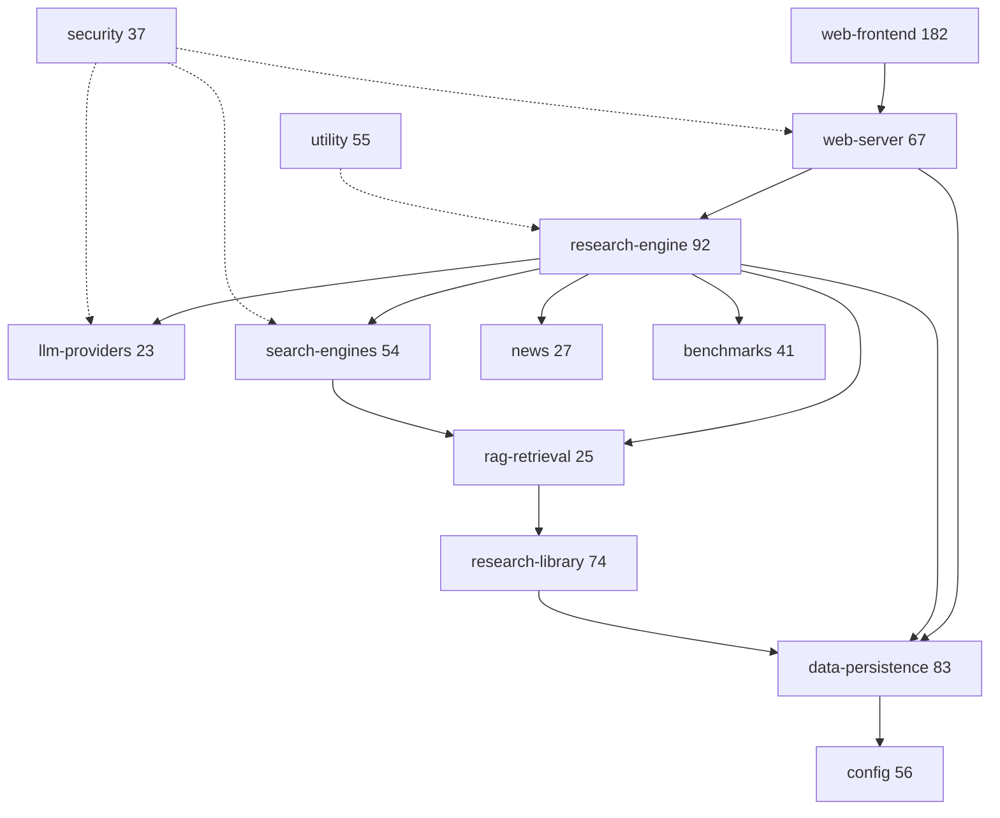

# Local Deep Research 新人上手指南

> 知识图谱生成 | 1017 文件 | commit `2915dc05` | 2026-09-21

## 1. 项目概览

**Local Deep Research（LDR）** 是 OpenAI Deep Research 的开源本地替代——本地/自托管、隐私优先的深度研究引擎。隐私三件套：LLM 走 Ollama/llama.cpp 等本地推理（21 个 provider，含云端）；搜索可走 SearXNG 自托管（37 种引擎实现）；数据落**每用户 SQLCipher 加密 SQLite 单库**，出网受 egress 策略治理。

研究循环本质是迭代「搜索 → 阅读 → 综合」：策略生成问题变体并行检索；content_fetcher 把 URL 变清洗全文；LLM 比对知识差距决定下一轮搜什么、何时停；report_generator 综合带引用报告。

同一引擎五种消费形态：WebUI、Python API、HTTP API v1、CLI、MCP server。核心数字：**1017 文件、16 架构层**；主代码 `src/local_deep_research`；基座 pdm + Vite + SQLAlchemy + Alembic + SQLCipher。

## 2. 架构分层

「入口 → 引擎 → 能力抽象 → 横切底座 → 交付质量」五段式：

| 层 | 规模 | 职责 |
|---|---|---|
| web-frontend | 182 | static 的 JS 组件/页面脚本、Jinja2 模板、主题 |
| ci-quality | 142 | 66 条 workflow、59 个 pre-commit 钩子、安全扫描 |
| research-engine | 92 | AdvancedSearchSystem 主循环、策略族、api 与 MCP 接口 |
| web-server | 67 | FastAPI 路由/认证/服务、研究队列，HTTP 入口 |
| data-persistence | 83 | SQLAlchemy 模型、Alembic、SQLCipher、线程会话、备份 |
| research-library | 74 | 下载器/Zotero/笔记/检索/删除、期刊质量、导出 |
| config | 56 | SettingsManager、env 注册表、defaults 默认 JSON |
| utility | 55 | 通用工具、metrics 计量、通知、调度、错误处理 |
| search-engines | 54 | 引擎工厂与注册表、37 种实现、限流、content_fetcher |
| infrastructure | 50 | Dockerfile、docker-compose、CI/dev 脚本、构建配置 |
| benchmarks | 41 | SimpleQA/BrowseComp/XBench 评测 + Optuna 调优 |
| security | 37 | SSRF、egress 出口管控、DNS pinning、日志脱敏 |
| news | 27 | RSS 订阅拉取、评分、偏好、推荐 |
| rag-retrieval | 25 | embeddings、FAISS 向量门面、多格式 loader |
| llm-providers | 23 | 21 个 provider、注册表与 base 抽象 |
| documentation | 16 | README/CONTRIBUTING/SECURITY、模板 |

## 3. 核心概念

**database-first SettingsManager**：一切行为由设置驱动。settings/manager.py 以每用户加密库为权威存储，类型化读写与快照上下文；base.py 定义可替换协议（InMemorySettingsManager 供 API/MCP）。读取走 config/thread_settings.py 多级链：快照 → 线程上下文 → 用户管理器兜底；默认值在 defaults/。

**FastAPI 应用工厂**：web/app.py 是 uvicorn 入口；组合根在 fastapi_app.py——lifespan、安全中间件栈、CORS、子应用挂载。dependencies/auth.py 的认证/会话/设置 Depends 被几乎所有路由复用。

**研究策略家族**：api/research_functions.py 两档入口——quick_summary 与 detailed_research/generate_report/analyze_documents；策略由 AVAILABLE_STRATEGIES 声明、search_system_factory 实例化。代表：focused_iteration（SimpleQA 96.51%）、source_based、langgraph_agent（3100 行）。全部实现 base_strategy 的 analyze_topic 契约，由 search_system.py 驱动。

**LLM 抽象**：providers/base.py 定 create_llm/is_available 契约；auto_discovery.py 自动注册 21 个 provider；openai_base.py 集中 SSRF 校验与 context window 推断，DeepSeek/OpenRouter 等以薄子类复用 OpenAI 协议；llm_registry 按 username 缓存实例。

**搜索引擎抽象**：search_engine_base.py 统一两阶段检索（previews → full）、LLM 相关性过滤、期刊过滤、自适应限流与 egress 校验；engine_registry.py 是 30+ 引擎的硬编码单一事实来源；factory 经 module_whitelist 动态加载。

**RAG**：embeddings 对齐 LLM provider 架构（sentence-transformers/Ollama/OpenAI）；vector_stores/facade.py 的 VectorIndex 是唯一入口——安全不变量：FAISS 只存 int64 id + 向量，chunk 文本权威在加密库 DocumentChunk；library_rag_service.py 管索引与写锁；search_engine_library.py 把库包装成搜索引擎。

**MCP**：mcp/server.py 基于 FastMCP 暴露 quick_research/detailed_research 等工具；`python -m local_deep_research.mcp` 启动。

**每用户加密 SQLite**：encrypted_db.py 管密钥派生/rekey/WAL；sqlcipher_utils.py 是加密基座；session_context.py 统一开会话；24 个模型模块注册到唯一 Base.metadata，Alembic 自动迁移。

## 4. 推荐学习路径

按 15 步 tour 分四段：

**定位与配置（1-4）**：README.md + pyproject.toml 建立认知；读 settings 包；沿 web/app.py → fastapi_app.py → dependencies/auth.py 走通启动；跟 research_service.py（3322 行）→ queue/processor_v2.py 理解任务调度。

**引擎心脏（5-6）**：research_functions 四入口 → factory 实例化策略 → search_system.py 驱动 analyze_topic 迭代 → report_generator.py 综合报告；再展开策略家族与 questions/findings 子包。

**三大能力抽象（7-10)**：LLM 注册与自动发现（7）→ 搜索统一底座（8）→ content_fetcher 抓取全文（9）→ RAG 私有库检索（10）。

**消费端与横切（11-15）**：MCP 与 LDRClient（11）→ 前端 Vite + Jinja2（12）→ 加密 SQLite（13）→ egress 治理（14，权威设计文档 331 行）→ 容器化与贡献流程（15）。

## 5. 文件地图

| 层 | 关键文件 |
|---|---|
| web-server | routers/{research,settings,notes,rag}.py；services/research_service.py；fastapi_app.py |
| research-engine | api/research_functions.py；search_system.py；strategies/*；mcp/server.py |
| llm-providers | providers/{base,auto_discovery,openai_base}.py；implementations/{ollama,anthropic}.py |
| search-engines | search_engine_base.py；engine_registry.py；engines/search_engine_searxng.py |
| rag / research-library | vector_stores/facade.py；services/library_rag_service.py；downloaders/{base,playwright_html}.py |
| data-persistence | encrypted_db.py；session_context.py；models/{library,research}.py |
| config / security | settings/manager.py；config/thread_settings.py；security/egress/policy.py |
| web-frontend | templates/base.html；static/js/components/{research,progress,results}.js |
| infrastructure | Dockerfile；docker-compose.yml；pyproject.toml |

（相对 src/local_deep_research/）

## 6. 复杂度热点

Top 10（按连接度）：

| # | 文件 | 度 | 切入建议 |
|---|---|---|---|
| 1 | web/routers/notes.py | 110 | 50+ 端点，先读路由表再挑 AI 动作端点 |
| 2 | web/routers/settings.py | 103 | 3995 行；双模式保存 + 引擎发现 |
| 3 | web/routers/news_flask_api.py | 98 | Flask 名遗留，实为 APIRouter |
| 4 | web/routers/rag.py | 91 | 最大 4472 行；索引全流程 |
| 5 | static/js/pages/note-detail.js | 89 | 前端最重页面，双模式 + AI 动作 |
| 6 | static/js/pages/news.js | 80 | 与 news_flask_api.py 对照读 |
| 7 | web/routers/metrics.py | 79 | 30+ 分析端点 |
| 8 | database/models/library.py | 70 | 23 个 ORM 实体，改 schema 前必读 |
| 9 | web/routers/research.py | 70 | 配合 research_service.py 读 |
| 10 | web/routers/library.py | 62 | 文献库与下载队列 |

共性：热点集中在 web/routers 与前端脚本——路由层是扇入汇聚点，改路由先看 service 层。

## 7. 构建与调试

- **本地开发**：Python >=3.12，pdm install；入口点 ldr-web 与 ldr-mcp。前端 Node>=24：npm ci && npm run build。
- **容器化**：docker-compose.yml 拉起 local-deep-research（5000 端口）+ ollama + searxng 三服务；Dockerfile 四阶段构建，GPU 用 override。
- **测试**：pytest；慢测试标 @pytest.mark.slow；CI 预建加密测试库；整合测试在 docker-tests.yml（约 1500 行）。
- **调试**：进度经 Socket.IO 推送（/ws），断连降级轮询；LDR_LOG_SETTINGS 控设置日志。

## 8. 常见坑与本地约定

1. **版本勘误（重要）**：启动入口是 `web/app.py` + 组合根 `web/fastapi_app.py`——不存在 `web/utils/app.py`；研究编排在 `api/research_functions.py` + `search_system.py`——不在 web_models。
2. **src/ui 未入扫描**：1017 文件分析范围不含 src/ui，图谱无覆盖，需直接读源码。
3. **配置 database-first**：改 defaults/*.json 只是种子，运行时以每用户加密库为准。
4. **Flask→FastAPI 已完成**：src/ 禁止 flask import（钩子守护）；news_flask_api.py 是名称遗留。元数据的 Flask/Celery/React 属历史标注——实际后端 FastAPI、队列走后台线程 processor_v2、前端 Vite + Bootstrap + Jinja2。
5. **pre-commit 很重**：约 40 个自定义钩子，首次提交前跑 pre-commit run --all-files。
6. **每用户数据库心智**：数据按用户隔离；后台凭据经 session_passwords 复用；脱离请求上下文取身份用 get_current_username()。
