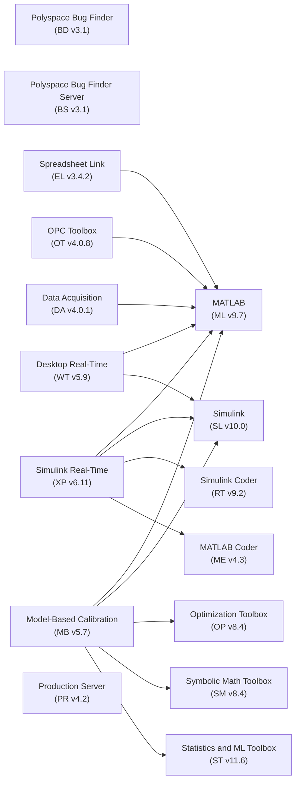

# 07 · 五年演变：R2019b vs R2024b 安装器对照

> 左：MATLAB_r2019b_Linux.iso（18GB 离线介质，9.7.0.1190202，2019-08）；右：R2024b 在线安装器（本系列前六册）。

## 一句话

2019→2024 是**完整架构换代**（Java/SOAP/Swing/黑盒加密包 → C++/REST/Web/OPC 签名包），但**商业语义层原封不动**（entitlement/FIK/FlexLM/四工作流前身）——改的是"怎么分发与验证"，不动"卖什么与怎么授权"。

## 六维速览

| 维 | 2019b | 2024b |
|---|---|---|
| 介质 | 18GB ISO 全量 | 217MB 在线安装器 + 云端按需下载 |
| 启动 | install → install_unix(sh) → **自带 JRE 1.8** 跑 install.jar | install → MathWorksProductInstaller(ELF) → 微服务容器 |
| UI | **Java Swing** 向导（17 个 jar）；Dojo 仅做公式渲染插件 | **CEF + mf0 模型驱动 + Dojo 全站** |
| 服务 | **Apache Axis SOAP**（mlwebservices 包）；URL 散落；遥测**全 http** | REST **集中注册表**（223 URL×5 环境）；全 https；WS_ENV 切换 |
| 原生面 | 9 个辅助 so | **672 ELF / 64 bundle / 130 组件** |
| 包格式 | `.enc` = 标准 zip + 4 字节循环 XOR（混淆） | `.enc` = **OPC(zip)+XML-DSig+关系级 AES-GCM**（真加密） |

## 包格式演变（已彻底破译：`.enc` = XOR 混淆的标准 zip）

从 2019b 安装器 jar 反编译出解密器全链：`DecodeArchiveInputStreamExtractor` → `DecodeInputStream`，字节码钉版 `b[i] ^= TMWkey[i%4]`，**静态密钥 `TMWkey = {0x1a,0x1b,0x1c,0x1d}`**。实测 **3,005/3,005 全量档案 100% 解开**（XOR 后即标准 zip `PK\x03\x04`，mexa64/`.m` 源码原样可读）——18GB 介质实质明文。

> 安全定性翻案：2019b 的 `.enc` 是**混淆不是加密**（4 字节静态 XOR 防顺手解包，不防认真的人）。

2024b 的 `.enc` 组件包：OPC zip 明文容器 + **XML-DSig 独立签名** + cipherData 关系级 **AES256-GCM 真加密**（密钥随授权派生，包内零静态密钥）。

→ 五年真实叙事：**混淆 → 签名与加密分离的密码学工程**。供应链安全从"体面门槛"到"标准容器+可验签+选择性机密"。

## 服务层：entitlement 数据模型五年不变，传输层全部重做

2019b `DefaultActivationService` 方法面（class 常量池）：`getEntitlements / getEntitlementByActivationKey / activateAnonymous / canActivate / activateSelf / activateOther`——**entitlement 2019 年已是 API 一等公民**；2024b 的 entitlementId 更贯穿下载（DWS 参数）→许可（MLS）→包密钥（CipherEntry）全链。

## 九个不变的东西

install 脚本 1997 模板（逐字同源）· VersionInfo.xml 结构 · installer_input 参数命名族 · entitlement 模型 · FlexLM 三件套（内核 2018→2023）· `.enc` 后缀 · Dojo（局部→全站）· **MW_*_SERVICE 端点 override 键族**（2019 WSEndPoints 环境变量→2024 UrlManager 同名连续）· 档案 entry 语义（`_common.xml`/`mwcontents_` 前缀）。

**服务层彩蛋**：2019b 就有集中端点类 `WSEndPoints`（21 getter + `getURLFromKeyOrOverride`），MW_DWS_SERVICE/MW_LOGIN_SERVICE 等 20 个键——2024b 的 `MW_DOWNLOADS_SERVICE` 是直系后裔；向导流一屏对一屏（Swing PanelUI → mf0 模型屏，只换渲染层）。

## 栈血缘（2024b 安装器的前身在 2019b MATLAB 本体里）

`.enc` 解包实证：`+connector/+internal/webwindowmanager.m`（mw-webwindow 包）与 `+cef/webwindow.m`（cefclient 包）——**connector 命名空间与 CEF webwindow 2019 已在 MATLAB Desktop（JCEF 时代）**；`connector_api_java`+`mlconnector_bridge.jar` 是 14 个 libmwconnector so 的 Java 前身；`libmatlab_toolbox_mvm` 是 mvm_transport 前身。→ 2024b 安装器 = 把 MATLAB Desktop 的 Java/JCEF 连接器生态平移重写为原生 C++ 微服务，命名几乎未变。

## 产品依赖图（104 节点，核心子图）

全图 104 节点/137 边：`product_graph_2019b.json`；被依赖 TOP：ML×61、SL×18、SG×9（MATLAB 绝对根+Simulink 第二生态中心）；controlling 4 家族（ML/PR/BD/BS）→ 2024b 扩至 10；ML 产品 596 组件、语言前端 libmwfe 七件套独立成档。

## 安全态势跃迁

遥测 http→https · 端点散落→集中治理+五环境 · 加密即完整性→签名独立 · 二进制无自验证→全家族 ELF 签名四节 · 无本地服务面→localhost+TLS+随机端口+nonce+Feval 白名单。
唯一的倒退向观察：2024b `improveMATLAB=yes` 成为模板唯一默认启用行（无头装机默认开遥测），2019b 无此参数。
