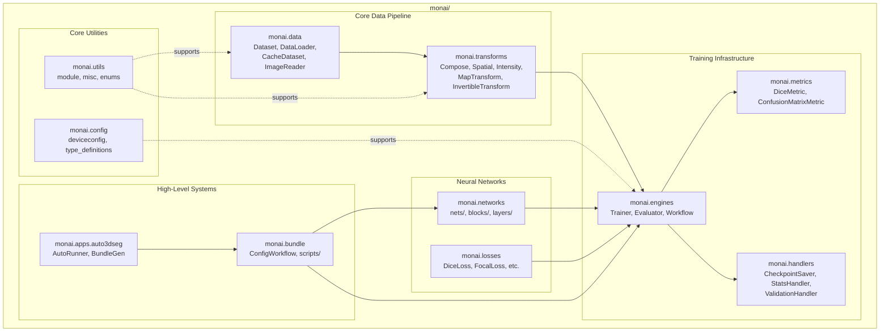
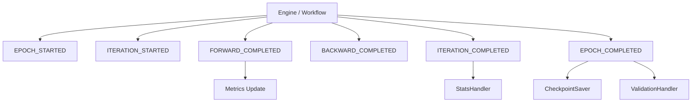
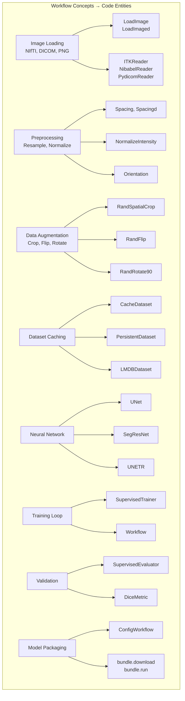

<!-- source: DeepWiki mcp.deepwiki.com · repo Project-MONAI/MONAI · page 1 MONAI Overview · fetched 2026-10-21 -->

# MONAI Overview

<details>
<summary>Relevant source files</summary>

The following files were used as context for generating this wiki page:

- [README.md](README.md)
- [docs/images/MONAI_arch.png](docs/images/MONAI_arch.png)
- [docs/images/MONAI_bundle_cloud.png](docs/images/MONAI_bundle_cloud.png)
- [docs/images/MONAI_clouds.png](docs/images/MONAI_clouds.png)
- [docs/images/MONAI_map_cloud.png](docs/images/MONAI_map_cloud.png)
- [docs/source/bundle_intro.rst](docs/source/bundle_intro.rst)
- [docs/source/index.rst](docs/source/index.rst)
- [docs/source/mb_specification.rst](docs/source/mb_specification.rst)
- [tests/testing_data/metadata.json](tests/testing_data/metadata.json)

</details>


## Purpose and Scope

This document provides a high-level introduction to the MONAI framework, its architecture, and core concepts. It covers the overall organization of the codebase, key modules, and how they interact to support deep learning workflows for medical imaging.

For detailed information about specific subsystems:
- Core utilities and module management: see [Core Utilities and Module System](#2.1)
- Transform system architecture: see [Transform System](#3)
- Data loading and caching: see [Data Loading and Processing](#4)
- Neural network architectures: see [Network Architectures and Components](#5.1)
- Training workflows: see [Training Engines and Workflows](#5.2)
- Bundle format and distribution: see [Bundle System](#6.1)
- Development setup and CI/CD: see [Development and Infrastructure](#7)

---

## What is MONAI?

**MONAI** (Medical Open Network for AI) is a PyTorch-based, open-source framework for deep learning in healthcare imaging. It is part of the PyTorch Ecosystem and provides domain-specific implementations for medical image analysis tasks including segmentation, classification, detection, and registration.

**Core Ambitions:**
- Develop a collaborative community of academic, industrial, and clinical researchers
- Create state-of-the-art, end-to-end training workflows for healthcare imaging
- Provide researchers with optimized and standardized tools for deep learning model development

**Key Features:**
- Flexible preprocessing for multi-dimensional medical imaging data
- Compositional and portable APIs for integration into existing workflows
- Domain-specific network architectures, loss functions, and evaluation metrics
- Customizable design supporting varying levels of user expertise
- Multi-GPU and multi-node data parallelism support

**Sources:** [README.md:1-26](), [docs/source/index.rst:1-44]()

---

## Architecture Overview

MONAI's architecture is organized into distinct layers, each providing specific functionality for medical imaging workflows. The diagram below maps high-level system components to their corresponding code modules.



**Sources:** [README.md:20-44](), [docs/source/index.rst:14-34]()

---

## Core Module Organization

The MONAI codebase is organized into the following primary modules located under the `monai/` directory:

### Data Pipeline (`monai.data`)
Handles medical image loading, caching, and batching:
- `Dataset`: Base dataset class and specialized variants (`CacheDataset`, `PersistentDataset`, `LMDBDataset`)
- `DataLoader`: PyTorch-compatible data loaders with custom collation
- `ImageReader`: Format-specific readers (`ITKReader`, `NibabelReader`, `PydicomReader`)
- Decathalon dataset utilities

**Key Classes:** `Dataset`, `CacheDataset`, `DataLoader`, `ImageReader`

### Transforms (`monai.transforms`)
Composable preprocessing and augmentation operations:
- **Base Classes:** `Transform`, `MapTransform`, `RandomizableTransform`, `InvertibleTransform`, `LazyTransform`
- **Categories:** Spatial (resampling, rotation), Intensity (normalization, scaling), Crop/Pad, Post-processing
- **Dictionary Pattern:** Transforms ending with 'd' suffix operate on dictionaries (e.g., `LoadImaged`, `Spacingd`)

**Key Classes:** `Compose`, `LoadImage`, `Spacing`, `NormalizeIntensity`, `RandCropByPosNegLabel`

### Networks (`monai.networks`)
Neural network architectures and building blocks:
- `nets/`: Complete architectures (UNet, ResNet, DenseNet, ViT, UNETR, etc.)
- `blocks/`: Reusable network components (Convolution, Residual, Attention blocks)
- `layers/`: Low-level layer implementations (Act, Norm, Conv, Dropout)

**Key Classes:** `UNet`, `DynUNet`, `SegResNet`, `UNETR`, `SwinUNETR`

### Training & Evaluation (`monai.engines`, `monai.metrics`, `monai.handlers`)
Event-driven training infrastructure built on PyTorch Ignite:
- **Engines:** `Workflow`, `SupervisedTrainer`, `SupervisedEvaluator`, `EnsembleEvaluator`
- **Metrics:** `DiceMetric`, `HausdorffDistanceMetric`, `ConfusionMatrixMetric`, `ROCAUCMetric`
- **Handlers:** `CheckpointSaver`, `StatsHandler`, `TensorBoardHandler`, `ValidationHandler`

**Key Classes:** `SupervisedTrainer`, `SupervisedEvaluator`, `DiceMetric`, `CheckpointSaver`

### Bundle System (`monai.bundle`)
Standardized model packaging and distribution:
- Configuration-based workflows (`ConfigWorkflow`)
- Bundle scripts for download, load, run, verify operations
- Model export utilities (TorchScript, ONNX, TensorRT)

**Key Classes:** `ConfigWorkflow`, `ConfigParser`

### Auto3DSeg (`monai.apps.auto3dseg`)
Automated pipeline for 3D segmentation tasks:
- `AutoRunner`: Orchestrates the complete automated workflow
- `BundleGen`: Generates algorithm bundles from templates
- `AlgoEnsemble`: Combines multiple models for inference

**Key Classes:** `AutoRunner`, `BundleGen`, `AlgoEnsemble`

**Sources:** [README.md:27-44](), [docs/source/index.rst:27-34]()

---

## Key Abstractions and Design Patterns

### MetaTensor
MONAI's `MetaTensor` extends PyTorch tensors with metadata tracking capabilities. It stores:
- Affine transformations for spatial coordinates
- Applied operations history (`applied_operations`)
- Pending lazy operations (`pending_operations`)
- Original image metadata (spacing, orientation, etc.)

This enables invertible transforms and preserves provenance throughout the pipeline.

**Key Class:** `monai.data.MetaTensor`

### Transform Composition
Transforms follow a functional composition pattern where operations are chained:


Dictionary-based transforms (suffix 'd') operate on dictionaries of data items, enabling coordinated transformations across images, labels, and metadata.

**Key Classes:** `Compose`, `MapTransform`, `InvertibleTransform`

### Event-Driven Training
Training engines use an event system built on PyTorch Ignite:



Handlers attach to events to perform actions like logging, checkpointing, or validation.

**Key Classes:** `Workflow`, `IterationEvents`, `Handler`

### Bundle Configuration System
Bundles use JSON/YAML configurations with a reference syntax for defining workflows:

- `@network_def` references network instantiation
- `@preprocessing` references transform chains
- `$@device` references runtime parameters
- Expressions like `$@optimizer_def#lr` access nested values

The `ConfigParser` resolves these references and instantiates components.

**Key Class:** `monai.bundle.ConfigParser`

**Sources:** [README.md:27-44](), [docs/source/index.rst:27-34]()

---

## Code-to-Concept Mapping

The following diagram maps common medical imaging workflow concepts to specific MONAI code entities:



**Sources:** [README.md:1-97]()

---

## Installation and Distribution

### Installation Options

**PyPI (recommended):**
```bash
pip install monai
```

**Conda:**
```bash
conda install -c conda-forge monai
```

**Docker:**
```bash
docker pull projectmonai/monai
```

**Weekly Preview (development builds):**
```bash
pip install monai-weekly
```

### Requirements
- Python: Currently supported versions (typically 3.8+)
- PyTorch: Current version plus three previous minor versions
- NumPy: Required core dependency
- Optional dependencies for specific features (ITK, Nibabel, TorchVision, etc.)

Version compatibility information is maintained in `requirements*.txt` files at the repository root.

For detailed installation instructions including optional dependencies and environment setup, see [Project Setup and Dependencies](#7.1).

**Sources:** [README.md:37-54]()

---

## Getting Started Resources

**Documentation:**
- API Documentation: `https://docs.monai.io`
- Technical highlights and tutorials: Available in the docs
- Bundle specification: [docs/source/mb_specification.rst:1-175]()

**Code Examples:**
- MedNIST demo: Interactive Colab notebook for 2D classification
- MONAI for PyTorch Users: Developer guide notebook
- Tutorial repository: `https://github.com/Project-MONAI/tutorials`

**Model Zoo:**
- Pre-trained models in Bundle format: `https://github.com/Project-MONAI/model-zoo`
- Community-contributed models and workflows
- Easy integration with MONAI applications

**Community:**
- GitHub Discussions: Q&A and community support
- Twitter: @ProjectMONAI
- LinkedIn: Project MONAI page
- Slack: Community workspace

**Sources:** [README.md:56-82](), [docs/source/index.rst:38-108]()

---

## Development and Contribution

MONAI follows open-source development practices with:

**Testing Infrastructure:**
- Unit tests covering core functionality
- Integration tests for end-to-end workflows
- GPU-specific test suites
- Minimal dependency tests

**CI/CD Pipelines:**
- Pre-merge validation (quick tests, formatting, type checking)
- Post-merge comprehensive testing
- Nightly builds testing multiple Python/PyTorch/CUDA combinations
- Automated release process to PyPI and conda-forge

**Code Quality:**
- Automated formatting: `black`, `isort`, `ruff`
- Type checking: `mypy`
- Linting: `flake8`
- Test coverage reporting

For information about setting up a development environment, running tests, and the contribution workflow, see [Development and Infrastructure](#7).

**Sources:** [README.md:74-76]()

---

## Related Pages

- **[Core Architecture](#2)**: Fundamental utilities, module system, and core abstractions
- **[Transform System](#3)**: Comprehensive documentation of MONAI's transform architecture
- **[Data Loading and Processing](#4)**: Dataset classes, caching strategies, and image I/O
- **[Models and Training](#5)**: Neural networks, training engines, metrics, and handlers
- **[Advanced Features](#6)**: Bundle system and Auto3DSeg pipeline
- **[Development and Infrastructure](#7)**: Setup, testing, CI/CD, and packaging

**Sources:** [README.md:1-97](), [docs/source/index.rst:1-115]()

---

