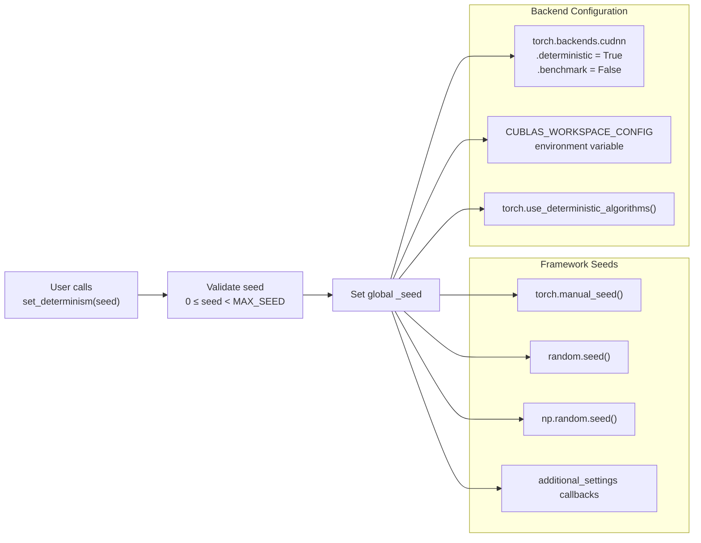
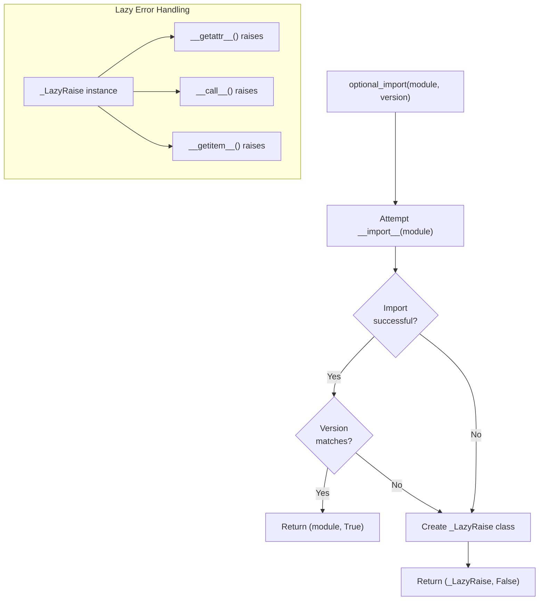
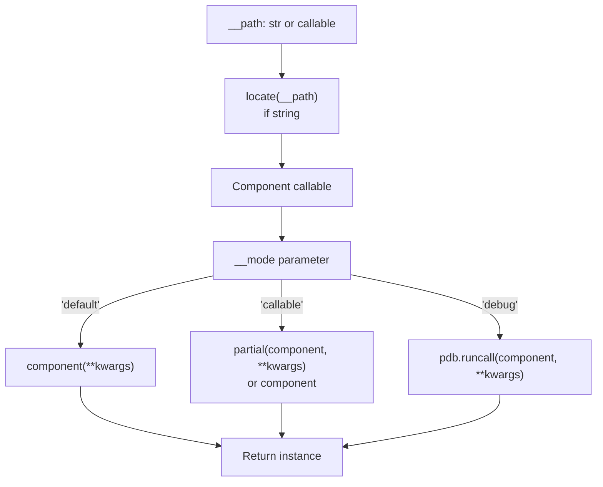
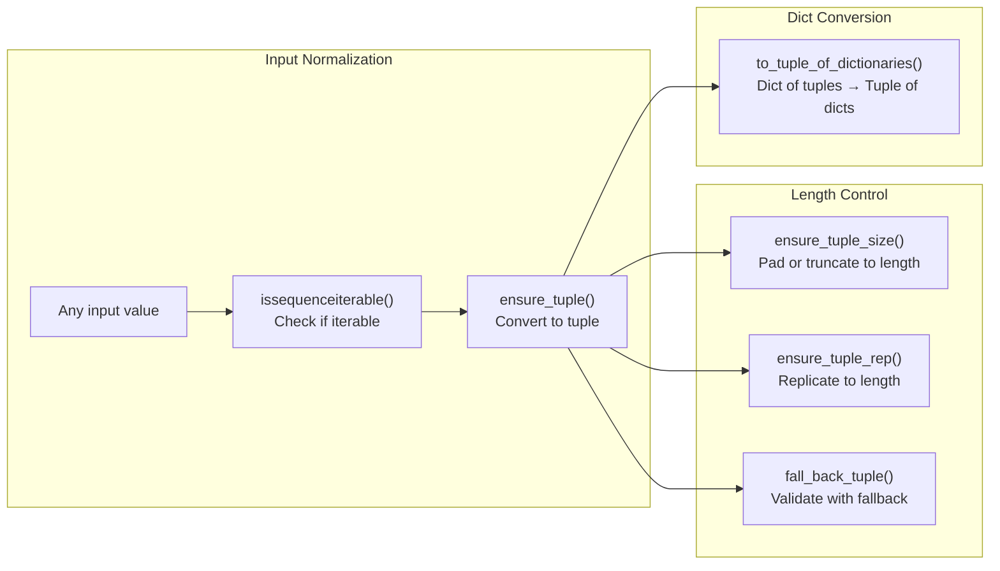
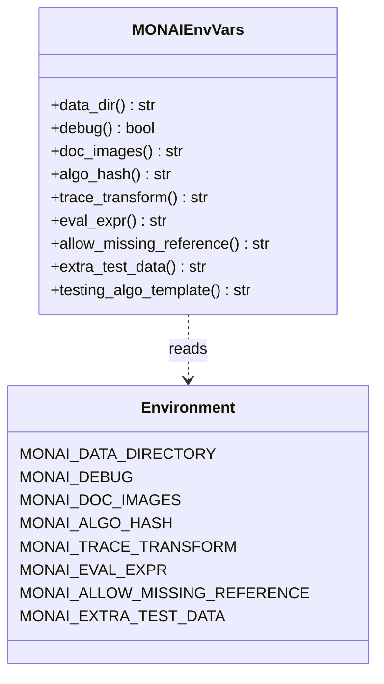
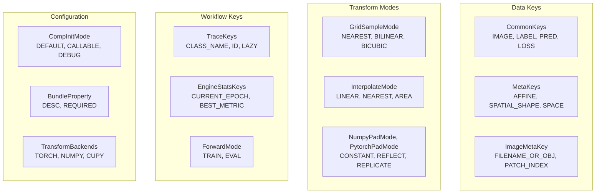
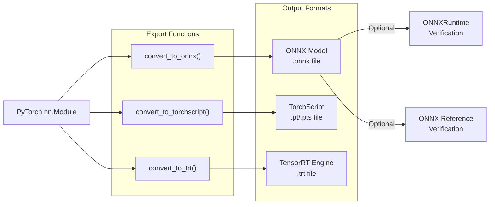

<!-- source: DeepWiki mcp.deepwiki.com · repo Project-MONAI/MONAI · page 2 Core Architecture · fetched 2026-10-21 -->

# Core Architecture

<details>
<summary>Relevant source files</summary>

The following files were used as context for generating this wiki page:

- [monai/__init__.py](monai/__init__.py)
- [monai/networks/__init__.py](monai/networks/__init__.py)
- [monai/networks/layers/simplelayers.py](monai/networks/layers/simplelayers.py)
- [monai/networks/utils.py](monai/networks/utils.py)
- [monai/utils/__init__.py](monai/utils/__init__.py)
- [monai/utils/enums.py](monai/utils/enums.py)
- [monai/utils/misc.py](monai/utils/misc.py)
- [monai/utils/module.py](monai/utils/module.py)

</details>


## Purpose and Scope

This page documents the fundamental utilities and systems that underpin the entire MONAI framework. These core components provide essential functionality for determinism control, module loading, type conversions, environment configuration, and model deployment. All higher-level MONAI components (transforms, data loaders, networks, engines) depend on these utilities.

For information about:
- Transform system architecture and operations, see [Transform System](#3)
- Data loading, caching, and I/O, see [Data Loading and Processing](#4)
- Neural network architectures and training, see [Models and Training](#5)

---

## System Overview

The core architecture provides foundational services organized into several key subsystems:

```mermaid
graph TB
    subgraph "Module System"
        OptImport["optional_import()<br/>Safe dependency loading"]
        LoadSub["load_submodules()<br/>Package discovery"]
        Instantiate["instantiate()<br/>Component creation"]
    end
    
    subgraph "Determinism Control"
        SetDet["set_determinism()<br/>Seed management"]
        GetSeed["get_seed()<br/>Current seed"]
        MaxSeed["MAX_SEED<br/>2^32 limit"]
    end
    
    subgraph "Type Utilities"
        EnsureTuple["ensure_tuple()<br/>Sequence normalization"]
        EnsureTupleRep["ensure_tuple_rep()<br/>Length enforcement"]
        Convert["Type conversion utils"]
    end
    
    subgraph "Environment & Config"
        EnvVars["MONAIEnvVars<br/>Environment settings"]
        Enums["StrEnum types<br/>Type-safe constants"]
        ImageMeta["ImageMetaKey<br/>Metadata keys"]
    end
    
    subgraph "Model Deployment"
        ToONNX["convert_to_onnx()<br/>ONNX export"]
        ToTS["convert_to_torchscript()<br/>TorchScript export"]
        ToTRT["convert_to_trt()<br/>TensorRT export"]
        StateDict["State management"]
    end
    
    OptImport --> LoadSub
    LoadSub --> Instantiate
    
    SetDet --> GetSeed
    GetSeed --> MaxSeed
    
    EnsureTuple --> EnsureTupleRep
    EnsureTupleRep --> Convert
    
    EnvVars --> Enums
    Enums --> ImageMeta
    
    ToONNX --> StateDict
    ToTS --> StateDict
    ToTRT --> StateDict
```



**Diagram: Core Architecture Subsystems** - This diagram shows the five major subsystems of MONAI's core architecture and their internal relationships. Each subsystem provides essential utilities that support the higher-level data, transform, network, and training systems.

Sources: [monai/utils/__init__.py:1-159](), [monai/utils/misc.py:1-929](), [monai/utils/module.py:1-658]()

---

## Determinism and Random State Management

MONAI provides comprehensive determinism control to ensure reproducible training and evaluation across different runs.

### Seed Management

| Function/Constant | Purpose | File Location |
|------------------|---------|---------------|
| `set_determinism()` | Configure global deterministic behavior | [monai/utils/misc.py:339-391]() |
| `get_seed()` | Retrieve current random seed | [monai/utils/misc.py:335-336]() |
| `MAX_SEED` | Maximum valid seed value (2^32) | [monai/utils/misc.py:103]() |
| `_seed` | Global seed storage | [monai/utils/misc.py:99]() |

### Determinism Configuration Flow



**Diagram: Determinism Control Flow** - Shows how `set_determinism()` propagates seed values and configuration flags across PyTorch, NumPy, Python random, and CUDA backends to achieve reproducible behavior.

Sources: [monai/utils/misc.py:339-391](), [monai/utils/misc.py:99-107]()

### Key Implementation Details

The determinism system configures multiple layers:

1. **Global Seed Storage**: The module-level `_seed` variable stores the current seed for retrieval
2. **Framework Seeds**: PyTorch, NumPy, and Python's random module are seeded identically
3. **CUDA Configuration**: Sets `CUBLAS_WORKSPACE_CONFIG` environment variable to enable deterministic algorithms
4. **cuDNN Flags**: Disables benchmarking and enables deterministic mode
5. **Additional Settings**: Allows custom callbacks for framework-specific seeding

```python
# Example usage pattern
from monai.utils import set_determinism, get_seed

# Enable deterministic training
set_determinism(seed=42)

# Later retrieve the seed
current_seed = get_seed()  # Returns 42
```

**Important Note**: The `MAX_SEED` constant is set to 2^32 (4,294,967,296) because PyTorch CUDA requires 32-bit seeds. Seeds are automatically taken modulo `MAX_SEED` if they exceed this limit.

Sources: [monai/utils/misc.py:99-107](), [monai/utils/misc.py:339-391]()

---

## Module Loading and Optional Dependencies

MONAI uses a sophisticated module loading system to handle optional dependencies gracefully, allowing the framework to function even when certain packages are not installed.

### Optional Import System



**Diagram: Optional Import Mechanism** - Shows how `optional_import()` attempts to load modules and returns either the real module or a lazy error-raising proxy object. The proxy delays exceptions until actual use.

Sources: [monai/utils/module.py:315-445]()

### Module Loading Functions

| Function | Purpose | Return Type |
|----------|---------|-------------|
| `optional_import()` | Import module with version checking | `(module, bool)` |
| `load_submodules()` | Traverse and load package structure | `(list[Module], list[str])` |
| `instantiate()` | Create object from class path string | `Any` |
| `require_pkg()` | Decorator for dependency checking | `Callable` |

### Component Instantiation

The `instantiate()` function supports multiple operating modes for creating components:



**Diagram: Component Instantiation Modes** - The `instantiate()` function supports three modes controlled by `CompInitMode` enum: immediate instantiation (`default`), delayed callable (`callable`), and debugger mode (`debug`).

Sources: [monai/utils/module.py:205-259](), [monai/utils/enums.py:410-419]()

### Lazy Import Example

```python
# Import succeeds even if package not installed
itk, has_itk = optional_import("itk")

if has_itk:
    # Use itk normally
    image = itk.imread("file.nii")
else:
    # Lazy object raises informative error when used
    try:
        image = itk.imread("file.nii")  # Raises OptionalImportError
    except OptionalImportError as e:
        print(f"ITK not available: {e}")
```

Sources: [monai/utils/module.py:315-445]()

---

## Type Utilities and Data Handling

MONAI provides comprehensive utilities for type conversions, sequence handling, and data structure manipulation.

### Tuple Utilities



**Diagram: Tuple Utility Functions** - Shows the hierarchy of tuple conversion utilities. `ensure_tuple()` forms the base, with specialized functions for length control and dictionary restructuring.

Sources: [monai/utils/misc.py:166-303]()

### Core Type Utilities

| Function | Input | Output | Purpose |
|----------|-------|--------|---------|
| `ensure_tuple()` | Any | `tuple` | Convert to tuple, handle arrays |
| `ensure_tuple_size()` | Any, int | `tuple` | Pad/truncate to exact length |
| `ensure_tuple_rep()` | Any, int | `tuple` | Replicate scalar or validate sequence |
| `issequenceiterable()` | Any | `bool` | Check if iterable (excluding strings) |
| `is_scalar()` | Any | `bool` | Check if scalar including 0-d tensors |
| `first()` | Iterable | Any | Get first element or default |

### Practical Examples

```python
# ensure_tuple: Normalize various inputs
ensure_tuple(5)              # (5,)
ensure_tuple([1, 2, 3])      # (1, 2, 3)
ensure_tuple("abc")          # ("abc",)  # string as single item

# ensure_tuple_size: Fixed-length tuples
ensure_tuple_size(5, dim=3)           # (5, 5, 5)
ensure_tuple_size([1, 2], dim=4, pad_val=0)  # (1, 2, 0, 0)

# ensure_tuple_rep: Replicate or validate
ensure_tuple_rep(1, dim=3)        # (1, 1, 1)
ensure_tuple_rep([1, 2, 3], dim=3)  # (1, 2, 3)
ensure_tuple_rep([1, 2], dim=3)   # ValueError: wrong length

# fall_back_tuple: Conditional fallback
fall_back_tuple((-1, 10), (32, 32))  # (32, 10) - replaces -1
```

Sources: [monai/utils/misc.py:166-303]()

### Additional Utilities

| Function | Purpose |
|----------|---------|
| `zip_with()` | Zip iterables and apply operation |
| `star_zip_with()` | Zip with starmap for multiple args |
| `list_to_dict()` | Parse "key=value" strings to dict |
| `copy_to_device()` | Recursively move data to device |
| `str2bool()` | Parse string to boolean |
| `str2list()` | Parse comma-separated string to list |

Sources: [monai/utils/misc.py:110-524]()

---

## Environment Configuration System

MONAI uses environment variables and configuration classes to control framework behavior.

### MONAIEnvVars Class



**Diagram: Environment Variable Access** - The `MONAIEnvVars` class provides static methods to read MONAI-specific environment variables with proper type conversions.

Sources: [monai/utils/misc.py:526-567]()

### Environment Variables

| Variable | Type | Default | Purpose |
|----------|------|---------|---------|
| `MONAI_DATA_DIRECTORY` | str | None | Default data download location |
| `MONAI_DEBUG` | bool | False | Enable debug mode |
| `MONAI_TRACE_TRANSFORM` | str | "1" | Enable transform tracing |
| `MONAI_EVAL_EXPR` | str | "1" | Enable expression evaluation in configs |
| `MONAI_ALLOW_MISSING_REFERENCE` | str | "1" | Allow missing config references |
| `CUBLAS_WORKSPACE_CONFIG` | str | ":4096:8" | CUDA deterministic algorithms |

### Metadata Keys

```python
class ImageMetaKey:
    """Common metadata keys for medical images"""
    FILENAME_OR_OBJ = "filename_or_obj"
    PATCH_INDEX = "patch_index"
    SPATIAL_SHAPE = "spatial_shape"
```

Sources: [monai/utils/misc.py:526-577]()

### Module-Level Flags

Defined in `monai/utils/module.py`:

```python
# Bundle config system flags
run_eval = os.environ.get("MONAI_EVAL_EXPR", "1") != "0"
run_debug = os.environ.get("MONAI_DEBUG_CONFIG", "0") != "0"
allow_missing_reference = os.environ.get("MONAI_ALLOW_MISSING_REFERENCE", "0") != "0"
```

These flags control bundle configuration parsing and validation behavior globally.

Sources: [monai/utils/module.py:32-38]()

---

## Enumeration System

MONAI defines a comprehensive set of type-safe enumerations for configuration and mode specification.

### StrEnum Base Class

```python
class StrEnum(str, Enum):
    """Enum that converts to string automatically"""
    
    def __str__(self):
        return self.value
    
    def __repr__(self):
        return self.value
```

This allows enums to be used directly as strings while maintaining type safety:

```python
from monai.utils import CommonKeys

# Can use as string
key = CommonKeys.IMAGE  # "image"
assert str(key) == "image"
assert key == "image"  # True
```

Sources: [monai/utils/enums.py:68-91]()

### Key Enumerations



**Diagram: Core Enumeration Categories** - MONAI's enumeration system organized by functional area: data handling, transform operations, workflow control, and configuration.

Sources: [monai/utils/enums.py:1-771]()

### Important Enum Types

| Enum Class | Purpose | Example Values |
|------------|---------|----------------|
| `CommonKeys` | Standard data dict keys | `IMAGE`, `LABEL`, `PRED`, `LOSS` |
| `MetaKeys` | Metadata dictionary keys | `AFFINE`, `SPATIAL_SHAPE`, `SPACE` |
| `TraceKeys` | Transform tracing metadata | `CLASS_NAME`, `ID`, `LAZY` |
| `GridSampleMode` | PyTorch grid_sample modes | `NEAREST`, `BILINEAR`, `BICUBIC` |
| `InterpolateMode` | PyTorch interpolation modes | `LINEAR`, `NEAREST`, `AREA` |
| `CompInitMode` | Component instantiation | `DEFAULT`, `CALLABLE`, `DEBUG` |
| `TransformBackends` | Transform execution backend | `TORCH`, `NUMPY`, `CUPY` |
| `LazyAttr` | Lazy evaluation attributes | `SHAPE`, `AFFINE`, `PADDING_MODE` |

Sources: [monai/utils/enums.py:20-771]()

---

## Model Deployment and Export Utilities

MONAI provides utilities to export trained models to multiple formats for deployment.

### Export Format Support



**Diagram: Model Export Pipeline** - Shows the three primary export paths from PyTorch models to deployment formats with optional verification steps.

Sources: [monai/networks/utils.py:661-895]()

### ONNX Export

The `convert_to_onnx()` function provides comprehensive ONNX export with verification:

```python
def convert_to_onnx(
    model: nn.Module,
    inputs: Sequence[Any],
    input_names: Sequence[str] | None = None,
    output_names: Sequence[str] | None = None,
    opset_version: int | None = None,
    dynamic_axes: Mapping | None = None,
    filename: Any | None = None,
    verify: bool = False,
    use_ort: bool = False,
    # ... additional parameters
)
```

**Key Features:**
- Dynamic axis support for variable batch sizes
- Optional verification with ONNX Runtime or reference implementation
- Constant folding optimization via Polygraphy
- Version checking for ONNX opset compatibility

Sources: [monai/networks/utils.py:661-784]()

### TorchScript Export

```python
def convert_to_torchscript(
    model: nn.Module,
    inputs: Any | None = None,
    device: torch.device | None = None,
    use_trace: bool = True,
    # ... other parameters
)
```

Supports both tracing and scripting modes:
- **Tracing**: Records operations during forward pass
- **Scripting**: Compiles Python code directly

Sources: [monai/networks/utils.py:787-895]()

### TensorRT Export

```python
def convert_to_trt(
    model: nn.Module,
    inputs: torch.Tensor | None = None,
    fp16: bool = False,
    int8: bool = False,
    dynamic_batchsize: Sequence[int] | None = None,
    # ... other parameters
)
```

**TensorRT Optimization Features:**
- FP16 and INT8 quantization support
- Dynamic batch size optimization
- Profile shapes for optimal performance
- Precision verification against PyTorch

Sources: [monai/networks/utils.py:898-1076]()

### Model Export Comparison

| Format | Use Case | Precision | Dynamic Shapes | Speed |
|--------|----------|-----------|----------------|-------|
| ONNX | Cross-platform deployment | FP32, FP16 | Yes | Medium |
| TorchScript | PyTorch ecosystem | FP32, FP16 | Limited | Medium |
| TensorRT | NVIDIA GPU inference | FP32, FP16, INT8 | Yes | Fastest |

Sources: [monai/networks/utils.py:43-69](), [monai/networks/utils.py:661-1076]()

---

## Network State Management

MONAI provides utilities for managing model state dictionaries, checkpoint handling, and parameter copying.

### State Dictionary Operations

```mermaid
flowchart TB
    subgraph "State Retrieval"
        GetState["get_state_dict(obj)"]
        CheckDP{"Is DataParallel?"}
        Extract["Extract .module"]
        Return["Return state_dict()"]
        
        GetState --> CheckDP
        CheckDP -->|Yes| Extract
        CheckDP -->|No| Return
        Extract --> Return
    end
    
    subgraph "State Copying"
        Copy["copy_model_state(dst, src)"]
        SrcDict["Get src state_dict"]
        DstDict["Get dst state_dict"]
        Match["Match keys & shapes"]
        Update["Update dst dict"]
        
        Copy --> SrcDict
        Copy --> DstDict
        SrcDict --> Match
        DstDict --> Match
        Match --> Update
    end
    
    subgraph "State Saving"
        Save["save_state(src, path)"]
        Atomic{"atomic=True?"}
        TempFile["Write to temp file"]
        Move["Move to final path"]
        Direct["Write directly"]
        
        Save --> Atomic
        Atomic -->|Yes| TempFile
        Atomic -->|No| Direct
        TempFile --> Move
    end
```



**Diagram: State Management Functions** - Shows the three primary state management operations: retrieval, copying between models, and atomic saving to disk.

Sources: [monai/networks/utils.py:528-684]()

### State Management Functions

| Function | Purpose | Key Features |
|----------|---------|--------------|
| `get_state_dict()` | Extract state dict | Handles DataParallel automatically |
| `copy_model_state()` | Copy weights between models | Shape validation, prefix mapping, filtering |
| `save_state()` | Save checkpoint to disk | Atomic writes, DataParallel handling |

### Advanced State Copying

The `copy_model_state()` function supports sophisticated weight transfer:

```python
# Copy with prefix matching
copy_model_state(
    dst=model_a,
    src=model_b,
    dst_prefix="encoder.",  # Match dst keys starting with "encoder."
    mapping={"conv1": "first_conv"},  # Explicit key mapping
    exclude_vars=".*bias",  # Regex to exclude parameters
    inplace=True  # Directly load into dst model
)
```

**Features:**
- Automatic shape validation
- Regular expression filtering
- Custom key mapping
- Prefix-based matching
- Optional in-place loading

Sources: [monai/networks/utils.py:542-624]()

### Atomic Save Operations

The `save_state()` function prevents checkpoint corruption:

```python
def save_obj(obj, path, atomic=True):
    """
    Save with atomic writes to prevent corruption.
    
    Process:
    1. Write to temporary file
    2. Move to final destination (atomic operation)
    3. Guaranteed consistency even if process crashes
    """
```

Sources: [monai/utils/misc.py:639-685]()

---

## Device and Context Management

MONAI provides utilities for device handling and execution mode control.

### Device Transfer Utilities

```python
def copy_to_device(
    obj: Any,
    device: str | torch.device | None,
    non_blocking: bool = True,
    verbose: bool = False
) -> Any:
    """
    Recursively move tensors to target device.
    
    Handles:
    - Single tensors
    - Nested lists
    - Nested tuples
    - Nested dictionaries
    - Objects with .to() method
    """
```

**Example Usage:**
```python
# Move nested structure to GPU
data = {
    "image": torch.randn(1, 3, 256, 256),
    "label": torch.randint(0, 5, (1, 256, 256)),
    "metadata": {"filename": "image.nii"}
}

gpu_data = copy_to_device(data, "cuda:0", non_blocking=True)
# Only tensors are moved; metadata stays as-is
```

Sources: [monai/utils/misc.py:425-456]()

### Execution Mode Context Managers

```python
# Temporarily switch to eval mode
with eval_mode(model):
    output = model(input_data)
    # model.training == False
# model restored to original training state

# Temporarily switch to train mode
with train_mode(model):
    output = model(input_data)
    # model.training == True
# model restored to original eval state
```

These context managers automatically restore the original training state when exiting.

Sources: [monai/networks/utils.py:457-525]()

---

## Utility Functions Reference

### String and Parsing Utilities

| Function | Purpose | Example |
|----------|---------|---------|
| `str2bool()` | Parse string to boolean | `str2bool("true")` → `True` |
| `str2list()` | Parse CSV string to list | `str2list("1,2,3")` → `[1, 2, 3]` |
| `list_to_dict()` | Parse key=value pairs | `["a=1", "b=2"]` → `{"a": 1, "b": 2}` |
| `path_to_uri()` | Convert path to URI | `path_to_uri("data.nii")` → `"file://..."` |

Sources: [monai/utils/misc.py:459-524](), [monai/utils/misc.py:393-422](), [monai/utils/misc.py:710-718]()

### Version Checking Utilities

| Function | Purpose |
|----------|---------|
| `version_leq()` | Check if version ≤ target |
| `version_geq()` | Check if version ≥ target |
| `pytorch_after()` | Check PyTorch version |
| `is_module_ver_at_least()` | Check module version |
| `get_torch_version_tuple()` | Get PyTorch version as tuple |

Sources: [monai/utils/module.py:532-636](), [monai/utils/misc.py:589-599]()

### Validation and Checking

| Function | Purpose |
|----------|---------|
| `has_option()` | Check if callable has keyword argument |
| `check_parent_dir()` | Validate parent directory exists |
| `check_kwargs_exist_in_class_init()` | Validate kwargs match __init__ signature |
| `is_scalar()` | Check if value is scalar |
| `is_immutable()` | Check if object is immutable |

Sources: [monai/utils/misc.py:579-636](), [monai/utils/misc.py:848-865](), [monai/utils/misc.py:306-313](), [monai/utils/misc.py:157-163]()

---

## Summary

The MONAI core architecture provides essential utilities organized into six key subsystems:

1. **Determinism Control**: Global seed management and reproducibility across PyTorch, NumPy, and CUDA backends
2. **Module Loading**: Optional dependency handling with lazy error raising and version checking
3. **Type Utilities**: Comprehensive tuple manipulation, type conversion, and sequence handling
4. **Environment Configuration**: Centralized access to environment variables and framework settings
5. **Enumerations**: Type-safe constants for modes, keys, and configuration values
6. **Model Deployment**: Export utilities for ONNX, TorchScript, and TensorRT formats

These core utilities form the foundation upon which all higher-level MONAI components are built, providing consistent interfaces for data handling, configuration management, and model deployment across the framework.

Sources: [monai/utils/__init__.py:1-159](), [monai/utils/misc.py:1-929](), [monai/utils/module.py:1-658](), [monai/utils/enums.py:1-771](), [monai/networks/utils.py:1-1515]()

---

