<!-- source: DeepWiki mcp.deepwiki.com · repo Project-MONAI/MONAI · page 2.1 Core Utilities and Module System · fetched 2026-10-21 -->

# Core Utilities and Module System

<details>
<summary>Relevant source files</summary>

The following files were used as context for generating this wiki page:

- [monai/__init__.py](monai/__init__.py)
- [monai/networks/__init__.py](monai/networks/__init__.py)
- [monai/networks/layers/simplelayers.py](monai/networks/layers/simplelayers.py)
- [monai/networks/utils.py](monai/networks/utils.py)
- [monai/utils/__init__.py](monai/utils/__init__.py)
- [monai/utils/enums.py](monai/utils/enums.py)
- [monai/utils/misc.py](monai/utils/misc.py)
- [monai/utils/module.py](monai/utils/module.py)

</details>


**Purpose**: This page documents MONAI's core utility infrastructure that underpins the entire framework. It covers determinism management, optional dependency handling, module loading, model deployment (ONNX/TRT/TorchScript conversion), and essential utility functions used throughout the codebase.

**Scope**: For neural network architectures and training components, see [Models and Training](#5). For data transforms and pipelines, see [Transform System](#3).

---

## System Architecture

The core utilities provide foundational services organized into several subsystems:

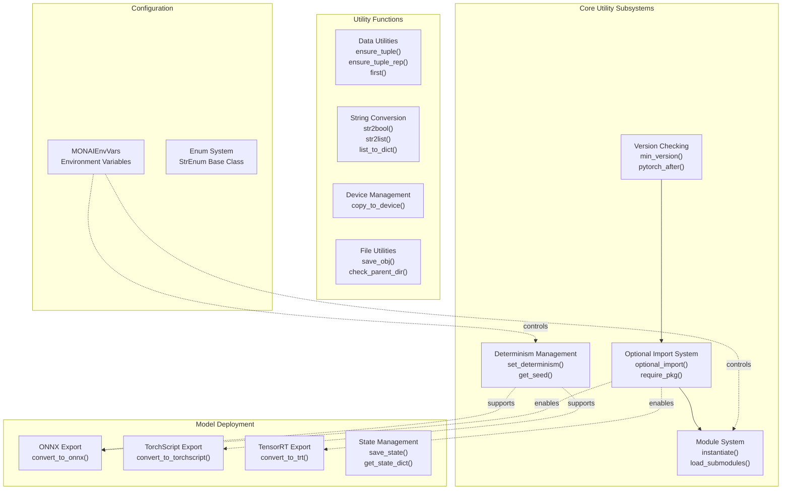

**Sources**: [monai/utils/__init__.py:1-159](), [monai/utils/misc.py:1-929](), [monai/utils/module.py:1-685](), [monai/networks/utils.py:1-1615]()

---

## Determinism and Random Seed Management

MONAI provides centralized control over randomness for reproducible experiments through the determinism management system.

### Core Functions

| Function | Location | Purpose |
|----------|----------|---------|
| `set_determinism()` | [monai/utils/misc.py:339-391]() | Configure deterministic behavior across PyTorch, NumPy, and Python |
| `get_seed()` | [monai/utils/misc.py:335-336]() | Retrieve current random seed |
| `MAX_SEED` | [monai/utils/misc.py:103]() | Maximum seed value (2^32) |

### Determinism Flow

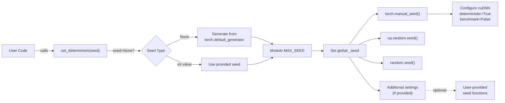

**Sources**: [monai/utils/misc.py:339-391]()

### Implementation Details

The determinism system manages several global flags:

```python
# Global state tracked in misc.py
_seed = None  # Current seed value
_flag_deterministic = torch.backends.cudnn.deterministic  # Original cuDNN setting
_flag_cudnn_benchmark = torch.backends.cudnn.benchmark    # Original benchmark setting
```

The `set_determinism()` function:
- Accepts seed values in range `[0, MAX_SEED - 1]` where `MAX_SEED = 2^32`
- Configures `CUBLAS_WORKSPACE_CONFIG` environment variable for deterministic algorithms
- Supports passing `None` to disable determinism and restore original settings
- Accepts `additional_settings` callable(s) for framework-specific seed configuration

**Sources**: [monai/utils/misc.py:99-108](), [monai/utils/misc.py:339-391]()

---

## Optional Import System

The optional import system enables MONAI to work with various optional dependencies without requiring all of them to be installed.

### Architecture

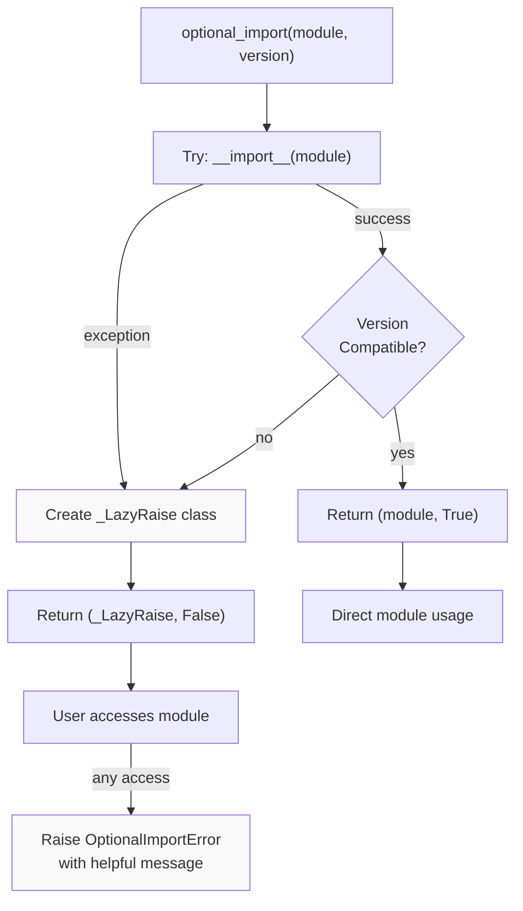

**Sources**: [monai/utils/module.py:315-446]()

### Usage Patterns

**Basic Import**:
```python
# From monai/networks/utils.py
onnx, _ = optional_import("onnx")
onnxruntime, _ = optional_import("onnxruntime")
```

**Import with Version Check**:
```python
# From monai/utils/module.py example
torch, flag = optional_import('torch', '1.1')
# flag is True if torch >= 1.1, False otherwise
```

**Import Specific Name**:
```python
# From monai/utils/misc.py
SafeLoader, _ = optional_import("yaml", name="SafeLoader", as_type="base")
```

**Sources**: [monai/utils/module.py:315-446](), [monai/networks/utils.py:37-41]()

### Lazy Error Behavior

The `_LazyRaise` class defers errors until actual usage:

| Method | Behavior |
|--------|----------|
| `__getattr__` | Raises `OptionalImportError` when accessing attributes |
| `__call__` | Raises `OptionalImportError` when calling as function |
| `__getitem__` | Raises `OptionalImportError` when indexing |
| `__iter__` | Raises `OptionalImportError` when iterating |

This allows code to import optional dependencies at module level without immediately failing if the dependency is missing.

**Sources**: [monai/utils/module.py:402-434]()

### Package Requirement Decorator

The `require_pkg()` decorator enforces package requirements at runtime:

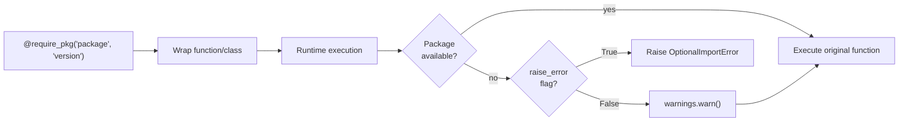

**Sources**: [monai/utils/module.py:448-484]()

---

## Module Loading and Instantiation

MONAI provides utilities for dynamic module loading and component instantiation, primarily used by the Bundle system.

### Component Instantiation

The `instantiate()` function creates objects from string paths or callables:

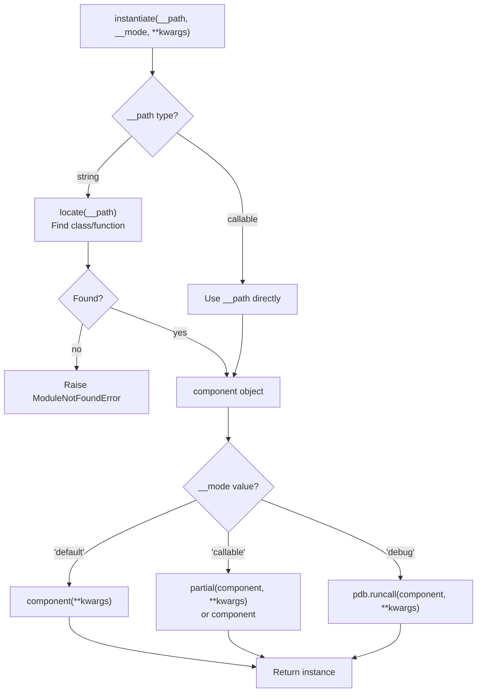

**Sources**: [monai/utils/module.py:205-259]()

### Instantiation Modes

| Mode | Enum Value | Behavior |
|------|-----------|----------|
| Default | `CompInitMode.DEFAULT` | Immediately call `component(**kwargs)` |
| Callable | `CompInitMode.CALLABLE` | Return callable or partial for later invocation |
| Debug | `CompInitMode.DEBUG` | Execute in debugger with `pdb.runcall()` |

**Sources**: [monai/utils/enums.py:410-419](), [monai/utils/module.py:226-256]()

### Submodule Loading

The `load_submodules()` function traverses and loads package structure:

```python
# From monai/__init__.py
load_submodules(sys.modules[__name__], False, exclude_pattern=excludes)  # directories only
load_submodules(sys.modules[__name__], True, exclude_pattern=excludes)   # all modules
```

**Parameters**:
- `basemod`: Base module to traverse
- `load_all`: If True, load all files; if False, only packages
- `exclude_pattern`: Regex pattern to exclude modules (e.g., test files)

**Sources**: [monai/utils/module.py:173-202](), [monai/__init__.py:83-104]()

---

## Version Checking System

MONAI provides comprehensive version checking for dependencies and PyTorch versions.

### Version Comparison Functions

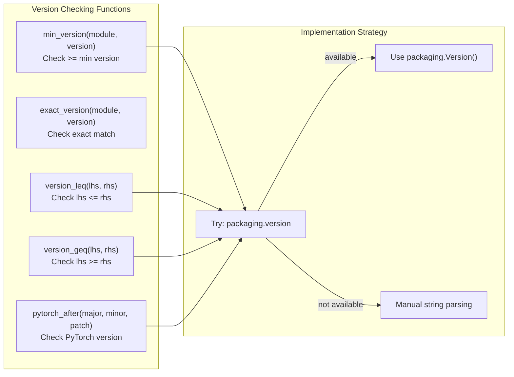

**Sources**: [monai/utils/module.py:273-636]()

### PyTorch Version Checking

The `pytorch_after()` function provides cached PyTorch version comparison:

**Features**:
- Cached result via `@functools.lru_cache(None)` decorator
- Handles prerelease versions (alpha, rc)
- Can use environment variable `PYTORCH_VER` override
- Supports both `packaging.version` and manual parsing fallback

**Sources**: [monai/utils/module.py:588-636]()

### GPU Compute Capability Checking

```python
# From monai/utils/module.py
@functools.lru_cache(None)
def compute_capabilities_after(major: int, minor: int = 0, 
                               current_ver_string: str | None = None) -> bool:
    """Check if GPU CUDA compute capability >= specified version"""
```

**Sources**: [monai/utils/module.py:639-685]()

---

## Model Deployment System

MONAI provides unified interfaces for exporting models to ONNX, TorchScript, and TensorRT formats.

### Deployment Pipeline

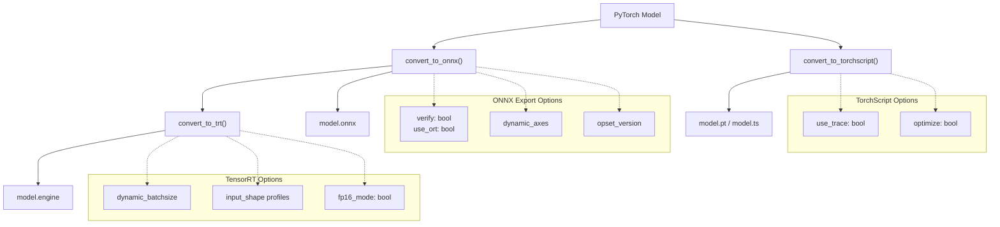

**Sources**: [monai/networks/utils.py:661-884](), [monai/networks/utils.py:886-1066](), [monai/networks/utils.py:1068-1277]()

### ONNX Export

The `convert_to_onnx()` function provides comprehensive ONNX export:

**Key Parameters**:
- `inputs`: Sample input data used for tracing
- `opset_version`: ONNX opset version (must be >= 7)
- `dynamic_axes`: Specify dynamic dimensions
- `verify`: Validate output with ONNX or ONNXRuntime
- `use_trace`: Use `torch.onnx.export()` tracing vs `torch.jit.script()`
- `do_constant_folding`: Enable constant folding optimization

**Verification Flow**:
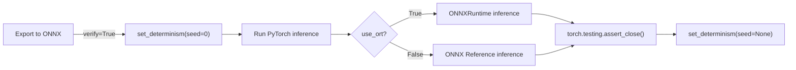

**Sources**: [monai/networks/utils.py:661-783]()

### TorchScript Export

The `convert_to_torchscript()` function supports both tracing and scripting:

**Modes**:
| Mode | Method | Use Case |
|------|--------|----------|
| Trace | `torch.jit.trace()` | Models without control flow |
| Script | `torch.jit.script()` | Models with conditionals/loops |

**Optimization**:
- `optimize=True`: Apply `torch.jit.optimize_for_inference()`
- Removes training-only operations
- Enables operator fusion

**Sources**: [monai/networks/utils.py:886-1066]()

### TensorRT Conversion

The `convert_to_trt()` function creates optimized TensorRT engines:

**Profile Shape Strategy**:
```python
# From monai/networks/utils.py
def get_profile_shapes(input_shape, dynamic_batchsize):
    """Generate min/opt/max shapes for dynamic batching"""
    if dynamic_batchsize:
        min_shape = [dynamic_batchsize[0], *input_shape[1:]]
        opt_shape = [dynamic_batchsize[1], *input_shape[1:]]
        max_shape = [dynamic_batchsize[2], *input_shape[1:]]
    else:
        min_shape = opt_shape = max_shape = input_shape
    return min_shape, opt_shape, max_shape
```

**Key Features**:
- FP16 precision mode for faster inference
- Dynamic batch size support via profiles
- Workspace size configuration
- Input/output binding management

**Sources**: [monai/networks/utils.py:1068-1277](), [monai/networks/utils.py:76-93]()

---

## State Management

MONAI provides utilities for saving and loading model states, handling data parallel models automatically.

### State Management Functions

```mermaid
flowchart TB
    subgraph "State Retrieval"
        GetState["get_state_dict(obj)"]
        GetState --> CheckDP{DataParallel?}
        CheckDP -->|yes| Unwrap["Access .module"]
        CheckDP -->|no| Direct["Use directly"]
        Unwrap --> ExtractState["Call .state_dict()"]
        Direct --> ExtractState
    end
    
    subgraph "State Copying"
        CopyState["copy_model_state(dst, src)"]
        CopyState --> GetSrc["get_state_dict(src)"]
        CopyState --> GetDst["get_state_dict(dst)"]
        GetSrc --> Match["Match keys and shapes"]
        GetDst --> Match
        Match --> Update["Update dst dict"]
        Update --> OptLoad{inplace?}
        OptLoad -->|True| LoadState["dst.load_state_dict()"]
        OptLoad -->|False| ReturnDict["Return updated dict"]
    end
    
    subgraph "State Saving"
        SaveState["save_state(src, path)"]
        SaveState --> GetDict["get_state_dict(src)"]
        GetDict --> SaveObj["save_obj()"]
        SaveObj --> Atomic{atomic?}
        Atomic -->|True| TempFile["Write to temp file"]
        Atomic -->|False| DirectWrite["Write to path"]
        TempFile --> Move["shutil.move()"]
    end
```

**Sources**: [monai/networks/utils.py:528-624](), [monai/networks/utils.py:627-658]()

### State Copying Features

The `copy_model_state()` function provides flexible weight transfer:

**Parameters**:
- `dst_prefix`: Prefix for destination keys
- `mapping`: Dictionary mapping `{"src_key": "dst_key"}`
- `exclude_vars`: Regex pattern to exclude variables
- `filter_func`: Custom function for filtering weights
- `inplace`: Whether to load state into `dst` module

**Use Case Example**:
```python
# From docstring in monai/networks/utils.py:574-586
model_a = BasicUNet(in_channels=1, out_channels=4)
model_b = BasicUNet(in_channels=1, out_channels=2)
model_a_b, changed, unchanged = copy_model_state(
    model_a, model_b, exclude_vars="conv_0.conv_0", inplace=False
)
```

**Sources**: [monai/networks/utils.py:542-624]()

---

## Utility Functions

MONAI provides numerous utility functions for common operations.

### Tuple and Sequence Utilities

| Function | Purpose | Example |
|----------|---------|---------|
| `ensure_tuple()` | Convert to tuple | `ensure_tuple(1)` → `(1,)` |
| `ensure_tuple_rep()` | Repeat to size | `ensure_tuple_rep(1, 3)` → `(1, 1, 1)` |
| `ensure_tuple_size()` | Pad/truncate | `ensure_tuple_size([1,2], 3, 0)` → `(1, 2, 0)` |
| `fall_back_tuple()` | Conditional fallback | `fall_back_tuple((-1, 10), (32, 32))` → `(32, 10)` |
| `issequenceiterable()` | Check if iterable | Returns bool, excludes strings |
| `first()` | Get first item | `first([1,2,3])` → `1` |

**Sources**: [monai/utils/misc.py:145-303]()

### String Conversion Utilities

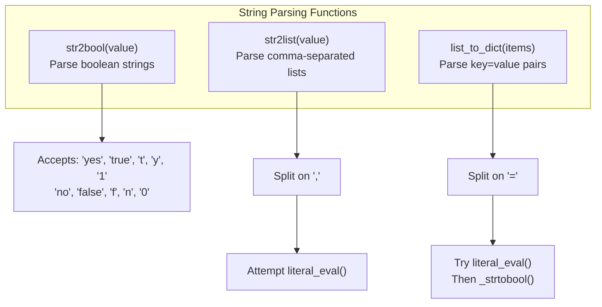

**Sources**: [monai/utils/misc.py:459-524]()

### Device Management

The `copy_to_device()` function recursively copies data structures to a target device:

**Supported Types**:
- Objects with `.to()` method (Tensors, MetaTensors)
- Tuples, lists, and dictionaries (recursive)
- Nested combinations of above

**Parameters**:
- `device`: Target device (`"cpu"`, `"cuda"`, `"cuda:0"`, etc.)
- `non_blocking`: Enable asynchronous transfer
- `verbose`: Warn about incompatible types

**Sources**: [monai/utils/misc.py:425-456]()

### File and Object Saving

The `save_obj()` function provides atomic file saving:

**Atomic Save Strategy**:
1. Create temporary directory
2. Save to temp file
3. Move to final destination (atomic operation)
4. Prevents corruption if exception occurs

**Default**: Uses `torch.save()` as the save function

**Sources**: [monai/utils/misc.py:639-684]()

---

## Environment Variables

MONAI uses environment variables for configuration, centralized in the `MONAIEnvVars` class.

### Environment Variable Reference

| Variable | Method | Default | Purpose |
|----------|--------|---------|---------|
| `MONAI_DATA_DIRECTORY` | `.data_dir()` | None | Default data storage location |
| `MONAI_DEBUG` | `.debug()` | False | Enable debug mode |
| `MONAI_DOC_IMAGES` | `.doc_images()` | None | Documentation image path |
| `MONAI_TRACE_TRANSFORM` | `.trace_transform()` | "1" | Enable transform tracing |
| `MONAI_EVAL_EXPR` | `.eval_expr()` | "1" | Allow eval() in Bundle configs |
| `MONAI_ALLOW_MISSING_REFERENCE` | `.allow_missing_reference()` | "1" | Allow missing references |
| `MONAI_EXTRA_TEST_DATA` | `.extra_test_data()` | "1" | Include extra test data |
| `CUBLAS_WORKSPACE_CONFIG` | N/A | ":4096:8" | CUDA deterministic config |

**Bundle Config Flags**:
```python
# From monai/utils/module.py
run_eval = os.environ.get("MONAI_EVAL_EXPR", "1") != "0"
run_debug = os.environ.get("MONAI_DEBUG_CONFIG", "0") != "0"
allow_missing_reference = os.environ.get("MONAI_ALLOW_MISSING_REFERENCE", "0") != "0"
```

**Sources**: [monai/utils/misc.py:526-567](), [monai/utils/module.py:32-38](), [monai/utils/misc.py:107]()

---

## Enum System

MONAI provides a `StrEnum` base class for creating string-based enumerations.

### StrEnum Base Class

```python
# From monai/utils/enums.py
class StrEnum(str, Enum):
    """Enum subclass that converts its value to a string."""
    
    def __str__(self):
        return self.value
    
    def __repr__(self):
        return self.value
```

**Key Properties**:
- Values are strings
- Can be compared directly to strings
- Usable with `look_up_option()` for validation

**Sources**: [monai/utils/enums.py:68-90]()

### Common Enum Categories

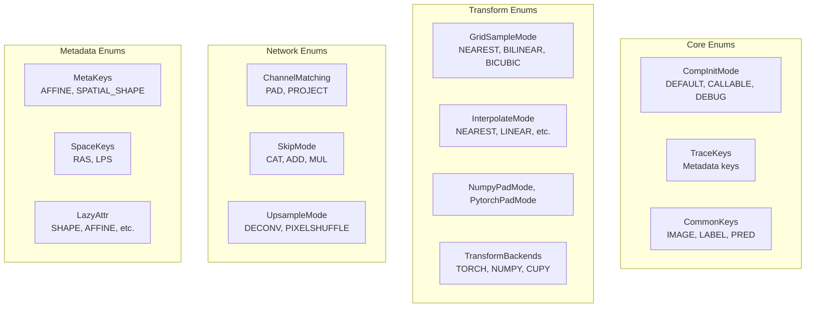

**Sources**: [monai/utils/enums.py:1-771]()

### Option Lookup System

The `look_up_option()` function validates options against enums or collections:

**Features**:
- Fuzzy matching with Damerau-Levenshtein distance
- Helpful error messages suggesting close matches
- Supports Enum, dict, set, list, tuple

**Example Usage**:
```python
# From monai/networks/layers/simplelayers.py:81
mode = look_up_option(mode, ChannelMatching)

# Raises helpful error if invalid:
# ValueError: By 'padd', did you mean 'pad'?
```

**Sources**: [monai/utils/module.py:61-142]()

---

## Summary

The Core Utilities and Module System provides essential infrastructure used throughout MONAI:

**Key Components**:
1. **Determinism**: Centralized random seed management for reproducibility
2. **Optional Imports**: Graceful handling of missing dependencies
3. **Module System**: Dynamic loading and instantiation of components
4. **Version Checking**: Compatibility verification for dependencies
5. **Model Deployment**: Unified export to ONNX, TorchScript, TensorRT
6. **State Management**: Robust model saving/loading with atomic writes
7. **Utilities**: Common operations for tuples, strings, devices, files
8. **Configuration**: Environment variable system
9. **Enums**: Type-safe option validation

These utilities form the foundation that enables MONAI's modular, extensible architecture while maintaining compatibility across different deployment scenarios and optional dependencies.

---

