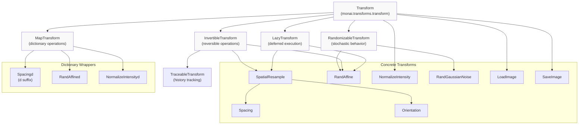
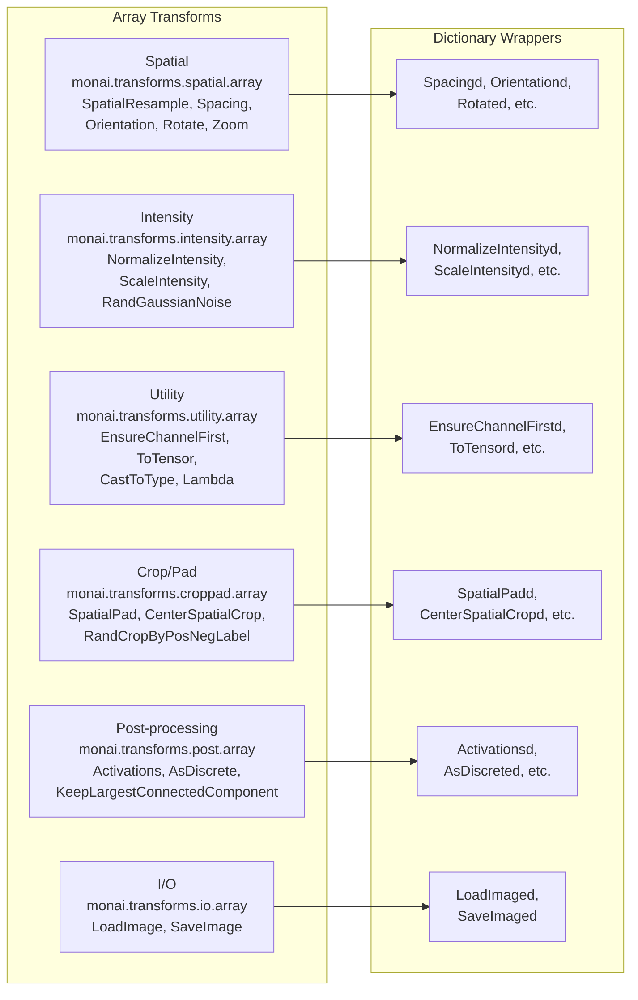
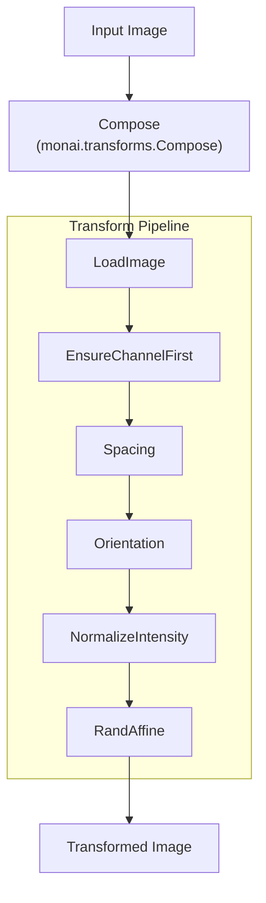
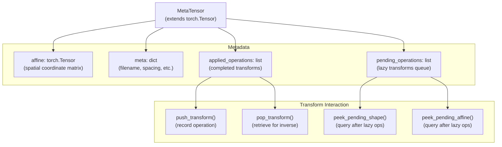

<!-- source: DeepWiki mcp.deepwiki.com · repo Project-MONAI/MONAI · page 3 Transform System · fetched 2026-10-21 -->

# Transform System

<details>
<summary>Relevant source files</summary>

The following files were used as context for generating this wiki page:

- [docs/source/transforms.rst](docs/source/transforms.rst)
- [monai/transforms/__init__.py](monai/transforms/__init__.py)
- [monai/transforms/croppad/array.py](monai/transforms/croppad/array.py)
- [monai/transforms/croppad/dictionary.py](monai/transforms/croppad/dictionary.py)
- [monai/transforms/intensity/array.py](monai/transforms/intensity/array.py)
- [monai/transforms/intensity/dictionary.py](monai/transforms/intensity/dictionary.py)
- [monai/transforms/inverse.py](monai/transforms/inverse.py)
- [monai/transforms/post/array.py](monai/transforms/post/array.py)
- [monai/transforms/post/dictionary.py](monai/transforms/post/dictionary.py)
- [monai/transforms/spatial/array.py](monai/transforms/spatial/array.py)
- [monai/transforms/spatial/dictionary.py](monai/transforms/spatial/dictionary.py)
- [monai/transforms/utility/array.py](monai/transforms/utility/array.py)
- [monai/transforms/utility/dictionary.py](monai/transforms/utility/dictionary.py)
- [monai/transforms/utils.py](monai/transforms/utils.py)

</details>


## Purpose and Scope

The Transform System is MONAI's core data preprocessing and augmentation framework for medical imaging. It provides a composable architecture for applying spatial, intensity, crop/pad, and post-processing operations to medical images. The system supports both array-based and dictionary-based transforms, with advanced features including lazy execution, invertible operations, and automatic metadata tracking.

This page covers the overall transform architecture, base classes, and the organization of transform categories. For detailed information on specific transform features, see:
- [Transform Architecture and Base Classes](#3.1) - Core classes and design patterns
- [Spatial Transforms](#3.2) - Resampling, rotation, affine operations
- [Intensity and Utility Transforms](#3.3) - Normalization, scaling, type conversion
- [Crop, Pad, and Post-processing Transforms](#3.4) - Cropping, padding, and model output processing
- [Dictionary-Based Transforms](#3.5) - The `MapTransform` pattern
- [Invertible Transforms and MetaTensor](#3.6) - Reversible operations and metadata
- [Lazy Transform Execution](#3.7) - Deferred computation and optimization

For information about the data loading pipeline that uses these transforms, see [Data Loading and Processing](#4).

## Architecture Overview

The transform system is organized into a hierarchical class structure with multiple inheritance paths that provide different capabilities. At the highest level, all transforms inherit from the `Transform` base class, which defines the standard `__call__` interface.

### Transform Class Hierarchy



**Sources:** [monai/transforms/transform.py](), [monai/transforms/inverse.py:42-256](), [monai/transforms/spatial/array.py:124-256]()

## Base Classes

The transform system uses five primary base classes that provide different capabilities through multiple inheritance:

| Base Class | Purpose | Key Methods | File Location |
|------------|---------|-------------|---------------|
| `Transform` | Root interface for all transforms | `__call__(img)` | monai/transforms/transform.py |
| `MapTransform` | Dictionary-based operations | `key_iterator(data)` | monai/transforms/transform.py |
| `RandomizableTransform` | Stochastic transforms with seeding | `randomize()`, `set_random_state()` | monai/transforms/transform.py |
| `LazyTransform` | Deferred computation | `lazy` property, pending operations | monai/transforms/transform.py |
| `InvertibleTransform` | Reversible operations | `inverse(data)`, `push_transform()`, `pop_transform()` | monai/transforms/inverse.py |

### Transform Base Class

The `Transform` class is the root of the hierarchy and defines the basic interface. All transforms must implement `__call__`:

**Core Interface Pattern:**
```python
class Transform:
    def __call__(self, img: NdarrayOrTensor) -> NdarrayOrTensor:
        # Transform implementation
        pass
```

**Sources:** [monai/transforms/transform.py]()

### MapTransform (Dictionary Pattern)

`MapTransform` extends `Transform` to operate on dictionaries of data, applying transforms to specific keys. This is the foundation of the "d-suffix" naming convention:

**Dictionary Operation Pattern:**
```python
class MapTransform(Transform):
    def __init__(self, keys: KeysCollection, allow_missing_keys: bool = False):
        self.keys = keys
        self.allow_missing_keys = allow_missing_keys
    
    def key_iterator(self, data: Mapping) -> Iterator:
        # Iterates over specified keys
        pass
```

**Sources:** [monai/transforms/transform.py](), [monai/transforms/utility/dictionary.py:203-226]()

### RandomizableTransform

Adds controlled randomization with reproducible seeding:

**Randomization Pattern:**
```python
class RandomizableTransform(Transform, Randomizable):
    def __init__(self, prob: float = 0.1):
        self.prob = prob
        self._do_transform = False
    
    def randomize(self, data: Any = None) -> None:
        self._do_transform = self.R.random() < self.prob
```

**Sources:** [monai/transforms/transform.py](), [monai/transforms/intensity/array.py:86-141]()

### LazyTransform

Enables deferred execution where transforms queue operations instead of executing immediately:

**Lazy Execution Pattern:**
```python
class LazyTransform(Transform):
    def __init__(self, lazy: bool = False):
        self._lazy = lazy
    
    @property
    def lazy(self) -> bool:
        return self._lazy
```

**Sources:** [monai/transforms/transform.py](), [monai/transforms/spatial/array.py:124-166]()

### InvertibleTransform

Provides transform reversal by maintaining a history of applied operations:

**Inversion Pattern:**
```python
class InvertibleTransform(TraceableTransform):
    def inverse(self, data: torch.Tensor) -> torch.Tensor:
        # Reverse the transformation
        pass
    
    def push_transform(self, data, **kwargs):
        # Record transformation metadata
        pass
    
    def pop_transform(self, data) -> dict:
        # Retrieve and remove last transform
        pass
```

**Sources:** [monai/transforms/inverse.py:256-end](), [monai/transforms/spatial/array.py:240-256]()

## Transform Categories

MONAI organizes transforms into functional categories, each in separate modules:

### Category Organization



**Sources:** [monai/transforms/__init__.py:1-600](), [monai/transforms/spatial/array.py:90-119](), [monai/transforms/intensity/array.py:42-83]()

### Spatial Transforms

Located in `monai/transforms/spatial/array.py`, these transforms manipulate the spatial dimensions and coordinate systems of images:

| Transform | Purpose | Lazy Support | Invertible |
|-----------|---------|--------------|------------|
| `SpatialResample` | Resample between coordinate systems | Yes | Yes |
| `Spacing` | Change voxel spacing | Yes | Yes |
| `Orientation` | Change axis orientation (RAS, LPS, etc.) | Yes | Yes |
| `Flip` | Mirror along axes | Yes | Yes |
| `Rotate` | Rotation by angles | Yes | Yes |
| `Zoom` | Scale spatial dimensions | Yes | Yes |
| `Affine` | General affine transformation | Yes | Yes |
| `RandAffine` | Random affine with ranges | Yes | Yes |

**Sources:** [monai/transforms/spatial/array.py:90-119](), [monai/transforms/spatial/array.py:124-256]()

### Intensity Transforms

Located in `monai/transforms/intensity/array.py`, these transforms modify pixel/voxel intensity values:

| Transform | Purpose | Randomizable |
|-----------|---------|--------------|
| `NormalizeIntensity` | Z-score normalization | No |
| `ScaleIntensity` | Linear scaling | No |
| `ScaleIntensityRange` | Min-max scaling | No |
| `RandGaussianNoise` | Add Gaussian noise | Yes |
| `RandShiftIntensity` | Random intensity shift | Yes |
| `AdjustContrast` | Gamma correction | No |
| `ThresholdIntensity` | Binary thresholding | No |

**Sources:** [monai/transforms/intensity/array.py:42-83](), [monai/transforms/intensity/array.py:86-259]()

### Utility Transforms

Located in `monai/transforms/utility/array.py`, these provide type conversion and data format operations:

| Transform | Purpose | Backend |
|-----------|---------|---------|
| `EnsureChannelFirst` | Move channel to first dimension | TORCH, NUMPY |
| `ToTensor` | Convert to PyTorch tensor | TORCH |
| `ToNumpy` | Convert to NumPy array | NUMPY |
| `CastToType` | Change data type | TORCH, NUMPY |
| `Lambda` | Apply custom function | TORCH, NUMPY |
| `SqueezeDim` | Remove singleton dimension | TORCH, NUMPY |

**Sources:** [monai/transforms/utility/array.py:75-114](), [monai/transforms/utility/array.py:175-235]()

### Crop and Pad Transforms

Located in `monai/transforms/croppad/array.py`, these modify spatial extent:

| Transform | Purpose | Lazy Support |
|-----------|---------|--------------|
| `SpatialPad` | Pad to target size | Yes |
| `DivisiblePad` | Pad to divisible size | Yes |
| `SpatialCrop` | Crop to region | No |
| `CenterSpatialCrop` | Center crop | No |
| `RandSpatialCrop` | Random crop | No |
| `RandCropByPosNegLabel` | Crop around labeled regions | No |
| `ResizeWithPadOrCrop` | Resize by cropping or padding | Yes |

**Sources:** [monai/transforms/croppad/array.py:60-78](), [monai/transforms/croppad/array.py:81-178]()

### Post-Processing Transforms

Located in `monai/transforms/post/array.py`, these process model outputs:

| Transform | Purpose |
|-----------|---------|
| `Activations` | Apply sigmoid/softmax |
| `AsDiscrete` | Convert to discrete values (argmax, threshold) |
| `KeepLargestConnectedComponent` | Filter by connected components |
| `FillHoles` | Fill holes in binary masks |
| `RemoveSmallObjects` | Remove small connected components |
| `LabelToContour` | Convert labels to contours |

**Sources:** [monai/transforms/post/array.py:51-66](), [monai/transforms/post/array.py:69-138]()

## Dictionary-Based Transform Pattern

Dictionary-based transforms operate on dictionaries of data using the "d-suffix" naming convention. They wrap array-based transforms and apply them to specific keys:

### Naming Convention


### Implementation Pattern

All dictionary transforms follow this pattern:

```python
class Spacingd(MapTransform, InvertibleTransform, LazyTransform):
    def __init__(self, keys: KeysCollection, pixdim: Sequence[float], ...):
        MapTransform.__init__(self, keys, allow_missing_keys)
        LazyTransform.__init__(self, lazy=lazy)
        self.spacing = Spacing(pixdim=pixdim, ...)  # Wrap array transform
    
    def __call__(self, data: Mapping) -> dict:
        d = dict(data)
        for key in self.key_iterator(d):
            d[key] = self.spacing(d[key], ...)  # Apply to each key
        return d
```

### Key Features

**Key Iteration:**
The `key_iterator()` method handles missing keys based on `allow_missing_keys`:

```python
for key, mode, padding_mode in self.key_iterator(d, self.mode, self.padding_mode):
    d[key] = self.transform(d[key], mode=mode, padding_mode=padding_mode)
```

**Multiple Value Mapping:**
Parameters can be sequences that map to keys:

```python
mode = ensure_tuple_rep(mode, len(self.keys))  # One mode per key
```

**Sources:** [monai/transforms/utility/dictionary.py:203-226](), [monai/transforms/spatial/dictionary.py:366-449]()

## Transform Composition and Execution

Transforms are typically combined into pipelines using `Compose`:

### Compose Pattern



### Sequential Execution

`Compose` executes transforms sequentially:

```python
class Compose:
    def __init__(self, transforms: Sequence[Transform] = None):
        self.transforms = transforms
    
    def __call__(self, input_):
        for t in self.transforms:
            input_ = apply_transform(t, input_)
        return input_
```

### Conditional Execution

Other composition patterns include:

| Compositor | Behavior |
|------------|----------|
| `Compose` | Execute all transforms sequentially |
| `OneOf` | Execute one randomly selected transform |
| `RandomOrder` | Execute all in random order |
| `SomeOf` | Execute random subset of transforms |

**Sources:** [monai/transforms/compose.py](), [monai/transforms/__init__.py:15]()

## MetaTensor Integration

The transform system integrates with `MetaTensor` to track metadata and transformation history:

### MetaTensor Structure



**Sources:** [monai/data/meta_tensor.py](), [monai/transforms/inverse.py:130-165]()

## Transform Backend Support

Transforms declare supported backends for compatibility:

```python
class SpatialResample(InvertibleTransform, LazyTransform):
    backend = [TransformBackends.TORCH, TransformBackends.NUMPY, TransformBackends.CUPY]
```

### Backend Options

| Backend | When Used | File Indicator |
|---------|-----------|----------------|
| `TORCH` | PyTorch tensor operations | Uses `torch.` functions |
| `NUMPY` | NumPy array operations | Uses `np.` functions |
| `CUPY` | GPU-accelerated NumPy | Uses `cupy.` functions |

Backend selection happens automatically based on input type.

**Sources:** [monai/transforms/spatial/array.py:136](), [monai/utils/enums.py]()

## Common Usage Patterns

### Basic Array Transform

```python
# Apply a single transform to an array
transform = Spacing(pixdim=(1.0, 1.0, 1.0))
output = transform(input_image)
```

### Dictionary Pipeline

```python
# Create a preprocessing pipeline
train_transforms = Compose([
    LoadImaged(keys=["image", "label"]),
    EnsureChannelFirstd(keys=["image", "label"]),
    Spacingd(keys=["image", "label"], pixdim=(1.0, 1.0, 1.0)),
    Orientationd(keys=["image", "label"], axcodes="RAS"),
    NormalizeIntensityd(keys=["image"]),
    RandAffined(keys=["image", "label"], prob=0.5, ...),
])

# Apply to data dictionary
data = train_transforms({"image": image_path, "label": label_path})
```

### With DataLoader

```python
from monai.data import Dataset, DataLoader

dataset = Dataset(data=data_list, transform=train_transforms)
dataloader = DataLoader(dataset, batch_size=4, num_workers=4)

for batch in dataloader:
    images = batch["image"]
    labels = batch["label"]
    # Training loop
```

**Sources:** [monai/transforms/__init__.py](), [docs/source/transforms.rst:1-100]()

## File Organization

The transform system is organized into a modular file structure:

```
monai/transforms/
├── __init__.py                    # Public API exports
├── transform.py                   # Base classes (Transform, MapTransform, etc.)
├── compose.py                     # Compose, OneOf, etc.
├── inverse.py                     # InvertibleTransform, TraceableTransform
├── utils.py                       # Utility functions
├── spatial/
│   ├── array.py                   # Spatial array transforms
│   ├── dictionary.py              # Spatial dictionary transforms
│   └── functional.py              # Low-level spatial functions
├── intensity/
│   ├── array.py                   # Intensity array transforms
│   └── dictionary.py              # Intensity dictionary transforms
├── utility/
│   ├── array.py                   # Utility array transforms
│   └── dictionary.py              # Utility dictionary transforms
├── croppad/
│   ├── array.py                   # Crop/pad array transforms
│   ├── dictionary.py              # Crop/pad dictionary transforms
│   └── functional.py              # Low-level crop/pad functions
├── post/
│   ├── array.py                   # Post-processing array transforms
│   └── dictionary.py              # Post-processing dictionary transforms
├── io/
│   ├── array.py                   # I/O transforms (LoadImage, SaveImage)
│   └── dictionary.py              # I/O dictionary transforms
└── lazy/
    ├── array.py                   # Lazy execution utilities (ApplyPending)
    ├── dictionary.py              # Lazy dictionary utilities
    ├── functional.py              # Low-level lazy functions
    └── utils.py                   # Lazy transform utilities
```

**Sources:** [monai/transforms/__init__.py:1-600](), [monai/transforms/spatial/array.py:1-13](), [monai/transforms/utility/array.py:1-13]()

## Summary

The MONAI Transform System provides:

1. **Modular Architecture**: Base classes with single-responsibility design (Transform, MapTransform, RandomizableTransform, LazyTransform, InvertibleTransform)

2. **Functional Organization**: Transforms grouped by purpose (spatial, intensity, crop/pad, utility, post-processing, I/O)

3. **Dictionary Pattern**: Unified "d-suffix" convention for operating on data dictionaries

4. **Advanced Features**:
   - Lazy execution for performance optimization
   - Invertible operations for post-processing
   - Metadata tracking via MetaTensor
   - Reproducible randomization

5. **Flexible Composition**: Multiple composition strategies (Compose, OneOf, RandomOrder, SomeOf)

6. **Backend Agnostic**: Support for PyTorch, NumPy, and CuPy

This architecture enables users to build complex medical imaging pipelines through simple composition of well-defined, reusable transform components.

**Sources:** [monai/transforms/__init__.py](), [monai/transforms/transform.py](), [monai/transforms/inverse.py](), [monai/transforms/spatial/array.py](), [monai/transforms/intensity/array.py](), [monai/transforms/utility/array.py](), [monai/transforms/croppad/array.py](), [monai/transforms/post/array.py]()

---

