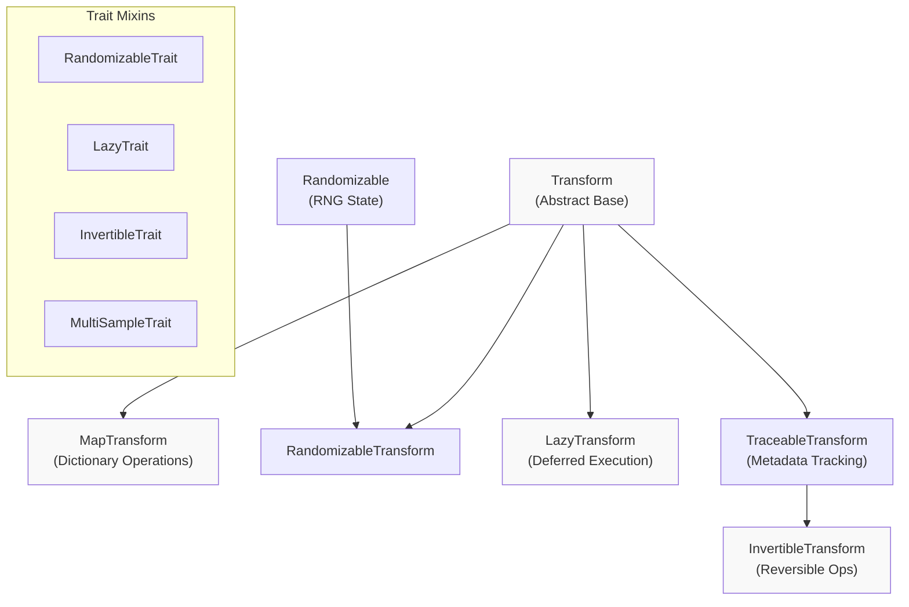
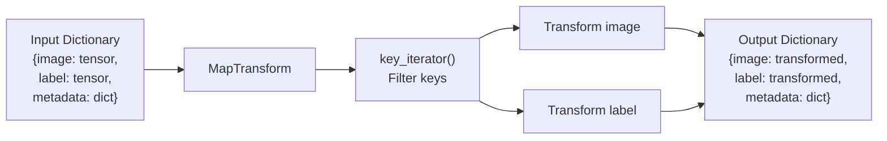
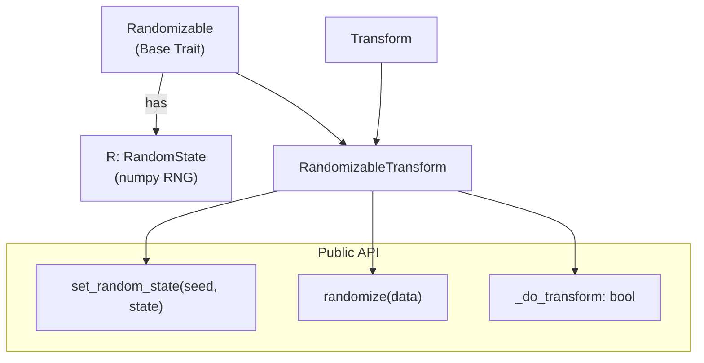
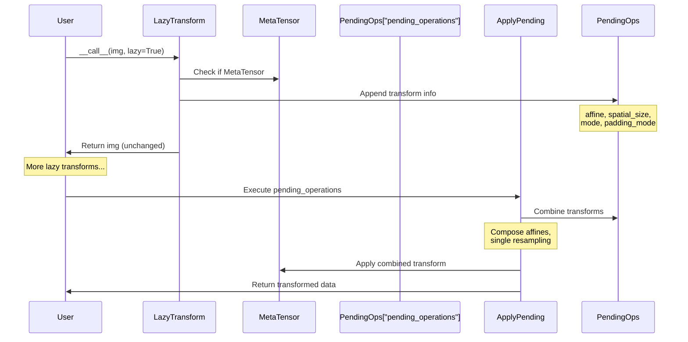
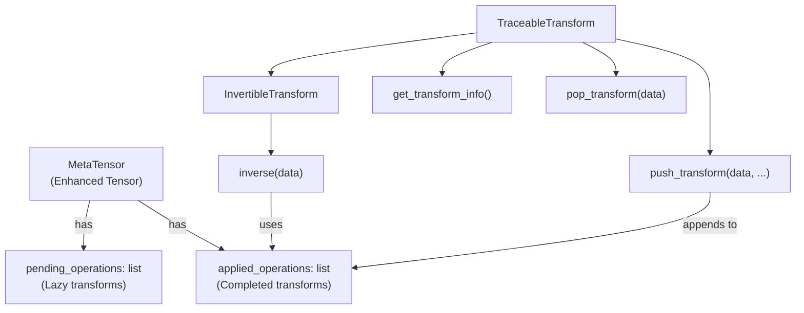
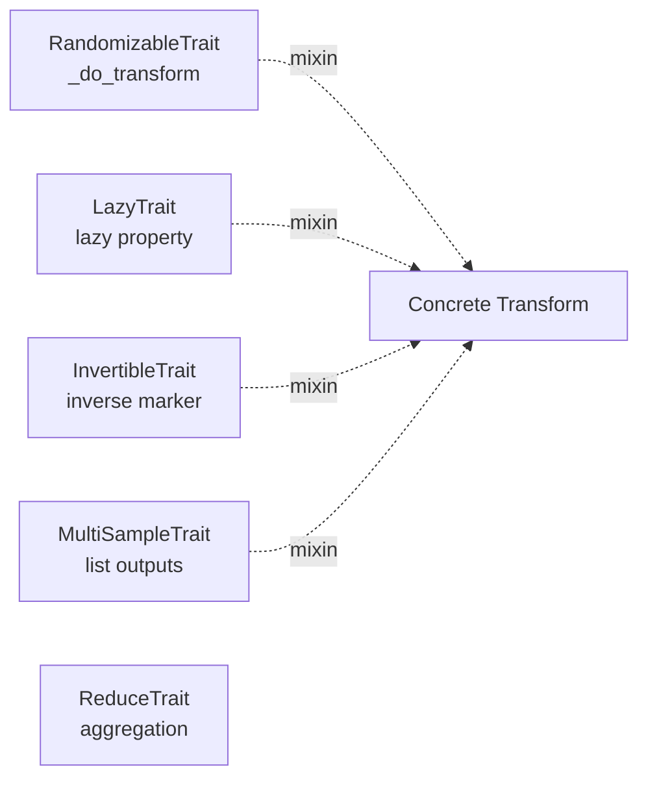
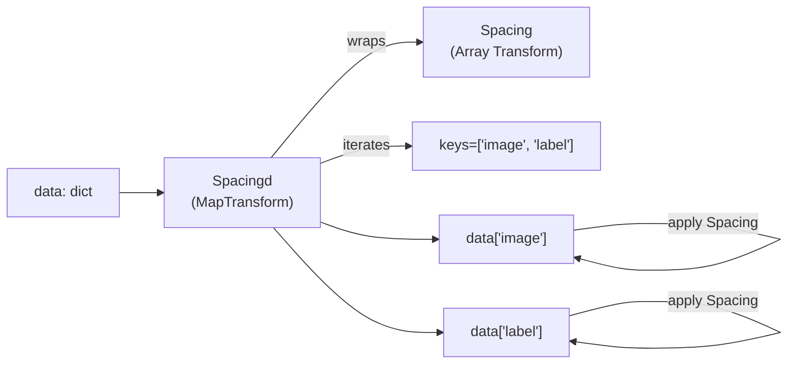
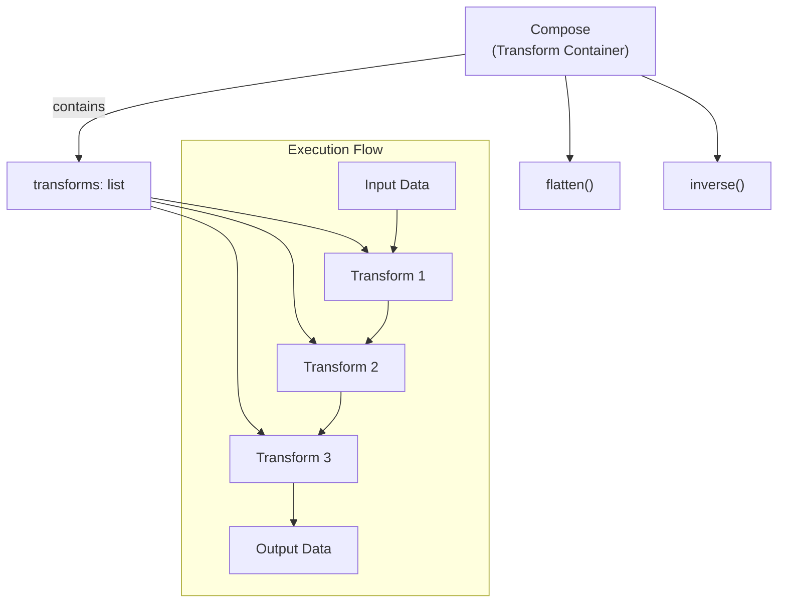
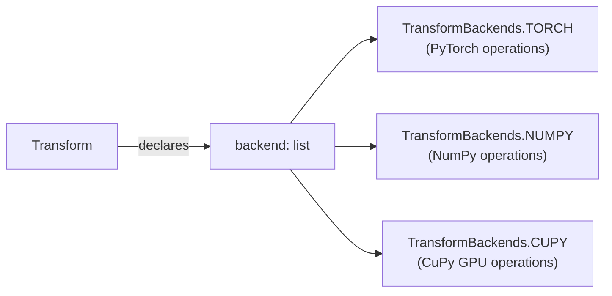
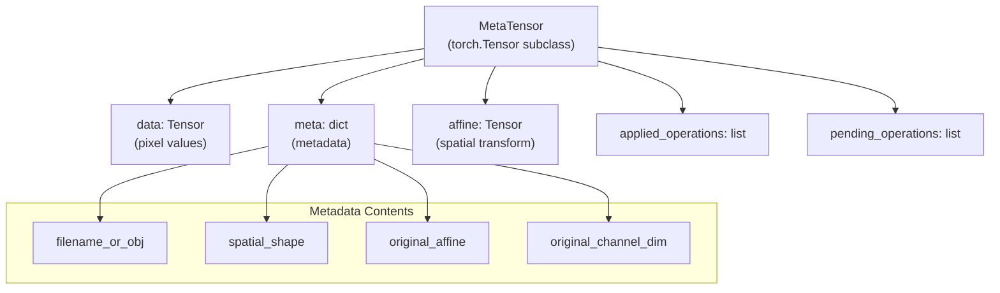

<!-- source: DeepWiki mcp.deepwiki.com · repo Project-MONAI/MONAI · page 3.1 Transform Architecture and Base Classes · fetched 2026-10-21 -->

# Transform Architecture and Base Classes

<details>
<summary>Relevant source files</summary>

The following files were used as context for generating this wiki page:

- [docs/source/transforms.rst](docs/source/transforms.rst)
- [monai/transforms/__init__.py](monai/transforms/__init__.py)
- [monai/transforms/croppad/array.py](monai/transforms/croppad/array.py)
- [monai/transforms/croppad/dictionary.py](monai/transforms/croppad/dictionary.py)
- [monai/transforms/intensity/array.py](monai/transforms/intensity/array.py)
- [monai/transforms/intensity/dictionary.py](monai/transforms/intensity/dictionary.py)
- [monai/transforms/inverse.py](monai/transforms/inverse.py)
- [monai/transforms/post/array.py](monai/transforms/post/array.py)
- [monai/transforms/post/dictionary.py](monai/transforms/post/dictionary.py)
- [monai/transforms/spatial/array.py](monai/transforms/spatial/array.py)
- [monai/transforms/spatial/dictionary.py](monai/transforms/spatial/dictionary.py)
- [monai/transforms/utility/array.py](monai/transforms/utility/array.py)
- [monai/transforms/utility/dictionary.py](monai/transforms/utility/dictionary.py)
- [monai/transforms/utils.py](monai/transforms/utils.py)

</details>


## Purpose and Scope

This page documents the foundational transform architecture in MONAI, including the core base classes, trait system, and design patterns that underpin all transform implementations. This covers the abstract interfaces and execution mechanisms, not the concrete transform implementations themselves.

For specific transform categories, see:
- Spatial transforms: [Spatial Transforms](#3.2)
- Intensity transforms: [Intensity and Utility Transforms](#3.3)
- Dictionary-based transform patterns: [Dictionary-Based Transforms](#3.5)
- Lazy execution mechanisms: [Lazy Transform Execution](#3.7)
- Invertible transform mechanisms: [Invertible Transforms and MetaTensor](#3.6)

---

## Core Base Classes Hierarchy

The transform system is built on a hierarchy of base classes that provide composable capabilities through multiple inheritance.

### Class Hierarchy Diagram



**Sources:** [monai/transforms/transform.py](), [monai/transforms/inverse.py](), [docs/source/transforms.rst:13-79]()

---

## Transform Base Class

The `Transform` class is the root of the transform hierarchy, providing the fundamental interface for all data transformations.

### Core Interface

| Method/Property | Description | Required |
|----------------|-------------|----------|
| `__call__(data)` | Execute the transform on input data | Yes (abstract) |
| `backend` | List of supported backends (TORCH, NUMPY, CUPY) | No |

### Key Characteristics

- **Abstract base class**: Subclasses must implement `__call__`
- **Stateless by default**: Transforms should be reusable and thread-safe
- **Backend declaration**: Optional `backend` class attribute declares supported computation backends

### Example Implementation Pattern

```python
class MyTransform(Transform):
    backend = [TransformBackends.TORCH, TransformBackends.NUMPY]
    
    def __init__(self, param1, param2):
        self.param1 = param1
        self.param2 = param2
    
    def __call__(self, img: NdarrayOrTensor) -> NdarrayOrTensor:
        # Implementation here
        return transformed_img
```

**Sources:** [monai/transforms/transform.py](), [docs/source/transforms.rst:13-17]()

---

## MapTransform for Dictionary Operations

`MapTransform` extends `Transform` to operate on dictionary-based data structures, enabling selective transformation of specific keys.

### Architecture Diagram



### Core Attributes

| Attribute | Type | Description |
|-----------|------|-------------|
| `keys` | `KeysCollection` | Keys to transform (single key or tuple) |
| `allow_missing_keys` | `bool` | Whether to raise error on missing keys |

### Key Iterator Pattern

The `key_iterator()` method is the core mechanism for iterating over specified keys:

```python
def __call__(self, data):
    d = dict(data)
    for key in self.key_iterator(d):
        d[key] = self.transform(d[key])
    return d
```

### Multi-Parameter Key Iteration

`key_iterator()` can iterate over multiple parameter sequences aligned with keys:

```python
for key, mode, padding in self.key_iterator(d, self.mode, self.padding):
    d[key] = self.transform(d[key], mode=mode, padding=padding)
```

**Sources:** [monai/transforms/transform.py](), [monai/transforms/utility/dictionary.py:203-226](), [docs/source/transforms.rst:19-23]()

---

## Randomizable Transforms

The randomization system provides deterministic pseudo-random behavior for data augmentation.

### Randomizable Architecture



### Key Components

| Component | Type | Purpose |
|-----------|------|---------|
| `R` | `np.random.RandomState` | Thread-safe RNG instance |
| `_do_transform` | `bool` | Flag indicating if transform should execute |
| `randomize(data)` | Method | Generate random parameters before `__call__` |
| `set_random_state(seed, state)` | Method | Set deterministic random state |

### Execution Pattern

Randomizable transforms follow a two-phase execution:

1. **Randomize phase**: Generate random parameters
2. **Transform phase**: Apply transformation using parameters

```python
def __call__(self, img, randomize=True):
    if randomize:
        self.randomize(img)  # Generate _do_transform and random params
    
    if not self._do_transform:
        return img
    
    # Apply transform using self.random_param
    return transformed_img
```

**Sources:** [monai/transforms/transform.py](), [monai/transforms/intensity/array.py:86-141](), [docs/source/transforms.rst:45-58]()

---

## LazyTransform for Deferred Execution

`LazyTransform` enables deferred execution of transforms, storing transformation metadata instead of immediately computing results. This is critical for optimizing spatial transform pipelines.

### Lazy Execution Flow



### Core Attributes

| Attribute | Type | Description |
|-----------|------|-------------|
| `lazy` | `bool` | Controls lazy execution mode (instance and call-level) |
| `pending_operations` | `list` | Stack of deferred transforms (in MetaTensor) |

### Lazy Property Pattern

The `lazy` property is implemented as a descriptor with getter/setter:

```python
@property
def lazy(self) -> bool:
    return self._lazy

@lazy.setter
def lazy(self, val: bool) -> None:
    self._lazy = val
    # Propagate to child transforms
```

### Execution Modes

| Mode | `lazy` at Init | `lazy` at Call | Behavior |
|------|----------------|----------------|----------|
| Eager (default) | `False` | `None` or `False` | Execute immediately |
| Lazy | `True` | `None` or `True` | Defer to pending_operations |
| Override | Any | `True` / `False` | Call-time override |

**Sources:** [monai/transforms/transform.py](), [monai/transforms/spatial/array.py:124-238](), [docs/source/transforms.rst:50-53]()

---

## TraceableTransform and InvertibleTransform

These classes provide transform metadata tracking and reversibility, essential for post-processing model outputs back to original image space.

### Transform Tracking Architecture



### TraceableTransform Interface

| Method | Purpose |
|--------|---------|
| `get_transform_info()` | Returns dict with class name, id, tracing flag, do_transform |
| `push_transform(data, ...)` | Append transform metadata to applied_operations |
| `pop_transform(data)` | Remove most recent transform from stack |
| `trace_key(key)` | Generate metadata key for dictionary-based data |

### Transform Information Dictionary

Each applied transform stores:

```python
{
    TraceKeys.CLASS_NAME: "Spacing",
    TraceKeys.ID: id(self),
    TraceKeys.TRACING: True,
    TraceKeys.DO_TRANSFORM: True,
    TraceKeys.ORIG_SIZE: (192, 192, 192),
    TraceKeys.EXTRA_INFO: {
        "src_affine": [[1,0,0,0], ...],
        "dst_affine": [[2,0,0,0], ...],
        ...
    }
}
```

### InvertibleTransform Pattern

Subclasses implement the `inverse(data)` method:

```python
def inverse(self, data: torch.Tensor) -> torch.Tensor:
    transform = self.pop_transform(data)  # Get last applied transform
    
    # Extract parameters from transform metadata
    orig_size = transform[TraceKeys.ORIG_SIZE]
    extra_info = transform[TraceKeys.EXTRA_INFO]
    
    # Compute inverse operation
    with self.trace_transform(False):  # Don't trace the inverse
        inverted = self._apply_inverse(data, orig_size, extra_info)
    
    return inverted
```

**Sources:** [monai/transforms/inverse.py:42-256](), [monai/transforms/spatial/array.py:240-256](), [docs/source/transforms.rst:66-74]()

---

## Transform Traits

Traits are mixin classes that provide reusable capabilities without full inheritance hierarchy constraints.

### Trait System Overview



### Trait Descriptions

| Trait | Purpose | Key Members |
|-------|---------|-------------|
| `RandomizableTrait` | Marks transforms as randomizable | `_do_transform` flag |
| `LazyTrait` | Marks transforms supporting lazy execution | `lazy` property |
| `InvertibleTrait` | Marks transforms as invertible | Marker interface |
| `MultiSampleTrait` | Marks transforms returning multiple samples | Returns `list` instead of single item |
| `ReduceTrait` | Marks transforms that reduce/aggregate data | Aggregation marker |

### Usage in Multiple Inheritance

Transforms combine traits with base classes:

```python
class RandAffine(RandomizableTransform, InvertibleTransform, LazyTransform):
    """
    Combines:
    - RandomizableTransform: probability-based execution
    - InvertibleTransform: reversible for post-processing
    - LazyTransform: deferred execution capability
    """
    pass
```

**Sources:** [monai/transforms/traits.py](), [monai/transforms/transform.py](), [docs/source/transforms.rst:25-43]()

---

## Dictionary Transform Pattern ('d' Suffix)

MONAI uses a systematic naming convention where dictionary-based transforms append 'd', 'D', or 'Dict' to the base transform name.

### Naming Convention Table

| Array Transform | Dictionary Variants | Purpose |
|----------------|---------------------|---------|
| `Spacing` | `Spacingd`, `SpacingD`, `SpacingDict` | Resample to target spacing |
| `Orientation` | `Orientationd`, `OrientationD`, `OrientationDict` | Reorient to canonical axes |
| `LoadImage` | `LoadImaged`, `LoadImageD`, `LoadImageDict` | Load images from files |
| `RandAffine` | `RandAffined`, `RandAffineD`, `RandAffineDict` | Random affine augmentation |

All three suffixes (`d`, `D`, `Dict`) are aliases for the same class for backward compatibility.

### Implementation Pattern

Dictionary transforms wrap array transforms:



### Standard Implementation

```python
class Spacingd(MapTransform, InvertibleTransform, LazyTransform):
    def __init__(self, keys, pixdim, mode=..., **kwargs):
        MapTransform.__init__(self, keys, ...)
        LazyTransform.__init__(self, lazy=...)
        self.spacing = Spacing(pixdim, mode, **kwargs)  # Wrap array transform
    
    def __call__(self, data, lazy=None):
        d = dict(data)
        lazy_ = self.lazy if lazy is None else lazy
        for key, mode in self.key_iterator(d, self.mode):
            d[key] = self.spacing(d[key], mode=mode, lazy=lazy_)
        return d
```

**Sources:** [monai/transforms/spatial/dictionary.py:366-549](), [monai/transforms/utility/dictionary.py:1-16](), [monai/transforms/compose.py]()

---

## Transform Composition

The `Compose` class chains multiple transforms into a sequential pipeline.

### Compose Architecture



### Key Features

| Feature | Description |
|---------|-------------|
| Sequential execution | Transforms applied in order |
| `flatten()` | Unwraps nested Compose objects into flat list |
| `inverse()` | Applies inverse transforms in reverse order |
| MapTransform support | Automatically handles dictionary data |
| Lazy execution | Propagates lazy mode to child transforms |

### Compose Execution Pattern

```python
compose = Compose([
    LoadImaged(keys=["image", "label"]),
    Spacingd(keys=["image", "label"], pixdim=1.5),
    RandRotated(keys=["image", "label"], prob=0.5),
])

data = compose({"image": "img.nii.gz", "label": "seg.nii.gz"})
```

**Sources:** [monai/transforms/compose.py](), [docs/source/transforms.rst:60-64]()

---

## Backend System

Transforms declare supported computational backends for cross-platform compatibility.

### Backend Types



### Backend Declaration Examples

| Transform | Backends | Rationale |
|-----------|----------|-----------|
| `SpatialResample` | `[TORCH, NUMPY, CUPY]` | Multi-backend resampling |
| `ToTensor` | `[TORCH]` | PyTorch-specific conversion |
| `RandGaussianNoise` | `[TORCH, NUMPY]` | Noise generation both platforms |
| `Identity` | `[TORCH, NUMPY]` | Universal pass-through |

### Backend Selection Logic

```python
class MyTransform(Transform):
    backend = [TransformBackends.TORCH, TransformBackends.NUMPY]
    
    def __call__(self, img):
        if isinstance(img, torch.Tensor):
            # Use PyTorch backend
            return self._torch_impl(img)
        else:
            # Use NumPy backend
            return self._numpy_impl(img)
```

**Sources:** [monai/transforms/spatial/array.py:136-137](), [monai/transforms/utility/array.py:124-125](), [monai/utils/enums.py]()

---

## MetaTensor Integration

Transforms interact with `MetaTensor`, MONAI's enhanced tensor type that tracks metadata and transformation history.

### MetaTensor Structure



### Transform-MetaTensor Interaction

When transforms operate on `MetaTensor`:

1. **Read metadata**: Access `affine`, `meta`, `applied_operations`
2. **Transform data**: Operate on underlying tensor
3. **Update metadata**: Modify `affine`, append to `applied_operations`
4. **Return MetaTensor**: Preserve type and metadata

### Metadata Update Pattern

```python
def __call__(self, img: MetaTensor) -> MetaTensor:
    # Read current metadata
    current_affine = img.affine
    spatial_shape = img.shape[1:]
    
    # Transform data
    transformed = self._transform_data(img)
    
    # Update metadata
    if isinstance(transformed, MetaTensor):
        transformed.affine = current_affine @ self.new_affine
        self.push_transform(transformed, ...)
    
    return transformed
```

**Sources:** [monai/data/meta_tensor.py](), [monai/transforms/inverse.py:42-256](), [monai/transforms/spatial/array.py:172-238]()

---

## Transform Execution Control Flow

Understanding the complete execution path through a transform pipeline.

### Execution Phases Diagram

```mermaid
sequenceDiagram
    participant User
    participant Compose
    participant Transform1["Transform 1<br/>(Randomizable)"]
    participant Transform2["Transform 2<br/>(Lazy)"]
    participant MetaTensor
    
    User->>Compose: __call__(data)
    
    Compose->>Transform1: __call__(data)
    Transform1->>Transform1: randomize(data)
    Note over Transform1: Set _do_transform=True<br/>Generate random params
    
    alt _do_transform is True
        Transform1->>MetaTensor: Apply transformation
        Transform1->>MetaTensor: push_transform(...)
        Note over MetaTensor: Append to applied_operations
    else _do_transform is False
        Transform1->>MetaTensor: Return unchanged
    end
    
    Transform1->>Compose: Return data
    
    Compose->>Transform2: __call__(data, lazy=True)
    Transform2->>MetaTensor: Append to pending_operations
    Note over MetaTensor: Deferred execution
    Transform2->>Compose: Return data (lazy)
    
    Compose->>User: Return final data
    
    User->>MetaTensor: ApplyPending()
    MetaTensor->>MetaTensor: Execute pending_operations
    MetaTensor->>User: Return transformed data
```

**Sources:** [monai/transforms/compose.py](), [monai/transforms/transform.py](), [monai/transforms/inverse.py:130-165]()

---

## Common Transform Patterns

Concrete examples of how base classes are combined in practice.

### Pattern: Spatial Transform with Full Capabilities

```python
class Spacing(InvertibleTransform, LazyTransform):
    """
    Capabilities:
    - InvertibleTransform: Can reverse to original spacing
    - LazyTransform: Can defer resampling for optimization
    """
    backend = [TransformBackends.TORCH, TransformBackends.NUMPY, TransformBackends.CUPY]
    
    def __init__(self, pixdim, mode=..., lazy=False):
        LazyTransform.__init__(self, lazy=lazy)
        self.pixdim = pixdim
        self.sp_resample = SpatialResample(mode, lazy=lazy)
    
    def __call__(self, data_array, lazy=None):
        # Compute output affine and shape
        # Call sp_resample with lazy mode
        pass
    
    def inverse(self, data):
        return self.sp_resample.inverse(data)
```

### Pattern: Random Transform

```python
class RandRotate90(RandomizableTransform):
    """
    Capabilities:
    - RandomizableTransform: Probability-based execution
    - Deterministic random state
    """
    def __init__(self, prob=0.1, max_k=3):
        RandomizableTransform.__init__(self, prob)
        self.max_k = max_k
        self._rand_k = 0
    
    def randomize(self, data=None):
        super().randomize(None)  # Set _do_transform
        if self._do_transform:
            self._rand_k = self.R.randint(0, self.max_k + 1)
    
    def __call__(self, img, randomize=True):
        if randomize:
            self.randomize()
        if not self._do_transform:
            return img
        return torch.rot90(img, self._rand_k, ...)
```

### Pattern: Dictionary Transform

```python
class Spacingd(MapTransform, InvertibleTransform, LazyTransform):
    """
    Capabilities:
    - MapTransform: Operates on dictionary keys
    - InvertibleTransform: Inherited from wrapped Spacing
    - LazyTransform: Inherited from wrapped Spacing
    """
    def __init__(self, keys, pixdim, mode=..., lazy=False):
        MapTransform.__init__(self, keys, ...)
        LazyTransform.__init__(self, lazy=lazy)
        self.spacing = Spacing(pixdim, mode, lazy=lazy)
        self.mode = ensure_tuple_rep(mode, len(self.keys))
    
    def __call__(self, data, lazy=None):
        d = dict(data)
        lazy_ = self.lazy if lazy is None else lazy
        for key, mode in self.key_iterator(d, self.mode):
            d[key] = self.spacing(d[key], mode=mode, lazy=lazy_)
        return d
    
    def inverse(self, data):
        d = dict(data)
        for key in self.key_iterator(d):
            d[key] = self.spacing.inverse(d[key])
        return d
```

**Sources:** [monai/transforms/spatial/array.py:340-549](), [monai/transforms/intensity/array.py:86-141](), [monai/transforms/spatial/dictionary.py:366-549]()

---

## Summary: Transform Capabilities Matrix

This matrix shows which base classes provide which capabilities:

| Capability | Base Class | Key Feature |
|-----------|------------|-------------|
| Basic transformation | `Transform` | `__call__` interface |
| Dictionary operations | `MapTransform` | `key_iterator()`, key filtering |
| Randomization | `RandomizableTransform` | `R` RNG, `_do_transform`, `randomize()` |
| Deferred execution | `LazyTransform` | `lazy` property, pending_operations |
| Metadata tracking | `TraceableTransform` | `push_transform()`, applied_operations |
| Reversibility | `InvertibleTransform` | `inverse()`, `pop_transform()` |
| Multiple outputs | `MultiSampleTrait` | Returns `list` of results |

### Recommended Reading Order

For developers implementing new transforms:

1. Start with `Transform` base class
2. Add `MapTransform` if operating on dictionaries
3. Add `RandomizableTransform` if randomization needed
4. Add `LazyTransform` if spatial/resampling transform
5. Add `InvertibleTransform` if reversibility required

**Sources:** [monai/transforms/transform.py](), [monai/transforms/inverse.py](), [monai/transforms/traits.py]()

---

