<!-- source: DeepWiki mcp.deepwiki.com · repo Project-MONAI/MONAI · page 3.2 Spatial Transforms · fetched 2026-10-21 -->

# Spatial Transforms

<details>
<summary>Relevant source files</summary>

The following files were used as context for generating this wiki page:

- [docs/source/transforms.rst](docs/source/transforms.rst)
- [monai/transforms/__init__.py](monai/transforms/__init__.py)
- [monai/transforms/croppad/array.py](monai/transforms/croppad/array.py)
- [monai/transforms/croppad/dictionary.py](monai/transforms/croppad/dictionary.py)
- [monai/transforms/intensity/array.py](monai/transforms/intensity/array.py)
- [monai/transforms/intensity/dictionary.py](monai/transforms/intensity/dictionary.py)
- [monai/transforms/inverse.py](monai/transforms/inverse.py)
- [monai/transforms/post/array.py](monai/transforms/post/array.py)
- [monai/transforms/post/dictionary.py](monai/transforms/post/dictionary.py)
- [monai/transforms/spatial/array.py](monai/transforms/spatial/array.py)
- [monai/transforms/spatial/dictionary.py](monai/transforms/spatial/dictionary.py)
- [monai/transforms/utility/array.py](monai/transforms/utility/array.py)
- [monai/transforms/utility/dictionary.py](monai/transforms/utility/dictionary.py)
- [monai/transforms/utils.py](monai/transforms/utils.py)

</details>


## Purpose and Scope

This page documents MONAI's spatial transformation system, which provides operations that modify the spatial properties of medical images including resampling, rotation, orientation changes, and geometric deformations. These transforms manipulate the physical space occupied by image data while preserving medical imaging metadata.

**Scope**: This page covers array-based spatial transforms in [monai/transforms/spatial/array.py](). For dictionary-based wrappers (the 'd' suffix pattern), see [Dictionary-Based Transforms](#3.5). For base transform classes and design patterns, see [Transform Architecture and Base Classes](#3.1). For lazy execution capabilities, see [Lazy Transform Execution](#3.7). For invertible transform mechanisms, see [Invertible Transforms and MetaTensor](#3.6).

**Related transforms**: Intensity transforms are covered in [Intensity and Utility Transforms](#3.3). Cropping and padding operations are in [Crop, Pad, and Post-processing Transforms](#3.4).

---

## Transform Hierarchy

The spatial transform system is organized around core resampling functionality with specialized transforms for common medical imaging operations.

```mermaid
graph TB
    subgraph "Base Classes"
        Transform["Transform"]
        InvertibleTransform["InvertibleTransform"]
        LazyTransform["LazyTransform"]
        RandomizableTransform["RandomizableTransform"]
    end
    
    subgraph "Core Resampling"
        SpatialResample["SpatialResample<br/>generic resampling"]
        ResampleToMatch["ResampleToMatch<br/>match target metadata"]
        Spacing["Spacing<br/>resample to voxel spacing"]
        Orientation["Orientation<br/>change axis orientation"]
    end
    
    subgraph "Affine-Based Transforms"
        Affine["Affine<br/>general affine matrix"]
        Rotate["Rotate<br/>rotation around axes"]
        Zoom["Zoom<br/>scale image"]
        Resize["Resize<br/>output spatial size"]
    end
    
    subgraph "Randomized Variants"
        RandAffine["RandAffine"]
        RandRotate["RandRotate"]
        RandZoom["RandZoom"]
        RandFlip["RandFlip"]
    end
    
    subgraph "Specialized Operations"
        Flip["Flip<br/>reverse axis order"]
        Rotate90["Rotate90<br/>90-degree rotation"]
        GridDistortion["GridDistortion<br/>control point deformation"]
        Rand2DElastic["Rand2DElastic<br/>2D elastic deformation"]
        Rand3DElastic["Rand3DElastic<br/>3D elastic deformation"]
    end
    
    InvertibleTransform --> SpatialResample
    LazyTransform --> SpatialResample
    SpatialResample --> ResampleToMatch
    SpatialResample --> Spacing
    SpatialResample --> Orientation
    
    InvertibleTransform --> Affine
    LazyTransform --> Affine
    Affine --> Rotate
    Affine --> Zoom
    Affine --> Resize
    
    RandomizableTransform --> RandAffine
    RandomizableTransform --> RandRotate
    RandomizableTransform --> RandZoom
    RandomizableTransform --> RandFlip
    
    InvertibleTransform --> Flip
    LazyTransform --> Flip
    Transform --> Rotate90
    Transform --> GridDistortion
    RandomizableTransform --> Rand2DElastic
    RandomizableTransform --> Rand3DElastic
```

**Sources**: [monai/transforms/spatial/array.py:1-119](), [monai/transforms/inverse.py:39-40](), [monai/transforms/transform.py]()

---

## Core Resampling Transforms

### SpatialResample

`SpatialResample` is the foundational resampling transform that resamples an image from a source affine matrix to a destination affine matrix. It computes the transformation matrix `xform = linalg.solve(src_affine, dst_affine)` and internally calls the affine transformation.

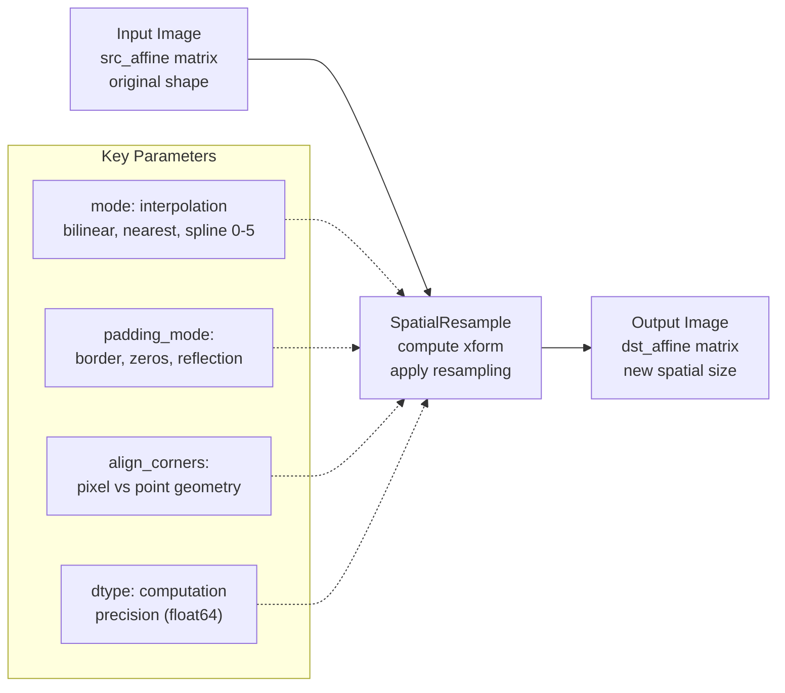

**Key implementation details**:
- Supports three backends: `TransformBackends.TORCH`, `TransformBackends.NUMPY`, `TransformBackends.CUPY`
- Uses `spatial_resample()` functional API from [monai/transforms/spatial/functional.py]()
- Automatically determines spatial rank from `min(img.ndim - 1, len(src_affine) - 1, 3)`
- When `USE_COMPILED` and `align_corners` are both True, uses MONAI's optimized resampling

**Sources**: [monai/transforms/spatial/array.py:124-256]()

---

### Spacing

`Spacing` resamples input images into a specified voxel spacing (pixdim). It preserves or resets spatial orientation based on the `diagonal` parameter.

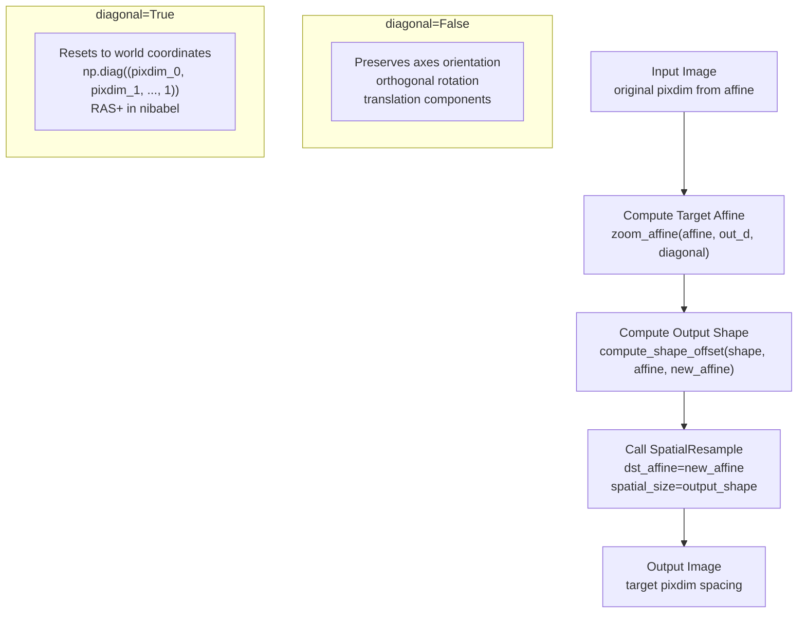

**Pixdim handling**:
- Positive values: resample to specified spacing
- Non-positive values: use corresponding original spacing from affine
- `min_pixdim` and `max_pixdim`: constrain resampling range to avoid unnecessary operations
- If original spacing falls within [min_pixdim, max_pixdim], no resampling occurs

**Sources**: [monai/transforms/spatial/array.py:340-549]()

---

### Orientation

`Orientation` changes the image's orientation into a specified axcodes format using nibabel's orientation functions. It supports both explicit target orientations and canonical orientation.

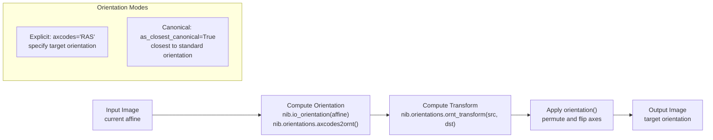

**Label handling**: For `MetaTensor` inputs with `space='LPS'` metadata, automatically uses `labels=(('R', 'L'), ('A', 'P'), ('I', 'S'))` to correctly interpret LPS coordinate systems. Otherwise defaults to `(('L', 'R'), ('P', 'A'), ('I', 'S'))`.

**Sources**: [monai/transforms/spatial/array.py:551-702]()

---

### ResampleToMatch

`ResampleToMatch` extends `SpatialResample` to resample an image to match the affine matrix and spatial size of a target image. It extracts metadata from `img_dst` using `peek_pending_affine()` and `peek_pending_shape()` for lazy-compatible operation.

**Sources**: [monai/transforms/spatial/array.py:258-338]()

---

## Affine-Based Transforms

Affine transforms apply linear transformations represented as 4×4 matrices in homogeneous coordinates. The transformation matrices are composed and applied through resampling.

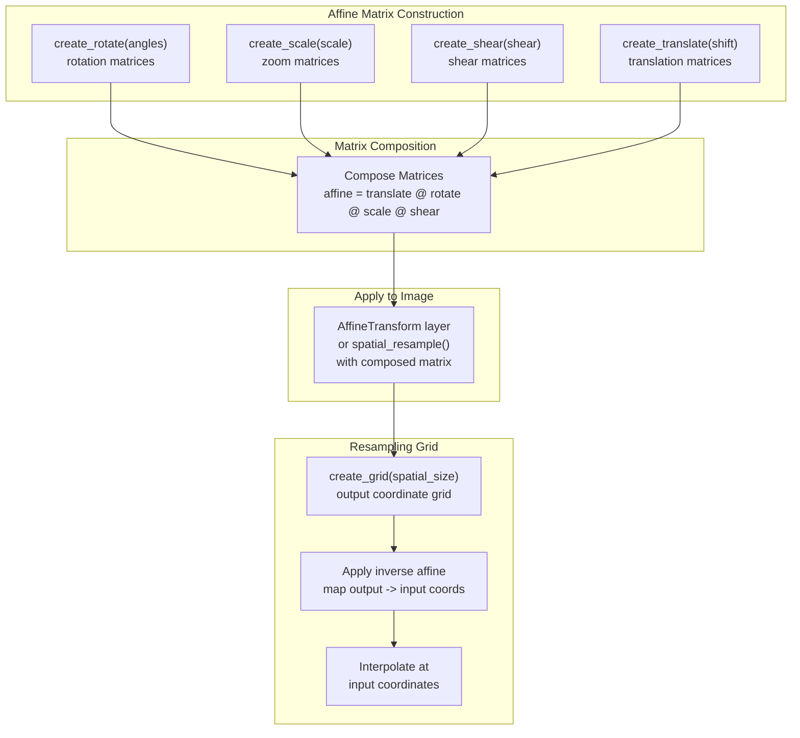

**Sources**: [monai/transforms/utils.py:96-103](), [monai/transforms/spatial/array.py:2144-2546]()

---

### Affine Transform Class

The `Affine` transform applies a general affine transformation matrix to the input image. It supports spatial_size specification, padding, and different interpolation modes.

**Key parameters**:
| Parameter | Description | Default |
|-----------|-------------|---------|
| `rotate_params` | Rotation angles for each axis | None |
| `shear_params` | Shear factors | None |
| `translate_params` | Translation in pixels | None |
| `scale_params` | Scaling factors | None |
| `spatial_size` | Output spatial dimensions | None (auto-computed) |
| `mode` | Interpolation mode | `GridSampleMode.BILINEAR` |
| `padding_mode` | Out-of-bounds handling | `GridSamplePadMode.BORDER` |

**Sources**: [monai/transforms/spatial/array.py:2144-2382]()

---

### Rotate

`Rotate` is a specialized affine transform for rotation around specified axes. It internally creates a rotation matrix using `create_rotate()` and applies it via the affine mechanism.

```python
# Example rotation matrix construction
# For angle=45 degrees around z-axis (2D rotation)
angle = np.pi / 4
rotation_matrix = [
    [cos(angle), -sin(angle), 0, 0],
    [sin(angle),  cos(angle), 0, 0],
    [0,           0,          1, 0],
    [0,           0,          0, 1]
]
```

**Sources**: [monai/transforms/spatial/array.py:1791-1875]()

---

### Zoom

`Zoom` scales images by specified factors along each axis. It creates a scaling affine matrix and ensures output size matches the scaled dimensions.

**Sources**: [monai/transforms/spatial/array.py:1877-1954]()

---

### Resize

`Resize` resamples to an explicit output spatial size. Unlike `Zoom` which works with scale factors, `Resize` directly specifies target dimensions.

**Key modes**:
- Interpolation modes for upsampling/downsampling
- Anti-aliasing support when `anti_aliasing=True`
- When size dimension is -1, uses input dimension size

**Sources**: [monai/transforms/spatial/array.py:1548-1682]()

---

## Flip Operations

Flip transforms reverse the order of elements along spatial axes.

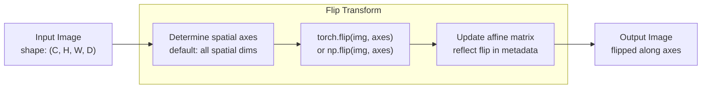

### Flip

Reverses element order along specified spatial axes. Supports lazy execution and is invertible (flipping twice returns original).

**Sources**: [monai/transforms/spatial/array.py:704-749]()

---

### Rotate90

Rotates by 90 degrees in the plane specified by two axes. Uses `torch.rot90()` or `np.rot90()` with specified `k` parameter for number of 90-degree rotations.

**Sources**: [monai/transforms/spatial/array.py:1318-1410]()

---

### RandFlip and RandAxisFlip

Randomized variants that apply flips probabilistically:
- `RandFlip`: randomly flips along specified axes with given probability
- `RandAxisFlip`: randomly selects one axis to flip

**Sources**: [monai/transforms/spatial/array.py:1492-1545](), [monai/transforms/spatial/array.py:1412-1490]()

---

## Grid-Based Transforms

Grid-based transforms manipulate images using control points and deformation fields.

### GridDistortion

Creates smooth deformations by perturbing a control grid and interpolating between control points. The deformation field is created using Gaussian-smoothed random displacements.

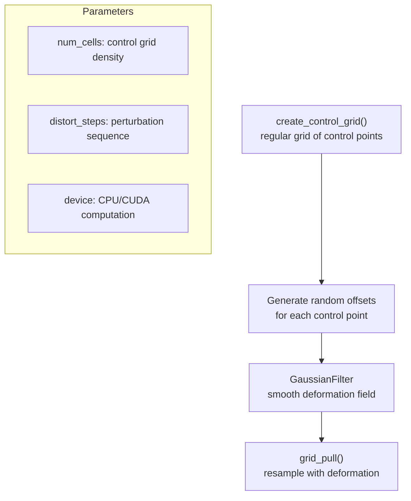

**Sources**: [monai/transforms/spatial/array.py:751-895]()

---

### GridSplit and GridPatch

- `GridSplit`: Divides images into non-overlapping patches arranged in a grid
- `GridPatch`: Extracts patches at specified grid indices with optional overlap
- `RandGridPatch`: Randomly samples grid patches

These are useful for processing large medical images in smaller chunks.

**Sources**: [monai/transforms/spatial/array.py:897-1181]()

---

## Elastic Deformations

Elastic deformations simulate realistic tissue deformations for data augmentation.

### Rand2DElastic and Rand3DElastic

Generate smooth random deformations using:
1. Random displacement fields at control points
2. B-spline interpolation to create smooth deformation
3. Optional rotation and zoom applied first
4. Deformation field applied via `grid_pull()`

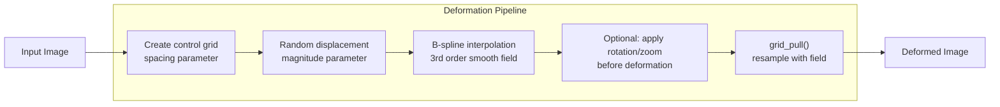

**Key parameters**:
- `spacing`: control point spacing (larger = smoother deformations)
- `magnitude_range`: displacement magnitude range
- `prob`: probability of applying transform
- `rotate_range`, `scale_range`, `shear_range`: optional affine augmentation

**Sources**: [monai/transforms/spatial/array.py:2547-2895]()

---

## Specialized Transforms

### RandSimulateLowResolution

Simulates acquisition at lower resolution followed by upsampling, mimicking low-resolution medical imaging protocols.

**Process**:
1. Downsample image by `zoom_range` factor
2. Upsample back to original size
3. Simulates resolution degradation in medical imaging

**Sources**: [monai/transforms/spatial/array.py:2897-2967]()

---

## Interpolation Modes and Backend Selection

### Available Interpolation Modes

Spatial transforms support multiple interpolation modes depending on the backend:

| Mode | PyTorch | NumPy/CuPy | Use Case |
|------|---------|------------|----------|
| `"bilinear"` | ✓ | ✗ | Smooth interpolation for continuous data |
| `"nearest"` | ✓ | ✓ | Preserve discrete labels, no averaging |
| `0` (spline order 0) | ✗ | ✓ | Nearest neighbor (scipy backend) |
| `1` (spline order 1) | ✗ | ✓ | Linear interpolation |
| `2-5` (spline orders) | ✗ | ✓ | Higher-order spline interpolation |

**Backend selection logic**:
- If `mode` is string (`"bilinear"`, `"nearest"`): PyTorch backend via `torch.nn.functional.grid_sample()`
- If `mode` is integer (0-5): NumPy (CPU) or CuPy (CUDA) backend via `scipy.ndimage.map_coordinates()`

**Sources**: [monai/transforms/spatial/array.py:148-159](), [monai/transforms/utils.py:133-141]()

---

### Padding Modes

Handle out-of-bounds values during resampling:

| Mode | PyTorch | NumPy/CuPy | Behavior |
|------|---------|------------|----------|
| `"border"` | ✓ | `"nearest"` | Use edge values |
| `"zeros"` | ✓ | `"constant"` | Pad with zeros |
| `"reflection"` | ✓ | `"reflect"` | Mirror reflection |
| `"grid-mirror"`, `"wrap"`, etc. | ✗ | ✓ | Advanced scipy modes |

**Sources**: [monai/transforms/spatial/array.py:154-159](), [monai/transforms/utils.py:133-141]()

---

## Lazy Execution Support

Spatial transforms extensively support lazy execution, deferring actual computation until explicitly triggered. This enables optimization through transform composition.

### Lazy-Capable Transforms

The following spatial transforms inherit from `LazyTransform`:
- `SpatialResample`, `ResampleToMatch`, `Spacing`, `Orientation`
- `Flip`
- `Affine`, `RandAffine`
- Padding transforms (see [Crop, Pad, and Post-processing Transforms](#3.4))

### Lazy Execution Pattern

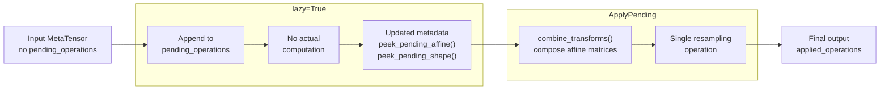

**Key benefits**:
1. **Performance**: Multiple affine transforms compose algebraically before single resampling
2. **Precision**: Single interpolation step reduces cumulative errors
3. **Flexibility**: Inspect/modify transform chain before execution

**Example usage**:
```python
# Multiple transforms deferred
transform = Compose([
    Spacingd(keys=["image"], pixdim=[1.0, 1.0, 1.0], lazy=True),
    Orientationd(keys=["image"], axcodes="RAS", lazy=True),
    RandAffined(keys=["image"], prob=1.0, rotate_range=[0.1, 0.1, 0.1], lazy=True),
])
data = transform(data)  # No resampling yet, all in pending_operations

# Trigger execution
from monai.transforms import ApplyPending
data = ApplyPending()(data)  # Single resampling applies all transforms
```

For details on lazy execution mechanics, see [Lazy Transform Execution](#3.7).

**Sources**: [monai/transforms/spatial/array.py:132-134](), [monai/transforms/transform.py:LazyTransform]()

---

## Randomized Transform Pattern

Many spatial transforms have randomized variants (prefix `Rand`) that inherit from `RandomizableTransform`. These apply transformations probabilistically and sample parameters from specified ranges.

### Randomization Architecture

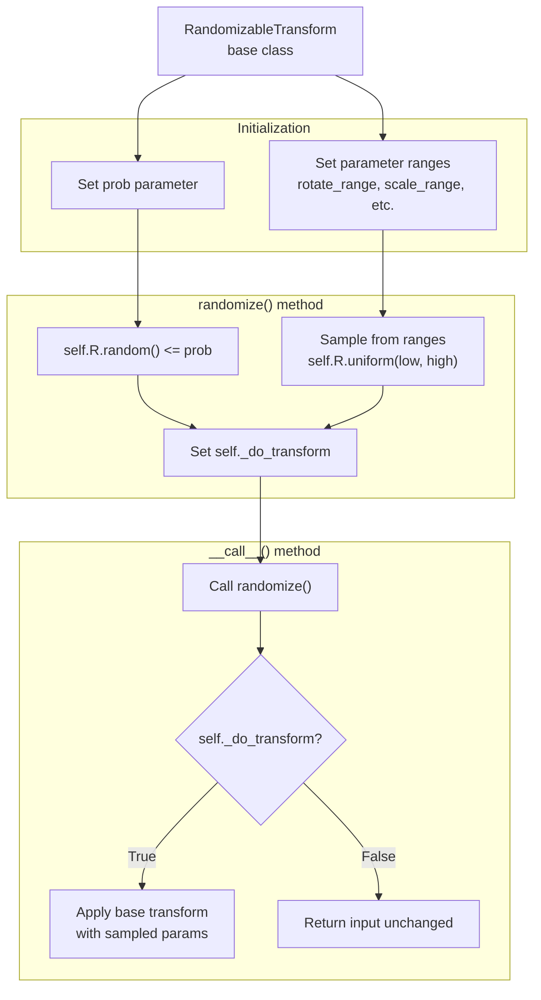

**Common randomized spatial transforms**:
- `RandAffine`: random rotation, scale, shear, translation
- `RandRotate`: random rotation within angle range
- `RandZoom`: random scaling within factor range
- `RandFlip`, `RandAxisFlip`: random axis flipping
- `RandRotate90`: random 90-degree rotations
- `RandGridDistortion`: random grid deformations
- `Rand2DElastic`, `Rand3DElastic`: random elastic deformations

**Random state management**: All randomized transforms use `self.R` (numpy RandomState) for reproducibility. Seed can be set via `set_random_state()`.

**Sources**: [monai/transforms/transform.py:Randomizable](), [monai/transforms/spatial/array.py:1956-2142]()

---

## Dictionary-Based Wrappers

All spatial transforms have dictionary-based counterparts with a 'd' suffix (e.g., `Spacingd`, `Orientationd`, `Affined`). These wrap the array-based transforms for use with dictionary data.

### Naming Convention

| Array Transform | Dictionary Transform | Purpose |
|----------------|---------------------|---------|
| `SpatialResample` | `SpatialResampled` | Resample dictionary items |
| `Spacing` | `Spacingd` | Spacing for dictionary data |
| `Orientation` | `Orientationd` | Orientation for dictionary data |
| `Affine` | `Affined` | Affine for dictionary data |
| `RandAffine` | `RandAffined` | Random affine for dictionary data |

### MapTransform Pattern

Dictionary transforms inherit from `MapTransform` and iterate over specified keys:

```python
class Spacingd(MapTransform, InvertibleTransform, LazyTransform):
    def __init__(self, keys, pixdim, ...):
        MapTransform.__init__(self, keys, allow_missing_keys)
        self.spacer = Spacing(pixdim, ...)  # Wrap array transform
    
    def __call__(self, data):
        d = dict(data)
        for key in self.key_iterator(d):
            d[key] = self.spacer(d[key])  # Apply to each key
        return d
```

**Key features**:
- `keys`: KeysCollection specifying which dictionary items to transform
- `allow_missing_keys`: if True, skip missing keys instead of raising error
- Parameter sequences: most parameters can be sequences matching `keys` length

For comprehensive coverage of the dictionary transform pattern, see [Dictionary-Based Transforms](#3.5).

**Sources**: [monai/transforms/spatial/dictionary.py:1-151]()

---

## Invertible Transform Mechanism

Most spatial transforms inherit from `InvertibleTransform`, enabling reversal of applied transformations. This is critical for converting model predictions back to original image space.

### Inverse Transform Pattern

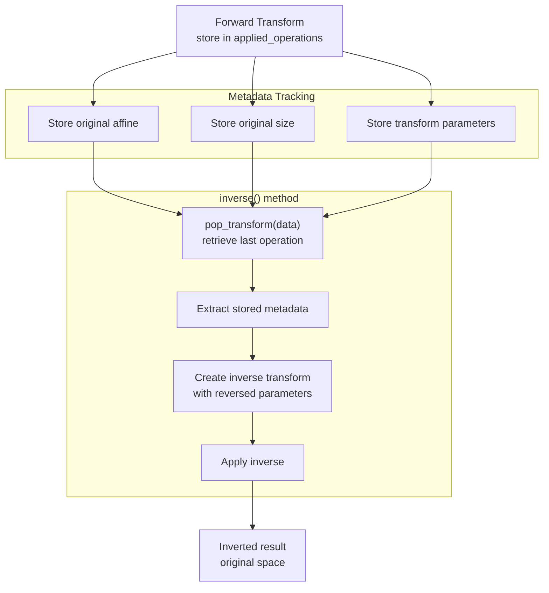

**Example: Spacing inverse**

```python
# Forward: resample 2mm -> 1mm spacing
spacing_transform = Spacing(pixdim=[1.0, 1.0, 1.0])
resampled = spacing_transform(image)  # Stores operation in metadata

# Inverse: resample 1mm -> original 2mm spacing
original = spacing_transform.inverse(resampled)  # Uses stored src_affine
```

**Key inverse implementations**:
- `SpatialResample.inverse()`: swaps src and dst affine matrices
- `Orientation.inverse()`: computes original orientation from stored affine
- `Flip.inverse()`: flips again along same axes (self-inverse)
- `Affine.inverse()`: applies inverse affine matrix

For detailed coverage of invertible transform architecture, see [Invertible Transforms and MetaTensor](#3.6).

**Sources**: [monai/transforms/spatial/array.py:240-255](), [monai/transforms/inverse.py:1-284]()

---

## Performance Considerations

### Backend Selection for Performance

| Scenario | Recommended Backend | Configuration |
|----------|-------------------|---------------|
| GPU tensors, standard modes | PyTorch | `mode="bilinear"` or `"nearest"` |
| CPU tensors, high-quality interpolation | NumPy/SciPy | `mode=3` (cubic spline) |
| CUDA tensors, spline interpolation | CuPy | `mode=3`, data on GPU |
| Compiled optimization | MONAI custom | `USE_COMPILED=True`, `align_corners=True` |

### Lazy Execution for Multiple Transforms

When applying multiple spatial transforms sequentially:
1. Set `lazy=True` on all transforms
2. Affine matrices compose algebraically in `pending_operations`
3. Call `ApplyPending()` to execute single resampling
4. Avoids multiple interpolation steps, reducing error accumulation

**Performance comparison**:
```
Non-lazy (3 transforms): Resample → Resample → Resample (3× interpolation)
Lazy (3 transforms): Compose → Single Resample (1× interpolation)
```

**Sources**: [monai/transforms/spatial/array.py:136-145](), [monai/config/__init__.py:USE_COMPILED]()

---

## Common Usage Patterns

### Standardizing Medical Image Space

```python
from monai.transforms import Compose, Spacingd, Orientationd

# Resample to 1mm isotropic, RAS+ orientation
transform = Compose([
    Spacingd(keys=["image", "label"], pixdim=[1.0, 1.0, 1.0], mode=["bilinear", "nearest"]),
    Orientationd(keys=["image", "label"], axcodes="RAS"),
])
```

### Affine Data Augmentation

```python
from monai.transforms import RandAffined

# Random rotation, scaling, translation
augment = RandAffined(
    keys=["image", "label"],
    prob=0.8,
    rotate_range=[0.2, 0.2, 0.2],  # ±0.2 radians each axis
    scale_range=[0.1, 0.1, 0.1],   # ±10% scaling
    translate_range=[10, 10, 10],   # ±10 pixels translation
    mode=["bilinear", "nearest"],   # Smooth image, preserve labels
    padding_mode="border",
)
```

### Lazy Multi-Transform Pipeline

```python
from monai.transforms import Compose, Spacingd, Orientationd, RandAffined, ApplyPending

# All transforms deferred
pipeline = Compose([
    Spacingd(keys=["image"], pixdim=[1.0, 1.0, 1.0], lazy=True),
    Orientationd(keys=["image"], axcodes="RAS", lazy=True),
    RandAffined(keys=["image"], rotate_range=[0.1, 0.1, 0.1], lazy=True, prob=1.0),
])

data = pipeline(data)  # Builds pending_operations queue
data = ApplyPending()(data)  # Executes composed transform
```

**Sources**: [monai/transforms/spatial/array.py](), [monai/transforms/spatial/dictionary.py]()

---

## Summary

Spatial transforms in MONAI provide a comprehensive system for medical image geometric manipulation:

1. **Core resampling** (`SpatialResample`, `Spacing`, `Orientation`) handles fundamental spatial operations
2. **Affine transforms** (`Affine`, `Rotate`, `Zoom`) apply linear geometric transformations
3. **Specialized operations** (flips, grid distortions, elastic deformations) enable diverse augmentation
4. **Lazy execution** optimizes pipelines by deferring computation and composing transforms
5. **Invertible mechanism** enables mapping predictions back to original image space
6. **Dictionary wrappers** provide convenient batch processing of multi-modal data
7. **Multiple backends** (PyTorch, NumPy, CuPy) optimize for different hardware and quality requirements

All spatial transforms preserve medical imaging metadata through `MetaTensor`, track applied operations for reproducibility, and support both deterministic and randomized variants for data augmentation.

**Sources**: [monai/transforms/spatial/array.py:1-2967](), [monai/transforms/spatial/dictionary.py:1-1500]()

---

