<!-- source: DeepWiki mcp.deepwiki.com · repo Project-MONAI/MONAI · page 3.3 Intensity and Utility Transforms · fetched 2026-10-21 -->

# Intensity and Utility Transforms

<details>
<summary>Relevant source files</summary>

The following files were used as context for generating this wiki page:

- [docs/source/transforms.rst](docs/source/transforms.rst)
- [monai/transforms/__init__.py](monai/transforms/__init__.py)
- [monai/transforms/croppad/array.py](monai/transforms/croppad/array.py)
- [monai/transforms/croppad/dictionary.py](monai/transforms/croppad/dictionary.py)
- [monai/transforms/intensity/array.py](monai/transforms/intensity/array.py)
- [monai/transforms/intensity/dictionary.py](monai/transforms/intensity/dictionary.py)
- [monai/transforms/inverse.py](monai/transforms/inverse.py)
- [monai/transforms/post/array.py](monai/transforms/post/array.py)
- [monai/transforms/post/dictionary.py](monai/transforms/post/dictionary.py)
- [monai/transforms/spatial/array.py](monai/transforms/spatial/array.py)
- [monai/transforms/spatial/dictionary.py](monai/transforms/spatial/dictionary.py)
- [monai/transforms/utility/array.py](monai/transforms/utility/array.py)
- [monai/transforms/utility/dictionary.py](monai/transforms/utility/dictionary.py)
- [monai/transforms/utils.py](monai/transforms/utils.py)

</details>


This page documents two categories of MONAI transforms that operate on image data values and provide general-purpose utilities:

- **Intensity Transforms**: Operations that modify pixel/voxel intensity values without changing spatial dimensions (normalization, noise addition, smoothing, contrast adjustment, etc.)
- **Utility Transforms**: General-purpose operations for data type conversion, channel management, debugging, and custom operations

For spatial geometric operations (rotation, scaling, flipping), see [Spatial Transforms](#3.2). For cropping and padding operations, see [Crop, Pad, and Post-processing Transforms](#3.4). For dictionary-based transform patterns, see [Dictionary-Based Transforms](#3.5).

---

## Transform Categories Overview

### Intensity Transform Categories

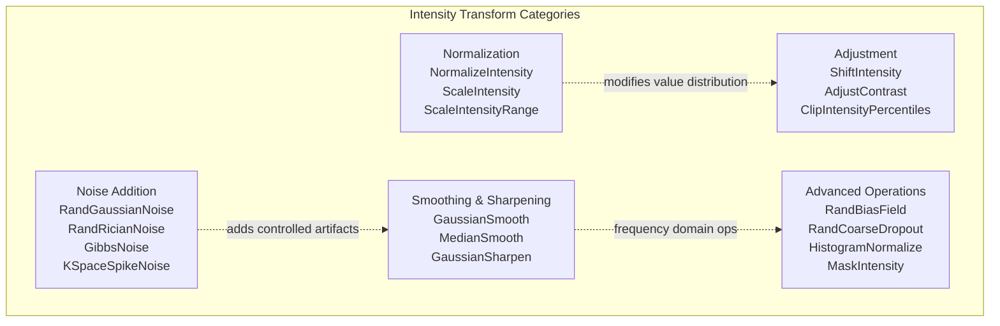

**Intensity Transform Categories**

Sources: [monai/transforms/intensity/array.py:1-83]()

### Utility Transform Categories

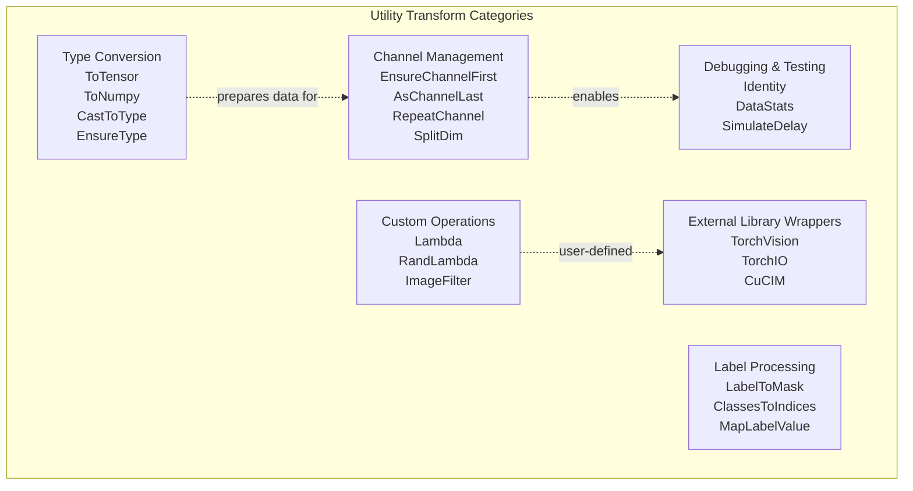

**Utility Transform Categories**

Sources: [monai/transforms/utility/array.py:75-114]()

---

## Intensity Transforms

Intensity transforms modify pixel/voxel values without altering spatial dimensions. All intensity transforms inherit from `Transform` and support both numpy arrays and PyTorch tensors.

### Normalization Transforms

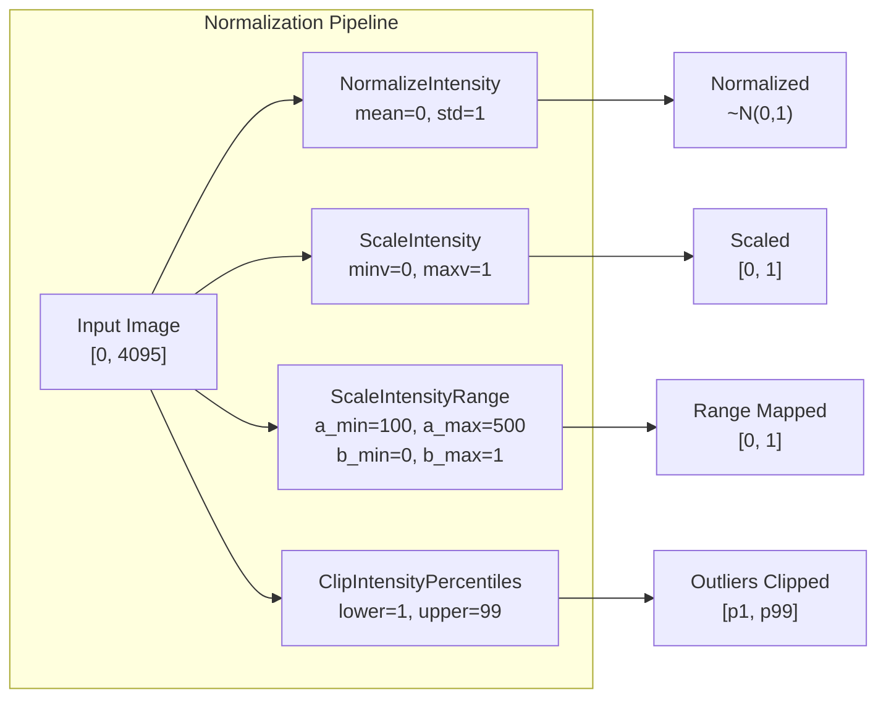

**Normalization Transform Options**

| Transform | Operation | Use Case |
|-----------|-----------|----------|
| `NormalizeIntensity` | `(x - mean) / std` | Z-score normalization, standardizes distribution |
| `ScaleIntensity` | `x * factor + offset` | Simple linear scaling |
| `ScaleIntensityRange` | `(x - a_min) / (a_max - a_min) * (b_max - b_min) + b_min` | Map specific input range to output range |
| `ScaleIntensityRangePercentiles` | Uses percentiles instead of fixed values | Robust to outliers |
| `ClipIntensityPercentiles` | Clips values outside percentile range | Remove extreme values |

**Example: NormalizeIntensity**

[monai/transforms/intensity/array.py:1017-1090]() implements `NormalizeIntensity`:

```python
class NormalizeIntensity(Transform):
    def __init__(
        self,
        subtrahend: NdarrayOrTensor | None = None,
        divisor: NdarrayOrTensor | None = None,
        nonzero: bool = False,
        channel_wise: bool = False,
        dtype: DtypeLike = np.float32,
        allow_missing_keys: bool = False,
    )
```

Key parameters:
- `subtrahend`: Value to subtract (default: mean of image)
- `divisor`: Value to divide by (default: std of image)
- `nonzero`: If True, only normalize non-zero voxels
- `channel_wise`: Process each channel independently

Sources: [monai/transforms/intensity/array.py:1017-1090](), [monai/transforms/intensity/dictionary.py:336-389]()

### Noise Addition Transforms

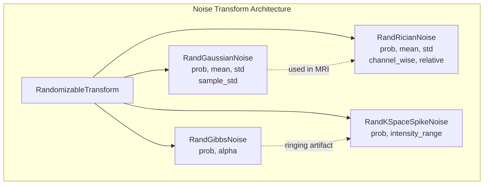

**Noise Addition Transforms Comparison**

| Transform | Noise Type | Parameters | Medical Imaging Context |
|-----------|------------|------------|-------------------------|
| `RandGaussianNoise` | Additive Gaussian | `mean`, `std`, `sample_std` | General noise simulation |
| `RandRicianNoise` | Rician (magnitude of complex Gaussian) | `mean`, `std`, `channel_wise`, `relative` | MRI magnitude images |
| `RandGibbsNoise` | Gibbs ringing (truncation artifact) | `alpha` (0-1, k-space truncation) | MRI reconstruction artifacts |
| `RandKSpaceSpikeNoise` | K-space spike artifacts | `intensity_range`, `channel_wise` | MRI motion/hardware artifacts |

**RandGaussianNoise Implementation**

[monai/transforms/intensity/array.py:86-141]() implements basic Gaussian noise:

```python
class RandGaussianNoise(RandomizableTransform):
    def __init__(
        self,
        prob: float = 0.1,
        mean: float = 0.0,
        std: float = 0.1,
        dtype: DtypeLike = np.float32,
        sample_std: bool = True,
    )
    
    def randomize(self, img: NdarrayOrTensor, mean: float | None = None):
        # If sample_std=True, std is sampled uniformly from [0, self.std]
        std = self.R.uniform(0, self.std) if self.sample_std else self.std
        noise = self.R.normal(mean, std, size=img.shape)
```

**RandRicianNoise for MRI**

[monai/transforms/intensity/array.py:143-230]() implements Rician noise specific to MRI:

The Rician distribution models magnitude MRI data: `sqrt((x + n1)^2 + n2^2)` where `n1`, `n2` are independent Gaussian noise.

Key features:
- `channel_wise=True`: Different noise per channel
- `relative=True`: Noise std is relative to image std
- `sample_std=True`: Randomly sample noise level

Sources: [monai/transforms/intensity/array.py:86-230](), [monai/transforms/intensity/dictionary.py:177-230]()

### Smoothing and Sharpening Transforms

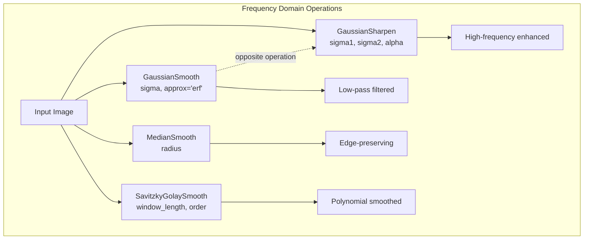

**Smoothing Transforms**

| Transform | Method | Parameters | Characteristics |
|-----------|--------|------------|-----------------|
| `GaussianSmooth` | Gaussian kernel convolution | `sigma`, `approx='erf'/'sampled'` | Isotropic smoothing, removes high-freq noise |
| `MedianSmooth` | Median filter | `radius` | Edge-preserving, removes salt-and-pepper |
| `SavitzkyGolaySmooth` | Polynomial fitting | `window_length`, `order`, `axis`, `mode` | Preserves features while smoothing |

**GaussianSmooth Implementation**

[monai/transforms/intensity/array.py:1630-1703]() uses `monai.networks.layers.GaussianFilter`:

```python
class GaussianSmooth(Transform):
    def __init__(
        self,
        sigma: Sequence[float] | float | Sequence[torch.Tensor] | torch.Tensor,
        approx: str = "erf",
    )
    
    def __call__(self, img: NdarrayOrTensor):
        # Uses separable Gaussian filtering for efficiency
        gaussian_filter = GaussianFilter(img.ndim - 1, sigma, approx=self.approx)
        return gaussian_filter(img)
```

**GaussianSharpen Implementation**

[monai/transforms/intensity/array.py:1773-1859]() implements unsharp masking:

```python
class GaussianSharpen(Transform):
    # Sharpening via: img_sharp = img + alpha * (img - img_smooth)
    # Where img_smooth uses two Gaussian kernels (sigma1, sigma2)
    def __init__(
        self,
        sigma1: Sequence[float] | float = 3.0,
        sigma2: Sequence[float] | float = 1.0,
        alpha: float = 30.0,
        approx: str = "erf",
    )
```

Sources: [monai/transforms/intensity/array.py:1630-1859](), [monai/transforms/intensity/dictionary.py:547-690]()

### Intensity Adjustment Transforms

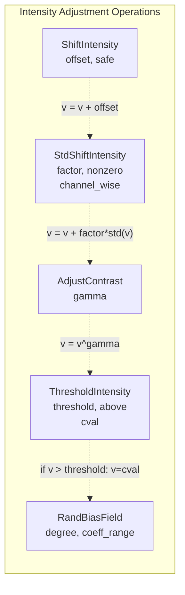

**Adjustment Transform Operations**

| Transform | Formula | Use Case |
|-----------|---------|----------|
| `ShiftIntensity` | `v' = v + offset` | Simple intensity shift |
| `RandShiftIntensity` | `v' = v + random_offset` | Augmentation with random shift |
| `StdShiftIntensity` | `v' = v + factor * std(v)` | Normalize relative to std dev |
| `RandStdShiftIntensity` | Random version of above | Augmentation |
| `AdjustContrast` | `v' = v^gamma` | Gamma correction for contrast |
| `ThresholdIntensity` | `v' = cval if v > threshold else v` | Clip extreme values |
| `RandBiasField` | Adds smooth spatial bias field | Simulate MRI bias field artifact |

**StdShiftIntensity Example**

[monai/transforms/intensity/array.py:330-382]() implements std-based shifting:

```python
class StdShiftIntensity(Transform):
    def __init__(
        self,
        factor: float,
        nonzero: bool = False,  # Only consider non-zero voxels
        channel_wise: bool = False,  # Per-channel computation
        dtype: DtypeLike = np.float32,
    )
    
    def _stdshift(self, img: NdarrayOrTensor):
        slices = (img != 0) if self.nonzero else ones(img.shape, dtype=bool)
        if slices.any():
            offset = self.factor * std(img[slices])
            img[slices] = img[slices] + offset
```

**RandBiasField for MRI Simulation**

[monai/transforms/intensity/array.py:573-696]() simulates MRI bias field inhomogeneity:

```python
class RandBiasField(RandomizableTransform):
    def __init__(
        self,
        degree: int = 3,  # Polynomial degree for bias field
        coeff_range: tuple[float, float] = (0.0, 0.1),
        dtype: DtypeLike = np.float32,
        prob: float = 0.1,
    )
    
    # Generates smooth multiplicative bias: img_biased = img * bias_field
    # bias_field is created using polynomial basis functions
```

Sources: [monai/transforms/intensity/array.py:232-696](), [monai/transforms/intensity/dictionary.py:231-335]()

### Advanced Intensity Operations

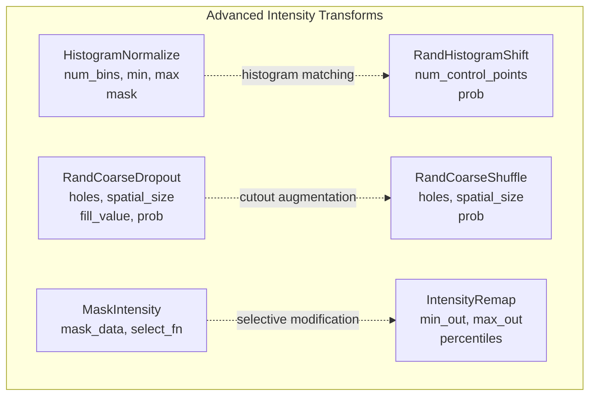

**Advanced Operations**

| Transform | Operation | Key Parameters | Purpose |
|-----------|-----------|----------------|---------|
| `HistogramNormalize` | Histogram matching to reference | `num_bins`, `min`, `max`, `mask` | Standardize intensity distributions across images |
| `RandHistogramShift` | Random non-linear intensity shift | `num_control_points`, `prob` | Augmentation via histogram deformation |
| `RandCoarseDropout` | Random rectangular holes filled with value | `holes`, `spatial_size`, `fill_value` | Cutout augmentation |
| `RandCoarseShuffle` | Shuffle patches within image | `holes`, `spatial_size` | Self-supervised learning |
| `MaskIntensity` | Apply mask to intensity values | `mask_data`, `select_fn` | Process only specific regions |
| `IntensityRemap` | Remap intensity range | `min_out`, `max_out`, `percentiles` | Flexible range mapping |
| `RandIntensityRemap` | Random version of IntensityRemap | Same as above + `prob` | Augmentation |

**HistogramNormalize Implementation**

[monai/transforms/intensity/array.py:2346-2421]() performs histogram matching:

```python
class HistogramNormalize(Transform):
    def __init__(
        self,
        num_bins: int = 256,
        min: int = 0,
        max: int = 255,
        mask: NdarrayOrTensor | None = None,
        dtype: DtypeLike = np.float32,
    )
    
    # Uses skimage.exposure.match_histograms to match
    # intensity distribution to a reference histogram
```

**RandCoarseDropout for Augmentation**

[monai/transforms/intensity/array.py:2161-2278]() implements cutout augmentation:

```python
class RandCoarseDropout(RandomizableTransform):
    def __init__(
        self,
        holes: int,  # Number of rectangular holes to create
        spatial_size: Sequence[int] | int,  # Size of each hole
        dropout_holes: bool = True,
        fill_value: tuple[float, float] | float | None = None,
        max_holes: int | None = None,
        max_spatial_size: Sequence[int] | int | None = None,
        prob: float = 0.1,
    )
    
    # Randomly selects regions and fills them with fill_value
    # Used for regularization and robustness
```

Sources: [monai/transforms/intensity/array.py:2048-2421](), [monai/transforms/intensity/dictionary.py:690-833]()

---

## Utility Transforms

Utility transforms provide essential operations for data preparation, type conversion, channel management, and debugging. Unlike intensity transforms, they may not preserve data type or structure.

### Type Conversion Transforms

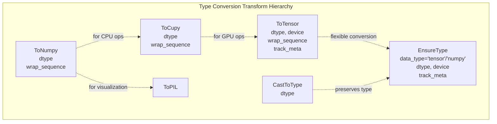

**Type Conversion Transforms**

| Transform | Input → Output | Key Parameters | Use Case |
|-----------|---------------|----------------|----------|
| `ToTensor` | Any → `torch.Tensor` or `MetaTensor` | `dtype`, `device`, `track_meta` | Convert to PyTorch tensor for network input |
| `ToNumpy` | Any → `np.ndarray` | `dtype`, `wrap_sequence` | Convert for numpy operations |
| `ToCupy` | Any → `cupy.ndarray` | `dtype`, `wrap_sequence` | Convert for CuPy GPU operations |
| `ToPIL` | Array → `PIL.Image` | None | Convert for PIL operations |
| `CastToType` | Preserves type, changes dtype | `dtype` | Change precision (e.g., float64 → float32) |
| `EnsureType` | Any → specified type | `data_type`, `dtype`, `device` | Flexible type enforcement |

**ToTensor Implementation**

[monai/transforms/utility/array.py:383-424]() converts data to tensor:

```python
class ToTensor(Transform):
    def __init__(
        self,
        dtype: torch.dtype | None = None,
        device: torch.device | str | None = None,
        wrap_sequence: bool = True,
        track_meta: bool | None = None,  # If True, creates MetaTensor
    )
    
    def __call__(self, img: NdarrayOrTensor):
        return convert_to_tensor(
            img, 
            dtype=self.dtype, 
            device=self.device,
            wrap_sequence=self.wrap_sequence,
            track_meta=self.track_meta
        )
```

**EnsureType for Flexible Conversion**

[monai/transforms/utility/array.py:426-499]() provides flexible type conversion:

```python
class EnsureType(Transform):
    def __init__(
        self,
        data_type: str = "tensor",  # "tensor" or "numpy"
        dtype: DtypeLike | torch.dtype = None,
        device: torch.device | None = None,
        wrap_sequence: bool = True,
        track_meta: bool | None = None,
    )
    
    def __call__(self, data: NdarrayOrTensor, dtype=None):
        if self.data_type == "tensor":
            output_type = MetaTensor if self.track_meta else torch.Tensor
        else:
            output_type = np.ndarray
        return convert_data_type(data, output_type=output_type, ...)
```

Sources: [monai/transforms/utility/array.py:383-524](), [monai/transforms/utility/dictionary.py:436-570]()

### Channel Management Transforms

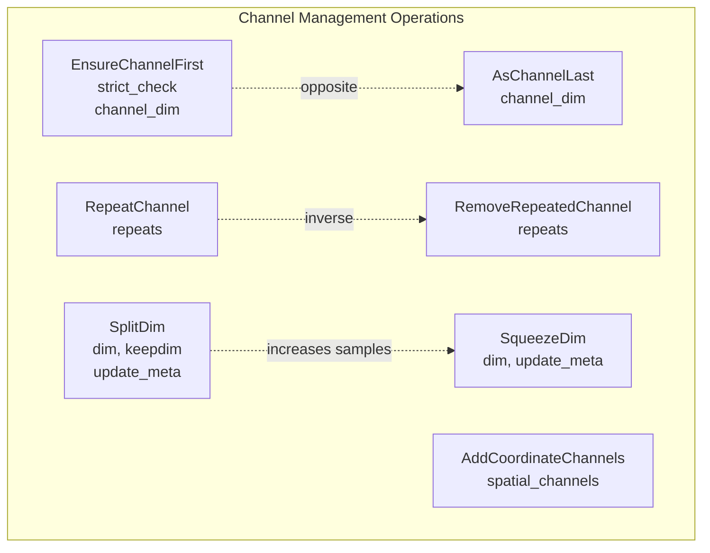

**Channel Management Transforms**

| Transform | Operation | Parameters | Use Case |
|-----------|-----------|------------|----------|
| `EnsureChannelFirst` | Move channel to first dimension | `channel_dim`, `strict_check` | Ensure channel-first format for networks |
| `AsChannelLast` | Move channel to last dimension | `channel_dim` | Convert to channel-last for external libraries |
| `RepeatChannel` | Duplicate channels | `repeats` | Convert grayscale to RGB (1→3 channels) |
| `RemoveRepeatedChannel` | Remove duplicate channels | `repeats` | Undo RepeatChannel |
| `SplitDim` | Split dimension into separate samples | `dim`, `keepdim` | Split 3D volume into 2D slices |
| `SqueezeDim` | Remove singleton dimension | `dim`, `update_meta` | Remove extra dimensions |
| `AddCoordinateChannels` | Add spatial coordinate channels | `spatial_channels` | Add position encoding |

**EnsureChannelFirst Implementation**

[monai/transforms/utility/array.py:175-235]() ensures channel-first format:

```python
class EnsureChannelFirst(Transform):
    def __init__(
        self,
        strict_check: bool = True,
        channel_dim: None | str | int = None,  # Can be "no_channel"
    )
    
    def __call__(self, img: torch.Tensor, meta_dict: Mapping | None = None):
        # Reads original_channel_dim from MetaTensor metadata
        # If no_channel, adds a singleton dimension
        # Otherwise moves the channel dimension to position 0
        if is_no_channel(channel_dim):
            result = img[None]  # Add channel dimension
        else:
            result = moveaxis(img, int(channel_dim), 0)
```

**SplitDim for Multi-Sample Output**

[monai/transforms/utility/array.py:291-335]() splits data along dimension:

```python
class SplitDim(Transform, MultiSampleTrait):
    # Implements MultiSampleTrait to indicate output is list of samples
    def __init__(
        self,
        dim: int = -1,
        keepdim: bool = True,  # Keep singleton dimension after split
        update_meta: bool = True,  # Update affine for each slice
    )
    
    def __call__(self, img: torch.Tensor) -> list[torch.Tensor]:
        # Split along dim and optionally update metadata for each output
        outputs = torch.split(img, 1, self.dim) if torch else np.split(...)
        # If update_meta and MetaTensor, update affine for spatial offset
        return outputs
```

Sources: [monai/transforms/utility/array.py:145-335](), [monai/transforms/utility/dictionary.py:228-399]()

### Debugging and Testing Transforms

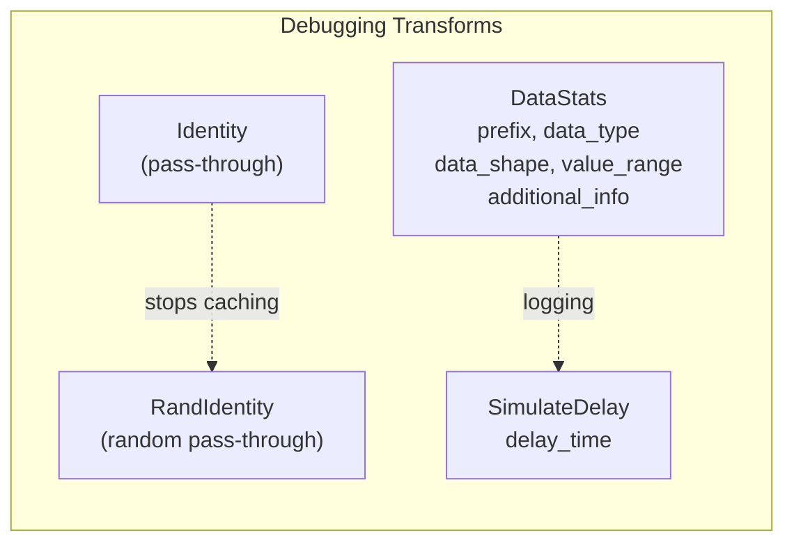

**Debugging Transforms**

| Transform | Purpose | Key Parameters | Use Case |
|-----------|---------|----------------|----------|
| `Identity` | Pass data through unchanged | None | Test transform chains, verify behavior |
| `RandIdentity` | Random pass-through | None | Stop caching in data pipeline |
| `DataStats` | Log statistics about data | `prefix`, `data_type`, `data_shape`, `value_range`, `data_value`, `meta_info` | Debug pipeline, inspect intermediate results |
| `SimulateDelay` | Add artificial delay | `delay_time` | Test slow I/O, simulate network latency |

**DataStats Implementation**

[monai/transforms/utility/array.py:640-747]() provides detailed logging:

```python
class DataStats(Transform):
    def __init__(
        self,
        prefix: str = "Data",
        data_type: bool = True,  # Log data type
        data_shape: bool = True,  # Log shape
        value_range: bool = True,  # Log min/max
        data_value: bool = False,  # Log actual values (verbose)
        meta_info: bool = False,  # Log MetaTensor metadata
        additional_info: Callable | None = None,  # Custom info extractor
        name: str = "DataStats",  # Logger name
    )
    
    def __call__(self, img: NdarrayOrTensor, ...):
        lines = [f"{self.prefix} statistics:"]
        if self.data_type:
            lines.append(f"Type: {type(img)} {img.dtype}")
        if self.data_shape:
            lines.append(f"Shape: {img.shape}")
        if self.value_range:
            lines.append(f"Value range: ({np.min(img)}, {np.max(img)})")
        # ... more logging
        logging.getLogger(self._logger_name).info("\n".join(lines))
        return img  # Pass through unchanged
```

**RandIdentity for Cache Control**

[monai/transforms/utility/array.py:133-143]() implements randomizable identity:

```python
class RandIdentity(RandomizableTrait):
    # Since this is randomizable, CacheDataset won't cache
    # subsequent transforms, allowing them to execute per-epoch
    def __call__(self, data: Any) -> Any:
        return data
```

Sources: [monai/transforms/utility/array.py:117-781](), [monai/transforms/utility/dictionary.py:203-226]()

### Lambda and Custom Operations

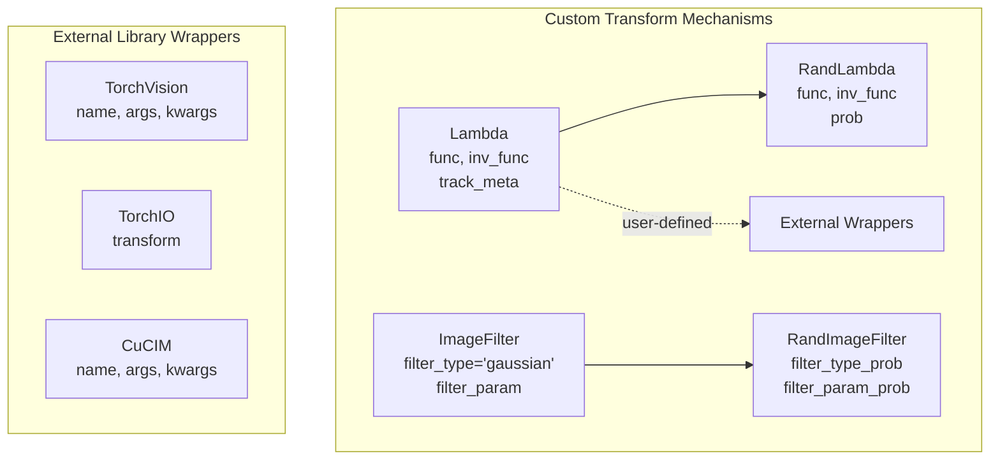

**Custom Operation Transforms**

| Transform | Purpose | Key Parameters | Example Usage |
|-----------|---------|----------------|---------------|
| `Lambda` | Apply custom function | `func`, `inv_func`, `track_meta` | `Lambda(func=lambda x: x[:, ::2, ::2])` |
| `RandLambda` | Random custom function | `func`, `inv_func`, `prob` | `RandLambda(func=lambda x: x + noise, prob=0.5)` |
| `ImageFilter` | Apply predefined filters | `filter_type`, `filter_param` | Various filter options |
| `RandImageFilter` | Random filter application | `filter_type_prob`, `filter_param_prob` | Random filter augmentation |
| `TorchVision` | Wrap torchvision transforms | `name`, `args`, `kwargs` | `TorchVision("ColorJitter", brightness=0.2)` |
| `TorchIO` | Wrap TorchIO transforms | `transform` | Use TorchIO augmentations |
| `CuCIM` | Wrap cuCIM transforms | `name`, `args`, `kwargs` | GPU-accelerated image ops |

**Lambda Transform Implementation**

[monai/transforms/utility/array.py:783-867]() provides flexible custom operations:

```python
class Lambda(InvertibleTransform):
    def __init__(
        self,
        func: Callable | None = None,
        inv_func: Callable = no_collation,  # Inverse function
        track_meta: bool = True,
    )
    
    def __call__(self, img: NdarrayOrTensor, func: Callable | None = None):
        # Apply user-defined function
        if func is not None:
            return func(img)
        return self.func(img)
    
    def inverse(self, data: NdarrayOrTensor):
        # Apply inverse function if defined
        return self.inv_func(data)
```

**ImageFilter Options**

[monai/transforms/utility/array.py:1752-1841]() provides various filter types:

```python
class ImageFilter(Transform):
    def __init__(
        self,
        filter_type: str = "gaussian",  # or "laplace", "elliptical", etc.
        filter_param: dict | None = None,
    )
    
    # Supported filters from monai.networks.layers.simplelayers:
    # - GaussianFilter
    # - LaplaceFilter
    # - EllipticalFilter
    # - MeanFilter
    # - SharpenFilter
    # - MedianFilter
    # - SavitzkyGolayFilter
```

**External Library Wrappers**

[monai/transforms/utility/array.py:1264-1478]() wraps TorchVision:

```python
class TorchVision(Transform):
    def __init__(self, name: str, *args, **kwargs):
        # Dynamically loads transform from torchvision.transforms
        # Example: TorchVision("ColorJitter", brightness=0.2, contrast=0.2)
        transform_lib = __import__("torchvision.transforms")
        self.trans = getattr(transform_lib.transforms, name)(*args, **kwargs)
```

Sources: [monai/transforms/utility/array.py:783-1478](), [monai/transforms/utility/dictionary.py:1115-1429]()

### Label Processing Utilities

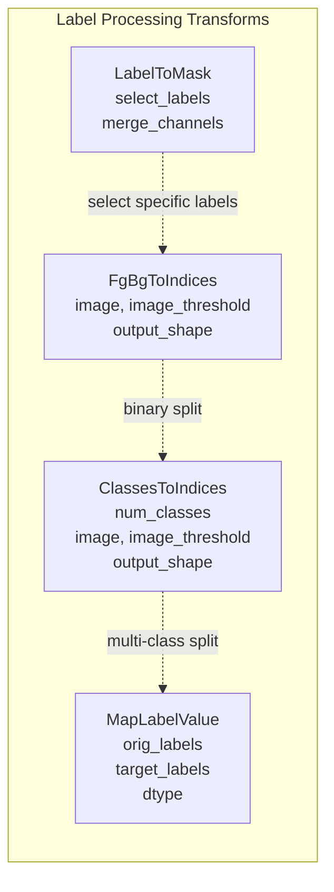

**Label Processing Transforms**

| Transform | Operation | Parameters | Output |
|-----------|-----------|------------|--------|
| `LabelToMask` | Convert labels to binary mask | `select_labels`, `merge_channels` | Binary mask from selected labels |
| `FgBgToIndices` | Get foreground/background indices | `image`, `image_threshold`, `output_shape` | Two arrays of flattened indices |
| `ClassesToIndices` | Get indices for each class | `num_classes`, `image`, `output_shape` | List of index arrays per class |
| `MapLabelValue` | Remap label values | `orig_labels`, `target_labels`, `dtype` | Relabeled data |

**FgBgToIndices for Sampling**

[monai/transforms/utility/array.py:912-998]() computes sampling indices:

```python
class FgBgToIndices(Transform):
    def __init__(
        self,
        image_threshold: float = 0.0,
        output_shape: Sequence[int] | None = None,
    )
    
    def __call__(self, label: NdarrayOrTensor, image: NdarrayOrTensor | None = None):
        # Returns (fg_indices, bg_indices)
        # Used by RandCropByPosNegLabel for sampling
        return map_binary_to_indices(label, image, self.image_threshold)
```

**MapLabelValue for Relabeling**

[monai/transforms/utility/array.py:1606-1668]() remaps label values:

```python
class MapLabelValue(Transform):
    def __init__(
        self,
        orig_labels: Sequence,  # Original label values
        target_labels: Sequence,  # Target label values
        dtype: DtypeLike = np.float32,
    )
    
    def __call__(self, img: NdarrayOrTensor):
        # Maps each value in orig_labels to corresponding target_labels
        # Example: orig_labels=[1, 2, 3], target_labels=[0, 0, 1]
        # Maps labels 1,2 to 0 and label 3 to 1
```

Sources: [monai/transforms/utility/array.py:869-1668](), [monai/transforms/utility/dictionary.py:828-1115]()

---

## Transform Architecture

### Base Classes and Inheritance

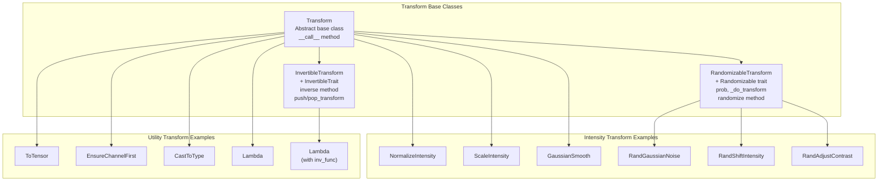

**Transform Base Class Hierarchy**

All transforms inherit from `Transform` [monai/transforms/transform.py]():

```python
class Transform:
    """Abstract base class for all transforms"""
    backend: list[TransformBackends] = []  # Supported backends
    
    @abstractmethod
    def __call__(self, data):
        raise NotImplementedError
```

Key subclasses:
- **`RandomizableTransform`**: Adds randomization with `prob` parameter and `_do_transform` flag
- **`InvertibleTransform`**: Supports inverse operations for post-processing
- **`MapTransform`**: For dictionary-based transforms (see [Dictionary-Based Transforms](#3.5))

Sources: [monai/transforms/transform.py](), [monai/transforms/inverse.py:39-256]()

### Dictionary-Based Transform Pattern

All intensity and utility transforms follow the dictionary-based pattern with 'd' suffix:

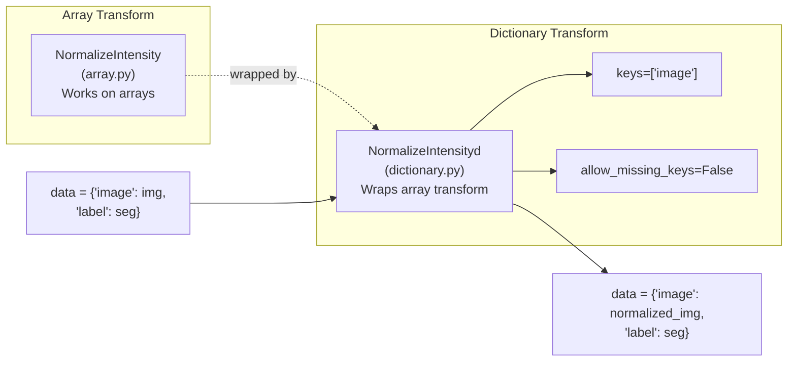

**Dictionary Transform Implementation Pattern**

[monai/transforms/intensity/dictionary.py:336-389]() shows the pattern:

```python
class NormalizeIntensityd(MapTransform):
    """Dictionary-based wrapper of NormalizeIntensity"""
    
    backend = NormalizeIntensity.backend  # Inherit backend
    
    def __init__(
        self,
        keys: KeysCollection,  # Keys to transform
        subtrahend: ...,
        divisor: ...,
        nonzero: bool = False,
        channel_wise: bool = False,
        dtype: DtypeLike = np.float32,
        allow_missing_keys: bool = False,  # Skip if key not in dict
    ):
        super().__init__(keys, allow_missing_keys)
        # Create array transform instance
        self.normalizer = NormalizeIntensity(
            subtrahend, divisor, nonzero, channel_wise, dtype
        )
    
    def __call__(self, data: Mapping[Hashable, NdarrayOrTensor]):
        d = dict(data)
        # Apply to each specified key
        for key in self.key_iterator(d):
            d[key] = self.normalizer(d[key])
        return d
```

This pattern is used for ALL intensity and utility transforms. For more details, see [Dictionary-Based Transforms](#3.5).

Sources: [monai/transforms/intensity/dictionary.py:1-172](), [monai/transforms/utility/dictionary.py:1-199]()

---

## Common Usage Patterns

### Typical Intensity Transform Pipeline

```mermaid
graph TB
    subgraph "Training Pipeline with Intensity Transforms"
        Load["LoadImaged<br/>keys=['image', 'label']"]
        Channel["EnsureChannelFirstd<br/>keys=['image', 'label']"]
        Spacing["Spacingd<br/>keys=['image', 'label']<br/>pixdim=[1.0, 1.0, 1.0]"]
        Orient["Orientationd<br/>keys=['image', 'label']<br/>axcodes='RAS'"]
        
        ScaleRange["ScaleIntensityRanged<br/>keys=['image']<br/>a_min=-175, a_max=250<br/>b_min=0, b_max=1"]
        Crop["RandCropByPosNegLabeld<br/>keys=['image', 'label']<br/>spatial_size=[96,96,96]"]
        
        RandFlip["RandFlipd<br/>keys=['image', 'label']<br/>prob=0.5"]
        RandRotate["RandRotate90d<br/>keys=['image', 'label']<br/>prob=0.5"]
        
        RandShift["RandShiftIntensityd<br/>keys=['image']<br/>offsets=0.1, prob=0.5"]
        RandScale["RandScaleIntensityd<br/>keys=['image']<br/>factors=0.1, prob=0.5"]
        RandNoise["RandGaussianNoised<br/>keys=['image']<br/>std=0.01, prob=0.15"]
        
        ToTensor["ToTensord<br/>keys=['image', 'label']"]
    end
    
    Load --> Channel
    Channel --> Spacing
    Spacing --> Orient
    Orient --> ScaleRange
    ScaleRange --> Crop
    Crop --> RandFlip
    RandFlip --> RandRotate
    RandRotate --> RandShift
    RandShift --> RandScale
    RandScale --> RandNoise
    RandNoise --> ToTensor
```

**Typical Training Pipeline Code**

```python
from monai.transforms import Compose
from monai.transforms import (
    LoadImaged, EnsureChannelFirstd, Spacingd, Orientationd,
    ScaleIntensityRanged, RandCropByPosNegLabeld,
    RandFlipd, RandRotate90d,
    RandShiftIntensityd, RandScaleIntensityd, RandGaussianNoised,
    ToTensord
)

train_transforms = Compose([
    # I/O and standardization
    LoadImaged(keys=["image", "label"]),
    EnsureChannelFirstd(keys=["image", "label"]),
    Spacingd(keys=["image", "label"], pixdim=(1.0, 1.0, 1.0)),
    Orientationd(keys=["image", "label"], axcodes="RAS"),
    
    # Intensity normalization
    ScaleIntensityRanged(
        keys=["image"],
        a_min=-175, a_max=250,  # CT Hounsfield units
        b_min=0.0, b_max=1.0,
        clip=True
    ),
    
    # Spatial crop
    RandCropByPosNegLabeld(
        keys=["image", "label"],
        label_key="label",
        spatial_size=(96, 96, 96),
        pos=1, neg=1,
        num_samples=4
    ),
    
    # Spatial augmentation
    RandFlipd(keys=["image", "label"], spatial_axis=[0], prob=0.5),
    RandRotate90d(keys=["image", "label"], prob=0.5),
    
    # Intensity augmentation
    RandShiftIntensityd(keys=["image"], offsets=0.1, prob=0.5),
    RandScaleIntensityd(keys=["image"], factors=0.1, prob=0.5),
    RandGaussianNoised(keys=["image"], std=0.01, prob=0.15),
    
    # Convert to tensor
    ToTensord(keys=["image", "label"])
])
```

Sources: [monai/transforms/__init__.py:1-585]()

### Validation/Inference Pipeline

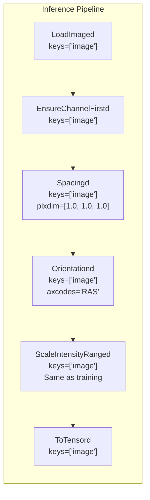

**Inference Pipeline Code**

```python
# Inference uses same preprocessing but NO augmentation
val_transforms = Compose([
    LoadImaged(keys=["image"]),
    EnsureChannelFirstd(keys=["image"]),
    Spacingd(keys=["image"], pixdim=(1.0, 1.0, 1.0)),
    Orientationd(keys=["image"], axcodes="RAS"),
    ScaleIntensityRanged(
        keys=["image"],
        a_min=-175, a_max=250,
        b_min=0.0, b_max=1.0,
        clip=True
    ),
    ToTensord(keys=["image"])
])
```

Sources: [monai/transforms/__init__.py:1-585]()

### Debugging Transform Pipeline

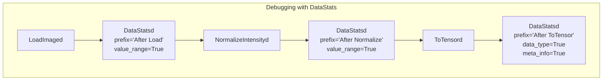

**Debugging Code Example**

```python
from monai.transforms import DataStatsd

debug_transforms = Compose([
    LoadImaged(keys=["image"]),
    DataStatsd(
        keys=["image"],
        prefix="After Load",
        data_type=True,
        data_shape=True,
        value_range=True
    ),
    EnsureChannelFirstd(keys=["image"]),
    DataStatsd(
        keys=["image"],
        prefix="After EnsureChannelFirst",
        data_shape=True
    ),
    NormalizeIntensityd(keys=["image"]),
    DataStatsd(
        keys=["image"],
        prefix="After Normalize",
        value_range=True,
        additional_info=lambda x: f"mean={x.mean():.3f}, std={x.std():.3f}"
    ),
    ToTensord(keys=["image"])
])
```

Output example:
```
After Load statistics:
Type: <class 'numpy.ndarray'> float64
Shape: (512, 512, 100)
Value range: (-1000, 3000)

After EnsureChannelFirst statistics:
Shape: (1, 512, 512, 100)

After Normalize statistics:
Value range: (-3.1415, 3.1415)
Additional info: mean=0.000, std=1.000
```

Sources: [monai/transforms/utility/array.py:640-747](), [monai/transforms/utility/dictionary.py:775-824]()

---

## Summary Tables

### Intensity Transform Categories

| Category | Transforms | Key Use Cases |
|----------|------------|---------------|
| **Normalization** | `NormalizeIntensity`, `ScaleIntensity`, `ScaleIntensityRange`, `ScaleIntensityRangePercentiles` | Standardize intensity distributions, prepare for network input |
| **Noise** | `RandGaussianNoise`, `RandRicianNoise`, `RandGibbsNoise`, `RandKSpaceSpikeNoise` | Augmentation, simulate imaging artifacts |
| **Smoothing** | `GaussianSmooth`, `MedianSmooth`, `SavitzkyGolaySmooth` | Denoise, preprocess |
| **Sharpening** | `GaussianSharpen`, `RandGaussianSharpen` | Enhance edges, improve contrast |
| **Adjustment** | `ShiftIntensity`, `AdjustContrast`, `ThresholdIntensity`, `RandBiasField` | Modify intensity characteristics, simulate artifacts |
| **Advanced** | `HistogramNormalize`, `RandHistogramShift`, `RandCoarseDropout`, `MaskIntensity` | Histogram matching, cutout augmentation, selective processing |

### Utility Transform Categories  

| Category | Transforms | Key Use Cases |
|----------|------------|---------------|
| **Type Conversion** | `ToTensor`, `ToNumpy`, `ToCupy`, `ToPIL`, `CastToType`, `EnsureType` | Convert between data types for different operations |
| **Channel Management** | `EnsureChannelFirst`, `AsChannelLast`, `RepeatChannel`, `SplitDim`, `SqueezeDim` | Manage channel dimensions for networks |
| **Debugging** | `Identity`, `RandIdentity`, `DataStats`, `SimulateDelay` | Test pipelines, log statistics, simulate delays |
| **Custom** | `Lambda`, `RandLambda`, `ImageFilter`, `TorchVision`, `TorchIO`, `CuCIM` | Apply custom functions, wrap external libraries |
| **Label Processing** | `LabelToMask`, `FgBgToIndices`, `ClassesToIndices`, `MapLabelValue` | Process segmentation labels, compute sampling indices |

### Backend Support

| Transform Type | Torch | Numpy | CuPy |
|----------------|-------|-------|------|
| Most Intensity Transforms | ✓ | ✓ | - |
| Type Conversion | ✓ | ✓ | ✓ (ToCupy) |
| Channel Management | ✓ | ✓ | - |
| Lambda/Custom | ✓ | ✓ | - |

Sources: [monai/transforms/intensity/array.py:1-2491](), [monai/transforms/utility/array.py:1-2228]()

---

