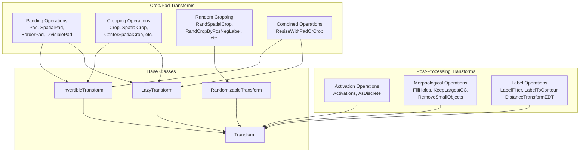
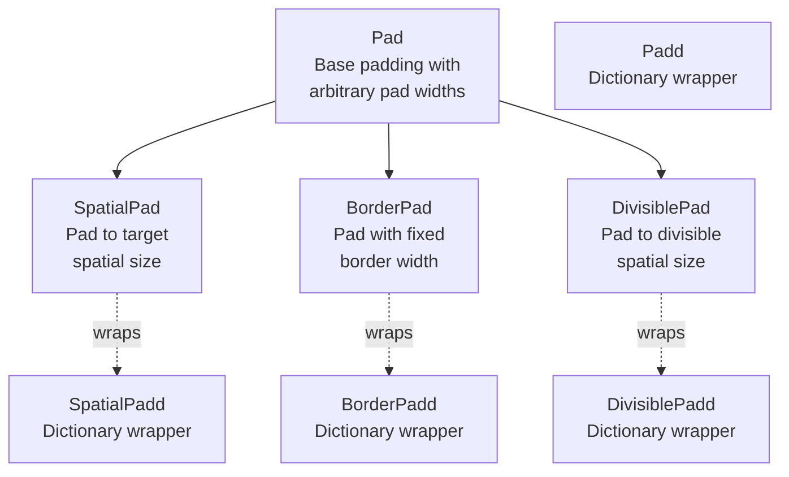
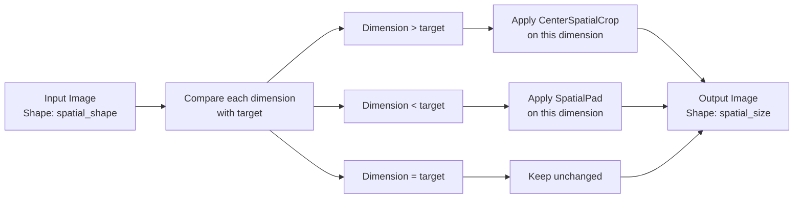
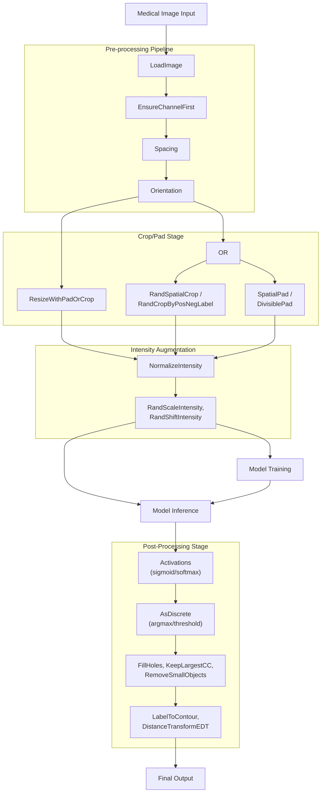
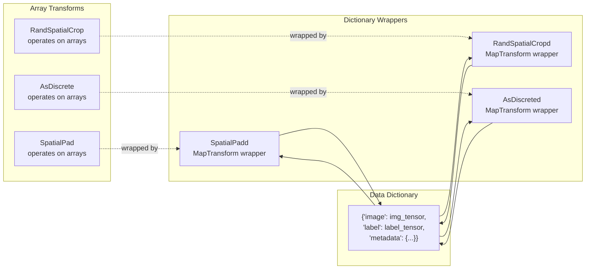
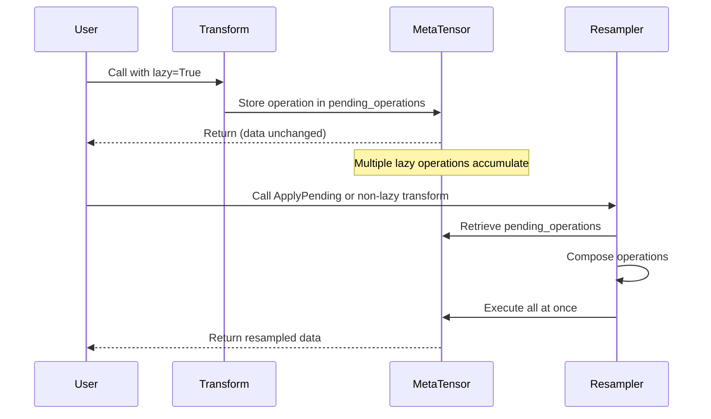

<!-- source: DeepWiki mcp.deepwiki.com · repo Project-MONAI/MONAI · page 3.4 Crop, Pad, and Post-processing Transforms · fetched 2026-10-21 -->

# Crop, Pad, and Post-processing Transforms

<details>
<summary>Relevant source files</summary>

The following files were used as context for generating this wiki page:

- [docs/source/transforms.rst](docs/source/transforms.rst)
- [monai/transforms/__init__.py](monai/transforms/__init__.py)
- [monai/transforms/croppad/array.py](monai/transforms/croppad/array.py)
- [monai/transforms/croppad/dictionary.py](monai/transforms/croppad/dictionary.py)
- [monai/transforms/intensity/array.py](monai/transforms/intensity/array.py)
- [monai/transforms/intensity/dictionary.py](monai/transforms/intensity/dictionary.py)
- [monai/transforms/inverse.py](monai/transforms/inverse.py)
- [monai/transforms/post/array.py](monai/transforms/post/array.py)
- [monai/transforms/post/dictionary.py](monai/transforms/post/dictionary.py)
- [monai/transforms/spatial/array.py](monai/transforms/spatial/array.py)
- [monai/transforms/spatial/dictionary.py](monai/transforms/spatial/dictionary.py)
- [monai/transforms/utility/array.py](monai/transforms/utility/array.py)
- [monai/transforms/utility/dictionary.py](monai/transforms/utility/dictionary.py)
- [monai/transforms/utils.py](monai/transforms/utils.py)

</details>


## Purpose and Scope

This page documents MONAI's transforms for spatial cropping, padding, and post-processing operations. These transforms modify the spatial dimensions of medical images or refine model outputs for downstream use.

**Scope:**
- Padding transforms that increase image dimensions
- Cropping transforms that extract regions of interest
- Combined resize/pad/crop operations
- Post-processing transforms for model outputs (activations, discretization, connected components)

**Related pages:**
- For general spatial transforms (spacing, orientation, affine), see [Spatial Transforms](#3.2)
- For intensity normalization, see [Intensity and Utility Transforms](#3.3)
- For dictionary-based transform patterns, see [Dictionary-Based Transforms](#3.5)
- For invertible transform mechanisms, see [Invertible Transforms and MetaTensor](#3.6)

---

## Transform Categories Overview

Crop, pad, and post-processing transforms are organized into three main categories:



**Sources:** [monai/transforms/croppad/array.py:1-78](), [monai/transforms/post/array.py:1-66]()

---

## Padding Transforms

Padding transforms extend image boundaries by adding values around the image perimeter. All padding transforms inherit from `InvertibleTransform` and `LazyTransform`, making them compatible with lazy execution pipelines.

### Pad Class Hierarchy



**Sources:** [monai/transforms/croppad/array.py:81-106](), [monai/transforms/croppad/dictionary.py:113-180]()

### Pad

The base `Pad` class performs padding with user-specified amounts for each dimension.

**Location:** [monai/transforms/croppad/array.py:81-173]()

**Key Features:**
- Accepts `to_pad` parameter: `[(low_H, high_H), (low_W, high_W), ...]`
- Uses `torch.nn.functional.pad` when possible, falls back to `np.pad`
- Supports all NumPy and PyTorch padding modes
- Lazy execution capable

**Padding Modes:**
- NumPy: `constant`, `edge`, `linear_ramp`, `maximum`, `mean`, `median`, `minimum`, `reflect`, `symmetric`, `wrap`, `empty`
- PyTorch: `constant`, `reflect`, `replicate`, `circular`

**Implementation:** Uses [monai/transforms/croppad/functional.py]() for the actual padding operation via `pad_func`.

### SpatialPad

Pads an image to reach a target spatial size, with options for symmetric or end-side padding.

**Location:** [monai/transforms/croppad/array.py:176-254]()

**Parameters:**
- `spatial_size`: Target output dimensions
- `method`: `"symmetric"` (pad both sides equally) or `"end"` (pad only trailing edges)
- `mode`: Padding mode (constant, reflect, etc.)

**Behavior:**
- If input dimension already meets or exceeds target, no padding on that dimension
- Negative values in `spatial_size` use corresponding input dimension

**Example scenario:**
```
Input shape: [30, 30, 30]
spatial_size: [32, 25, -1]
Output shape: [32, 30, 30]  # First dim padded, second unchanged (already ≥25), third unchanged (-1)
```

### BorderPad

Adds a fixed-width border around the entire image.

**Location:** [monai/transforms/croppad/array.py:257-304]()

**Parameters:**
- `spatial_border`: Border width(s) to add on all sides

**Use case:** Adding context margins for models that need peripheral information.

### DivisiblePad

Pads image so spatial dimensions become divisible by specified values (e.g., powers of 2 for U-Net).

**Location:** [monai/transforms/croppad/array.py:307-357]()

**Parameters:**
- `k`: Divisor value(s) for each spatial dimension
- `method`: Padding distribution strategy

**Implementation:** Calls [monai/transforms/utils.py:compute_divisible_spatial_size]() to calculate required padding.

**Sources:** [monai/transforms/croppad/array.py:81-357](), [monai/transforms/utils.py:92]()

---

## Cropping Transforms

Cropping transforms extract regions from images. They are organized into deterministic and randomized variants.

### Crop Class Hierarchy

```mermaid
graph TB
    subgraph "Deterministic Crops"
        Crop["Crop<br/>General purpose cropping"]
        SpatialCrop["SpatialCrop<br/>Crop specified ROI"]
        CenterSpatialCrop["CenterSpatialCrop<br/>Center-aligned crop"]
        CenterScaleCrop["CenterScaleCrop<br/>Center crop with scaling"]
        CropForeground["CropForeground<br/>Crop to foreground bbox"]
        BoundingRect["BoundingRect<br/>Compute bounding box"]
    end
    
    subgraph "Random Crops"
        RandSpatialCrop["RandSpatialCrop<br/>Random position crop"]
        RandScaleCrop["RandScaleCrop<br/>Random scale + crop"]
        RandSpatialCropSamples["RandSpatialCropSamples<br/>Multiple random crops"]
        RandWeightedCrop["RandWeightedCrop<br/>Weight map sampling"]
        RandCropByPosNegLabel["RandCropByPosNegLabel<br/>Balanced fg/bg sampling"]
        RandCropByLabelClasses["RandCropByLabelClasses<br/>Class-balanced sampling"]
    end
    
    InvertibleTransform["InvertibleTransform"]
    RandomizableTransform["RandomizableTransform"]
    
    Crop --> InvertibleTransform
    SpatialCrop --> InvertibleTransform
    CenterSpatialCrop --> InvertibleTransform
    CenterScaleCrop --> InvertibleTransform
    CropForeground --> InvertibleTransform
    BoundingRect --> InvertibleTransform
    
    RandSpatialCrop --> RandomizableTransform
    RandScaleCrop --> RandomizableTransform
    RandSpatialCropSamples --> RandomizableTransform
    RandWeightedCrop --> RandomizableTransform
    RandCropByPosNegLabel --> RandomizableTransform
    RandCropByLabelClasses --> RandomizableTransform
```



**Sources:** [monai/transforms/croppad/array.py:360-1330]()

### Core Cropping Classes

#### Crop

Base cropping transform that extracts a region defined by slice objects.

**Location:** [monai/transforms/croppad/array.py:360-405]()

**Parameters:**
- `slices`: Slice objects defining the region to extract

**Usage:** Typically used internally by other crop transforms.

#### SpatialCrop

Crops to a specified region of interest (ROI) in spatial dimensions.

**Location:** [monai/transforms/croppad/array.py:408-492]()

**Parameters:**
- `roi_start`: Starting coordinates of ROI
- `roi_end`: Ending coordinates of ROI (exclusive)
- `roi_slices`: Alternative specification using slice objects

**Implementation:** Uses [monai/transforms/croppad/functional.py:crop_func]() for the actual operation.

#### CenterSpatialCrop

Extracts a center-aligned region of specified size.

**Location:** [monai/transforms/croppad/array.py:495-567]()

**Parameters:**
- `roi_size`: Desired output spatial dimensions

**Common use case:** Extracting fixed-size patches from larger images during inference.

### Random Cropping Classes

#### RandSpatialCrop

Randomly selects a crop position with specified size.

**Location:** [monai/transforms/croppad/array.py:616-726]()

**Parameters:**
- `roi_size`: Crop dimensions
- `random_center`: If `True`, fully random; if `False`, aligns to image center with jitter
- `random_size`: If `True`, randomly reduces `roi_size`

**Randomization:** Calls `randomize()` to select crop position before applying transform.

#### RandCropByPosNegLabel

Randomly crops regions with controlled foreground/background ratio.

**Location:** [monai/transforms/croppad/array.py:913-1126]()

**Parameters:**
- `spatial_size`: Crop dimensions
- `label`: Label tensor to determine fg/bg regions
- `pos`: Foreground sampling probability (e.g., 0.75 means 75% of crops contain foreground)
- `neg`: Background sampling probability
- `num_samples`: Number of crops to generate

**Workflow:**
1. Calls [monai/transforms/utils.py:map_binary_to_indices]() to compute foreground/background indices
2. Uses [monai/transforms/utils.py:generate_pos_neg_label_crop_centers]() to select crop centers
3. Applies crops at selected positions

**Use case:** Balanced training data generation for segmentation tasks.

#### RandCropByLabelClasses

Randomly crops based on class distribution in multi-class labels.

**Location:** [monai/transforms/croppad/array.py:1129-1330]()

**Parameters:**
- `spatial_size`: Crop dimensions
- `label`: Multi-class label tensor
- `num_classes`: Number of classes (for argmax labels)
- `ratios`: Desired sampling ratio per class
- `num_samples`: Number of crops to generate

**Workflow:**
1. Calls [monai/transforms/utils.py:map_classes_to_indices]() to get indices per class
2. Uses [monai/transforms/utils.py:generate_label_classes_crop_centers]() to sample crops
3. Respects class distribution specified by `ratios`

**Use case:** Class-balanced patch sampling for imbalanced datasets.

**Sources:** [monai/transforms/croppad/array.py:360-1330](), [monai/transforms/utils.py:443-541]()

---

## ResizeWithPadOrCrop

A combined transform that resizes images to target dimensions using padding and/or cropping as needed.

**Location:** [monai/transforms/croppad/array.py:1333-1443](), also referenced in [monai/transforms/spatial/array.py:34]()

### Operation Logic



**Parameters:**
- `spatial_size`: Target output dimensions
- `mode`: Padding mode (if padding needed)

**Example:**
```
Input: [100, 80, 120]
spatial_size: [96, 96, 96]
Result: 
  - Dimension 0: Crop 100 → 96
  - Dimension 1: Pad 80 → 96
  - Dimension 2: Crop 120 → 96
```

**Key features:**
- Inherits from `InvertibleTransform` and `LazyTransform`
- Uses `CenterSpatialCrop` and `SpatialPad` internally
- Maintains spatial alignment via center-based operations

**Sources:** [monai/transforms/croppad/array.py:1333-1443](), [monai/transforms/spatial/array.py:34]()

---

## Post-Processing Transforms

Post-processing transforms operate on model outputs to prepare them for evaluation or visualization. These transforms typically do not preserve spatial metadata and are not invertible.

### Post-Processing Transform Categories

```mermaid
graph TB
    subgraph "Activation Transforms"
        Activations["Activations<br/>Apply sigmoid/softmax"]
        AsDiscrete["AsDiscrete<br/>Convert to discrete values"]
    end
    
    subgraph "Morphological Transforms"
        FillHoles["FillHoles<br/>Fill holes in binary masks"]
        KeepLargestCC["KeepLargestConnectedComponent<br/>Keep largest component"]
        RemoveSmallObjects["RemoveSmallObjects<br/>Remove small regions"]
        LabelFilter["LabelFilter<br/>Filter labels by value"]
    end
    
    subgraph "Label Transforms"
        LabelToContour["LabelToContour<br/>Extract boundaries"]
        DistanceTransformEDT["DistanceTransformEDT<br/>Compute distance maps"]
    end
    
    subgraph "Ensemble Transforms"
        MeanEnsemble["MeanEnsemble<br/>Average predictions"]
        VoteEnsemble["VoteEnsemble<br/>Majority voting"]
    end
    
    Transform["Transform"]
    
    Activations --> Transform
    AsDiscrete --> Transform
    FillHoles --> Transform
    KeepLargestCC --> Transform
    RemoveSmallObjects --> Transform
    LabelFilter --> Transform
    LabelToContour --> Transform
    DistanceTransformEDT --> Transform
    MeanEnsemble --> Transform
    VoteEnsemble --> Transform
```



**Sources:** [monai/transforms/post/array.py:51-66]()

### Activations

Applies activation functions to model outputs (sigmoid, softmax, or custom functions).

**Location:** [monai/transforms/post/array.py:69-138]()

**Parameters:**
- `sigmoid`: Apply sigmoid activation
- `softmax`: Apply softmax activation
- `other`: Custom callable activation function
- `kwargs`: Additional parameters (e.g., `dim` for softmax)

**Example usage:**
```python
# Apply softmax along channel dimension
transform = Activations(softmax=True, dim=1)
output = transform(model_output)
```

**Note:** Converts input to float32 before applying activations.

### AsDiscrete

Converts continuous model outputs to discrete values through various operations.

**Location:** [monai/transforms/post/array.py:140-266]()

**Operations supported:**
1. **Argmax**: Select class with highest probability
2. **Threshold**: Binarize at specified threshold
3. **One-hot encoding**: Convert to one-hot format
4. **Rounding**: Round to nearest integer

**Parameters:**
- `argmax`: Apply argmax operation
- `to_onehot`: Number of classes for one-hot conversion
- `threshold`: Threshold value for binarization
- `rounding`: Rounding method (`"torchrounding"`)
- `kwargs`: Additional parameters (e.g., `dim`, `keepdim` for argmax)

**Operation order:** argmax → one-hot → threshold → rounding

**Example:**
```python
# Convert prediction to binary mask
transform = AsDiscrete(threshold=0.5)
binary_mask = transform(probability_map)

# Convert to class labels with argmax
transform = AsDiscrete(argmax=True)
labels = transform(class_probabilities)
```

### Morphological Operations

#### FillHoles

Fills holes in binary masks using morphological operations.

**Location:** [monai/transforms/post/array.py:269-313]()

**Parameters:**
- `applied_labels`: Which label values to process (or all if None)
- `connectivity`: Connectivity for hole detection

**Implementation:** Uses [monai/transforms/utils.py:fill_holes]() which wraps `scipy.ndimage.binary_fill_holes`.

#### KeepLargestConnectedComponent

Retains only the largest connected component(s) in each label.

**Location:** [monai/transforms/post/array.py:316-411]()

**Parameters:**
- `applied_labels`: Label values to process
- `independent`: Process each label independently
- `connectivity`: Connectivity for component analysis
- `num_components`: Number of largest components to keep

**Use case:** Removing spurious predictions and keeping main structure.

**Implementation:** Uses [monai/transforms/utils.py:get_largest_connected_component_mask]().

#### RemoveSmallObjects

Removes connected components smaller than specified size.

**Location:** [monai/transforms/post/array.py:414-468]()

**Parameters:**
- `min_size`: Minimum component size in voxels
- `connectivity`: Connectivity for component analysis
- `independent`: Process each label independently

**Implementation:** Uses [monai/transforms/utils.py:remove_small_objects]() which wraps `skimage.morphology.remove_small_objects`.

### Label Operations

#### LabelFilter

Filters labels based on allowed/disallowed values.

**Location:** [monai/transforms/post/array.py:471-510]()

**Parameters:**
- `applied_labels`: Labels to apply operation to
- `binary_output`: Output binary mask or preserve label values

**Example:**
```python
# Keep only labels 1 and 3
transform = LabelFilter(applied_labels=[1, 3])
filtered = transform(label_image)
```

#### LabelToContour

Extracts object boundaries from label images.

**Location:** [monai/transforms/post/array.py:513-560]()

**Parameters:**
- `kernel_type`: Morphological kernel type (`"Laplace"` or custom)

**Implementation:** Uses [monai/transforms/utils_morphological_ops.py:erode]() internally to compute boundaries.

#### DistanceTransformEDT

Computes Euclidean distance transform from object boundaries.

**Location:** [monai/transforms/post/array.py:713-751]()

**Parameters:**
- `sampling`: Voxel spacing for each dimension
- `channel_wise`: Compute transform per channel

**Implementation:** Uses [monai/transforms/utils.py:distance_transform_edt]() which wraps `scipy.ndimage.distance_transform_edt`.

**Use case:** Distance-based loss functions, level-set methods.

**Sources:** [monai/transforms/post/array.py:69-751](), [monai/transforms/utils.py:103-144]()

---

## Transform Pipeline Integration

Crop/pad and post-processing transforms fit into the broader MONAI transform pipeline:



**Typical workflows:**

1. **Training pipeline:** Load → Spatial transforms → Crop/Pad (with augmentation) → Intensity transforms → Model
2. **Inference pipeline:** Load → Spatial transforms → Pad (for divisibility) → Model → Post-processing
3. **Evaluation pipeline:** Inference pipeline → AsDiscrete → Morphological cleanup → Metrics

**Sources:** [monai/transforms/__init__.py:1-12](), [docs/source/transforms.rst:1-100]()

---

## Dictionary-Based Wrappers

All crop/pad and post-processing transforms have dictionary-based equivalents following the `'d'` suffix convention.

### Dictionary Wrapper Pattern



**Wrapper characteristics:**
- All dictionary wrappers inherit from `MapTransform`
- Accept `keys` parameter to specify which dictionary entries to transform
- Support `allow_missing_keys` to handle missing keys gracefully
- Preserve dictionary structure while transforming specified values

**Naming conventions:**
- Base name + `d`: `SpatialPad` → `SpatialPadd`
- Base name + `D`: `SpatialPad` → `SpatialPadD` (alias)
- Base name + `Dict`: `SpatialPad` → `SpatialPadDict` (alias)

**Example usage:**
```python
from monai.transforms import SpatialPadd, RandCropByPosNegLabeld

# Apply spatial padding to both image and label
transform = SpatialPadd(
    keys=["image", "label"],
    spatial_size=[128, 128, 64],
    method="symmetric"
)

# Random crop with foreground sampling
crop = RandCropByPosNegLabeld(
    keys=["image", "label"],
    label_key="label",
    spatial_size=[96, 96, 48],
    pos=1.0,  # 100% foreground crops
    neg=0.0,
    num_samples=4  # Generate 4 crop samples
)
```

**Sources:** [monai/transforms/croppad/dictionary.py:1-110](), [monai/transforms/post/dictionary.py:1-103]()

---

## Invertibility and Lazy Execution

Crop and pad transforms support two advanced execution modes:

### Invertibility

Crop and pad transforms implement `InvertibleTransform`, enabling reversal of operations.

**Inversion mechanism:**
1. Transform stores metadata in `MetaTensor.applied_operations`
2. Metadata includes original size, crop/pad parameters
3. `inverse()` method reconstructs original spatial configuration

**Example inversion scenarios:**

| Transform | Forward Operation | Inverse Operation |
|-----------|-------------------|-------------------|
| `SpatialPad` | Add padding to reach target size | Remove padding to restore original size |
| `CenterSpatialCrop` | Extract center region | Embed cropped region back into original space with zero padding |
| `RandSpatialCrop` | Extract random region | Embed cropped region at recorded position |

**Implementation details:** [monai/transforms/inverse.py:42-256]()

### Lazy Execution

Crop and pad transforms can defer execution when `lazy=True`.

**Lazy execution workflow:**


**Benefits:**
- Compose multiple spatial operations without intermediate resampling
- Single interpolation step preserves image quality
- Reduced computation time

**Supported transforms:** `Pad`, `SpatialPad`, `BorderPad`, `DivisiblePad`, `Crop`, `SpatialCrop`, `CenterSpatialCrop`, `ResizeWithPadOrCrop`

**Usage:**
```python
from monai.transforms import Compose, SpatialPadd, Spacingd, ApplyPendingd

# All operations execute lazily, resampling once at the end
pipeline = Compose([
    SpatialPadd(keys=["image"], spatial_size=[512, 512, 256], lazy=True),
    Spacingd(keys=["image"], pixdim=[1.0, 1.0, 1.0], lazy=True),
    ApplyPendingd(keys=["image"])  # Trigger execution
])
```

**Sources:** [monai/transforms/croppad/array.py:81-106](), [monai/transforms/transform.py](), [monai/transforms/inverse.py:42-256]()

---

## Common Usage Patterns

### Pattern 1: Padding for Network Compatibility

Many neural network architectures require input dimensions to be divisible by specific values (e.g., powers of 2).

```python
from monai.transforms import DivisiblePadd, Compose

# Ensure dimensions divisible by 32 for U-Net
transform = DivisiblePadd(
    keys=["image", "label"],
    k=32,  # Divisor
    method="end"  # Pad only trailing edges
)
```

**Sources:** [monai/transforms/croppad/array.py:307-357]()

### Pattern 2: Foreground-Focused Training

Generate training patches that balance foreground and background content.

```python
from monai.transforms import RandCropByPosNegLabeld

crop = RandCropByPosNegLabeld(
    keys=["image", "label"],
    label_key="label",
    spatial_size=[96, 96, 96],
    pos=3,  # 3 parts foreground
    neg=1,  # 1 part background
    num_samples=4,  # 4 crops per image
    image_key="image",
    image_threshold=0  # Foreground threshold
)
```

**Workflow:**
1. Computes foreground/background indices via `map_binary_to_indices`
2. Samples crop centers with 75% foreground, 25% background probability
3. Extracts crops at selected positions

**Sources:** [monai/transforms/croppad/array.py:913-1126](), [monai/transforms/utils.py:443-476]()

### Pattern 3: Class-Balanced Multi-Class Sampling

Sample crops proportionally to class frequencies in multi-class segmentation.

```python
from monai.transforms import RandCropByLabelClassesd

crop = RandCropByLabelClassesd(
    keys=["image", "label"],
    label_key="label",
    spatial_size=[128, 128, 64],
    num_classes=4,
    ratios=[1, 2, 2, 1],  # Sample class 1&2 twice as often as class 0&3
    num_samples=8
)
```

**Sources:** [monai/transforms/croppad/array.py:1129-1330](), [monai/transforms/utils.py:479-541]()

### Pattern 4: Model Output Post-Processing

Standard pipeline for segmentation model outputs.

```python
from monai.transforms import Compose, Activations, AsDiscrete
from monai.transforms import KeepLargestConnectedComponent, FillHoles

post_process = Compose([
    Activations(softmax=True, dim=1),  # Convert logits to probabilities
    AsDiscrete(argmax=True),  # Get class predictions
    FillHoles(applied_labels=[1]),  # Fill holes in foreground
    KeepLargestConnectedComponent(applied_labels=[1], independent=False)  # Keep main structure
])

prediction = model(image)
final_output = post_process(prediction)
```

**Sources:** [monai/transforms/post/array.py:69-411]()

### Pattern 5: Inference with Padding and Restoration

Pad input for divisibility, run inference, then restore original size.

```python
from monai.transforms import (
    Compose, DivisiblePad, Invert, 
    Activations, AsDiscrete
)

# Forward pipeline
pre_process = Compose([
    DivisiblePad(k=32, mode="reflect")
])

# Post-processing with inversion
post_process = Compose([
    Activations(sigmoid=True),
    AsDiscrete(threshold=0.5),
    Invert(
        transform=pre_process,
        orig_keys="image",
        nearest_interp=False
    )
])

padded_image = pre_process(image)
prediction = model(padded_image)
original_size_output = post_process(prediction)
```

**Sources:** [monai/transforms/croppad/array.py:307-357](), [monai/transforms/post/array.py:563-710]()

---

## Transform Parameter Reference

### Key Padding Parameters

| Parameter | Transforms | Description |
|-----------|-----------|-------------|
| `spatial_size` | `SpatialPad`, `SpatialPadd` | Target spatial dimensions after padding |
| `to_pad` | `Pad`, `Padd` | Explicit padding amounts per dimension `[(low, high), ...]` |
| `spatial_border` | `BorderPad`, `BorderPadd` | Fixed border width to add |
| `k` | `DivisiblePad`, `DivisiblePadd` | Divisor for output dimensions |
| `method` | Most pad transforms | `"symmetric"` or `"end"` padding distribution |
| `mode` | All pad transforms | NumPy/PyTorch padding mode (constant, reflect, etc.) |

**Sources:** [monai/transforms/croppad/array.py:81-357]()

### Key Cropping Parameters

| Parameter | Transforms | Description |
|-----------|-----------|-------------|
| `roi_size` | Most crop transforms | Spatial dimensions of output crop |
| `roi_start`, `roi_end` | `SpatialCrop`, `SpatialCropd` | Explicit ROI coordinates |
| `random_center` | `RandSpatialCrop` | Enable fully random positioning |
| `random_size` | `RandSpatialCrop` | Enable random crop size variation |
| `pos`, `neg` | `RandCropByPosNegLabel` | Foreground/background sampling ratio |
| `num_samples` | Random crop transforms | Number of crops to generate |
| `ratios` | `RandCropByLabelClasses` | Sampling probability per class |

**Sources:** [monai/transforms/croppad/array.py:360-1330]()

### Key Post-Processing Parameters

| Parameter | Transforms | Description |
|-----------|-----------|-------------|
| `sigmoid`, `softmax` | `Activations` | Activation function selection |
| `argmax` | `AsDiscrete` | Apply argmax to get class labels |
| `threshold` | `AsDiscrete` | Threshold for binarization |
| `to_onehot` | `AsDiscrete` | Number of classes for one-hot conversion |
| `applied_labels` | Morphological transforms | Which label values to process |
| `connectivity` | Morphological transforms | Connectivity definition (1-3) |
| `min_size` | `RemoveSmallObjects` | Minimum component size in voxels |

**Sources:** [monai/transforms/post/array.py:69-751]()

---

## Performance Considerations

### Memory Efficiency

**Padding memory usage:**
- Padding increases memory footprint proportionally to added volume
- Use `lazy=True` to defer padding until combined with other operations
- `DivisiblePad` with minimal divisor reduces unnecessary padding

**Cropping memory usage:**
- Cropping reduces memory footprint
- `RandSpatialCropSamples` with `MultiSampleTrait` can generate multiple crops efficiently
- Consider crop size vs. GPU memory capacity for batch processing

### Computational Efficiency

**Lazy execution optimization:**
```python
# Inefficient: Multiple resampling operations
spatial_pad = SpatialPad(spatial_size=[512, 512, 256])
spacing = Spacing(pixdim=[1.0, 1.0, 1.0])
img = spacing(spatial_pad(img))  # 2 interpolations

# Efficient: Single resampling
spatial_pad = SpatialPad(spatial_size=[512, 512, 256], lazy=True)
spacing = Spacing(pixdim=[1.0, 1.0, 1.0], lazy=True)
img = spacing(spatial_pad(img))  # Operations composed, 1 interpolation
```

**Crop-then-process strategy:**
- Apply computationally expensive transforms (e.g., `HistogramNormalize`) after cropping
- Reduces computation on unnecessary background regions

**Post-processing optimization:**
- `KeepLargestConnectedComponent` is expensive; use judiciously
- `FillHoles` complexity depends on hole size and number
- Consider applying morphological operations to specific labels only

**Sources:** [monai/transforms/transform.py](), [monai/transforms/lazy/]()

---

## Integration with Other Transform Systems

### Compatibility with Spatial Transforms

Crop/pad transforms work seamlessly with spatial transforms (spacing, orientation, affine):

```python
from monai.transforms import Compose, Spacingd, Orientationd, SpatialPadd

pipeline = Compose([
    Spacingd(keys=["image", "label"], pixdim=[1.0, 1.0, 1.0]),
    Orientationd(keys=["image", "label"], axcodes="RAS"),
    SpatialPadd(keys=["image", "label"], spatial_size=[256, 256, 128])
])
```

**Execution order matters:**
- Spacing/orientation typically before padding to standardize image geometry
- Cropping before expensive transforms to reduce computation
- Padding after cropping to achieve target size

### Compatibility with Intensity Transforms

Crop/pad transforms preserve intensity values, making them compatible with intensity transforms:

```python
from monai.transforms import (
    Compose, RandCropByPosNegLabeld,
    RandScaleIntensityd, RandGaussianNoised
)

pipeline = Compose([
    RandCropByPosNegLabeld(
        keys=["image", "label"],
        label_key="label",
        spatial_size=[96, 96, 96],
        pos=1, neg=1
    ),
    RandScaleIntensityd(keys=["image"], factors=0.1, prob=0.5),
    RandGaussianNoised(keys=["image"], prob=0.5)
])
```

**Best practice:** Apply intensity augmentations after spatial augmentations to preserve physical meaning of intensity ranges.

**Sources:** [monai/transforms/__init__.py:13-238]()

---

## Summary

Crop, pad, and post-processing transforms provide essential functionality for:

1. **Spatial dimension management:** Padding to network requirements, cropping to regions of interest
2. **Training data augmentation:** Random crops with foreground/background balancing, class-balanced sampling
3. **Model output refinement:** Activations, discretization, morphological cleanup

**Key design features:**
- Invertible operations for accurate spatial tracking
- Lazy execution for optimized resampling pipelines
- Dictionary-based wrappers for multi-modal data
- Comprehensive randomization options for data augmentation

**Transform file locations:**
- Array-based: [monai/transforms/croppad/array.py](), [monai/transforms/post/array.py]()
- Dictionary-based: [monai/transforms/croppad/dictionary.py](), [monai/transforms/post/dictionary.py]()
- Functional implementations: [monai/transforms/croppad/functional.py]()
- Utility functions: [monai/transforms/utils.py]()

For more information on related transform systems:
- Transform architecture: [Transform Architecture and Base Classes](#3.1)
- Spatial transforms: [Spatial Transforms](#3.2)
- Dictionary transforms: [Dictionary-Based Transforms](#3.5)
- Lazy execution: [Lazy Transform Execution](#3.7)

---

