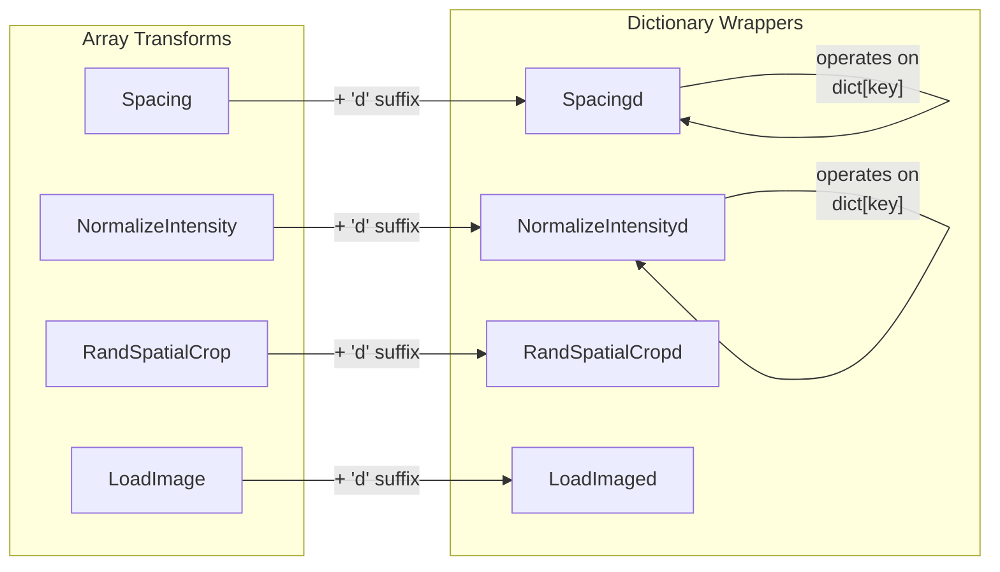
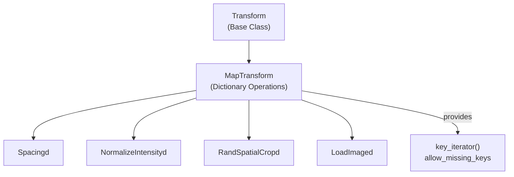
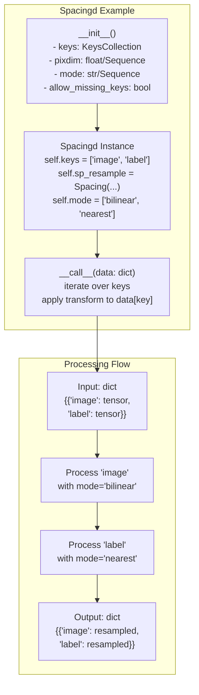
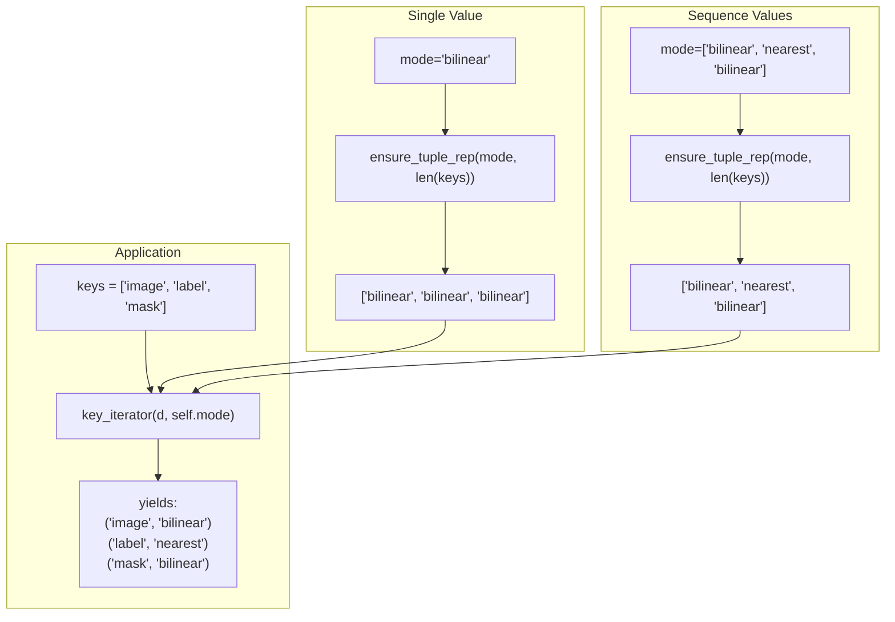
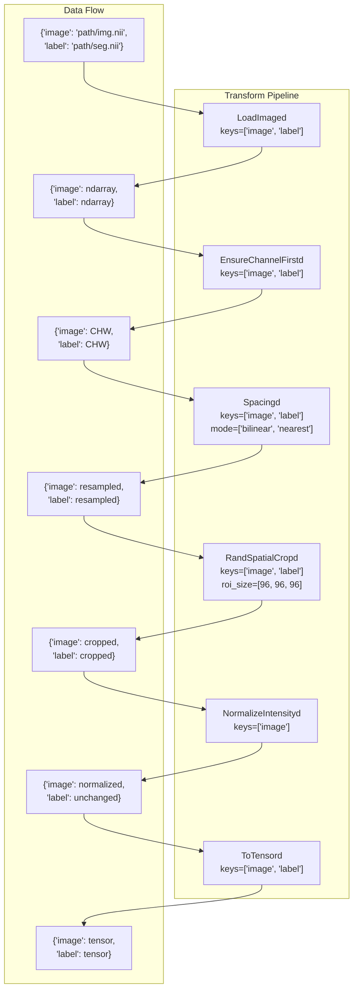
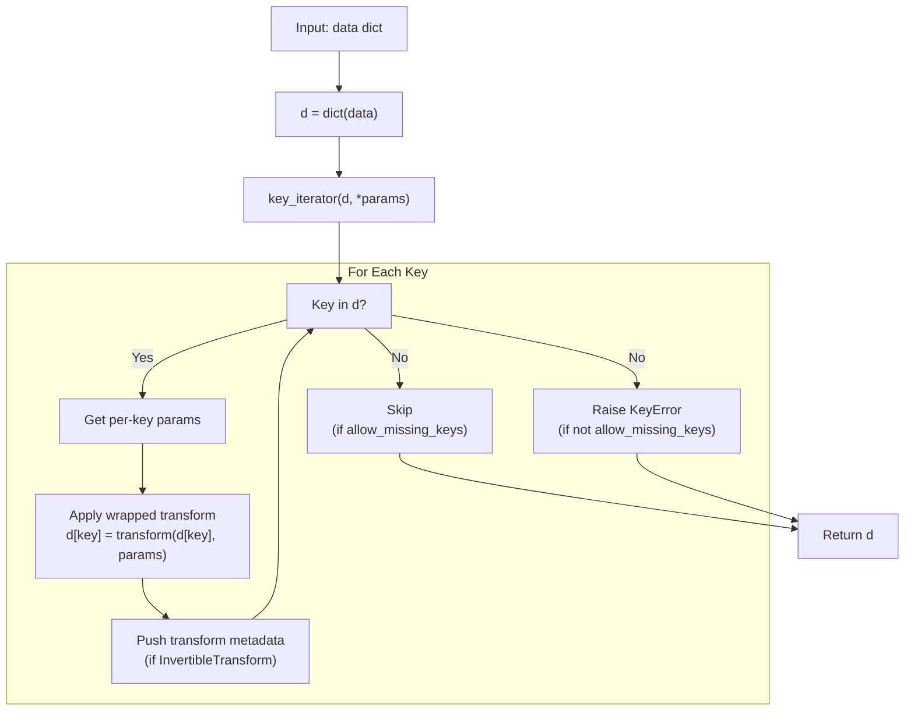
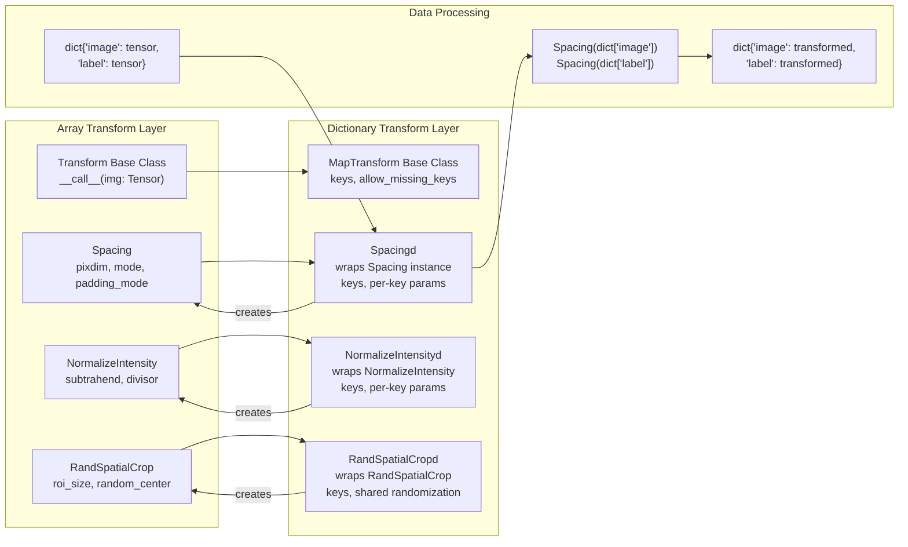

<!-- source: DeepWiki mcp.deepwiki.com · repo Project-MONAI/MONAI · page 3.5 Dictionary-Based Transforms · fetched 2026-10-21 -->

# Dictionary-Based Transforms

<details>
<summary>Relevant source files</summary>

The following files were used as context for generating this wiki page:

- [docs/source/transforms.rst](docs/source/transforms.rst)
- [monai/transforms/__init__.py](monai/transforms/__init__.py)
- [monai/transforms/croppad/array.py](monai/transforms/croppad/array.py)
- [monai/transforms/croppad/dictionary.py](monai/transforms/croppad/dictionary.py)
- [monai/transforms/intensity/array.py](monai/transforms/intensity/array.py)
- [monai/transforms/intensity/dictionary.py](monai/transforms/intensity/dictionary.py)
- [monai/transforms/inverse.py](monai/transforms/inverse.py)
- [monai/transforms/post/array.py](monai/transforms/post/array.py)
- [monai/transforms/post/dictionary.py](monai/transforms/post/dictionary.py)
- [monai/transforms/spatial/array.py](monai/transforms/spatial/array.py)
- [monai/transforms/spatial/dictionary.py](monai/transforms/spatial/dictionary.py)
- [monai/transforms/utility/array.py](monai/transforms/utility/array.py)
- [monai/transforms/utility/dictionary.py](monai/transforms/utility/dictionary.py)
- [monai/transforms/utils.py](monai/transforms/utils.py)

</details>


## Purpose and Scope

This document describes MONAI's dictionary-based transform system, which enables applying transformations to multiple items in a dictionary simultaneously using a consistent key-based API. Dictionary-based transforms wrap "vanilla" array-based transforms with the ability to operate on dictionary data structures, where each key corresponds to a data item (e.g., "image", "label", "mask").

For information about the underlying array-based transforms, see [Transform Architecture and Base Classes](#3.1), [Spatial Transforms](#3.2), [Intensity and Utility Transforms](#3.3), and [Crop, Pad, and Post-processing Transforms](#3.4). For information about invertible operations and metadata tracking, see [Invertible Transforms and MetaTensor](#3.6).

## Dictionary-Based Transform Pattern

Dictionary-based transforms follow a consistent naming convention: they append a **'d' suffix** to the corresponding array transform class name. For example:
- `Spacing` → `Spacingd`
- `NormalizeIntensity` → `NormalizeIntensityd`
- `RandSpatialCrop` → `RandSpatialCropd`

Additionally, two alternative suffixes are provided for consistency with different naming preferences:
- **'D' suffix** (capitalized): `SpacingD`, `NormalizeIntensityD`
- **'Dict' suffix**: `SpacingDict`, `NormalizeIntensityDict`

All three variants (e.g., `Spacingd`, `SpacingD`, `SpacingDict`) are aliases that refer to the same implementation.

**The 'd' Suffix Pattern:**



Sources: [monai/transforms/utility/dictionary.py:12-16](), [monai/transforms/spatial/dictionary.py:12-16]()

## MapTransform Base Class

All dictionary-based transforms inherit from `MapTransform`, which provides the core infrastructure for iterating over dictionary keys and handling missing keys.

**MapTransform Class Hierarchy:**



Sources: [monai/transforms/transform.py](), [monai/transforms/utility/dictionary.py:203-226]()

### Key MapTransform Features

The `MapTransform` class provides:

1. **`keys` parameter**: Specifies which dictionary keys to transform
2. **`allow_missing_keys` parameter**: Controls whether to raise exceptions for missing keys
3. **`key_iterator()` method**: Iterates over specified keys, optionally yielding additional per-key parameters

```python
class MapTransform(Transform):
    def __init__(self, keys: KeysCollection, allow_missing_keys: bool = False):
        self.keys = ensure_tuple(keys)
        self.allow_missing_keys = allow_missing_keys
    
    def key_iterator(self, d: Mapping[Hashable, Any], *extras):
        # Iterates over keys, yielding key and optional extra parameters
        # Handles allow_missing_keys logic
```

Sources: [monai/transforms/transform.py:MapTransform]()

## Basic Dictionary Transform Structure

**Dictionary Transform Anatomy:**



Sources: [monai/transforms/spatial/dictionary.py:366-549]()

### Example Implementation Pattern

Here's the typical pattern for dictionary-based transforms, illustrated by `Spacingd`:

```python
class Spacingd(MapTransform, InvertibleTransform, LazyTransform):
    def __init__(
        self,
        keys: KeysCollection,
        pixdim: Sequence[float] | float,
        mode: SequenceStr = GridSampleMode.BILINEAR,
        allow_missing_keys: bool = False,
        lazy: bool = False,
    ) -> None:
        MapTransform.__init__(self, keys, allow_missing_keys)
        LazyTransform.__init__(self, lazy=lazy)
        # Store array transform instance
        self.sp_resample = Spacing(pixdim=pixdim, lazy=lazy)
        # Expand mode to match number of keys
        self.mode = ensure_tuple_rep(mode, len(self.keys))
    
    def __call__(self, data: Mapping[Hashable, torch.Tensor], lazy: bool | None = None):
        d = dict(data)
        # Iterate over keys with per-key parameters
        for key, mode in self.key_iterator(d, self.mode):
            d[key] = self.sp_resample(d[key], mode=mode, lazy=lazy)
        return d
```

Sources: [monai/transforms/spatial/dictionary.py:366-451]()

## Per-Key Parameter Specification

Dictionary-based transforms support specifying parameters either as:
1. **Single value** (applied to all keys)
2. **Sequence of values** (one per key)

This is accomplished using `ensure_tuple_rep()`, which repeats a single value or validates a sequence matches the number of keys.

**Per-Key Parameter Pattern:**



Sources: [monai/transforms/spatial/dictionary.py:217-220](), [monai/utils/misc.py:ensure_tuple_rep]()

### Common Per-Key Parameters

| Parameter | Example Transform | Usage |
|-----------|-------------------|-------|
| `mode` | `Spacingd`, `Resized` | Different interpolation per key |
| `padding_mode` | `SpatialPadd`, `Affined` | Different padding per key |
| `dtype` | `CastToTyped`, `EnsureTyped` | Different data types per key |
| `prob` | Many `Rand*` transforms | Different probabilities per key |
| `sigma` | `GaussianSmoothd` | Different smoothing per key |

Sources: [monai/transforms/spatial/dictionary.py:154-221](), [monai/transforms/utility/dictionary.py:401-434]()

## Dictionary Transform Categories

Dictionary-based transforms are organized by the same categories as their array counterparts:

### Spatial Transforms

**Common Spatial Dictionary Transforms:**

| Array Transform | Dictionary Transform | Purpose |
|----------------|---------------------|---------|
| `Spacing` | `Spacingd` | Resample to target voxel spacing |
| `Orientation` | `Orientationd` | Reorient to target axes |
| `Resize` | `Resized` | Resize to target shape |
| `Rotate` | `Rotated` | Rotate by angle |
| `Zoom` | `Zoomd` | Zoom by scale factor |
| `Flip` | `Flipd` | Flip along spatial axes |
| `Affine` | `Affined` | Apply affine transformation |
| `RandAffine` | `RandAffined` | Random affine augmentation |

Sources: [monai/transforms/spatial/dictionary.py:80-151]()

### Intensity Transforms

**Common Intensity Dictionary Transforms:**

| Array Transform | Dictionary Transform | Purpose |
|----------------|---------------------|---------|
| `NormalizeIntensity` | `NormalizeIntensityd` | Normalize intensity values |
| `ScaleIntensity` | `ScaleIntensityd` | Scale intensity range |
| `ScaleIntensityRange` | `ScaleIntensityRanged` | Scale from source to target range |
| `RandGaussianNoise` | `RandGaussianNoised` | Add random Gaussian noise |
| `RandShiftIntensity` | `RandShiftIntensityd` | Random intensity shift |
| `GaussianSmooth` | `GaussianSmoothd` | Gaussian smoothing |
| `AdjustContrast` | `AdjustContrastd` | Adjust image contrast |

Sources: [monai/transforms/intensity/dictionary.py:69-172]()

### Crop and Pad Transforms

**Common Crop/Pad Dictionary Transforms:**

| Array Transform | Dictionary Transform | Purpose |
|----------------|---------------------|---------|
| `SpatialPad` | `SpatialPadd` | Pad to target spatial size |
| `SpatialCrop` | `SpatialCropd` | Crop to specified region |
| `CenterSpatialCrop` | `CenterSpatialCropd` | Center crop to size |
| `RandSpatialCrop` | `RandSpatialCropd` | Random spatial crop |
| `CropForeground` | `CropForegroundd` | Crop around foreground |
| `RandCropByPosNegLabel` | `RandCropByPosNegLabeld` | Sample positive/negative regions |
| `DivisiblePad` | `DivisiblePadd` | Pad to make dimensions divisible |

Sources: [monai/transforms/croppad/dictionary.py:55-110]()

### Utility Transforms

**Common Utility Dictionary Transforms:**

| Array Transform | Dictionary Transform | Purpose |
|----------------|---------------------|---------|
| `EnsureChannelFirst` | `EnsureChannelFirstd` | Ensure channel-first format |
| `ToTensor` | `ToTensord` | Convert to PyTorch tensor |
| `CastToType` | `CastToTyped` | Cast to target dtype |
| `Lambda` | `Lambdad` | Apply custom function |
| `SqueezeDim` | `SqueezeDimd` | Squeeze singleton dimension |
| `RepeatChannel` | `RepeatChanneld` | Repeat channel dimension |

Sources: [monai/transforms/utility/dictionary.py:75-198]()

### I/O Transforms

**I/O Dictionary Transforms:**

| Array Transform | Dictionary Transform | Purpose |
|----------------|---------------------|---------|
| `LoadImage` | `LoadImaged` | Load images from files |
| `SaveImage` | `SaveImaged` | Save images to files |

Sources: [monai/transforms/io/dictionary.py]()

### Post-Processing Transforms

**Post-Processing Dictionary Transforms:**

| Array Transform | Dictionary Transform | Purpose |
|----------------|---------------------|---------|
| `Activations` | `Activationsd` | Apply activation functions |
| `AsDiscrete` | `AsDiscreted` | Convert to discrete values |
| `KeepLargestConnectedComponent` | `KeepLargestConnectedComponentd` | Keep largest component |
| `FillHoles` | `FillHolesd` | Fill holes in binary mask |

Sources: [monai/transforms/post/dictionary.py:54-103]()

## Dictionary Transform Composition

**Composing Dictionary Transforms:**



Sources: [monai/transforms/compose.py:Compose]()

## Advanced Features

### Lazy Execution Support

Many dictionary-based transforms support lazy execution, inheriting from both `MapTransform` and `LazyTransform`:

```python
class Spacingd(MapTransform, InvertibleTransform, LazyTransform):
    def __init__(self, keys, pixdim, lazy: bool = False, ...):
        MapTransform.__init__(self, keys, allow_missing_keys)
        LazyTransform.__init__(self, lazy=lazy)
        self.sp_resample = Spacing(pixdim=pixdim, lazy=lazy)
    
    @LazyTransform.lazy.setter
    def lazy(self, val: bool) -> None:
        self._lazy = val
        self.sp_resample.lazy = val  # Propagate to wrapped transform
```

When `lazy=True`, transforms are queued in `MetaTensor.pending_operations` rather than executed immediately. See [Lazy Transform Execution](#3.7) for details.

Sources: [monai/transforms/spatial/dictionary.py:366-451](), [monai/transforms/transform.py:LazyTransform]()

### Invertible Dictionary Transforms

Dictionary-based transforms that inherit from `InvertibleTransform` can be inverted:

```python
class Spacingd(MapTransform, InvertibleTransform, LazyTransform):
    def inverse(self, data: Mapping[Hashable, torch.Tensor]):
        d = dict(data)
        for key in self.key_iterator(d):
            d[key] = self.sp_resample.inverse(d[key])
        return d
```

The `inverse()` method iterates over keys and calls the wrapped transform's `inverse()` method on each data item.

Sources: [monai/transforms/spatial/dictionary.py:258-263](), [monai/transforms/inverse.py]()

### Multi-Sample Dictionary Transforms

Some transforms generate multiple samples from a single input, implementing the `MultiSampleTrait`:

```python
class SplitDimd(MapTransform, MultiSampleTrait):
    def __init__(self, keys, output_postfixes=None, dim=0, list_output=False):
        # Splits data along dimension, returns list of dicts or dict with new keys
        pass
    
    def __call__(self, data):
        if self.list_output:
            # Returns [dict1, dict2, ...] where each dict has same keys
            return list_of_dicts
        else:
            # Returns single dict with new keys: key_postfix1, key_postfix2, ...
            return dict_with_new_keys
```

Sources: [monai/transforms/utility/dictionary.py:335-399]()

### Randomizable Dictionary Transforms

Dictionary transforms that perform stochastic operations inherit from `RandomizableTransform`:

```python
class RandSpatialCropd(MapTransform, RandomizableTransform):
    def randomize(self, data):
        # Generate random crop coordinates once
        self._slices = generate_random_slices(...)
    
    def __call__(self, data):
        self.randomize(data[self.keys[0]])  # Randomize once
        d = dict(data)
        for key in self.key_iterator(d):
            d[key] = self.cropper(d[key], slices=self._slices)  # Apply same crop
        return d
```

The randomization typically happens once per call, then the same random parameters are applied to all keys. This ensures spatial consistency across image/label pairs.

Sources: [monai/transforms/croppad/dictionary.py:RandSpatialCropd]()

## Special Dictionary Operations

### DeleteItemsd

Removes specified keys from the dictionary:

```python
class DeleteItemsd(MapTransform):
    def __init__(self, keys, sep=".", use_re=False):
        # keys can be "A.B.C" to delete nested keys
        # use_re=True allows regex patterns
        pass
    
    def __call__(self, data):
        # Returns new dict without specified keys
        pass
```

Sources: [monai/transforms/utility/dictionary.py:665-701]()

### SelectItemsd

Keeps only specified keys, removing all others:

```python
class SelectItemsd(MapTransform):
    def __init__(self, keys):
        pass
    
    def __call__(self, data):
        # Returns new dict with only specified keys
        pass
```

Sources: [monai/transforms/utility/dictionary.py:703-760]()

### CopyItemsd

Copies data from one key to another:

```python
class CopyItemsd(MapTransform):
    def __init__(self, keys, times, names):
        # Copies keys to new keys specified by names
        pass
```

Sources: [monai/transforms/utility/dictionary.py:762-829]()

### ConcatItemsd

Concatenates multiple dictionary items:

```python
class ConcatItemsd(MapTransform):
    def __init__(self, keys, name):
        # Concatenates data[key] for all keys into data[name]
        pass
```

Sources: [monai/transforms/utility/dictionary.py:831-883]()

## Dictionary Transform Implementation Details

**Internal Processing Flow:**



Sources: [monai/transforms/transform.py:MapTransform.key_iterator](), [monai/transforms/utility/dictionary.py:203-226]()

### Key Iterator Implementation

The `key_iterator()` method handles iteration with optional per-key parameters:

```python
def key_iterator(self, d: Mapping[Hashable, Any], *extras):
    """
    Iterate over keys, yielding (key, *per_key_params).
    
    Args:
        d: input dictionary
        extras: sequences of per-key parameters
    
    Yields:
        (key, param1, param2, ...) for each key
    """
    if not extras:
        for key in self.keys:
            if key in d or not self.allow_missing_keys:
                yield key
    else:
        for key, *params in zip(self.keys, *extras):
            if key in d or not self.allow_missing_keys:
                yield (key, *params)
```

This allows transforms to easily iterate with per-key parameters:

```python
for key, mode, padding_mode in self.key_iterator(d, self.mode, self.padding_mode):
    d[key] = self.transform(d[key], mode=mode, padding_mode=padding_mode)
```

Sources: [monai/transforms/transform.py:MapTransform]()

## Common Usage Patterns

### Pattern 1: Image-Label Pair Processing

```python
from monai.transforms import (
    LoadImaged, EnsureChannelFirstd, Spacingd, 
    RandSpatialCropd, NormalizeIntensityd, ToTensord
)

train_transforms = Compose([
    LoadImaged(keys=["image", "label"]),
    EnsureChannelFirstd(keys=["image", "label"]),
    Spacingd(
        keys=["image", "label"],
        pixdim=(1.5, 1.5, 2.0),
        mode=("bilinear", "nearest"),  # Per-key interpolation
    ),
    RandSpatialCropd(
        keys=["image", "label"],
        roi_size=(96, 96, 96),
        random_size=False,
    ),
    NormalizeIntensityd(keys=["image"]),  # Only normalize image
    ToTensord(keys=["image", "label"]),
])
```

Sources: [monai/transforms/compose.py](), [monai/transforms/spatial/dictionary.py]()

### Pattern 2: Multi-Channel Processing

```python
data = {
    "t1": t1_image,
    "t2": t2_image, 
    "flair": flair_image,
    "label": segmentation,
}

transforms = Compose([
    Spacingd(
        keys=["t1", "t2", "flair", "label"],
        pixdim=(1.0, 1.0, 1.0),
        mode=["bilinear", "bilinear", "bilinear", "nearest"],
    ),
    NormalizeIntensityd(keys=["t1", "t2", "flair"]),  # Normalize all modalities
    # Concatenate modalities into single multi-channel image
    ConcatItemsd(keys=["t1", "t2", "flair"], name="image"),
    DeleteItemsd(keys=["t1", "t2", "flair"]),  # Remove individual channels
])
```

Sources: [monai/transforms/utility/dictionary.py:665-883]()

### Pattern 3: Conditional Key Processing

```python
class ConditionalNormalized(MapTransform):
    def __init__(self, keys, threshold=0.0, allow_missing_keys=False):
        super().__init__(keys, allow_missing_keys)
        self.threshold = threshold
    
    def __call__(self, data):
        d = dict(data)
        for key in self.key_iterator(d):
            # Only normalize if data has sufficient foreground
            if (d[key] > self.threshold).sum() > 100:
                d[key] = normalize(d[key])
        return d
```

Sources: [monai/transforms/utility/dictionary.py:203-226]()

## Relationship to Array Transforms

**Array Transform to Dictionary Transform Mapping:**



Sources: [monai/transforms/spatial/dictionary.py:366-451](), [monai/transforms/utility/dictionary.py:203-226]()

## Error Handling

### Missing Keys

By default, dictionary transforms raise `KeyError` if a specified key is missing:

```python
transform = Spacingd(keys=["image", "label"], pixdim=1.5)
data = {"image": tensor}  # Missing "label" key
# Raises KeyError: "label"
```

Use `allow_missing_keys=True` to skip missing keys:

```python
transform = Spacingd(keys=["image", "label"], pixdim=1.5, allow_missing_keys=True)
data = {"image": tensor}  # Missing "label" key
result = transform(data)  # Only transforms "image", skips "label"
```

Sources: [monai/transforms/transform.py:MapTransform]()

### Parameter Length Mismatch

If per-key parameters are provided as sequences, their length must match the number of keys:

```python
# Incorrect: 2 keys, 3 modes
transform = Spacingd(
    keys=["image", "label"],
    mode=["bilinear", "nearest", "bilinear"],  # Error!
)
```

The `ensure_tuple_rep()` function will raise a `ValueError` if lengths don't match.

Sources: [monai/utils/misc.py:ensure_tuple_rep]()

## Summary

Dictionary-based transforms in MONAI provide:

1. **Consistent API**: The 'd' suffix pattern makes it easy to convert array-based code to dictionary-based
2. **Key-based processing**: Specify which dictionary items to transform via `keys` parameter
3. **Per-key parameters**: Different parameters for different keys (e.g., different interpolation for image vs. label)
4. **Shared randomization**: Random transforms apply the same randomization to all keys for spatial consistency
5. **Missing key handling**: Optional `allow_missing_keys` for flexible data processing
6. **Full feature support**: Lazy execution, invertibility, and multi-sample generation all work with dictionary transforms

The dictionary-based pattern is essential for medical imaging pipelines where related data items (images, labels, masks) must be transformed in a coordinated manner.

Sources: [monai/transforms/utility/dictionary.py:1-198](), [monai/transforms/spatial/dictionary.py:1-151](), [monai/transforms/transform.py:MapTransform]()

---

