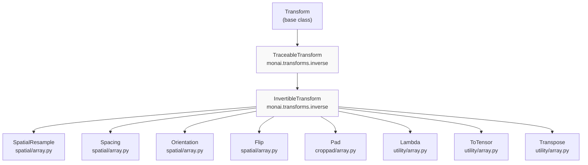
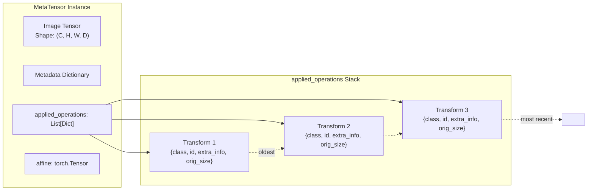
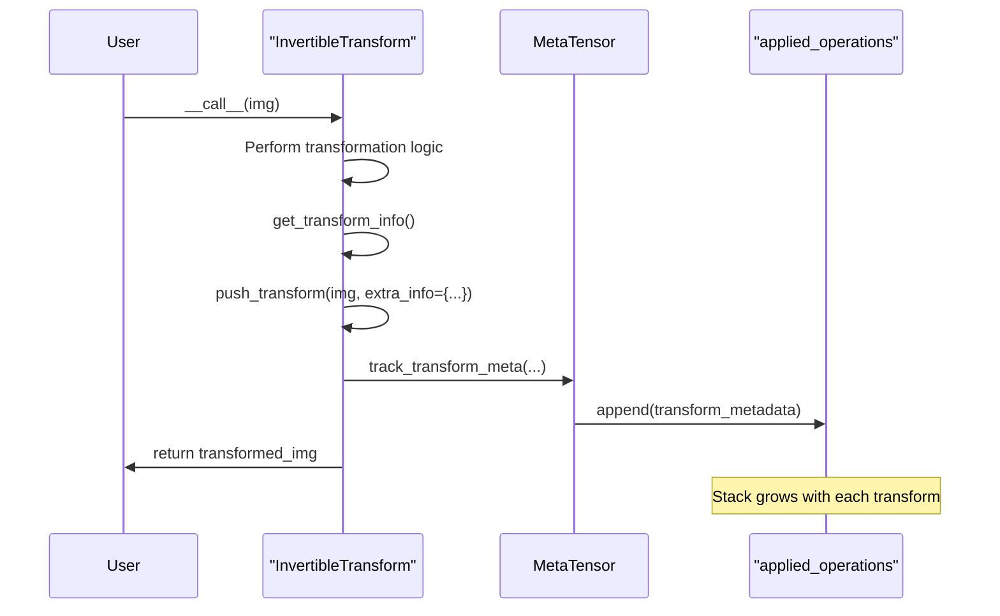
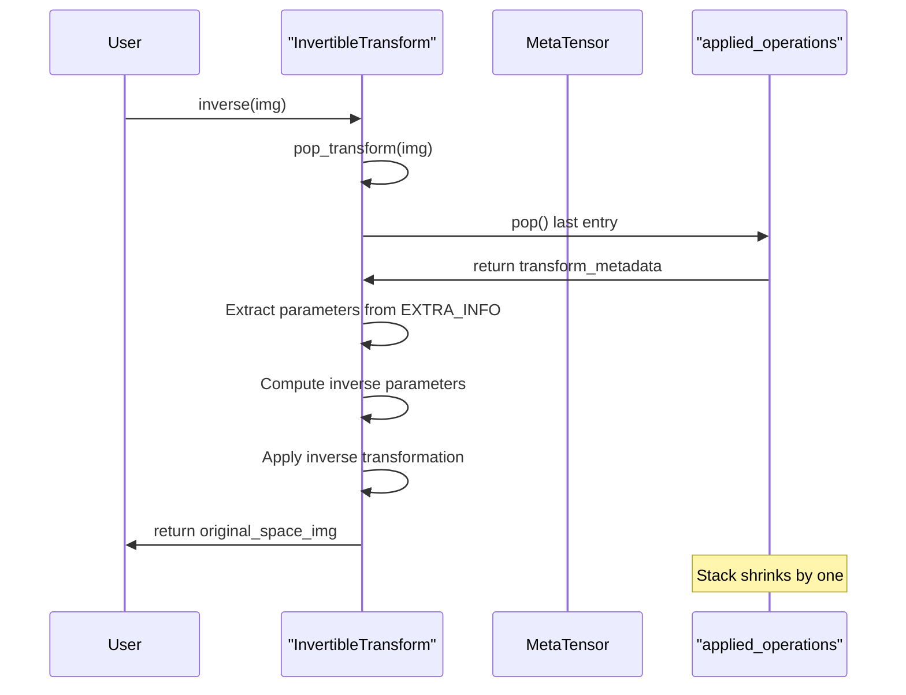
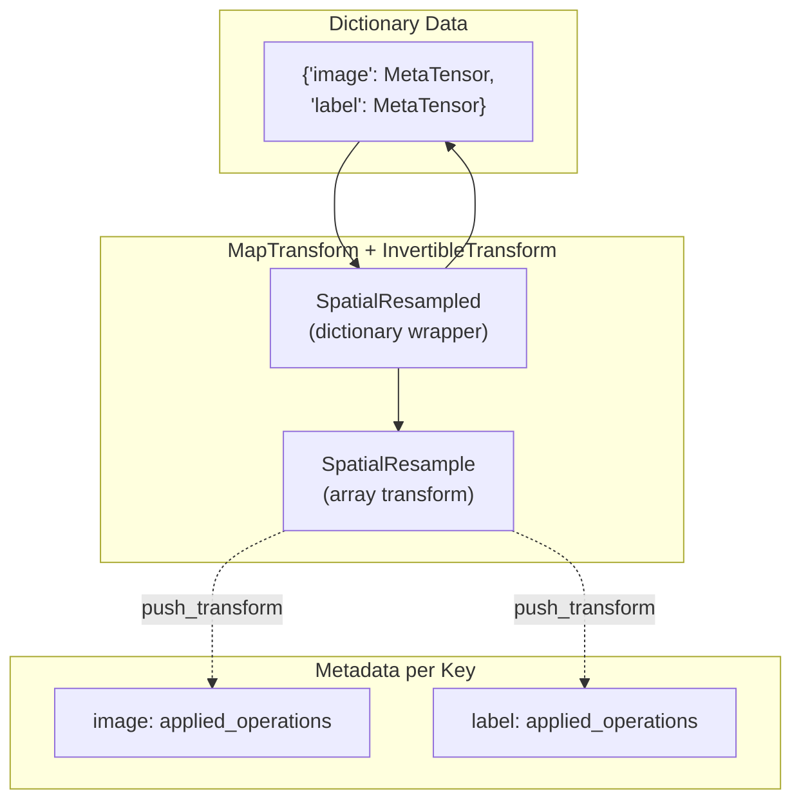
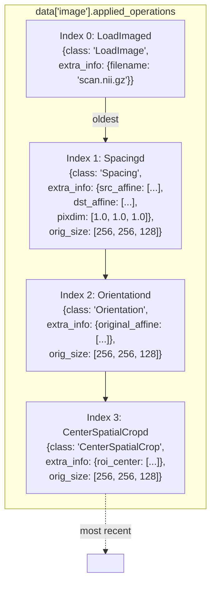

<!-- source: DeepWiki mcp.deepwiki.com · repo Project-MONAI/MONAI · page 3.6 Invertible Transforms and MetaTensor · fetched 2026-10-21 -->

# Invertible Transforms and MetaTensor

<details>
<summary>Relevant source files</summary>

The following files were used as context for generating this wiki page:

- [docs/source/transforms.rst](docs/source/transforms.rst)
- [monai/transforms/__init__.py](monai/transforms/__init__.py)
- [monai/transforms/croppad/array.py](monai/transforms/croppad/array.py)
- [monai/transforms/croppad/dictionary.py](monai/transforms/croppad/dictionary.py)
- [monai/transforms/intensity/array.py](monai/transforms/intensity/array.py)
- [monai/transforms/intensity/dictionary.py](monai/transforms/intensity/dictionary.py)
- [monai/transforms/inverse.py](monai/transforms/inverse.py)
- [monai/transforms/post/array.py](monai/transforms/post/array.py)
- [monai/transforms/post/dictionary.py](monai/transforms/post/dictionary.py)
- [monai/transforms/spatial/array.py](monai/transforms/spatial/array.py)
- [monai/transforms/spatial/dictionary.py](monai/transforms/spatial/dictionary.py)
- [monai/transforms/utility/array.py](monai/transforms/utility/array.py)
- [monai/transforms/utility/dictionary.py](monai/transforms/utility/dictionary.py)
- [monai/transforms/utils.py](monai/transforms/utils.py)

</details>


## Purpose and Scope

This page documents MONAI's invertible transform mechanism and the `MetaTensor` metadata tracking system. Invertible transforms maintain a history of applied operations in `MetaTensor.applied_operations`, enabling accurate reversal of preprocessing steps to return model predictions to original image space. This is critical in medical imaging workflows where results must align with source image geometry.

For the base transform architecture including `Transform` and `MapTransform`, see [Transform Architecture and Base Classes](#3.1). For lazy execution of transforms, see [Lazy Transform Execution](#3.7).

---

## Invertible Transform Architecture

### Class Hierarchy



**Sources:** [monai/transforms/inverse.py:42-257](), [monai/transforms/spatial/array.py:124-255]()

### TraceableTransform

`TraceableTransform` is the base class that manages the stack of applied transforms. It provides core functionality for tracking transform metadata without implementing inversion logic.

| Method | Purpose |
|--------|---------|
| `push_transform(data, **kwargs)` | Add transform metadata to stack |
| `pop_transform(data, check=True)` | Remove and return most recent transform |
| `get_most_recent_transform(data, key=None, check=True)` | Retrieve transform metadata without removal |
| `get_transform_info()` | Return dictionary with class name, id, tracing state |
| `trace_key(key=None)` | Generate key name for transform stack storage |

**Sources:** [monai/transforms/inverse.py:42-257]()

### InvertibleTransform

`InvertibleTransform` extends `TraceableTransform` by adding the `inverse()` method, which subclasses must implement to reverse the transformation.

```python
# Abstract pattern from InvertibleTransform
def inverse(self, data):
    """
    Inverse operation to reverse the transformation applied in __call__.
    """
    raise NotImplementedError(f"Subclass {self.__class__.__name__} must implement this method.")
```

**Sources:** [monai/transforms/inverse.py:260-320]()

---

## MetaTensor and applied_operations

`MetaTensor` is a `torch.Tensor` subclass that carries metadata about transformations applied to medical images. The key attribute is `applied_operations`, a list of dictionaries storing the complete transformation history.

### Applied Operations Structure



**Sources:** [monai/data/meta_tensor.py]() (implied), [monai/transforms/inverse.py:168-217]()

### Transform Metadata Keys

Each entry in `applied_operations` is a dictionary containing:

| TraceKeys Constant | Key String | Purpose |
|-------------------|------------|---------|
| `CLASS_NAME` | `"class"` | Transform class name |
| `ID` | `"id"` | Unique transform instance identifier |
| `TRACING` | `"tracing"` | Whether tracing was enabled |
| `DO_TRANSFORM` | `"do_transform"` | Whether transform was actually applied |
| `ORIG_SIZE` | `"orig_size"` | Original spatial dimensions before transform |
| `EXTRA_INFO` | `"extra_info"` | Transform-specific parameters for inversion |

**Sources:** [monai/transforms/inverse.py:113-128](), [monai/utils/enums.py]() (implied)

---

## Transform Lifecycle: Forward and Inverse

### Forward Transform Flow



**Sources:** [monai/transforms/inverse.py:130-165]()

### Inverse Transform Flow



**Sources:** [monai/transforms/inverse.py:260-320](), [monai/transforms/spatial/array.py:240-255]()

---

## Implementing Invertible Transforms

### Standard Pattern

The canonical pattern for implementing an invertible transform:

1. **Forward (`__call__`)**: Apply transformation and push metadata
2. **Inverse (`inverse`)**: Pop metadata, extract parameters, apply reverse operation

### Example: SpatialResample

The `SpatialResample` transform demonstrates the complete pattern:

```
Forward Operation:
  Input: img with affine A_src
  Operation: Resample to new affine A_dst
  Metadata Stored:
    - src_affine: A_src
    - dst_affine: A_dst
    - mode, padding_mode, align_corners
    - orig_size: original spatial shape
  
Inverse Operation:
  Retrieve: src_affine, dst_affine from metadata
  Operation: Resample back using dst_affine → src_affine
  Result: Image returned to original space
```

**Implementation Details:**

[monai/transforms/spatial/array.py:240-255]() shows the inverse method:
- Calls `pop_transform(data)` to retrieve metadata
- Swaps `src_affine` and `dst_affine` 
- Uses `orig_size` from metadata for output shape
- Calls the transform with `trace_transform(False)` to prevent re-recording
- Returns inverted result

**Sources:** [monai/transforms/spatial/array.py:124-255]()

### Example: Orientation

The `Orientation` transform changes image axis ordering (e.g., LPS to RAS):

```
Forward Operation:
  Input: img with original orientation
  Metadata Stored:
    - original_affine: affine before reorientation
  Operation: Apply orientation transformation
  
Inverse Operation:
  Retrieve: original_affine from metadata
  Compute: Original axcodes from affine
  Create: New Orientation transform with original axcodes
  Apply: Reorientation back to original
```

**Sources:** [monai/transforms/spatial/array.py:551-701]()

### Critical Implementation Details

| Requirement | Reason | Example |
|-------------|--------|---------|
| Use `trace_transform(False)` during inverse | Prevents infinite recursion in metadata stack | [spatial/array.py:251]() |
| Store sufficient parameters in `extra_info` | Enables accurate reconstruction | [spatial/array.py:238]() |
| Convert dtypes from strings | Metadata serialization converts torch.dtype to strings | [spatial/array.py:245]() |
| Handle None values appropriately | Some parameters may not be set | [spatial/array.py:249]() |

**Sources:** [monai/transforms/spatial/array.py:240-255](), [monai/transforms/inverse.py:168-217]()

---

## Common Invertible Transforms

### Spatial Transforms

| Transform | Inverse Operation | Metadata Required |
|-----------|-------------------|-------------------|
| `SpatialResample` | Resample with swapped src/dst affines | `src_affine`, `dst_affine`, `spatial_size`, interpolation params |
| `Spacing` | Delegated to `SpatialResample.inverse()` | Same as SpatialResample |
| `Orientation` | Reorient to original axcodes | `original_affine`, `labels` |
| `Flip` | Flip same axes again (self-inverse) | `spatial_axis` |
| `Rotate` | Rotate by negative angle | `angle`, `mode`, `padding_mode`, `align_corners` |
| `Zoom` | Zoom by reciprocal factors | `zoom` factors, interpolation params |

**Sources:** [monai/transforms/spatial/array.py:124-1100]()

### Crop and Pad Transforms

| Transform | Inverse Operation | Metadata Required |
|-----------|-------------------|-------------------|
| `Pad` | Crop padded regions | `to_pad` (padding amounts per dimension) |
| `SpatialPad` | Crop to original size | Computed from `spatial_size` |
| `Crop` | Pad back to original size | `slices` (crop coordinates) |
| `SpatialCrop` | Pad back with original shape | `roi_start`, `roi_end` |

**Sources:** [monai/transforms/croppad/array.py:81-600]()

### Utility Transforms

| Transform | Inverse Operation | Metadata Required |
|-----------|-------------------|-------------------|
| `ToTensor` | Convert to NumPy | None (type conversion only) |
| `Transpose` | Transpose with inverse indices | `indices` (permutation order) |
| `Lambda` | Apply user-provided inverse function | None (user responsibility) |

**Sources:** [monai/transforms/utility/array.py:383-423](), [monai/transforms/utility/array.py:571-662](), [monai/transforms/utility/array.py:783-859]()

---

## Dictionary-Based Invertible Transforms

Dictionary transforms wrap array transforms and apply them to specific keys while managing metadata per key.

### Dictionary Transform Pattern



**Sources:** [monai/transforms/spatial/dictionary.py:154-263]()

### Implementation Example: SpatialResampled

The dictionary wrapper pattern from [monai/transforms/spatial/dictionary.py:154-263]():

```
Forward:
  for key in keys:
    data[key] = self.sp_transform(data[key], ...)
    # push_transform called internally by sp_transform
  
Inverse:
  for key in keys:
    data[key] = self.sp_transform.inverse(data[key])
    # pop_transform called internally
```

Each key in the dictionary maintains its own independent `applied_operations` stack within its `MetaTensor`.

**Sources:** [monai/transforms/spatial/dictionary.py:154-263]()

---

## Applied Operations Stack Example

### Realistic Workflow

```python
# Forward transforms applied in sequence:
LoadImaged(keys=["image"])
→ Spacingd(keys=["image"], pixdim=[1.0, 1.0, 1.0])
→ Orientationd(keys=["image"], axcodes="RAS")
→ CenterSpatialCropd(keys=["image"], roi_size=[128, 128, 64])
```

### Resulting Stack Structure



**Inverse Process (LIFO - Last In First Out):**

1. **First inverse**: CenterSpatialCrop → pads back to [256, 256, 128]
2. **Second inverse**: Orientation → reorients to original axes
3. **Third inverse**: Spacing → resamples to original voxel spacing
4. **Fourth inverse**: LoadImage → typically not inverted (just removes from stack)

**Sources:** [monai/transforms/inverse.py:168-217]()

---

## Context Manager: trace_transform

The `trace_transform` context manager temporarily disables tracing during inverse operations to prevent re-recording transforms:

```python
with self.trace_transform(False):
    out = SpatialResample.__call__(self, data, **kw_args)
```

| Usage | Purpose |
|-------|---------|
| During inverse operations | Prevent inverse operation from being added to stack |
| When creating temporary transforms | Avoid polluting metadata |
| Testing/debugging | Inspect transforms without side effects |

**Sources:** [monai/transforms/inverse.py:322-334]()

---

## Practical Usage Patterns

### Pattern 1: Post-Processing Model Outputs

```
Training Pipeline:
  LoadImage → Spacing → Orientation → CenterCrop → Model → Loss

Inference Pipeline:
  LoadImage → Spacing → Orientation → CenterCrop → Model → Prediction
  ↓
  Inverse: CenterCrop → Inverse: Orientation → Inverse: Spacing
  ↓
  Result in original image space for visualization/analysis
```

### Pattern 2: Batch Inverse Transform

The `BatchInverseTransform` class applies inverse transforms to batched data after model inference:

```python
# After model prediction
batch_data = decollate_batch(batch_data)
for data in batch_data:
    data["pred"] = BatchInverseTransform.inverse(
        data=data["pred"], 
        transform=train_transforms
    )
```

**Sources:** [monai/transforms/inverse_batch_transform.py]() (implied from imports)

### Pattern 3: Selective Inversion

Not all transforms need to be inverted. Common pattern:

```
Forward:
  LoadImage → Spacing → Orientation → RandomFlip → RandomRotate → Model
  
Inverse (only geometric transforms):
  Skip: RandomRotate (augmentation)
  Skip: RandomFlip (augmentation)
  Invert: Orientation
  Invert: Spacing
```

**Sources:** Based on common usage patterns from documentation and examples

---

## Key Design Principles

### Thread-Local Tracing State

The `tracing` property is thread-local to support multi-threaded data loading:

```python
# Each thread maintains its own tracing state
self._tracing = threading.local()
self._tracing.value = MONAIEnvVars.trace_transform() != "0"
```

**Sources:** [monai/transforms/inverse.py:74-104]()

### Separation of Concerns

| Component | Responsibility |
|-----------|----------------|
| `TraceableTransform` | Metadata stack management (push/pop) |
| `InvertibleTransform` | Inverse operation interface |
| `MetaTensor` | Metadata storage and tensor operations |
| Individual transforms | Specific inverse logic implementation |

**Sources:** [monai/transforms/inverse.py:42-320]()

### Compatibility with Lazy Execution

Invertible transforms work with lazy execution (see [Lazy Transform Execution](#3.7)):

- Forward: Transforms added to `pending_operations` instead of `applied_operations`
- Inverse: Cannot be performed until pending operations are resolved
- `ApplyPending` finalizes transforms before inversion

**Sources:** [monai/transforms/spatial/array.py:124-145]()

---

## Summary

The invertible transform system in MONAI provides a robust framework for tracking and reversing preprocessing operations:

- **TraceableTransform** manages the transformation history stack
- **InvertibleTransform** defines the inverse operation interface  
- **MetaTensor.applied_operations** stores complete transformation metadata
- Each transform records sufficient information in `extra_info` for accurate inversion
- Dictionary-based transforms maintain independent stacks per key
- The system integrates with lazy execution and batch processing workflows

This architecture enables medical imaging pipelines to accurately map model predictions back to original image coordinates, essential for clinical validation and visualization.

**Sources:** [monai/transforms/inverse.py:1-334](), [monai/transforms/spatial/array.py:124-1100](), [monai/transforms/spatial/dictionary.py:154-600]()

---

