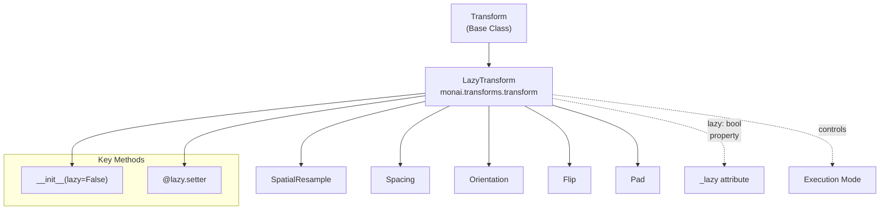
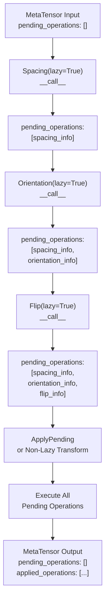
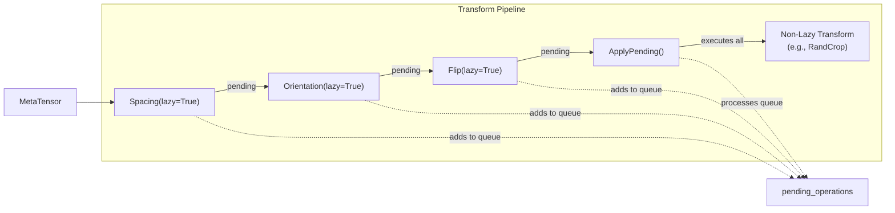
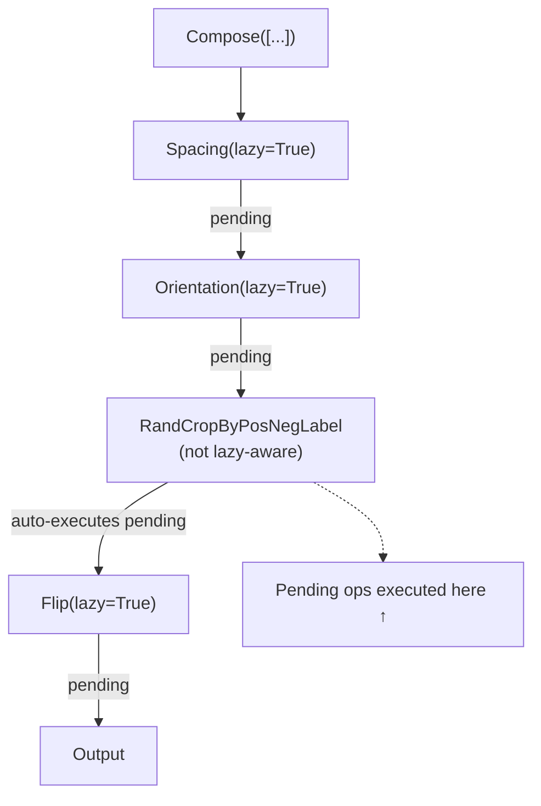
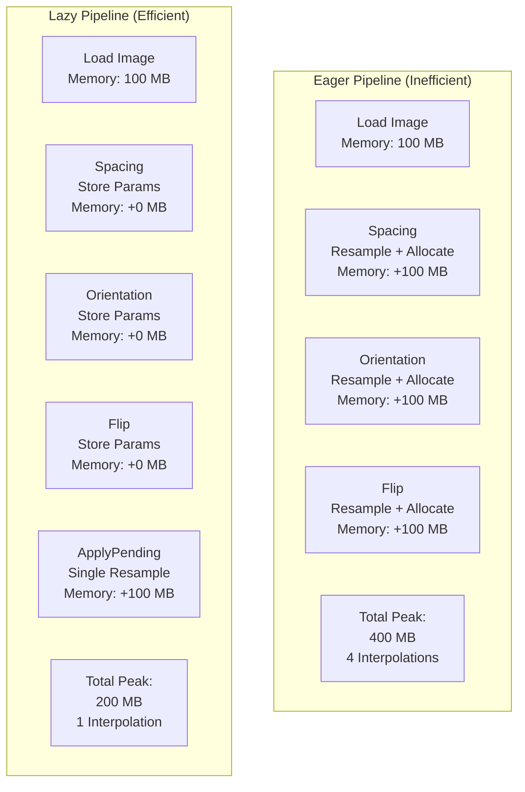
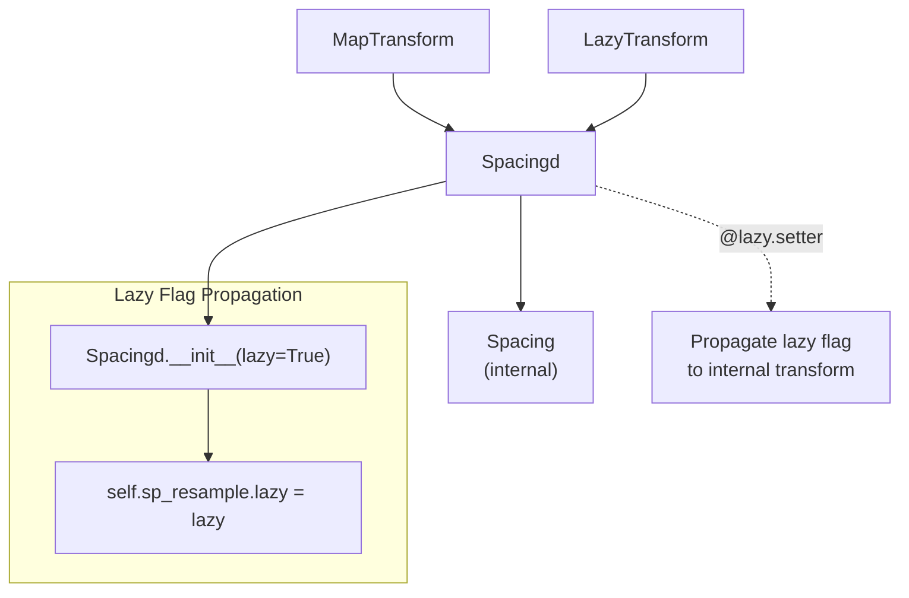

<!-- source: DeepWiki mcp.deepwiki.com · repo Project-MONAI/MONAI · page 3.7 Lazy Transform Execution · fetched 2026-10-21 -->

# Lazy Transform Execution

<details>
<summary>Relevant source files</summary>

The following files were used as context for generating this wiki page:

- [docs/source/transforms.rst](docs/source/transforms.rst)
- [monai/transforms/__init__.py](monai/transforms/__init__.py)
- [monai/transforms/croppad/array.py](monai/transforms/croppad/array.py)
- [monai/transforms/croppad/dictionary.py](monai/transforms/croppad/dictionary.py)
- [monai/transforms/intensity/array.py](monai/transforms/intensity/array.py)
- [monai/transforms/intensity/dictionary.py](monai/transforms/intensity/dictionary.py)
- [monai/transforms/inverse.py](monai/transforms/inverse.py)
- [monai/transforms/post/array.py](monai/transforms/post/array.py)
- [monai/transforms/post/dictionary.py](monai/transforms/post/dictionary.py)
- [monai/transforms/spatial/array.py](monai/transforms/spatial/array.py)
- [monai/transforms/spatial/dictionary.py](monai/transforms/spatial/dictionary.py)
- [monai/transforms/utility/array.py](monai/transforms/utility/array.py)
- [monai/transforms/utility/dictionary.py](monai/transforms/utility/dictionary.py)
- [monai/transforms/utils.py](monai/transforms/utils.py)

</details>


## Purpose and Scope

This page documents MONAI's lazy execution system for transforms, which defers computation until explicitly triggered to optimize memory usage and execution speed. Lazy execution is particularly beneficial for spatial transforms where multiple affine operations can be composed algebraically before applying a single resampling operation.

For information about the base transform architecture, see [Transform Architecture and Base Classes](#3.1). For details on specific spatial transforms that support lazy execution, see [Spatial Transforms](#3.2). For information about MetaTensor's role in tracking transform metadata, see [Invertible Transforms and MetaTensor](#3.6).

---

## Overview of Lazy Execution

Lazy execution allows transforms to defer their computational work by storing transformation parameters in a queue rather than immediately modifying image data. This approach provides two key benefits:

1. **Algebraic Composition**: Multiple affine transformations can be composed mathematically before applying a single resampling operation, avoiding repeated interpolation and cumulative precision loss
2. **Memory Efficiency**: Intermediate results are not materialized until necessary, reducing memory footprint during complex transform pipelines

### Lazy vs. Eager Execution Comparison

| Aspect | Eager Execution | Lazy Execution |
|--------|----------------|----------------|
| When computation occurs | Immediately when transform is called | Deferred until `ApplyPending` or non-lazy transform |
| Affine operations | Each applies resampling separately | Composed algebraically, single resampling |
| Memory usage | Creates intermediate arrays | No intermediate arrays until execution |
| Interpolation quality | Multiple interpolations degrade quality | Single interpolation preserves quality |
| Use case | Simple pipelines, debugging | Complex spatial pipelines, production |

**Sources**: [monai/transforms/spatial/array.py:132-134](), [monai/transforms/spatial/array.py:213-220]()

---

## LazyTransform Base Class

The `LazyTransform` class is the foundation for lazy execution support. Transforms that support lazy evaluation inherit from this class and implement lazy-aware behavior.

### LazyTransform Architecture



### Key Attributes and Methods

The `LazyTransform` class provides:

- `lazy` property: Boolean flag controlling execution mode (default `False`)
- `__init__(lazy: bool = False)`: Initialize with lazy mode setting
- `lazy.setter`: Property setter allowing dynamic mode changes

Transforms inheriting from `LazyTransform` accept a `lazy` parameter in both `__init__` and `__call__` methods:

```python
# In __init__
def __init__(self, ..., lazy: bool = False):
    LazyTransform.__init__(self, lazy=lazy)

# In __call__
def __call__(self, img, ..., lazy: bool | None = None):
    lazy_ = self.lazy if lazy is None else lazy
    # Use lazy_ to control execution
```

The `__call__` parameter allows per-invocation override of the initialization setting.

**Sources**: [monai/transforms/spatial/array.py:124](), [monai/transforms/spatial/array.py:144](), [monai/transforms/spatial/array.py:166](), [monai/transforms/spatial/array.py:227]()

---

## Pending Operations Stack

The `MetaTensor` class tracks pending (deferred) operations in a stack structure. When transforms execute lazily, they append transformation metadata to this stack instead of modifying the data.

### Pending Operations Data Flow



### Pending Operations Structure

Each pending operation stores:

- **Transform identity**: Class name and instance ID
- **Transform parameters**: All arguments needed to execute the transform
- **Spatial metadata**: Expected output shape and affine matrix
- **Extra information**: Transform-specific data for execution

When lazy execution is triggered, the system:
1. Pops operations from `pending_operations` stack
2. Composes affine transformations algebraically (for spatial transforms)
3. Executes the composed transformation
4. Moves completed operations to `applied_operations` stack

**Sources**: [monai/transforms/inverse.py:152](), [monai/transforms/inverse.py:168-191]()

---

## Affine Composition for Spatial Transforms

A key optimization in lazy execution is algebraic composition of affine transformations. Instead of applying multiple resampling operations sequentially (each with interpolation), MONAI composes the affine matrices mathematically and applies a single resampling.

### Affine Composition Process


### Mathematical Composition

For a sequence of spatial transforms with affine matrices A₁, A₂, ..., Aₙ, lazy execution computes:

**Composed Affine = Aₙ @ ... @ A₂ @ A₁**

This composed matrix is then applied once:

**Output = Resample(Input, Composed Affine)**

This approach:
- Reduces interpolation operations from *n* to 1
- Preserves image quality by avoiding cumulative interpolation errors
- Improves performance by eliminating intermediate array allocations

### peek_pending_affine and peek_pending_shape

`MetaTensor` provides methods to inspect pending transformations without triggering execution:

- `peek_pending_affine()`: Returns the composed affine matrix if all pending operations were executed
- `peek_pending_shape()`: Returns the expected output shape after pending operations

These methods are used by transforms to make decisions about spatial parameters without forcing eager evaluation.

**Sources**: [monai/transforms/spatial/array.py:310](), [monai/transforms/spatial/array.py:490-492](), [monai/transforms/spatial/array.py:497](), [monai/transforms/spatial/dictionary.py:265-270]()

---

## ApplyPending Transform

The `ApplyPending` transform explicitly triggers execution of all pending operations. This is the primary mechanism for converting lazy computations into eager results.

### ApplyPending Usage Pattern



### Automatic Lazy Execution Triggers

Lazy operations are automatically executed when:

1. **ApplyPending transform** is explicitly called
2. **Non-lazy transform** is applied to data with pending operations
3. **Data access** requiring computed values (e.g., converting to numpy array)
4. **Batch collation** during data loading

### Dictionary-Based ApplyPending

The dictionary variant `ApplyPendingd` applies pending execution to specific keys:

```python
transform = ApplyPendingd(keys=["image", "label"])
# Executes pending operations for both image and label
data = transform(data)
```

**Sources**: [monai/transforms/__init__.py:253-256]()

---

## Lazy-Aware Transform Categories

Different transform categories have varying levels of lazy execution support:

### Spatial Transforms (Full Support)

| Transform | Lazy Support | Affine Composition |
|-----------|--------------|-------------------|
| `SpatialResample` | ✓ | ✓ |
| `Spacing` | ✓ | ✓ |
| `Orientation` | ✓ | ✓ |
| `Flip` | ✓ | ✓ |
| `Rotate` | ✓ | ✓ |
| `Zoom` | ✓ | ✓ |
| `Affine` | ✓ | ✓ |

### Crop/Pad Transforms (Partial Support)

| Transform | Lazy Support | Notes |
|-----------|--------------|-------|
| `Pad` | ✓ | Padding can be deferred |
| `SpatialPad` | ✓ | Via `Pad` base class |
| `BorderPad` | ✓ | Via `Pad` base class |
| `DivisiblePad` | ✓ | Via `Pad` base class |
| Crop transforms | ✗ | Cropping not easily deferrable |

### Intensity Transforms (No Support)

Intensity transforms generally do not support lazy execution because:
- They operate on voxel values directly, not spatial coordinates
- No composition optimization is possible
- They are typically fast operations not benefiting from deferral

**Sources**: [monai/transforms/spatial/array.py:124-756](), [monai/transforms/croppad/array.py:81-165]()

---

## Configuring Lazy Execution

Lazy execution can be configured at three levels:

### 1. Per-Transform Initialization

```python
# Set lazy mode during transform creation
spacing = Spacing(pixdim=[1.0, 1.0, 1.0], lazy=True)
orientation = Orientation(axcodes="RAS", lazy=True)
```

### 2. Per-Invocation Override

```python
# Override lazy mode for specific call
spacing = Spacing(pixdim=[1.0, 1.0, 1.0], lazy=False)
output = spacing(image, lazy=True)  # Executes lazily this time
```

### 3. Dynamic Mode Changes

```python
# Change lazy mode after initialization
transform = Spacing(pixdim=[1.0, 1.0, 1.0], lazy=False)
transform.lazy = True  # Now executes lazily
```

### Compose with Mixed Lazy/Eager Transforms



When a non-lazy-aware transform is applied to data with pending operations, MONAI automatically executes all pending operations before applying the non-lazy transform.

**Sources**: [monai/transforms/spatial/array.py:144](), [monai/transforms/spatial/array.py:213](), [monai/transforms/spatial/array.py:434-437]()

---

## Checking for Pending Operations

MONAI provides utilities to check for and warn about unexpected pending operations:

### check_non_lazy_pending_ops Function

```python
from monai.transforms.utils import check_non_lazy_pending_ops

# Check if input has pending operations
check_non_lazy_pending_ops(
    input_array=data, 
    name="function_name",
    raise_error=False  # or True to raise exception
)
```

This function:
- Inspects whether `MetaTensor` has pending operations
- Issues warning or raises error if pending operations exist
- Helps identify transforms that don't properly handle lazy execution

Usage locations include:
- Functions expecting fully-computed data (e.g., `map_binary_to_indices`)
- Debugging transform pipelines
- Validating data before non-lazy-aware operations

**Sources**: [monai/transforms/utils.py:358-377](), [monai/transforms/utils.py:459](), [monai/transforms/utils.py:507]()

---

## Performance Optimization Strategies

### Memory Optimization

Lazy execution reduces memory usage by:

1. **No intermediate arrays**: Transformations store parameters, not computed results
2. **Delayed allocation**: Output arrays created only when needed
3. **Batch processing**: Pending operations applied during batch collation, reusing memory

### Computational Optimization



### Recommended Lazy Execution Patterns

| Pattern | When to Use |
|---------|-------------|
| **Full lazy pipeline** | Multiple spatial transforms before non-spatial operations |
| **Selective lazy** | Mix lazy spatial transforms with eager intensity transforms |
| **Explicit ApplyPending** | Control execution timing for debugging or memory management |
| **Disable lazy** | Simple pipelines, interactive debugging, or when overhead exceeds benefits |

### Best Practices

1. **Group spatial transforms**: Place all spatial transforms together to maximize affine composition benefits
2. **Apply pending before GPU transfer**: Execute pending CPU operations before moving data to GPU
3. **Use peek methods**: Check pending state without triggering execution
4. **Profile pipelines**: Measure actual performance gains in your specific use case

**Sources**: [monai/transforms/spatial/array.py:132-134](), [monai/transforms/utils.py:358-377]()

---

## Integration with Dictionary Transforms

Dictionary-based transforms (ending with 'd') support lazy execution through their wrapped array transforms:

### Lazy Dictionary Transform Pattern



Dictionary transforms with lazy support implement a `lazy` setter that propagates the flag to their internal array transforms:

```python
@LazyTransform.lazy.setter
def lazy(self, val: bool) -> None:
    self._lazy = val
    self.sp_resample.lazy = val  # Propagate to wrapped transform
```

This ensures consistent lazy behavior across dictionary and array transform variants.

**Sources**: [monai/transforms/spatial/dictionary.py:223-226](), [monai/transforms/spatial/dictionary.py:325-328](), [monai/transforms/spatial/dictionary.py:434-437]()

---

## Limitations and Considerations

### Transforms Without Lazy Support

Not all transforms can efficiently support lazy execution:

1. **Random transforms**: Stochastic operations often require immediate value computation
2. **Intensity transforms**: No composition benefit for per-voxel operations
3. **Crop transforms**: Require immediate spatial extent determination
4. **Conditional transforms**: Decisions based on data content need computed values

### Debugging Lazy Pipelines

Debugging lazy execution can be challenging because:

- Errors occur at execution time, not when transforms are added
- Stack traces point to `ApplyPending` or trigger point, not original transform
- Intermediate results aren't available for inspection

**Debugging strategies**:
- Temporarily set `lazy=False` to identify problematic transforms
- Use `peek_pending_shape()` and `peek_pending_affine()` to inspect queue state
- Add explicit `ApplyPending` at suspicious points in pipeline
- Enable transform tracing (see [Invertible Transforms and MetaTensor](#3.6))

### Thread Safety

Lazy execution involves shared mutable state (`pending_operations`). When using multi-threaded data loading:

- Each worker process has independent `MetaTensor` instances (safe)
- Transforms shared across workers should not modify lazy state dynamically
- Use per-transform initialization rather than runtime mode changes

**Sources**: [monai/transforms/spatial/array.py:340-362](), [monai/transforms/utils.py:358-377]()

---

## Complete Example: Lazy vs. Eager Pipeline

### Code Structure Comparison

```python
# Eager execution (default)
eager_transforms = Compose([
    LoadImaged(keys=["image"]),
    Spacingd(keys=["image"], pixdim=[1.0, 1.0, 1.0]),      # Resamples immediately
    Orientationd(keys=["image"], axcodes="RAS"),            # Resamples immediately
    Flipd(keys=["image"], spatial_axis=0),                  # Resamples immediately
    RandCropByPosNegLabeld(keys=["image"], label_key="label", spatial_size=[96, 96, 96])
])

# Lazy execution
lazy_transforms = Compose([
    LoadImaged(keys=["image"]),
    Spacingd(keys=["image"], pixdim=[1.0, 1.0, 1.0], lazy=True),      # Deferred
    Orientationd(keys=["image"], axcodes="RAS", lazy=True),            # Deferred
    Flipd(keys=["image"], spatial_axis=0, lazy=True),                  # Deferred
    ApplyPendingd(keys=["image"]),                                     # Executes all at once
    RandCropByPosNegLabeld(keys=["image"], label_key="label", spatial_size=[96, 96, 96])
])
```

### Execution Timeline

```mermaid
gantt
    title Transform Execution Timeline Comparison
    dateFormat X
    axisFormat %L
    
    section Eager
    LoadImage           :0, 50
    Spacing (resample)  :50, 100
    Orientation (resample) :100, 150
    Flip (resample)     :150, 200
    RandCrop            :200, 250
    
    section Lazy
    LoadImage           :0, 50
    Spacing (store)     :50, 52
    Orientation (store) :52, 54
    Flip (store)        :54, 56
    ApplyPending (resample) :56, 106
    RandCrop            :106, 156
```



The lazy pipeline:
- Completes faster (fewer total resampling operations)
- Uses less memory (no intermediate arrays)
- Produces higher quality results (single interpolation)

**Sources**: [monai/transforms/spatial/dictionary.py:154-263](), [monai/transforms/spatial/dictionary.py:366-401]()

---

