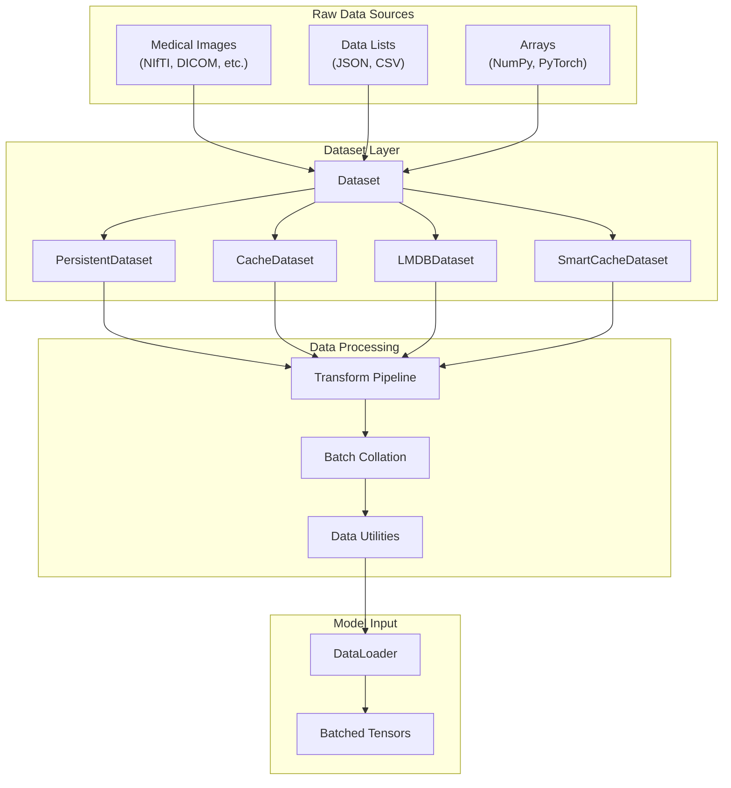
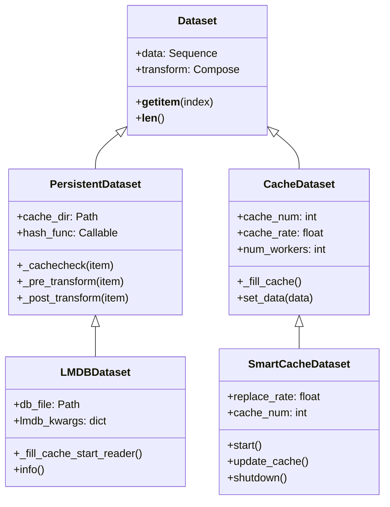
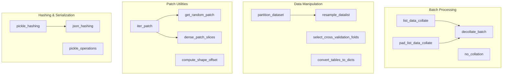
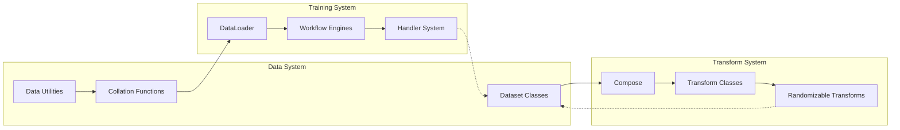

<!-- source: DeepWiki mcp.deepwiki.com · repo Project-MONAI/MONAI · page 4 Data Loading and Processing · fetched 2026-10-21 -->

# Data Loading and Processing

Relevant source files

The following files were used as context for generating this wiki page:

- [docs/source/data.rst](docs/source/data.rst)
- [monai/data/__init__.py](monai/data/__init__.py)
- [monai/data/dataset.py](monai/data/dataset.py)
- [monai/data/image_reader.py](monai/data/image_reader.py)
- [monai/data/utils.py](monai/data/utils.py)
- [monai/handlers/smartcache_handler.py](monai/handlers/smartcache_handler.py)
- [monai/transforms/io/array.py](monai/transforms/io/array.py)
- [monai/transforms/io/dictionary.py](monai/transforms/io/dictionary.py)

This document covers MONAI's comprehensive data loading and processing infrastructure, which provides the foundation for efficient medical imaging workflows. The system includes dataset classes with various caching strategies, utilities for data manipulation and batch processing, and integration with PyTorch's data loading mechanisms.

For information about transform operations applied to data, see [Transform System](#2.3). For details about image format support and I/O operations, see [Image I/O](#2.2).

## Overview

MONAI's data loading and processing system forms the critical bridge between raw medical imaging data and model training. The system is designed to handle the unique challenges of medical imaging: large file sizes, diverse formats, and the need for deterministic preprocessing with optional randomization.

Sources: [monai/data/dataset.py:56-415](), [monai/data/utils.py:483-538](), [monai/data/__init__.py:29-42]()

## Core Dataset Classes

The dataset system provides multiple strategies for managing data loading and caching, each optimized for different use cases and memory constraints.

Sources: [monai/data/dataset.py:56-109](), [monai/data/dataset.py:161-414](), [monai/data/dataset.py:684-1077](), [monai/data/dataset.py:510-682]()

### Dataset Base Class

The `Dataset` class provides the fundamental interface, extending PyTorch's `Dataset` with transform composition and slicing support.

| Feature | Description | Implementation |
|---------|-------------|----------------|
| Transform Integration | Automatic wrapping in `Compose` | [monai/data/dataset.py:72-84]() |
| Slicing Support | Returns PyTorch `Subset` for slices | [monai/data/dataset.py:96-108]() |
| Data Types | Supports sequences of dictionaries or arrays | [monai/data/dataset.py:63-69]() |

### Caching Strategies

Different dataset classes implement various caching strategies to optimize performance:

**PersistentDataset**: Disk-based caching of deterministic transforms
- Caches pre-computed results to disk for reuse across runs
- Uses hash-based filenames for cache invalidation
- Separates deterministic and random transforms

**CacheDataset**: Memory-based caching with configurable size
- Caches a configurable number or percentage of items in RAM
- Multi-threaded cache filling during initialization
- Smart cache management with replacement strategies

**LMDBDataset**: High-performance disk caching using LMDB
- Lightning Memory-Mapped Database for efficient disk storage
- Supports concurrent read access
- Automatic database resizing and management

**SmartCacheDataset**: Dynamic cache replacement during training
- Replaces cache content during training for data diversity
- Background thread management for cache updates
- Configurable replacement rates and strategies

Sources: [monai/data/dataset.py:161-414](), [monai/data/dataset.py:684-1077](), [monai/data/dataset.py:510-682]()

## Data Processing Utilities

The data utilities provide essential functions for batch processing, data manipulation, and distributed training support.

Sources: [monai/data/utils.py:483-538](), [monai/data/utils.py:669-693](), [monai/data/utils.py:566-667](), [monai/data/utils.py:107-255]()

### Batch Collation

MONAI provides enhanced collation functions that handle the complexities of medical imaging data:

**list_data_collate**: Enhanced version of PyTorch's default collate function
- Handles MetaTensor objects with metadata preservation
- Supports nested dictionary and list structures
- Provides detailed error reporting for debugging

**pad_list_data_collate**: Handles variable-sized data through padding
- Centrally pads tensors to match the largest in each dimension
- Configurable padding methods and modes
- Essential for datasets with varying image sizes

**decollate_batch**: Separates batched data back into individual items
- Preserves metadata and applied operations
- Handles mixed data types and structures
- Supports padding for uneven batch sizes

Sources: [monai/data/utils.py:483-538](), [monai/data/utils.py:669-693](), [monai/data/utils.py:566-667]()

### Patch-Based Processing

MONAI includes comprehensive utilities for patch-based processing, essential for handling large medical images:

| Function | Purpose | Key Parameters |
|----------|---------|----------------|
| `iter_patch` | Iterate over patches with overlap | `patch_size`, `overlap`, `mode` |
| `get_random_patch` | Generate random patch locations | `dims`, `patch_size`, `rand_state` |
| `dense_patch_slices` | Enumerate all patches in a grid | `scan_interval`, `return_slice` |
| `iter_patch_position` | Iterate over patch starting positions | `start_pos`, `padded` |

Sources: [monai/data/utils.py:107-255](), [monai/data/utils.py:257-341](), [monai/data/utils.py:166-207]()

## Integration Points

The data loading system integrates tightly with other MONAI components:

Sources: [monai/data/dataset.py:39](), [monai/handlers/smartcache_handler.py:26-81]()

### Transform Integration

Datasets automatically wrap transforms in `Compose` objects and intelligently separate deterministic and random transforms for caching purposes. The system uses the `RandomizableTrait` interface to identify where caching should stop.

### Distributed Training Support

The data system includes specialized components for distributed training:
- `DistributedSampler` for data partitioning across processes
- `partition_dataset` utilities for manual data splitting
- Worker initialization functions for proper random seeding

### Memory Management

Advanced memory management features include:
- Configurable cache sizes and replacement strategies
- Memory mapping support through LMDB
- Lazy loading and on-demand computation
- Efficient serialization and deserialization

Sources: [monai/data/utils.py:702-735](), [monai/data/dataset.py:739-752]()

---

