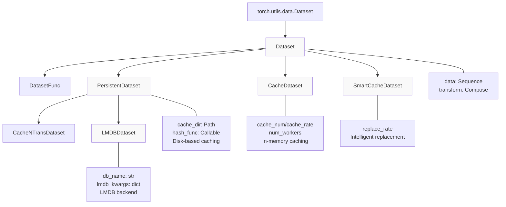
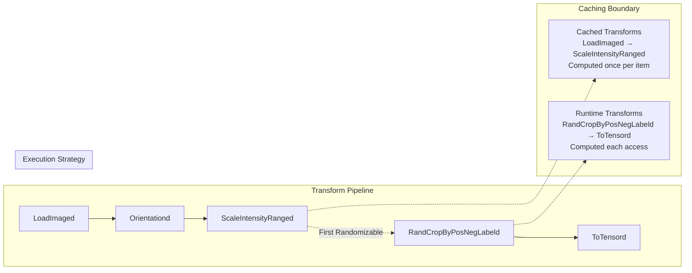
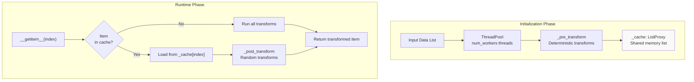
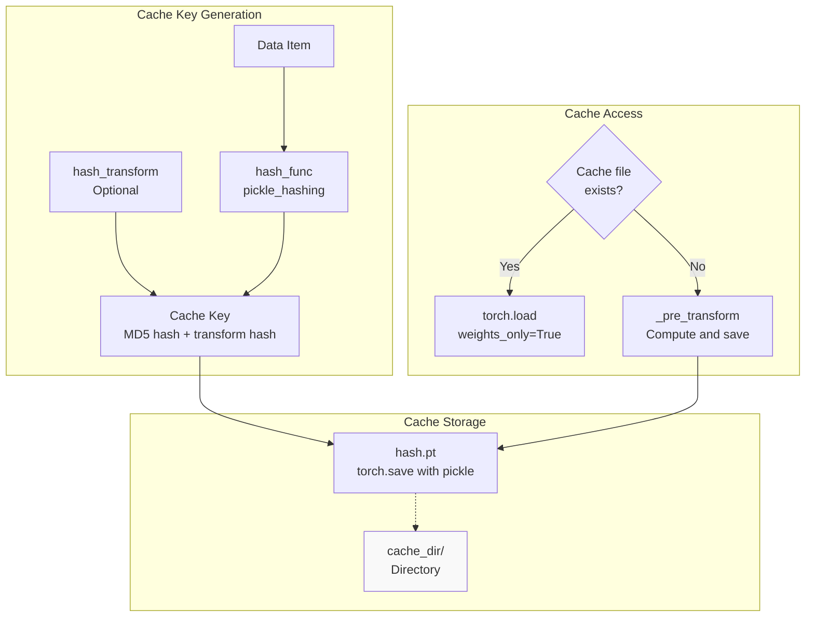
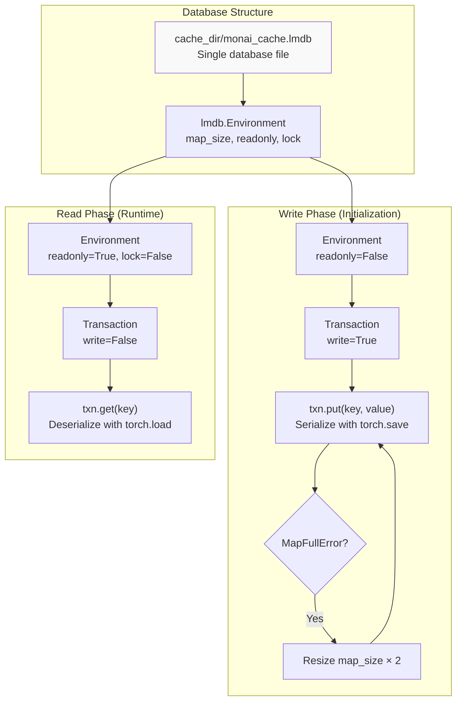
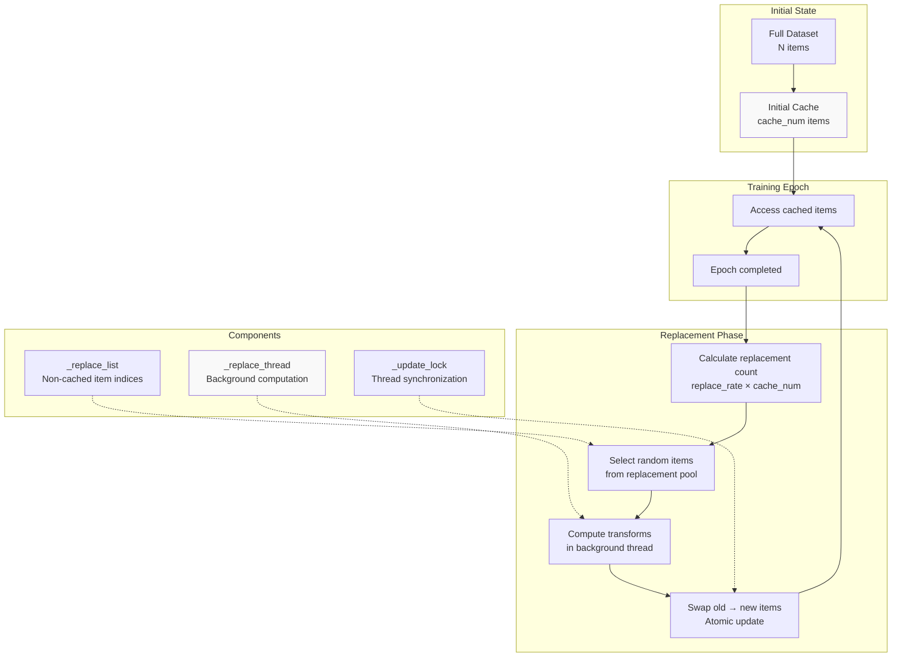
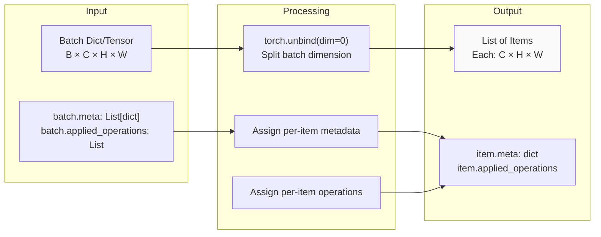

<!-- source: DeepWiki mcp.deepwiki.com · repo Project-MONAI/MONAI · page 4.1 Dataset System and Caching Strategies · fetched 2026-10-21 -->

# Dataset System and Caching Strategies

<details>
<summary>Relevant source files</summary>

The following files were used as context for generating this wiki page:

- [docs/source/data.rst](docs/source/data.rst)
- [monai/data/__init__.py](monai/data/__init__.py)
- [monai/data/dataset.py](monai/data/dataset.py)
- [monai/data/utils.py](monai/data/utils.py)
- [monai/handlers/smartcache_handler.py](monai/handlers/smartcache_handler.py)

</details>


This page documents MONAI's dataset classes and their caching mechanisms. These systems provide efficient data loading and preprocessing for medical imaging workflows, with various strategies to optimize memory usage and training speed.

**Scope**: This page covers dataset classes ([monai/data/dataset.py]()), caching implementations, and data collation utilities. For image loading and I/O operations, see [Image I/O and Readers](#4.2). For transform system integration, see [Transform System](#3).

---

## Overview

MONAI's dataset system extends PyTorch's `Dataset` with medical imaging-specific features including deterministic transform caching, persistent storage, and intelligent cache replacement strategies. The system balances memory constraints with training speed by offering multiple caching backends.

**Key Design Principles**:
- Cache deterministic (non-random) transforms only
- Split transforms at first randomizable operation
- Support both in-memory and persistent storage
- Enable multi-process data loading
- Maintain transform invertibility for post-processing

Sources: [monai/data/dataset.py:57-110](), [monai/data/dataset.py:721-774]()

---

## Dataset Class Hierarchy



**Dataset Class Hierarchy and Key Attributes**

Sources: [monai/data/dataset.py:57-160](), [monai/data/dataset.py:162-221](), [monai/data/dataset.py:535-549](), [monai/data/dataset.py:721-774]()

---

## Base Dataset Class

The `Dataset` class provides the foundation for all MONAI datasets. It wraps a data sequence with optional transforms and supports PyTorch `Subset` slicing.

### Core Features

| Feature | Implementation | File Location |
|---------|---------------|---------------|
| Transform wrapping | Wraps callables in `Compose` | [monai/data/dataset.py:73-85]() |
| Slicing support | Returns `torch.utils.data.Subset` for slices | [monai/data/dataset.py:97-109]() |
| Length property | `len(self.data)` | [monai/data/dataset.py:87-88]() |

### Basic Usage Pattern

```python
# Input data format
data = [
    {"image": "image1.nii.gz", "label": "label1.nii.gz"},
    {"image": "image2.nii.gz", "label": "label2.nii.gz"},
]

# Dataset creation
dataset = Dataset(data=data, transform=my_transforms)

# Supports slicing
subset = dataset[0:10]  # Returns Subset
item = dataset[5]       # Returns transformed item
```

Sources: [monai/data/dataset.py:57-110](), [monai/data/dataset.py:90-109]()

---

## Transform Caching Mechanism

All caching datasets split transforms at the first `Randomizable` or non-`Transform` operation. Deterministic transforms before this split point are cached; randomizable transforms after it are executed on each access.



**Transform Splitting for Caching**

### Detection Logic

The split point is determined by `Compose.get_index_of_first()`:

```python
# PersistentDataset implementation
first_random = self.transform.get_index_of_first(
    lambda t: isinstance(t, RandomizableTrait) or not isinstance(t, Transform)
)
```

Sources: [monai/data/dataset.py:345-352](), [monai/data/dataset.py:365-370]()

---

## In-Memory Caching (CacheDataset)

`CacheDataset` caches deterministic transform results in RAM for fast repeated access. It uses multi-threading to populate the cache during initialization.

### Architecture



**CacheDataset Execution Flow**

### Key Parameters

| Parameter | Type | Purpose |
|-----------|------|---------|
| `cache_num` | `int` | Number of items to cache (mutually exclusive with `cache_rate`) |
| `cache_rate` | `float` | Fraction of dataset to cache (0.0 to 1.0) |
| `num_workers` | `int` | Threads for cache initialization |
| `runtime_cache` | `bool \| str \| list` | Which transforms to cache at runtime |
| `copy_cache` | `bool` | Whether to deepcopy cached items (prevents mutation) |

### Cache Initialization Process

1. **Manager Setup**: Creates `multiprocessing.Manager` for shared memory
2. **Worker Pool**: Spawns `num_workers` threads via `ThreadPool`
3. **Transform Execution**: Each thread runs `_pre_transform` on assigned items
4. **Cache Storage**: Results stored in shared `ListProxy` accessible to all processes

Sources: [monai/data/dataset.py:776-850](), [monai/data/dataset.py:897-946]()

### Memory Considerations

```python
# Example: 1000 images, each 512x512x100 float32
# Cached data per image: 512 * 512 * 100 * 4 bytes ≈ 100 MB
# Total cache: 100 GB for full dataset

# Solution 1: Limit cache rate
dataset = CacheDataset(data, transform, cache_rate=0.1)  # Only 10 GB

# Solution 2: Use cache_num
dataset = CacheDataset(data, transform, cache_num=100)  # Only 100 images
```

Sources: [monai/data/dataset.py:721-774]()

---

## Persistent Disk Caching (PersistentDataset)

`PersistentDataset` stores pre-computed transforms on disk, enabling caching beyond available RAM. It uses hashing to create unique cache files for each data item and transform configuration.

### Cache File Management



**PersistentDataset Cache File System**

### Hashing Strategy

The cache key combines data hash and optional transform hash:

```python
# From _cachecheck method
data_item_md5 = self.hash_func(item_transformed).decode("utf-8")
data_item_md5 += self.transform_hash
hashfile = self.cache_dir / f"{data_item_md5}.pt"
```

**Hash Functions**:
- `pickle_hashing` (default): Hash serialized data
- `json_hashing`: Hash JSON-serializable representation
- Custom: User-provided callable

Sources: [monai/data/dataset.py:372-434](), [monai/data/dataset.py:223-301]()

### Transform Hash Validation

When `hash_transform` is provided, the dataset computes a hash of cacheable transforms to detect changes:

```python
# From set_transform_hash
hashable_transforms = []
for _tr in self.transform.flatten().transforms:
    if isinstance(_tr, RandomizableTrait) or not isinstance(_tr, Transform):
        break
    hashable_transforms.append(_tr)

transform_hash = hash_xform_func(hashable_transforms)
```

This prevents using stale cache when transforms change during experiments.

Sources: [monai/data/dataset.py:303-321]()

### File Safety and Corruption Handling

The implementation uses atomic-like operations to prevent corruption:

```python
# Two-phase write with temporary directory
with tempfile.TemporaryDirectory() as tmpdirname:
    temp_hash_file = Path(tmpdirname) / hashfile.name
    torch.save(obj=..., f=temp_hash_file, ...)
    if temp_hash_file.is_file() and not hashfile.is_file():
        shutil.move(str(temp_hash_file), hashfile)
```

Corrupt files are detected and recomputed:

```python
except (UnpicklingError, RuntimeError) as e:
    if "Invalid magic number; corrupt file" in str(e):
        warnings.warn(f"Corrupt cache file detected: {hashfile}. Deleting and recomputing.")
        hashfile.unlink()
```

Sources: [monai/data/dataset.py:413-433](), [monai/data/dataset.py:397-408]()

### Security: weights_only Parameter

Starting with recent versions, `PersistentDataset` defaults to `weights_only=True` when loading cache files:

```python
def __init__(self, ..., weights_only: bool = True):
    ...
    if track_meta and weights_only:
        raise ValueError(
            "Invalid argument combination: `track_meta=True` cannot be used with `weights_only=True`."
        )
```

This prevents arbitrary code execution via malicious pickle files, but requires `weights_only=False` to load `MetaTensor` objects with metadata.

Sources: [monai/data/dataset.py:234-279](), [monai/data/dataset.py:295-299]()

---

## LMDB Caching (LMDBDataset)

`LMDBDataset` extends `PersistentDataset` with an LMDB (Lightning Memory-Mapped Database) backend for efficient key-value caching with better performance characteristics than file-per-item storage.

### LMDB Architecture



**LMDB Backend Architecture**

### Key Advantages

| Feature | Benefit |
|---------|---------|
| Single file | Reduced filesystem overhead vs. thousands of `.pt` files |
| Memory mapping | Fast access without explicit loading |
| Atomic writes | Transaction safety prevents corruption |
| Dynamic resizing | Automatic map_size expansion when needed |
| Multi-process safe | Single-writer, multi-reader by design |

### Configuration

```python
lmdb_kwargs = {
    "map_size": 1024**4,      # 1 TB default
    "readonly": False,         # Set during initialization
    "lock": False,             # Disabled for read-only access
    "readahead": False,        # Disabled for random access
}

dataset = LMDBDataset(
    data=data,
    transform=transforms,
    cache_dir="./cache",
    db_name="monai_cache",    # Creates monai_cache.lmdb
    lmdb_kwargs=lmdb_kwargs
)
```

Sources: [monai/data/dataset.py:551-613](), [monai/data/dataset.py:606-607]()

### Automatic Resizing

The implementation handles `MapFullError` by doubling map size:

```python
except lmdb.MapFullError:
    size = env.info()["map_size"]
    new_size = size * 2
    warnings.warn(f"Resizing the cache database from {int(size) >> 20}MB to {int(new_size) >> 20}MB.")
    env.set_mapsize(new_size)
```

Up to 5 retries per item before failing.

Sources: [monai/data/dataset.py:662-673]()

### Multi-Process Considerations

Each worker process creates its own read-only environment:

```python
def _cachecheck(self, item_transformed):
    if self._read_env is None:
        # Each process creates its own environment
        self._read_env = self._fill_cache_start_reader(show_progress=False)
    with self._read_env.begin(write=False) as txn:
        data = txn.get(self.hash_func(item_transformed))
```

Sources: [monai/data/dataset.py:689-706]()

---

## Smart Caching (SmartCacheDataset)

`SmartCacheDataset` implements an intelligent cache replacement strategy that updates cache contents during training based on data access patterns.

### Replacement Strategy



**SmartCacheDataset Replacement Workflow**

### Configuration Parameters

| Parameter | Type | Default | Purpose |
|-----------|------|---------|---------|
| `replace_rate` | `float` | Required | Fraction of cache to replace each epoch (0.0-1.0) |
| `cache_num` / `cache_rate` | `int` / `float` | Required | Initial cache size |
| `num_init_workers` | `int` | 0 | Workers for initial cache population |
| `num_replace_workers` | `int` | 0 | Workers for replacement computation |

### Lifecycle Management

**Start Phase**:
```python
def start(self):
    """Start background replacement thread"""
    with self._update_lock:
        if self._replace_done is False:
            return
        self._replace_done = False
    self._replace_mgr = Manager()
    self._replace_data_len = self._replace_mgr.Value("i", len(self._replace_list))
    self._compute_data = self._replace_mgr.list()
    self._replace_thread = threading.Thread(target=self._replace_cache_thread, daemon=True)
    self._replace_thread.start()
```

**Update Phase**:
```python
def update_cache(self):
    """Swap computed replacement data into cache"""
    if self._replace_done is False:
        with self._update_lock:
            # Swap _cache and _compute_data
            for i, batch_idx in enumerate(self._replace_cache_idx):
                self._cache[batch_idx] = self._compute_data[i]
```

**Shutdown Phase**:
```python
def shutdown(self):
    """Stop replacement thread and cleanup"""
    if self._replace_thread is not None:
        self._replace_done = True
        self._replace_thread.join()
```

Sources: [monai/data/dataset.py:1100-1208]()

### Handler Integration

The `SmartCacheHandler` integrates with Ignite engines:

```python
from monai.handlers import SmartCacheHandler

handler = SmartCacheHandler(smartcacher=smart_dataset)
handler.attach(trainer)

# Events automatically trigger:
# - STARTED → smart_dataset.start()
# - EPOCH_COMPLETED → smart_dataset.update_cache()
# - COMPLETED → smart_dataset.shutdown()
```

Sources: [monai/handlers/smartcache_handler.py:26-80]()

---

## CacheNTransDataset

`CacheNTransDataset` extends `PersistentDataset` to cache the first N transforms regardless of whether they are randomizable:

```python
def _pre_transform(self, item_transformed):
    """Cache first N transforms (not just deterministic)"""
    item_transformed = self.transform(item_transformed, end=self.cache_n_trans, threading=True)
    reset_ops_id(item_transformed)
    return item_transformed

def _post_transform(self, item_transformed):
    """Execute remaining transforms from N+1 onward"""
    return self.transform(item_transformed, start=self.cache_n_trans)
```

This allows caching of specific transform counts for fine-grained control.

Sources: [monai/data/dataset.py:441-533]()

---

## Data Collation Strategies

MONAI provides specialized collation functions for batching medical imaging data with variable sizes and metadata.

### Collation Function Comparison

```mermaid
graph TB
    subgraph "list_data_collate"
        LCD_Input["Batch: List of dicts/tensors"]
        LCD_Meta["Detect MetaTensor"]
        LCD_Collate["collate_meta_tensor_fn<br/>Preserve metadata"]
        LCD_Default["default_collate<br/>PyTorch standard"]
        LCD_Output["Batched tensors + metadata"]
    end
    
    subgraph "pad_list_data_collate"
        PLC_Input["Batch: Variable-sized tensors"]
        PLC_Detect["Detect max dimensions"]
        PLC_Pad["SpatialPad<br/>Center-pad to max size"]
        PLC_Meta["Add PadListDataCollate<br/>to applied_operations"]
        PLC_Output["Uniform-sized batch"]
    end
    
    subgraph "no_collation"
        NC_Input["Batch: Any"]
        NC_Output["Return as-is<br/>No processing"]
    end
    
    LCD_Input --> LCD_Meta
    LCD_Meta --> LCD_Collate
    LCD_Collate --> LCD_Output
    LCD_Default --> LCD_Output
    
    PLC_Input --> PLC_Detect
    PLC_Detect --> PLC_Pad
    PLC_Pad --> PLC_Meta
    PLC_Meta --> PLC_Output
    
    NC_Input --> NC_Output
    
    style LCD_Output fill:#f9f9f9
    style PLC_Output fill:#f9f9f9
```



**Collation Function Workflows**

### list_data_collate

The default MONAI collation function with `MetaTensor` support:

```python
def list_data_collate(batch: Sequence):
    """
    Enhancement for PyTorch DataLoader default collate.
    Handles MetaTensor metadata and applied_operations.
    """
    from monai.data.meta_tensor import MetaTensor
    default_collate_fn_map.update({MetaTensor: collate_meta_tensor_fn})
    
    elem = batch[0]
    data = [i for k in batch for i in k] if isinstance(elem, list) else batch
    # ... collate logic
```

**MetaTensor Collation**:
```python
def collate_meta_tensor_fn(batch, *, collate_fn_map=None):
    collated = collate_tensor_fn(batch)  # Stack tensors
    
    # Merge metadata from all items
    meta_dicts = [i.meta or TraceKeys.NONE for i in batch]
    common_ = set.intersection(*[set(d.keys()) for d in meta_dicts if isinstance(d, dict)])
    collated.meta = default_collate(meta_dicts)
    
    # Preserve per-item operation history
    collated.applied_operations = [i.applied_operations or TraceKeys.NONE for i in batch]
    collated.is_batch = True
    return collated
```

Sources: [monai/data/utils.py:455-510](), [monai/data/utils.py:419-436]()

### pad_list_data_collate

Handles variable-sized images by padding to maximum dimensions:

```python
from monai.data import pad_list_data_collate

# Usage with DataLoader
dataloader = DataLoader(
    dataset,
    batch_size=4,
    collate_fn=pad_list_data_collate  # or partial(pad_list_data_collate, method="symmetric")
)

# Internally calls PadListDataCollate transform
# which records padding in applied_operations for inversion
```

**When to Use**:
- Variable-sized images after random cropping
- Different original image dimensions
- Mixed 2D/3D data (when applicable)

Sources: [monai/data/utils.py:643-666]()

### no_collation

Returns batch without any processing:

```python
def no_collation(x):
    """No any collation operation."""
    return x

# Use case: When Dataset already returns batched data
dataloader = DataLoader(dataset, batch_size=None, collate_fn=no_collation)
```

Sources: [monai/data/utils.py:669-673]()

---

## Decollation

The `decollate_batch` function reverses collation, splitting batches back into individual items:



**Decollation Process**

### Usage Patterns

```python
# In post-processing/validation
batch_data = next(iter(dataloader))
# batch_data["image"].shape = (B, C, H, W)

decollated = decollate_batch(batch_data)
# List of B items, each with shape (C, H, W)

for item in decollated:
    # Apply post-processing per item
    output = model(item["image"])
    # Invert transforms using item's applied_operations
    inverted = transforms.inverse({"pred": output})
```

**Padding Control**:
```python
batch_data = {
    "image": [1, 2, 3],  # Length 3
    "meta": [4, 5],      # Length 2, undetermined batch size
}

# With padding
out = decollate_batch(batch_data, pad=True, fill_value=0)
# [{'image': 1, 'meta': 4}, {'image': 2, 'meta': 5}, {'image': 3, 'meta': 0}]

# Without padding  
out = decollate_batch(batch_data, pad=False)
# [{'image': 1, 'meta': 4}, {'image': 2, 'meta': 5}]
```

Sources: [monai/data/utils.py:538-640]()

---

## Multi-Processing and Worker Initialization

### Worker Random State

The `worker_init_fn` ensures each DataLoader worker has unique random states:

```python
def worker_init_fn(worker_id: int) -> None:
    """
    Callback for PyTorch DataLoader `worker_init_fn`.
    Sets different random seed for transforms in different workers.
    """
    worker_info = torch.utils.data.get_worker_info()
    set_rnd(worker_info.dataset, seed=worker_info.seed)
```

**Recursive Randomizable Detection**:
```python
def set_rnd(obj, seed: int) -> int:
    """Set seed for all randomizable properties of obj."""
    if hasattr(obj, "set_random_state"):
        obj.set_random_state(seed=seed % MAX_SEED)
        return seed + 1
    # Recursively search object attributes
    for key in obj.__dict__:
        if key.startswith("__"):
            continue
        seed = set_rnd(obj.__dict__[key], seed=seed)
    return seed
```

Sources: [monai/data/utils.py:676-708]()

### DataLoader Configuration

```python
from monai.data import DataLoader, worker_init_fn

dataloader = DataLoader(
    dataset,
    batch_size=4,
    num_workers=4,
    worker_init_fn=worker_init_fn,  # Ensures different random seeds
    persistent_workers=False,        # Required for set_data() updates
)
```

**CacheDataset Multi-Processing**:
- Main process populates shared cache (`ListProxy`)
- Worker processes read from same cache (no duplication)
- Each worker has unique random state for runtime transforms

**PersistentDataset Multi-Processing**:
- Each worker reads same disk cache files
- File system handles concurrent reads
- Cache computation happens once (first worker or main process)

Sources: [monai/data/dataset.py:761-768]()

---

## Best Practices and Performance Considerations

### Choosing a Caching Strategy

| Dataset Type | Use Case | Pros | Cons |
|-------------|----------|------|------|
| `Dataset` | Small datasets, debugging | Simple, no overhead | Recomputes transforms every time |
| `CacheDataset` | Medium datasets fitting in RAM | Fastest access | High memory usage |
| `PersistentDataset` | Large datasets, persistent storage | Unlimited size, reusable cache | Disk I/O overhead, cache management |
| `LMDBDataset` | Very large datasets | Efficient single-file storage | LMDB dependency, setup complexity |
| `SmartCacheDataset` | Training with limited RAM | Adaptive caching | Background thread overhead |

### Transform Ordering

**Optimal pattern** for maximum caching efficiency:

```python
transforms = Compose([
    # 1. Deterministic I/O (cacheable)
    LoadImaged(keys=["image", "label"]),
    EnsureChannelFirstd(keys=["image", "label"]),
    
    # 2. Deterministic preprocessing (cacheable)
    Orientationd(keys=["image", "label"], axcodes="RAS"),
    Spacingd(keys=["image", "label"], pixdim=(1.0, 1.0, 1.0)),
    ScaleIntensityRanged(keys=["image"], a_min=-57, a_max=164, b_min=0.0, b_max=1.0),
    
    # 3. First randomizable operation (cache split point)
    RandCropByPosNegLabeld(keys=["image", "label"], label_key="label", spatial_size=(96, 96, 96)),
    RandFlipd(keys=["image", "label"], prob=0.5, spatial_axis=0),
    
    # 4. Final preprocessing
    ToTensord(keys=["image", "label"]),
])
```

### Memory Estimation

```python
import numpy as np

def estimate_cache_memory(num_items, item_shape, dtype=np.float32):
    """Estimate cache memory usage in GB"""
    bytes_per_item = np.prod(item_shape) * np.dtype(dtype).itemsize
    total_bytes = num_items * bytes_per_item
    return total_bytes / (1024**3)

# Example: 500 cached items, each 256×256×128 float32
memory_gb = estimate_cache_memory(500, (256, 256, 128))
print(f"Estimated memory: {memory_gb:.2f} GB")
```

### Cache Directory Management

```python
# PersistentDataset cache cleanup
from pathlib import Path
import shutil

cache_dir = Path("./cache")
if cache_dir.exists():
    # Clear stale cache when transforms change
    shutil.rmtree(cache_dir)

# Use hash_transform to auto-detect changes
from monai.data.utils import pickle_hashing

dataset = PersistentDataset(
    data=data,
    transform=transforms,
    cache_dir=cache_dir,
    hash_transform=pickle_hashing,  # Invalidates cache if transforms change
)
```

### Lazy Resampling Interaction

When using lazy transforms (see [Lazy Transform Execution](#3.7)):

```python
from monai.transforms import Compose

# Lazy resampling enabled
transforms = Compose([
    LoadImaged(keys=["image"]),
    Spacingd(keys=["image"], pixdim=(1.0, 1.0, 1.0)),  # Lazy
    Orientationd(keys=["image"], axcodes="RAS"),       # Lazy
    # Pending operations accumulated in metadata
], lazy=True)

# With CacheDataset
cache_dataset = CacheDataset(data, transform=transforms)
# Cached items contain pending_operations
# Actual resampling deferred until:
# - First non-lazy transform
# - Explicit ApplyPending()
# - Model forward pass
```

**Warning**: `PersistentDataset` with `reset_ops_id=True` removes transform instance IDs, which can cause issues with lazy operation validation.

Sources: [monai/data/dataset.py:216-220](), [monai/data/dataset.py:769-772]()

### Runtime Cache Configuration

`CacheDataset` supports `runtime_cache` for selective post-randomization caching:

```python
dataset = CacheDataset(
    data=data,
    transform=transforms,
    cache_rate=1.0,
    runtime_cache="auto",  # or True, False, list of keys
)

# "auto": Cache non-random transforms after first random
# True: Cache all transforms after first random  
# False: No runtime caching
# ["RandFlipd", "RandRotated"]: Cache specific transforms
```

This can speed up epochs when post-random transforms are expensive.

Sources: [monai/data/dataset.py:848-850]()

---

## Summary

MONAI's dataset system provides flexible caching strategies optimized for medical imaging workflows:

- **`Dataset`**: Base class with transform integration and slicing support
- **`CacheDataset`**: Fast in-memory caching with multi-threaded initialization
- **`PersistentDataset`**: Disk-based caching with hash-based cache keys
- **`LMDBDataset`**: LMDB backend for efficient large-scale caching
- **`SmartCacheDataset`**: Intelligent cache replacement during training
- **`CacheNTransDataset`**: Fine-grained control over cached transform count

All caching strategies split transforms at the first randomizable operation, caching only deterministic preprocessing. The collation utilities (`list_data_collate`, `pad_list_data_collate`) handle batching with metadata preservation and variable-sized data support.

For optimal performance, order transforms with deterministic operations first, estimate memory requirements before choosing cache parameters, and use `hash_transform` with `PersistentDataset` to detect transform changes automatically.

Sources: [monai/data/dataset.py](), [monai/data/utils.py]()

---

