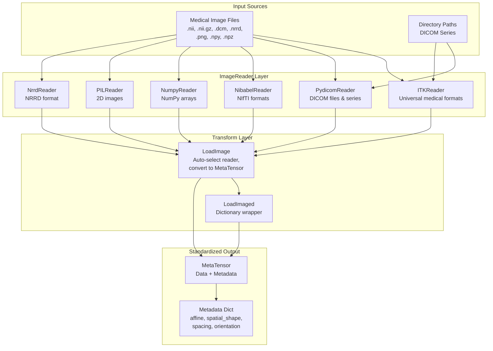
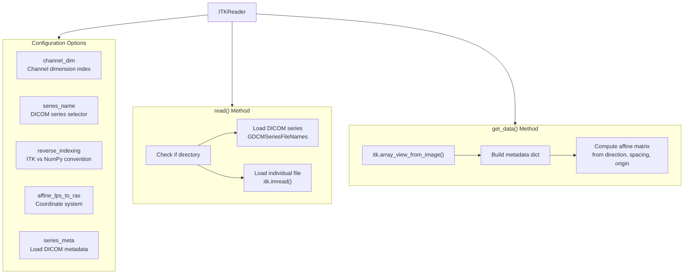
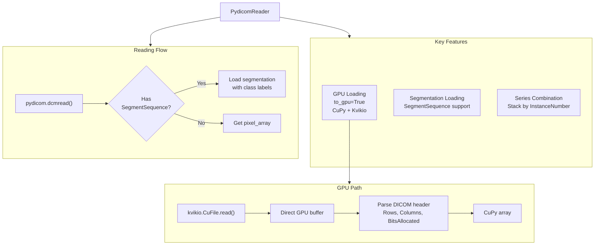
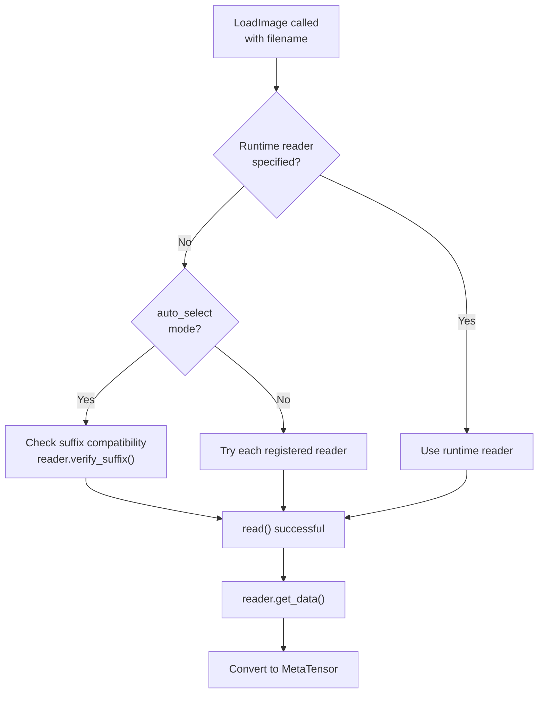
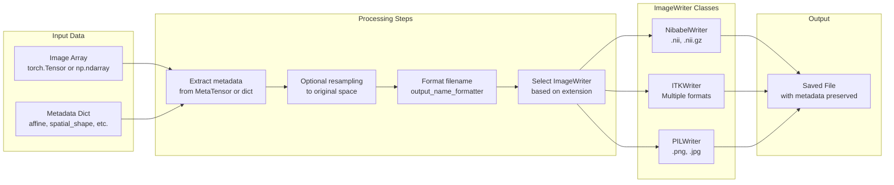
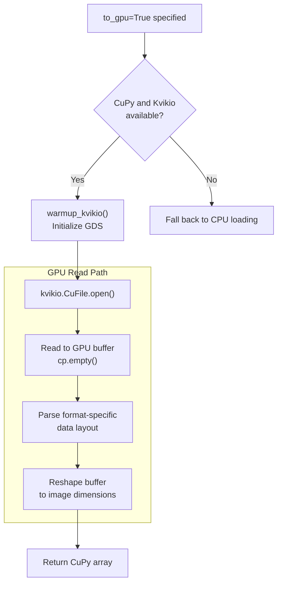
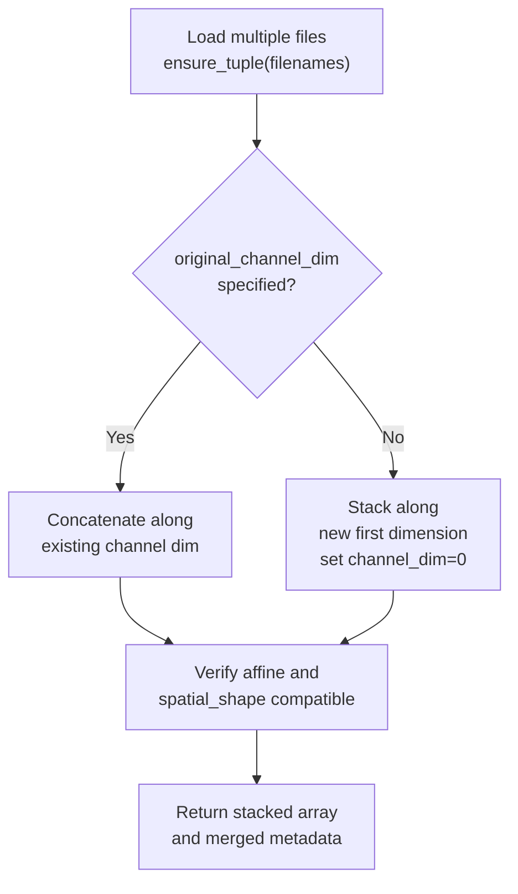

<!-- source: DeepWiki mcp.deepwiki.com · repo Project-MONAI/MONAI · page 4.2 Image I/O and Readers · fetched 2026-10-21 -->

# Image I/O and Readers

<details>
<summary>Relevant source files</summary>

The following files were used as context for generating this wiki page:

- [monai/data/image_reader.py](monai/data/image_reader.py)
- [monai/transforms/io/array.py](monai/transforms/io/array.py)
- [monai/transforms/io/dictionary.py](monai/transforms/io/dictionary.py)

</details>


## Purpose and Scope

This page documents MONAI's image input/output (I/O) system, which provides format-agnostic loading and saving of medical images. The system supports multiple file formats (NIfTI, DICOM, NRRD, PNG, NumPy, etc.) through a unified interface using specialized reader and writer classes.

For information about dataset classes that use these readers for efficient data loading, see [Dataset System and Caching Strategies](#4.1). For transforms that process images after loading, see [Transform Architecture and Base Classes](#3.1).

---

## Architecture Overview

MONAI's image I/O system follows a two-phase design: the `read()` method loads format-specific image objects, and the `get_data()` method extracts standardized numpy arrays with metadata. This separation enables format-specific optimizations while maintaining a consistent downstream interface.

### High-Level I/O Pipeline



**Sources:** [monai/data/image_reader.py:63-121](), [monai/transforms/io/array.py:109-306]()

---

## ImageReader Base Class

The `ImageReader` abstract base class defines the standard interface that all reader implementations must follow. Each reader is responsible for format-specific loading logic.

### Core Interface

| Method | Purpose | Returns |
|--------|---------|---------|
| `verify_suffix(filename)` | Check if reader supports the file format | `bool` |
| `read(data, **kwargs)` | Load image object(s) from file(s) | Format-specific object(s) |
| `get_data(img)` | Extract array and metadata | `tuple[np.ndarray, dict]` |

The separation of `read()` and `get_data()` allows lazy loading - the `read()` method can load lightweight image headers while deferring pixel data extraction to `get_data()`.

**Sources:** [monai/data/image_reader.py:63-121]()

### Standard Metadata Keys

All readers populate standardized metadata keys for downstream transforms:

| Metadata Key | Description | Data Type |
|--------------|-------------|-----------|
| `MetaKeys.AFFINE` | Current affine transformation matrix | `np.ndarray` (4×4) |
| `MetaKeys.ORIGINAL_AFFINE` | Original affine before any transforms | `np.ndarray` (4×4) |
| `MetaKeys.SPATIAL_SHAPE` | Spatial dimensions (excluding channels) | `np.ndarray` |
| `MetaKeys.ORIGINAL_CHANNEL_DIM` | Original channel dimension index | `int` or `float('nan')` |
| `MetaKeys.SPACE` | Coordinate system (RAS/LPS) | `str` |

**Sources:** [monai/data/image_reader.py:272-303]()

---

## Reader Implementations

### ITKReader

`ITKReader` uses the Insight Toolkit (ITK) library to support a wide range of medical imaging formats including NIfTI, DICOM, MetaImage, NRRD, and many others.



**Key Features:**
- Automatic DICOM series detection and loading [monai/data/image_reader.py:242-270]()
- Configurable spatial indexing convention via `reverse_indexing` [monai/data/image_reader.py:378-382]()
- Affine matrix construction from ITK's direction cosines, spacing, and origin [monai/data/image_reader.py:324-345]()
- Optional LPS to RAS coordinate system conversion [monai/data/image_reader.py:343-344]()

**Sources:** [monai/data/image_reader.py:161-383]()

### PydicomReader

`PydicomReader` provides DICOM-specific functionality including segmentation loading and GPU-accelerated I/O through CuPy and Kvikio.



**GPU Acceleration:**

The `to_gpu=True` flag enables direct loading to GPU memory, bypassing CPU intermediate buffers. This requires CuPy and Kvikio libraries [monai/data/image_reader.py:441-461]().

The GPU loading path:
1. Parses DICOM header to determine pixel data location and size [monai/data/image_reader.py:911-940]()
2. Uses Kvikio to read directly into GPU buffer [monai/data/image_reader.py:946-950]()
3. Reshapes buffer into CuPy array [monai/data/image_reader.py:952-953]()

**Segmentation Support:**

DICOM segmentation files are detected via the `SegmentSequence` tag and loaded with per-class separation [monai/data/image_reader.py:825-900]().

**Sources:** [monai/data/image_reader.py:385-994]()

### NibabelReader

`NibabelReader` specializes in NIfTI format images (`.nii`, `.nii.gz`) using the Nibabel library. It's the default reader for NIfTI files due to its reliability and widespread use in neuroimaging.

**Key Features:**
- Automatic canonical orientation via `as_closest_canonical` [monai/data/image_reader.py:1117-1120]()
- Non-spatial singleton dimension squeezing [monai/data/image_reader.py:1124-1127]()
- GPU loading support for `.nii` and `.nii.gz` files [monai/data/image_reader.py:1198-1217]()
- Automatic handling of big-endian data (converts to little-endian for PyTorch) [monai/data/image_reader.py:1148-1151]()

**GPU Loading for NIfTI:**

For uncompressed `.nii` files, entire file is read to GPU and data extracted from buffer [monai/data/image_reader.py:1199-1217](). For compressed `.nii.gz` files, data is transferred to CPU for decompression, then back to GPU, which may be slower than CPU loading [monai/data/image_reader.py:1204-1212]().

**Sources:** [monai/data/image_reader.py:996-1218]()

### NumpyReader

`NumpyReader` loads NumPy array files (`.npy`, `.npz`), commonly used for preprocessed data or mask files.

**Features:**
- Selective key loading for `.npz` archives via `npz_keys` parameter [monai/data/image_reader.py:1274-1280]()
- No affine matrix (uses identity) since NumPy arrays lack spatial metadata [monai/data/image_reader.py:1302-1309]()
- Channel dimension inference based on `channel_dim` parameter [monai/data/image_reader.py:1306-1312]()

**Sources:** [monai/data/image_reader.py:1220-1317]()

### PILReader

`PILReader` handles 2D image formats (PNG, JPG, BMP) using the Python Imaging Library (PIL/Pillow).

**Important:** By default, `reverse_indexing=True` swaps axes 0 and 1 after loading because PIL's spatial axis convention differs from medical imaging libraries [monai/data/image_reader.py:1327-1329](), [monai/data/image_reader.py:1397-1404]().

**Sources:** [monai/data/image_reader.py:1319-1409]()

### NrrdReader

`NrrdReader` loads NRRD (Nearly Raw Raster Data) format images, commonly used in medical imaging research.

**Sources:** [monai/data/image_reader.py:1411-1552]()

---

## LoadImage Transform

The `LoadImage` transform provides automatic reader selection and converts loaded images to `MetaTensor` objects with metadata tracking.

### Reader Selection Logic



**Reader Registration Order:**

Readers are tried in reverse registration order [monai/transforms/io/array.py:260-276](). Default registration order:

1. `NibabelReader` (`.nii`, `.nii.gz`)
2. `PILReader` (`.png`, `.jpg`, `.bmp`)
3. `NumpyReader` (`.npy`, `.npz`)
4. `NrrdReader` (`.nrrd`)
5. `ITKReader` (fallback for other formats including DICOM)

**Sources:** [monai/transforms/io/array.py:109-306](), [monai/transforms/io/array.py:188-223]()

### Constructor Parameters

| Parameter | Type | Default | Description |
|-----------|------|---------|-------------|
| `reader` | `ImageReader` \| `str` \| `None` | `None` | Specific reader(s) to use |
| `image_only` | `bool` | `True` | Return only image, not metadata dict |
| `dtype` | `DtypeLike` | `np.float32` | Convert loaded data to this dtype |
| `ensure_channel_first` | `bool` | `False` | Auto-convert to channel-first format |
| `simple_keys` | `bool` | `False` | Remove redundant metadata keys |
| `prune_meta_pattern` | `str` \| `None` | `None` | Regex to prune metadata keys |
| `expanduser` | `bool` | `True` | Expand `~` in file paths |

**Sources:** [monai/transforms/io/array.py:131-176]()

### Example Usage Pattern

```python
# Auto-select reader based on file extension
loader = LoadImage(dtype=np.float32)
img = loader("path/to/image.nii.gz")  # Returns MetaTensor

# Specify reader explicitly
loader = LoadImage(reader=ITKReader())
img = loader("path/to/dicom_dir/")

# Get both image and metadata
loader = LoadImage(image_only=False)
img, metadata = loader("path/to/image.nii")
```

**Sources:** [monai/transforms/io/array.py:237-305]()

---

## SaveImage Transform

The `SaveImage` transform writes images to disk with automatic format detection and optional resampling to original space.

### Save Pipeline Architecture



**Sources:** [monai/transforms/io/array.py:308-524]()

### Filename Construction

The filename is constructed using `FolderLayout` and `output_name_formatter`:

```
{output_dir}/{data_root_rel_path}/{input_filename_stem}/{input_filename_stem}_{output_postfix}{output_ext}
```

With `separate_folder=True` (default), each input file gets its own subdirectory. With `separate_folder=False`, all outputs go directly in `output_dir` [monai/transforms/io/array.py:359-362]().

**Example:**
- Input: `/foo/bar/test1/image.nii`
- `output_dir`: `/output`
- `data_root_dir`: `/foo/bar`
- `output_postfix`: `seg`
- `output_ext`: `.nii.gz`
- Output: `/output/test1/image/image_seg.nii.gz`

**Sources:** [monai/transforms/io/array.py:345-357]()

### Resampling to Original Space

When `resample=True`, the image is resampled back to its original spatial dimensions and orientation before saving [monai/transforms/io/array.py:324-335]().

This is useful when:
- Images were resized during preprocessing
- Spatial transforms were applied (rotation, affine)
- Predictions need to align with original input

The resampling uses the `spatial_shape` and `original_affine` from metadata [monai/transforms/io/array.py:445]().

**Sources:** [monai/transforms/io/array.py:389-403]()

---

## GPU-Accelerated I/O

Both `PydicomReader` and `NibabelReader` support GPU-accelerated loading via the `to_gpu` parameter, which requires CuPy and Kvikio libraries.

### GPU Loading Flow



**Performance Considerations:**

GPU loading provides significant speedup for:
- Large uncompressed files (`.nii`, `.dcm`)
- High-throughput data loading scenarios
- Multi-GPU training pipelines

However, compressed `.nii.gz` files require CPU decompression, reducing the benefit [monai/data/image_reader.py:1204-1207]().

**Warmup Requirement:**

The `warmup_kvikio()` method must be called to initialize Kvikio's internal buffers and GDS (GPUDirect Storage) [monai/data/image_reader.py:463-478](), [monai/data/image_reader.py:1041-1056](). This is done automatically in the constructor when `to_gpu=True`.

**Sources:** [monai/data/image_reader.py:421-424](), [monai/data/image_reader.py:452-461](), [monai/data/image_reader.py:902-994](), [monai/data/image_reader.py:1008-1038](), [monai/data/image_reader.py:1198-1217]()

---

## Dictionary-Based Transforms

### LoadImaged

`LoadImaged` is the dictionary-based wrapper of `LoadImage`, processing multiple keys in a data dictionary.

**Key Features:**
- Loads images for specified keys in data dictionary [monai/transforms/io/dictionary.py:75-92]()
- Optionally stores metadata in separate keys with `meta_keys` or `{key}_{meta_key_postfix}` pattern [monai/transforms/io/dictionary.py:105-112]()
- Supports all `LoadImage` parameters [monai/transforms/io/dictionary.py:130-141]()

**Usage Pattern:**
```python
transform = LoadImaged(
    keys=["image", "label"],
    reader=ITKReader(),
    ensure_channel_first=True
)

data = {"image": "img.nii.gz", "label": "seg.nii.gz"}
result = transform(data)
# result = {"image": MetaTensor(...), "label": MetaTensor(...)}
```

**Sources:** [monai/transforms/io/dictionary.py:40-179]()

### SaveImaged

`SaveImaged` saves images from specified keys in the data dictionary.

**Metadata Handling:**

The transform retrieves metadata from:
1. `MetaTensor.meta` if the data is a `MetaTensor` [monai/transforms/io/dictionary.py:320]()
2. `meta_keys` parameter if specified
3. `{key}_{meta_key_postfix}` pattern (default: `{key}_meta_dict`)

**Usage Pattern:**
```python
saver = SaveImaged(
    keys=["pred"],
    meta_keys=["image_meta_dict"],  # Use metadata from input image
    output_dir="./output",
    output_postfix="prediction",
    output_ext=".nii.gz",
    resample=True  # Resample to original space
)

data = {"pred": prediction_tensor, "image_meta_dict": {...}}
saver(data)
```

**Sources:** [monai/transforms/io/dictionary.py:181-322]()

---

## Multi-File Loading and Stacking

All readers support loading multiple files and stacking them along a channel dimension.

### Stacking Logic



**Compatibility Requirements:**

When stacking multiple images, all images must have:
- Same affine matrix (checked with `np.allclose`) [monai/data/image_reader.py:134-138]()
- Same spatial shape [monai/data/image_reader.py:139-143]()

If these constraints are violated, a `RuntimeError` is raised with details about the mismatch.

**Sources:** [monai/data/image_reader.py:146-159](), [monai/data/image_reader.py:123-144]()

---

## Supported File Formats

### Format Support Matrix

| Format | Extensions | Default Reader | Notes |
|--------|-----------|----------------|-------|
| NIfTI | `.nii`, `.nii.gz` | `NibabelReader` | Medical imaging standard |
| DICOM | `.dcm`, directory | `PydicomReader` | Supports series and segmentation |
| NRRD | `.nrrd` | `NrrdReader` | Nearly Raw Raster Data |
| PNG | `.png` | `PILReader` | 8-bit or 16-bit |
| JPEG | `.jpg`, `.jpeg` | `PILReader` | 8-bit only |
| BMP | `.bmp` | `PILReader` | 8-bit |
| NumPy | `.npy`, `.npz` | `NumpyReader` | Pickled arrays |
| MetaImage | `.mha`, `.mhd` | `ITKReader` | ITK format |
| TIFF | `.tif`, `.tiff` | `ITKReader` | Multi-page support |

**Reader Priority:**

The `LoadImage` transform tries readers in reverse registration order, so `ITKReader` (registered first) is tried last as a fallback [monai/transforms/io/array.py:188-199](), [monai/transforms/io/array.py:260-276]().

**Sources:** [monai/transforms/io/array.py:64-71](), [monai/data/image_reader.py:60]()

---

## Common Pitfalls and Best Practices

### Channel Dimension Handling

Medical images often lack explicit channel dimensions. Readers use `original_channel_dim` metadata:
- `float('nan')`: No channel dimension (scalar images)
- `-1`: Channel last (e.g., RGB images)
- `0`, `1`, etc.: Specific channel dimension

The `EnsureChannelFirst` transform uses this metadata to correctly reorder dimensions [monai/transforms/io/array.py:301-302]().

**Sources:** [monai/data/image_reader.py:295-300]()

### Coordinate System Conventions

Different formats use different coordinate systems:
- **RAS**: Right-Anterior-Superior (NIfTI, Nibabel convention)
- **LPS**: Left-Posterior-Superior (DICOM, ITK convention)

Most readers default to converting to RAS via `affine_lps_to_ras=True` for consistency [monai/data/image_reader.py:186-187](), [monai/data/image_reader.py:406-407]().

**Sources:** [monai/data/image_reader.py:292](), [monai/data/image_reader.py:677](), [monai/data/image_reader.py:1122]()

### Endianness Handling

PyTorch does not support big-endian data. All readers automatically convert to little-endian, and `LoadImage` ensures all metadata is also little-endian [monai/transforms/io/array.py:294]().

**Sources:** [monai/transforms/io/array.py:74-106](), [monai/transforms/io/array.py:293-294](), [monai/data/image_reader.py:1148-1151]()

### 2D Image Axis Conventions

PIL and similar 2D image libraries use different axis ordering than medical imaging packages. The `reverse_indexing=True` parameter (default for `PILReader`) swaps axes after loading to maintain consistency [monai/data/image_reader.py:1327-1329]().

**Sources:** [monai/data/image_reader.py:1383-1385](), [monai/transforms/io/array.py:121-123]()

---

