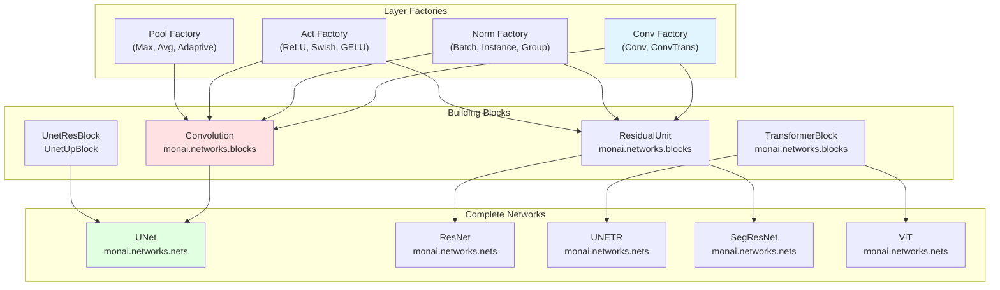
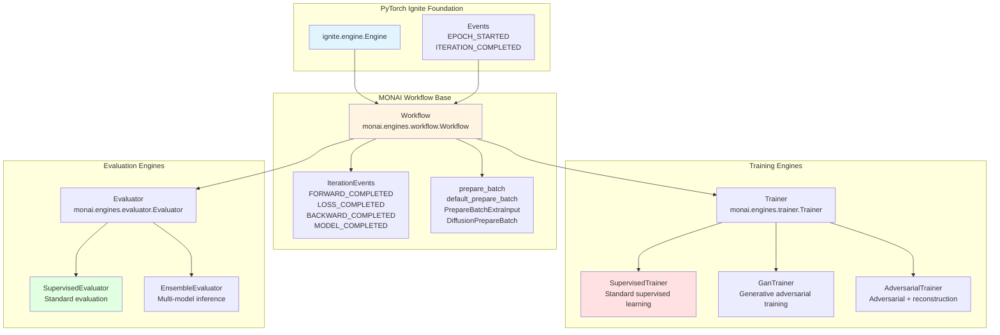
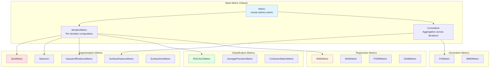
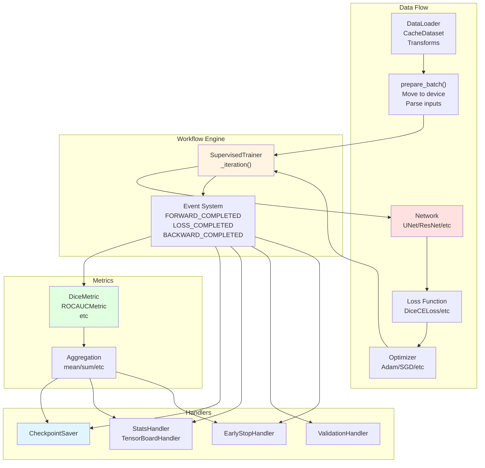

<!-- source: DeepWiki mcp.deepwiki.com · repo Project-MONAI/MONAI · page 5 Models and Training · fetched 2026-10-21 -->

# Models and Training

<details>
<summary>Relevant source files</summary>

The following files were used as context for generating this wiki page:

- [docs/source/engines.rst](docs/source/engines.rst)
- [docs/source/handlers.rst](docs/source/handlers.rst)
- [docs/source/metrics.rst](docs/source/metrics.rst)
- [docs/source/networks.rst](docs/source/networks.rst)
- [docs/source/utils.rst](docs/source/utils.rst)
- [monai/engines/__init__.py](monai/engines/__init__.py)
- [monai/engines/evaluator.py](monai/engines/evaluator.py)
- [monai/engines/trainer.py](monai/engines/trainer.py)
- [monai/engines/utils.py](monai/engines/utils.py)
- [monai/engines/workflow.py](monai/engines/workflow.py)
- [monai/handlers/__init__.py](monai/handlers/__init__.py)
- [monai/metrics/__init__.py](monai/metrics/__init__.py)
- [monai/networks/blocks/__init__.py](monai/networks/blocks/__init__.py)
- [monai/networks/blocks/activation.py](monai/networks/blocks/activation.py)
- [monai/networks/layers/__init__.py](monai/networks/layers/__init__.py)
- [monai/networks/layers/factories.py](monai/networks/layers/factories.py)
- [monai/networks/nets/__init__.py](monai/networks/nets/__init__.py)
- [monai/networks/nets/efficientnet.py](monai/networks/nets/efficientnet.py)
- [tests/min_tests.py](tests/min_tests.py)

</details>


## Purpose and Scope

This document provides an overview of MONAI's neural network models and training infrastructure. It covers the network architecture system (layers, blocks, and complete models), the training and evaluation workflow engines, and the supporting components (metrics and handlers) that enable flexible, production-ready deep learning pipelines for medical imaging.

For detailed information on specific topics:
- Network architectures and building blocks: see [Network Architectures and Components](#5.1)
- Training workflow implementation: see [Training Engines and Workflows](#5.2)
- Performance metrics: see [Metrics](#5.3)
- Event handlers for checkpointing, logging, and more: see [Handlers](#5.4)

---

## Network Architecture System

MONAI provides a comprehensive library of neural network components organized in a three-tier hierarchy: **Layers** → **Blocks** → **Networks**. This modular design enables dimension-agnostic implementations that work seamlessly across 1D, 2D, and 3D medical imaging tasks.

### Architecture Hierarchy



**Sources:** [monai/networks/layers/factories.py:1-482](), [monai/networks/blocks/__init__.py:1-50](), [monai/networks/nets/__init__.py:1-147]()

### LayerFactory System

The `LayerFactory` pattern enables dimension-agnostic component creation. Factories dynamically select the appropriate PyTorch layer type (1D/2D/3D) based on a dimensionality parameter.

| Factory | Purpose | Example Usage |
|---------|---------|---------------|
| `Conv` | Convolution layers | `Conv["conv", 3]` → `nn.Conv3d` |
| `Norm` | Normalization layers | `Norm["batch", 2]` → `nn.BatchNorm2d` |
| `Act` | Activation functions | `Act["relu"]` → `nn.ReLU` |
| `Pool` | Pooling layers | `Pool["max", 3]` → `nn.MaxPool3d` |
| `Dropout` | Dropout layers | `Dropout["dropout", 2]` → `nn.Dropout2d` |
| `Pad` | Padding layers | `Pad["replicationpad", 1]` → `nn.ReplicationPad1d` |

**Sources:** [monai/networks/layers/factories.py:76-161](), [monai/networks/layers/factories.py:197-475]()

### Available Network Architectures

MONAI provides 40+ pre-built network architectures spanning multiple domains:

- **Segmentation**: `UNet`, `DynUNet`, `SegResNet`, `AttentionUnet`, `UNETR`, `SwinUNETR`, `VISTA3D`
- **Classification**: `ResNet`, `DenseNet`, `EfficientNet`, `SENet`, `ViT`
- **Registration**: `RegUNet`, `LocalNet`, `GlobalNet`, `VoxelMorph`
- **Generative**: `AutoEncoder`, `VarAutoEncoder`, `VQVAE`, `DiffusionModelUNet`, `ControlNet`
- **Specialized**: `HoVerNet`, `DiNTS`, `MILModel`, `Transchex`

**Sources:** [monai/networks/nets/__init__.py:14-147](), [docs/source/networks.rst:444-770]()

---

## Training and Evaluation System

MONAI's training infrastructure is built on [PyTorch Ignite](https://pytorch.org/ignite/), extending it with medical imaging-specific functionality. The system provides an event-driven architecture that separates training logic into composable, reusable components.

### Workflow Base Architecture



**Sources:** [monai/engines/workflow.py:47-309](), [monai/engines/trainer.py:42-78](), [monai/engines/evaluator.py:44-172]()

### Workflow Class Hierarchy

The `Workflow` class ([monai/engines/workflow.py:47-309]()) serves as the foundation, providing:

1. **State Management**: Tracks epoch, iteration, metrics, best model performance
2. **Event Registration**: Custom `IterationEvents` for fine-grained control
3. **Data Preparation**: Pluggable `prepare_batch` strategies
4. **Metric Integration**: Automatic metric computation and tracking
5. **Handler Attachment**: Extensibility through event handlers

| Engine Class | Purpose | Key Method |
|--------------|---------|------------|
| `Workflow` | Base class with shared functionality | `run()` |
| `Trainer` | Base for training engines | `run()` with GradScaler |
| `SupervisedTrainer` | Standard supervised learning | `_iteration()` |
| `GanTrainer` | GAN training (G/D alternation) | `_iteration()` |
| `AdversarialTrainer` | Adversarial + reconstruction | `_iteration()` |
| `Evaluator` | Base for evaluation engines | `run(global_epoch)` |
| `SupervisedEvaluator` | Standard model evaluation | `_iteration()` |
| `EnsembleEvaluator` | Multi-model ensemble | `_iteration()` |

**Sources:** [monai/engines/trainer.py:80-278](), [monai/engines/evaluator.py:174-347](), [monai/engines/evaluator.py:350-503]()

---

## Event-Driven Architecture

The training system uses an event-driven model where handlers can attach to specific events during execution. This enables modular extension without modifying core engine code.

### Training Iteration Event Flow

```mermaid
graph LR
    Start["ITERATION_STARTED"] --> PrepBatch["prepare_batch()"]
    PrepBatch --> Forward["network(input)"]
    Forward --> FwdEvent["FORWARD_COMPLETED"]
    FwdEvent --> Loss["loss_function(pred, target)"]
    Loss --> LossEvent["LOSS_COMPLETED"]
    LossEvent --> Backward["loss.backward()"]
    Backward --> BwdEvent["BACKWARD_COMPLETED"]
    BwdEvent --> OptStep["optimizer.step()"]
    OptStep --> Decollate["Decollate<br/>(if enabled)"]
    Decollate --> Postproc["Postprocessing<br/>(if configured)"]
    Postproc --> ModelEvent["MODEL_COMPLETED"]
    ModelEvent --> MetricComp["Metric Computation"]
    MetricComp --> End["ITERATION_COMPLETED"]
```



**Sources:** [monai/engines/trainer.py:194-278](), [monai/engines/utils.py:47-66]()

### Event Types

**Ignite Standard Events:**
- `STARTED`, `COMPLETED` (engine level)
- `EPOCH_STARTED`, `EPOCH_COMPLETED`
- `ITERATION_STARTED`, `ITERATION_COMPLETED`

**MONAI IterationEvents** ([monai/engines/utils.py:47-66]()):
- `FORWARD_COMPLETED`: After `network(inputs)`
- `LOSS_COMPLETED`: After `loss_function(pred, target)`
- `BACKWARD_COMPLETED`: After `loss.backward()`
- `MODEL_COMPLETED`: After all model-related operations
- `INNER_ITERATION_STARTED/COMPLETED`: For nested loops

**Sources:** [monai/engines/utils.py:47-66](), [monai/engines/workflow.py:170-183]()

### Prepare Batch Strategies

The `prepare_batch` callable controls how batch data is prepared for each iteration. MONAI provides several strategies:

| Strategy | Class | Use Case |
|----------|-------|----------|
| Default | `default_prepare_batch` | Standard image/label pairs |
| Extra Input | `PrepareBatchExtraInput` | Networks requiring additional inputs |
| Diffusion | `DiffusionPrepareBatch` | Diffusion model training |
| V-Prediction | `VPredictionPrepareBatch` | Velocity prediction for diffusion |

**Sources:** [monai/engines/utils.py:100-150](), [monai/engines/utils.py:193-241](), [monai/engines/utils.py:243-313]()

---

## Metrics System

MONAI provides 30+ metric implementations for evaluating model performance across segmentation, classification, regression, and generative tasks. Metrics integrate with the Ignite engine system and automatically aggregate results across iterations.

### Metric Categories



**Sources:** [monai/metrics/__init__.py:13-44](), [docs/source/metrics.rst:1-189]()

### Metric Integration

Metrics attach to workflow engines and compute automatically during training/evaluation:

**Key Metric Classes:**
- `DiceMetric`: Dice coefficient for segmentation ([monai/metrics/__init__.py:24]())
- `ROCAUCMetric`: Area under ROC curve for classification ([monai/metrics/__init__.py:39]())
- `HausdorffDistanceMetric`: Boundary distance metric ([monai/metrics/__init__.py:22]())
- `MSEMetric`, `MAEMetric`, `RMSEMetric`: Regression metrics ([monai/metrics/__init__.py:29-37]())
- `FIDMetric`, `MMDMetric`: Generative model evaluation ([monai/metrics/__init__.py:19,27]())

Metrics are passed to `Workflow` constructors as dictionaries:

```python
key_metric = {"dice": DiceMetric(include_background=False, reduction="mean")}
additional_metrics = {
    "hausdorff": HausdorffDistanceMetric(percentile=95),
    "surface_dice": SurfaceDiceMetric()
}
```

**Sources:** [monai/engines/workflow.py:227-261](), [docs/source/metrics.rst:54-124]()

---

## Handlers System

Handlers are event-driven components that perform auxiliary operations during training and evaluation. They attach to specific events and execute callbacks at designated points in the workflow.

### Handler Categories

| Category | Handlers | Purpose |
|----------|----------|---------|
| **Checkpointing** | `CheckpointSaver`, `CheckpointLoader` | Save/load model state |
| **Logging** | `StatsHandler`, `TensorBoardStatsHandler`, `MLFlowHandler` | Log metrics and statistics |
| **Validation** | `ValidationHandler` | Trigger validation during training |
| **Scheduling** | `LrScheduleHandler`, `ParamSchedulerHandler` | Learning rate and parameter scheduling |
| **Early Stopping** | `EarlyStopHandler` | Terminate training based on conditions |
| **Metrics** | `MeanDice`, `ROCAUC`, `ConfusionMatrix` | Specialized metric handlers |
| **Post-processing** | `PostProcessing`, `DecollateBatch` | Transform outputs |
| **Resource Management** | `GarbageCollector`, `SmartCacheHandler` | Memory management |

**Sources:** [monai/handlers/__init__.py:14-46](), [docs/source/handlers.rst:9-223]()

### Handler Attachment

Handlers implement an `attach(engine)` method and are passed to workflow constructors:

```python
handlers = [
    CheckpointSaver(save_dir="./models", save_dict={"net": network, "opt": optimizer}),
    StatsHandler(output_transform=lambda x: x["loss"]),
    ValidationHandler(evaluator=val_evaluator, interval=5),
    TensorBoardStatsHandler(log_dir="./runs")
]
```

**Sources:** [monai/engines/workflow.py:262-269](), [docs/source/handlers.rst:9-162]()

---

## Complete Training Pipeline

The following diagram shows how all components integrate in a typical supervised training workflow:



**Sources:** [monai/engines/trainer.py:136-193](), [monai/engines/workflow.py:103-195]()

### Minimal Training Example

A complete training setup requires:

1. **Network**: Choose from `monai.networks.nets` ([monai/networks/nets/__init__.py:14-147]())
2. **Data**: `DataLoader` with transforms (see [4.1](#4.1))
3. **Trainer**: `SupervisedTrainer` with optimizer and loss ([monai/engines/trainer.py:80-163]())
4. **Metrics**: Attach metrics for evaluation ([monai/engines/workflow.py:227-241]())
5. **Handlers**: Configure checkpointing, logging, validation ([monai/engines/workflow.py:262-269]())

```python
# Network setup
network = UNet(spatial_dims=3, in_channels=1, out_channels=2, channels=(16, 32, 64))

# Training engine
trainer = SupervisedTrainer(
    device=torch.device("cuda"),
    max_epochs=100,
    train_data_loader=train_loader,
    network=network,
    optimizer=torch.optim.Adam(network.parameters(), lr=1e-4),
    loss_function=DiceCELoss(),
    key_train_metric={"train_dice": DiceMetric()},
    train_handlers=[
        CheckpointSaver(save_dir="./models", save_dict={"net": network}),
        StatsHandler(),
        ValidationHandler(evaluator=val_evaluator, interval=5)
    ]
)

trainer.run()
```

**Sources:** [monai/engines/trainer.py:136-193]()

---

## Advanced Features

### Automatic Mixed Precision (AMP)

Both `Trainer` and `Evaluator` support AMP via the `amp=True` parameter and optional `amp_kwargs` dictionary. The `Trainer` automatically manages `GradScaler` for scaled gradients.

**Sources:** [monai/engines/trainer.py:48-55](), [monai/engines/trainer.py:251-257]()

### Model Compilation

PyTorch 2.0+ `torch.compile()` is supported via `compile=True` and `compile_kwargs`. A workaround handles `MetaTensor` incompatibility by converting to `torch.Tensor` before forward pass and back afterward.

**Sources:** [monai/engines/trainer.py:184-188](), [monai/engines/trainer.py:221-237]()

### Inferer System

The `Inferer` abstraction decouples inference logic from engines, enabling strategies like sliding window inference for large medical images:

- `SimpleInferer`: Direct forward pass
- `SlidingWindowInferer`: Patch-based inference for large volumes
- `SaliencyInferer`: For interpretability

**Sources:** [monai/engines/trainer.py:191](), [monai/engines/evaluator.py:276]()

### Distributed Training

The `Workflow` automatically detects distributed environments and manages rank information. `DistributedSampler` epochs are synchronized via event handlers.

**Sources:** [monai/engines/workflow.py:126-134](), [monai/engines/workflow.py:144-145]()

---

## Summary

MONAI's models and training system provides:

1. **40+ neural network architectures** with dimension-agnostic implementations
2. **Event-driven training infrastructure** built on PyTorch Ignite
3. **Flexible workflow engines** for supervised, GAN, and adversarial training
4. **30+ metrics** covering segmentation, classification, regression, and generative tasks
5. **Comprehensive handlers** for checkpointing, logging, validation, and scheduling
6. **Advanced features**: AMP, model compilation, sliding window inference, distributed training

For implementation details:
- Network architectures: [5.1](#5.1)
- Training engines: [5.2](#5.2)
- Metrics: [5.3](#5.3)
- Handlers: [5.4](#5.4)

---

