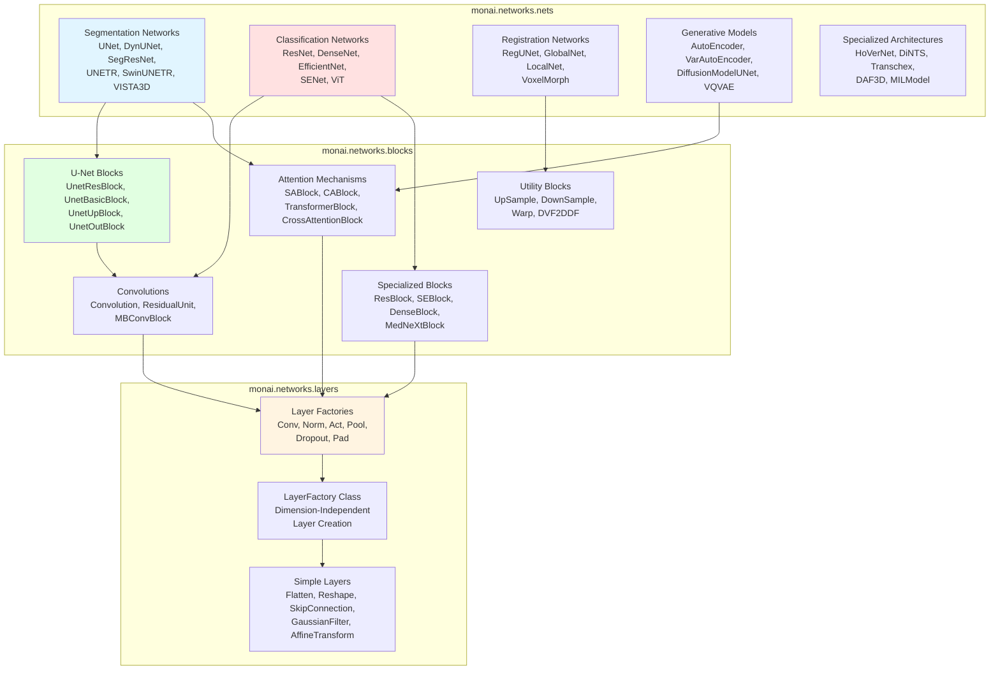
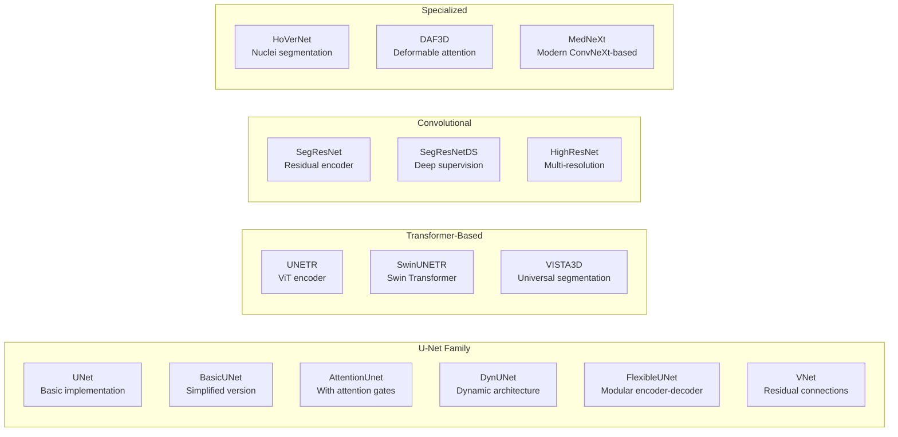
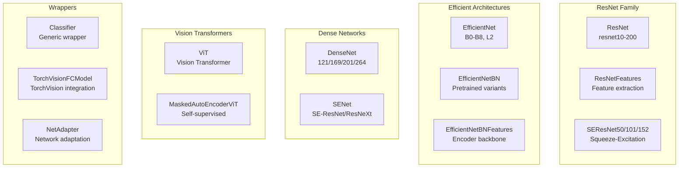
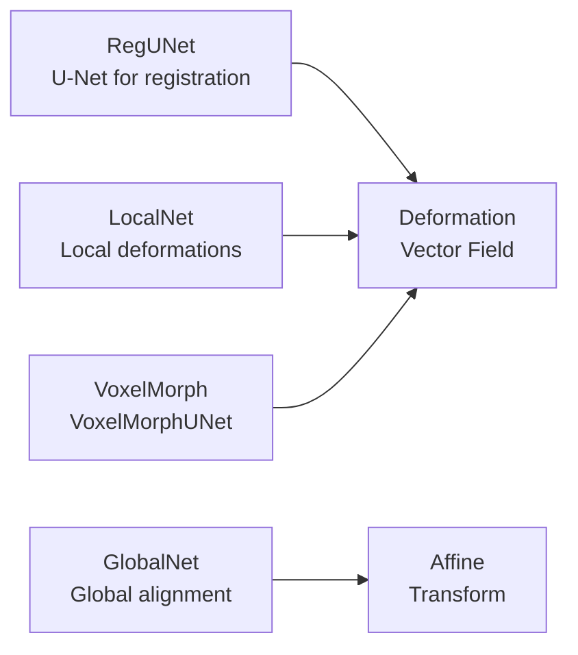
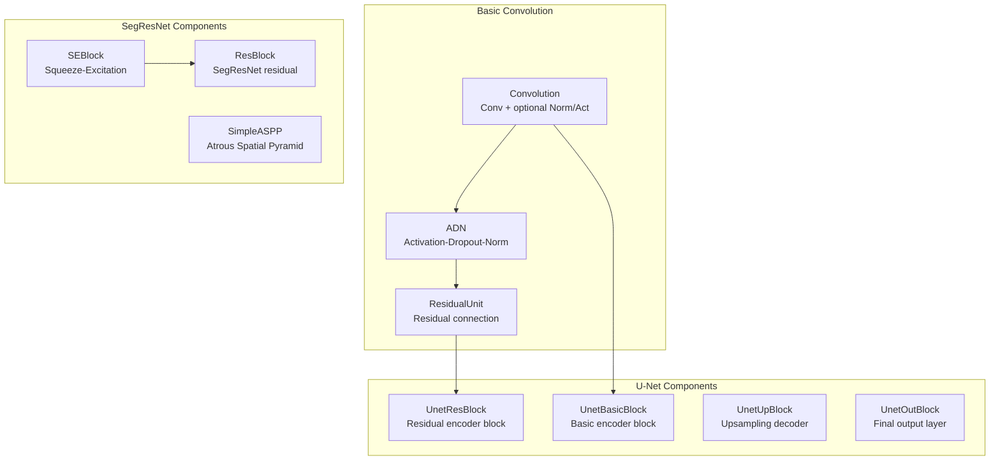
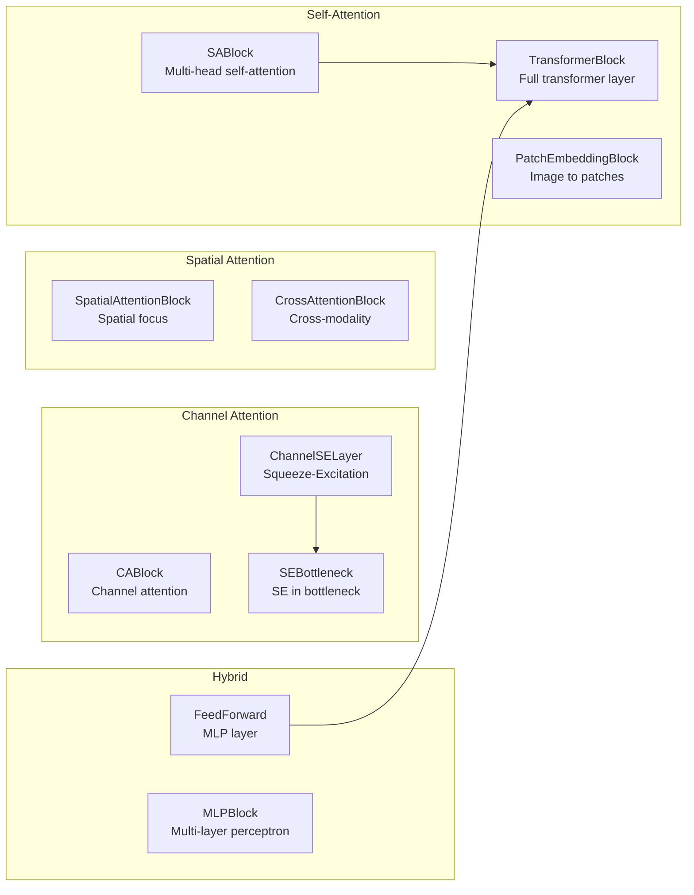
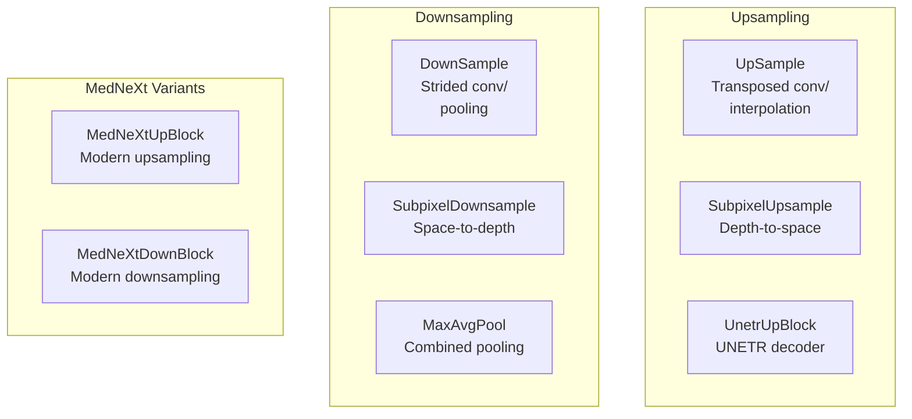
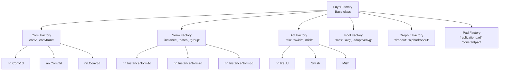
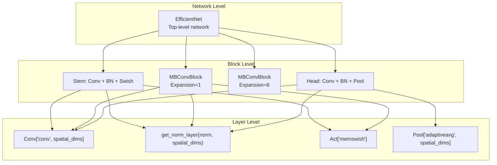
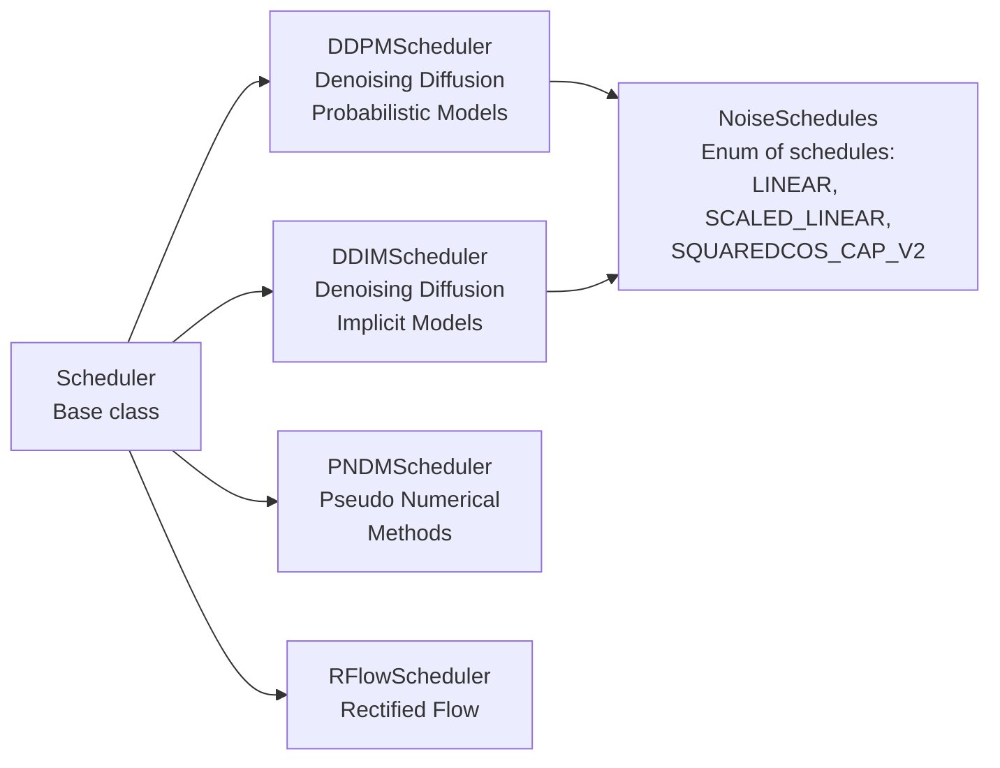

<!-- source: DeepWiki mcp.deepwiki.com · repo Project-MONAI/MONAI · page 5.1 Network Architectures and Components · fetched 2026-10-21 -->

# Network Architectures and Components

<details>
<summary>Relevant source files</summary>

The following files were used as context for generating this wiki page:

- [docs/source/networks.rst](docs/source/networks.rst)
- [monai/networks/blocks/__init__.py](monai/networks/blocks/__init__.py)
- [monai/networks/blocks/activation.py](monai/networks/blocks/activation.py)
- [monai/networks/layers/__init__.py](monai/networks/layers/__init__.py)
- [monai/networks/layers/factories.py](monai/networks/layers/factories.py)
- [monai/networks/nets/__init__.py](monai/networks/nets/__init__.py)
- [monai/networks/nets/efficientnet.py](monai/networks/nets/efficientnet.py)

</details>


This page documents MONAI's comprehensive collection of neural network architectures and the modular components used to build them. It covers complete network implementations, reusable building blocks, and the dimension-independent layer factory system.

**Scope**: This page focuses on the network architectures themselves and their components. For information about training these networks, see [Training Engines and Workflows](#5.2). For metrics to evaluate network outputs, see [Metrics](#5.3).

---

## System Overview

MONAI's network module is organized into three hierarchical layers: complete architectures (nets), reusable building blocks, and dimension-independent layers. This modular design enables rapid prototyping while maintaining consistency across 1D, 2D, and 3D medical imaging tasks.



**Sources**: [monai/networks/nets/__init__.py:1-147](), [monai/networks/blocks/__init__.py:1-50](), [monai/networks/layers/__init__.py:1-43](), [docs/source/networks.rst:1-813]()

---

## Network Architecture Categories

MONAI provides over 50 complete network architectures organized by task. Each architecture is implemented to support flexible spatial dimensions (1D, 2D, 3D) where applicable.

### Segmentation Networks

Segmentation networks are the most extensive category, ranging from classic U-Net variants to modern transformer-based architectures.



**Key Implementations**:

| Network | File | Primary Features |
|---------|------|------------------|
| `UNet` | [monai/networks/nets/unet.py]() | Classic encoder-decoder with skip connections |
| `DynUNet` | [monai/networks/nets/dynunet.py]() | Automatically determines architecture from data |
| `UNETR` | [monai/networks/nets/unetr.py]() | Vision Transformer encoder with CNN decoder |
| `SwinUNETR` | [monai/networks/nets/swin_unetr.py]() | Swin Transformer with hierarchical features |
| `SegResNet` | [monai/networks/nets/segresnet.py]() | Residual encoder with VAE variant |
| `VISTA3D` | [monai/networks/nets/vista3d.py]() | Universal segmentation for multiple organs |

**Sources**: [monai/networks/nets/__init__.py:14-146](), [docs/source/networks.rst:567-611]()

### Classification Networks

Classification networks include standard backbones and their MONAI-enhanced variants with pretrained weights support.



**Sources**: [monai/networks/nets/__init__.py:23-97](), [docs/source/networks.rst:448-716]()

### Registration Networks

Registration networks predict deformation fields for image alignment tasks.



**Sources**: [monai/networks/nets/__init__.py:81](), [docs/source/networks.rst:618-770]()

### Generative Models

Generative architectures support VAE, GAN, and diffusion-based approaches.

| Network | Purpose | Key Features |
|---------|---------|--------------|
| `AutoEncoder` | Basic autoencoder | Encoder-decoder structure |
| `VarAutoEncoder` | Variational autoencoder | KL divergence regularization |
| `AutoencoderKL` | Latent diffusion | Compatible with diffusion models |
| `VQVAE` | Vector-quantized VAE | Discrete latent space |
| `DiffusionModelUNet` | Diffusion backbone | Time-step conditioning |
| `ControlNet` | Conditional generation | Spatial control mechanisms |
| `Generator` / `Discriminator` | GAN components | Adversarial training |

**Sources**: [monai/networks/nets/__init__.py:16-22](), [docs/source/networks.rst:633-697]()

---

## Building Blocks

Building blocks are reusable components that networks compose together. MONAI provides dimension-independent implementations that work seamlessly across 1D, 2D, and 3D data.

### Foundational Convolution Blocks



**Key Block Implementations**:

**`Convolution`** ([monai/networks/blocks/convolutions.py]()): Wrapper around N-dimensional convolution with integrated normalization and activation. Supports stride, padding, and dilation parameters.

**`ResidualUnit`** ([monai/networks/blocks/convolutions.py]()): Implements residual connections with optional projection shortcuts. Forms the basis for ResNet and SegResNet architectures.

**`UnetResBlock`** ([monai/networks/blocks/dynunet_block.py]()): Dynamic U-Net encoder block with residual connections. Used by `DynUNet` to build architecture dynamically based on input shape.

**`ADN`** ([monai/networks/blocks/acti_norm.py]()): Combines activation, dropout, and normalization in configurable order. Provides consistent regularization across architectures.

**Sources**: [monai/networks/blocks/__init__.py:14-26](), [docs/source/networks.rst:8-96]()

### Attention Mechanisms



**`SABlock`** ([monai/networks/blocks/selfattention.py]()): Multi-head self-attention for modeling long-range dependencies. Core component of UNETR and vision transformers.

**`TransformerBlock`** ([monai/networks/blocks/transformerblock.py]()): Complete transformer layer with self-attention, feedforward, and layer normalization. Used in ViT, UNETR, and other transformer-based architectures.

**`CABlock`** ([monai/networks/blocks/cablock.py]()): Channel attention mechanism that recalibrates channel-wise features. Complements spatial convolutions with learned channel importance.

**Sources**: [monai/networks/blocks/__init__.py:18-22](), [docs/source/networks.rst:107-230]()

### Upsampling and Downsampling



**`UpSample`** and **`DownSample`** ([monai/networks/blocks/upsample.py](), [monai/networks/blocks/downsample.py]()): Flexible sampling blocks supporting multiple modes (transposed convolution, interpolation, pooling). Allow networks to operate at different spatial resolutions.

**`SubpixelUpsample`** / **`SubpixelDownsample`**: Efficient pixel shuffle operations for changing spatial resolution without interpolation artifacts.

**Sources**: [monai/networks/blocks/__init__.py:24-25](), [docs/source/networks.rst:176-195]()

### Specialized Blocks

**Registration Blocks**:
- **`RegistrationResidualConvBlock`**: Residual convolution for registration networks
- **`RegistrationDownSampleBlock`**: Downsampling with residual connections
- **`RegistrationExtractionBlock`**: Feature extraction for deformation fields

**DiNTS Blocks** (Differentiable Neural Architecture Search):
- **`ActiConvNormBlock`**: Activation-convolution-normalization ordering
- **`FactorizedIncreaseBlock`**: Efficient channel expansion
- **`FactorizedReduceBlock`**: Efficient spatial reduction

**Reconstruction Blocks**:
- **`VarNetBlock`**: Variable network block for MRI reconstruction

**Sources**: [monai/networks/blocks/__init__.py:23-35](), [docs/source/networks.rst:196-270]()

---

## Layer Factory System

The LayerFactory system provides dimension-independent layer creation, allowing networks to work seamlessly across 1D, 2D, and 3D data without code duplication.

### LayerFactory Architecture



**Sources**: [monai/networks/layers/factories.py:76-161]()

### Factory Usage Pattern

The factory system allows dimension-agnostic code:

```python
# From monai/networks/nets/efficientnet.py:116-117
conv_type = Conv["conv", spatial_dims]  # Returns Conv1d, Conv2d, or Conv3d
adaptivepool_type = Pool["adaptiveavg", spatial_dims]
```

**Factory Definition Pattern**:

```python
# From monai/networks/layers/factories.py:357-369
@Conv.factory_function("conv")
def conv_factory(dim: int) -> type[nn.Conv1d | nn.Conv2d | nn.Conv3d]:
    """Convolutional layers in 1,2,3 dimensions."""
    types = (nn.Conv1d, nn.Conv2d, nn.Conv3d)
    return types[dim - 1]
```

### Available Factories

| Factory | Purpose | Available Options |
|---------|---------|-------------------|
| **`Conv`** | Convolution layers | `"conv"`, `"convtrans"` |
| **`Norm`** | Normalization layers | `"instance"`, `"batch"`, `"group"`, `"layer"`, `"syncbatch"`, `"instance_nvfuser"` |
| **`Act`** | Activation functions | `"relu"`, `"leakyrelu"`, `"prelu"`, `"elu"`, `"selu"`, `"swish"`, `"mish"`, `"geglu"`, `"sigmoid"`, `"tanh"`, `"softmax"` |
| **`Pool`** | Pooling layers | `"max"`, `"avg"`, `"adaptivemax"`, `"adaptiveavg"` |
| **`Dropout`** | Dropout layers | `"dropout"`, `"alphadropout"` |
| **`Pad`** | Padding layers | `"replicationpad"`, `"constantpad"` |

**Sources**: [monai/networks/layers/factories.py:197-475]()

### Advanced Factory Features

**`split_args` Utility** ([monai/networks/layers/factories.py:163-194]()):

Parses string or tuple specifications for layer instantiation:

```python
# From docstring example
act_type, args = split_args("PRELU")
Act[act_type]  # Returns nn.PReLU

act_type, args = split_args(("PRELU", {"num_parameters": 1, "init": 0.25}))
Act[act_type](**args)  # Returns configured PReLU(num_parameters=1)
```

**Custom Activations**:

- **`Swish`** ([monai/networks/blocks/activation.py:41-70]()): `f(x) = x * σ(αx)`
- **`MemoryEfficientSwish`** ([monai/networks/blocks/activation.py:93-131]()): Memory-optimized implementation using custom autograd
- **`Mish`** ([monai/networks/blocks/activation.py:133-164]()): `f(x) = x * tanh(softplus(x))`
- **`GEGLU`** ([monai/networks/blocks/activation.py:167-184]()): Gated Linear Unit variant

**Sources**: [monai/networks/layers/factories.py:163-355](), [monai/networks/blocks/activation.py:1-185]()

---

## Network Construction Patterns

### Composition Example: EfficientNet

The `EfficientNet` architecture demonstrates how networks compose layers, blocks, and factories:



**Key Implementation Details**:

1. **Stem** ([monai/networks/nets/efficientnet.py:294-300]()):
   - Uses factory to create dimension-appropriate convolution
   - Applies batch normalization with custom epsilon/momentum
   - Uses memory-efficient Swish activation

2. **MBConvBlock** ([monai/networks/nets/efficientnet.py:75-228]()):
   - Mobile Inverted Residual Bottleneck
   - Expansion phase → Depthwise convolution → Squeeze-Excitation → Projection
   - Supports drop_connect for stochastic depth

3. **Dynamic Block Creation** ([monai/networks/nets/efficientnet.py:302-386]()):
   - Decodes block specifications from strings
   - Scales width and depth based on coefficients
   - Builds sequential blocks with increasing drop_connect rates

**Sources**: [monai/networks/nets/efficientnet.py:230-476]()

### Dimension Independence Example

Networks automatically adapt to spatial dimensions:

```python
# From usage pattern
# 2D case
model_2d = SegResNet(spatial_dims=2, in_channels=3, out_channels=1)
input_2d = torch.randn(1, 3, 256, 256)

# 3D case  
model_3d = SegResNet(spatial_dims=3, in_channels=1, out_channels=4)
input_3d = torch.randn(1, 1, 128, 128, 128)
```

The same network code works for both by using factories internally to instantiate the correct layer types.

**Sources**: [monai/networks/layers/factories.py:12-60]()

---

## Encoder-Decoder Registration System

`FlexibleUNet` introduces a registration system for pluggable encoder backbones:

```mermaid
graph LR
    subgraph "Encoder Registration"
        BaseEncoder["BaseEncoder<br/>Abstract interface"]
        ResNetEncoder["ResNetEncoder<br/>ResNet backbone"]
        EfficientNetEncoder["EfficientNetEncoder<br/>EfficientNet backbone"]
        FlexUNetEncoderRegister["FlexUNetEncoderRegister<br/>Registry manager"]
    end
    
    subgraph "FlexibleUNet"
        FlexibleUNet["FlexibleUNet<br/>Modular U-Net"]
        Decoder["Decoder<br/>Upsampling path"]
    end
    
    BaseEncoder --> ResNetEncoder
    BaseEncoder --> EfficientNetEncoder
    ResNetEncoder --> FlexUNetEncoderRegister
    EfficientNetEncoder --> FlexUNetEncoderRegister
    FlexUNetEncoderRegister --> FlexibleUNet
    FlexibleUNet --> Decoder
```

**`BaseEncoder` Interface** ([monai/networks/blocks/encoder.py]()):
- Defines contract for encoder backbones
- Requires methods: `get_encoder_parameters()`, `num_channels_per_output()`, `num_outputs()`, `get_encoder_names()`

**`EfficientNetEncoder`** ([monai/networks/nets/efficientnet.py:645-717]()):
- Wraps `EfficientNetBNFeatures` for flexible-unet compatibility
- Provides 10 backbone variants (efficientnet-b0 through l2)
- Returns multi-scale feature maps for skip connections

**Sources**: [monai/networks/nets/__init__.py:51](), [monai/networks/nets/efficientnet.py:645-717]()

---

## Pretrained Model Support

Several architectures support pretrained weights from ImageNet or specialized medical datasets:

| Network | Pretrained Source | Dimensions | Notes |
|---------|------------------|------------|-------|
| `ResNet` | ImageNet, MedicalNet | 2D, 3D | [monai/networks/nets/resnet.py]() |
| `EfficientNetBN` | ImageNet, Adversarial | 2D | [monai/networks/nets/efficientnet.py:478-563]() |
| `DenseNet` | ImageNet | 2D | [monai/networks/nets/densenet.py]() |
| `SENet` | ImageNet | 2D | [monai/networks/nets/senet.py]() |
| `VISTA3D` | MONAI Model Zoo | 3D | [monai/networks/nets/vista3d.py]() |

**Loading Pretrained Weights**:

```python
# From EfficientNet implementation pattern
model = EfficientNetBN("efficientnet-b0", pretrained=True, spatial_dims=2)
# Automatically downloads and loads ImageNet weights

# Adversarial training weights
model_adv = EfficientNetBN("efficientnet-b0", pretrained=True, adv_prop=True)
```

**Sources**: [monai/networks/nets/efficientnet.py:560-563](), [docs/source/networks.rst:474-552]()

---

## Noise Schedulers for Generative Models

MONAI provides schedulers for diffusion-based generative models:



**Usage Pattern**:
- Schedulers manage the noise schedule for forward/reverse diffusion
- Support different noise scheduling strategies
- Enable sampling with varying numbers of timesteps

**Sources**: [docs/source/networks.rst:779-813]()

---

## Network Utilities

Helper functions and utilities support network operations:

**Dimension Calculation** ([monai/networks/layers/convutils.py]()):
- `calculate_out_shape()`: Computes output spatial dimensions
- `same_padding()`: Calculates padding for "SAME" mode
- `gaussian_1d()`: Generates Gaussian kernel weights

**Network Inspection** ([monai/networks/utils.py]()):
- Functions for analyzing network structure
- Parameter counting and memory estimation
- Layer extraction utilities

**Sources**: [monai/networks/layers/__init__.py:15](), [docs/source/networks.rst:771-778]()

---

## Design Principles

**Dimension Independence**: All networks support configurable spatial dimensions (1D, 2D, 3D) through factory pattern, eliminating code duplication and ensuring consistency.

**Modular Composition**: Networks are built from reusable blocks that encapsulate common patterns. This enables rapid prototyping and architecture search.

**Medical Imaging Focus**: Architectures are optimized for medical imaging characteristics:
- Support for anisotropic spacing and orientations
- Large 3D volume handling with memory-efficient operations
- Multi-modal input support

**Extensibility**: The factory and registration systems allow users to add custom layers, blocks, and entire backbone architectures without modifying core code.

**Production Ready**: Includes features for deployment:
- TorchScript compatibility (where applicable)
- ONNX and TensorRT export support ([Core Utilities and Module System](#2.1))
- Pretrained weights for transfer learning

**Sources**: [monai/networks/layers/factories.py:11-60](), [monai/networks/blocks/__init__.py:1-50]()

---

