<!-- source: DeepWiki mcp.deepwiki.com · repo Project-MONAI/MONAI · page 5.2 Training Engines and Workflows · fetched 2026-10-21 -->

# Training Engines and Workflows

<details>
<summary>Relevant source files</summary>

The following files were used as context for generating this wiki page:

- [docs/source/engines.rst](docs/source/engines.rst)
- [docs/source/utils.rst](docs/source/utils.rst)
- [monai/engines/__init__.py](monai/engines/__init__.py)
- [monai/engines/evaluator.py](monai/engines/evaluator.py)
- [monai/engines/trainer.py](monai/engines/trainer.py)
- [monai/engines/utils.py](monai/engines/utils.py)
- [monai/engines/workflow.py](monai/engines/workflow.py)

</details>


## Purpose and Scope

This document describes MONAI's training and evaluation engine system, which provides reusable workflow abstractions for model training and evaluation. These engines are built on [PyTorch Ignite](https://pytorch.org/ignite/) and implement an event-driven architecture that separates training logic from auxiliary operations like checkpointing, logging, and validation.

For information about network architectures used with these engines, see [Network Architectures and Components](#5.1). For metrics computation during training/evaluation, see [Metrics](#5.3). For event handlers that attach to these engines, see [Handlers](#5.4).

**Sources:** [monai/engines/__init__.py:1-30](), [docs/source/engines.rst:1-57]()

---

## Architecture Overview

### Foundation on PyTorch Ignite

MONAI's engine system extends PyTorch Ignite's `Engine` class to provide domain-specific functionality for medical imaging workflows. The architecture follows a three-layer hierarchy:

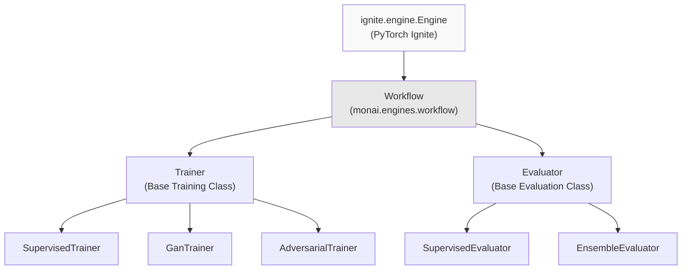

**Class Hierarchy**

| Layer | Class | Purpose |
|-------|-------|---------|
| Foundation | `ignite.engine.Engine` | Core event loop and state management |
| Base | `Workflow` | MONAI-specific initialization, events, and utilities |
| Category | `Trainer`, `Evaluator` | Training vs. evaluation specialization |
| Concrete | `SupervisedTrainer`, etc. | Task-specific implementations |

**Sources:** [monai/engines/workflow.py:47-101](), [monai/engines/trainer.py:42-46](), [monai/engines/evaluator.py:44-88]()

---

## Workflow Base Class

### Core Responsibilities

The `Workflow` class ([monai/engines/workflow.py:47-309]()) serves as the foundation for all MONAI engines, providing:

1. **State initialization** - Sets up `engine.state` with training/evaluation context
2. **Event registration** - Adds custom MONAI events to Ignite's event system
3. **Data preparation** - Configures batch preparation strategies
4. **Postprocessing** - Registers output transform pipelines
5. **Metrics management** - Attaches and tracks metrics
6. **Handler registration** - Connects event handlers to the engine

### State Attributes

The `Workflow` initializes `engine.state` with the following attributes:

| Attribute | Type | Description |
|-----------|------|-------------|
| `rank` | int | Distributed training rank (0 if not distributed) |
| `seed` | int | Random seed |
| `iteration` | int | Current iteration number |
| `epoch` | int | Current epoch number |
| `max_epochs` | int | Total epochs to run |
| `epoch_length` | int \| None | Iterations per epoch |
| `output` | Any | Output of current iteration |
| `batch` | Any | Input batch for current iteration |
| `metrics` | dict | Computed metric values |
| `metric_details` | dict | Detailed metric information |
| `dataloader` | DataLoader | Data loader instance |
| `device` | torch.device | Compute device |
| `key_metric_name` | str \| None | Name of primary metric |
| `best_metric` | float | Best metric value achieved |
| `best_metric_epoch` | int | Epoch where best metric occurred |

**Sources:** [monai/engines/workflow.py:143-160]()

### Constructor Parameters

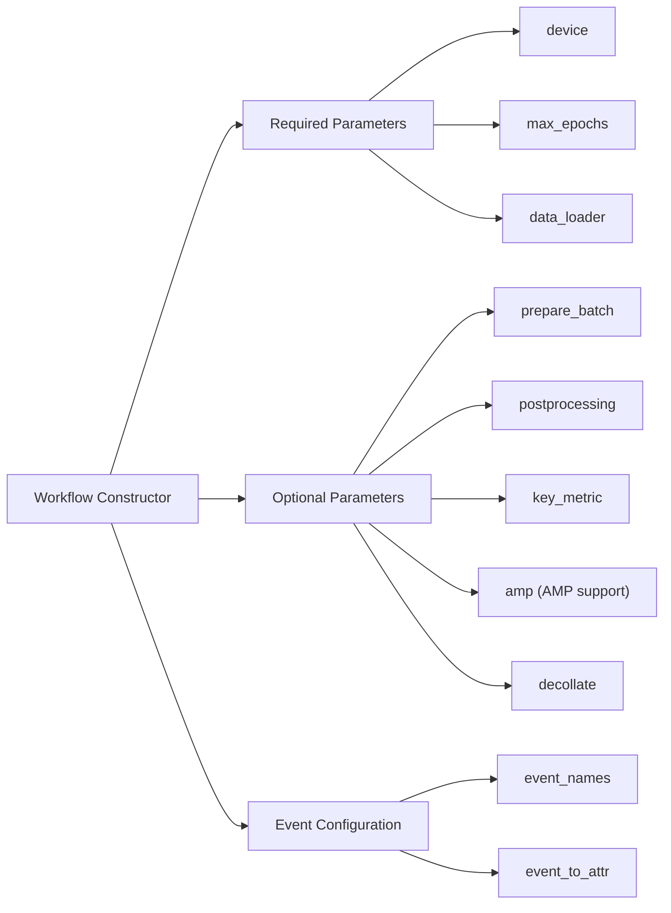

**Key Parameters:**

- `prepare_batch`: Callable to extract inputs/labels from batch data (default: `default_prepare_batch`)
- `iteration_update`: Custom iteration logic (default: `self._iteration()`)
- `postprocessing`: Transform applied to model outputs
- `key_metric`: Primary metric for model selection (dict with single metric)
- `additional_metrics`: Other metrics to track
- `metric_cmp_fn`: Function to compare metrics (default: greater than)
- `handlers`: Sequence of handlers to attach
- `amp`: Enable automatic mixed precision
- `decollate`: Decollate batch-first data to lists (recommended for MONAI transforms)

**Sources:** [monai/engines/workflow.py:103-123]()

---

## Event System

### IterationEvents Enum

MONAI extends Ignite's event system with `IterationEvents` ([monai/engines/utils.py:47-66]()), providing fine-grained hooks into the iteration lifecycle:

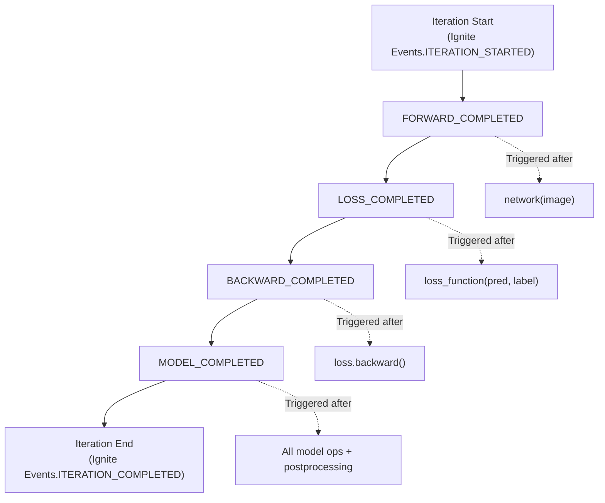

**Event Types:**

| Event | Trigger Point |
|-------|---------------|
| `FORWARD_COMPLETED` | After network forward pass |
| `LOSS_COMPLETED` | After loss computation |
| `BACKWARD_COMPLETED` | After gradient computation (training only) |
| `MODEL_COMPLETED` | After all model operations and postprocessing |
| `INNER_ITERATION_STARTED` | Start of inner loop (e.g., discriminator steps) |
| `INNER_ITERATION_COMPLETED` | End of inner loop |

**Usage Example Pattern:**

```python
@trainer.on(IterationEvents.FORWARD_COMPLETED)
def log_predictions(engine):
    # Access predictions immediately after forward pass
    predictions = engine.state.output[Keys.PRED]
```

**Sources:** [monai/engines/utils.py:47-66](), [monai/engines/workflow.py:170-182]()

### Event Registration Flow

The `Workflow` automatically registers `IterationEvents` and any custom events specified via `event_names` parameter:

**Sources:** [monai/engines/workflow.py:170-182]()

---

## Decollation and Postprocessing

### Decollation

When `decollate=True` (default), the `Workflow` registers a decollation handler that converts batch-first data to lists after model computation:

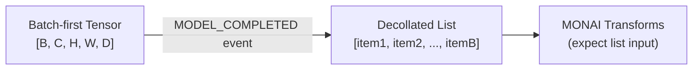

This is essential because MONAI transforms expect channel-first, single-item data. The `Decollated` transform ([monai/engines/workflow.py:196-209]()) handles this conversion using `monai.transforms.Decollated`.

**Sources:** [monai/engines/workflow.py:196-209]()

### Postprocessing Pipeline

If a `postprocessing` callable is provided, it's applied after decollation via the `MODEL_COMPLETED` event:

**Flow:**
1. Model forward pass completes
2. Decollation (if enabled)
3. Postprocessing transforms applied
4. Results stored back in `engine.state.output`

The postprocessing is applied using `engine_apply_transform` ([monai/engines/utils.py:325-351]()), which intelligently merges batch and output dictionaries for dictionary-based transforms.

**Sources:** [monai/engines/workflow.py:211-225](), [monai/engines/utils.py:325-351]()

---

## prepare_batch Strategies

### Purpose

The `prepare_batch` callable extracts inputs and labels from raw batch data and moves them to the appropriate device. MONAI provides several strategies for different training paradigms.

### Default Strategy

`default_prepare_batch` ([monai/engines/utils.py:100-150]()) handles three input formats:

| Input Format | Returns |
|--------------|---------|
| Single tensor | `(tensor, None)` |
| Tuple of 2 tensors | `(image, label)` |
| Dictionary with `CommonKeys.IMAGE` and `CommonKeys.LABEL` | `(image, label)` |
| Dictionary with `CommonKeys.IMAGE` only | `(image, None)` |
| Dictionary with `GanKeys.REALS` | `reals` tensor |

**Sources:** [monai/engines/utils.py:100-150]()

### PrepareBatch Classes

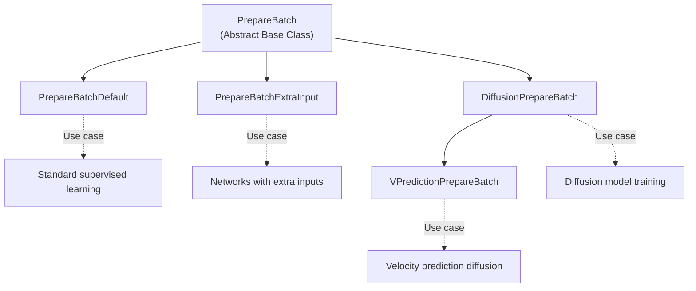

**Class Descriptions:**

| Class | Purpose | Returns |
|-------|---------|---------|
| `PrepareBatchDefault` | Wraps `default_prepare_batch` | `(image, label)` |
| `PrepareBatchExtraInput` | Extracts extra network arguments from batch dict | `(image, label, args_tuple, kwargs_dict)` |
| `DiffusionPrepareBatch` | Generates noise and timesteps for diffusion training | `(image, noise, (), {"noise": noise, "timesteps": t})` |
| `VPredictionPrepareBatch` | Computes velocity target for diffusion | `(image, velocity, (), {"noise": noise, "timesteps": t})` |

**Sources:** [monai/engines/utils.py:152-313]()

### PrepareBatchExtraInput Example

For networks that require additional inputs beyond image and label:

```python
# Extract 'spacing' as positional arg and 'metadata' as kwarg
prepare_batch = PrepareBatchExtraInput(
    extra_keys=["spacing"],  # Positional
    # OR
    extra_keys={"meta": "metadata"}  # Keyword
)

trainer = SupervisedTrainer(
    ...,
    prepare_batch=prepare_batch
)
# Network will be called as: network(image, spacing) or network(image, meta=metadata)
```

**Sources:** [monai/engines/utils.py:193-241]()

---

## Training Engines

### Trainer Base Class

The `Trainer` class ([monai/engines/trainer.py:42-78]()) extends `Workflow` with training-specific functionality:

- Initializes `GradScaler` for AMP when `amp=True`
- Provides `get_stats()` method returning training statistics
- Manages continuous training across multiple `run()` calls

**Sources:** [monai/engines/trainer.py:42-78]()

### SupervisedTrainer

`SupervisedTrainer` ([monai/engines/trainer.py:80-279]()) implements standard supervised learning with the following iteration flow:

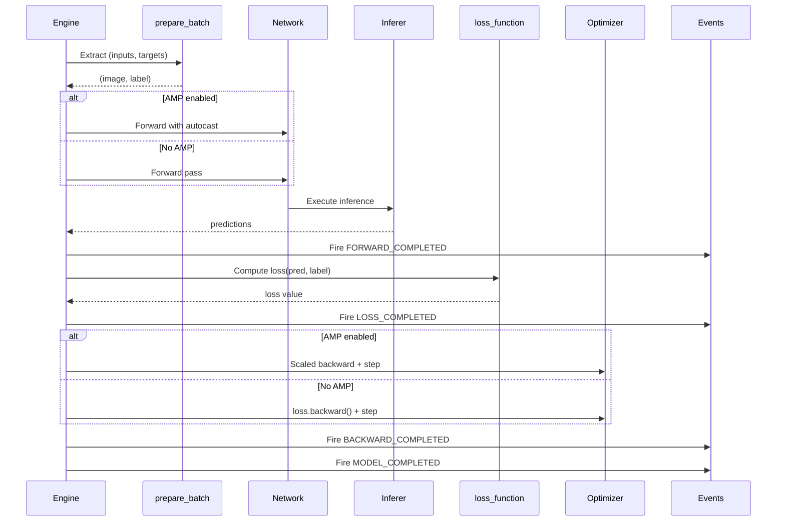

**Key Features:**

- **Inferer integration**: Uses `Inferer` abstraction (default: `SimpleInferer`) to separate inference logic
- **AMP support**: Automatic mixed precision with `GradScaler` when `amp=True`
- **torch.compile support**: Optional compilation with `compile=True` (handles MetaTensor conversion)
- **Flexible loss**: Supports any callable loss function
- **Optimizer control**: `optim_set_to_none` parameter for `zero_grad()` behavior

**Constructor Parameters:**

| Parameter | Type | Description |
|-----------|------|-------------|
| `network` | torch.nn.Module | Model to train |
| `optimizer` | Optimizer | PyTorch optimizer |
| `loss_function` | Callable | Loss computation function |
| `inferer` | Inferer \| None | Inference strategy (default: `SimpleInferer`) |
| `compile` | bool | Use `torch.compile` (default: False) |
| `optim_set_to_none` | bool | Use `set_to_none=True` in `zero_grad()` |

**Sources:** [monai/engines/trainer.py:80-279]()

### GanTrainer

`GanTrainer` ([monai/engines/trainer.py:281-468]()) implements adversarial training for Generative Adversarial Networks:

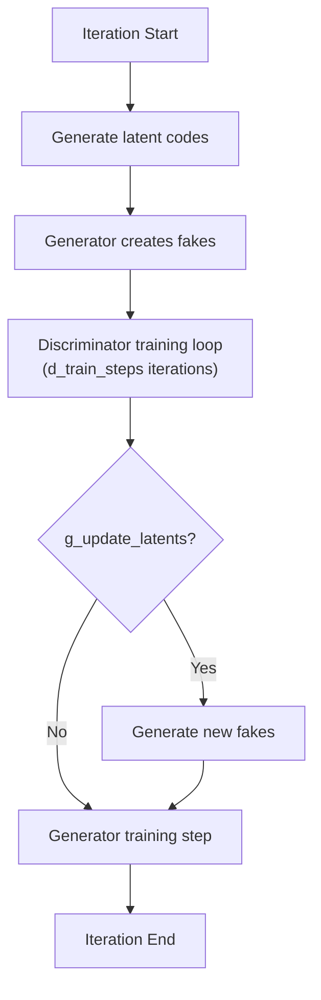

**Training Loop:**

1. Generate latent codes using `g_prepare_batch` (default: `default_make_latent`)
2. Generator creates fake samples
3. Update discriminator `d_train_steps` times using real and fake samples
4. Optionally generate new latent codes if `g_update_latents=True`
5. Update generator using discriminator feedback

**Key Parameters:**

| Parameter | Type | Description |
|-----------|------|-------------|
| `g_network`, `g_optimizer`, `g_loss_function` | Module, Optimizer, Callable | Generator components |
| `d_network`, `d_optimizer`, `d_loss_function` | Module, Optimizer, Callable | Discriminator components |
| `d_train_steps` | int | Number of discriminator updates per iteration |
| `latent_shape` | int | Dimension of latent code |
| `g_update_latents` | bool | Generate new latents for G training step |
| `g_prepare_batch` | Callable | Latent generation function |
| `d_prepare_batch` | Callable | Real data extraction function |

**Sources:** [monai/engines/trainer.py:281-468]()

### AdversarialTrainer

`AdversarialTrainer` ([monai/engines/trainer.py:470-658]()) implements supervised adversarial training (e.g., for perceptual loss):

**Architecture:**
- **Generator (G)**: Reconstruction network
- **Discriminator (D)**: Distinguishes real from reconstructed images
- **Loss**: Combination of reconstruction loss and adversarial loss

**Custom Events:**

The trainer registers `AdversarialIterationEvents` for fine-grained control of G and D training phases.

**State Management:**

Unlike other trainers, `AdversarialTrainer` stores networks and optimizers in `engine.state` rather than as instance attributes, enabling proper checkpoint saving. The `_state_dict_user_keys` list is extended to include:
- `g_network`, `g_optimizer`, `g_scaler`
- `d_network`, `d_optimizer`, `d_scaler`
- Loss functions (if they have `state_dict` methods)

**Sources:** [monai/engines/trainer.py:470-658](), [monai/engines/trainer.py:591-614]()

---

## Evaluation Engines

### Evaluator Base Class

The `Evaluator` class ([monai/engines/evaluator.py:44-172]()) extends `Workflow` for validation/evaluation:

**Key Differences from Trainer:**

- Sets `max_epochs=1` (single evaluation pass)
- Supports `mode` parameter: `ForwardMode.EVAL` or `ForwardMode.TRAIN`
- `run(global_epoch)` accepts epoch number from training context
- Returns validation statistics via `get_stats()`

**Mode Control:**

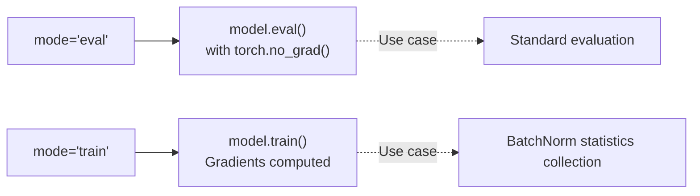

The `mode` parameter controls whether the model runs in eval or train mode during evaluation, useful for collecting batch normalization statistics.

**Sources:** [monai/engines/evaluator.py:44-172](), [monai/engines/evaluator.py:131-137]()

### SupervisedEvaluator

`SupervisedEvaluator` ([monai/engines/evaluator.py:174-348]()) implements standard supervised evaluation:

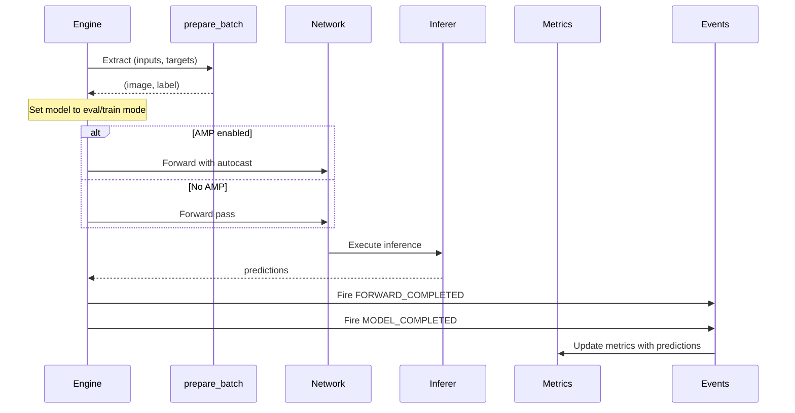

**Key Features:**

- **No gradient computation**: Operates in inference mode (unless `mode='train'`)
- **Inferer support**: Uses same `Inferer` abstraction as `SupervisedTrainer`
- **AMP support**: Automatic mixed precision for faster evaluation
- **torch.compile support**: Optional compilation (handles MetaTensor conversion)
- **Metric computation**: Attached metrics automatically compute during evaluation

**torch.compile Handling:**

When `compile=True`, the evaluator converts `MetaTensor` inputs to standard tensors before forward pass, then converts them back with metadata preserved ([monai/engines/evaluator.py:304-343]()):

```python
if self.compile and isinstance(inputs, MetaTensor):
    inputs, inputs_meta, inputs_applied_operations = (
        inputs.as_tensor(),
        inputs.meta,
        inputs.applied_operations,
    )
    # ... forward pass ...
    # Convert back to MetaTensor with metadata
    engine.state.output[Keys.IMAGE] = MetaTensor(
        inputs, meta=inputs_meta, applied_operations=inputs_applied_operations
    )
```

**Sources:** [monai/engines/evaluator.py:174-348]()

### EnsembleEvaluator

`EnsembleEvaluator` ([monai/engines/evaluator.py:350-504]()) evaluates multiple models and returns predictions from all:

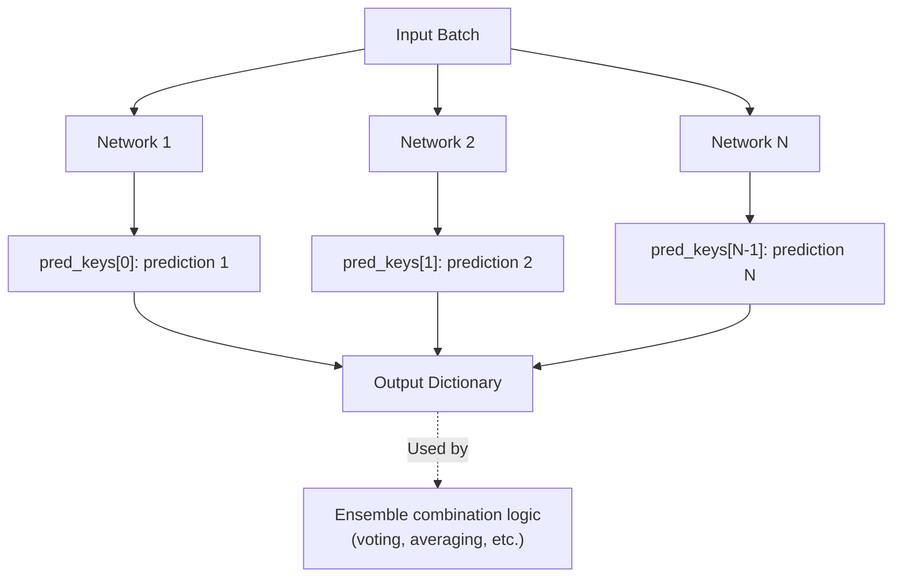

**Configuration:**

```python
evaluator = EnsembleEvaluator(
    device=device,
    val_data_loader=val_loader,
    networks=[model1, model2, model3],
    pred_keys=["pred_model1", "pred_model2", "pred_model3"],  # Optional
    # If pred_keys=None, uses ["pred_0", "pred_1", "pred_2"]
)
```

**Iteration Output:**

The `engine.state.output` dictionary contains:
- `CommonKeys.IMAGE`: Input images
- `CommonKeys.LABEL`: Ground truth labels
- `pred_keys[i]`: Prediction from network `i`

This enables downstream ensemble strategies (voting, averaging, etc.) via postprocessing transforms or metrics.

**Sources:** [monai/engines/evaluator.py:350-504]()

---

## Inferer Abstraction

### Purpose

The `Inferer` interface ([monai/inferers/inferer.py]()) decouples inference logic from engine logic, enabling:

- **Sliding window inference** for large medical images
- **Test-time augmentation** strategies
- **Custom inference patterns** without modifying engines

### Common Inferers

| Inferer | Purpose |
|---------|---------|
| `SimpleInferer` | Direct `network(input)` call |
| `SlidingWindowInferer` | Patches large images, aggregates predictions |
| `SlidingWindowInfererAdapt` | Adaptive sliding window based on memory |

**Usage Example:**

```python
from monai.inferers import SlidingWindowInferer

inferer = SlidingWindowInferer(
    roi_size=(96, 96, 96),
    sw_batch_size=4,
    overlap=0.5
)

trainer = SupervisedTrainer(
    ...,
    inferer=inferer  # Engine uses this for all forward passes
)
```

**Sources:** [monai/engines/trainer.py:191](), [monai/engines/evaluator.py:276]()

---

## Metrics Integration

### Automatic Metric Attachment

When `key_metric` or `additional_metrics` are provided to `Workflow`, they're automatically attached to the engine:

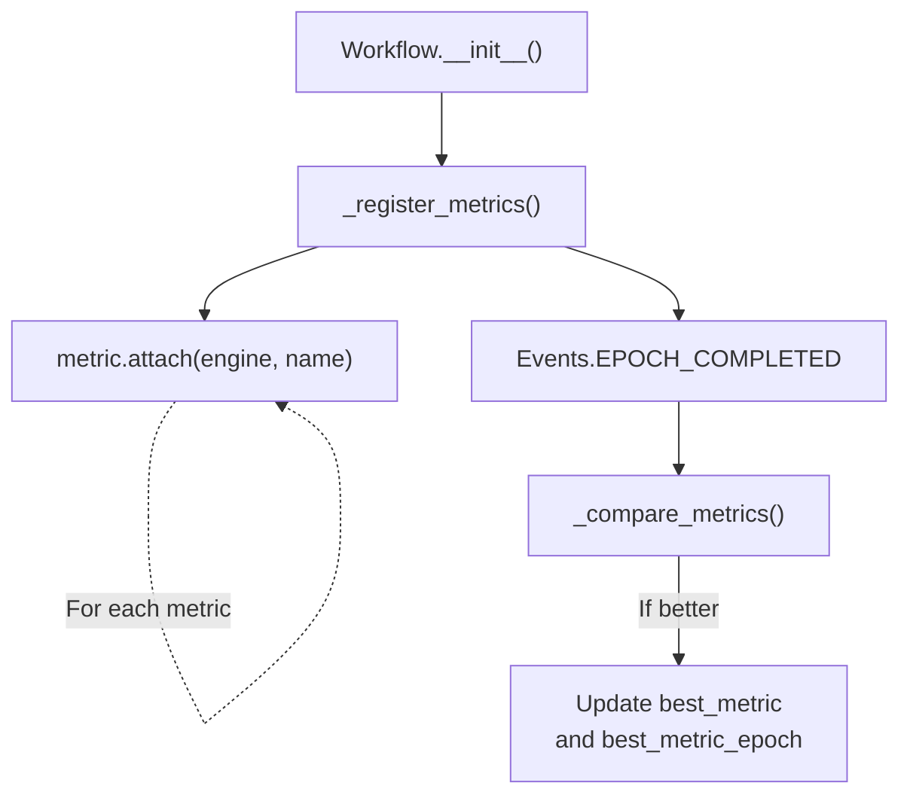

**Key Metric Comparison:**

The `metric_cmp_fn` (default: greater than) compares current metric value with `engine.state.best_metric`. If current is better, updates are stored in state ([monai/engines/workflow.py:243-260]()):

```python
if self.metric_cmp_fn(current_val_metric, engine.state.best_metric):
    self.logger.info(f"Got new best metric of {key_metric_name}: {current_val_metric}")
    engine.state.best_metric = current_val_metric
    engine.state.best_metric_epoch = engine.state.epoch
```

**Sources:** [monai/engines/workflow.py:227-260]()

### Metric State Access

Metrics can be accessed via `engine.state.metrics`:

```python
trainer.run()
print(f"Final loss: {trainer.state.metrics['train_loss']}")
print(f"Best metric: {trainer.state.best_metric} at epoch {trainer.state.best_metric_epoch}")
```

---

## Automatic Mixed Precision (AMP)

### Configuration

AMP is enabled via the `amp` parameter:

```python
trainer = SupervisedTrainer(
    ...,
    amp=True,
    amp_kwargs={
        "dtype": torch.float16,  # Optional: control precision
        "enabled": True
    }
)
```

**Sources:** [monai/engines/workflow.py:165-167]()

### Training with AMP

When `amp=True`, `SupervisedTrainer` uses `torch.cuda.amp.GradScaler`:

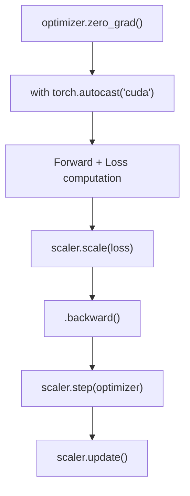

**Code Location:** [monai/engines/trainer.py:251-257]()

### Evaluation with AMP

`SupervisedEvaluator` uses AMP without `GradScaler` (inference only):

```python
if engine.amp:
    with torch.autocast("cuda", **engine.amp_kwargs):
        engine.state.output[Keys.PRED] = engine.inferer(inputs, engine.network)
```

**Sources:** [monai/engines/evaluator.py:326-330]()

---

## Distributed Training Support

### DistributedSampler Integration

The `Workflow` automatically handles `DistributedSampler` epoch setting:

```python
if isinstance(sampler, DistributedSampler):
    @self.on(Events.EPOCH_STARTED)
    def set_sampler_epoch(engine: Engine) -> None:
        sampler.set_epoch(engine.state.epoch)
```

This ensures proper shuffling across epochs in distributed training.

**Sources:** [monai/engines/workflow.py:126-134]()

### Rank Tracking

The engine state tracks the process rank:

```python
self.state.rank = dist.get_rank() if dist.is_available() and dist.is_initialized() else 0
```

This is accessible via `engine.state.rank` and included in `get_stats()` output.

**Sources:** [monai/engines/workflow.py:145]()

---

## Complete Training Example

### Basic Supervised Training

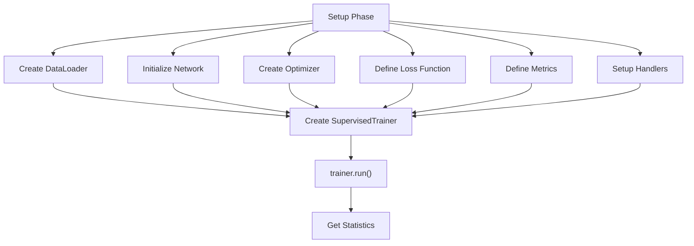

**Typical Code Structure:**

```python
from monai.engines import SupervisedTrainer
from monai.handlers import CheckpointSaver, StatsHandler
from monai.metrics import DiceMetric

# Component setup
trainer = SupervisedTrainer(
    device=device,
    max_epochs=100,
    train_data_loader=train_loader,
    network=unet,
    optimizer=optimizer,
    loss_function=loss,
    inferer=SlidingWindowInferer(...),
    postprocessing=Compose([AsDiscrete(...)]),
    key_train_metric={"train_dice": DiceMetric()},
    train_handlers=[
        CheckpointSaver(...),
        StatsHandler(...),
    ],
    amp=True,
    decollate=True,
)

# Execute training
trainer.run()

# Access results
stats = trainer.get_stats("iteration", "epoch")
```

**Sources:** [monai/engines/trainer.py:136-193]()

---

## State Management and Statistics

### get_stats() Method

Both `Trainer` and `Evaluator` provide `get_stats()` methods for extracting state information:

**Trainer Statistics:**

```python
stats = trainer.get_stats()
# Returns:
{
    'rank': 0,
    'current_epoch': 50,
    'current_iteration': 5000,
    'total_epochs': 100,
    'total_iterations': 100  # per epoch
}
```

**Evaluator Statistics:**

```python
stats = evaluator.get_stats()
# Returns:
{
    'rank': 0,
    'best_validation_epoch': 45,
    'best_validation_metric': 0.923
}
```

**Custom Variables:**

```python
stats = trainer.get_stats("learning_rate", "custom_field")
# Adds learning_rate and custom_field from engine.state if they exist
```

**Sources:** [monai/engines/trainer.py:57-77](), [monai/engines/evaluator.py:153-171](), [monai/engines/workflow.py:299-308]()

---

## Summary of Key Classes

| Class | File | Primary Use Case |
|-------|------|------------------|
| `Workflow` | workflow.py:47-309 | Base class for all engines |
| `Trainer` | trainer.py:42-78 | Base training class |
| `SupervisedTrainer` | trainer.py:80-279 | Standard supervised learning |
| `GanTrainer` | trainer.py:281-468 | GAN training with G/D alternation |
| `AdversarialTrainer` | trainer.py:470-658 | Adversarial reconstruction training |
| `Evaluator` | evaluator.py:44-172 | Base evaluation class |
| `SupervisedEvaluator` | evaluator.py:174-348 | Standard model evaluation |
| `EnsembleEvaluator` | evaluator.py:350-504 | Multi-model ensemble evaluation |

**Event System:**

| Event Enum | Events |
|------------|--------|
| `IterationEvents` | FORWARD_COMPLETED, LOSS_COMPLETED, BACKWARD_COMPLETED, MODEL_COMPLETED, INNER_ITERATION_STARTED, INNER_ITERATION_COMPLETED |
| `AdversarialIterationEvents` | G/D-specific training events |

**Utility Classes:**

| Class | Purpose |
|-------|---------|
| `PrepareBatchDefault` | Standard batch preparation |
| `PrepareBatchExtraInput` | Extra network arguments |
| `DiffusionPrepareBatch` | Diffusion model training |
| `VPredictionPrepareBatch` | Velocity prediction diffusion |

**Sources:** [monai/engines/__init__.py:1-30]()

---

