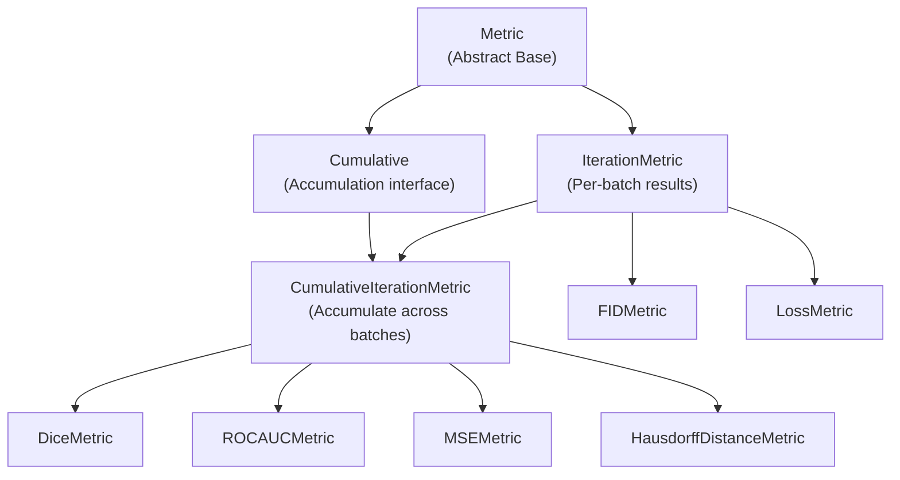
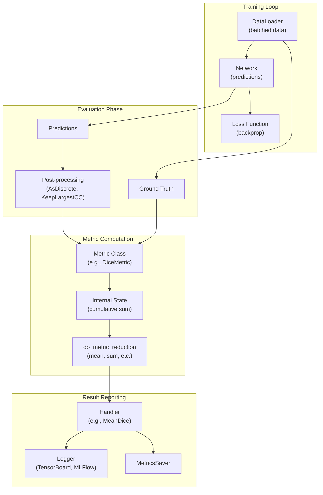
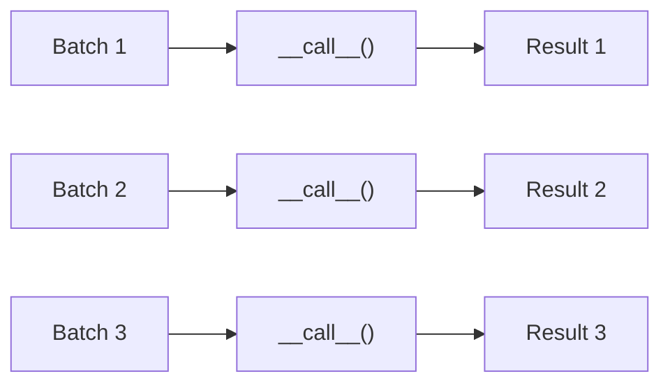
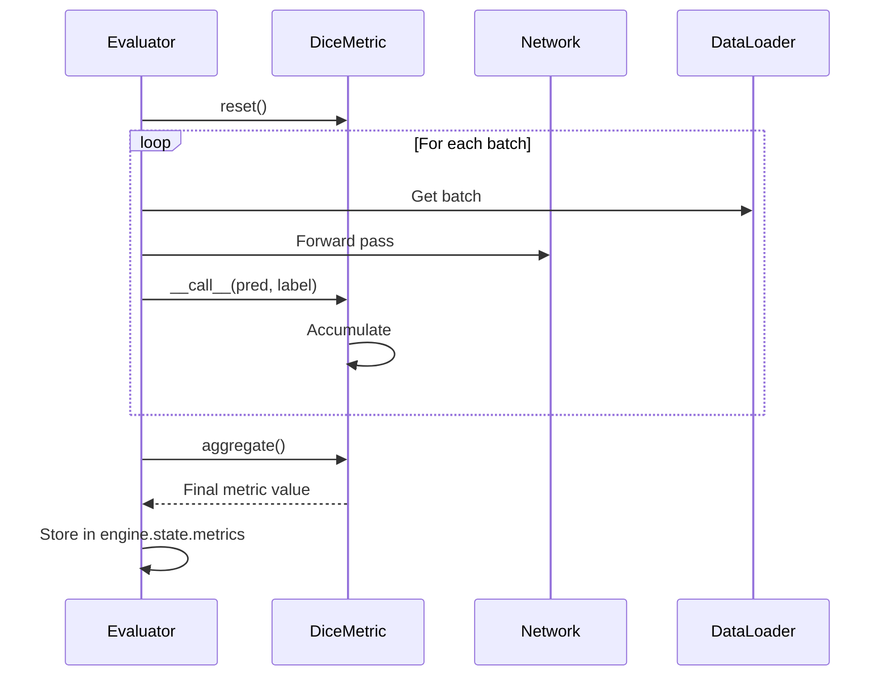
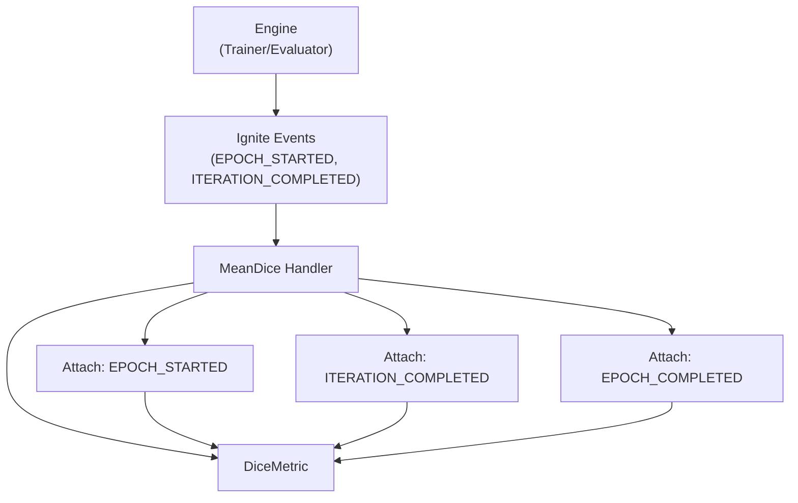

<!-- source: DeepWiki mcp.deepwiki.com · repo Project-MONAI/MONAI · page 5.3 Metrics · fetched 2026-10-21 -->

# Metrics

<details>
<summary>Relevant source files</summary>

The following files were used as context for generating this wiki page:

- [docs/source/handlers.rst](docs/source/handlers.rst)
- [docs/source/metrics.rst](docs/source/metrics.rst)
- [monai/handlers/__init__.py](monai/handlers/__init__.py)
- [monai/metrics/__init__.py](monai/metrics/__init__.py)
- [tests/min_tests.py](tests/min_tests.py)

</details>


## Purpose and Scope

This page documents MONAI's metrics system, which provides quantitative evaluation capabilities for medical imaging tasks including segmentation, classification, regression, and generative modeling. Metrics compute performance measures during validation and testing phases of the training workflow.

For information about how metrics integrate into training loops via event handlers, see [Handlers](#5.4). For the workflow engines that execute training and evaluation, see [Training Engines and Workflows](#5.2).

**Sources:** [monai/metrics/__init__.py:1-44](), [docs/source/metrics.rst:1-189]()

---

## System Overview

The metrics module provides two primary interfaces for computing performance measures:

1. **Standalone functions** (prefixed with `compute_*`) - Functional interface for one-time calculations
2. **Metric classes** (suffixed with `Metric`) - Stateful accumulators for batch-wise computation

Metric classes inherit from base abstractions that define accumulation patterns (per-iteration vs cumulative) and integrate with PyTorch Ignite's event system through the workflow engines. Each metric supports configurable reduction strategies (mean, sum, mean_batch, etc.) and handles background class exclusion for segmentation tasks.

**Sources:** [monai/metrics/__init__.py:13-43](), [docs/source/metrics.rst:15-189]()

---

## Metric Architecture

### Base Class Hierarchy



**Diagram: Metric Class Inheritance Structure**

The `Metric` base class defines the interface for all metrics. `IterationMetric` returns results for each batch without accumulation. `Cumulative` provides methods for accumulating state across batches (`reset`, `aggregate`). `CumulativeIterationMetric` combines both patterns, accumulating internal state while exposing per-batch results.

**Sources:** [monai/metrics/__init__.py:26-27](), [docs/source/metrics.rst:15-47]()

---

## Metric Categories

### Segmentation Metrics

Segmentation metrics evaluate spatial overlap and boundary quality between predicted and ground truth masks.

| Metric Class | Compute Function | Purpose |
|--------------|------------------|---------|
| `DiceMetric` | `compute_dice` | Sørensen-Dice coefficient for overlap |
| `MeanIoU` | `compute_iou` | Intersection over Union (Jaccard index) |
| `GeneralizedDiceScore` | `compute_generalized_dice` | Weighted Dice for class imbalance |
| `HausdorffDistanceMetric` | `compute_hausdorff_distance` | Maximum boundary distance |
| `SurfaceDistanceMetric` | `compute_average_surface_distance` | Average boundary distance |
| `SurfaceDiceMetric` | `compute_surface_dice` | Dice computed on surface boundaries |
| `PanopticQualityMetric` | `compute_panoptic_quality` | Combined segmentation and detection quality |

The `DiceMetric` is the most commonly used segmentation metric. It includes a `DiceHelper` class that handles various input formats and reduction strategies.

**Sources:** [monai/metrics/__init__.py:21-28](), [docs/source/metrics.rst:54-124]()

---

### Classification Metrics

Classification metrics evaluate prediction accuracy and discrimination capability.

| Metric Class | Compute Function | Purpose |
|--------------|------------------|---------|
| `ROCAUCMetric` | `compute_roc_auc` | Area under ROC curve |
| `AveragePrecisionMetric` | `compute_average_precision` | Area under precision-recall curve |
| `ConfusionMatrixMetric` | `get_confusion_matrix`, `compute_confusion_matrix_metric` | Confusion matrix and derived metrics (accuracy, sensitivity, specificity) |
| `FBetaScore` | N/A | F-beta score (harmonic mean of precision and recall) |

The `ConfusionMatrixMetric` can compute multiple derived metrics from the confusion matrix including accuracy, sensitivity, specificity, precision, and F1 score based on configuration.

**Sources:** [monai/metrics/__init__.py:15-18](), [docs/source/metrics.rst:76-96]()

---

### Regression Metrics

Regression metrics measure prediction error and quality for continuous outputs.

| Metric Class | Purpose |
|--------------|---------|
| `MSEMetric` | Mean squared error |
| `MAEMetric` | Mean absolute error |
| `RMSEMetric` | Root mean squared error |
| `PSNRMetric` | Peak signal-to-noise ratio |
| `SSIMMetric` | Structural similarity index |
| `MultiScaleSSIMMetric` | Multi-scale structural similarity |

The `SSIMMetric` and `MultiScaleSSIMMetric` use `compute_ssim_and_cs` and `compute_ms_ssim` functions respectively. These are particularly useful for image quality assessment in reconstruction tasks.

**Sources:** [monai/metrics/__init__.py:29-38](), [docs/source/metrics.rst:126-152]()

---

### Generative Model Metrics

Generative model metrics evaluate the quality and diversity of generated samples.

| Metric Class | Compute Function | Purpose |
|--------------|------------------|---------|
| `FIDMetric` | `compute_frechet_distance` | Fréchet Inception Distance (distribution similarity) |
| `MMDMetric` | `compute_mmd` | Maximum Mean Discrepancy (distribution distance) |

These metrics require feature extraction from pretrained models (e.g., Inception-v3 for FID) and compute statistical distances between feature distributions of real and generated images.

**Sources:** [monai/metrics/__init__.py:19-27](), [docs/source/metrics.rst:154-166]()

---

### Specialized Metrics

Additional metrics for specific use cases:

| Metric Class | Compute Function | Purpose |
|--------------|------------------|---------|
| `LossMetric` | N/A | Wraps a loss function as a metric |
| `CumulativeAverage` | N/A | Running average across iterations |
| `VarianceMetric` | `compute_variance` | Variance for active learning |
| `LabelQualityScore` | `label_quality_score` | Label quality assessment |
| FROC metrics | `compute_fp_tp_probs`, `compute_froc_curve_data`, `compute_froc_score` | Free-Response ROC for detection |

The `LossMetric` enables tracking training loss as a metric, useful for monitoring convergence alongside evaluation metrics.

**Sources:** [monai/metrics/__init__.py:14-23](), [docs/source/metrics.rst:20-33](), [docs/source/metrics.rst:49-51]()

---

## Metrics Reloaded Integration

MONAI integrates with the Metrics Reloaded library for standardized medical image analysis evaluation:

- `MetricsReloadedBinary` - Wrapper for binary segmentation metrics
- `MetricsReloadedCategorical` - Wrapper for multi-class segmentation metrics

These wrappers provide access to a comprehensive set of standardized metrics following community best practices.

**Sources:** [monai/metrics/__init__.py:43](), [docs/source/metrics.rst:173-181]()

---

## Metric Computation Flow



**Diagram: Metric Computation Pipeline in Training Workflow**

During evaluation, predictions and ground truth flow through post-processing transforms before metric computation. Metric classes accumulate results across batches, apply reduction strategies, and emit values that handlers attach to logging systems.

**Sources:** [monai/metrics/__init__.py:42](), [docs/source/handlers.rst:20-108]()

---

## Accumulation Patterns

### Iteration Metrics

`IterationMetric` subclasses compute and return results for each batch independently:



**Diagram: Iteration Metric Pattern (Stateless)**

Examples: `FIDMetric`, `LossMetric`

**Sources:** [docs/source/metrics.rst:34-37]()

---

### Cumulative Metrics

`CumulativeIterationMetric` subclasses accumulate state across batches:


**Diagram: Cumulative Metric Pattern (Stateful)**

The workflow is:
1. `reset()` - Clear accumulated state at epoch start
2. `__call__(predictions, labels)` - Process batch and accumulate
3. `aggregate()` - Compute final metric from accumulated state

Most metrics follow this pattern: `DiceMetric`, `ROCAUCMetric`, `HausdorffDistanceMetric`, etc.

**Sources:** [docs/source/metrics.rst:44-47](), [monai/metrics/__init__.py:26]()

---

## Integration with Engines

### Direct Usage in Evaluator



**Diagram: Metric Usage in Evaluator Engine**

Metrics are attached to the evaluator's workflow and called automatically after each iteration. The engine manages the `reset()` and `aggregate()` lifecycle.

**Sources:** [monai/metrics/__init__.py:26-27]()

---

### Handler-Wrapped Metrics

Handlers provide a higher-level interface that wraps metrics and manages their lifecycle:



**Diagram: Handler-Based Metric Management**

Handlers automatically attach metrics to engine events and store results in `engine.state.metrics`. For example, `MeanDice` handler wraps `DiceMetric`.

**Sources:** [docs/source/handlers.rst:38-46](), [monai/handlers/__init__.py:27]()

---

## Metric Utilities

The `monai.metrics.utils` module provides helper functions:

| Function | Purpose |
|----------|---------|
| `do_metric_reduction` | Apply reduction strategy (mean, sum, mean_batch, sum_batch, mean_channel, none) |
| `ignore_background` | Remove background class from metric computation |
| `get_mask_edges` | Extract mask boundaries for surface-based metrics |
| `get_surface_distance` | Compute distances between surfaces |
| `is_binary_tensor` | Check if tensor contains only 0 and 1 |

The `do_metric_reduction` function is used internally by all metrics to apply the configured reduction strategy across spatial dimensions, channels, or batches.

**Sources:** [monai/metrics/__init__.py:42](), [docs/source/metrics.rst:185-189]()

---

## Common Usage Patterns

### Pattern 1: Functional Interface

For one-time computation without state accumulation:

```python
from monai.metrics import compute_dice

dice_score = compute_dice(predictions, labels, include_background=False)
```

**Sources:** [monai/metrics/__init__.py:24]()

---

### Pattern 2: Metric Class in Evaluation Loop

For accumulation across batches:

```python
from monai.metrics import DiceMetric

dice_metric = DiceMetric(include_background=False, reduction="mean")

# In evaluation loop
dice_metric.reset()
for batch in dataloader:
    predictions = model(batch["image"])
    dice_metric(y_pred=predictions, y=batch["label"])

result = dice_metric.aggregate()
```

**Sources:** [monai/metrics/__init__.py:24]()

---

### Pattern 3: Handler Integration

Automatic metric management via handlers:

```python
from monai.handlers import MeanDice

validation_handlers = [
    MeanDice(
        include_background=False,
        output_transform=from_engine(["pred", "label"])
    )
]

evaluator.run()
dice_value = evaluator.state.metrics["mean_dice"]
```

**Sources:** [monai/handlers/__init__.py:27](), [docs/source/handlers.rst:38-41]()

---

## Reduction Strategies

Metrics support multiple reduction strategies via the `reduction` parameter:

| Strategy | Behavior |
|----------|----------|
| `"mean"` | Mean across batch and spatial dimensions |
| `"sum"` | Sum across batch and spatial dimensions |
| `"mean_batch"` | Mean across batch, keep spatial dims |
| `"sum_batch"` | Sum across batch, keep spatial dims |
| `"mean_channel"` | Mean across channels |
| `"none"` | No reduction, return per-element values |

The reduction is applied by `do_metric_reduction` after computing per-element metric values.

**Sources:** [monai/metrics/__init__.py:42]()

---

## Background Handling

Segmentation metrics provide the `include_background` parameter:

- `include_background=True` - Include class 0 in metric computation
- `include_background=False` - Exclude class 0 (typically background)

The `ignore_background` utility function removes the background channel before computation, which is important for medical imaging where background often dominates the image and skews metrics.

**Sources:** [monai/metrics/__init__.py:42]()

---

## Test Coverage

Metric tests are primarily excluded from minimal test runs due to dependencies. Key test files include:

- Segmentation: `test_meandice`, `test_meaniou`, `test_hausdorff_distance`, `test_surface_distance`, `test_surface_dice`
- Classification: `test_compute_roc_auc`, `test_confusion_matrix`
- Regression: `test_regression_metrics`
- Integration: `test_handler_mean_dice`, `test_handler_rocauc`, `test_handler_confusion_matrix`
- External: `test_metrics_reloaded`

**Sources:** [tests/min_tests.py:46-112]()

---

## Summary Table of All Metrics

| Category | Metric | Class | Compute Function |
|----------|--------|-------|------------------|
| **Segmentation** | Dice | `DiceMetric` | `compute_dice` |
| | IoU | `MeanIoU` | `compute_iou` |
| | Generalized Dice | `GeneralizedDiceScore` | `compute_generalized_dice` |
| | Hausdorff Distance | `HausdorffDistanceMetric` | `compute_hausdorff_distance` |
| | Surface Distance | `SurfaceDistanceMetric` | `compute_average_surface_distance` |
| | Surface Dice | `SurfaceDiceMetric` | `compute_surface_dice` |
| | Panoptic Quality | `PanopticQualityMetric` | `compute_panoptic_quality` |
| **Classification** | ROC AUC | `ROCAUCMetric` | `compute_roc_auc` |
| | Average Precision | `AveragePrecisionMetric` | `compute_average_precision` |
| | Confusion Matrix | `ConfusionMatrixMetric` | `get_confusion_matrix`, `compute_confusion_matrix_metric` |
| | F-Beta Score | `FBetaScore` | - |
| | FROC | - | `compute_fp_tp_probs`, `compute_froc_curve_data`, `compute_froc_score` |
| **Regression** | MSE | `MSEMetric` | - |
| | MAE | `MAEMetric` | - |
| | RMSE | `RMSEMetric` | - |
| | PSNR | `PSNRMetric` | - |
| | SSIM | `SSIMMetric` | `compute_ssim_and_cs` |
| | Multi-Scale SSIM | `MultiScaleSSIMMetric` | `compute_ms_ssim` |
| **Generative** | FID | `FIDMetric` | `compute_frechet_distance` |
| | MMD | `MMDMetric` | `compute_mmd` |
| **Utility** | Loss | `LossMetric` | - |
| | Cumulative Average | `CumulativeAverage` | - |
| | Variance | `VarianceMetric` | `compute_variance` |
| | Label Quality | `LabelQualityScore` | `label_quality_score` |

**Sources:** [monai/metrics/__init__.py:14-43]()

---

