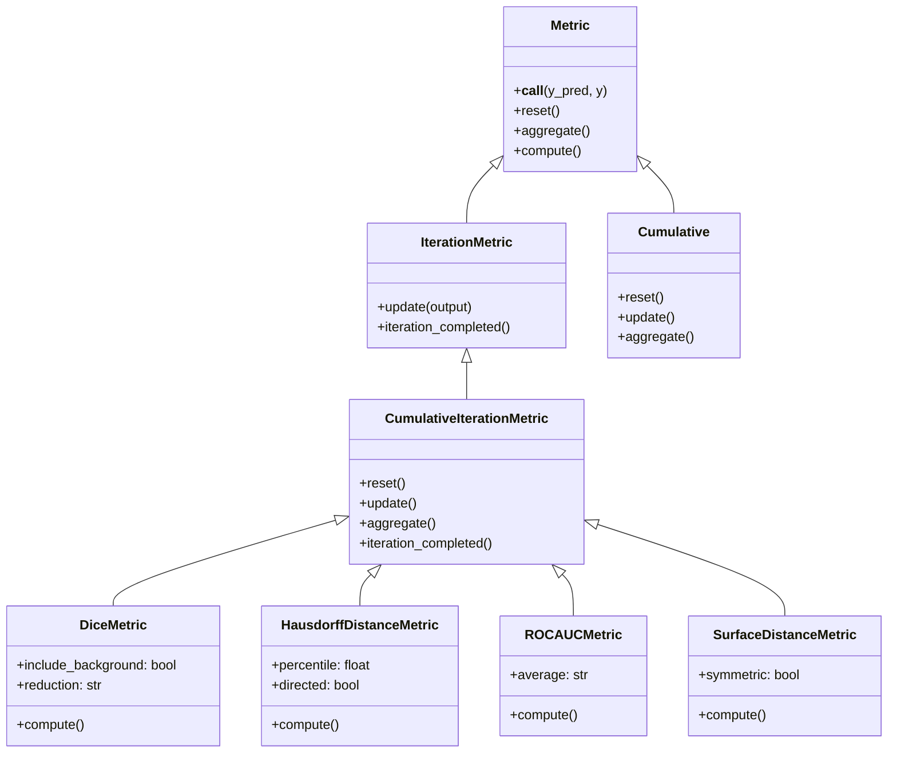
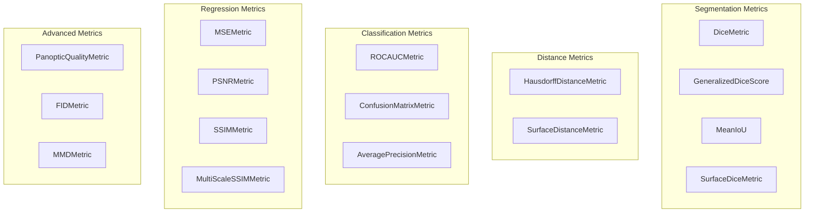
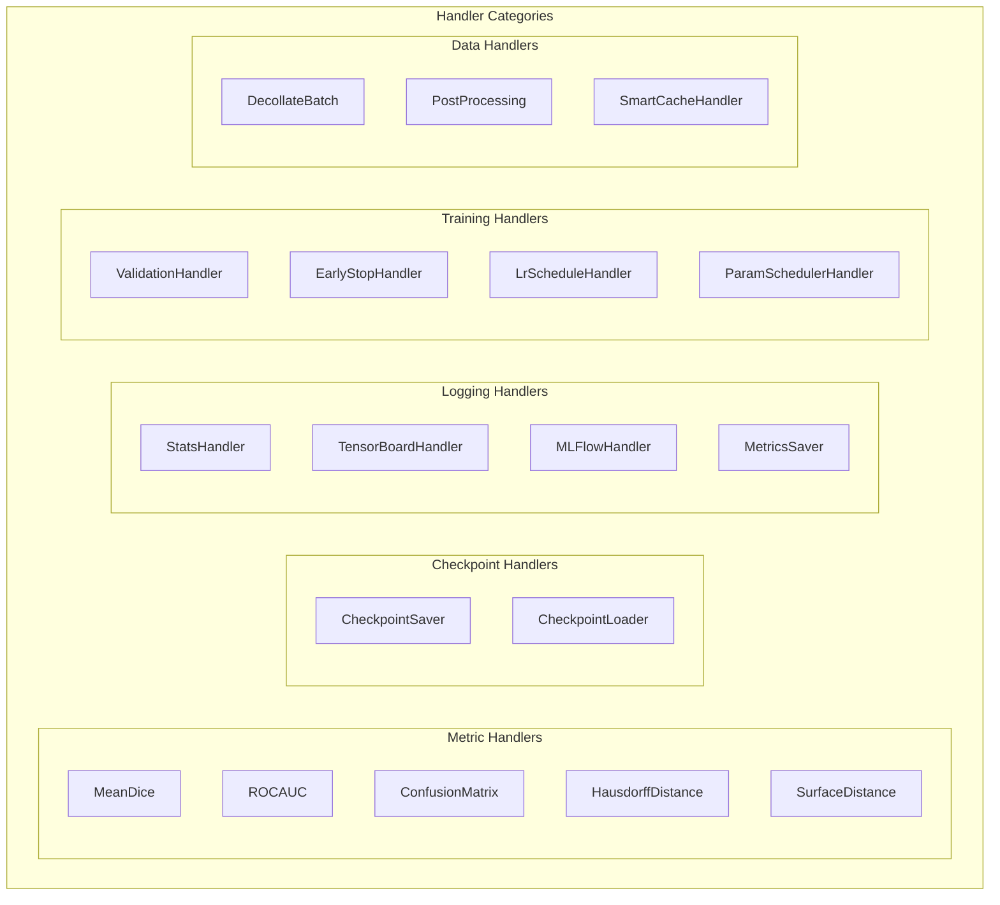
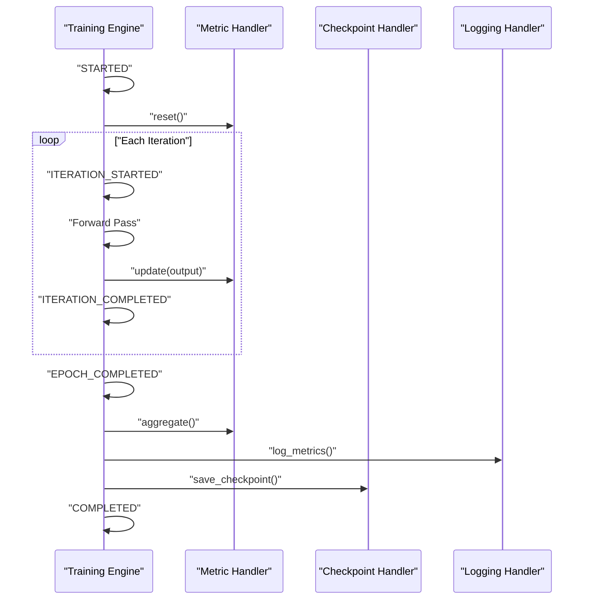
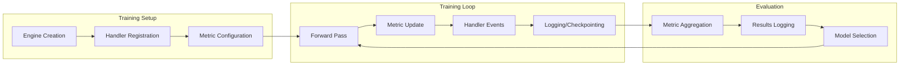

<!-- source: DeepWiki mcp.deepwiki.com · repo Project-MONAI/MONAI · page 5.4 Handlers · fetched 2026-10-21 -->

# Metrics and Handlers

Relevant source files

The following files were used as context for generating this wiki page:

- [docs/source/handlers.rst](docs/source/handlers.rst)
- [docs/source/metrics.rst](docs/source/metrics.rst)
- [monai/handlers/__init__.py](monai/handlers/__init__.py)
- [monai/metrics/__init__.py](monai/metrics/__init__.py)
- [tests/min_tests.py](tests/min_tests.py)

This document covers MONAI's metrics and handlers systems, which provide comprehensive evaluation capabilities and workflow management for medical imaging AI applications. The metrics system offers specialized evaluation functions for medical imaging tasks, while the handlers system provides event-driven workflow management during training and inference.

For information about the underlying training workflows that use these systems, see [Training Engines](#3.3). For model inference strategies, see [Inference System](#3.5).

## Purpose and Scope

The metrics and handlers systems work together to provide:

- **Evaluation metrics** tailored for medical imaging (Dice, Hausdorff distance, surface metrics)
- **Event-driven handlers** for workflow management during training and evaluation
- **Integration with PyTorch Ignite** for standardized training loops
- **Logging and monitoring** capabilities for experiment tracking
- **Checkpoint management** and model persistence

## Metrics System Architecture

The metrics system is built around a hierarchical class structure that provides both standalone evaluation functions and integrated workflow metrics.

Sources: [monai/metrics/__init__.py:16-43](), [docs/source/metrics.rst:15-189]()

### Core Metric Classes

| Metric Class | Purpose | Key Features |
|--------------|---------|--------------|
| `Metric` | Base metric interface | Abstract base for all metrics |
| `IterationMetric` | Per-iteration metrics | Updates during training iterations |
| `Cumulative` | Accumulating metrics | Tracks values across batches |
| `CumulativeIterationMetric` | Combined functionality | Accumulates and updates per iteration |

### Medical Imaging Specific Metrics

The system provides specialized metrics for medical imaging evaluation:

Sources: [monai/metrics/__init__.py:14-43](), [docs/source/metrics.rst:54-182]()

## Handlers System Architecture

Handlers provide event-driven functionality that integrates with PyTorch Ignite's training loop system. They respond to specific events during training, validation, and inference.

Sources: [monai/handlers/__init__.py:14-46](), [docs/source/handlers.rst:9-223]()

### Handler Event Integration

Handlers respond to specific events in the training workflow:

Sources: [monai/handlers/__init__.py:14-46]()

## Key Handler Types

### Metric-Specific Handlers

These handlers integrate specific metrics into the training workflow:

| Handler | Associated Metric | Purpose |
|---------|------------------|---------|
| `MeanDice` | `DiceMetric` | Dice coefficient for segmentation |
| `ROCAUC` | `ROCAUCMetric` | ROC AUC for classification |
| `ConfusionMatrix` | `ConfusionMatrixMetric` | Classification confusion matrix |
| `HausdorffDistance` | `HausdorffDistanceMetric` | Hausdorff distance for segmentation |
| `SurfaceDistance` | `SurfaceDistanceMetric` | Surface distance metrics |

### Workflow Management Handlers

| Handler | Purpose | Key Events |
|---------|---------|------------|
| `ValidationHandler` | Runs validation during training | `EPOCH_COMPLETED` |
| `CheckpointSaver` | Saves model checkpoints | `EPOCH_COMPLETED` |
| `EarlyStopHandler` | Implements early stopping | `EPOCH_COMPLETED` |
| `LrScheduleHandler` | Learning rate scheduling | `ITERATION_COMPLETED`, `EPOCH_COMPLETED` |

Sources: [docs/source/handlers.rst:38-177]()

## Integration with Training Workflows

The metrics and handlers systems integrate seamlessly with MONAI's training engines:

Sources: [monai/handlers/__init__.py:14-46](), [monai/metrics/__init__.py:14-43]()

## Specialized Features

### Metrics Reloaded Integration

MONAI provides wrappers for the metrics-reloaded library:

- `MetricsReloadedBinary` - Binary classification metrics
- `MetricsReloadedCategorical` - Multi-class classification metrics
- `MetricsReloadedBinaryHandler` - Handler for binary metrics
- `MetricsReloadedCategoricalHandler` - Handler for categorical metrics

### External Logging Integration

The handlers system supports multiple logging backends:

| Handler | Backend | Purpose |
|---------|---------|---------|
| `TensorBoardHandler` | TensorBoard | Scalar and image logging |
| `MLFlowHandler` | MLflow | Experiment tracking |
| `ClearMLHandler` | ClearML | Experiment management |

### Advanced Functionality

- **Distributed Training Support**: Many handlers work in distributed settings
- **GPU Memory Management**: `GarbageCollector` for memory optimization  
- **Smart Caching**: `SmartCacheHandler` for intelligent data caching
- **NVTX Profiling**: Handlers for NVIDIA profiling integration

Sources: [monai/handlers/__init__.py:18-44](), [monai/metrics/__init__.py:43](), [tests/min_tests.py:78-111]()

---

