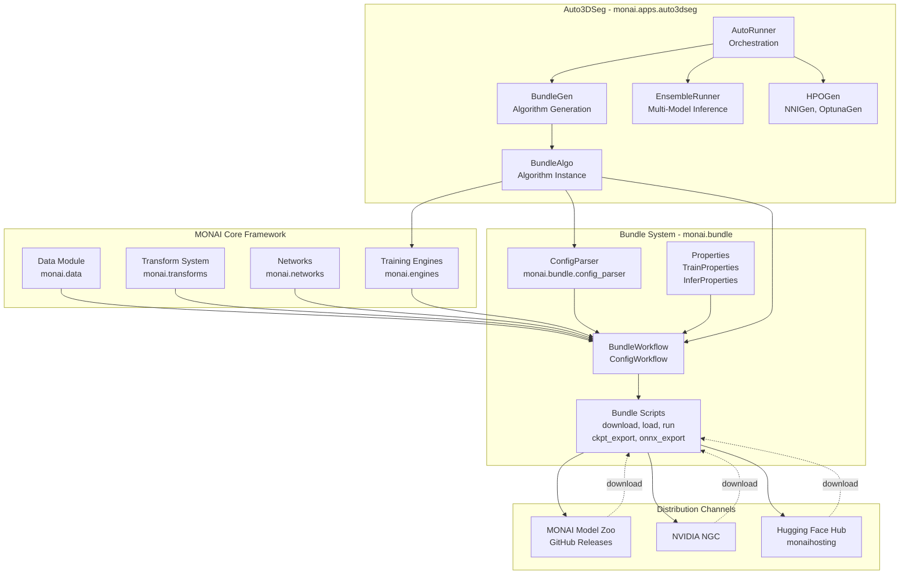
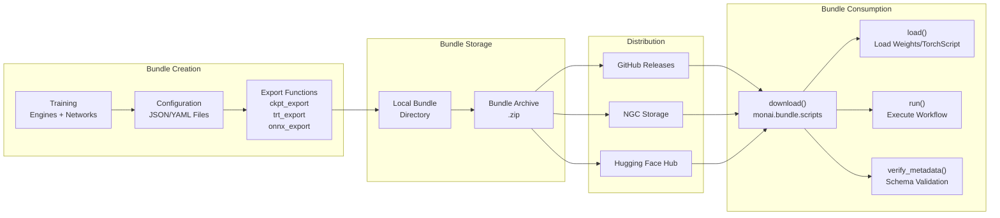
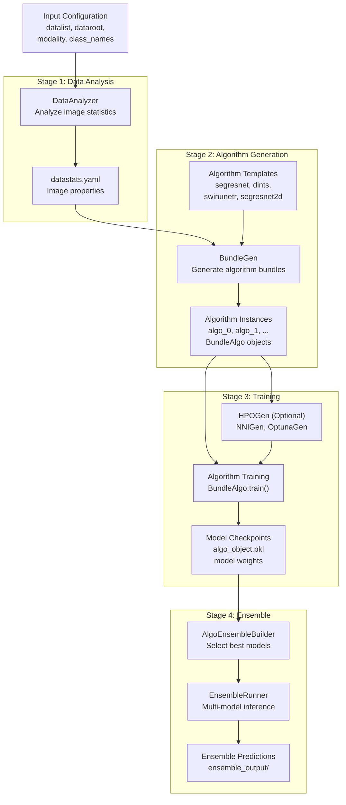
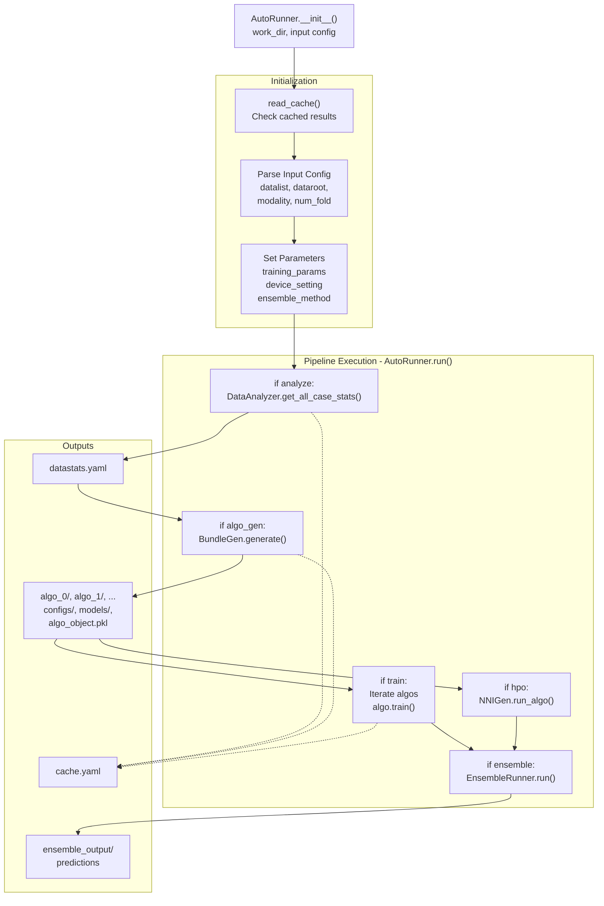
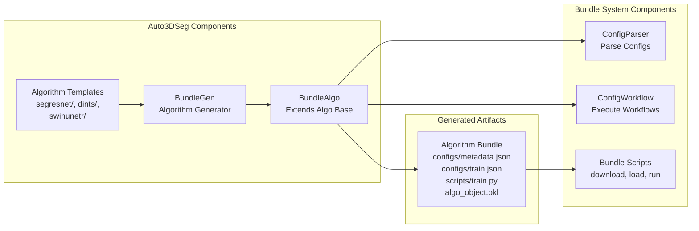

<!-- source: DeepWiki mcp.deepwiki.com · repo Project-MONAI/MONAI · page 6 Advanced Features · fetched 2026-10-21 -->

# Advanced Features

<details>
<summary>Relevant source files</summary>

The following files were used as context for generating this wiki page:

- [README.md](README.md)
- [docs/images/MONAI_arch.png](docs/images/MONAI_arch.png)
- [docs/images/MONAI_bundle_cloud.png](docs/images/MONAI_bundle_cloud.png)
- [docs/images/MONAI_clouds.png](docs/images/MONAI_clouds.png)
- [docs/images/MONAI_map_cloud.png](docs/images/MONAI_map_cloud.png)
- [docs/source/bundle.rst](docs/source/bundle.rst)
- [docs/source/bundle_intro.rst](docs/source/bundle_intro.rst)
- [docs/source/index.rst](docs/source/index.rst)
- [docs/source/mb_specification.rst](docs/source/mb_specification.rst)
- [monai/apps/auto3dseg/__init__.py](monai/apps/auto3dseg/__init__.py)
- [monai/apps/auto3dseg/__main__.py](monai/apps/auto3dseg/__main__.py)
- [monai/apps/auto3dseg/auto_runner.py](monai/apps/auto3dseg/auto_runner.py)
- [monai/apps/auto3dseg/bundle_gen.py](monai/apps/auto3dseg/bundle_gen.py)
- [monai/apps/auto3dseg/ensemble_builder.py](monai/apps/auto3dseg/ensemble_builder.py)
- [monai/apps/auto3dseg/hpo_gen.py](monai/apps/auto3dseg/hpo_gen.py)
- [monai/apps/auto3dseg/utils.py](monai/apps/auto3dseg/utils.py)
- [monai/auto3dseg/algo_gen.py](monai/auto3dseg/algo_gen.py)
- [monai/auto3dseg/utils.py](monai/auto3dseg/utils.py)
- [monai/bundle/__init__.py](monai/bundle/__init__.py)
- [monai/bundle/__main__.py](monai/bundle/__main__.py)
- [monai/bundle/properties.py](monai/bundle/properties.py)
- [monai/bundle/scripts.py](monai/bundle/scripts.py)
- [monai/bundle/workflows.py](monai/bundle/workflows.py)
- [tests/bundle/test_bundle_download.py](tests/bundle/test_bundle_download.py)
- [tests/networks/nets/test_autoencoderkl.py](tests/networks/nets/test_autoencoderkl.py)
- [tests/nonconfig_workflow.py](tests/nonconfig_workflow.py)
- [tests/testing_data/fl_infer_properties.json](tests/testing_data/fl_infer_properties.json)
- [tests/testing_data/metadata.json](tests/testing_data/metadata.json)
- [tests/testing_data/python_workflow_properties.json](tests/testing_data/python_workflow_properties.json)
- [tests/testing_data/responsive_inference.json](tests/testing_data/responsive_inference.json)

</details>


## Purpose and Scope

This page provides an overview of MONAI's high-level automation and packaging systems that build upon the core framework. These advanced features enable distribution of trained models and automated training workflows for medical imaging tasks.

The two primary advanced features are:

- **Bundle System**: A standardized format for packaging and distributing trained models with metadata, configurations, and scripts. For detailed information, see [Bundle System](#6.1).
- **Auto3DSeg Pipeline**: An automated framework for 3D medical image segmentation that generates, trains, and ensembles multiple algorithms. For detailed information, see [Auto3DSeg Pipeline](#6.2).

For information about the foundational components these systems build upon, see:
- Core data processing and transforms: [Transform System](#3)
- Training and evaluation engines: [Training Engines and Workflows](#5.2)
- Network architectures: [Network Architectures and Components](#5.1)

---

## System Architecture

The advanced features layer sits above MONAI's core framework and provides application-ready functionality for model deployment and automated training.



**Sources:** [monai/bundle/__init__.py:1-47](), [monai/apps/auto3dseg/__init__.py:1-26](), [monai/bundle/workflows.py:1-60](), [monai/apps/auto3dseg/auto_runner.py:40-206]()

---

## Bundle System Overview

The Bundle System provides a standardized format for packaging MONAI models with their configurations, metadata, and execution scripts. Bundles enable reproducible training and inference workflows that can be easily shared and deployed.

### Key Components

| Component | Module/Class | Purpose |
|-----------|--------------|---------|
| Configuration Parser | `monai.bundle.ConfigParser` | Parse and instantiate objects from JSON/YAML configs |
| Workflow Engines | `ConfigWorkflow`, `PythonicWorkflow` | Execute training/inference workflows from config or Python |
| Bundle Scripts | `download()`, `load()`, `run()` | Command-line interface for bundle operations |
| Export Tools | `ckpt_export()`, `onnx_export()`, `trt_export()` | Convert models to different formats |
| Properties | `TrainProperties`, `InferProperties`, `MetaProperties` | Define standard bundle interfaces |

**Bundle Directory Structure:**

```
bundle_name/
├── configs/
│   ├── metadata.json       # Required: version, task, network format
│   ├── train.json          # Optional: training configuration
│   └── inference.json      # Optional: inference configuration
├── models/
│   ├── model.pt            # Required: PyTorch state dict
│   ├── model.ts            # Optional: TorchScript model
│   └── model.onnx          # Optional: ONNX model
├── scripts/                # Optional: custom Python scripts
└── docs/
    └── README.md           # Optional: documentation
```

**Sources:** [docs/source/mb_specification.rst:1-120](), [monai/bundle/scripts.py:1-100](), [monai/bundle/workflows.py:361-450]()

### Bundle Operations Workflow



**Sources:** [monai/bundle/scripts.py:446-626](), [monai/bundle/scripts.py:628-768](), [monai/bundle/scripts.py:1072-1273]()

### Primary Classes and Functions

**`ConfigParser`** [monai/bundle/config_parser.py]():
- Parses JSON/YAML configuration files with special syntax (`$`, `@`, `%`)
- Instantiates Python objects from configuration dictionaries
- Supports reference resolution and macro expansion

**`ConfigWorkflow`** [monai/bundle/workflows.py:361-600]():
- Base class for config-based training and inference workflows
- Manages property access via standardized interfaces
- Executes `initialize()`, `run()`, and `finalize()` methods

**Bundle Script Functions:**
- `download()` [monai/bundle/scripts.py:446-626](): Download bundles from multiple sources (GitHub, NGC, Hugging Face)
- `load()` [monai/bundle/scripts.py:628-768](): Load model weights or TorchScript modules
- `run()` [monai/bundle/scripts.py:1072-1273](): Execute training or inference workflows
- `verify_metadata()` [monai/bundle/scripts.py:1510-1586](): Validate metadata.json against schema

**Sources:** [monai/bundle/__init__.py:14-46](), [monai/bundle/workflows.py:1-60](), [monai/bundle/scripts.py:1-100]()

---

## Auto3DSeg Overview

Auto3DSeg is an automated pipeline for 3D medical image segmentation that analyzes datasets, generates multiple algorithm candidates, trains them with optional hyperparameter optimization, and produces ensemble predictions.

### Pipeline Stages



**Sources:** [monai/apps/auto3dseg/auto_runner.py:40-206](), [monai/apps/auto3dseg/bundle_gen.py:442-666](), [monai/apps/auto3dseg/ensemble_builder.py:397-650]()

### Core Classes

| Class | Location | Purpose |
|-------|----------|---------|
| `AutoRunner` | `monai.apps.auto3dseg.auto_runner` | Orchestrates entire pipeline with minimal user input |
| `BundleGen` | `monai.apps.auto3dseg.bundle_gen` | Generates algorithm bundles from templates |
| `BundleAlgo` | `monai.apps.auto3dseg.bundle_gen` | Individual algorithm instance with train/predict methods |
| `DataAnalyzer` | `monai.apps.auto3dseg.data_analyzer` | Analyzes dataset statistics |
| `EnsembleRunner` | `monai.apps.auto3dseg.ensemble_builder` | Executes ensemble inference on test data |
| `AlgoEnsembleBuilder` | `monai.apps.auto3dseg.ensemble_builder` | Selects best models for ensembling |
| `NNIGen` | `monai.apps.auto3dseg.hpo_gen` | Hyperparameter optimization via NNI |
| `OptunaGen` | `monai.apps.auto3dseg.hpo_gen` | Hyperparameter optimization via Optuna |

**Sources:** [monai/apps/auto3dseg/__init__.py:14-26](), [monai/apps/auto3dseg/auto_runner.py:40-206]()

### AutoRunner Execution Flow

The `AutoRunner` class [monai/apps/auto3dseg/auto_runner.py:40-206]() provides a simplified interface that manages the entire Auto3DSeg pipeline:



**Sources:** [monai/apps/auto3dseg/auto_runner.py:210-392](), [monai/apps/auto3dseg/auto_runner.py:694-925]()

### BundleAlgo: Algorithm Representation

`BundleAlgo` [monai/apps/auto3dseg/bundle_gen.py:53-369]() represents a single algorithm instance with the following key methods:

- `fill_template_config()` [monai/apps/auto3dseg/bundle_gen.py:154-169](): Populates configuration templates with dataset statistics
- `export_to_disk()` [monai/apps/auto3dseg/bundle_gen.py:171-194](): Writes bundle files to output directory
- `train()` [monai/apps/auto3dseg/bundle_gen.py:279-300](): Executes training with device configuration
- `get_score()` [monai/apps/auto3dseg/bundle_gen.py:302-313](): Returns validation metrics from training
- `get_inferer()` [monai/apps/auto3dseg/bundle_gen.py:315-351](): Loads inference class from scripts
- `predict()` [monai/apps/auto3dseg/bundle_gen.py:353-364](): Runs inference on input files

**Device Management:**

`BundleAlgo` manages multi-GPU and multi-node training through the `device_setting` dictionary [monai/apps/auto3dseg/bundle_gen.py:96-102]():

```python
device_setting = {
    "CUDA_VISIBLE_DEVICES": "0,1,2,3",  # GPU IDs
    "n_devices": 4,                      # Number of devices
    "NUM_NODES": 1,                      # Number of nodes
    "MN_START_METHOD": "bcprun",        # Multi-node launcher
    "CMD_PREFIX": ""                     # Command prefix
}
```

Training commands are created via `_create_cmd()` [monai/apps/auto3dseg/bundle_gen.py:196-246]() and executed via `_run_cmd()` [monai/apps/auto3dseg/bundle_gen.py:248-277](), supporting:
- Single GPU: Direct Python execution
- Multi-GPU: `torchrun` for distributed training
- Multi-node: `bcprun` for cluster execution

**Sources:** [monai/apps/auto3dseg/bundle_gen.py:53-369](), [monai/auto3dseg/utils.py:404-502]()

---

## Integration Between Bundle System and Auto3DSeg

Auto3DSeg leverages the Bundle System infrastructure to create standardized, distributable algorithms:



**Sources:** [monai/apps/auto3dseg/bundle_gen.py:442-524](), [monai/bundle/workflows.py:361-450]()

### Shared Configuration System

Both systems use `ConfigParser` [monai/bundle/config_parser.py]() for configuration management:

**Bundle Scripts Usage:**
- `download()` uses `ConfigParser.load_config_file()` to parse `args_file` [monai/bundle/scripts.py:529-540]()
- `load()` creates `ConfigWorkflow` which internally uses `ConfigParser` [monai/bundle/scripts.py:741-751]()
- `run()` instantiates workflows via `ConfigParser` [monai/bundle/scripts.py:1089-1132]()

**Auto3DSeg Usage:**
- `BundleAlgo.get_score()` reads validation metrics via `ConfigParser.load_config_file()` [monai/apps/auto3dseg/bundle_gen.py:311]()
- `BundleGen` uses `ConfigParser` to instantiate algorithm classes [monai/apps/auto3dseg/bundle_gen.py:508]()
- `AutoRunner` parses input config with `ConfigParser.load_config_file()` [monai/apps/auto3dseg/auto_runner.py:236]()

### Persistence and Serialization

Auto3DSeg algorithms are persisted as pickle files using utility functions that integrate with the Bundle System:

**`algo_to_pickle()`** [monai/auto3dseg/utils.py:277-297]():
```python
# Saves BundleAlgo instance to algo_object.pkl
data = {
    "algo_bytes": pickle.dumps(algo),
    "template_path": str(template_path),
    # Additional metadata like best_metric
}
pkl_filename = os.path.join(algo.get_output_path(), "algo_object.pkl")
```

**`algo_from_pickle()`** [monai/auto3dseg/utils.py:300-375]():
- Loads serialized algorithm instances
- Restores template paths for module imports
- Updates output paths if moved

These functions enable Auto3DSeg to save trained algorithms alongside their bundle artifacts, allowing the `EnsembleRunner` to reload them for inference [monai/apps/auto3dseg/utils.py:23-65]().

**Sources:** [monai/auto3dseg/utils.py:277-375](), [monai/apps/auto3dseg/utils.py:23-78](), [monai/apps/auto3dseg/ensemble_builder.py:334-376]()

---

## Command-Line Interface

Both systems provide command-line interfaces via Python's `fire` library:

**Bundle CLI** [monai/bundle/__main__.py:27-31]():
```bash
# Download bundle
python -m monai.bundle download --name spleen_ct_segmentation --version 0.3.7

# Load bundle weights
python -m monai.bundle load --name spleen_ct_segmentation

# Run bundle workflow
python -m monai.bundle run --config_file configs/train.json

# Export to different formats
python -m monai.bundle ckpt_export --ckpt model.pt --output model.ts
python -m monai.bundle onnx_export --config_file configs/inference.json
```

**Auto3DSeg CLI** [monai/apps/auto3dseg/__main__.py:20-35]():
```bash
# Run complete pipeline
python -m monai.apps.auto3dseg AutoRunner run --input input.yaml

# Generate algorithms only
python -m monai.apps.auto3dseg BundleGen generate \
    --data_stats_filename datastats.yaml --output_folder ./

# Run ensemble inference
python -m monai.apps.auto3dseg EnsembleRunner run \
    --data_src_cfg_name input.yaml --work_dir ./
```

**Sources:** [monai/bundle/__main__.py:14-31](), [monai/apps/auto3dseg/__main__.py:14-35]()

---

## Summary

The advanced features provide two complementary high-level systems:

1. **Bundle System**: Infrastructure for packaging, distributing, and executing trained models in a standardized format
2. **Auto3DSeg**: Automated pipeline for dataset analysis, algorithm generation, training, and ensemble inference

These systems integrate through shared configuration parsing (`ConfigParser`), workflow execution (`ConfigWorkflow`), and serialization mechanisms, enabling Auto3DSeg to produce bundle-compatible artifacts while leveraging the bundle distribution infrastructure.

**Key Integration Points:**
- Auto3DSeg algorithms (`BundleAlgo`) create bundle-compatible directory structures
- Both use `ConfigParser` for configuration management
- Algorithms are persisted as bundle artifacts with `algo_object.pkl`
- Bundle scripts can load and run Auto3DSeg-generated models
- Ensemble predictions leverage bundle inference configurations

For detailed documentation on specific components:
- Bundle format and structure: [Bundle Format and Structure](#6.1.1)
- Bundle scripts and workflows: [Bundle Scripts and Workflows](#6.1.2)
- Auto3DSeg pipeline: [Auto3DSeg Pipeline](#6.2)

**Sources:** [README.md:68-71](), [docs/source/index.rst:84-88](), [monai/bundle/__init__.py:1-47](), [monai/apps/auto3dseg/__init__.py:1-26]()

---

