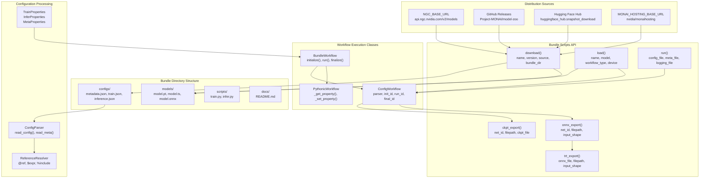
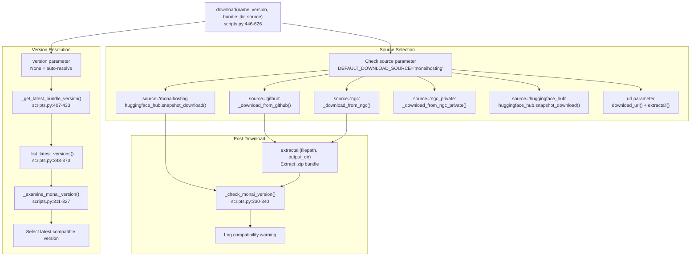
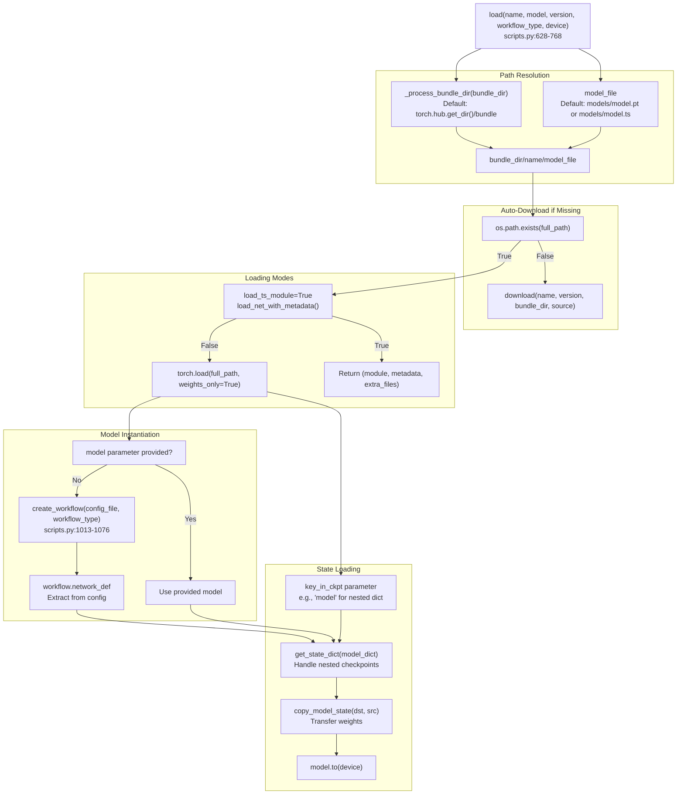
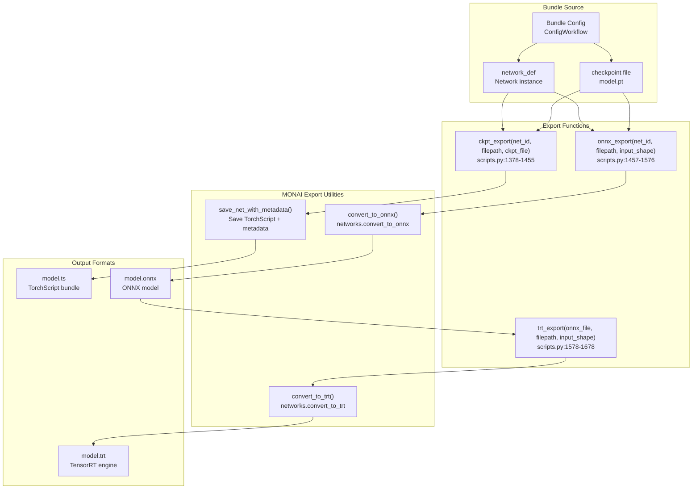

<!-- source: DeepWiki mcp.deepwiki.com · repo Project-MONAI/MONAI · page 6.1 Bundle System · fetched 2026-10-21 -->

# Bundle System

<details>
<summary>Relevant source files</summary>

The following files were used as context for generating this wiki page:

- [README.md](README.md)
- [docs/images/MONAI_arch.png](docs/images/MONAI_arch.png)
- [docs/images/MONAI_bundle_cloud.png](docs/images/MONAI_bundle_cloud.png)
- [docs/images/MONAI_clouds.png](docs/images/MONAI_clouds.png)
- [docs/images/MONAI_map_cloud.png](docs/images/MONAI_map_cloud.png)
- [docs/source/bundle.rst](docs/source/bundle.rst)
- [docs/source/bundle_intro.rst](docs/source/bundle_intro.rst)
- [docs/source/index.rst](docs/source/index.rst)
- [docs/source/mb_specification.rst](docs/source/mb_specification.rst)
- [monai/bundle/__init__.py](monai/bundle/__init__.py)
- [monai/bundle/__main__.py](monai/bundle/__main__.py)
- [monai/bundle/properties.py](monai/bundle/properties.py)
- [monai/bundle/scripts.py](monai/bundle/scripts.py)
- [monai/bundle/workflows.py](monai/bundle/workflows.py)
- [tests/bundle/test_bundle_download.py](tests/bundle/test_bundle_download.py)
- [tests/networks/nets/test_autoencoderkl.py](tests/networks/nets/test_autoencoderkl.py)
- [tests/nonconfig_workflow.py](tests/nonconfig_workflow.py)
- [tests/testing_data/fl_infer_properties.json](tests/testing_data/fl_infer_properties.json)
- [tests/testing_data/metadata.json](tests/testing_data/metadata.json)
- [tests/testing_data/python_workflow_properties.json](tests/testing_data/python_workflow_properties.json)
- [tests/testing_data/responsive_inference.json](tests/testing_data/responsive_inference.json)

</details>


The MONAI Bundle System provides a standardized framework for packaging, distributing, and executing medical imaging AI models. It enables researchers to share complete model packages that include trained weights, configuration files, metadata, preprocessing pipelines, and execution workflows in a reproducible format.

This system encompasses model packaging, distribution across multiple platforms (NGC, GitHub, Hugging Face Hub), workflow execution engines, and export capabilities to various deployment formats. For information about automated pipeline generation using bundles, see page 6.2 (Auto3DSeg Pipeline). For details about the underlying training and inference engines, see pages 5.2 (Training Engines and Workflows) and 5.3 (Metrics).

**Key Components:**
- **Bundle Scripts** ([monai/bundle/scripts.py]()): Core functions for download, load, run, and export operations
- **Workflow Classes** ([monai/bundle/workflows.py]()): `BundleWorkflow`, `ConfigWorkflow`, `PythonicWorkflow` for execution
- **Configuration System** ([monai/bundle/config_parser.py]()): `ConfigParser` for JSON/YAML processing
- **Property Definitions** ([monai/bundle/properties.py]()): Standardized bundle interfaces

## Architecture Overview

**Diagram: Bundle System Architecture**



**Sources:** [monai/bundle/scripts.py:68-72](), [monai/bundle/scripts.py:446-628](), [monai/bundle/workflows.py:37-242](), [monai/bundle/workflows.py:361-647]()

## Bundle Structure and Components

A MONAI bundle follows a standardized directory structure defined in the MONAI Bundle Specification. The specification ensures bundles are machine-readable and human-friendly.

**Diagram: Bundle Directory Structure**

```mermaid
graph TB
    BundleRoot["Bundle Root Directory<br/>e.g., spleen_ct_segmentation/"]
    
    subgraph "Required Components"
        LICENSE["LICENSE<br/>Apache 2.0 or compatible"]
        metadata["configs/metadata.json<br/>Bundle specification"]
        model_pt["models/model.pt<br/>PyTorch state_dict"]
    end
    
    subgraph "Optional Components"
        train_json["configs/train.json<br/>Training workflow config"]
        infer_json["configs/inference.json<br/>Inference workflow config"]
        logging_conf["configs/logging.conf<br/>Python logging config"]
        model_ts["models/model.ts<br/>TorchScript module"]
        model_onnx["models/model.onnx<br/>ONNX export"]
        train_py["scripts/train.py<br/>Custom training script"]
        infer_py["scripts/infer.py<br/>Custom inference script"]
        readme["docs/README.md<br/>Documentation"]
    end
    
    BundleRoot --> LICENSE
    BundleRoot --> metadata
    BundleRoot --> model_pt
    BundleRoot --> train_json
    BundleRoot --> infer_json
    BundleRoot --> logging_conf
    BundleRoot --> model_ts
    BundleRoot --> model_onnx
    BundleRoot --> train_py
    BundleRoot --> infer_py
    BundleRoot --> readme
```



### metadata.json Specification

The `metadata.json` file contains critical information about the bundle:

| Field | Required | Description |
|-------|----------|-------------|
| `version` | Yes | Bundle version (semantic versioning) |
| `monai_version` | Yes | Required MONAI version |
| `pytorch_version` | Yes | Required PyTorch version |
| `numpy_version` | Yes | Required NumPy version |
| `task` | Yes | Plain-language task description |
| `description` | Yes | Detailed model description |
| `authors` | Yes | Model authors |
| `copyright` | Yes | Copyright statement |
| `network_data_format` | Yes | Input/output tensor specifications |
| `required_packages_version` | No | Additional package dependencies |
| `changelog` | No | Version history |
| `data_source` | No | Training data source |

**Metadata Validation:**
- Schema validation via `verify_metadata()` [monai/bundle/scripts.py:1692-1766]()
- Version compatibility check via `_examine_monai_version()` [monai/bundle/scripts.py:311-327]()
- Schema URL: `https://github.com/Project-MONAI/MONAI-extra-test-data/releases/download/0.8.1/meta_schema_*.json`

**Sources:** [docs/source/mb_specification.rst:14-174](), [tests/testing_data/metadata.json:1-76](), [monai/bundle/scripts.py:311-341]()

## Workflow System

The bundle system provides three workflow execution patterns through class inheritance:

**Diagram: Workflow Class Hierarchy**

```mermaid
graph TB
    BundleWorkflow["BundleWorkflow (ABC)<br/>workflows.py:37-242"]
    
    subgraph "Abstract Interface"
        initialize["initialize(*args, **kwargs)"]
        run["run(*args, **kwargs)"]
        finalize["finalize(*args, **kwargs)"]
        get_prop["_get_property(name, property)"]
        set_prop["_set_property(name, property, value)"]
    end
    
    subgraph "ConfigWorkflow Implementation"
        CW["ConfigWorkflow<br/>workflows.py:361-647"]
        CW_init["initialize() -> parse config"]
        CW_run["run() -> execute run_id"]
        CW_final["finalize() -> execute final_id"]
        parser["self.parser: ConfigParser"]
        init_id["self.init_id = 'initialize'"]
        run_id["self.run_id = 'run'"]
        final_id["self.final_id = 'finalize'"]
    end
    
    subgraph "PythonicWorkflow Implementation"
        PW["PythonicWorkflow<br/>workflows.py:243-360"]
        PW_init["initialize() -> setup _props_vals"]
        PW_get["get_<property>() methods"]
        PW_set["_set_<property>() methods"]
        props_vals["self._props_vals: dict"]
    end
    
    BundleWorkflow --> initialize
    BundleWorkflow --> run
    BundleWorkflow --> finalize
    BundleWorkflow --> get_prop
    BundleWorkflow --> set_prop
    
    BundleWorkflow --> CW
    CW --> CW_init
    CW --> CW_run
    CW --> CW_final
    CW --> parser
    CW --> init_id
    CW --> run_id
    CW --> final_id
    
    BundleWorkflow --> PW
    PW --> PW_init
    PW --> PW_get
    PW --> PW_set
    PW --> props_vals
```



### BundleWorkflow Base Class

The abstract base class defines the workflow contract:

```python
# Defined in monai/bundle/workflows.py:37-242

class BundleWorkflow(ABC):
    supported_train_type = ("train", "training")
    supported_infer_type = ("infer", "inference", "eval", "evaluation")
    
    def __init__(self, workflow_type: str | None = None,
                 properties_path: PathLike | None = None,
                 meta_file: str | Sequence[str] | None = None,
                 logging_file: str | None = None)
    
    @abstractmethod
    def initialize(self, *args, **kwargs) -> Any
    
    @abstractmethod
    def run(self, *args, **kwargs) -> Any
    
    @abstractmethod
    def finalize(self, *args, **kwargs) -> Any
    
    def check_properties(self) -> list[str] | None
```

### ConfigWorkflow Details

`ConfigWorkflow` uses `ConfigParser` to execute configuration-based bundles:

**Key Attributes:**
- `self.parser`: `ConfigParser` instance for config processing [monai/bundle/workflows.py:448-453]()
- `self.init_id`: Config ID for initialization (default: `"initialize"`) [monai/bundle/workflows.py:454]()
- `self.run_id`: Config ID for main execution (default: `"run"`) [monai/bundle/workflows.py:455]()
- `self.final_id`: Config ID for finalization (default: `"finalize"`) [monai/bundle/workflows.py:456]()

**Execution Flow:**
1. `initialize()`: Calls `parser.parse(reset=True)` to resolve references [monai/bundle/workflows.py:466-474]()
2. `run()`: Adds bundle root to `sys.path`, executes `run_id` expression [monai/bundle/workflows.py:476-488]()
3. `finalize()`: Executes `final_id` expression if present [monai/bundle/workflows.py:490-495]()

### PythonicWorkflow Details

`PythonicWorkflow` supports imperative Python-based workflows with dynamic property access:

**Property Resolution:**
- User-defined getter methods: `get_<property_name>()` [monai/bundle/workflows.py:335-337]()
- Cached in `self._props_vals` dictionary [monai/bundle/workflows.py:329-330]()
- User-set values stored in `self._set_props_vals` [monai/bundle/workflows.py:327-328]()
- Falls back to `ConfigParser` if property exists in config [monai/bundle/workflows.py:331-333]()

**Sources:** [monai/bundle/workflows.py:37-242](), [monai/bundle/workflows.py:361-647](), [monai/bundle/workflows.py:243-360](), [tests/nonconfig_workflow.py:34-181]()

## Download and Distribution System

The `download()` function supports multiple distribution sources with automatic version resolution and MONAI version compatibility checking.

**Diagram: Download Function Flow**



### Source Configuration

The system uses environment variables and defaults for source configuration:

| Source | URL Constant | Environment Variable |
|--------|-------------|---------------------|
| NGC Public | `NGC_BASE_URL` = `"https://api.ngc.nvidia.com/v2/models/nvidia/monaitoolkit"` | - |
| MONAI Hosting | `MONAI_HOSTING_BASE_URL` = `"https://api.ngc.nvidia.com/v2/models/nvidia/monaihosting"` | - |
| NGC Private | `_get_ngc_private_base_url(repo)` | `NGC_API_KEY`, `NGC_ORG`, `NGC_TEAM` |
| Default Source | - | `BUNDLE_DOWNLOAD_SRC` (default: `"monaihosting"`) |

### Download Source Functions

Each source has a dedicated download function:

| Function | Location | Purpose |
|----------|----------|---------|
| `_download_from_github()` | [monai/bundle/scripts.py:190-197]() | GitHub release assets |
| `_download_from_monaihosting()` | [monai/bundle/scripts.py:200-204]() | MONAI hosting with direct URL |
| `_download_from_ngc()` | [monai/bundle/scripts.py:244-260]() | NGC public catalog |
| `_download_from_ngc_private()` | [monai/bundle/scripts.py:263-291]() | NGC private repositories |

### Version Compatibility

The system automatically selects compatible bundle versions:

1. **Get Available Versions:** `_list_latest_versions()` queries the source API [monai/bundle/scripts.py:343-373]()
2. **Check Compatibility:** `_examine_monai_version()` compares MONAI versions [monai/bundle/scripts.py:311-327]()
3. **Select Version:** Returns latest compatible version or latest if none compatible [monai/bundle/scripts.py:376-404]()

**Version Comparison Logic:**
- Strips `rc` suffix for comparison: `re.sub(r"rc\d.*", "", version)` [monai/bundle/scripts.py:320-321]()
- Compares: `package_version < monai_version` for compatibility [monai/bundle/scripts.py:322-326]()

**Sources:** [monai/bundle/scripts.py:446-626](), [monai/bundle/scripts.py:68-72](), [monai/bundle/scripts.py:190-291](), [monai/bundle/scripts.py:311-404]()

## Model Loading and Execution

The `load()` function provides a unified interface for loading bundle models with automatic workflow creation and device management.

**Diagram: Load Function Flow**



### Load Function Parameters

| Parameter | Type | Default | Description |
|-----------|------|---------|-------------|
| `name` | `str` | Required | Bundle name (e.g., `"spleen_ct_segmentation"`) |
| `model` | `torch.nn.Module \| None` | `None` | Existing model to load weights into |
| `version` | `str \| None` | `None` | Bundle version (auto-resolves to latest) |
| `workflow_type` | `str` | `"train"` | Workflow type: `"train"` or `"infer"` |
| `model_file` | `str \| None` | `None` | Relative path (default: `"models/model.pt"`) |
| `load_ts_module` | `bool` | `False` | Load TorchScript module instead of weights |
| `device` | `str \| None` | `None` | Target device (default: `"cuda:0"` if available) |
| `key_in_ckpt` | `str \| None` | `None` | Key for nested checkpoints (e.g., `"model"`) |
| `net_override` | `dict \| None` | `None` | Override network definition parameters |

### Workflow Creation

When `model=None`, the function uses `create_workflow()` to instantiate the network:

```python
# scripts.py:1013-1076
def create_workflow(
    workflow_name: str | BundleWorkflow | None = None,
    config_file: str | Sequence[str] | None = None,
    workflow_type: str | None = "train",
    **override: Any
) -> BundleWorkflow
```

**Workflow Type Mapping:**
- `"train"`, `"training"` → Training workflow with `network_def` property
- `"infer"`, `"inference"`, `"eval"`, `"evaluation"` → Inference workflow

The workflow's `network_def` property is accessed to get the instantiated network [monai/bundle/scripts.py:756-760]().

### Network Override

The `net_override` parameter allows dynamic network modification:

```python
# Example: Override output channels
model = load(
    name="spleen_ct_segmentation",
    net_override={"out_channels": 5}  # Override network_def#out_channels
)
```

This is implemented by prefixing keys with `"network_def#"` [monai/bundle/scripts.py:744]().

**Sources:** [monai/bundle/scripts.py:628-768](), [monai/bundle/scripts.py:1013-1076](), [monai/bundle/scripts.py:436-443](), [monai/networks/utils.py:764-766]()

## Export and Deployment

The bundle system provides multiple export formats for deployment across different inference engines through dedicated export functions.

**Diagram: Export Function Pipeline**



### Export Functions

| Function | Purpose | Key Parameters |
|----------|---------|----------------|
| `ckpt_export()` | Export to TorchScript with metadata | `net_id`, `filepath`, `ckpt_file`, `meta_file`, `config_file` |
| `onnx_export()` | Export to ONNX format | `net_id`, `filepath`, `input_shape`, `opset_version` |
| `trt_export()` | Export to TensorRT engine | `onnx_file`, `filepath`, `input_shape`, `dynamic_batchsize` |

### ckpt_export Details

Exports bundle to TorchScript format with embedded metadata:

**Function Signature:**
```python
# scripts.py:1378-1455
def ckpt_export(
    net_id: str | None = None,
    filepath: str | None = None,
    ckpt_file: str | None = None,
    meta_file: str | Sequence[str] | None = None,
    config_file: str | Sequence[str] | None = None,
    key_in_ckpt: str | None = None,
    **override: Any
)
```

**Export Process:**
1. Create `ConfigWorkflow` from config files [monai/bundle/scripts.py:1411-1421]()
2. Extract network via `workflow.network_def` property
3. Load checkpoint state: `torch.load(ckpt_file)` [monai/bundle/scripts.py:1432-1433]()
4. Apply state to network: `copy_model_state()` [monai/bundle/scripts.py:1439-1442]()
5. Convert to TorchScript: `convert_to_torchscript()` [monai/bundle/scripts.py:1444]()
6. Save with metadata: `save_net_with_metadata()` [monai/bundle/scripts.py:1447-1453]()

### onnx_export Details

Exports bundle to ONNX format with configurable input shapes:

**Key Parameters:**
- `input_shape`: Input tensor shape (e.g., `[1, 1, 96, 96, 96]`)
- `opset_version`: ONNX opset version (default: 11)
- `use_trace`: Use `torch.jit.trace` instead of scripting

**Export Process:**
1. Instantiate network from bundle config
2. Create dummy input: `torch.randn(input_shape)` [monai/bundle/scripts.py:1524]()
3. Convert: `convert_to_onnx(network, input_sample, filepath)` [monai/bundle/scripts.py:1528-1537]()
4. Verify: `onnx.checker.check_model(filepath)` [monai/bundle/scripts.py:1543]()

### trt_export Details

Converts ONNX model to TensorRT engine for optimized inference:

**Key Parameters:**
- `onnx_file`: Path to ONNX model
- `input_shape`: Input tensor shape for optimization
- `dynamic_batchsize`: Range for dynamic batching (e.g., `[1, 4, 8]`)
- `precision`: `"fp32"`, `"fp16"`, or `"int8"`

**Export Process:**
1. Load ONNX model: `onnx.load(onnx_file)` [monai/bundle/scripts.py:1623]()
2. Convert: `convert_to_trt(onnx_model, filepath, input_shape, ...)` [monai/bundle/scripts.py:1625-1639]()
3. Optionally verify output accuracy [monai/bundle/scripts.py:1641-1675]()

**Sources:** [monai/bundle/scripts.py:1378-1455](), [monai/bundle/scripts.py:1457-1576](), [monai/bundle/scripts.py:1578-1678](), [monai/networks/utils.py:39-45]()

## Configuration and Property System

The bundle system uses a property-based configuration system that defines standardized interfaces for training and inference workflows:

### Property Categories

| Property Set | Purpose | Key Properties |
|-------------|---------|----------------|
| `TrainProperties` | Training workflows | `trainer`, `max_epochs`, `train_dataset` |
| `InferProperties` | Inference workflows | `evaluator`, `network_def`, `inferer` |
| `MetaProperties` | Bundle metadata | `version`, `monai_version`, `description` |

### Configuration Reference System

The bundle configuration supports advanced reference resolution for modular configurations:

- **Direct References**: `@network_def` - Reference another config item
- **Nested References**: `@train::trainer::max_epochs` - Access nested properties  
- **Expressions**: `$torch.device('cuda')` - Execute Python expressions
- **Macro References**: `%/path/to/file.json` - Include external files

**Sources:** [monai/bundle/properties.py:30-262](), [monai/bundle/utils.py:42-44](), [tests/testing_data/inference.json:10-121]()

---

