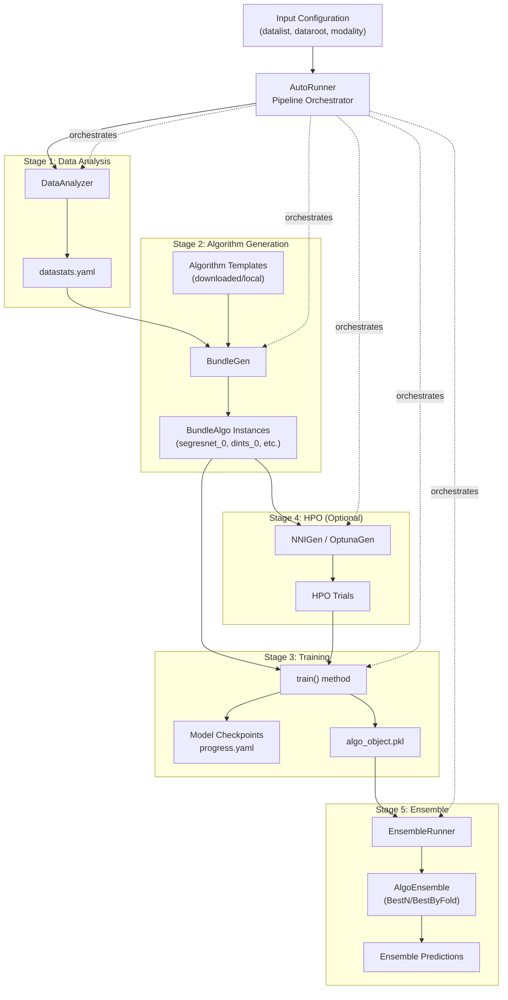
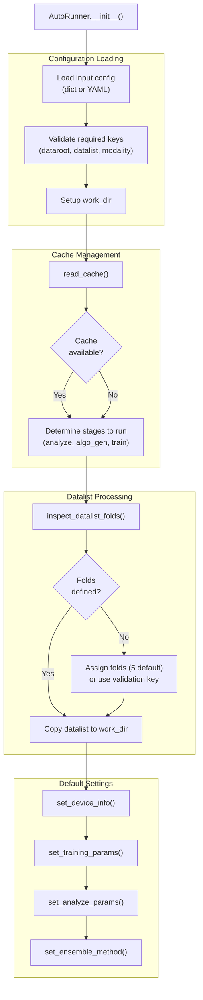
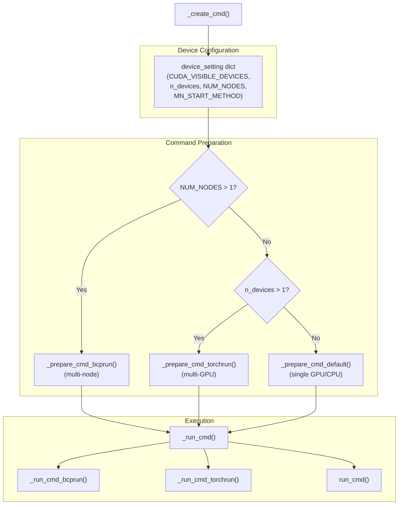
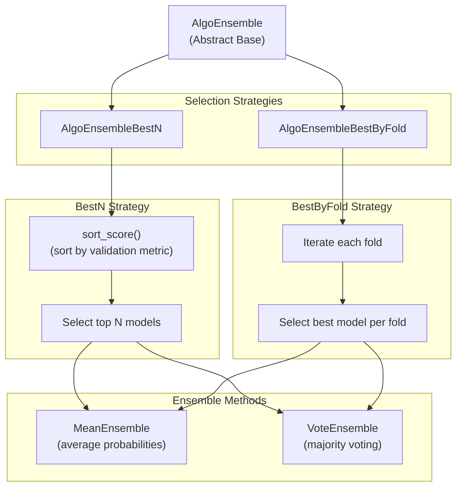
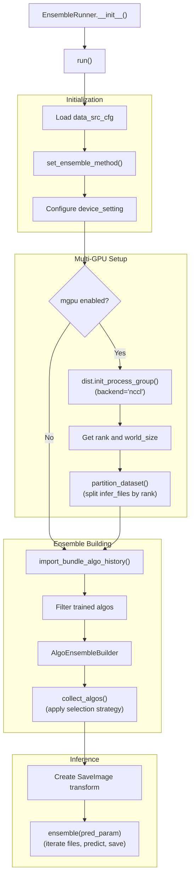
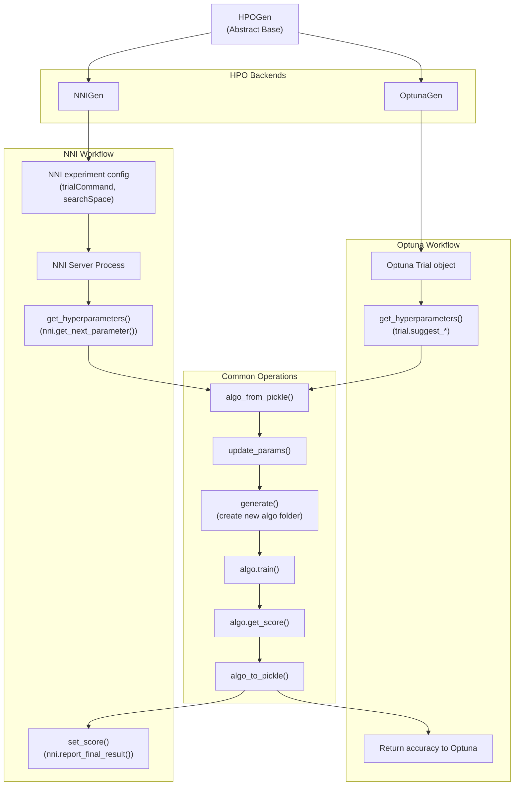
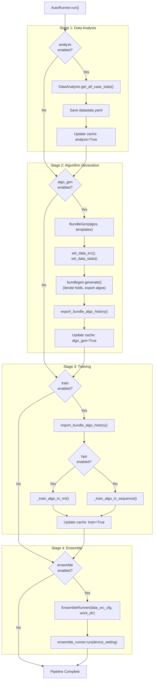
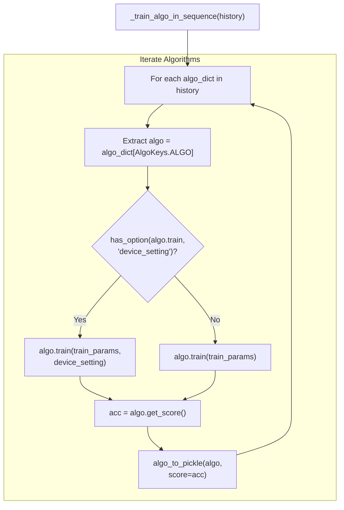
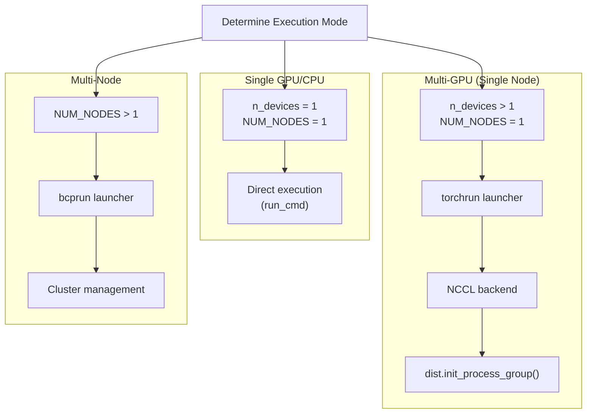
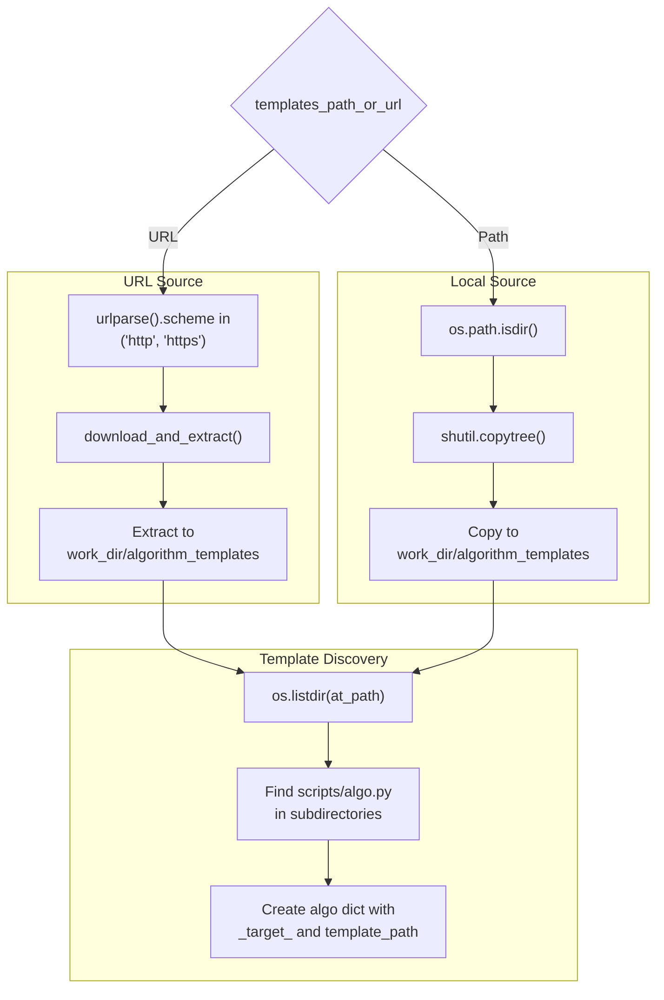

<!-- source: DeepWiki mcp.deepwiki.com · repo Project-MONAI/MONAI · page 6.2 Auto3DSeg Pipeline · fetched 2026-10-21 -->

# Auto3DSeg Pipeline

<details>
<summary>Relevant source files</summary>

The following files were used as context for generating this wiki page:

- [monai/apps/auto3dseg/__init__.py](monai/apps/auto3dseg/__init__.py)
- [monai/apps/auto3dseg/__main__.py](monai/apps/auto3dseg/__main__.py)
- [monai/apps/auto3dseg/auto_runner.py](monai/apps/auto3dseg/auto_runner.py)
- [monai/apps/auto3dseg/bundle_gen.py](monai/apps/auto3dseg/bundle_gen.py)
- [monai/apps/auto3dseg/ensemble_builder.py](monai/apps/auto3dseg/ensemble_builder.py)
- [monai/apps/auto3dseg/hpo_gen.py](monai/apps/auto3dseg/hpo_gen.py)
- [monai/apps/auto3dseg/utils.py](monai/apps/auto3dseg/utils.py)
- [monai/auto3dseg/algo_gen.py](monai/auto3dseg/algo_gen.py)
- [monai/auto3dseg/utils.py](monai/auto3dseg/utils.py)

</details>


## Purpose and Scope

This document describes the Auto3DSeg pipeline, an automated end-to-end system for 3D medical image segmentation. The pipeline orchestrates data analysis, algorithm generation, model training, hyperparameter optimization, and ensemble inference with minimal user intervention. 

For information about the Bundle format used by Auto3DSeg, see [Bundle System](#6.1). For core framework components used by the pipeline (data loading, transforms, networks), see [Core Architecture](#2), [Transform System](#3), [Data Loading and Processing](#4), and [Models and Training](#5).

**Sources:** [monai/apps/auto3dseg/auto_runner.py:1-207](), [monai/apps/auto3dseg/__init__.py:1-26]()

## Pipeline Overview

The Auto3DSeg pipeline automates the complete workflow from raw medical images to trained segmentation models and ensemble predictions. The primary entry point is the `AutoRunner` class, which coordinates five major stages:

1. **Data Analysis** - Analyzes dataset statistics and properties
2. **Algorithm Generation** - Creates algorithm bundles from templates
3. **Training** - Trains models across cross-validation folds
4. **Hyperparameter Optimization** (optional) - Optimizes model parameters using NNI or Optuna
5. **Ensemble Inference** - Combines predictions from multiple trained models

### High-Level Pipeline Architecture



**Sources:** [monai/apps/auto3dseg/auto_runner.py:40-206](), [monai/apps/auto3dseg/bundle_gen.py:442-665](), [monai/apps/auto3dseg/ensemble_builder.py:397-661]()

## Core Components

### AutoRunner

The `AutoRunner` class is the main interface for the Auto3DSeg pipeline. It manages state through caching, coordinates the execution of pipeline stages, and provides extensive configuration options.

#### Key Responsibilities

| Responsibility | Method | Description |
|---------------|--------|-------------|
| Pipeline Execution | `run()` | Executes all enabled pipeline stages in sequence |
| Configuration | `__init__()` | Loads input config, initializes cache, sets defaults |
| Data Analysis Control | `set_analyze_params()` | Configures data analysis parameters |
| Fold Management | `set_num_fold()`, `inspect_datalist_folds()` | Manages cross-validation folds |
| Training Control | `set_training_params()`, `set_device_info()` | Configures training and device settings |
| HPO Integration | `set_hpo_params()`, `set_nni_search_space()` | Sets hyperparameter optimization parameters |
| Ensemble Control | `set_ensemble_method()`, `set_prediction_params()` | Configures ensemble method and inference |
| GPU Optimization | `set_gpu_customization()` | Enables GPU-based parameter customization |
| State Management | `read_cache()`, `export_cache()` | Manages pipeline state caching |

**Sources:** [monai/apps/auto3dseg/auto_runner.py:210-461]()

#### AutoRunner Initialization and Configuration Flow



**Sources:** [monai/apps/auto3dseg/auto_runner.py:210-342](), [monai/apps/auto3dseg/auto_runner.py:348-392](), [monai/apps/auto3dseg/auto_runner.py:394-461]()

#### Cache System

The AutoRunner maintains a `cache.yaml` file to track completed pipeline stages and avoid redundant computation:

```yaml
analyze: true
datastats: ./work_dir/datastats.yaml
algo_gen: true
train: true
```

The cache is read during initialization and updated after each stage completion. Users can disable caching with the `not_use_cache` parameter.

**Sources:** [monai/apps/auto3dseg/auto_runner.py:348-392]()

### BundleGen and BundleAlgo

The `BundleGen` class generates multiple `BundleAlgo` instances across cross-validation folds. Each `BundleAlgo` represents a complete algorithm (network architecture, training scripts, and configuration files) exported as a MONAI Bundle.

#### BundleGen Architecture

```mermaid
graph TB
    BundleGen["BundleGen"]
    
    subgraph "Algorithm Templates"
        TemplateSource{"Template Source"}
        URL["URL Download<br/>(GitHub Release)"]
        LocalFolder["Local Folder"]
        DefaultTemplates["Default Templates<br/>(segresnet, dints,<br/>swinunetr, segresnet2d)"]
    end
    
    subgraph "Generation Process"
        LoadTemplates["Load template definitions"]
        CreateInstances["Create BundleAlgo instances"]
        IterateFolds["Iterate folds (0..n_fold-1)"]
        ExportToDisk["export_to_disk()<br/>(copy templates, fill configs)"]
        SavePickle["algo_to_pickle()<br/>(save algo_object.pkl)"]
    end
    
    subgraph "Outputs"
        AlgoFolder["work_dir/algoname_fold/<br/>├── configs/<br/>├── scripts/<br/>└── algo_object.pkl"]
    end
    
    BundleGen --> TemplateSource
    TemplateSource -->|HTTP(S)| URL
    TemplateSource -->|Path| LocalFolder
    URL --> DefaultTemplates
    LocalFolder --> DefaultTemplates
    
    DefaultTemplates --> LoadTemplates
    LoadTemplates --> CreateInstances
    CreateInstances --> IterateFolds
    IterateFolds --> ExportToDisk
    ExportToDisk --> SavePickle
    SavePickle --> AlgoFolder
```

**Sources:** [monai/apps/auto3dseg/bundle_gen.py:442-665](), [monai/apps/auto3dseg/bundle_gen.py:385-440]()

#### BundleAlgo Methods

| Method | Purpose | Returns |
|--------|---------|---------|
| `export_to_disk()` | Copy template and fill configurations | None |
| `fill_template_config()` | Fill template placeholders with data stats | dict |
| `train()` | Execute training script | subprocess.CompletedProcess |
| `predict()` | Run inference on files | list |
| `get_score()` | Retrieve validation metric from progress.yaml | float |
| `get_inferer()` | Load InferClass from scripts/infer.py | InferClass instance |
| `get_output_path()` | Return algorithm output directory path | str |

**Sources:** [monai/apps/auto3dseg/bundle_gen.py:53-369]()

#### BundleAlgo Training Command Generation

The `BundleAlgo` supports single-GPU, multi-GPU (torchrun), and multi-node (bcprun) training modes:



**Sources:** [monai/apps/auto3dseg/bundle_gen.py:196-300](), [monai/auto3dseg/utils.py:404-524]()

### EnsembleRunner and AlgoEnsemble

The ensemble system combines predictions from multiple trained models to improve accuracy and robustness. The `EnsembleRunner` orchestrates the ensemble process, while `AlgoEnsemble` subclasses implement selection strategies.

#### Ensemble Selection Strategies



**Sources:** [monai/apps/auto3dseg/ensemble_builder.py:49-315]()

#### EnsembleRunner Execution Flow



**Sources:** [monai/apps/auto3dseg/ensemble_builder.py:397-661](), [monai/apps/auto3dseg/ensemble_builder.py:317-395]()

## Hyperparameter Optimization

Auto3DSeg supports hyperparameter optimization through two backends: NNI (Neural Network Intelligence) and Optuna. The HPO system is accessed via the `hpo` parameter in `AutoRunner`.

### HPO Integration Architecture



**Sources:** [monai/apps/auto3dseg/hpo_gen.py:35-241](), [monai/apps/auto3dseg/hpo_gen.py:242-402]()

### NNI Integration

The `NNIGen` class prepares algorithms for NNI trials. Unlike direct execution, NNIGen generates configuration instructions that users must incorporate into NNI experiment configs:

**Key Methods:**

- `print_bundle_algo_instruction()` - Displays command to add to NNI trialCommand
- `run_algo()` - Trial function called by NNI for each hyperparameter combination
- `get_task_id()` - Generates unique identifier for each trial (e.g., `_learning_rate_0.01`)

**Sources:** [monai/apps/auto3dseg/hpo_gen.py:66-240]()

### Optuna Integration

The `OptunaGen` class is callable directly from Optuna study optimization:

```python
from functools import partial

optuna_gen = OptunaGen(algo=bundle_algo)
objective = partial(optuna_gen, obj_filename=pkl_file, output_folder=work_dir)
study.optimize(objective, n_trials=10)
```

**Sources:** [monai/apps/auto3dseg/hpo_gen.py:242-402]()

## Pipeline Execution Workflow

### Complete AutoRunner.run() Execution



**Sources:** [monai/apps/auto3dseg/auto_runner.py:871-1068]()

### Training Sequence Details

The training stage can execute in two modes: sequential or HPO-based.

#### Sequential Training (_train_algo_in_sequence)



**Sources:** [monai/apps/auto3dseg/auto_runner.py:720-744]()

#### HPO-Based Training (_train_algo_in_nni)

For HPO mode, the AutoRunner configures NNI experiment files and can optionally start the NNI service or run in dry-run mode:

**Sources:** [monai/apps/auto3dseg/auto_runner.py:745-869]()

## Data Structures and File Organization

### Work Directory Structure

After running the complete Auto3DSeg pipeline, the work directory contains:

```
work_dir/
├── algorithm_templates/          # Downloaded or copied templates
│   ├── segresnet/
│   │   ├── configs/
│   │   └── scripts/
│   ├── dints/
│   ├── swinunetr/
│   └── segresnet2d/
├── cache.yaml                    # Pipeline state cache
├── datastats.yaml                # Data analysis results
├── input.yaml                    # Copy of input configuration
├── datalist.json                 # Copy of datalist (with folds assigned)
├── segresnet_0/                  # Algorithm instance (fold 0)
│   ├── algo_object.pkl           # Serialized BundleAlgo
│   ├── configs/                  # Filled configuration files
│   │   ├── hyper_parameters.yaml
│   │   ├── inference.json
│   │   └── ...
│   ├── scripts/                  # Training/inference scripts
│   │   ├── train.py
│   │   ├── infer.py
│   │   └── algo.py
│   ├── model_fold0/              # Training outputs
│   │   ├── model.pt              # Best checkpoint
│   │   └── ...
│   └── progress.yaml             # Training progress/metrics
├── segresnet_1/                  # Fold 1
├── ...                           # Additional folds/algorithms
└── ensemble_output/              # Ensemble predictions
    ├── case_001_ensemble.nii.gz
    └── ...
```

**Sources:** [monai/apps/auto3dseg/auto_runner.py:183-196]()

### Pickle Object Structure

Each algorithm is serialized using `algo_to_pickle()` and `algo_from_pickle()`:

**algo_object.pkl contents:**
- `algo_bytes` - Pickled BundleAlgo instance
- `template_path` - Path to algorithm templates
- `AlgoKeys.SCORE` - Best validation metric (added after training)

**Sources:** [monai/auto3dseg/utils.py:277-375]()

### Configuration Files

#### Input Configuration (input.yaml)

Required keys:
- `modality` - Imaging modality (e.g., "ct", "mri")
- `datalist` - Path to JSON datalist file
- `dataroot` - Root directory for image files

Optional keys:
- `num_fold` - Number of cross-validation folds (default: 5)
- `class_names` - List of class names for segmentation
- `multigpu` - Enable multi-GPU training (boolean)
- `work_dir` - Override default work directory

**Sources:** [monai/apps/auto3dseg/auto_runner.py:228-295]()

#### Datalist Format

The datalist follows the format described in `monai.data.load_decathlon_datalist`:

```json
{
  "training": [
    {"image": "img_001.nii.gz", "label": "seg_001.nii.gz", "fold": 0},
    {"image": "img_002.nii.gz", "label": "seg_002.nii.gz", "fold": 1},
    ...
  ],
  "testing": [
    {"image": "img_test_001.nii.gz"},
    ...
  ]
}
```

If `fold` is not specified, AutoRunner automatically assigns folds using K-fold cross-validation.

**Sources:** [monai/apps/auto3dseg/auto_runner.py:394-461]()

## Multi-GPU and Multi-Node Support

Auto3DSeg supports distributed training and inference across multiple GPUs and nodes through configurable device settings.

### Device Configuration

The `device_setting` dictionary controls distributed execution:

| Key | Description | Default |
|-----|-------------|---------|
| `CUDA_VISIBLE_DEVICES` | Comma-separated GPU IDs | All available GPUs |
| `n_devices` | Number of GPUs per node | Derived from CUDA_VISIBLE_DEVICES |
| `NUM_NODES` | Number of compute nodes | 1 or env `NUM_NODES` |
| `MN_START_METHOD` | Multi-node launcher | "bcprun" or env `MN_START_METHOD` |
| `CMD_PREFIX` | Command prefix for subprocess | "" or env `CMD_PREFIX` |

**Sources:** [monai/apps/auto3dseg/auto_runner.py:542-599]()

### Distributed Execution Modes



**Sources:** [monai/apps/auto3dseg/bundle_gen.py:196-278](), [monai/apps/auto3dseg/ensemble_builder.py:608-661]()

### Ensemble Inference Partitioning

For multi-GPU ensemble inference, the `EnsembleRunner` partitions the test dataset across GPUs:

1. Initialize process group with `dist.init_process_group(backend="nccl")`
2. Partition inference files using `partition_dataset()`
3. Each rank processes its subset of files
4. Results are saved independently (no aggregation needed)

**Sources:** [monai/apps/auto3dseg/ensemble_builder.py:552-607]()

## Algorithm Templates

Auto3DSeg uses algorithm templates to generate bundles. Default templates are downloaded from the MONAI research-contributions repository.

### Default Algorithms

| Name | Network Architecture | Description |
|------|---------------------|-------------|
| `segresnet` | SegResNet | 3D residual segmentation network |
| `segresnet2d` | SegResNet2D | 2D residual segmentation network |
| `dints` | DiNTS | Differentiable Neural Architecture Search |
| `swinunetr` | SwinUNETR | Swin Transformer-based U-Net |

**Sources:** [monai/apps/auto3dseg/bundle_gen.py:376-382]()

### Template Download and Management



**Sources:** [monai/apps/auto3dseg/bundle_gen.py:385-440]()

### Template Structure

Each algorithm template must follow this structure:

```
template_name/
├── configs/
│   ├── hyper_parameters.yaml   # Template with placeholders
│   ├── inference.json
│   └── ...
└── scripts/
    ├── algo.py                 # Contains AlgoClass (e.g., SegresnetAlgo)
    ├── train.py
    ├── infer.py
    └── __init__.py
```

The `algo.py` must define a class inheriting from `BundleAlgo` (e.g., `SegresnetAlgo`, `DintsAlgo`).

**Sources:** [monai/apps/auto3dseg/bundle_gen.py:511-521]()

## Usage Examples

### Basic Pipeline Execution

```python
from monai.apps.auto3dseg import AutoRunner

# Minimal configuration
runner = AutoRunner(
    work_dir="./work_dir",
    input={
        "modality": "ct",
        "datalist": "./dataset.json",
        "dataroot": "/data/images",
        "class_names": ["background", "organ"]
    }
)

# Run complete pipeline
runner.run()
```

**Sources:** [monai/apps/auto3dseg/auto_runner.py:93-114]()

### Customized Training

```python
# Select specific algorithms
runner = AutoRunner(
    work_dir="./work_dir",
    input="./input.yaml",
    algos=["segresnet", "dints"]  # Only use these two
)

# Configure training parameters
runner.set_training_params({
    "num_epochs": 100,
    "num_epochs_per_validation": 5,
    "num_images_per_batch": 4
})

# Set device configuration
runner.set_device_info(
    cuda_visible_devices="0,1,2,3",
    num_nodes=1
)

# Configure ensemble
runner.set_ensemble_method("AlgoEnsembleBestN", n_best=3)

runner.run()
```

**Sources:** [monai/apps/auto3dseg/auto_runner.py:116-172]()

### Hyperparameter Optimization

```python
# Enable HPO with NNI
runner = AutoRunner(
    work_dir="./work_dir",
    input="./input.yaml",
    hpo=True,
    hpo_backend="nni"
)

# Define search space
runner.set_nni_search_space({
    "learning_rate": {
        "_type": "choice",
        "_value": [0.0001, 0.001, 0.01]
    },
    "num_images_per_batch": {
        "_type": "choice", 
        "_value": [2, 4, 8]
    }
})

runner.run()
```

**Sources:** [monai/apps/auto3dseg/auto_runner.py:174-182]()

### Command Line Interface

The Auto3DSeg modules can be invoked via command line using Python Fire:

```bash
# Run complete pipeline
python -m monai.apps.auto3dseg AutoRunner run \
    --input='{"modality": "ct", "datalist": "data.json", "dataroot": "/data"}'

# Run from YAML config
python -m monai.apps.auto3dseg AutoRunner run --input=./config.yaml

# Generate bundles only
python -m monai.apps.auto3dseg BundleGen generate \
    --data_stats_filename=./datastats.yaml \
    --output_folder=./algos

# Run ensemble only
python -m monai.apps.auto3dseg EnsembleRunner run \
    --data_src_cfg_name=./input.yaml \
    --work_dir=./work_dir
```

**Sources:** [monai/apps/auto3dseg/__main__.py:1-36]()

## Key Interfaces and Data Flow

### Algorithm History Management

The pipeline tracks algorithm instances through history lists. Each history entry is a dictionary with `AlgoKeys`:

| Key | Type | Description |
|-----|------|-------------|
| `AlgoKeys.ID` | str | Algorithm identifier (e.g., "segresnet_0") |
| `AlgoKeys.ALGO` | BundleAlgo | Algorithm instance |
| `AlgoKeys.SCORE` | float | Best validation metric |
| `AlgoKeys.IS_TRAINED` | bool | Whether training completed |

**Functions:**
- `import_bundle_algo_history(work_dir, only_trained=True)` - Load saved algorithms
- `export_bundle_algo_history(history)` - Save algorithms to disk

**Sources:** [monai/apps/auto3dseg/utils.py:23-91](), [monai/utils/enums.py:AlgoKeys]()

### Prediction Parameters

The ensemble inference accepts extensive prediction parameters:

```python
pred_params = {
    "files_slices": slice(0, 10),      # Only process first 10 files
    "mode": "mean",                     # or "vote"
    "sigmoid": True,                    # Threshold method
    "output_dir": "./predictions",      # SaveImage parameters
    "output_postfix": "seg",
    "output_dtype": "uint8",
    "algo_spec_params": {               # Model-specific overrides
        "segresnet": {"roi_size": [96, 96, 96]},
        "dints": {"roi_size": [128, 128, 128]}
    }
}

runner.set_prediction_params(pred_params)
```

**Sources:** [monai/apps/auto3dseg/ensemble_builder.py:154-232]()

### GPU Customization

The GPU customization feature automatically optimizes batch sizes and sliding window parameters:

```python
runner.set_gpu_customization(
    gpu_customization=True,
    gpu_customization_specs={
        "universal": {  # Apply to all algorithms
            "num_trials": 6,
            "range_num_images_per_batch": [1, 8],
            "range_num_sw_batch_size": [1, 8]
        },
        "dints": {  # Override for specific algorithm
            "num_trials": 10,
            "range_num_images_per_batch": [1, 4]
        }
    }
)
```

**Sources:** [monai/apps/auto3dseg/auto_runner.py:462-499]()

## Summary

The Auto3DSeg pipeline provides a complete automation framework for 3D medical image segmentation through five orchestrated stages:

1. **Data Analysis** - Computes dataset statistics
2. **Algorithm Generation** - Creates bundle instances from templates
3. **Training** - Trains models with cross-validation
4. **Hyperparameter Optimization** - Optionally tunes parameters with NNI/Optuna
5. **Ensemble Inference** - Combines predictions from multiple models

The `AutoRunner` class serves as the main entry point, managing state through caching, coordinating distributed execution, and providing extensive configuration options. The system supports single-GPU, multi-GPU, and multi-node execution modes, making it suitable for both research and production environments.

**Sources:** [monai/apps/auto3dseg/auto_runner.py:40-206](), [monai/apps/auto3dseg/bundle_gen.py:442-665](), [monai/apps/auto3dseg/ensemble_builder.py:397-661](), [monai/apps/auto3dseg/hpo_gen.py:35-402]()

---

