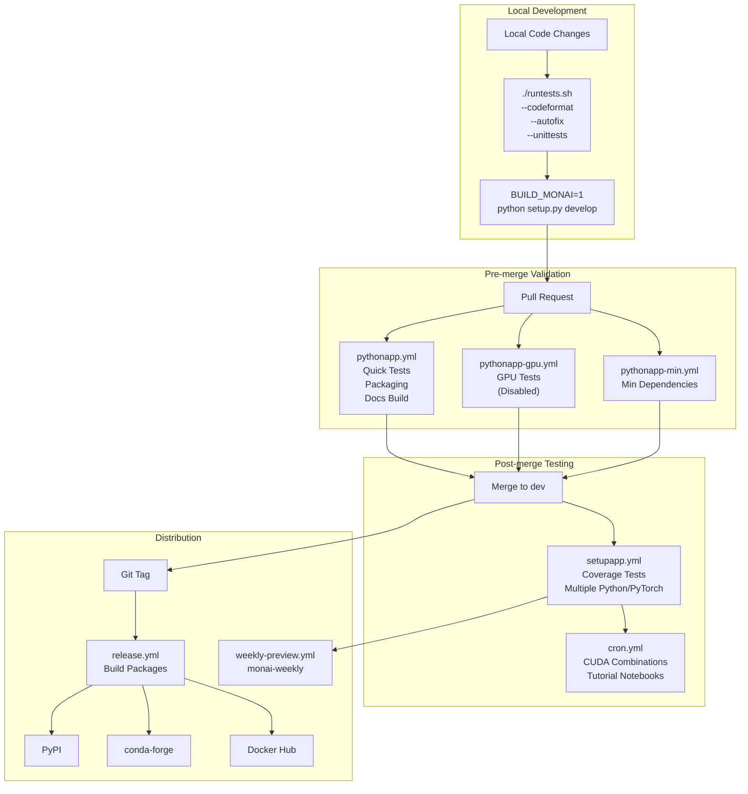
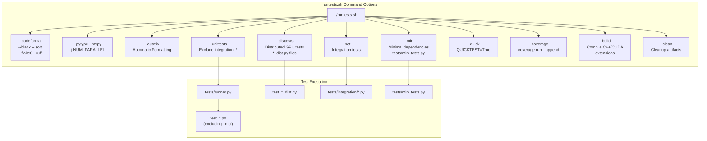
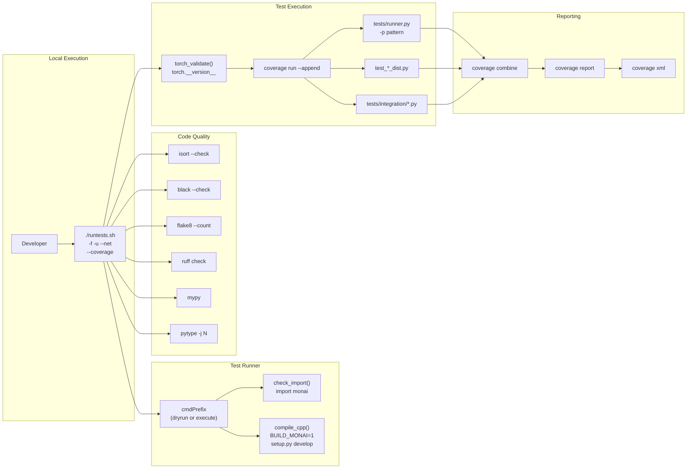
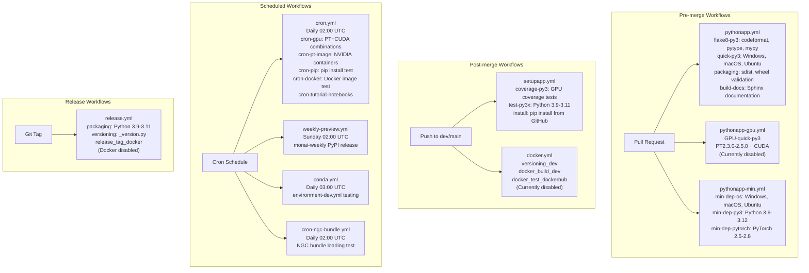
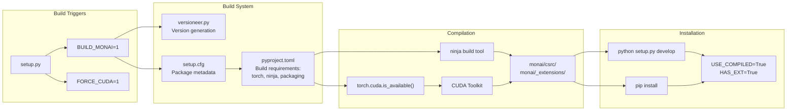
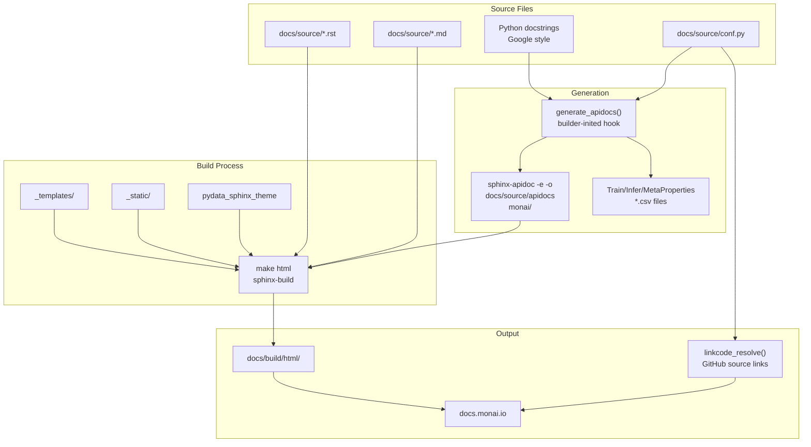
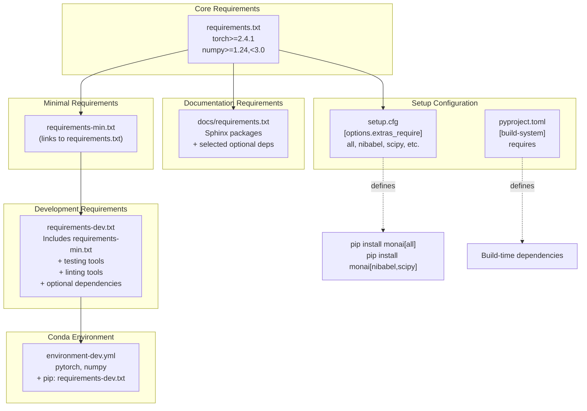
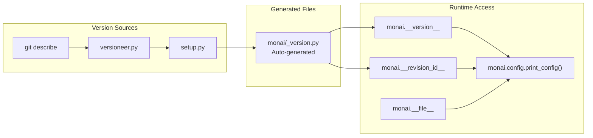
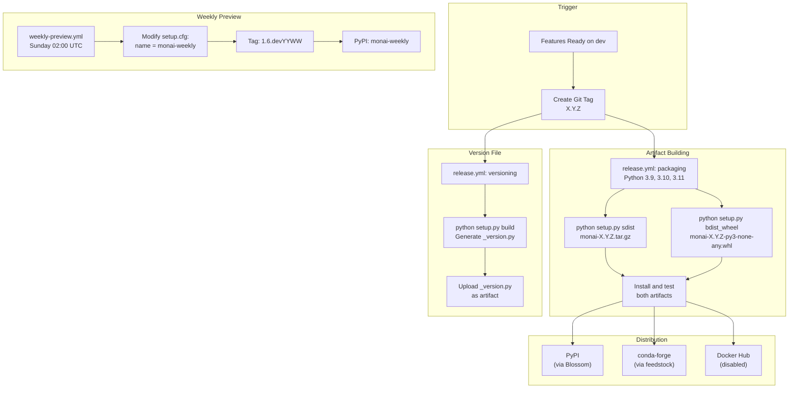

<!-- source: DeepWiki mcp.deepwiki.com · repo Project-MONAI/MONAI · page 7 Development and Infrastructure · fetched 2026-10-21 -->

# Development and Infrastructure

<details>
<summary>Relevant source files</summary>

The following files were used as context for generating this wiki page:

- [.github/workflows/blossom-ci.yml](.github/workflows/blossom-ci.yml)
- [.github/workflows/codeql-analysis.yml](.github/workflows/codeql-analysis.yml)
- [.github/workflows/conda.yml](.github/workflows/conda.yml)
- [.github/workflows/cron-ngc-bundle.yml](.github/workflows/cron-ngc-bundle.yml)
- [.github/workflows/cron.yml](.github/workflows/cron.yml)
- [.github/workflows/docker.yml](.github/workflows/docker.yml)
- [.github/workflows/integration.yml](.github/workflows/integration.yml)
- [.github/workflows/pythonapp-gpu.yml](.github/workflows/pythonapp-gpu.yml)
- [.github/workflows/pythonapp-min.yml](.github/workflows/pythonapp-min.yml)
- [.github/workflows/pythonapp.yml](.github/workflows/pythonapp.yml)
- [.github/workflows/release.yml](.github/workflows/release.yml)
- [.github/workflows/setupapp.yml](.github/workflows/setupapp.yml)
- [.github/workflows/weekly-preview.yml](.github/workflows/weekly-preview.yml)
- [.gitignore](.gitignore)
- [CONTRIBUTING.md](CONTRIBUTING.md)
- [Dockerfile](Dockerfile)
- [docs/requirements.txt](docs/requirements.txt)
- [docs/source/conf.py](docs/source/conf.py)
- [docs/source/installation.md](docs/source/installation.md)
- [environment-dev.yml](environment-dev.yml)
- [monai/config/deviceconfig.py](monai/config/deviceconfig.py)
- [pyproject.toml](pyproject.toml)
- [requirements-dev.txt](requirements-dev.txt)
- [requirements.txt](requirements.txt)
- [runtests.sh](runtests.sh)
- [setup.cfg](setup.cfg)

</details>


This page documents MONAI's development infrastructure, including local development setup, testing systems, continuous integration/continuous deployment (CI/CD) pipelines, code quality enforcement, and distribution mechanisms. This infrastructure ensures code quality, maintains backward compatibility, and enables reliable distribution across multiple package managers.

For detailed information on specific aspects:
- Installation options and dependency management: see [Project Setup and Dependencies](#7.1)
- CI/CD workflows and testing strategies: see [CI/CD Workflows and Testing](#7.2)
- Release process and packaging: see [Packaging and Distribution](#7.3)

## Development Workflow Overview

MONAI follows a GitHub-based development workflow with automated quality gates at every stage. The workflow spans from local development through automated testing to final distribution.

**Development Workflow Stages**



**Sources:** [.github/workflows/pythonapp.yml](), [.github/workflows/setupapp.yml](), [.github/workflows/cron.yml](), [.github/workflows/release.yml](), [.github/workflows/weekly-preview.yml](), [CONTRIBUTING.md]()

## Testing Infrastructure

MONAI's testing infrastructure is orchestrated through the `runtests.sh` script, which provides a unified interface for all testing and code quality operations.

**Testing Script Architecture**



**Sources:** [runtests.sh:1-770]()

### Test Categories

| Test Type | Command | Description | Files |
|-----------|---------|-------------|-------|
| Unit Tests | `./runtests.sh --unittests` | Core functionality tests, excludes integration | `test_[module].py` (excluding `_dist`) |
| Distributed Tests | `./runtests.sh --disttests` | Multi-GPU distributed tests | `test_*_dist.py` |
| Integration Tests | `./runtests.sh --net` | Network training/inference workflows | `tests/integration/*.py` |
| Minimal Tests | `./runtests.sh --min` | Tests with minimal dependencies only | `tests/min_tests.py` |
| Quick Tests | `./runtests.sh --quick` | Subset of unit tests for rapid validation | Unit tests with `QUICKTEST=True` |

**Sources:** [runtests.sh:62-119](), [runtests.sh:719-749](), [CONTRIBUTING.md:102-150]()

### Code Quality Tools

MONAI enforces code quality through multiple linters and formatters configured in [setup.cfg]() and [pyproject.toml]().

**Code Quality Tool Chain**

| Tool | Purpose | Configuration | Command |
|------|---------|---------------|---------|
| **black** | Code formatter | [pyproject.toml:11-35]() | `./runtests.sh --black` |
| **isort** | Import sorter | [setup.cfg:212-219]() | `./runtests.sh --isort` |
| **flake8** | Style checker | [setup.cfg:182-210]() | `./runtests.sh --flake8` |
| **ruff** | Fast linter | [pyproject.toml:41-56]() | `./runtests.sh --ruff` |
| **mypy** | Static type checker | [setup.cfg:229-276]() | `./runtests.sh --mypy` |
| **pytype** | Type inference | [pyproject.toml:58-88]() | `./runtests.sh --pytype -j 2` |
| **pre-commit** | Git hooks | `.pre-commit-config.yaml` | `./runtests.sh --precommit` |

**Sources:** [setup.cfg:182-276](), [pyproject.toml:11-88](), [runtests.sh:441-679]()

### Test Execution Flow



**Sources:** [runtests.sh:128-770](), [CONTRIBUTING.md:52-150]()

## Continuous Integration Pipelines

MONAI uses GitHub Actions for CI/CD, with workflows organized by trigger event and purpose.

**CI/CD Workflow Organization**



**Sources:** [.github/workflows/pythonapp.yml](), [.github/workflows/pythonapp-gpu.yml](), [.github/workflows/pythonapp-min.yml](), [.github/workflows/setupapp.yml](), [.github/workflows/cron.yml](), [.github/workflows/weekly-preview.yml](), [.github/workflows/release.yml]()

### Pre-merge Validation Strategy

The pre-merge validation runs three parallel workflows to provide fast feedback:

**pythonapp.yml** performs comprehensive checks:
- **Code formatting** (flake8-py3 job): Runs `codeformat`, `pytype`, and `mypy` checks in parallel using matrix strategy
- **Cross-platform tests** (quick-py3 job): Tests on Windows, macOS, and Ubuntu with Python 3.9
- **Packaging validation** (packaging job): Builds sdist and wheel, tests installation from both
- **Documentation** (build-docs job): Builds Sphinx HTML documentation

**pythonapp-min.yml** validates minimal dependency configurations:
- **min-dep-os**: Tests with minimal requirements on Windows, macOS, Ubuntu
- **min-dep-py3**: Tests Python 3.9, 3.10, 3.11, 3.12 compatibility
- **min-dep-pytorch**: Tests PyTorch 2.5.1, 2.6.0, 2.7.1, 2.8.0 compatibility

**pythonapp-gpu.yml** (currently disabled) validates GPU functionality with multiple PyTorch+CUDA combinations.

**Sources:** [.github/workflows/pythonapp.yml:1-204](), [.github/workflows/pythonapp-min.yml:1-171](), [.github/workflows/pythonapp-gpu.yml:1-131]()

### Post-merge and Nightly Testing

**Post-merge workflows** provide deeper validation:
- Coverage tests with full GPU access
- Multiple Python versions (3.9, 3.10, 3.11)
- Direct GitHub installation testing

**Nightly cron workflows** provide exhaustive validation:
- **cron-gpu**: Tests multiple PyTorch/CUDA combinations (PT2.3.0+CUDA12.1, PT2.4.0+CUDA12.6, latest)
- **cron-pt-image**: Tests against NVIDIA PyTorch container images (23.08, 24.08, 24.10)
- **cron-pip**: Validates `pip install` from source with full test suite
- **cron-docker**: Tests the official Docker image
- **cron-tutorial-notebooks**: Executes all tutorial notebooks from `Project-MONAI/tutorials`

**Sources:** [.github/workflows/setupapp.yml:1-175](), [.github/workflows/cron.yml:1-267]()

## Build and Compilation System

MONAI includes optional C++/CUDA extensions for performance-critical operations. The build system is controlled through environment variables.

**Build Configuration**

| Environment Variable | Effect | Default |
|---------------------|--------|---------|
| `BUILD_MONAI` | Enable compilation of C++/CUDA extensions | `0` (disabled) |
| `FORCE_CUDA` | Force CUDA compilation even if not auto-detected | `0` (auto-detect) |
| `TORCH_CUDA_ARCH_LIST` | Specify CUDA architectures to compile for | PyTorch default |

**Build Process**



The compilation status is exposed through `monai.config`:
- `HAS_EXT`: Whether extensions were successfully imported
- `USE_COMPILED`: Whether extensions are currently in use (`HAS_EXT and os.getenv("BUILD_MONAI") == "1"`)

**Sources:** [setup.cfg:35-46](), [pyproject.toml:1-9](), [monai/config/deviceconfig.py:30-34](), [runtests.sh:142-153](), [Dockerfile:48-49]()

## Documentation System

MONAI uses Sphinx for documentation generation with automatic API documentation via `sphinx-apidoc`.

**Documentation Build Pipeline**



**Documentation Configuration**

Key extensions enabled in [docs/source/conf.py:94-104]():
- `sphinx.ext.autodoc`: Auto-generate API docs from docstrings
- `sphinx.ext.napoleon`: Support Google-style docstrings
- `sphinx.ext.linkcode`: Link to source code on GitHub
- `sphinx.ext.autosummary`: Generate summary tables
- `sphinx_autodoc_typehints`: Include type hints in docs
- `recommonmark`: Support Markdown files

The `linkcode_resolve()` function [docs/source/conf.py:191-223]() generates GitHub source links based on the git reference:
- Uses `READTHEDOCS_GIT_IDENTIFIER` for ReadTheDocs builds
- Uses `GITHUB_SHA` for CI builds
- Falls back to `dev` branch

**Sources:** [docs/source/conf.py:1-224](), [docs/requirements.txt:1-46](), [CONTRIBUTING.md:154-182](), [.github/workflows/pythonapp.yml:182-203]()

## Dependency Management

MONAI uses a tiered dependency system to support flexible deployment scenarios.

**Dependency Hierarchy**



**Optional Dependencies Structure**

The [setup.cfg:48-178]() defines granular optional dependencies:
- Individual packages: `nibabel`, `scipy`, `pillow`, `tensorboard`, etc.
- Feature groups: `[all]` includes all optional dependencies
- Platform-specific: `cucim-cu12` only on Linux, `imagecodecs`/`tifffile` on Linux/Darwin

Example extras:
```
pip install monai[nibabel,skimage]  # Specific features
pip install monai[all]               # All optional dependencies
```

**Sources:** [requirements.txt:1-4](), [requirements-dev.txt:1-67](), [setup.cfg:44-178](), [docs/requirements.txt:1-46](), [environment-dev.yml:1-16](), [pyproject.toml:1-9]()

## Version Management

MONAI uses `versioneer` for automatic version string generation based on git tags.

**Version String Components**

A typical version string like `0.1.0+144.g52c763d.dirty` contains:
- `0.1.0`: Base milestone version
- `+144`: Number of commits ahead of the milestone
- `g52c763d`: Git commit hash
- `dirty`: Local modifications present

**Version Information Access**



The configuration is defined in [setup.cfg:221-227]():
```
[versioneer]
VCS = git
style = pep440
versionfile_source = monai/_version.py
versionfile_build = monai/_version.py
tag_prefix =
parentdir_prefix =
```

**Sources:** [setup.cfg:221-227](), [docs/source/installation.md:180-191](), [monai/config/deviceconfig.py:95-117]()

## Docker Infrastructure

MONAI provides official Docker images built from the NVIDIA PyTorch base image.

**Docker Build Process**

The [Dockerfile]() follows this structure:
1. **Base image**: `nvcr.io/nvidia/pytorch:24.10-py3` (PyTorch 2.5.0, CUDA 12.6)
2. **Dependencies**: Installs `requirements-dev.txt` (excluding torch to avoid conflicts)
3. **Source code**: Copies source and builds with `BUILD_MONAI=1 FORCE_CUDA=1`
4. **NGC CLI**: Installs NVIDIA NGC command-line interface
5. **Additional tools**: Installs `libopenslide0` and sets up `POLYGRAPHY_AUTOINSTALL_DEPS=1`

**Docker Image Tags**
- `projectmonai/monai:latest` - Dev branch HEAD
- `projectmonai/monai:X.Y.Z` - Tagged releases (disabled in current workflow)

The Docker build workflow is defined in [.github/workflows/docker.yml]() but is currently disabled.

**Sources:** [Dockerfile:1-67](), [.github/workflows/docker.yml:1-106](), [docs/source/installation.md:193-211]()

## Release Process

MONAI follows a structured release process with multiple distribution channels.

**Release Workflow Stages**



**Weekly Preview Release**

The weekly preview provides early access to development features:
1. Runs every Sunday at 02:00 UTC via [.github/workflows/weekly-preview.yml]()
2. Modifies `setup.cfg` to change package name from `monai` to `monai-weekly`
3. Injects commit ID: `__commit_id__ = "..."` into `monai/__init__.py`
4. Creates a dev tag: `1.6.dev[YYWW]` where `YYWW` is year and ISO week number
5. Publishes to PyPI as `monai-weekly` package

**Sources:** [.github/workflows/release.yml:1-169](), [.github/workflows/weekly-preview.yml:1-79](), [CONTRIBUTING.md:379-395]()

## System Configuration Reporting

MONAI provides utilities to report system and configuration information for debugging.

**Configuration Reporting Functions**

| Function | Purpose | Output |
|----------|---------|--------|
| `monai.config.print_config()` | Print package versions | MONAI, PyTorch, NumPy, optional deps |
| `monai.config.print_system_info()` | Print system information | OS, CPU, memory, disk usage (requires `psutil`) |
| `monai.config.print_gpu_info()` | Print GPU configuration | CUDA version, GPU count, memory, capabilities |
| `monai.config.print_debug_info()` | Print all debugging info | Combines all above |

**Configuration Variables**

Exposed through `monai.config`:
- `USE_COMPILED`: Whether C++/CUDA extensions are in use
- `USE_META_DICT`: Whether MetaDict compatibility mode is enabled (env: `USE_META_DICT=1`)
- `HAS_EXT`: Whether extensions were successfully imported

**Sources:** [monai/config/deviceconfig.py:29-275]()

## Contributing Guidelines

MONAI follows strict contributing guidelines documented in [CONTRIBUTING.md]().

**Key Requirements**

1. **Code Format**: All code must pass `./runtests.sh --codeformat`
2. **Testing**: New features require accompanying tests
3. **Documentation**: Update relevant `.rst` files in `docs/source/`
4. **Backward Compatibility**: Use deprecation warnings, plan for 2 minor versions
5. **DCO Sign-off**: All commits must include `Signed-off-by` line (use `git commit -s`)
6. **Copyright Headers**: All source files must include Apache 2.0 license header

**Pull Request Process**

1. Create branch named `[ticket_id]-[task_name]`
2. Make changes with detailed commit messages
3. Run local tests: `./runtests.sh -f -u --net --coverage`
4. Create pull request with detailed description
5. Address CI/CD failures and review comments
6. Trigger optional tests via comments: `/black`, `/integration-test`
7. Maintainers trigger `/build` for full internal tests
8. Merge after all approvals

**Automatic Code Formatting**

Commenting `/black` on a pull request triggers automatic formatting via [monai-code-formatter](https://github.com/Project-MONAI/monai-code-formatter) GitHub Action using `psf/Black`.

**Sources:** [CONTRIBUTING.md:1-395]()

---

