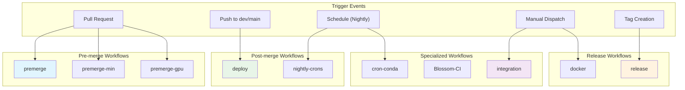
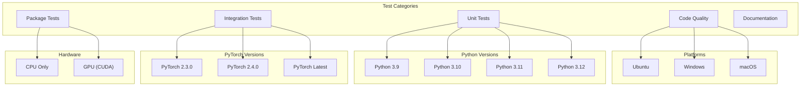
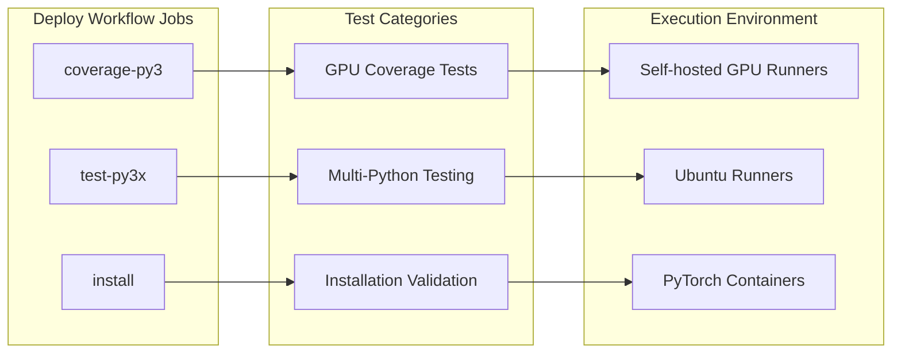
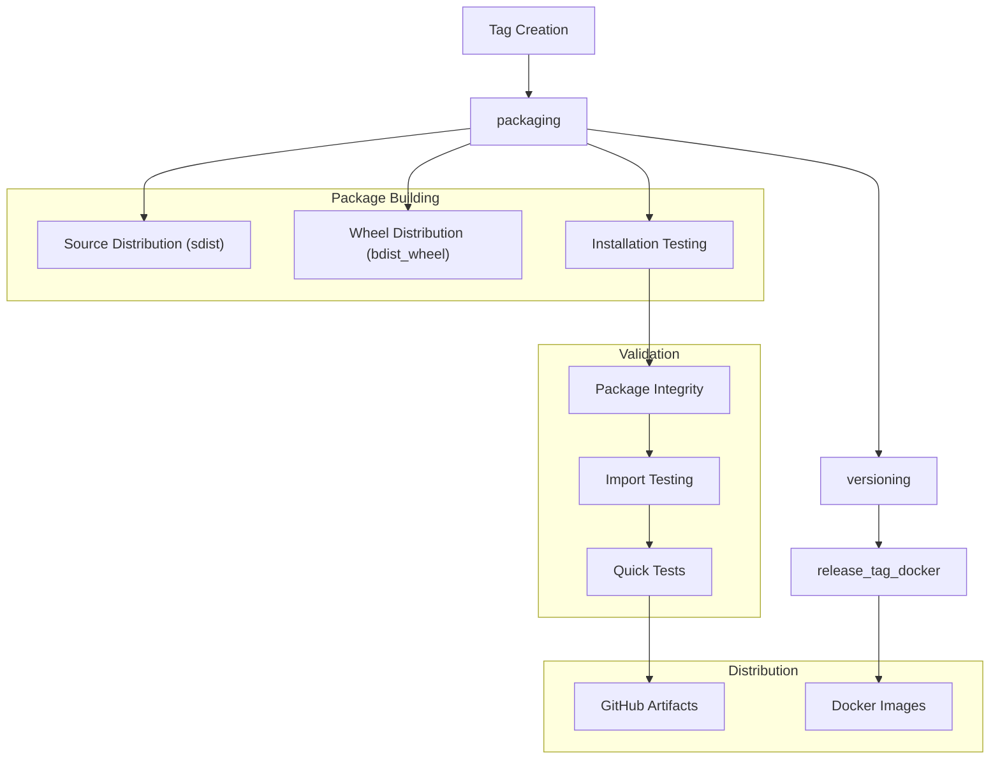
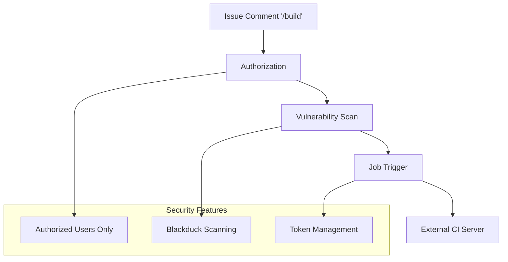

<!-- source: DeepWiki mcp.deepwiki.com · repo Project-MONAI/MONAI · page 7.2 CI/CD Workflows and Testing · fetched 2026-10-21 -->

# CI/CD Pipeline

<details>
<summary>Relevant source files</summary>

The following files were used as context for generating this wiki page:

- [.github/workflows/blossom-ci.yml](.github/workflows/blossom-ci.yml)
- [.github/workflows/codeql-analysis.yml](.github/workflows/codeql-analysis.yml)
- [.github/workflows/conda.yml](.github/workflows/conda.yml)
- [.github/workflows/cron-ngc-bundle.yml](.github/workflows/cron-ngc-bundle.yml)
- [.github/workflows/cron.yml](.github/workflows/cron.yml)
- [.github/workflows/docker.yml](.github/workflows/docker.yml)
- [.github/workflows/integration.yml](.github/workflows/integration.yml)
- [.github/workflows/pythonapp-gpu.yml](.github/workflows/pythonapp-gpu.yml)
- [.github/workflows/pythonapp-min.yml](.github/workflows/pythonapp-min.yml)
- [.github/workflows/pythonapp.yml](.github/workflows/pythonapp.yml)
- [.github/workflows/release.yml](.github/workflows/release.yml)
- [.github/workflows/setupapp.yml](.github/workflows/setupapp.yml)
- [.github/workflows/weekly-preview.yml](.github/workflows/weekly-preview.yml)
- [.gitignore](.gitignore)
- [CONTRIBUTING.md](CONTRIBUTING.md)
- [Dockerfile](Dockerfile)
- [docs/requirements.txt](docs/requirements.txt)
- [docs/source/conf.py](docs/source/conf.py)
- [docs/source/installation.md](docs/source/installation.md)
- [environment-dev.yml](environment-dev.yml)
- [monai/config/deviceconfig.py](monai/config/deviceconfig.py)
- [pyproject.toml](pyproject.toml)
- [requirements-dev.txt](requirements-dev.txt)
- [requirements.txt](requirements.txt)
- [runtests.sh](runtests.sh)
- [setup.cfg](setup.cfg)

</details>


This document covers MONAI's continuous integration and continuous deployment (CI/CD) infrastructure, including GitHub Actions workflows, testing strategies, and automated quality assurance processes. The pipeline ensures code quality, compatibility across platforms, and reliable releases through automated testing and deployment.

For information about project configuration and dependency management, see [Project Setup](#5.1). For details about code quality tools and utilities, see [Utilities](#5.3).

## Overview

MONAI's CI/CD pipeline is built on GitHub Actions and consists of multiple automated workflows that handle different aspects of the development lifecycle. The pipeline supports pre-merge validation, comprehensive testing across platforms and configurations, automated releases, and Docker image distribution.

## Workflow Architecture

### Primary Workflow Types

The CI/CD system consists of several distinct workflow categories, each serving specific purposes in the development lifecycle:



**Sources:** [.github/workflows/pythonapp.yml:1-246](), [.github/workflows/setupapp.yml:1-175](), [.github/workflows/cron.yml:1-267](), [.github/workflows/release.yml:1-169]()

### Test Execution Matrix

The pipeline executes tests across multiple dimensions to ensure comprehensive coverage:



**Sources:** [.github/workflows/pythonapp.yml:58-125](), [.github/workflows/setupapp.yml:80-125](), [.github/workflows/pythonapp-min.yml:74-121]()

## Pre-merge Validation

### Standard Pre-merge Pipeline

The main pre-merge workflow (`premerge`) runs on every pull request and push to protected branches:

| Job | Purpose | Environment | Duration |
|-----|---------|-------------|----------|
| `flake8-py3` | Code formatting, type checking | Ubuntu + Python 3.9 | ~10 min |
| `quick-py3` | Cross-platform unit tests | Windows/macOS/Ubuntu | ~120 min |
| `packaging` | Package building and testing | Ubuntu | ~30 min |
| `build-docs` | Documentation generation | Ubuntu | ~20 min |

The `flake8-py3` job runs three parallel tasks defined in the matrix strategy:

```yaml
strategy:
  matrix:
    opt: ["codeformat", "pytype", "mypy"]
```

Each task executes `runtests.sh` with the corresponding option for code quality checks.

**Sources:** [.github/workflows/pythonapp.yml:25-56](), [.github/workflows/pythonapp.yml:58-125]()

### Minimal Dependency Testing

The `premerge-min` workflow tests with minimal dependencies across multiple configurations:

- **OS Matrix**: Windows, macOS, Ubuntu
- **Python Matrix**: 3.9, 3.10, 3.11, 3.12
- **PyTorch Matrix**: 2.5.1, 2.6.0, 2.7.1, 2.8.0

This ensures MONAI works with the minimum required dependencies and maintains backward compatibility.

**Sources:** [.github/workflows/pythonapp-min.yml:25-73](), [.github/workflows/pythonapp-min.yml:122-169]()

### GPU Pre-merge Testing

The `premerge-gpu` workflow (currently disabled) would test GPU functionality using self-hosted runners with different PyTorch/CUDA combinations:

```yaml
matrix:
  environment:
    - "PT230+CUDA124DOCKER"
    - "PT240+CUDA125DOCKER" 
    - "PT250+CUDA126DOCKER"
```

**Sources:** [.github/workflows/pythonapp-gpu.yml:19-131]()

## Post-merge and Deployment

### Comprehensive Testing Pipeline

The `deploy` workflow runs full test suites after code is merged to important branches:



The `test-py3x` job tests across Python versions 3.9, 3.10, and 3.11 with both compiled and non-compiled builds:

```bash
BUILD_MONAI=0 ./runtests.sh --build --quick --unittests
BUILD_MONAI=1 ./runtests.sh --build --quick --min
```

**Sources:** [.github/workflows/setupapp.yml:80-126](), [.github/workflows/setupapp.yml:127-175]()

### Nightly Testing

The `nightly-crons` workflow runs comprehensive tests on a schedule with GPU hardware:

| Job | Hardware | Purpose |
|-----|----------|---------|
| `cron-gpu` | Self-hosted GPU | Full GPU testing with coverage |
| `cron-pt-image` | NGC PyTorch containers | Container compatibility |
| `cron-pip` | Latest PyTorch | Package installation testing |
| `cron-docker` | MONAI Docker image | Docker image validation |
| `cron-tutorial-notebooks` | GPU cluster | Tutorial execution |

**Sources:** [.github/workflows/cron.yml:11-267]()

## Build and Release Pipeline

### Package Release Process

The release workflow handles building and distributing MONAI packages:



The packaging job builds both source and wheel distributions:

```bash
python setup.py sdist bdist_wheel --build-number $(date +'%Y%m%d%H%M')
```

**Sources:** [.github/workflows/release.yml:28-66](), [.github/workflows/release.yml:89-121]()

### Docker Image Management

The Docker workflow (currently disabled) builds and distributes container images:

1. **Versioning**: Computes version information from `setup.py`
2. **Building**: Creates Docker images with MONAI and dependencies
3. **Testing**: Validates container functionality
4. **Distribution**: Pushes to Docker Hub as `projectmonai/monai:latest`

**Sources:** [.github/workflows/docker.yml:17-106](), [Dockerfile:1-67]()

## Infrastructure and Tools

### Self-hosted Runners

MONAI uses self-hosted GitHub Actions runners for GPU testing:

- **GPU Hardware**: Tesla V100 cards for CUDA testing
- **Container Support**: NVIDIA PyTorch containers for consistent environments
- **Resource Management**: CUDA device allocation via `python -m tests.utils`

### Test Execution Tools

The pipeline primarily uses `runtests.sh` for test orchestration:

```bash
# Code quality checks
./runtests.sh --build --codeformat
./runtests.sh --build --pytype
./runtests.sh --build --mypy

# Test execution
./runtests.sh --build --quick --unittests
./runtests.sh --build --coverage --net
```

**Sources:** [.github/workflows/pythonapp.yml:54-56](), [.github/workflows/cron.yml:64-66]()

### Caching Strategy

The pipeline implements comprehensive caching to reduce build times:

- **Pip Cache**: Weekly cache keys for package dependencies
- **Torch Cache**: Cached PyTorch installations
- **Build Cache**: Compiled extensions and build artifacts

```yaml
key: ${{ runner.os }}-pip-${{ steps.pip-cache.outputs.datew }}
```

**Sources:** [.github/workflows/pythonapp.yml:36-45](), [.github/workflows/setupapp.yml:32-44]()

### Hybrid CI Infrastructure

The Blossom CI workflow provides additional security and hybrid cloud capabilities:



**Sources:** [.github/workflows/blossom-ci.yml:24-109]()

## Quality Assurance Integration

The CI/CD pipeline integrates multiple quality assurance mechanisms:

1. **Static Analysis**: `mypy`, `pytype` for type checking
2. **Code Formatting**: `flake8` for style consistency  
3. **Test Coverage**: `coverage` reporting via Codecov
4. **Documentation**: Sphinx documentation building
5. **Security**: Vulnerability scanning via Blossom CI

Each workflow job includes error handling and cleanup procedures to ensure reliable execution and resource management.

**Sources:** [.github/workflows/pythonapp.yml:51-56](), [.github/workflows/setupapp.yml:69-78](), [.github/workflows/blossom-ci.yml:72-84]()

---

