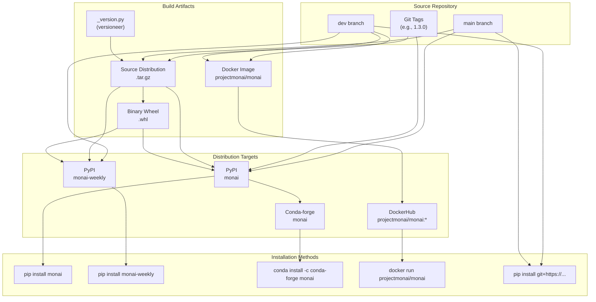
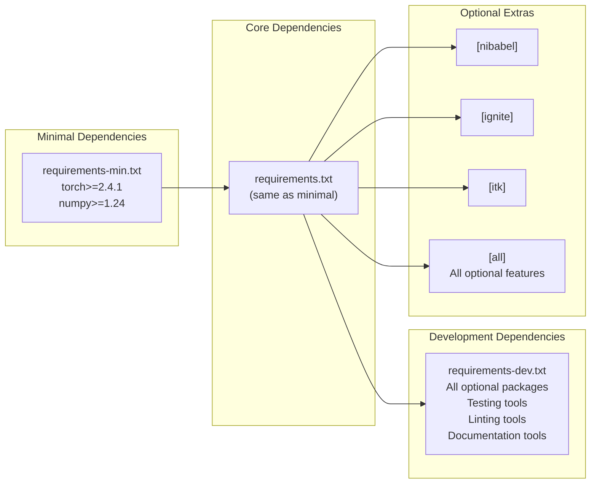
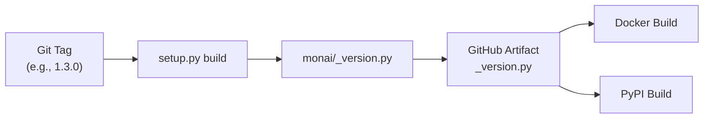
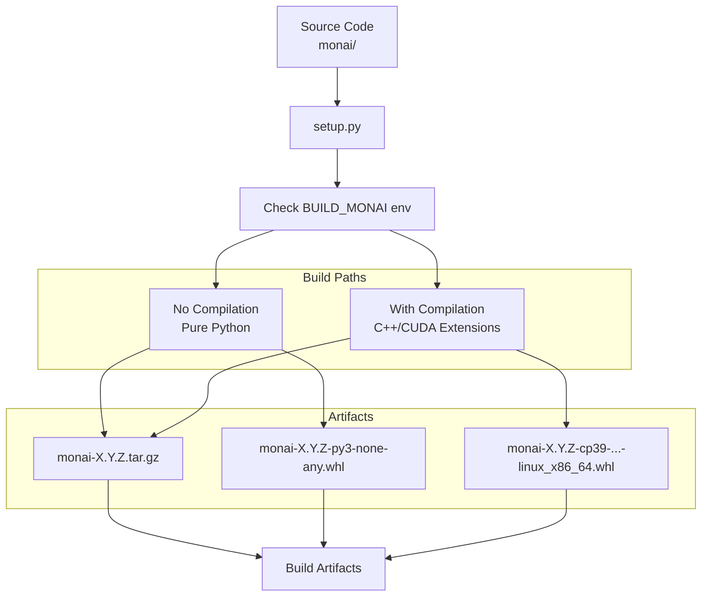
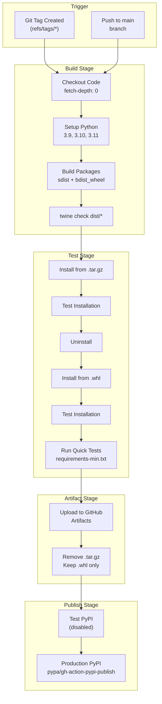
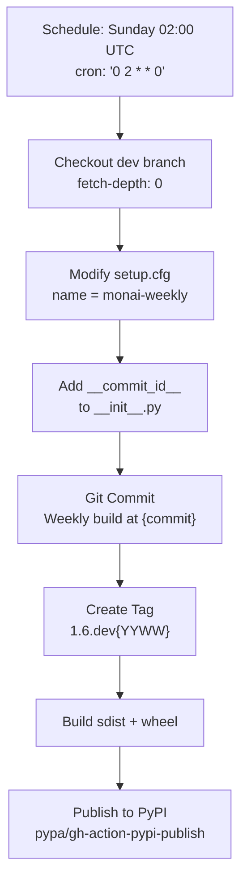
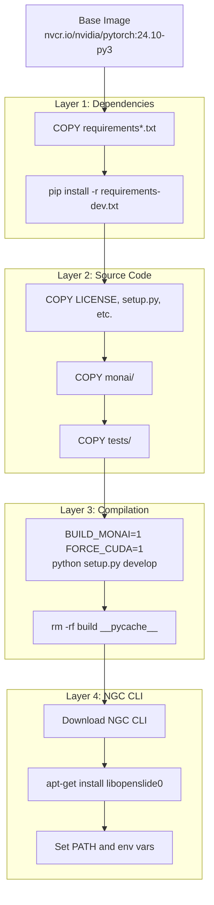
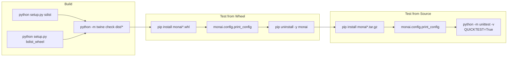
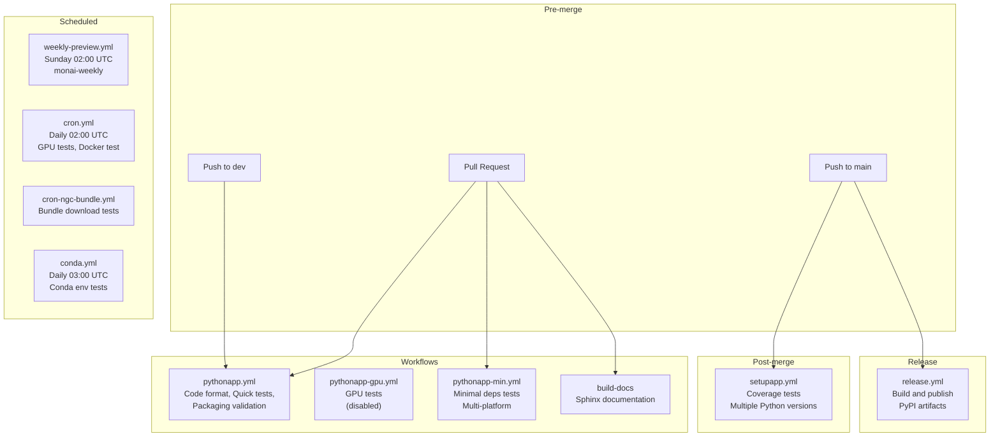

<!-- source: DeepWiki mcp.deepwiki.com · repo Project-MONAI/MONAI · page 7.3 Packaging and Distribution · fetched 2026-10-21 -->

# Packaging and Distribution

<details>
<summary>Relevant source files</summary>

The following files were used as context for generating this wiki page:

- [.github/workflows/blossom-ci.yml](.github/workflows/blossom-ci.yml)
- [.github/workflows/codeql-analysis.yml](.github/workflows/codeql-analysis.yml)
- [.github/workflows/conda.yml](.github/workflows/conda.yml)
- [.github/workflows/cron-ngc-bundle.yml](.github/workflows/cron-ngc-bundle.yml)
- [.github/workflows/cron.yml](.github/workflows/cron.yml)
- [.github/workflows/docker.yml](.github/workflows/docker.yml)
- [.github/workflows/integration.yml](.github/workflows/integration.yml)
- [.github/workflows/pythonapp-gpu.yml](.github/workflows/pythonapp-gpu.yml)
- [.github/workflows/pythonapp-min.yml](.github/workflows/pythonapp-min.yml)
- [.github/workflows/pythonapp.yml](.github/workflows/pythonapp.yml)
- [.github/workflows/release.yml](.github/workflows/release.yml)
- [.github/workflows/setupapp.yml](.github/workflows/setupapp.yml)
- [.github/workflows/weekly-preview.yml](.github/workflows/weekly-preview.yml)
- [.gitignore](.gitignore)
- [CONTRIBUTING.md](CONTRIBUTING.md)
- [Dockerfile](Dockerfile)
- [docs/requirements.txt](docs/requirements.txt)
- [docs/source/conf.py](docs/source/conf.py)
- [docs/source/installation.md](docs/source/installation.md)
- [environment-dev.yml](environment-dev.yml)
- [monai/config/deviceconfig.py](monai/config/deviceconfig.py)
- [pyproject.toml](pyproject.toml)
- [requirements-dev.txt](requirements-dev.txt)
- [requirements.txt](requirements.txt)
- [runtests.sh](runtests.sh)
- [setup.cfg](setup.cfg)

</details>


This document describes MONAI's packaging and distribution infrastructure, including the release process, distribution channels, dependency management, and CI/CD workflows that enable users to install MONAI via PyPI, Conda, Docker, or directly from source.

For information about development environment setup and testing infrastructure, see [Project Setup and Dependencies](#7.1) and [CI/CD Workflows and Testing](#7.2).

---

## Overview and Distribution Channels

MONAI is distributed through multiple channels to accommodate different user preferences and deployment scenarios. The primary distribution channels are:

- **PyPI** (`monai`) - Milestone releases every few months
- **PyPI** (`monai-weekly`) - Weekly preview builds from the `dev` branch
- **Conda-forge** (`monai`) - Conda package manager releases
- **DockerHub** (`projectmonai/monai`) - Pre-built container images with compiled extensions
- **GitHub** - Direct installation from source code

**Distribution Channels Architecture**



**Sources:** [setup.cfg:1-297](), [docs/source/installation.md:1-264](), [.github/workflows/release.yml:1-169]()

---

## Package Configuration and Metadata

MONAI's package configuration follows modern Python packaging standards using `setup.cfg` as the primary metadata source and `pyproject.toml` for build system requirements.

### Package Metadata

The package metadata is defined in `setup.cfg`:

| Metadata Field | Value | Location |
|----------------|-------|----------|
| Package Name | `monai` | [setup.cfg:2]() |
| Author | MONAI Consortium | [setup.cfg:3]() |
| License | Apache License 2.0 | [setup.cfg:10]() |
| Python Version | >= 3.9 | [setup.cfg:36]() |
| Homepage | https://project-monai.github.io/ | [setup.cfg:5]() |
| Documentation | https://monai.readthedocs.io/ | [setup.cfg:14]() |
| Source Code | https://github.com/Project-MONAI/MONAI | [setup.cfg:16]() |

### Build System Requirements

The `pyproject.toml` file specifies build dependencies required before the package can be installed:

```
[build-system]
requires = [
  "wheel",
  "setuptools", 
  "more-itertools>=8.0",
  "torch>=2.4.1",
  "ninja",
  "packaging"
]
```

These dependencies are isolated during pip installation and only used for building the package, not runtime.

**Sources:** [setup.cfg:1-34](), [pyproject.toml:1-9](), [docs/source/installation.md:113-118]()

---

## Dependency Management

MONAI uses a tiered dependency system to support flexible installations from minimal to full-featured deployments.

### Dependency Tiers

**Dependency Tier Structure**



### Requirements Files

| File | Purpose | Package Count |
|------|---------|---------------|
| `requirements.txt` | Minimal runtime dependencies | 2 (torch, numpy) |
| `requirements-min.txt` | Same as requirements.txt | 2 |
| `requirements-dev.txt` | Full development environment | 60+ packages |
| `docs/requirements.txt` | Documentation building | 40+ packages |
| `environment-dev.yml` | Conda environment specification | Full dev setup |

### Optional Extras Syntax

MONAI supports installing optional features using the extras syntax. These are defined in `setup.cfg` under `[options.extras_require]`:

```python
# Install with specific features
pip install monai[nibabel,skimage]

# Install all optional dependencies  
pip install monai[all]

# From setup.cfg:
[options.extras_require]
all = 
    nibabel
    ninja
    scikit-image>=0.14.2
    scipy>=1.12.0
    # ... (full list)
nibabel = 
    nibabel
ignite =
    pytorch-ignite==0.4.11
```

### Conditional Dependencies

Some dependencies are platform-specific:

```
cucim-cu12; platform_system == "Linux" and python_version >= '3.9' and python_version <= '3.10'
scipy>=1.12.0; python_version >= '3.9'
transformers>=4.36.0, <4.41.0; python_version <= '3.10'
```

**Sources:** [requirements.txt:1-4](), [requirements-dev.txt:1-67](), [setup.cfg:48-178](), [docs/source/installation.md:215-264]()

---

## Version Management

MONAI uses **versioneer** for automatic version string generation based on git history, ensuring that every build can be traced back to its source commit.

### Versioneer Configuration

Versioneer is configured in `setup.cfg`:

```
[versioneer]
VCS = git
style = pep440
versionfile_source = monai/_version.py
versionfile_build = monai/_version.py
tag_prefix =
parentdir_prefix =
```

### Version String Format

The version string encodes several pieces of information:

```
MONAI version: 0.1.0+144.g52c763d.dirty
```

| Component | Meaning |
|-----------|---------|
| `0.1.0` | Base milestone release version |
| `+144` | 144 commits ahead of the milestone |
| `g52c763d` | Git commit hash `52c763d` |
| `dirty` | Local modifications present (uncommitted changes) |

### Version File Generation

During the release process, the version file is generated and uploaded as an artifact:

**Version Generation Workflow**



**Sources:** [setup.cfg:221-227](), [docs/source/installation.md:180-192](), [.github/workflows/release.yml:89-121]()

---

## Build Process

MONAI packages are built using standard Python packaging tools, producing both source distributions (sdist) and binary wheels (bdist_wheel).

### Build Artifacts

The build process creates two types of artifacts:

1. **Source Distribution** (`.tar.gz`) - Contains source code and requires compilation on installation
2. **Binary Wheel** (`.whl`) - Pre-built package with platform-specific binaries

### Build Commands

The core build commands used in CI/CD:

```bash
# Standard build
python setup.py sdist bdist_wheel

# Check package metadata
python setup.py check -m -s

# Verify package with twine
python -m twine check dist/*
```

### Compiled Extensions

MONAI includes optional C++/CUDA extensions that can be compiled during installation:

```bash
# Build with extensions
BUILD_MONAI=1 python setup.py develop

# Force CUDA compilation
BUILD_MONAI=1 FORCE_CUDA=1 python setup.py develop

# macOS with clang
BUILD_MONAI=1 CC=clang CXX=clang++ python setup.py develop
```

The `BUILD_MONAI` environment variable controls whether extensions are compiled:

```python
# From monai/config/deviceconfig.py
try:
    _, HAS_EXT = optional_import("monai._C")
    USE_COMPILED = HAS_EXT and os.getenv("BUILD_MONAI", "0") == "1"
except (OptionalImportError, ImportError, AttributeError):
    HAS_EXT = USE_COMPILED = False
```

**Build Process Flow**



**Sources:** [setup.cfg:35-46](), [.github/workflows/pythonapp.yml:136-138](), [docs/source/installation.md:107-167](), [monai/config/deviceconfig.py:30-34]()

---

## PyPI Release Process

The PyPI release process is automated through GitHub Actions and involves multiple testing and verification stages before publication.

### Release Workflow

**PyPI Release Pipeline**



### Release Workflow File

The release workflow is triggered on git tags and main branch pushes:

```yaml
# From .github/workflows/release.yml
on:
  push:
    branches:
      - main
    tags:
      - '*'

jobs:
  packaging:
    # Builds for Python 3.9, 3.10, 3.11
    # Tests both tar.gz and wheel installations
    
  versioning:
    # Generates _version.py file
    # Uploads as artifact
    
  release_tag_docker:
    # Docker image build (currently disabled)
```

### Package Verification

Before publishing, packages undergo comprehensive testing:

1. **Metadata Validation**: `python setup.py check -m -s`
2. **Twine Check**: Verifies package structure and metadata
3. **Installation Test**: Install from both `.tar.gz` and `.whl`
4. **Import Test**: Verify MONAI can be imported and configured
5. **Quick Tests**: Run minimal test suite with `requirements-min.txt`

### Version-Specific Builds

For releases, wheels can include build numbers:

```bash
# From release.yml
python setup.py sdist bdist_wheel --build-number $(date +'%Y%m%d%H%M')
```

**Sources:** [.github/workflows/release.yml:1-169](), [.github/workflows/pythonapp.yml:106-181]()

---

## Weekly Preview Releases

MONAI publishes weekly preview builds to PyPI as `monai-weekly`, allowing users to access the latest features from the `dev` branch before milestone releases.

### Weekly Build Process

**Weekly Preview Workflow**



### Package Name Transformation

The weekly build transforms the package name to avoid conflicts:

```bash
# From .github/workflows/weekly-preview.yml
sed -i 's/name\ =\ monai$/name\ =\ monai-weekly/g' setup.cfg
```

### Weekly Version Format

Weekly versions follow the format `1.6.dev{YYWW}` where:
- `YYWW` = Year (2 digits) + Week number (2 digits)
- Example: `1.6.dev2418` = 2024, Week 18

```bash
export YEAR_WEEK=$(date +'%y%U')
git tag "1.6.dev${YEAR_WEEK}"
```

### Installing Weekly Builds

Users can install the latest development version:

```bash
# Install weekly preview
pip install monai-weekly

# Check version
python -c "import monai; print(monai.__version__)"
# Output: 1.6.dev2418+5.g8a2b3c4
```

### Namespace Conflict Warning

The documentation warns about potential conflicts:

> Coexistence of package `monai` and `monai-weekly` in a system may cause namespace conflicts and `ImportError`. This is usually a result of running both `pip install monai` and `pip install monai-weekly` without uninstalling the existing one first.

**Sources:** [.github/workflows/weekly-preview.yml:1-79](), [docs/source/installation.md:52-72]()

---

## Docker Image Distribution

MONAI provides pre-built Docker images on DockerHub with compiled C++/CUDA extensions and all optional dependencies installed.

### Dockerfile Structure

**Docker Build Layers**



### Docker Image Tags

| Tag | Source | Description |
|-----|--------|-------------|
| `latest` | `dev` branch | Latest development version |
| `1.3.0` | Git tag `1.3.0` | Specific milestone release |
| `0.1.0` | Git tag `0.1.0` | Older milestone release |

### Building Docker Images

The Docker build process (currently disabled in workflows):

```yaml
# From .github/workflows/docker.yml
docker build -t projectmonai/monai:latest -f Dockerfile .

# Push to DockerHub
echo "${{ secrets.DOCKER_PW }}" | docker login -u projectmonai --password-stdin
docker push projectmonai/monai:latest
```

### Running Docker Containers

Users can run MONAI containers with GPU support:

```bash
# Run latest version
docker run --gpus all --rm -ti --ipc=host projectmonai/monai:latest

# Run specific version
docker run --gpus all --rm -ti --ipc=host projectmonai/monai:1.3.0
```

### Docker Image Contents

The MONAI Docker image includes:

- **Base**: NVIDIA PyTorch container with CUDA support
- **MONAI**: Compiled with `BUILD_MONAI=1 FORCE_CUDA=1`
- **Dependencies**: All packages from `requirements-dev.txt`
- **NGC CLI**: For accessing NVIDIA GPU Cloud resources
- **Tests**: Full test suite available at `/opt/monai/tests`

**Sources:** [Dockerfile:1-67](), [.github/workflows/docker.yml:1-106](), [docs/source/installation.md:193-212]()

---

## Conda Distribution

MONAI is available on conda-forge, providing an alternative installation method for users who prefer the Conda package manager.

### Conda Installation

```bash
# Install from conda-forge
conda install -c conda-forge monai
```

### Conda Development Environment

MONAI provides a complete development environment specification:

```yaml
# environment-dev.yml
name: monai
channels:
  - pytorch
  - defaults
  - nvidia
  - conda-forge
dependencies:
  - numpy>=1.24,<3.0
  - pytorch>=2.3.0
  - torchio
  - torchvision
  - pytorch-cuda>=11.6
  - pip
  - pip:
    - -r requirements-dev.txt
```

### Creating Conda Environment

```bash
# Clone repository
git clone https://github.com/Project-MONAI/MONAI.git
cd MONAI/

# Create conda environment
conda create -n monai python=3.9
conda env update -n monai -f environment-dev.yml
conda activate monai

# Install MONAI in development mode
BUILD_MONAI=1 python setup.py develop
```

### Conda CI Testing

Daily cron jobs test the conda environment:

```yaml
# From .github/workflows/conda.yml
jobs:
  cron-conda:
    strategy:
      matrix:
        os: [ubuntu-latest]
        python-version: ["3.9", "3.10"]
    steps:
      - uses: conda-incubator/setup-miniconda@v3
        with:
          environment-file: environment-dev.yml
          activate-environment: monai
      - name: Test env
        run: |
          conda activate monai
          $(pwd)/runtests.sh --build --unittests
```

**Sources:** [environment-dev.yml:1-16](), [docs/source/installation.md:82-88](), [docs/source/installation.md:242-250](), [.github/workflows/conda.yml:1-72]()

---

## Package Testing and Validation

All packages undergo comprehensive testing before distribution to ensure installation works correctly across different environments.

### Pre-merge Package Testing

The `packaging` job in the pre-merge workflow validates package building:

**Package Testing Flow**



### Minimal Dependency Testing

MONAI tests installation with minimal dependencies to ensure the package works without optional features:

```bash
# Install minimal dependencies
pip install torch --index-url https://download.pytorch.org/whl/cpu
pip install -r requirements-min.txt

# Install MONAI without compilation
BUILD_MONAI=0 python setup.py develop

# Run minimal tests
./runtests.sh --min
```

### Multi-Environment Testing

The CI/CD pipeline tests packages across:

| Dimension | Values |
|-----------|--------|
| OS | Ubuntu, macOS, Windows |
| Python | 3.9, 3.10, 3.11, 3.12 |
| PyTorch | 2.5.1, 2.6.0, 2.7.1, 2.8.0 |
| Installation | pip, conda, docker, source |

### Nightly Package Testing

Nightly cron jobs test PyPI installation:

```bash
# From .github/workflows/cron.yml cron-pip job
pip uninstall monai
pip list | grep -iv monai

# Build and test installation from source
python setup.py sdist bdist_wheel
tmp_dir=$(mktemp -d)
cp dist/monai* "$tmp_dir"
cd "$tmp_dir"

# Install from tar.gz
python -m pip install monai*.tar.gz[all]
python -c 'import monai; monai.config.print_config()'

# Run unit tests
python -m pip install -r requirements-dev.txt
python ./tests/runner.py -p 'test_((?!integration).)'
```

**Sources:** [.github/workflows/pythonapp.yml:106-181](), [.github/workflows/pythonapp-min.yml:1-171](), [.github/workflows/cron.yml:123-191]()

---

## CI/CD Pipeline Integration

The packaging and distribution system is tightly integrated with MONAI's CI/CD infrastructure, ensuring quality and reliability.

### Workflow Triggers

**CI/CD Trigger Matrix**



### Package Validation Gates

Before code can be merged or released, it must pass:

1. **Code Format Checks**: `--codeformat` (black, isort, flake8, ruff)
2. **Type Checking**: `--mypy` and `--pytype`
3. **Unit Tests**: `--unittests` (excludes integration and distributed tests)
4. **Package Building**: Successful `sdist` and `bdist_wheel` creation
5. **Installation Tests**: Install from both `.tar.gz` and `.whl`
6. **Quick Tests**: Run with `QUICKTEST=True` environment variable

### Caching Strategy

The CI/CD pipeline uses aggressive caching to speed up builds:

```yaml
# Weekly timestamp for cache keys
- name: cache weekly timestamp
  id: pip-cache
  run: echo "datew=$(date '+%Y-%V')" >> $GITHUB_OUTPUT

# Pip cache
- name: cache for pip
  uses: actions/cache@v5
  with:
    path: |
      ~/.cache/pip
      ~/.cache/torch
    key: ${{ runner.os }}-pip-${{ steps.pip-cache.outputs.datew }}
```

### Artifact Upload

Build artifacts are uploaded for debugging and release:

```yaml
# From release.yml
- name: Upload artifacts
  uses: actions/upload-artifact@v6
  with:
    name: dist
    path: dist/

- name: Upload version
  uses: actions/upload-artifact@v6
  with:
    name: _version.py
    path: build/lib/monai/_version.py
```

**Sources:** [.github/workflows/pythonapp.yml:1-204](), [.github/workflows/setupapp.yml:1-175](), [.github/workflows/cron.yml:1-267](), [.github/workflows/weekly-preview.yml:1-79]()

---

## Installation Verification

MONAI provides utilities for verifying successful installation and debugging configuration issues.

### Configuration Printing

The `monai.config.print_config()` function displays installed dependencies:

```python
import monai
monai.config.print_config()
```

**Output includes:**
- MONAI version and revision ID
- Core dependencies (PyTorch, Numpy)
- Optional dependencies with version info
- Compilation flags (`HAS_EXT`, `USE_COMPILED`, `USE_META_DICT`)

### Debug Information

For comprehensive system information:

```python
import monai
monai.config.print_debug_info()
```

**Output includes:**
- MONAI configuration
- System information (OS, CPU, memory)
- GPU information (CUDA, cuDNN, devices)

### Version String Parsing

Users can parse the version string to understand their installation:

```python
import monai
print(monai.__version__)
# Example: "1.3.0+144.g52c763d.dirty"

# Check if compiled
from monai.config import USE_COMPILED, HAS_EXT
print(f"Extensions available: {HAS_EXT}")
print(f"Extensions in use: {USE_COMPILED}")
```

### Installation Sources

The configuration output shows the installation file path:

```python
import monai
print(monai.__file__)
# /usr/local/lib/python3.9/site-packages/monai/__init__.py
```

**Sources:** [monai/config/deviceconfig.py:41-264](), [docs/source/installation.md:169-192]()

---

## Summary

MONAI's packaging and distribution system provides:

1. **Multiple Distribution Channels**: PyPI (stable and weekly), Conda, Docker, and GitHub
2. **Flexible Dependency Management**: Minimal, optional extras, and full development dependencies
3. **Automated Release Pipeline**: GitHub Actions workflows for building, testing, and publishing
4. **Version Tracking**: Versioneer integration for traceable builds
5. **Comprehensive Testing**: Multi-platform, multi-Python version validation before release
6. **Pre-built Binaries**: Docker images with compiled C++/CUDA extensions
7. **Developer-Friendly**: Easy source installation with `setup.py develop`

The system balances ease of use for end users with flexibility for developers and advanced customization for specialized deployments.