# Page: MONAI Overview

# MONAI Overview

<details>
<summary>Relevant source files</summary>

The following files were used as context for generating this wiki page:

- [README.md](README.md)
- [docs/images/MONAI_arch.png](docs/images/MONAI_arch.png)
- [docs/images/MONAI_bundle_cloud.png](docs/images/MONAI_bundle_cloud.png)
- [docs/images/MONAI_clouds.png](docs/images/MONAI_clouds.png)
- [docs/images/MONAI_map_cloud.png](docs/images/MONAI_map_cloud.png)
- [docs/source/bundle_intro.rst](docs/source/bundle_intro.rst)
- [docs/source/index.rst](docs/source/index.rst)
- [docs/source/mb_specification.rst](docs/source/mb_specification.rst)
- [tests/testing_data/metadata.json](tests/testing_data/metadata.json)

</details>


## Purpose and Scope

This document provides a high-level introduction to the MONAI framework, its architecture, and core concepts. It covers the overall organization of the codebase, key modules, and how they interact to support deep learning workflows for medical imaging.

For detailed information about specific subsystems:
- Core utilities and module management: see [Core Utilities and Module System](#2.1)
- Transform system architecture: see [Transform System](#3)
- Data loading and caching: see [Data Loading and Processing](#4)
- Neural network architectures: see [Network Architectures and Components](#5.1)
- Training workflows: see [Training Engines and Workflows](#5.2)
- Bundle format and distribution: see [Bundle System](#6.1)
- Development setup and CI/CD: see [Development and Infrastructure](#7)

---

## What is MONAI?

**MONAI** (Medical Open Network for AI) is a PyTorch-based, open-source framework for deep learning in healthcare imaging. It is part of the PyTorch Ecosystem and provides domain-specific implementations for medical image analysis tasks including segmentation, classification, detection, and registration.

**Core Ambitions:**
- Develop a collaborative community of academic, industrial, and clinical researchers
- Create state-of-the-art, end-to-end training workflows for healthcare imaging
- Provide researchers with optimized and standardized tools for deep learning model development

**Key Features:**
- Flexible preprocessing for multi-dimensional medical imaging data
- Compositional and portable APIs for integration into existing workflows
- Domain-specific network architectures, loss functions, and evaluation metrics
- Customizable design supporting varying levels of user expertise
- Multi-GPU and multi-node data parallelism support

**Sources:** [README.md:1-26](), [docs/source/index.rst:1-44]()

---

## Architecture Overview

MONAI's architecture is organized into distinct layers, each providing specific functionality for medical imaging workflows. The diagram below maps high-level system components to their corresponding code modules.

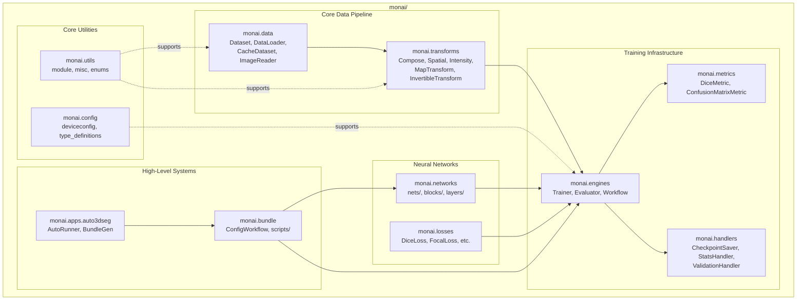

**Sources:** [README.md:20-44](), [docs/source/index.rst:14-34]()

---

## Core Module Organization

The MONAI codebase is organized into the following primary modules located under the `monai/` directory:

### Data Pipeline (`monai.data`)
Handles medical image loading, caching, and batching:
- `Dataset`: Base dataset class and specialized variants (`CacheDataset`, `PersistentDataset`, `LMDBDataset`)
- `DataLoader`: PyTorch-compatible data loaders with custom collation
- `ImageReader`: Format-specific readers (`ITKReader`, `NibabelReader`, `PydicomReader`)
- Decathalon dataset utilities

**Key Classes:** `Dataset`, `CacheDataset`, `DataLoader`, `ImageReader`

### Transforms (`monai.transforms`)
Composable preprocessing and augmentation operations:
- **Base Classes:** `Transform`, `MapTransform`, `RandomizableTransform`, `InvertibleTransform`, `LazyTransform`
- **Categories:** Spatial (resampling, rotation), Intensity (normalization, scaling), Crop/Pad, Post-processing
- **Dictionary Pattern:** Transforms ending with 'd' suffix operate on dictionaries (e.g., `LoadImaged`, `Spacingd`)

**Key Classes:** `Compose`, `LoadImage`, `Spacing`, `NormalizeIntensity`, `RandCropByPosNegLabel`

### Networks (`monai.networks`)
Neural network architectures and building blocks:
- `nets/`: Complete architectures (UNet, ResNet, DenseNet, ViT, UNETR, etc.)
- `blocks/`: Reusable network components (Convolution, Residual, Attention blocks)
- `layers/`: Low-level layer implementations (Act, Norm, Conv, Dropout)

**Key Classes:** `UNet`, `DynUNet`, `SegResNet`, `UNETR`, `SwinUNETR`

### Training & Evaluation (`monai.engines`, `monai.metrics`, `monai.handlers`)
Event-driven training infrastructure built on PyTorch Ignite:
- **Engines:** `Workflow`, `SupervisedTrainer`, `SupervisedEvaluator`, `EnsembleEvaluator`
- **Metrics:** `DiceMetric`, `HausdorffDistanceMetric`, `ConfusionMatrixMetric`, `ROCAUCMetric`
- **Handlers:** `CheckpointSaver`, `StatsHandler`, `TensorBoardHandler`, `ValidationHandler`

**Key Classes:** `SupervisedTrainer`, `SupervisedEvaluator`, `DiceMetric`, `CheckpointSaver`

### Bundle System (`monai.bundle`)
Standardized model packaging and distribution:
- Configuration-based workflows (`ConfigWorkflow`)
- Bundle scripts for download, load, run, verify operations
- Model export utilities (TorchScript, ONNX, TensorRT)

**Key Classes:** `ConfigWorkflow`, `ConfigParser`

### Auto3DSeg (`monai.apps.auto3dseg`)
Automated pipeline for 3D segmentation tasks:
- `AutoRunner`: Orchestrates the complete automated workflow
- `BundleGen`: Generates algorithm bundles from templates
- `AlgoEnsemble`: Combines multiple models for inference

**Key Classes:** `AutoRunner`, `BundleGen`, `AlgoEnsemble`

**Sources:** [README.md:27-44](), [docs/source/index.rst:27-34]()

---

## Key Abstractions and Design Patterns

### MetaTensor
MONAI's `MetaTensor` extends PyTorch tensors with metadata tracking capabilities. It stores:
- Affine transformations for spatial coordinates
- Applied operations history (`applied_operations`)
- Pending lazy operations (`pending_operations`)
- Original image metadata (spacing, orientation, etc.)

This enables invertible transforms and preserves provenance throughout the pipeline.

**Key Class:** `monai.data.MetaTensor`

### Transform Composition
Transforms follow a functional composition pattern where operations are chained:


Dictionary-based transforms (suffix 'd') operate on dictionaries of data items, enabling coordinated transformations across images, labels, and metadata.

**Key Classes:** `Compose`, `MapTransform`, `InvertibleTransform`

### Event-Driven Training
Training engines use an event system built on PyTorch Ignite:

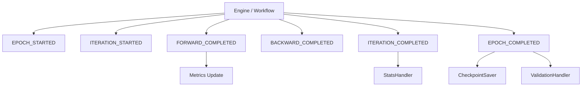

Handlers attach to events to perform actions like logging, checkpointing, or validation.

**Key Classes:** `Workflow`, `IterationEvents`, `Handler`

### Bundle Configuration System
Bundles use JSON/YAML configurations with a reference syntax for defining workflows:

- `@network_def` references network instantiation
- `@preprocessing` references transform chains
- `$@device` references runtime parameters
- Expressions like `$@optimizer_def#lr` access nested values

The `ConfigParser` resolves these references and instantiates components.

**Key Class:** `monai.bundle.ConfigParser`

**Sources:** [README.md:27-44](), [docs/source/index.rst:27-34]()

---

## Code-to-Concept Mapping

The following diagram maps common medical imaging workflow concepts to specific MONAI code entities:

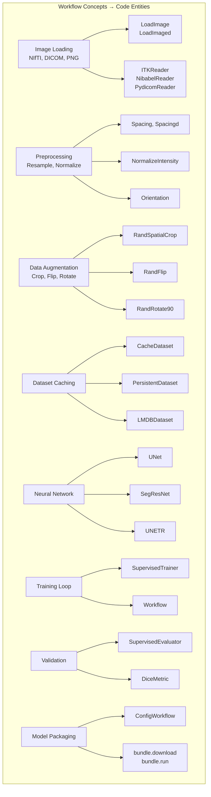

**Sources:** [README.md:1-97]()

---

## Installation and Distribution

### Installation Options

**PyPI (recommended):**
```bash
pip install monai
```

**Conda:**
```bash
conda install -c conda-forge monai
```

**Docker:**
```bash
docker pull projectmonai/monai
```

**Weekly Preview (development builds):**
```bash
pip install monai-weekly
```

### Requirements
- Python: Currently supported versions (typically 3.8+)
- PyTorch: Current version plus three previous minor versions
- NumPy: Required core dependency
- Optional dependencies for specific features (ITK, Nibabel, TorchVision, etc.)

Version compatibility information is maintained in `requirements*.txt` files at the repository root.

For detailed installation instructions including optional dependencies and environment setup, see [Project Setup and Dependencies](#7.1).

**Sources:** [README.md:37-54]()

---

## Getting Started Resources

**Documentation:**
- API Documentation: `https://docs.monai.io`
- Technical highlights and tutorials: Available in the docs
- Bundle specification: [docs/source/mb_specification.rst:1-175]()

**Code Examples:**
- MedNIST demo: Interactive Colab notebook for 2D classification
- MONAI for PyTorch Users: Developer guide notebook
- Tutorial repository: `https://github.com/Project-MONAI/tutorials`

**Model Zoo:**
- Pre-trained models in Bundle format: `https://github.com/Project-MONAI/model-zoo`
- Community-contributed models and workflows
- Easy integration with MONAI applications

**Community:**
- GitHub Discussions: Q&A and community support
- Twitter: @ProjectMONAI
- LinkedIn: Project MONAI page
- Slack: Community workspace

**Sources:** [README.md:56-82](), [docs/source/index.rst:38-108]()

---

## Development and Contribution

MONAI follows open-source development practices with:

**Testing Infrastructure:**
- Unit tests covering core functionality
- Integration tests for end-to-end workflows
- GPU-specific test suites
- Minimal dependency tests

**CI/CD Pipelines:**
- Pre-merge validation (quick tests, formatting, type checking)
- Post-merge comprehensive testing
- Nightly builds testing multiple Python/PyTorch/CUDA combinations
- Automated release process to PyPI and conda-forge

**Code Quality:**
- Automated formatting: `black`, `isort`, `ruff`
- Type checking: `mypy`
- Linting: `flake8`
- Test coverage reporting

For information about setting up a development environment, running tests, and the contribution workflow, see [Development and Infrastructure](#7).

**Sources:** [README.md:74-76]()

---

## Related Pages

- **[Core Architecture](#2)**: Fundamental utilities, module system, and core abstractions
- **[Transform System](#3)**: Comprehensive documentation of MONAI's transform architecture
- **[Data Loading and Processing](#4)**: Dataset classes, caching strategies, and image I/O
- **[Models and Training](#5)**: Neural networks, training engines, metrics, and handlers
- **[Advanced Features](#6)**: Bundle system and Auto3DSeg pipeline
- **[Development and Infrastructure](#7)**: Setup, testing, CI/CD, and packaging

**Sources:** [README.md:1-97](), [docs/source/index.rst:1-115]()

---

# Page: Core Architecture

# Core Architecture

<details>
<summary>Relevant source files</summary>

The following files were used as context for generating this wiki page:

- [monai/__init__.py](monai/__init__.py)
- [monai/networks/__init__.py](monai/networks/__init__.py)
- [monai/networks/layers/simplelayers.py](monai/networks/layers/simplelayers.py)
- [monai/networks/utils.py](monai/networks/utils.py)
- [monai/utils/__init__.py](monai/utils/__init__.py)
- [monai/utils/enums.py](monai/utils/enums.py)
- [monai/utils/misc.py](monai/utils/misc.py)
- [monai/utils/module.py](monai/utils/module.py)

</details>


## Purpose and Scope

This page documents the fundamental utilities and systems that underpin the entire MONAI framework. These core components provide essential functionality for determinism control, module loading, type conversions, environment configuration, and model deployment. All higher-level MONAI components (transforms, data loaders, networks, engines) depend on these utilities.

For information about:
- Transform system architecture and operations, see [Transform System](#3)
- Data loading, caching, and I/O, see [Data Loading and Processing](#4)
- Neural network architectures and training, see [Models and Training](#5)

---

## System Overview

The core architecture provides foundational services organized into several key subsystems:

```mermaid
graph TB
    subgraph "Module System"
        OptImport["optional_import()<br/>Safe dependency loading"]
        LoadSub["load_submodules()<br/>Package discovery"]
        Instantiate["instantiate()<br/>Component creation"]
    end
    
    subgraph "Determinism Control"
        SetDet["set_determinism()<br/>Seed management"]
        GetSeed["get_seed()<br/>Current seed"]
        MaxSeed["MAX_SEED<br/>2^32 limit"]
    end
    
    subgraph "Type Utilities"
        EnsureTuple["ensure_tuple()<br/>Sequence normalization"]
        EnsureTupleRep["ensure_tuple_rep()<br/>Length enforcement"]
        Convert["Type conversion utils"]
    end
    
    subgraph "Environment & Config"
        EnvVars["MONAIEnvVars<br/>Environment settings"]
        Enums["StrEnum types<br/>Type-safe constants"]
        ImageMeta["ImageMetaKey<br/>Metadata keys"]
    end
    
    subgraph "Model Deployment"
        ToONNX["convert_to_onnx()<br/>ONNX export"]
        ToTS["convert_to_torchscript()<br/>TorchScript export"]
        ToTRT["convert_to_trt()<br/>TensorRT export"]
        StateDict["State management"]
    end
    
    OptImport --> LoadSub
    LoadSub --> Instantiate
    
    SetDet --> GetSeed
    GetSeed --> MaxSeed
    
    EnsureTuple --> EnsureTupleRep
    EnsureTupleRep --> Convert
    
    EnvVars --> Enums
    Enums --> ImageMeta
    
    ToONNX --> StateDict
    ToTS --> StateDict
    ToTRT --> StateDict
```

**Diagram: Core Architecture Subsystems** - This diagram shows the five major subsystems of MONAI's core architecture and their internal relationships. Each subsystem provides essential utilities that support the higher-level data, transform, network, and training systems.

Sources: [monai/utils/__init__.py:1-159](), [monai/utils/misc.py:1-929](), [monai/utils/module.py:1-658]()

---

## Determinism and Random State Management

MONAI provides comprehensive determinism control to ensure reproducible training and evaluation across different runs.

### Seed Management

| Function/Constant | Purpose | File Location |
|------------------|---------|---------------|
| `set_determinism()` | Configure global deterministic behavior | [monai/utils/misc.py:339-391]() |
| `get_seed()` | Retrieve current random seed | [monai/utils/misc.py:335-336]() |
| `MAX_SEED` | Maximum valid seed value (2^32) | [monai/utils/misc.py:103]() |
| `_seed` | Global seed storage | [monai/utils/misc.py:99]() |

### Determinism Configuration Flow

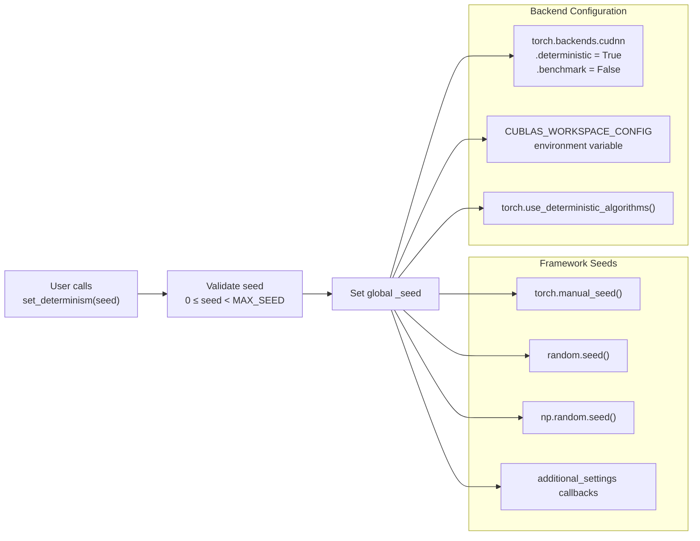

**Diagram: Determinism Control Flow** - Shows how `set_determinism()` propagates seed values and configuration flags across PyTorch, NumPy, Python random, and CUDA backends to achieve reproducible behavior.

Sources: [monai/utils/misc.py:339-391](), [monai/utils/misc.py:99-107]()

### Key Implementation Details

The determinism system configures multiple layers:

1. **Global Seed Storage**: The module-level `_seed` variable stores the current seed for retrieval
2. **Framework Seeds**: PyTorch, NumPy, and Python's random module are seeded identically
3. **CUDA Configuration**: Sets `CUBLAS_WORKSPACE_CONFIG` environment variable to enable deterministic algorithms
4. **cuDNN Flags**: Disables benchmarking and enables deterministic mode
5. **Additional Settings**: Allows custom callbacks for framework-specific seeding

```python
# Example usage pattern
from monai.utils import set_determinism, get_seed

# Enable deterministic training
set_determinism(seed=42)

# Later retrieve the seed
current_seed = get_seed()  # Returns 42
```

**Important Note**: The `MAX_SEED` constant is set to 2^32 (4,294,967,296) because PyTorch CUDA requires 32-bit seeds. Seeds are automatically taken modulo `MAX_SEED` if they exceed this limit.

Sources: [monai/utils/misc.py:99-107](), [monai/utils/misc.py:339-391]()

---

## Module Loading and Optional Dependencies

MONAI uses a sophisticated module loading system to handle optional dependencies gracefully, allowing the framework to function even when certain packages are not installed.

### Optional Import System

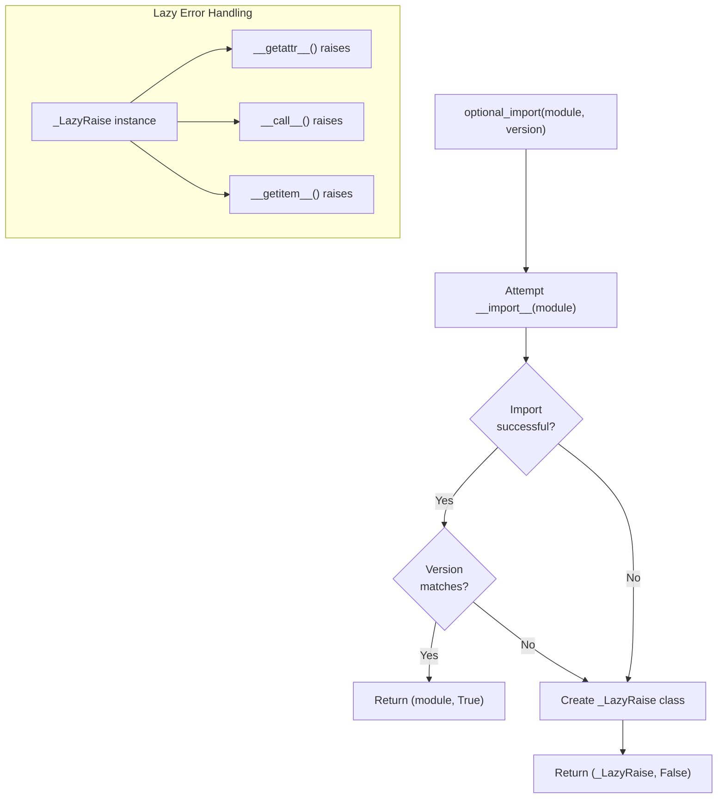

**Diagram: Optional Import Mechanism** - Shows how `optional_import()` attempts to load modules and returns either the real module or a lazy error-raising proxy object. The proxy delays exceptions until actual use.

Sources: [monai/utils/module.py:315-445]()

### Module Loading Functions

| Function | Purpose | Return Type |
|----------|---------|-------------|
| `optional_import()` | Import module with version checking | `(module, bool)` |
| `load_submodules()` | Traverse and load package structure | `(list[Module], list[str])` |
| `instantiate()` | Create object from class path string | `Any` |
| `require_pkg()` | Decorator for dependency checking | `Callable` |

### Component Instantiation

The `instantiate()` function supports multiple operating modes for creating components:

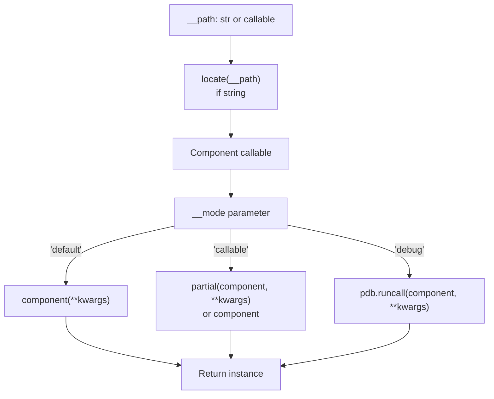

**Diagram: Component Instantiation Modes** - The `instantiate()` function supports three modes controlled by `CompInitMode` enum: immediate instantiation (`default`), delayed callable (`callable`), and debugger mode (`debug`).

Sources: [monai/utils/module.py:205-259](), [monai/utils/enums.py:410-419]()

### Lazy Import Example

```python
# Import succeeds even if package not installed
itk, has_itk = optional_import("itk")

if has_itk:
    # Use itk normally
    image = itk.imread("file.nii")
else:
    # Lazy object raises informative error when used
    try:
        image = itk.imread("file.nii")  # Raises OptionalImportError
    except OptionalImportError as e:
        print(f"ITK not available: {e}")
```

Sources: [monai/utils/module.py:315-445]()

---

## Type Utilities and Data Handling

MONAI provides comprehensive utilities for type conversions, sequence handling, and data structure manipulation.

### Tuple Utilities

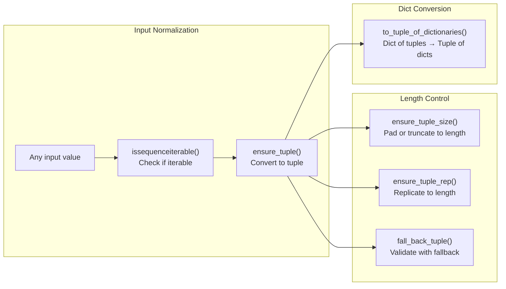

**Diagram: Tuple Utility Functions** - Shows the hierarchy of tuple conversion utilities. `ensure_tuple()` forms the base, with specialized functions for length control and dictionary restructuring.

Sources: [monai/utils/misc.py:166-303]()

### Core Type Utilities

| Function | Input | Output | Purpose |
|----------|-------|--------|---------|
| `ensure_tuple()` | Any | `tuple` | Convert to tuple, handle arrays |
| `ensure_tuple_size()` | Any, int | `tuple` | Pad/truncate to exact length |
| `ensure_tuple_rep()` | Any, int | `tuple` | Replicate scalar or validate sequence |
| `issequenceiterable()` | Any | `bool` | Check if iterable (excluding strings) |
| `is_scalar()` | Any | `bool` | Check if scalar including 0-d tensors |
| `first()` | Iterable | Any | Get first element or default |

### Practical Examples

```python
# ensure_tuple: Normalize various inputs
ensure_tuple(5)              # (5,)
ensure_tuple([1, 2, 3])      # (1, 2, 3)
ensure_tuple("abc")          # ("abc",)  # string as single item

# ensure_tuple_size: Fixed-length tuples
ensure_tuple_size(5, dim=3)           # (5, 5, 5)
ensure_tuple_size([1, 2], dim=4, pad_val=0)  # (1, 2, 0, 0)

# ensure_tuple_rep: Replicate or validate
ensure_tuple_rep(1, dim=3)        # (1, 1, 1)
ensure_tuple_rep([1, 2, 3], dim=3)  # (1, 2, 3)
ensure_tuple_rep([1, 2], dim=3)   # ValueError: wrong length

# fall_back_tuple: Conditional fallback
fall_back_tuple((-1, 10), (32, 32))  # (32, 10) - replaces -1
```

Sources: [monai/utils/misc.py:166-303]()

### Additional Utilities

| Function | Purpose |
|----------|---------|
| `zip_with()` | Zip iterables and apply operation |
| `star_zip_with()` | Zip with starmap for multiple args |
| `list_to_dict()` | Parse "key=value" strings to dict |
| `copy_to_device()` | Recursively move data to device |
| `str2bool()` | Parse string to boolean |
| `str2list()` | Parse comma-separated string to list |

Sources: [monai/utils/misc.py:110-524]()

---

## Environment Configuration System

MONAI uses environment variables and configuration classes to control framework behavior.

### MONAIEnvVars Class

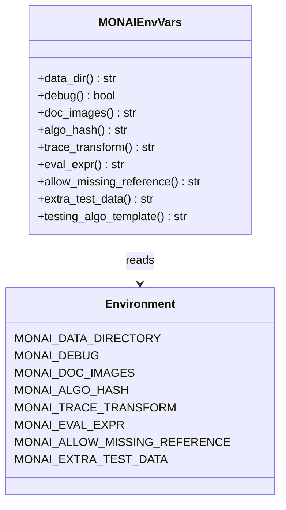

**Diagram: Environment Variable Access** - The `MONAIEnvVars` class provides static methods to read MONAI-specific environment variables with proper type conversions.

Sources: [monai/utils/misc.py:526-567]()

### Environment Variables

| Variable | Type | Default | Purpose |
|----------|------|---------|---------|
| `MONAI_DATA_DIRECTORY` | str | None | Default data download location |
| `MONAI_DEBUG` | bool | False | Enable debug mode |
| `MONAI_TRACE_TRANSFORM` | str | "1" | Enable transform tracing |
| `MONAI_EVAL_EXPR` | str | "1" | Enable expression evaluation in configs |
| `MONAI_ALLOW_MISSING_REFERENCE` | str | "1" | Allow missing config references |
| `CUBLAS_WORKSPACE_CONFIG` | str | ":4096:8" | CUDA deterministic algorithms |

### Metadata Keys

```python
class ImageMetaKey:
    """Common metadata keys for medical images"""
    FILENAME_OR_OBJ = "filename_or_obj"
    PATCH_INDEX = "patch_index"
    SPATIAL_SHAPE = "spatial_shape"
```

Sources: [monai/utils/misc.py:526-577]()

### Module-Level Flags

Defined in `monai/utils/module.py`:

```python
# Bundle config system flags
run_eval = os.environ.get("MONAI_EVAL_EXPR", "1") != "0"
run_debug = os.environ.get("MONAI_DEBUG_CONFIG", "0") != "0"
allow_missing_reference = os.environ.get("MONAI_ALLOW_MISSING_REFERENCE", "0") != "0"
```

These flags control bundle configuration parsing and validation behavior globally.

Sources: [monai/utils/module.py:32-38]()

---

## Enumeration System

MONAI defines a comprehensive set of type-safe enumerations for configuration and mode specification.

### StrEnum Base Class

```python
class StrEnum(str, Enum):
    """Enum that converts to string automatically"""
    
    def __str__(self):
        return self.value
    
    def __repr__(self):
        return self.value
```

This allows enums to be used directly as strings while maintaining type safety:

```python
from monai.utils import CommonKeys

# Can use as string
key = CommonKeys.IMAGE  # "image"
assert str(key) == "image"
assert key == "image"  # True
```

Sources: [monai/utils/enums.py:68-91]()

### Key Enumerations

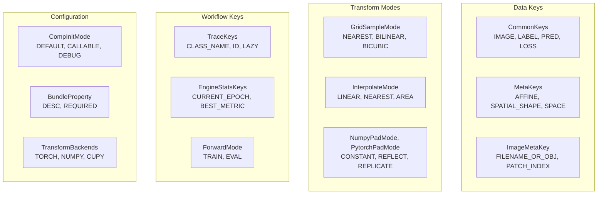

**Diagram: Core Enumeration Categories** - MONAI's enumeration system organized by functional area: data handling, transform operations, workflow control, and configuration.

Sources: [monai/utils/enums.py:1-771]()

### Important Enum Types

| Enum Class | Purpose | Example Values |
|------------|---------|----------------|
| `CommonKeys` | Standard data dict keys | `IMAGE`, `LABEL`, `PRED`, `LOSS` |
| `MetaKeys` | Metadata dictionary keys | `AFFINE`, `SPATIAL_SHAPE`, `SPACE` |
| `TraceKeys` | Transform tracing metadata | `CLASS_NAME`, `ID`, `LAZY` |
| `GridSampleMode` | PyTorch grid_sample modes | `NEAREST`, `BILINEAR`, `BICUBIC` |
| `InterpolateMode` | PyTorch interpolation modes | `LINEAR`, `NEAREST`, `AREA` |
| `CompInitMode` | Component instantiation | `DEFAULT`, `CALLABLE`, `DEBUG` |
| `TransformBackends` | Transform execution backend | `TORCH`, `NUMPY`, `CUPY` |
| `LazyAttr` | Lazy evaluation attributes | `SHAPE`, `AFFINE`, `PADDING_MODE` |

Sources: [monai/utils/enums.py:20-771]()

---

## Model Deployment and Export Utilities

MONAI provides utilities to export trained models to multiple formats for deployment.

### Export Format Support

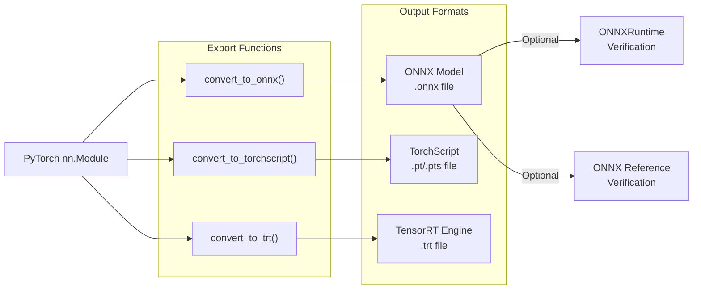

**Diagram: Model Export Pipeline** - Shows the three primary export paths from PyTorch models to deployment formats with optional verification steps.

Sources: [monai/networks/utils.py:661-895]()

### ONNX Export

The `convert_to_onnx()` function provides comprehensive ONNX export with verification:

```python
def convert_to_onnx(
    model: nn.Module,
    inputs: Sequence[Any],
    input_names: Sequence[str] | None = None,
    output_names: Sequence[str] | None = None,
    opset_version: int | None = None,
    dynamic_axes: Mapping | None = None,
    filename: Any | None = None,
    verify: bool = False,
    use_ort: bool = False,
    # ... additional parameters
)
```

**Key Features:**
- Dynamic axis support for variable batch sizes
- Optional verification with ONNX Runtime or reference implementation
- Constant folding optimization via Polygraphy
- Version checking for ONNX opset compatibility

Sources: [monai/networks/utils.py:661-784]()

### TorchScript Export

```python
def convert_to_torchscript(
    model: nn.Module,
    inputs: Any | None = None,
    device: torch.device | None = None,
    use_trace: bool = True,
    # ... other parameters
)
```

Supports both tracing and scripting modes:
- **Tracing**: Records operations during forward pass
- **Scripting**: Compiles Python code directly

Sources: [monai/networks/utils.py:787-895]()

### TensorRT Export

```python
def convert_to_trt(
    model: nn.Module,
    inputs: torch.Tensor | None = None,
    fp16: bool = False,
    int8: bool = False,
    dynamic_batchsize: Sequence[int] | None = None,
    # ... other parameters
)
```

**TensorRT Optimization Features:**
- FP16 and INT8 quantization support
- Dynamic batch size optimization
- Profile shapes for optimal performance
- Precision verification against PyTorch

Sources: [monai/networks/utils.py:898-1076]()

### Model Export Comparison

| Format | Use Case | Precision | Dynamic Shapes | Speed |
|--------|----------|-----------|----------------|-------|
| ONNX | Cross-platform deployment | FP32, FP16 | Yes | Medium |
| TorchScript | PyTorch ecosystem | FP32, FP16 | Limited | Medium |
| TensorRT | NVIDIA GPU inference | FP32, FP16, INT8 | Yes | Fastest |

Sources: [monai/networks/utils.py:43-69](), [monai/networks/utils.py:661-1076]()

---

## Network State Management

MONAI provides utilities for managing model state dictionaries, checkpoint handling, and parameter copying.

### State Dictionary Operations

```mermaid
flowchart TB
    subgraph "State Retrieval"
        GetState["get_state_dict(obj)"]
        CheckDP{"Is DataParallel?"}
        Extract["Extract .module"]
        Return["Return state_dict()"]
        
        GetState --> CheckDP
        CheckDP -->|Yes| Extract
        CheckDP -->|No| Return
        Extract --> Return
    end
    
    subgraph "State Copying"
        Copy["copy_model_state(dst, src)"]
        SrcDict["Get src state_dict"]
        DstDict["Get dst state_dict"]
        Match["Match keys & shapes"]
        Update["Update dst dict"]
        
        Copy --> SrcDict
        Copy --> DstDict
        SrcDict --> Match
        DstDict --> Match
        Match --> Update
    end
    
    subgraph "State Saving"
        Save["save_state(src, path)"]
        Atomic{"atomic=True?"}
        TempFile["Write to temp file"]
        Move["Move to final path"]
        Direct["Write directly"]
        
        Save --> Atomic
        Atomic -->|Yes| TempFile
        Atomic -->|No| Direct
        TempFile --> Move
    end
```

**Diagram: State Management Functions** - Shows the three primary state management operations: retrieval, copying between models, and atomic saving to disk.

Sources: [monai/networks/utils.py:528-684]()

### State Management Functions

| Function | Purpose | Key Features |
|----------|---------|--------------|
| `get_state_dict()` | Extract state dict | Handles DataParallel automatically |
| `copy_model_state()` | Copy weights between models | Shape validation, prefix mapping, filtering |
| `save_state()` | Save checkpoint to disk | Atomic writes, DataParallel handling |

### Advanced State Copying

The `copy_model_state()` function supports sophisticated weight transfer:

```python
# Copy with prefix matching
copy_model_state(
    dst=model_a,
    src=model_b,
    dst_prefix="encoder.",  # Match dst keys starting with "encoder."
    mapping={"conv1": "first_conv"},  # Explicit key mapping
    exclude_vars=".*bias",  # Regex to exclude parameters
    inplace=True  # Directly load into dst model
)
```

**Features:**
- Automatic shape validation
- Regular expression filtering
- Custom key mapping
- Prefix-based matching
- Optional in-place loading

Sources: [monai/networks/utils.py:542-624]()

### Atomic Save Operations

The `save_state()` function prevents checkpoint corruption:

```python
def save_obj(obj, path, atomic=True):
    """
    Save with atomic writes to prevent corruption.
    
    Process:
    1. Write to temporary file
    2. Move to final destination (atomic operation)
    3. Guaranteed consistency even if process crashes
    """
```

Sources: [monai/utils/misc.py:639-685]()

---

## Device and Context Management

MONAI provides utilities for device handling and execution mode control.

### Device Transfer Utilities

```python
def copy_to_device(
    obj: Any,
    device: str | torch.device | None,
    non_blocking: bool = True,
    verbose: bool = False
) -> Any:
    """
    Recursively move tensors to target device.
    
    Handles:
    - Single tensors
    - Nested lists
    - Nested tuples
    - Nested dictionaries
    - Objects with .to() method
    """
```

**Example Usage:**
```python
# Move nested structure to GPU
data = {
    "image": torch.randn(1, 3, 256, 256),
    "label": torch.randint(0, 5, (1, 256, 256)),
    "metadata": {"filename": "image.nii"}
}

gpu_data = copy_to_device(data, "cuda:0", non_blocking=True)
# Only tensors are moved; metadata stays as-is
```

Sources: [monai/utils/misc.py:425-456]()

### Execution Mode Context Managers

```python
# Temporarily switch to eval mode
with eval_mode(model):
    output = model(input_data)
    # model.training == False
# model restored to original training state

# Temporarily switch to train mode
with train_mode(model):
    output = model(input_data)
    # model.training == True
# model restored to original eval state
```

These context managers automatically restore the original training state when exiting.

Sources: [monai/networks/utils.py:457-525]()

---

## Utility Functions Reference

### String and Parsing Utilities

| Function | Purpose | Example |
|----------|---------|---------|
| `str2bool()` | Parse string to boolean | `str2bool("true")` → `True` |
| `str2list()` | Parse CSV string to list | `str2list("1,2,3")` → `[1, 2, 3]` |
| `list_to_dict()` | Parse key=value pairs | `["a=1", "b=2"]` → `{"a": 1, "b": 2}` |
| `path_to_uri()` | Convert path to URI | `path_to_uri("data.nii")` → `"file://..."` |

Sources: [monai/utils/misc.py:459-524](), [monai/utils/misc.py:393-422](), [monai/utils/misc.py:710-718]()

### Version Checking Utilities

| Function | Purpose |
|----------|---------|
| `version_leq()` | Check if version ≤ target |
| `version_geq()` | Check if version ≥ target |
| `pytorch_after()` | Check PyTorch version |
| `is_module_ver_at_least()` | Check module version |
| `get_torch_version_tuple()` | Get PyTorch version as tuple |

Sources: [monai/utils/module.py:532-636](), [monai/utils/misc.py:589-599]()

### Validation and Checking

| Function | Purpose |
|----------|---------|
| `has_option()` | Check if callable has keyword argument |
| `check_parent_dir()` | Validate parent directory exists |
| `check_kwargs_exist_in_class_init()` | Validate kwargs match __init__ signature |
| `is_scalar()` | Check if value is scalar |
| `is_immutable()` | Check if object is immutable |

Sources: [monai/utils/misc.py:579-636](), [monai/utils/misc.py:848-865](), [monai/utils/misc.py:306-313](), [monai/utils/misc.py:157-163]()

---

## Summary

The MONAI core architecture provides essential utilities organized into six key subsystems:

1. **Determinism Control**: Global seed management and reproducibility across PyTorch, NumPy, and CUDA backends
2. **Module Loading**: Optional dependency handling with lazy error raising and version checking
3. **Type Utilities**: Comprehensive tuple manipulation, type conversion, and sequence handling
4. **Environment Configuration**: Centralized access to environment variables and framework settings
5. **Enumerations**: Type-safe constants for modes, keys, and configuration values
6. **Model Deployment**: Export utilities for ONNX, TorchScript, and TensorRT formats

These core utilities form the foundation upon which all higher-level MONAI components are built, providing consistent interfaces for data handling, configuration management, and model deployment across the framework.

Sources: [monai/utils/__init__.py:1-159](), [monai/utils/misc.py:1-929](), [monai/utils/module.py:1-658](), [monai/utils/enums.py:1-771](), [monai/networks/utils.py:1-1515]()

---

# Page: Core Utilities and Module System

# Core Utilities and Module System

<details>
<summary>Relevant source files</summary>

The following files were used as context for generating this wiki page:

- [monai/__init__.py](monai/__init__.py)
- [monai/networks/__init__.py](monai/networks/__init__.py)
- [monai/networks/layers/simplelayers.py](monai/networks/layers/simplelayers.py)
- [monai/networks/utils.py](monai/networks/utils.py)
- [monai/utils/__init__.py](monai/utils/__init__.py)
- [monai/utils/enums.py](monai/utils/enums.py)
- [monai/utils/misc.py](monai/utils/misc.py)
- [monai/utils/module.py](monai/utils/module.py)

</details>


**Purpose**: This page documents MONAI's core utility infrastructure that underpins the entire framework. It covers determinism management, optional dependency handling, module loading, model deployment (ONNX/TRT/TorchScript conversion), and essential utility functions used throughout the codebase.

**Scope**: For neural network architectures and training components, see [Models and Training](#5). For data transforms and pipelines, see [Transform System](#3).

---

## System Architecture

The core utilities provide foundational services organized into several subsystems:

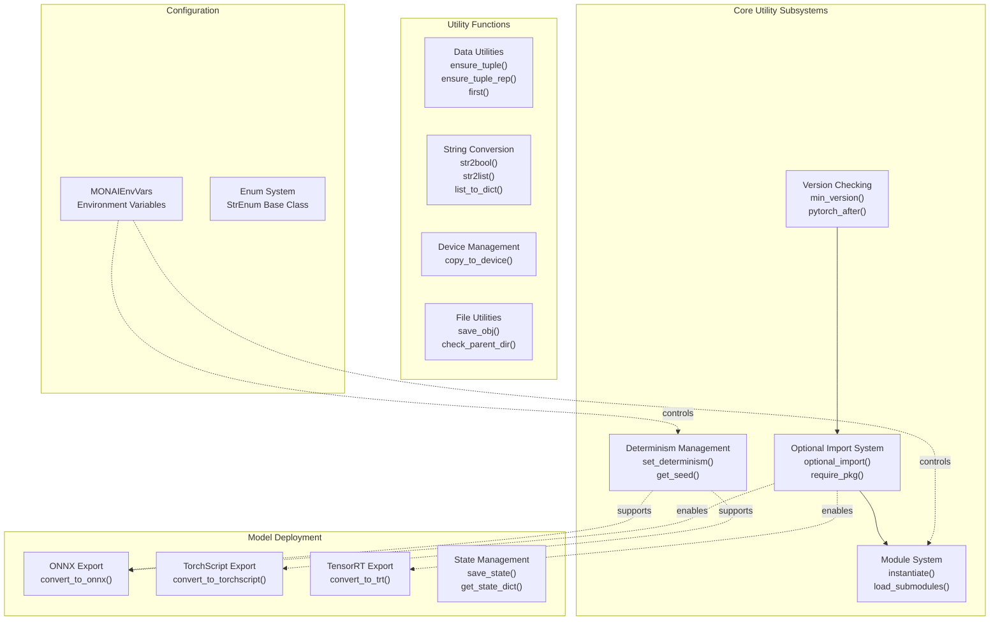

**Sources**: [monai/utils/__init__.py:1-159](), [monai/utils/misc.py:1-929](), [monai/utils/module.py:1-685](), [monai/networks/utils.py:1-1615]()

---

## Determinism and Random Seed Management

MONAI provides centralized control over randomness for reproducible experiments through the determinism management system.

### Core Functions

| Function | Location | Purpose |
|----------|----------|---------|
| `set_determinism()` | [monai/utils/misc.py:339-391]() | Configure deterministic behavior across PyTorch, NumPy, and Python |
| `get_seed()` | [monai/utils/misc.py:335-336]() | Retrieve current random seed |
| `MAX_SEED` | [monai/utils/misc.py:103]() | Maximum seed value (2^32) |

### Determinism Flow

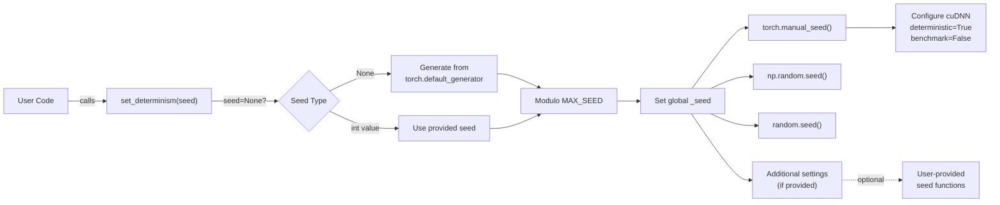

**Sources**: [monai/utils/misc.py:339-391]()

### Implementation Details

The determinism system manages several global flags:

```python
# Global state tracked in misc.py
_seed = None  # Current seed value
_flag_deterministic = torch.backends.cudnn.deterministic  # Original cuDNN setting
_flag_cudnn_benchmark = torch.backends.cudnn.benchmark    # Original benchmark setting
```

The `set_determinism()` function:
- Accepts seed values in range `[0, MAX_SEED - 1]` where `MAX_SEED = 2^32`
- Configures `CUBLAS_WORKSPACE_CONFIG` environment variable for deterministic algorithms
- Supports passing `None` to disable determinism and restore original settings
- Accepts `additional_settings` callable(s) for framework-specific seed configuration

**Sources**: [monai/utils/misc.py:99-108](), [monai/utils/misc.py:339-391]()

---

## Optional Import System

The optional import system enables MONAI to work with various optional dependencies without requiring all of them to be installed.

### Architecture

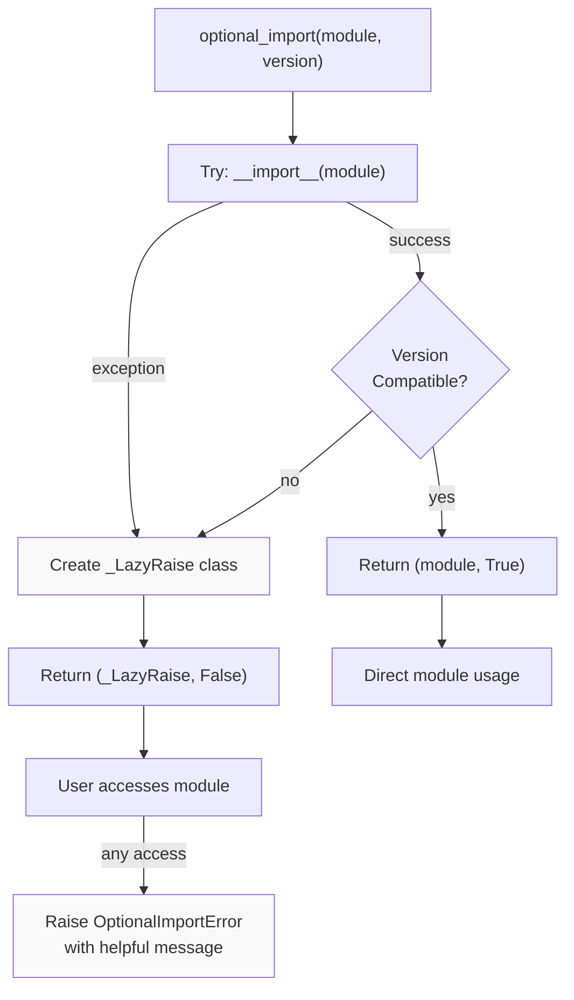

**Sources**: [monai/utils/module.py:315-446]()

### Usage Patterns

**Basic Import**:
```python
# From monai/networks/utils.py
onnx, _ = optional_import("onnx")
onnxruntime, _ = optional_import("onnxruntime")
```

**Import with Version Check**:
```python
# From monai/utils/module.py example
torch, flag = optional_import('torch', '1.1')
# flag is True if torch >= 1.1, False otherwise
```

**Import Specific Name**:
```python
# From monai/utils/misc.py
SafeLoader, _ = optional_import("yaml", name="SafeLoader", as_type="base")
```

**Sources**: [monai/utils/module.py:315-446](), [monai/networks/utils.py:37-41]()

### Lazy Error Behavior

The `_LazyRaise` class defers errors until actual usage:

| Method | Behavior |
|--------|----------|
| `__getattr__` | Raises `OptionalImportError` when accessing attributes |
| `__call__` | Raises `OptionalImportError` when calling as function |
| `__getitem__` | Raises `OptionalImportError` when indexing |
| `__iter__` | Raises `OptionalImportError` when iterating |

This allows code to import optional dependencies at module level without immediately failing if the dependency is missing.

**Sources**: [monai/utils/module.py:402-434]()

### Package Requirement Decorator

The `require_pkg()` decorator enforces package requirements at runtime:

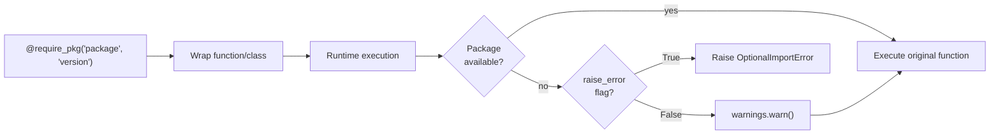

**Sources**: [monai/utils/module.py:448-484]()

---

## Module Loading and Instantiation

MONAI provides utilities for dynamic module loading and component instantiation, primarily used by the Bundle system.

### Component Instantiation

The `instantiate()` function creates objects from string paths or callables:

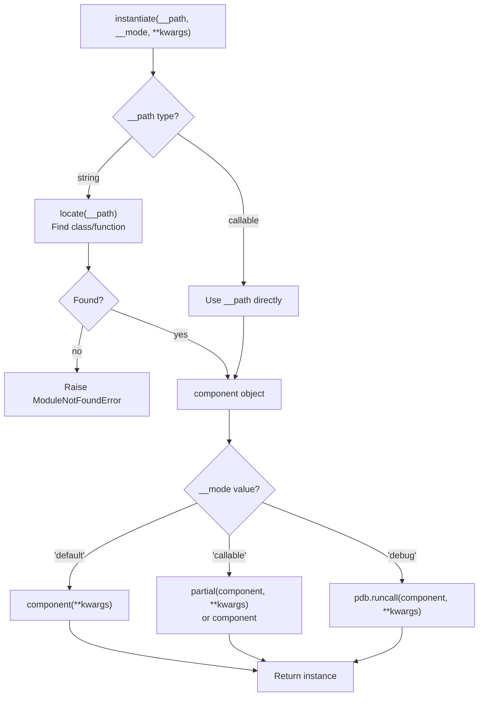

**Sources**: [monai/utils/module.py:205-259]()

### Instantiation Modes

| Mode | Enum Value | Behavior |
|------|-----------|----------|
| Default | `CompInitMode.DEFAULT` | Immediately call `component(**kwargs)` |
| Callable | `CompInitMode.CALLABLE` | Return callable or partial for later invocation |
| Debug | `CompInitMode.DEBUG` | Execute in debugger with `pdb.runcall()` |

**Sources**: [monai/utils/enums.py:410-419](), [monai/utils/module.py:226-256]()

### Submodule Loading

The `load_submodules()` function traverses and loads package structure:

```python
# From monai/__init__.py
load_submodules(sys.modules[__name__], False, exclude_pattern=excludes)  # directories only
load_submodules(sys.modules[__name__], True, exclude_pattern=excludes)   # all modules
```

**Parameters**:
- `basemod`: Base module to traverse
- `load_all`: If True, load all files; if False, only packages
- `exclude_pattern`: Regex pattern to exclude modules (e.g., test files)

**Sources**: [monai/utils/module.py:173-202](), [monai/__init__.py:83-104]()

---

## Version Checking System

MONAI provides comprehensive version checking for dependencies and PyTorch versions.

### Version Comparison Functions

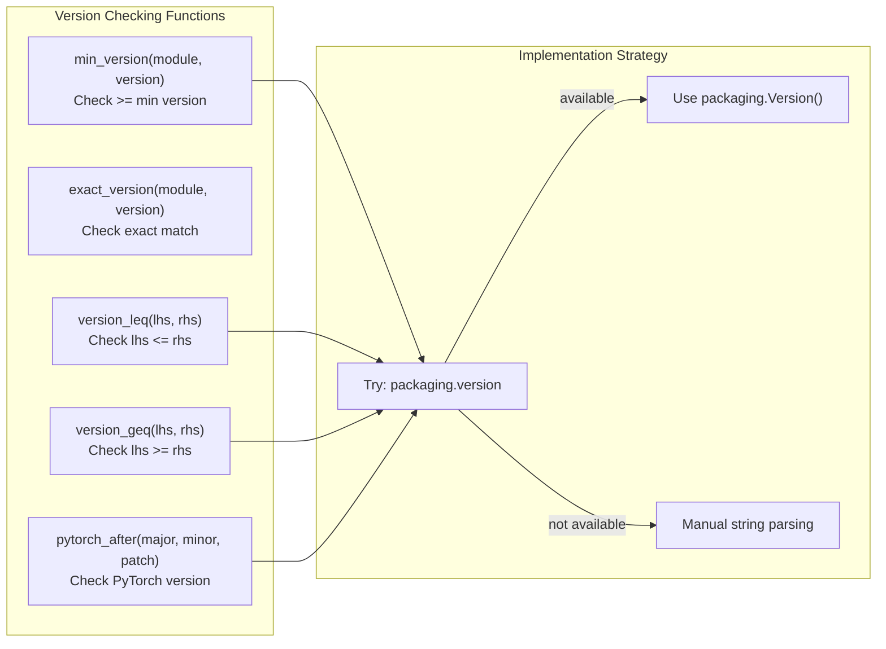

**Sources**: [monai/utils/module.py:273-636]()

### PyTorch Version Checking

The `pytorch_after()` function provides cached PyTorch version comparison:

**Features**:
- Cached result via `@functools.lru_cache(None)` decorator
- Handles prerelease versions (alpha, rc)
- Can use environment variable `PYTORCH_VER` override
- Supports both `packaging.version` and manual parsing fallback

**Sources**: [monai/utils/module.py:588-636]()

### GPU Compute Capability Checking

```python
# From monai/utils/module.py
@functools.lru_cache(None)
def compute_capabilities_after(major: int, minor: int = 0, 
                               current_ver_string: str | None = None) -> bool:
    """Check if GPU CUDA compute capability >= specified version"""
```

**Sources**: [monai/utils/module.py:639-685]()

---

## Model Deployment System

MONAI provides unified interfaces for exporting models to ONNX, TorchScript, and TensorRT formats.

### Deployment Pipeline

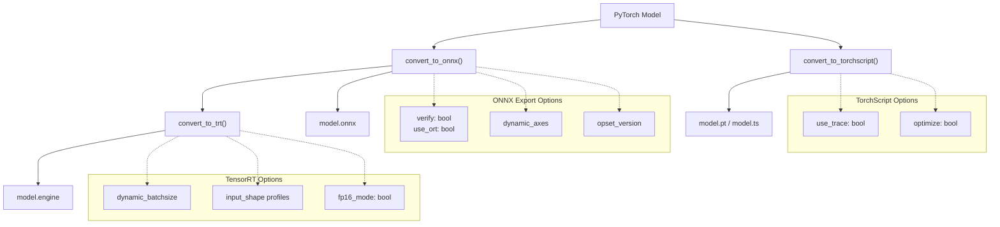

**Sources**: [monai/networks/utils.py:661-884](), [monai/networks/utils.py:886-1066](), [monai/networks/utils.py:1068-1277]()

### ONNX Export

The `convert_to_onnx()` function provides comprehensive ONNX export:

**Key Parameters**:
- `inputs`: Sample input data used for tracing
- `opset_version`: ONNX opset version (must be >= 7)
- `dynamic_axes`: Specify dynamic dimensions
- `verify`: Validate output with ONNX or ONNXRuntime
- `use_trace`: Use `torch.onnx.export()` tracing vs `torch.jit.script()`
- `do_constant_folding`: Enable constant folding optimization

**Verification Flow**:
```mermaid
flowchart LR
    Export["Export to ONNX"]
    
    Export -->|verify=True| SetDet["set_determinism(seed=0)"]
    SetDet --> TorchInfer["Run PyTorch inference"]
    TorchInfer --> ONNXInfer{use_ort?}
    
    ONNXInfer -->|True| ORT["ONNXRuntime inference"]
    ONNXInfer -->|False| Ref["ONNX Reference inference"]
    
    ORT --> Compare["torch.testing.assert_close()"]
    Ref --> Compare
    
    Compare --> ResetDet["set_determinism(seed=None)"]
```

**Sources**: [monai/networks/utils.py:661-783]()

### TorchScript Export

The `convert_to_torchscript()` function supports both tracing and scripting:

**Modes**:
| Mode | Method | Use Case |
|------|--------|----------|
| Trace | `torch.jit.trace()` | Models without control flow |
| Script | `torch.jit.script()` | Models with conditionals/loops |

**Optimization**:
- `optimize=True`: Apply `torch.jit.optimize_for_inference()`
- Removes training-only operations
- Enables operator fusion

**Sources**: [monai/networks/utils.py:886-1066]()

### TensorRT Conversion

The `convert_to_trt()` function creates optimized TensorRT engines:

**Profile Shape Strategy**:
```python
# From monai/networks/utils.py
def get_profile_shapes(input_shape, dynamic_batchsize):
    """Generate min/opt/max shapes for dynamic batching"""
    if dynamic_batchsize:
        min_shape = [dynamic_batchsize[0], *input_shape[1:]]
        opt_shape = [dynamic_batchsize[1], *input_shape[1:]]
        max_shape = [dynamic_batchsize[2], *input_shape[1:]]
    else:
        min_shape = opt_shape = max_shape = input_shape
    return min_shape, opt_shape, max_shape
```

**Key Features**:
- FP16 precision mode for faster inference
- Dynamic batch size support via profiles
- Workspace size configuration
- Input/output binding management

**Sources**: [monai/networks/utils.py:1068-1277](), [monai/networks/utils.py:76-93]()

---

## State Management

MONAI provides utilities for saving and loading model states, handling data parallel models automatically.

### State Management Functions

```mermaid
flowchart TB
    subgraph "State Retrieval"
        GetState["get_state_dict(obj)"]
        GetState --> CheckDP{DataParallel?}
        CheckDP -->|yes| Unwrap["Access .module"]
        CheckDP -->|no| Direct["Use directly"]
        Unwrap --> ExtractState["Call .state_dict()"]
        Direct --> ExtractState
    end
    
    subgraph "State Copying"
        CopyState["copy_model_state(dst, src)"]
        CopyState --> GetSrc["get_state_dict(src)"]
        CopyState --> GetDst["get_state_dict(dst)"]
        GetSrc --> Match["Match keys and shapes"]
        GetDst --> Match
        Match --> Update["Update dst dict"]
        Update --> OptLoad{inplace?}
        OptLoad -->|True| LoadState["dst.load_state_dict()"]
        OptLoad -->|False| ReturnDict["Return updated dict"]
    end
    
    subgraph "State Saving"
        SaveState["save_state(src, path)"]
        SaveState --> GetDict["get_state_dict(src)"]
        GetDict --> SaveObj["save_obj()"]
        SaveObj --> Atomic{atomic?}
        Atomic -->|True| TempFile["Write to temp file"]
        Atomic -->|False| DirectWrite["Write to path"]
        TempFile --> Move["shutil.move()"]
    end
```

**Sources**: [monai/networks/utils.py:528-624](), [monai/networks/utils.py:627-658]()

### State Copying Features

The `copy_model_state()` function provides flexible weight transfer:

**Parameters**:
- `dst_prefix`: Prefix for destination keys
- `mapping`: Dictionary mapping `{"src_key": "dst_key"}`
- `exclude_vars`: Regex pattern to exclude variables
- `filter_func`: Custom function for filtering weights
- `inplace`: Whether to load state into `dst` module

**Use Case Example**:
```python
# From docstring in monai/networks/utils.py:574-586
model_a = BasicUNet(in_channels=1, out_channels=4)
model_b = BasicUNet(in_channels=1, out_channels=2)
model_a_b, changed, unchanged = copy_model_state(
    model_a, model_b, exclude_vars="conv_0.conv_0", inplace=False
)
```

**Sources**: [monai/networks/utils.py:542-624]()

---

## Utility Functions

MONAI provides numerous utility functions for common operations.

### Tuple and Sequence Utilities

| Function | Purpose | Example |
|----------|---------|---------|
| `ensure_tuple()` | Convert to tuple | `ensure_tuple(1)` → `(1,)` |
| `ensure_tuple_rep()` | Repeat to size | `ensure_tuple_rep(1, 3)` → `(1, 1, 1)` |
| `ensure_tuple_size()` | Pad/truncate | `ensure_tuple_size([1,2], 3, 0)` → `(1, 2, 0)` |
| `fall_back_tuple()` | Conditional fallback | `fall_back_tuple((-1, 10), (32, 32))` → `(32, 10)` |
| `issequenceiterable()` | Check if iterable | Returns bool, excludes strings |
| `first()` | Get first item | `first([1,2,3])` → `1` |

**Sources**: [monai/utils/misc.py:145-303]()

### String Conversion Utilities

```mermaid
graph TB
    subgraph "String Parsing Functions"
        Str2Bool["str2bool(value)<br/>Parse boolean strings"]
        Str2List["str2list(value)<br/>Parse comma-separated lists"]
        List2Dict["list_to_dict(items)<br/>Parse key=value pairs"]
    end
    
    Str2Bool --> BoolValues["Accepts: 'yes', 'true', 't', 'y', '1'<br/>'no', 'false', 'f', 'n', '0'"]
    
    Str2List --> ParseComma["Split on ','"]
    ParseComma --> TryCast["Attempt literal_eval()"]
    
    List2Dict --> ParseEquals["Split on '='"]
    ParseEquals --> TryEval["Try literal_eval()<br/>Then _strtobool()"]
```

**Sources**: [monai/utils/misc.py:459-524]()

### Device Management

The `copy_to_device()` function recursively copies data structures to a target device:

**Supported Types**:
- Objects with `.to()` method (Tensors, MetaTensors)
- Tuples, lists, and dictionaries (recursive)
- Nested combinations of above

**Parameters**:
- `device`: Target device (`"cpu"`, `"cuda"`, `"cuda:0"`, etc.)
- `non_blocking`: Enable asynchronous transfer
- `verbose`: Warn about incompatible types

**Sources**: [monai/utils/misc.py:425-456]()

### File and Object Saving

The `save_obj()` function provides atomic file saving:

**Atomic Save Strategy**:
1. Create temporary directory
2. Save to temp file
3. Move to final destination (atomic operation)
4. Prevents corruption if exception occurs

**Default**: Uses `torch.save()` as the save function

**Sources**: [monai/utils/misc.py:639-684]()

---

## Environment Variables

MONAI uses environment variables for configuration, centralized in the `MONAIEnvVars` class.

### Environment Variable Reference

| Variable | Method | Default | Purpose |
|----------|--------|---------|---------|
| `MONAI_DATA_DIRECTORY` | `.data_dir()` | None | Default data storage location |
| `MONAI_DEBUG` | `.debug()` | False | Enable debug mode |
| `MONAI_DOC_IMAGES` | `.doc_images()` | None | Documentation image path |
| `MONAI_TRACE_TRANSFORM` | `.trace_transform()` | "1" | Enable transform tracing |
| `MONAI_EVAL_EXPR` | `.eval_expr()` | "1" | Allow eval() in Bundle configs |
| `MONAI_ALLOW_MISSING_REFERENCE` | `.allow_missing_reference()` | "1" | Allow missing references |
| `MONAI_EXTRA_TEST_DATA` | `.extra_test_data()` | "1" | Include extra test data |
| `CUBLAS_WORKSPACE_CONFIG` | N/A | ":4096:8" | CUDA deterministic config |

**Bundle Config Flags**:
```python
# From monai/utils/module.py
run_eval = os.environ.get("MONAI_EVAL_EXPR", "1") != "0"
run_debug = os.environ.get("MONAI_DEBUG_CONFIG", "0") != "0"
allow_missing_reference = os.environ.get("MONAI_ALLOW_MISSING_REFERENCE", "0") != "0"
```

**Sources**: [monai/utils/misc.py:526-567](), [monai/utils/module.py:32-38](), [monai/utils/misc.py:107]()

---

## Enum System

MONAI provides a `StrEnum` base class for creating string-based enumerations.

### StrEnum Base Class

```python
# From monai/utils/enums.py
class StrEnum(str, Enum):
    """Enum subclass that converts its value to a string."""
    
    def __str__(self):
        return self.value
    
    def __repr__(self):
        return self.value
```

**Key Properties**:
- Values are strings
- Can be compared directly to strings
- Usable with `look_up_option()` for validation

**Sources**: [monai/utils/enums.py:68-90]()

### Common Enum Categories

```mermaid
graph TB
    subgraph "Core Enums"
        CompInit["CompInitMode<br/>DEFAULT, CALLABLE, DEBUG"]
        TraceKeys["TraceKeys<br/>Metadata keys"]
        CommonKeys["CommonKeys<br/>IMAGE, LABEL, PRED"]
    end
    
    subgraph "Transform Enums"
        GridSample["GridSampleMode<br/>NEAREST, BILINEAR, BICUBIC"]
        Interpolate["InterpolateMode<br/>NEAREST, LINEAR, etc."]
        PadMode["NumpyPadMode, PytorchPadMode"]
        Backend["TransformBackends<br/>TORCH, NUMPY, CUPY"]
    end
    
    subgraph "Network Enums"
        Channel["ChannelMatching<br/>PAD, PROJECT"]
        Skip["SkipMode<br/>CAT, ADD, MUL"]
        Upsample["UpsampleMode<br/>DECONV, PIXELSHUFFLE"]
    end
    
    subgraph "Metadata Enums"
        MetaKeys["MetaKeys<br/>AFFINE, SPATIAL_SHAPE"]
        Space["SpaceKeys<br/>RAS, LPS"]
        LazyAttr["LazyAttr<br/>SHAPE, AFFINE, etc."]
    end
```

**Sources**: [monai/utils/enums.py:1-771]()

### Option Lookup System

The `look_up_option()` function validates options against enums or collections:

**Features**:
- Fuzzy matching with Damerau-Levenshtein distance
- Helpful error messages suggesting close matches
- Supports Enum, dict, set, list, tuple

**Example Usage**:
```python
# From monai/networks/layers/simplelayers.py:81
mode = look_up_option(mode, ChannelMatching)

# Raises helpful error if invalid:
# ValueError: By 'padd', did you mean 'pad'?
```

**Sources**: [monai/utils/module.py:61-142]()

---

## Summary

The Core Utilities and Module System provides essential infrastructure used throughout MONAI:

**Key Components**:
1. **Determinism**: Centralized random seed management for reproducibility
2. **Optional Imports**: Graceful handling of missing dependencies
3. **Module System**: Dynamic loading and instantiation of components
4. **Version Checking**: Compatibility verification for dependencies
5. **Model Deployment**: Unified export to ONNX, TorchScript, TensorRT
6. **State Management**: Robust model saving/loading with atomic writes
7. **Utilities**: Common operations for tuples, strings, devices, files
8. **Configuration**: Environment variable system
9. **Enums**: Type-safe option validation

These utilities form the foundation that enables MONAI's modular, extensible architecture while maintaining compatibility across different deployment scenarios and optional dependencies.

---

# Page: Transform System

# Transform System

<details>
<summary>Relevant source files</summary>

The following files were used as context for generating this wiki page:

- [docs/source/transforms.rst](docs/source/transforms.rst)
- [monai/transforms/__init__.py](monai/transforms/__init__.py)
- [monai/transforms/croppad/array.py](monai/transforms/croppad/array.py)
- [monai/transforms/croppad/dictionary.py](monai/transforms/croppad/dictionary.py)
- [monai/transforms/intensity/array.py](monai/transforms/intensity/array.py)
- [monai/transforms/intensity/dictionary.py](monai/transforms/intensity/dictionary.py)
- [monai/transforms/inverse.py](monai/transforms/inverse.py)
- [monai/transforms/post/array.py](monai/transforms/post/array.py)
- [monai/transforms/post/dictionary.py](monai/transforms/post/dictionary.py)
- [monai/transforms/spatial/array.py](monai/transforms/spatial/array.py)
- [monai/transforms/spatial/dictionary.py](monai/transforms/spatial/dictionary.py)
- [monai/transforms/utility/array.py](monai/transforms/utility/array.py)
- [monai/transforms/utility/dictionary.py](monai/transforms/utility/dictionary.py)
- [monai/transforms/utils.py](monai/transforms/utils.py)

</details>


## Purpose and Scope

The Transform System is MONAI's core data preprocessing and augmentation framework for medical imaging. It provides a composable architecture for applying spatial, intensity, crop/pad, and post-processing operations to medical images. The system supports both array-based and dictionary-based transforms, with advanced features including lazy execution, invertible operations, and automatic metadata tracking.

This page covers the overall transform architecture, base classes, and the organization of transform categories. For detailed information on specific transform features, see:
- [Transform Architecture and Base Classes](#3.1) - Core classes and design patterns
- [Spatial Transforms](#3.2) - Resampling, rotation, affine operations
- [Intensity and Utility Transforms](#3.3) - Normalization, scaling, type conversion
- [Crop, Pad, and Post-processing Transforms](#3.4) - Cropping, padding, and model output processing
- [Dictionary-Based Transforms](#3.5) - The `MapTransform` pattern
- [Invertible Transforms and MetaTensor](#3.6) - Reversible operations and metadata
- [Lazy Transform Execution](#3.7) - Deferred computation and optimization

For information about the data loading pipeline that uses these transforms, see [Data Loading and Processing](#4).

## Architecture Overview

The transform system is organized into a hierarchical class structure with multiple inheritance paths that provide different capabilities. At the highest level, all transforms inherit from the `Transform` base class, which defines the standard `__call__` interface.

### Transform Class Hierarchy

```mermaid
graph TB
    Transform["Transform<br/>(monai.transforms.transform)"]
    MapTransform["MapTransform<br/>(dictionary operations)"]
    Randomizable["RandomizableTransform<br/>(stochastic behavior)"]
    LazyTransform["LazyTransform<br/>(deferred execution)"]
    InvertibleTransform["InvertibleTransform<br/>(reversible operations)"]
    TraceableTransform["TraceableTransform<br/>(history tracking)"]
    
    subgraph "Concrete Transforms"
        SpatialResample["SpatialResample"]
        Spacing["Spacing"]
        Orientation["Orientation"]
        RandAffine["RandAffine"]
        NormalizeIntensity["NormalizeIntensity"]
        RandGaussianNoise["RandGaussianNoise"]
        LoadImage["LoadImage"]
        SaveImage["SaveImage"]
    end
    
    subgraph "Dictionary Wrappers"
        Spacingd["Spacingd<br/>(d suffix)"]
        RandAffined["RandAffined"]
        NormalizeIntensityd["NormalizeIntensityd"]
    end
    
    Transform --> MapTransform
    Transform --> Randomizable
    Transform --> LazyTransform
    Transform --> InvertibleTransform
    InvertibleTransform --> TraceableTransform
    
    InvertibleTransform --> SpatialResample
    LazyTransform --> SpatialResample
    SpatialResample --> Spacing
    SpatialResample --> Orientation
    
    Randomizable --> RandAffine
    InvertibleTransform --> RandAffine
    LazyTransform --> RandAffine
    
    Transform --> NormalizeIntensity
    Randomizable --> RandGaussianNoise
    
    Transform --> LoadImage
    Transform --> SaveImage
    
    MapTransform --> Spacingd
    MapTransform --> RandAffined
    MapTransform --> NormalizeIntensityd
    
    style Transform fill:#f9f9f9
    style MapTransform fill:#f9f9f9
    style Randomizable fill:#f9f9f9
    style LazyTransform fill:#f9f9f9
    style InvertibleTransform fill:#f9f9f9
```

**Sources:** [monai/transforms/transform.py](), [monai/transforms/inverse.py:42-256](), [monai/transforms/spatial/array.py:124-256]()

## Base Classes

The transform system uses five primary base classes that provide different capabilities through multiple inheritance:

| Base Class | Purpose | Key Methods | File Location |
|------------|---------|-------------|---------------|
| `Transform` | Root interface for all transforms | `__call__(img)` | monai/transforms/transform.py |
| `MapTransform` | Dictionary-based operations | `key_iterator(data)` | monai/transforms/transform.py |
| `RandomizableTransform` | Stochastic transforms with seeding | `randomize()`, `set_random_state()` | monai/transforms/transform.py |
| `LazyTransform` | Deferred computation | `lazy` property, pending operations | monai/transforms/transform.py |
| `InvertibleTransform` | Reversible operations | `inverse(data)`, `push_transform()`, `pop_transform()` | monai/transforms/inverse.py |

### Transform Base Class

The `Transform` class is the root of the hierarchy and defines the basic interface. All transforms must implement `__call__`:

**Core Interface Pattern:**
```python
class Transform:
    def __call__(self, img: NdarrayOrTensor) -> NdarrayOrTensor:
        # Transform implementation
        pass
```

**Sources:** [monai/transforms/transform.py]()

### MapTransform (Dictionary Pattern)

`MapTransform` extends `Transform` to operate on dictionaries of data, applying transforms to specific keys. This is the foundation of the "d-suffix" naming convention:

**Dictionary Operation Pattern:**
```python
class MapTransform(Transform):
    def __init__(self, keys: KeysCollection, allow_missing_keys: bool = False):
        self.keys = keys
        self.allow_missing_keys = allow_missing_keys
    
    def key_iterator(self, data: Mapping) -> Iterator:
        # Iterates over specified keys
        pass
```

**Sources:** [monai/transforms/transform.py](), [monai/transforms/utility/dictionary.py:203-226]()

### RandomizableTransform

Adds controlled randomization with reproducible seeding:

**Randomization Pattern:**
```python
class RandomizableTransform(Transform, Randomizable):
    def __init__(self, prob: float = 0.1):
        self.prob = prob
        self._do_transform = False
    
    def randomize(self, data: Any = None) -> None:
        self._do_transform = self.R.random() < self.prob
```

**Sources:** [monai/transforms/transform.py](), [monai/transforms/intensity/array.py:86-141]()

### LazyTransform

Enables deferred execution where transforms queue operations instead of executing immediately:

**Lazy Execution Pattern:**
```python
class LazyTransform(Transform):
    def __init__(self, lazy: bool = False):
        self._lazy = lazy
    
    @property
    def lazy(self) -> bool:
        return self._lazy
```

**Sources:** [monai/transforms/transform.py](), [monai/transforms/spatial/array.py:124-166]()

### InvertibleTransform

Provides transform reversal by maintaining a history of applied operations:

**Inversion Pattern:**
```python
class InvertibleTransform(TraceableTransform):
    def inverse(self, data: torch.Tensor) -> torch.Tensor:
        # Reverse the transformation
        pass
    
    def push_transform(self, data, **kwargs):
        # Record transformation metadata
        pass
    
    def pop_transform(self, data) -> dict:
        # Retrieve and remove last transform
        pass
```

**Sources:** [monai/transforms/inverse.py:256-end](), [monai/transforms/spatial/array.py:240-256]()

## Transform Categories

MONAI organizes transforms into functional categories, each in separate modules:

### Category Organization

```mermaid
graph LR
    subgraph "Array Transforms"
        Spatial["Spatial<br/>monai.transforms.spatial.array<br/>SpatialResample, Spacing,<br/>Orientation, Rotate, Zoom"]
        Intensity["Intensity<br/>monai.transforms.intensity.array<br/>NormalizeIntensity,<br/>ScaleIntensity, RandGaussianNoise"]
        Utility["Utility<br/>monai.transforms.utility.array<br/>EnsureChannelFirst, ToTensor,<br/>CastToType, Lambda"]
        CropPad["Crop/Pad<br/>monai.transforms.croppad.array<br/>SpatialPad, CenterSpatialCrop,<br/>RandCropByPosNegLabel"]
        Post["Post-processing<br/>monai.transforms.post.array<br/>Activations, AsDiscrete,<br/>KeepLargestConnectedComponent"]
        IO["I/O<br/>monai.transforms.io.array<br/>LoadImage, SaveImage"]
    end
    
    subgraph "Dictionary Wrappers"
        SpatialDict["Spacingd, Orientationd,<br/>Rotated, etc."]
        IntensityDict["NormalizeIntensityd,<br/>ScaleIntensityd, etc."]
        UtilityDict["EnsureChannelFirstd,<br/>ToTensord, etc."]
        CropPadDict["SpatialPadd,<br/>CenterSpatialCropd, etc."]
        PostDict["Activationsd,<br/>AsDiscreted, etc."]
        IODict["LoadImaged,<br/>SaveImaged"]
    end
    
    Spatial --> SpatialDict
    Intensity --> IntensityDict
    Utility --> UtilityDict
    CropPad --> CropPadDict
    Post --> PostDict
    IO --> IODict
```

**Sources:** [monai/transforms/__init__.py:1-600](), [monai/transforms/spatial/array.py:90-119](), [monai/transforms/intensity/array.py:42-83]()

### Spatial Transforms

Located in `monai/transforms/spatial/array.py`, these transforms manipulate the spatial dimensions and coordinate systems of images:

| Transform | Purpose | Lazy Support | Invertible |
|-----------|---------|--------------|------------|
| `SpatialResample` | Resample between coordinate systems | Yes | Yes |
| `Spacing` | Change voxel spacing | Yes | Yes |
| `Orientation` | Change axis orientation (RAS, LPS, etc.) | Yes | Yes |
| `Flip` | Mirror along axes | Yes | Yes |
| `Rotate` | Rotation by angles | Yes | Yes |
| `Zoom` | Scale spatial dimensions | Yes | Yes |
| `Affine` | General affine transformation | Yes | Yes |
| `RandAffine` | Random affine with ranges | Yes | Yes |

**Sources:** [monai/transforms/spatial/array.py:90-119](), [monai/transforms/spatial/array.py:124-256]()

### Intensity Transforms

Located in `monai/transforms/intensity/array.py`, these transforms modify pixel/voxel intensity values:

| Transform | Purpose | Randomizable |
|-----------|---------|--------------|
| `NormalizeIntensity` | Z-score normalization | No |
| `ScaleIntensity` | Linear scaling | No |
| `ScaleIntensityRange` | Min-max scaling | No |
| `RandGaussianNoise` | Add Gaussian noise | Yes |
| `RandShiftIntensity` | Random intensity shift | Yes |
| `AdjustContrast` | Gamma correction | No |
| `ThresholdIntensity` | Binary thresholding | No |

**Sources:** [monai/transforms/intensity/array.py:42-83](), [monai/transforms/intensity/array.py:86-259]()

### Utility Transforms

Located in `monai/transforms/utility/array.py`, these provide type conversion and data format operations:

| Transform | Purpose | Backend |
|-----------|---------|---------|
| `EnsureChannelFirst` | Move channel to first dimension | TORCH, NUMPY |
| `ToTensor` | Convert to PyTorch tensor | TORCH |
| `ToNumpy` | Convert to NumPy array | NUMPY |
| `CastToType` | Change data type | TORCH, NUMPY |
| `Lambda` | Apply custom function | TORCH, NUMPY |
| `SqueezeDim` | Remove singleton dimension | TORCH, NUMPY |

**Sources:** [monai/transforms/utility/array.py:75-114](), [monai/transforms/utility/array.py:175-235]()

### Crop and Pad Transforms

Located in `monai/transforms/croppad/array.py`, these modify spatial extent:

| Transform | Purpose | Lazy Support |
|-----------|---------|--------------|
| `SpatialPad` | Pad to target size | Yes |
| `DivisiblePad` | Pad to divisible size | Yes |
| `SpatialCrop` | Crop to region | No |
| `CenterSpatialCrop` | Center crop | No |
| `RandSpatialCrop` | Random crop | No |
| `RandCropByPosNegLabel` | Crop around labeled regions | No |
| `ResizeWithPadOrCrop` | Resize by cropping or padding | Yes |

**Sources:** [monai/transforms/croppad/array.py:60-78](), [monai/transforms/croppad/array.py:81-178]()

### Post-Processing Transforms

Located in `monai/transforms/post/array.py`, these process model outputs:

| Transform | Purpose |
|-----------|---------|
| `Activations` | Apply sigmoid/softmax |
| `AsDiscrete` | Convert to discrete values (argmax, threshold) |
| `KeepLargestConnectedComponent` | Filter by connected components |
| `FillHoles` | Fill holes in binary masks |
| `RemoveSmallObjects` | Remove small connected components |
| `LabelToContour` | Convert labels to contours |

**Sources:** [monai/transforms/post/array.py:51-66](), [monai/transforms/post/array.py:69-138]()

## Dictionary-Based Transform Pattern

Dictionary-based transforms operate on dictionaries of data using the "d-suffix" naming convention. They wrap array-based transforms and apply them to specific keys:

### Naming Convention

```mermaid
graph LR
    ArrayTransform["Array Transform<br/>Spacing"]
    DictTransform["Dictionary Transform<br/>Spacingd"]
    Aliases["Aliases<br/>SpacingD, SpacingDict"]
    
    ArrayTransform -->|"wraps with<br/>MapTransform"| DictTransform
    DictTransform -->|"alternate names"| Aliases
    
    style ArrayTransform fill:#f9f9f9
    style DictTransform fill:#e8f4f8
```

### Implementation Pattern

All dictionary transforms follow this pattern:

```python
class Spacingd(MapTransform, InvertibleTransform, LazyTransform):
    def __init__(self, keys: KeysCollection, pixdim: Sequence[float], ...):
        MapTransform.__init__(self, keys, allow_missing_keys)
        LazyTransform.__init__(self, lazy=lazy)
        self.spacing = Spacing(pixdim=pixdim, ...)  # Wrap array transform
    
    def __call__(self, data: Mapping) -> dict:
        d = dict(data)
        for key in self.key_iterator(d):
            d[key] = self.spacing(d[key], ...)  # Apply to each key
        return d
```

### Key Features

**Key Iteration:**
The `key_iterator()` method handles missing keys based on `allow_missing_keys`:

```python
for key, mode, padding_mode in self.key_iterator(d, self.mode, self.padding_mode):
    d[key] = self.transform(d[key], mode=mode, padding_mode=padding_mode)
```

**Multiple Value Mapping:**
Parameters can be sequences that map to keys:

```python
mode = ensure_tuple_rep(mode, len(self.keys))  # One mode per key
```

**Sources:** [monai/transforms/utility/dictionary.py:203-226](), [monai/transforms/spatial/dictionary.py:366-449]()

## Transform Composition and Execution

Transforms are typically combined into pipelines using `Compose`:

### Compose Pattern

```mermaid
graph TB
    Input["Input Image"]
    Compose["Compose<br/>(monai.transforms.Compose)"]
    
    subgraph "Transform Pipeline"
        T1["LoadImage"]
        T2["EnsureChannelFirst"]
        T3["Spacing"]
        T4["Orientation"]
        T5["NormalizeIntensity"]
        T6["RandAffine"]
    end
    
    Output["Transformed Image"]
    
    Input --> Compose
    Compose --> T1
    T1 --> T2
    T2 --> T3
    T3 --> T4
    T4 --> T5
    T5 --> T6
    T6 --> Output
```

### Sequential Execution

`Compose` executes transforms sequentially:

```python
class Compose:
    def __init__(self, transforms: Sequence[Transform] = None):
        self.transforms = transforms
    
    def __call__(self, input_):
        for t in self.transforms:
            input_ = apply_transform(t, input_)
        return input_
```

### Conditional Execution

Other composition patterns include:

| Compositor | Behavior |
|------------|----------|
| `Compose` | Execute all transforms sequentially |
| `OneOf` | Execute one randomly selected transform |
| `RandomOrder` | Execute all in random order |
| `SomeOf` | Execute random subset of transforms |

**Sources:** [monai/transforms/compose.py](), [monai/transforms/__init__.py:15]()

## MetaTensor Integration

The transform system integrates with `MetaTensor` to track metadata and transformation history:

### MetaTensor Structure

```mermaid
graph TB
    MetaTensor["MetaTensor<br/>(extends torch.Tensor)"]
    
    subgraph "Metadata"
        Affine["affine: torch.Tensor<br/>(spatial coordinate matrix)"]
        Meta["meta: dict<br/>(filename, spacing, etc.)"]
        AppliedOps["applied_operations: list<br/>(completed transforms)"]
        PendingOps["pending_operations: list<br/>(lazy transforms queue)"]
    end
    
    subgraph "Transform Interaction"
        Push["push_transform()<br/>(record operation)"]
        Pop["pop_transform()<br/>(retrieve for inverse)"]
        PeekShape["peek_pending_shape()<br/>(query after lazy ops)"]
        PeekAffine["peek_pending_affine()<br/>(query after lazy ops)"]
    end
    
    MetaTensor --> Affine
    MetaTensor --> Meta
    MetaTensor --> AppliedOps
    MetaTensor --> PendingOps
    
    AppliedOps --> Push
    AppliedOps --> Pop
    PendingOps --> PeekShape
    PendingOps --> PeekAffine
```

**Sources:** [monai/data/meta_tensor.py](), [monai/transforms/inverse.py:130-165]()

## Transform Backend Support

Transforms declare supported backends for compatibility:

```python
class SpatialResample(InvertibleTransform, LazyTransform):
    backend = [TransformBackends.TORCH, TransformBackends.NUMPY, TransformBackends.CUPY]
```

### Backend Options

| Backend | When Used | File Indicator |
|---------|-----------|----------------|
| `TORCH` | PyTorch tensor operations | Uses `torch.` functions |
| `NUMPY` | NumPy array operations | Uses `np.` functions |
| `CUPY` | GPU-accelerated NumPy | Uses `cupy.` functions |

Backend selection happens automatically based on input type.

**Sources:** [monai/transforms/spatial/array.py:136](), [monai/utils/enums.py]()

## Common Usage Patterns

### Basic Array Transform

```python
# Apply a single transform to an array
transform = Spacing(pixdim=(1.0, 1.0, 1.0))
output = transform(input_image)
```

### Dictionary Pipeline

```python
# Create a preprocessing pipeline
train_transforms = Compose([
    LoadImaged(keys=["image", "label"]),
    EnsureChannelFirstd(keys=["image", "label"]),
    Spacingd(keys=["image", "label"], pixdim=(1.0, 1.0, 1.0)),
    Orientationd(keys=["image", "label"], axcodes="RAS"),
    NormalizeIntensityd(keys=["image"]),
    RandAffined(keys=["image", "label"], prob=0.5, ...),
])

# Apply to data dictionary
data = train_transforms({"image": image_path, "label": label_path})
```

### With DataLoader

```python
from monai.data import Dataset, DataLoader

dataset = Dataset(data=data_list, transform=train_transforms)
dataloader = DataLoader(dataset, batch_size=4, num_workers=4)

for batch in dataloader:
    images = batch["image"]
    labels = batch["label"]
    # Training loop
```

**Sources:** [monai/transforms/__init__.py](), [docs/source/transforms.rst:1-100]()

## File Organization

The transform system is organized into a modular file structure:

```
monai/transforms/
├── __init__.py                    # Public API exports
├── transform.py                   # Base classes (Transform, MapTransform, etc.)
├── compose.py                     # Compose, OneOf, etc.
├── inverse.py                     # InvertibleTransform, TraceableTransform
├── utils.py                       # Utility functions
├── spatial/
│   ├── array.py                   # Spatial array transforms
│   ├── dictionary.py              # Spatial dictionary transforms
│   └── functional.py              # Low-level spatial functions
├── intensity/
│   ├── array.py                   # Intensity array transforms
│   └── dictionary.py              # Intensity dictionary transforms
├── utility/
│   ├── array.py                   # Utility array transforms
│   └── dictionary.py              # Utility dictionary transforms
├── croppad/
│   ├── array.py                   # Crop/pad array transforms
│   ├── dictionary.py              # Crop/pad dictionary transforms
│   └── functional.py              # Low-level crop/pad functions
├── post/
│   ├── array.py                   # Post-processing array transforms
│   └── dictionary.py              # Post-processing dictionary transforms
├── io/
│   ├── array.py                   # I/O transforms (LoadImage, SaveImage)
│   └── dictionary.py              # I/O dictionary transforms
└── lazy/
    ├── array.py                   # Lazy execution utilities (ApplyPending)
    ├── dictionary.py              # Lazy dictionary utilities
    ├── functional.py              # Low-level lazy functions
    └── utils.py                   # Lazy transform utilities
```

**Sources:** [monai/transforms/__init__.py:1-600](), [monai/transforms/spatial/array.py:1-13](), [monai/transforms/utility/array.py:1-13]()

## Summary

The MONAI Transform System provides:

1. **Modular Architecture**: Base classes with single-responsibility design (Transform, MapTransform, RandomizableTransform, LazyTransform, InvertibleTransform)

2. **Functional Organization**: Transforms grouped by purpose (spatial, intensity, crop/pad, utility, post-processing, I/O)

3. **Dictionary Pattern**: Unified "d-suffix" convention for operating on data dictionaries

4. **Advanced Features**:
   - Lazy execution for performance optimization
   - Invertible operations for post-processing
   - Metadata tracking via MetaTensor
   - Reproducible randomization

5. **Flexible Composition**: Multiple composition strategies (Compose, OneOf, RandomOrder, SomeOf)

6. **Backend Agnostic**: Support for PyTorch, NumPy, and CuPy

This architecture enables users to build complex medical imaging pipelines through simple composition of well-defined, reusable transform components.

**Sources:** [monai/transforms/__init__.py](), [monai/transforms/transform.py](), [monai/transforms/inverse.py](), [monai/transforms/spatial/array.py](), [monai/transforms/intensity/array.py](), [monai/transforms/utility/array.py](), [monai/transforms/croppad/array.py](), [monai/transforms/post/array.py]()

---

# Page: Transform Architecture and Base Classes

# Transform Architecture and Base Classes

<details>
<summary>Relevant source files</summary>

The following files were used as context for generating this wiki page:

- [docs/source/transforms.rst](docs/source/transforms.rst)
- [monai/transforms/__init__.py](monai/transforms/__init__.py)
- [monai/transforms/croppad/array.py](monai/transforms/croppad/array.py)
- [monai/transforms/croppad/dictionary.py](monai/transforms/croppad/dictionary.py)
- [monai/transforms/intensity/array.py](monai/transforms/intensity/array.py)
- [monai/transforms/intensity/dictionary.py](monai/transforms/intensity/dictionary.py)
- [monai/transforms/inverse.py](monai/transforms/inverse.py)
- [monai/transforms/post/array.py](monai/transforms/post/array.py)
- [monai/transforms/post/dictionary.py](monai/transforms/post/dictionary.py)
- [monai/transforms/spatial/array.py](monai/transforms/spatial/array.py)
- [monai/transforms/spatial/dictionary.py](monai/transforms/spatial/dictionary.py)
- [monai/transforms/utility/array.py](monai/transforms/utility/array.py)
- [monai/transforms/utility/dictionary.py](monai/transforms/utility/dictionary.py)
- [monai/transforms/utils.py](monai/transforms/utils.py)

</details>


## Purpose and Scope

This page documents the foundational transform architecture in MONAI, including the core base classes, trait system, and design patterns that underpin all transform implementations. This covers the abstract interfaces and execution mechanisms, not the concrete transform implementations themselves.

For specific transform categories, see:
- Spatial transforms: [Spatial Transforms](#3.2)
- Intensity transforms: [Intensity and Utility Transforms](#3.3)
- Dictionary-based transform patterns: [Dictionary-Based Transforms](#3.5)
- Lazy execution mechanisms: [Lazy Transform Execution](#3.7)
- Invertible transform mechanisms: [Invertible Transforms and MetaTensor](#3.6)

---

## Core Base Classes Hierarchy

The transform system is built on a hierarchy of base classes that provide composable capabilities through multiple inheritance.

### Class Hierarchy Diagram

```mermaid
graph TB
    Transform["Transform<br/>(Abstract Base)"]
    MapTransform["MapTransform<br/>(Dictionary Operations)"]
    Randomizable["Randomizable<br/>(RNG State)"]
    RandomizableTransform["RandomizableTransform"]
    LazyTransform["LazyTransform<br/>(Deferred Execution)"]
    TraceableTransform["TraceableTransform<br/>(Metadata Tracking)"]
    InvertibleTransform["InvertibleTransform<br/>(Reversible Ops)"]
    
    Transform --> MapTransform
    Transform --> RandomizableTransform
    Transform --> LazyTransform
    Transform --> TraceableTransform
    
    Randomizable --> RandomizableTransform
    TraceableTransform --> InvertibleTransform
    
    subgraph "Trait Mixins"
        RandomizableTrait["RandomizableTrait"]
        LazyTrait["LazyTrait"]
        InvertibleTrait["InvertibleTrait"]
        MultiSampleTrait["MultiSampleTrait"]
    end
    
    style Transform fill:#f9f9f9
    style MapTransform fill:#f9f9f9
    style LazyTransform fill:#f9f9f9
    style InvertibleTransform fill:#f9f9f9
```

**Sources:** [monai/transforms/transform.py](), [monai/transforms/inverse.py](), [docs/source/transforms.rst:13-79]()

---

## Transform Base Class

The `Transform` class is the root of the transform hierarchy, providing the fundamental interface for all data transformations.

### Core Interface

| Method/Property | Description | Required |
|----------------|-------------|----------|
| `__call__(data)` | Execute the transform on input data | Yes (abstract) |
| `backend` | List of supported backends (TORCH, NUMPY, CUPY) | No |

### Key Characteristics

- **Abstract base class**: Subclasses must implement `__call__`
- **Stateless by default**: Transforms should be reusable and thread-safe
- **Backend declaration**: Optional `backend` class attribute declares supported computation backends

### Example Implementation Pattern

```python
class MyTransform(Transform):
    backend = [TransformBackends.TORCH, TransformBackends.NUMPY]
    
    def __init__(self, param1, param2):
        self.param1 = param1
        self.param2 = param2
    
    def __call__(self, img: NdarrayOrTensor) -> NdarrayOrTensor:
        # Implementation here
        return transformed_img
```

**Sources:** [monai/transforms/transform.py](), [docs/source/transforms.rst:13-17]()

---

## MapTransform for Dictionary Operations

`MapTransform` extends `Transform` to operate on dictionary-based data structures, enabling selective transformation of specific keys.

### Architecture Diagram

```mermaid
graph LR
    Input["Input Dictionary<br/>{image: tensor,<br/>label: tensor,<br/>metadata: dict}"]
    MapTransform["MapTransform"]
    KeyIterator["key_iterator()<br/>Filter keys"]
    Transform1["Transform image"]
    Transform2["Transform label"]
    Output["Output Dictionary<br/>{image: transformed,<br/>label: transformed,<br/>metadata: dict}"]
    
    Input --> MapTransform
    MapTransform --> KeyIterator
    KeyIterator --> Transform1
    KeyIterator --> Transform2
    Transform1 --> Output
    Transform2 --> Output
```

### Core Attributes

| Attribute | Type | Description |
|-----------|------|-------------|
| `keys` | `KeysCollection` | Keys to transform (single key or tuple) |
| `allow_missing_keys` | `bool` | Whether to raise error on missing keys |

### Key Iterator Pattern

The `key_iterator()` method is the core mechanism for iterating over specified keys:

```python
def __call__(self, data):
    d = dict(data)
    for key in self.key_iterator(d):
        d[key] = self.transform(d[key])
    return d
```

### Multi-Parameter Key Iteration

`key_iterator()` can iterate over multiple parameter sequences aligned with keys:

```python
for key, mode, padding in self.key_iterator(d, self.mode, self.padding):
    d[key] = self.transform(d[key], mode=mode, padding=padding)
```

**Sources:** [monai/transforms/transform.py](), [monai/transforms/utility/dictionary.py:203-226](), [docs/source/transforms.rst:19-23]()

---

## Randomizable Transforms

The randomization system provides deterministic pseudo-random behavior for data augmentation.

### Randomizable Architecture

```mermaid
graph TB
    Randomizable["Randomizable<br/>(Base Trait)"]
    RandomState["R: RandomState<br/>(numpy RNG)"]
    RandomizableTransform["RandomizableTransform"]
    Transform["Transform"]
    
    Randomizable -->|has| RandomState
    Randomizable --> RandomizableTransform
    Transform --> RandomizableTransform
    
    subgraph "Public API"
        SetRandomState["set_random_state(seed, state)"]
        Randomize["randomize(data)"]
        DoTransform["_do_transform: bool"]
    end
    
    RandomizableTransform --> SetRandomState
    RandomizableTransform --> Randomize
    RandomizableTransform --> DoTransform
```

### Key Components

| Component | Type | Purpose |
|-----------|------|---------|
| `R` | `np.random.RandomState` | Thread-safe RNG instance |
| `_do_transform` | `bool` | Flag indicating if transform should execute |
| `randomize(data)` | Method | Generate random parameters before `__call__` |
| `set_random_state(seed, state)` | Method | Set deterministic random state |

### Execution Pattern

Randomizable transforms follow a two-phase execution:

1. **Randomize phase**: Generate random parameters
2. **Transform phase**: Apply transformation using parameters

```python
def __call__(self, img, randomize=True):
    if randomize:
        self.randomize(img)  # Generate _do_transform and random params
    
    if not self._do_transform:
        return img
    
    # Apply transform using self.random_param
    return transformed_img
```

**Sources:** [monai/transforms/transform.py](), [monai/transforms/intensity/array.py:86-141](), [docs/source/transforms.rst:45-58]()

---

## LazyTransform for Deferred Execution

`LazyTransform` enables deferred execution of transforms, storing transformation metadata instead of immediately computing results. This is critical for optimizing spatial transform pipelines.

### Lazy Execution Flow

```mermaid
sequenceDiagram
    participant User
    participant LazyTransform
    participant MetaTensor
    participant PendingOps["pending_operations"]
    participant ApplyPending
    
    User->>LazyTransform: __call__(img, lazy=True)
    LazyTransform->>MetaTensor: Check if MetaTensor
    LazyTransform->>PendingOps: Append transform info
    Note over PendingOps: affine, spatial_size,<br/>mode, padding_mode
    LazyTransform->>User: Return img (unchanged)
    
    Note over User: More lazy transforms...
    
    User->>ApplyPending: Execute pending_operations
    ApplyPending->>PendingOps: Combine transforms
    Note over ApplyPending: Compose affines,<br/>single resampling
    ApplyPending->>MetaTensor: Apply combined transform
    ApplyPending->>User: Return transformed data
```

### Core Attributes

| Attribute | Type | Description |
|-----------|------|-------------|
| `lazy` | `bool` | Controls lazy execution mode (instance and call-level) |
| `pending_operations` | `list` | Stack of deferred transforms (in MetaTensor) |

### Lazy Property Pattern

The `lazy` property is implemented as a descriptor with getter/setter:

```python
@property
def lazy(self) -> bool:
    return self._lazy

@lazy.setter
def lazy(self, val: bool) -> None:
    self._lazy = val
    # Propagate to child transforms
```

### Execution Modes

| Mode | `lazy` at Init | `lazy` at Call | Behavior |
|------|----------------|----------------|----------|
| Eager (default) | `False` | `None` or `False` | Execute immediately |
| Lazy | `True` | `None` or `True` | Defer to pending_operations |
| Override | Any | `True` / `False` | Call-time override |

**Sources:** [monai/transforms/transform.py](), [monai/transforms/spatial/array.py:124-238](), [docs/source/transforms.rst:50-53]()

---

## TraceableTransform and InvertibleTransform

These classes provide transform metadata tracking and reversibility, essential for post-processing model outputs back to original image space.

### Transform Tracking Architecture

```mermaid
graph TB
    MetaTensor["MetaTensor<br/>(Enhanced Tensor)"]
    AppliedOps["applied_operations: list<br/>(Completed transforms)"]
    PendingOps["pending_operations: list<br/>(Lazy transforms)"]
    
    TraceableTransform["TraceableTransform"]
    PushTransform["push_transform(data, ...)"]
    PopTransform["pop_transform(data)"]
    GetTransformInfo["get_transform_info()"]
    
    InvertibleTransform["InvertibleTransform"]
    InverseMethod["inverse(data)"]
    
    MetaTensor -->|has| AppliedOps
    MetaTensor -->|has| PendingOps
    
    TraceableTransform --> PushTransform
    TraceableTransform --> PopTransform
    TraceableTransform --> GetTransformInfo
    
    TraceableTransform --> InvertibleTransform
    InvertibleTransform --> InverseMethod
    
    PushTransform -->|appends to| AppliedOps
    InverseMethod -->|uses| AppliedOps
```

### TraceableTransform Interface

| Method | Purpose |
|--------|---------|
| `get_transform_info()` | Returns dict with class name, id, tracing flag, do_transform |
| `push_transform(data, ...)` | Append transform metadata to applied_operations |
| `pop_transform(data)` | Remove most recent transform from stack |
| `trace_key(key)` | Generate metadata key for dictionary-based data |

### Transform Information Dictionary

Each applied transform stores:

```python
{
    TraceKeys.CLASS_NAME: "Spacing",
    TraceKeys.ID: id(self),
    TraceKeys.TRACING: True,
    TraceKeys.DO_TRANSFORM: True,
    TraceKeys.ORIG_SIZE: (192, 192, 192),
    TraceKeys.EXTRA_INFO: {
        "src_affine": [[1,0,0,0], ...],
        "dst_affine": [[2,0,0,0], ...],
        ...
    }
}
```

### InvertibleTransform Pattern

Subclasses implement the `inverse(data)` method:

```python
def inverse(self, data: torch.Tensor) -> torch.Tensor:
    transform = self.pop_transform(data)  # Get last applied transform
    
    # Extract parameters from transform metadata
    orig_size = transform[TraceKeys.ORIG_SIZE]
    extra_info = transform[TraceKeys.EXTRA_INFO]
    
    # Compute inverse operation
    with self.trace_transform(False):  # Don't trace the inverse
        inverted = self._apply_inverse(data, orig_size, extra_info)
    
    return inverted
```

**Sources:** [monai/transforms/inverse.py:42-256](), [monai/transforms/spatial/array.py:240-256](), [docs/source/transforms.rst:66-74]()

---

## Transform Traits

Traits are mixin classes that provide reusable capabilities without full inheritance hierarchy constraints.

### Trait System Overview

```mermaid
graph LR
    RandomizableTrait["RandomizableTrait<br/>_do_transform"]
    LazyTrait["LazyTrait<br/>lazy property"]
    InvertibleTrait["InvertibleTrait<br/>inverse marker"]
    MultiSampleTrait["MultiSampleTrait<br/>list outputs"]
    ReduceTrait["ReduceTrait<br/>aggregation"]
    
    ConcreteTransform["Concrete Transform"]
    
    RandomizableTrait -.->|mixin| ConcreteTransform
    LazyTrait -.->|mixin| ConcreteTransform
    InvertibleTrait -.->|mixin| ConcreteTransform
    MultiSampleTrait -.->|mixin| ConcreteTransform
```

### Trait Descriptions

| Trait | Purpose | Key Members |
|-------|---------|-------------|
| `RandomizableTrait` | Marks transforms as randomizable | `_do_transform` flag |
| `LazyTrait` | Marks transforms supporting lazy execution | `lazy` property |
| `InvertibleTrait` | Marks transforms as invertible | Marker interface |
| `MultiSampleTrait` | Marks transforms returning multiple samples | Returns `list` instead of single item |
| `ReduceTrait` | Marks transforms that reduce/aggregate data | Aggregation marker |

### Usage in Multiple Inheritance

Transforms combine traits with base classes:

```python
class RandAffine(RandomizableTransform, InvertibleTransform, LazyTransform):
    """
    Combines:
    - RandomizableTransform: probability-based execution
    - InvertibleTransform: reversible for post-processing
    - LazyTransform: deferred execution capability
    """
    pass
```

**Sources:** [monai/transforms/traits.py](), [monai/transforms/transform.py](), [docs/source/transforms.rst:25-43]()

---

## Dictionary Transform Pattern ('d' Suffix)

MONAI uses a systematic naming convention where dictionary-based transforms append 'd', 'D', or 'Dict' to the base transform name.

### Naming Convention Table

| Array Transform | Dictionary Variants | Purpose |
|----------------|---------------------|---------|
| `Spacing` | `Spacingd`, `SpacingD`, `SpacingDict` | Resample to target spacing |
| `Orientation` | `Orientationd`, `OrientationD`, `OrientationDict` | Reorient to canonical axes |
| `LoadImage` | `LoadImaged`, `LoadImageD`, `LoadImageDict` | Load images from files |
| `RandAffine` | `RandAffined`, `RandAffineD`, `RandAffineDict` | Random affine augmentation |

All three suffixes (`d`, `D`, `Dict`) are aliases for the same class for backward compatibility.

### Implementation Pattern

Dictionary transforms wrap array transforms:

```mermaid
graph LR
    Spacingd["Spacingd<br/>(MapTransform)"]
    Spacing["Spacing<br/>(Array Transform)"]
    Keys["keys=['image', 'label']"]
    
    Data["data: dict"]
    Image["data['image']"]
    Label["data['label']"]
    
    Spacingd -->|wraps| Spacing
    Spacingd -->|iterates| Keys
    
    Data --> Spacingd
    Spacingd --> Image
    Spacingd --> Label
    Image -->|apply Spacing| Image
    Label -->|apply Spacing| Label
```

### Standard Implementation

```python
class Spacingd(MapTransform, InvertibleTransform, LazyTransform):
    def __init__(self, keys, pixdim, mode=..., **kwargs):
        MapTransform.__init__(self, keys, ...)
        LazyTransform.__init__(self, lazy=...)
        self.spacing = Spacing(pixdim, mode, **kwargs)  # Wrap array transform
    
    def __call__(self, data, lazy=None):
        d = dict(data)
        lazy_ = self.lazy if lazy is None else lazy
        for key, mode in self.key_iterator(d, self.mode):
            d[key] = self.spacing(d[key], mode=mode, lazy=lazy_)
        return d
```

**Sources:** [monai/transforms/spatial/dictionary.py:366-549](), [monai/transforms/utility/dictionary.py:1-16](), [monai/transforms/compose.py]()

---

## Transform Composition

The `Compose` class chains multiple transforms into a sequential pipeline.

### Compose Architecture

```mermaid
graph TB
    Compose["Compose<br/>(Transform Container)"]
    Transforms["transforms: list"]
    Flatten["flatten()"]
    Inverse["inverse()"]
    
    T1["Transform 1"]
    T2["Transform 2"]
    T3["Transform 3"]
    
    Compose -->|contains| Transforms
    Transforms --> T1
    Transforms --> T2
    Transforms --> T3
    
    Compose --> Flatten
    Compose --> Inverse
    
    subgraph "Execution Flow"
        Input["Input Data"]
        Output["Output Data"]
        Input --> T1
        T1 --> T2
        T2 --> T3
        T3 --> Output
    end
```

### Key Features

| Feature | Description |
|---------|-------------|
| Sequential execution | Transforms applied in order |
| `flatten()` | Unwraps nested Compose objects into flat list |
| `inverse()` | Applies inverse transforms in reverse order |
| MapTransform support | Automatically handles dictionary data |
| Lazy execution | Propagates lazy mode to child transforms |

### Compose Execution Pattern

```python
compose = Compose([
    LoadImaged(keys=["image", "label"]),
    Spacingd(keys=["image", "label"], pixdim=1.5),
    RandRotated(keys=["image", "label"], prob=0.5),
])

data = compose({"image": "img.nii.gz", "label": "seg.nii.gz"})
```

**Sources:** [monai/transforms/compose.py](), [docs/source/transforms.rst:60-64]()

---

## Backend System

Transforms declare supported computational backends for cross-platform compatibility.

### Backend Types

```mermaid
graph LR
    Transform["Transform"]
    Backend["backend: list"]
    
    TORCH["TransformBackends.TORCH<br/>(PyTorch operations)"]
    NUMPY["TransformBackends.NUMPY<br/>(NumPy operations)"]
    CUPY["TransformBackends.CUPY<br/>(CuPy GPU operations)"]
    
    Transform -->|declares| Backend
    Backend --> TORCH
    Backend --> NUMPY
    Backend --> CUPY
```

### Backend Declaration Examples

| Transform | Backends | Rationale |
|-----------|----------|-----------|
| `SpatialResample` | `[TORCH, NUMPY, CUPY]` | Multi-backend resampling |
| `ToTensor` | `[TORCH]` | PyTorch-specific conversion |
| `RandGaussianNoise` | `[TORCH, NUMPY]` | Noise generation both platforms |
| `Identity` | `[TORCH, NUMPY]` | Universal pass-through |

### Backend Selection Logic

```python
class MyTransform(Transform):
    backend = [TransformBackends.TORCH, TransformBackends.NUMPY]
    
    def __call__(self, img):
        if isinstance(img, torch.Tensor):
            # Use PyTorch backend
            return self._torch_impl(img)
        else:
            # Use NumPy backend
            return self._numpy_impl(img)
```

**Sources:** [monai/transforms/spatial/array.py:136-137](), [monai/transforms/utility/array.py:124-125](), [monai/utils/enums.py]()

---

## MetaTensor Integration

Transforms interact with `MetaTensor`, MONAI's enhanced tensor type that tracks metadata and transformation history.

### MetaTensor Structure

```mermaid
graph TB
    MetaTensor["MetaTensor<br/>(torch.Tensor subclass)"]
    
    Data["data: Tensor<br/>(pixel values)"]
    Meta["meta: dict<br/>(metadata)"]
    Affine["affine: Tensor<br/>(spatial transform)"]
    AppliedOps["applied_operations: list"]
    PendingOps["pending_operations: list"]
    
    MetaTensor --> Data
    MetaTensor --> Meta
    MetaTensor --> Affine
    MetaTensor --> AppliedOps
    MetaTensor --> PendingOps
    
    subgraph "Metadata Contents"
        Filename["filename_or_obj"]
        OrigShape["spatial_shape"]
        OrigAffine["original_affine"]
        OrigChannel["original_channel_dim"]
    end
    
    Meta --> Filename
    Meta --> OrigShape
    Meta --> OrigAffine
    Meta --> OrigChannel
```

### Transform-MetaTensor Interaction

When transforms operate on `MetaTensor`:

1. **Read metadata**: Access `affine`, `meta`, `applied_operations`
2. **Transform data**: Operate on underlying tensor
3. **Update metadata**: Modify `affine`, append to `applied_operations`
4. **Return MetaTensor**: Preserve type and metadata

### Metadata Update Pattern

```python
def __call__(self, img: MetaTensor) -> MetaTensor:
    # Read current metadata
    current_affine = img.affine
    spatial_shape = img.shape[1:]
    
    # Transform data
    transformed = self._transform_data(img)
    
    # Update metadata
    if isinstance(transformed, MetaTensor):
        transformed.affine = current_affine @ self.new_affine
        self.push_transform(transformed, ...)
    
    return transformed
```

**Sources:** [monai/data/meta_tensor.py](), [monai/transforms/inverse.py:42-256](), [monai/transforms/spatial/array.py:172-238]()

---

## Transform Execution Control Flow

Understanding the complete execution path through a transform pipeline.

### Execution Phases Diagram

```mermaid
sequenceDiagram
    participant User
    participant Compose
    participant Transform1["Transform 1<br/>(Randomizable)"]
    participant Transform2["Transform 2<br/>(Lazy)"]
    participant MetaTensor
    
    User->>Compose: __call__(data)
    
    Compose->>Transform1: __call__(data)
    Transform1->>Transform1: randomize(data)
    Note over Transform1: Set _do_transform=True<br/>Generate random params
    
    alt _do_transform is True
        Transform1->>MetaTensor: Apply transformation
        Transform1->>MetaTensor: push_transform(...)
        Note over MetaTensor: Append to applied_operations
    else _do_transform is False
        Transform1->>MetaTensor: Return unchanged
    end
    
    Transform1->>Compose: Return data
    
    Compose->>Transform2: __call__(data, lazy=True)
    Transform2->>MetaTensor: Append to pending_operations
    Note over MetaTensor: Deferred execution
    Transform2->>Compose: Return data (lazy)
    
    Compose->>User: Return final data
    
    User->>MetaTensor: ApplyPending()
    MetaTensor->>MetaTensor: Execute pending_operations
    MetaTensor->>User: Return transformed data
```

**Sources:** [monai/transforms/compose.py](), [monai/transforms/transform.py](), [monai/transforms/inverse.py:130-165]()

---

## Common Transform Patterns

Concrete examples of how base classes are combined in practice.

### Pattern: Spatial Transform with Full Capabilities

```python
class Spacing(InvertibleTransform, LazyTransform):
    """
    Capabilities:
    - InvertibleTransform: Can reverse to original spacing
    - LazyTransform: Can defer resampling for optimization
    """
    backend = [TransformBackends.TORCH, TransformBackends.NUMPY, TransformBackends.CUPY]
    
    def __init__(self, pixdim, mode=..., lazy=False):
        LazyTransform.__init__(self, lazy=lazy)
        self.pixdim = pixdim
        self.sp_resample = SpatialResample(mode, lazy=lazy)
    
    def __call__(self, data_array, lazy=None):
        # Compute output affine and shape
        # Call sp_resample with lazy mode
        pass
    
    def inverse(self, data):
        return self.sp_resample.inverse(data)
```

### Pattern: Random Transform

```python
class RandRotate90(RandomizableTransform):
    """
    Capabilities:
    - RandomizableTransform: Probability-based execution
    - Deterministic random state
    """
    def __init__(self, prob=0.1, max_k=3):
        RandomizableTransform.__init__(self, prob)
        self.max_k = max_k
        self._rand_k = 0
    
    def randomize(self, data=None):
        super().randomize(None)  # Set _do_transform
        if self._do_transform:
            self._rand_k = self.R.randint(0, self.max_k + 1)
    
    def __call__(self, img, randomize=True):
        if randomize:
            self.randomize()
        if not self._do_transform:
            return img
        return torch.rot90(img, self._rand_k, ...)
```

### Pattern: Dictionary Transform

```python
class Spacingd(MapTransform, InvertibleTransform, LazyTransform):
    """
    Capabilities:
    - MapTransform: Operates on dictionary keys
    - InvertibleTransform: Inherited from wrapped Spacing
    - LazyTransform: Inherited from wrapped Spacing
    """
    def __init__(self, keys, pixdim, mode=..., lazy=False):
        MapTransform.__init__(self, keys, ...)
        LazyTransform.__init__(self, lazy=lazy)
        self.spacing = Spacing(pixdim, mode, lazy=lazy)
        self.mode = ensure_tuple_rep(mode, len(self.keys))
    
    def __call__(self, data, lazy=None):
        d = dict(data)
        lazy_ = self.lazy if lazy is None else lazy
        for key, mode in self.key_iterator(d, self.mode):
            d[key] = self.spacing(d[key], mode=mode, lazy=lazy_)
        return d
    
    def inverse(self, data):
        d = dict(data)
        for key in self.key_iterator(d):
            d[key] = self.spacing.inverse(d[key])
        return d
```

**Sources:** [monai/transforms/spatial/array.py:340-549](), [monai/transforms/intensity/array.py:86-141](), [monai/transforms/spatial/dictionary.py:366-549]()

---

## Summary: Transform Capabilities Matrix

This matrix shows which base classes provide which capabilities:

| Capability | Base Class | Key Feature |
|-----------|------------|-------------|
| Basic transformation | `Transform` | `__call__` interface |
| Dictionary operations | `MapTransform` | `key_iterator()`, key filtering |
| Randomization | `RandomizableTransform` | `R` RNG, `_do_transform`, `randomize()` |
| Deferred execution | `LazyTransform` | `lazy` property, pending_operations |
| Metadata tracking | `TraceableTransform` | `push_transform()`, applied_operations |
| Reversibility | `InvertibleTransform` | `inverse()`, `pop_transform()` |
| Multiple outputs | `MultiSampleTrait` | Returns `list` of results |

### Recommended Reading Order

For developers implementing new transforms:

1. Start with `Transform` base class
2. Add `MapTransform` if operating on dictionaries
3. Add `RandomizableTransform` if randomization needed
4. Add `LazyTransform` if spatial/resampling transform
5. Add `InvertibleTransform` if reversibility required

**Sources:** [monai/transforms/transform.py](), [monai/transforms/inverse.py](), [monai/transforms/traits.py]()

---

# Page: Spatial Transforms

# Spatial Transforms

<details>
<summary>Relevant source files</summary>

The following files were used as context for generating this wiki page:

- [docs/source/transforms.rst](docs/source/transforms.rst)
- [monai/transforms/__init__.py](monai/transforms/__init__.py)
- [monai/transforms/croppad/array.py](monai/transforms/croppad/array.py)
- [monai/transforms/croppad/dictionary.py](monai/transforms/croppad/dictionary.py)
- [monai/transforms/intensity/array.py](monai/transforms/intensity/array.py)
- [monai/transforms/intensity/dictionary.py](monai/transforms/intensity/dictionary.py)
- [monai/transforms/inverse.py](monai/transforms/inverse.py)
- [monai/transforms/post/array.py](monai/transforms/post/array.py)
- [monai/transforms/post/dictionary.py](monai/transforms/post/dictionary.py)
- [monai/transforms/spatial/array.py](monai/transforms/spatial/array.py)
- [monai/transforms/spatial/dictionary.py](monai/transforms/spatial/dictionary.py)
- [monai/transforms/utility/array.py](monai/transforms/utility/array.py)
- [monai/transforms/utility/dictionary.py](monai/transforms/utility/dictionary.py)
- [monai/transforms/utils.py](monai/transforms/utils.py)

</details>


## Purpose and Scope

This page documents MONAI's spatial transformation system, which provides operations that modify the spatial properties of medical images including resampling, rotation, orientation changes, and geometric deformations. These transforms manipulate the physical space occupied by image data while preserving medical imaging metadata.

**Scope**: This page covers array-based spatial transforms in [monai/transforms/spatial/array.py](). For dictionary-based wrappers (the 'd' suffix pattern), see [Dictionary-Based Transforms](#3.5). For base transform classes and design patterns, see [Transform Architecture and Base Classes](#3.1). For lazy execution capabilities, see [Lazy Transform Execution](#3.7). For invertible transform mechanisms, see [Invertible Transforms and MetaTensor](#3.6).

**Related transforms**: Intensity transforms are covered in [Intensity and Utility Transforms](#3.3). Cropping and padding operations are in [Crop, Pad, and Post-processing Transforms](#3.4).

---

## Transform Hierarchy

The spatial transform system is organized around core resampling functionality with specialized transforms for common medical imaging operations.

```mermaid
graph TB
    subgraph "Base Classes"
        Transform["Transform"]
        InvertibleTransform["InvertibleTransform"]
        LazyTransform["LazyTransform"]
        RandomizableTransform["RandomizableTransform"]
    end
    
    subgraph "Core Resampling"
        SpatialResample["SpatialResample<br/>generic resampling"]
        ResampleToMatch["ResampleToMatch<br/>match target metadata"]
        Spacing["Spacing<br/>resample to voxel spacing"]
        Orientation["Orientation<br/>change axis orientation"]
    end
    
    subgraph "Affine-Based Transforms"
        Affine["Affine<br/>general affine matrix"]
        Rotate["Rotate<br/>rotation around axes"]
        Zoom["Zoom<br/>scale image"]
        Resize["Resize<br/>output spatial size"]
    end
    
    subgraph "Randomized Variants"
        RandAffine["RandAffine"]
        RandRotate["RandRotate"]
        RandZoom["RandZoom"]
        RandFlip["RandFlip"]
    end
    
    subgraph "Specialized Operations"
        Flip["Flip<br/>reverse axis order"]
        Rotate90["Rotate90<br/>90-degree rotation"]
        GridDistortion["GridDistortion<br/>control point deformation"]
        Rand2DElastic["Rand2DElastic<br/>2D elastic deformation"]
        Rand3DElastic["Rand3DElastic<br/>3D elastic deformation"]
    end
    
    InvertibleTransform --> SpatialResample
    LazyTransform --> SpatialResample
    SpatialResample --> ResampleToMatch
    SpatialResample --> Spacing
    SpatialResample --> Orientation
    
    InvertibleTransform --> Affine
    LazyTransform --> Affine
    Affine --> Rotate
    Affine --> Zoom
    Affine --> Resize
    
    RandomizableTransform --> RandAffine
    RandomizableTransform --> RandRotate
    RandomizableTransform --> RandZoom
    RandomizableTransform --> RandFlip
    
    InvertibleTransform --> Flip
    LazyTransform --> Flip
    Transform --> Rotate90
    Transform --> GridDistortion
    RandomizableTransform --> Rand2DElastic
    RandomizableTransform --> Rand3DElastic
```

**Sources**: [monai/transforms/spatial/array.py:1-119](), [monai/transforms/inverse.py:39-40](), [monai/transforms/transform.py]()

---

## Core Resampling Transforms

### SpatialResample

`SpatialResample` is the foundational resampling transform that resamples an image from a source affine matrix to a destination affine matrix. It computes the transformation matrix `xform = linalg.solve(src_affine, dst_affine)` and internally calls the affine transformation.

```mermaid
graph LR
    Input["Input Image<br/>src_affine matrix<br/>original shape"]
    SpatialResample["SpatialResample<br/>compute xform<br/>apply resampling"]
    Output["Output Image<br/>dst_affine matrix<br/>new spatial size"]
    
    Input --> SpatialResample
    SpatialResample --> Output
    
    subgraph "Key Parameters"
        mode["mode: interpolation<br/>bilinear, nearest, spline 0-5"]
        padding_mode["padding_mode:<br/>border, zeros, reflection"]
        align_corners["align_corners:<br/>pixel vs point geometry"]
        dtype["dtype: computation<br/>precision (float64)"]
    end
    
    mode -.-> SpatialResample
    padding_mode -.-> SpatialResample
    align_corners -.-> SpatialResample
    dtype -.-> SpatialResample
```

**Key implementation details**:
- Supports three backends: `TransformBackends.TORCH`, `TransformBackends.NUMPY`, `TransformBackends.CUPY`
- Uses `spatial_resample()` functional API from [monai/transforms/spatial/functional.py]()
- Automatically determines spatial rank from `min(img.ndim - 1, len(src_affine) - 1, 3)`
- When `USE_COMPILED` and `align_corners` are both True, uses MONAI's optimized resampling

**Sources**: [monai/transforms/spatial/array.py:124-256]()

---

### Spacing

`Spacing` resamples input images into a specified voxel spacing (pixdim). It preserves or resets spatial orientation based on the `diagonal` parameter.

```mermaid
graph TB
    InputImage["Input Image<br/>original pixdim from affine"]
    ComputeAffine["Compute Target Affine<br/>zoom_affine(affine, out_d, diagonal)"]
    ComputeShape["Compute Output Shape<br/>compute_shape_offset(shape, affine, new_affine)"]
    CallResample["Call SpatialResample<br/>dst_affine=new_affine<br/>spatial_size=output_shape"]
    OutputImage["Output Image<br/>target pixdim spacing"]
    
    InputImage --> ComputeAffine
    ComputeAffine --> ComputeShape
    ComputeShape --> CallResample
    CallResample --> OutputImage
    
    subgraph "diagonal=False"
        PreserveOrientation["Preserves axes orientation<br/>orthogonal rotation<br/>translation components"]
    end
    
    subgraph "diagonal=True"
        ResetOrientation["Resets to world coordinates<br/>np.diag((pixdim_0, pixdim_1, ..., 1))<br/>RAS+ in nibabel"]
    end
```

**Pixdim handling**:
- Positive values: resample to specified spacing
- Non-positive values: use corresponding original spacing from affine
- `min_pixdim` and `max_pixdim`: constrain resampling range to avoid unnecessary operations
- If original spacing falls within [min_pixdim, max_pixdim], no resampling occurs

**Sources**: [monai/transforms/spatial/array.py:340-549]()

---

### Orientation

`Orientation` changes the image's orientation into a specified axcodes format using nibabel's orientation functions. It supports both explicit target orientations and canonical orientation.

```mermaid
graph LR
    Input["Input Image<br/>current affine"]
    ComputeOrnt["Compute Orientation<br/>nib.io_orientation(affine)<br/>nib.orientations.axcodes2ornt()"]
    ComputeXform["Compute Transform<br/>nib.orientations.ornt_transform(src, dst)"]
    Apply["Apply orientation()<br/>permute and flip axes"]
    Output["Output Image<br/>target orientation"]
    
    Input --> ComputeOrnt
    ComputeOrnt --> ComputeXform
    ComputeXform --> Apply
    Apply --> Output
    
    subgraph "Orientation Modes"
        Explicit["Explicit: axcodes='RAS'<br/>specify target orientation"]
        Canonical["Canonical: as_closest_canonical=True<br/>closest to standard orientation"]
    end
```

**Label handling**: For `MetaTensor` inputs with `space='LPS'` metadata, automatically uses `labels=(('R', 'L'), ('A', 'P'), ('I', 'S'))` to correctly interpret LPS coordinate systems. Otherwise defaults to `(('L', 'R'), ('P', 'A'), ('I', 'S'))`.

**Sources**: [monai/transforms/spatial/array.py:551-702]()

---

### ResampleToMatch

`ResampleToMatch` extends `SpatialResample` to resample an image to match the affine matrix and spatial size of a target image. It extracts metadata from `img_dst` using `peek_pending_affine()` and `peek_pending_shape()` for lazy-compatible operation.

**Sources**: [monai/transforms/spatial/array.py:258-338]()

---

## Affine-Based Transforms

Affine transforms apply linear transformations represented as 4×4 matrices in homogeneous coordinates. The transformation matrices are composed and applied through resampling.

```mermaid
graph TB
    subgraph "Affine Matrix Construction"
        CreateRotate["create_rotate(angles)<br/>rotation matrices"]
        CreateScale["create_scale(scale)<br/>zoom matrices"]
        CreateShear["create_shear(shear)<br/>shear matrices"]
        CreateTranslate["create_translate(shift)<br/>translation matrices"]
    end
    
    subgraph "Matrix Composition"
        Compose["Compose Matrices<br/>affine = translate @ rotate @ scale @ shear"]
    end
    
    subgraph "Apply to Image"
        AffineTransform["AffineTransform layer<br/>or spatial_resample()<br/>with composed matrix"]
    end
    
    CreateRotate --> Compose
    CreateScale --> Compose
    CreateShear --> Compose
    CreateTranslate --> Compose
    Compose --> AffineTransform
    
    subgraph "Resampling Grid"
        CreateGrid["create_grid(spatial_size)<br/>output coordinate grid"]
        ApplyMatrix["Apply inverse affine<br/>map output -> input coords"]
        Interpolate["Interpolate at<br/>input coordinates"]
    end
    
    AffineTransform --> CreateGrid
    CreateGrid --> ApplyMatrix
    ApplyMatrix --> Interpolate
```

**Sources**: [monai/transforms/utils.py:96-103](), [monai/transforms/spatial/array.py:2144-2546]()

---

### Affine Transform Class

The `Affine` transform applies a general affine transformation matrix to the input image. It supports spatial_size specification, padding, and different interpolation modes.

**Key parameters**:
| Parameter | Description | Default |
|-----------|-------------|---------|
| `rotate_params` | Rotation angles for each axis | None |
| `shear_params` | Shear factors | None |
| `translate_params` | Translation in pixels | None |
| `scale_params` | Scaling factors | None |
| `spatial_size` | Output spatial dimensions | None (auto-computed) |
| `mode` | Interpolation mode | `GridSampleMode.BILINEAR` |
| `padding_mode` | Out-of-bounds handling | `GridSamplePadMode.BORDER` |

**Sources**: [monai/transforms/spatial/array.py:2144-2382]()

---

### Rotate

`Rotate` is a specialized affine transform for rotation around specified axes. It internally creates a rotation matrix using `create_rotate()` and applies it via the affine mechanism.

```python
# Example rotation matrix construction
# For angle=45 degrees around z-axis (2D rotation)
angle = np.pi / 4
rotation_matrix = [
    [cos(angle), -sin(angle), 0, 0],
    [sin(angle),  cos(angle), 0, 0],
    [0,           0,          1, 0],
    [0,           0,          0, 1]
]
```

**Sources**: [monai/transforms/spatial/array.py:1791-1875]()

---

### Zoom

`Zoom` scales images by specified factors along each axis. It creates a scaling affine matrix and ensures output size matches the scaled dimensions.

**Sources**: [monai/transforms/spatial/array.py:1877-1954]()

---

### Resize

`Resize` resamples to an explicit output spatial size. Unlike `Zoom` which works with scale factors, `Resize` directly specifies target dimensions.

**Key modes**:
- Interpolation modes for upsampling/downsampling
- Anti-aliasing support when `anti_aliasing=True`
- When size dimension is -1, uses input dimension size

**Sources**: [monai/transforms/spatial/array.py:1548-1682]()

---

## Flip Operations

Flip transforms reverse the order of elements along spatial axes.

```mermaid
graph LR
    Input["Input Image<br/>shape: (C, H, W, D)"]
    
    subgraph "Flip Transform"
        DetermineAxes["Determine spatial axes<br/>default: all spatial dims"]
        ReverseOrder["torch.flip(img, axes)<br/>or np.flip(img, axes)"]
        UpdateAffine["Update affine matrix<br/>reflect flip in metadata"]
    end
    
    Output["Output Image<br/>flipped along axes"]
    
    Input --> DetermineAxes
    DetermineAxes --> ReverseOrder
    ReverseOrder --> UpdateAffine
    UpdateAffine --> Output
```

### Flip

Reverses element order along specified spatial axes. Supports lazy execution and is invertible (flipping twice returns original).

**Sources**: [monai/transforms/spatial/array.py:704-749]()

---

### Rotate90

Rotates by 90 degrees in the plane specified by two axes. Uses `torch.rot90()` or `np.rot90()` with specified `k` parameter for number of 90-degree rotations.

**Sources**: [monai/transforms/spatial/array.py:1318-1410]()

---

### RandFlip and RandAxisFlip

Randomized variants that apply flips probabilistically:
- `RandFlip`: randomly flips along specified axes with given probability
- `RandAxisFlip`: randomly selects one axis to flip

**Sources**: [monai/transforms/spatial/array.py:1492-1545](), [monai/transforms/spatial/array.py:1412-1490]()

---

## Grid-Based Transforms

Grid-based transforms manipulate images using control points and deformation fields.

### GridDistortion

Creates smooth deformations by perturbing a control grid and interpolating between control points. The deformation field is created using Gaussian-smoothed random displacements.

```mermaid
graph TB
    CreateControlGrid["create_control_grid()<br/>regular grid of control points"]
    RandomOffsets["Generate random offsets<br/>for each control point"]
    SmoothField["GaussianFilter<br/>smooth deformation field"]
    Resample["grid_pull()<br/>resample with deformation"]
    
    CreateControlGrid --> RandomOffsets
    RandomOffsets --> SmoothField
    SmoothField --> Resample
    
    subgraph "Parameters"
        num_cells["num_cells: control grid density"]
        distort_steps["distort_steps: perturbation sequence"]
        device["device: CPU/CUDA computation"]
    end
```

**Sources**: [monai/transforms/spatial/array.py:751-895]()

---

### GridSplit and GridPatch

- `GridSplit`: Divides images into non-overlapping patches arranged in a grid
- `GridPatch`: Extracts patches at specified grid indices with optional overlap
- `RandGridPatch`: Randomly samples grid patches

These are useful for processing large medical images in smaller chunks.

**Sources**: [monai/transforms/spatial/array.py:897-1181]()

---

## Elastic Deformations

Elastic deformations simulate realistic tissue deformations for data augmentation.

### Rand2DElastic and Rand3DElastic

Generate smooth random deformations using:
1. Random displacement fields at control points
2. B-spline interpolation to create smooth deformation
3. Optional rotation and zoom applied first
4. Deformation field applied via `grid_pull()`

```mermaid
graph LR
    Input["Input Image"]
    
    subgraph "Deformation Pipeline"
        ControlGrid["Create control grid<br/>spacing parameter"]
        RandomDisplace["Random displacement<br/>magnitude parameter"]
        BSplineInterp["B-spline interpolation<br/>3rd order smooth field"]
        OptionalAffine["Optional: apply rotation/zoom<br/>before deformation"]
        ApplyDeform["grid_pull()<br/>resample with field"]
    end
    
    Output["Deformed Image"]
    
    Input --> ControlGrid
    ControlGrid --> RandomDisplace
    RandomDisplace --> BSplineInterp
    BSplineInterp --> OptionalAffine
    OptionalAffine --> ApplyDeform
    ApplyDeform --> Output
```

**Key parameters**:
- `spacing`: control point spacing (larger = smoother deformations)
- `magnitude_range`: displacement magnitude range
- `prob`: probability of applying transform
- `rotate_range`, `scale_range`, `shear_range`: optional affine augmentation

**Sources**: [monai/transforms/spatial/array.py:2547-2895]()

---

## Specialized Transforms

### RandSimulateLowResolution

Simulates acquisition at lower resolution followed by upsampling, mimicking low-resolution medical imaging protocols.

**Process**:
1. Downsample image by `zoom_range` factor
2. Upsample back to original size
3. Simulates resolution degradation in medical imaging

**Sources**: [monai/transforms/spatial/array.py:2897-2967]()

---

## Interpolation Modes and Backend Selection

### Available Interpolation Modes

Spatial transforms support multiple interpolation modes depending on the backend:

| Mode | PyTorch | NumPy/CuPy | Use Case |
|------|---------|------------|----------|
| `"bilinear"` | ✓ | ✗ | Smooth interpolation for continuous data |
| `"nearest"` | ✓ | ✓ | Preserve discrete labels, no averaging |
| `0` (spline order 0) | ✗ | ✓ | Nearest neighbor (scipy backend) |
| `1` (spline order 1) | ✗ | ✓ | Linear interpolation |
| `2-5` (spline orders) | ✗ | ✓ | Higher-order spline interpolation |

**Backend selection logic**:
- If `mode` is string (`"bilinear"`, `"nearest"`): PyTorch backend via `torch.nn.functional.grid_sample()`
- If `mode` is integer (0-5): NumPy (CPU) or CuPy (CUDA) backend via `scipy.ndimage.map_coordinates()`

**Sources**: [monai/transforms/spatial/array.py:148-159](), [monai/transforms/utils.py:133-141]()

---

### Padding Modes

Handle out-of-bounds values during resampling:

| Mode | PyTorch | NumPy/CuPy | Behavior |
|------|---------|------------|----------|
| `"border"` | ✓ | `"nearest"` | Use edge values |
| `"zeros"` | ✓ | `"constant"` | Pad with zeros |
| `"reflection"` | ✓ | `"reflect"` | Mirror reflection |
| `"grid-mirror"`, `"wrap"`, etc. | ✗ | ✓ | Advanced scipy modes |

**Sources**: [monai/transforms/spatial/array.py:154-159](), [monai/transforms/utils.py:133-141]()

---

## Lazy Execution Support

Spatial transforms extensively support lazy execution, deferring actual computation until explicitly triggered. This enables optimization through transform composition.

### Lazy-Capable Transforms

The following spatial transforms inherit from `LazyTransform`:
- `SpatialResample`, `ResampleToMatch`, `Spacing`, `Orientation`
- `Flip`
- `Affine`, `RandAffine`
- Padding transforms (see [Crop, Pad, and Post-processing Transforms](#3.4))

### Lazy Execution Pattern

```mermaid
graph LR
    Input["Input MetaTensor<br/>no pending_operations"]
    
    subgraph "lazy=True"
        AppendOp["Append to<br/>pending_operations"]
        NoCompute["No actual<br/>computation"]
        UpdatedMeta["Updated metadata<br/>peek_pending_affine()<br/>peek_pending_shape()"]
    end
    
    subgraph "ApplyPending"
        ComposeAffine["combine_transforms()<br/>compose affine matrices"]
        SingleResample["Single resampling<br/>operation"]
    end
    
    Output["Final output<br/>applied_operations"]
    
    Input --> AppendOp
    AppendOp --> NoCompute
    NoCompute --> UpdatedMeta
    UpdatedMeta --> ComposeAffine
    ComposeAffine --> SingleResample
    SingleResample --> Output
```

**Key benefits**:
1. **Performance**: Multiple affine transforms compose algebraically before single resampling
2. **Precision**: Single interpolation step reduces cumulative errors
3. **Flexibility**: Inspect/modify transform chain before execution

**Example usage**:
```python
# Multiple transforms deferred
transform = Compose([
    Spacingd(keys=["image"], pixdim=[1.0, 1.0, 1.0], lazy=True),
    Orientationd(keys=["image"], axcodes="RAS", lazy=True),
    RandAffined(keys=["image"], prob=1.0, rotate_range=[0.1, 0.1, 0.1], lazy=True),
])
data = transform(data)  # No resampling yet, all in pending_operations

# Trigger execution
from monai.transforms import ApplyPending
data = ApplyPending()(data)  # Single resampling applies all transforms
```

For details on lazy execution mechanics, see [Lazy Transform Execution](#3.7).

**Sources**: [monai/transforms/spatial/array.py:132-134](), [monai/transforms/transform.py:LazyTransform]()

---

## Randomized Transform Pattern

Many spatial transforms have randomized variants (prefix `Rand`) that inherit from `RandomizableTransform`. These apply transformations probabilistically and sample parameters from specified ranges.

### Randomization Architecture

```mermaid
graph TB
    RandTransform["RandomizableTransform<br/>base class"]
    
    subgraph "Initialization"
        SetProb["Set prob parameter"]
        SetRanges["Set parameter ranges<br/>rotate_range, scale_range, etc."]
    end
    
    subgraph "randomize() method"
        CheckProb["self.R.random() <= prob"]
        SampleParams["Sample from ranges<br/>self.R.uniform(low, high)"]
        SetDoTransform["Set self._do_transform"]
    end
    
    subgraph "__call__() method"
        CallRandomize["Call randomize()"]
        CheckFlag{"self._do_transform?"}
        ApplyTransform["Apply base transform<br/>with sampled params"]
        ReturnUnchanged["Return input unchanged"]
    end
    
    RandTransform --> SetProb
    RandTransform --> SetRanges
    SetProb --> CheckProb
    SetRanges --> SampleParams
    CheckProb --> SetDoTransform
    SampleParams --> SetDoTransform
    
    SetDoTransform --> CallRandomize
    CallRandomize --> CheckFlag
    CheckFlag -->|True| ApplyTransform
    CheckFlag -->|False| ReturnUnchanged
```

**Common randomized spatial transforms**:
- `RandAffine`: random rotation, scale, shear, translation
- `RandRotate`: random rotation within angle range
- `RandZoom`: random scaling within factor range
- `RandFlip`, `RandAxisFlip`: random axis flipping
- `RandRotate90`: random 90-degree rotations
- `RandGridDistortion`: random grid deformations
- `Rand2DElastic`, `Rand3DElastic`: random elastic deformations

**Random state management**: All randomized transforms use `self.R` (numpy RandomState) for reproducibility. Seed can be set via `set_random_state()`.

**Sources**: [monai/transforms/transform.py:Randomizable](), [monai/transforms/spatial/array.py:1956-2142]()

---

## Dictionary-Based Wrappers

All spatial transforms have dictionary-based counterparts with a 'd' suffix (e.g., `Spacingd`, `Orientationd`, `Affined`). These wrap the array-based transforms for use with dictionary data.

### Naming Convention

| Array Transform | Dictionary Transform | Purpose |
|----------------|---------------------|---------|
| `SpatialResample` | `SpatialResampled` | Resample dictionary items |
| `Spacing` | `Spacingd` | Spacing for dictionary data |
| `Orientation` | `Orientationd` | Orientation for dictionary data |
| `Affine` | `Affined` | Affine for dictionary data |
| `RandAffine` | `RandAffined` | Random affine for dictionary data |

### MapTransform Pattern

Dictionary transforms inherit from `MapTransform` and iterate over specified keys:

```python
class Spacingd(MapTransform, InvertibleTransform, LazyTransform):
    def __init__(self, keys, pixdim, ...):
        MapTransform.__init__(self, keys, allow_missing_keys)
        self.spacer = Spacing(pixdim, ...)  # Wrap array transform
    
    def __call__(self, data):
        d = dict(data)
        for key in self.key_iterator(d):
            d[key] = self.spacer(d[key])  # Apply to each key
        return d
```

**Key features**:
- `keys`: KeysCollection specifying which dictionary items to transform
- `allow_missing_keys`: if True, skip missing keys instead of raising error
- Parameter sequences: most parameters can be sequences matching `keys` length

For comprehensive coverage of the dictionary transform pattern, see [Dictionary-Based Transforms](#3.5).

**Sources**: [monai/transforms/spatial/dictionary.py:1-151]()

---

## Invertible Transform Mechanism

Most spatial transforms inherit from `InvertibleTransform`, enabling reversal of applied transformations. This is critical for converting model predictions back to original image space.

### Inverse Transform Pattern

```mermaid
graph TB
    Forward["Forward Transform<br/>store in applied_operations"]
    
    subgraph "Metadata Tracking"
        StoreAffine["Store original affine"]
        StoreSize["Store original size"]
        StoreParams["Store transform parameters"]
    end
    
    subgraph "inverse() method"
        PopTransform["pop_transform(data)<br/>retrieve last operation"]
        ExtractInfo["Extract stored metadata"]
        CreateInverse["Create inverse transform<br/>with reversed parameters"]
        ApplyInverse["Apply inverse"]
    end
    
    Output["Inverted result<br/>original space"]
    
    Forward --> StoreAffine
    Forward --> StoreSize
    Forward --> StoreParams
    
    StoreAffine --> PopTransform
    StoreSize --> PopTransform
    StoreParams --> PopTransform
    
    PopTransform --> ExtractInfo
    ExtractInfo --> CreateInverse
    CreateInverse --> ApplyInverse
    ApplyInverse --> Output
```

**Example: Spacing inverse**

```python
# Forward: resample 2mm -> 1mm spacing
spacing_transform = Spacing(pixdim=[1.0, 1.0, 1.0])
resampled = spacing_transform(image)  # Stores operation in metadata

# Inverse: resample 1mm -> original 2mm spacing
original = spacing_transform.inverse(resampled)  # Uses stored src_affine
```

**Key inverse implementations**:
- `SpatialResample.inverse()`: swaps src and dst affine matrices
- `Orientation.inverse()`: computes original orientation from stored affine
- `Flip.inverse()`: flips again along same axes (self-inverse)
- `Affine.inverse()`: applies inverse affine matrix

For detailed coverage of invertible transform architecture, see [Invertible Transforms and MetaTensor](#3.6).

**Sources**: [monai/transforms/spatial/array.py:240-255](), [monai/transforms/inverse.py:1-284]()

---

## Performance Considerations

### Backend Selection for Performance

| Scenario | Recommended Backend | Configuration |
|----------|-------------------|---------------|
| GPU tensors, standard modes | PyTorch | `mode="bilinear"` or `"nearest"` |
| CPU tensors, high-quality interpolation | NumPy/SciPy | `mode=3` (cubic spline) |
| CUDA tensors, spline interpolation | CuPy | `mode=3`, data on GPU |
| Compiled optimization | MONAI custom | `USE_COMPILED=True`, `align_corners=True` |

### Lazy Execution for Multiple Transforms

When applying multiple spatial transforms sequentially:
1. Set `lazy=True` on all transforms
2. Affine matrices compose algebraically in `pending_operations`
3. Call `ApplyPending()` to execute single resampling
4. Avoids multiple interpolation steps, reducing error accumulation

**Performance comparison**:
```
Non-lazy (3 transforms): Resample → Resample → Resample (3× interpolation)
Lazy (3 transforms): Compose → Single Resample (1× interpolation)
```

**Sources**: [monai/transforms/spatial/array.py:136-145](), [monai/config/__init__.py:USE_COMPILED]()

---

## Common Usage Patterns

### Standardizing Medical Image Space

```python
from monai.transforms import Compose, Spacingd, Orientationd

# Resample to 1mm isotropic, RAS+ orientation
transform = Compose([
    Spacingd(keys=["image", "label"], pixdim=[1.0, 1.0, 1.0], mode=["bilinear", "nearest"]),
    Orientationd(keys=["image", "label"], axcodes="RAS"),
])
```

### Affine Data Augmentation

```python
from monai.transforms import RandAffined

# Random rotation, scaling, translation
augment = RandAffined(
    keys=["image", "label"],
    prob=0.8,
    rotate_range=[0.2, 0.2, 0.2],  # ±0.2 radians each axis
    scale_range=[0.1, 0.1, 0.1],   # ±10% scaling
    translate_range=[10, 10, 10],   # ±10 pixels translation
    mode=["bilinear", "nearest"],   # Smooth image, preserve labels
    padding_mode="border",
)
```

### Lazy Multi-Transform Pipeline

```python
from monai.transforms import Compose, Spacingd, Orientationd, RandAffined, ApplyPending

# All transforms deferred
pipeline = Compose([
    Spacingd(keys=["image"], pixdim=[1.0, 1.0, 1.0], lazy=True),
    Orientationd(keys=["image"], axcodes="RAS", lazy=True),
    RandAffined(keys=["image"], rotate_range=[0.1, 0.1, 0.1], lazy=True, prob=1.0),
])

data = pipeline(data)  # Builds pending_operations queue
data = ApplyPending()(data)  # Executes composed transform
```

**Sources**: [monai/transforms/spatial/array.py](), [monai/transforms/spatial/dictionary.py]()

---

## Summary

Spatial transforms in MONAI provide a comprehensive system for medical image geometric manipulation:

1. **Core resampling** (`SpatialResample`, `Spacing`, `Orientation`) handles fundamental spatial operations
2. **Affine transforms** (`Affine`, `Rotate`, `Zoom`) apply linear geometric transformations
3. **Specialized operations** (flips, grid distortions, elastic deformations) enable diverse augmentation
4. **Lazy execution** optimizes pipelines by deferring computation and composing transforms
5. **Invertible mechanism** enables mapping predictions back to original image space
6. **Dictionary wrappers** provide convenient batch processing of multi-modal data
7. **Multiple backends** (PyTorch, NumPy, CuPy) optimize for different hardware and quality requirements

All spatial transforms preserve medical imaging metadata through `MetaTensor`, track applied operations for reproducibility, and support both deterministic and randomized variants for data augmentation.

**Sources**: [monai/transforms/spatial/array.py:1-2967](), [monai/transforms/spatial/dictionary.py:1-1500]()

---

# Page: Intensity and Utility Transforms

# Intensity and Utility Transforms

<details>
<summary>Relevant source files</summary>

The following files were used as context for generating this wiki page:

- [docs/source/transforms.rst](docs/source/transforms.rst)
- [monai/transforms/__init__.py](monai/transforms/__init__.py)
- [monai/transforms/croppad/array.py](monai/transforms/croppad/array.py)
- [monai/transforms/croppad/dictionary.py](monai/transforms/croppad/dictionary.py)
- [monai/transforms/intensity/array.py](monai/transforms/intensity/array.py)
- [monai/transforms/intensity/dictionary.py](monai/transforms/intensity/dictionary.py)
- [monai/transforms/inverse.py](monai/transforms/inverse.py)
- [monai/transforms/post/array.py](monai/transforms/post/array.py)
- [monai/transforms/post/dictionary.py](monai/transforms/post/dictionary.py)
- [monai/transforms/spatial/array.py](monai/transforms/spatial/array.py)
- [monai/transforms/spatial/dictionary.py](monai/transforms/spatial/dictionary.py)
- [monai/transforms/utility/array.py](monai/transforms/utility/array.py)
- [monai/transforms/utility/dictionary.py](monai/transforms/utility/dictionary.py)
- [monai/transforms/utils.py](monai/transforms/utils.py)

</details>


This page documents two categories of MONAI transforms that operate on image data values and provide general-purpose utilities:

- **Intensity Transforms**: Operations that modify pixel/voxel intensity values without changing spatial dimensions (normalization, noise addition, smoothing, contrast adjustment, etc.)
- **Utility Transforms**: General-purpose operations for data type conversion, channel management, debugging, and custom operations

For spatial geometric operations (rotation, scaling, flipping), see [Spatial Transforms](#3.2). For cropping and padding operations, see [Crop, Pad, and Post-processing Transforms](#3.4). For dictionary-based transform patterns, see [Dictionary-Based Transforms](#3.5).

---

## Transform Categories Overview

### Intensity Transform Categories

```mermaid
graph TB
    subgraph "Intensity Transform Categories"
        Norm[Normalization<br/>NormalizeIntensity<br/>ScaleIntensity<br/>ScaleIntensityRange]
        Noise[Noise Addition<br/>RandGaussianNoise<br/>RandRicianNoise<br/>GibbsNoise<br/>KSpaceSpikeNoise]
        Smooth[Smoothing & Sharpening<br/>GaussianSmooth<br/>MedianSmooth<br/>GaussianSharpen]
        Adjust[Adjustment<br/>ShiftIntensity<br/>AdjustContrast<br/>ClipIntensityPercentiles]
        Advanced[Advanced Operations<br/>RandBiasField<br/>RandCoarseDropout<br/>HistogramNormalize<br/>MaskIntensity]
    end
    
    Norm -.->|"modifies value distribution"| Adjust
    Noise -.->|"adds controlled artifacts"| Smooth
    Smooth -.->|"frequency domain ops"| Advanced
```

**Intensity Transform Categories**

Sources: [monai/transforms/intensity/array.py:1-83]()

### Utility Transform Categories

```mermaid
graph TB
    subgraph "Utility Transform Categories"
        Type[Type Conversion<br/>ToTensor<br/>ToNumpy<br/>CastToType<br/>EnsureType]
        Channel[Channel Management<br/>EnsureChannelFirst<br/>AsChannelLast<br/>RepeatChannel<br/>SplitDim]
        Debug[Debugging & Testing<br/>Identity<br/>DataStats<br/>SimulateDelay]
        Custom[Custom Operations<br/>Lambda<br/>RandLambda<br/>ImageFilter]
        Label[Label Processing<br/>LabelToMask<br/>ClassesToIndices<br/>MapLabelValue]
        External[External Library Wrappers<br/>TorchVision<br/>TorchIO<br/>CuCIM]
    end
    
    Type -.->|"prepares data for"| Channel
    Channel -.->|"enables"| Debug
    Custom -.->|"user-defined"| External
```

**Utility Transform Categories**

Sources: [monai/transforms/utility/array.py:75-114]()

---

## Intensity Transforms

Intensity transforms modify pixel/voxel values without altering spatial dimensions. All intensity transforms inherit from `Transform` and support both numpy arrays and PyTorch tensors.

### Normalization Transforms

```mermaid
graph LR
    subgraph "Normalization Pipeline"
        Input["Input Image<br/>[0, 4095]"]
        NormInt["NormalizeIntensity<br/>mean=0, std=1"]
        ScaleInt["ScaleIntensity<br/>minv=0, maxv=1"]
        ScaleRange["ScaleIntensityRange<br/>a_min=100, a_max=500<br/>b_min=0, b_max=1"]
        ClipPerc["ClipIntensityPercentiles<br/>lower=1, upper=99"]
    end
    
    Input --> NormInt
    Input --> ScaleInt
    Input --> ScaleRange
    Input --> ClipPerc
    
    NormInt --> Output1["Normalized<br/>~N(0,1)"]
    ScaleInt --> Output2["Scaled<br/>[0, 1]"]
    ScaleRange --> Output3["Range Mapped<br/>[0, 1]"]
    ClipPerc --> Output4["Outliers Clipped<br/>[p1, p99]"]
```

**Normalization Transform Options**

| Transform | Operation | Use Case |
|-----------|-----------|----------|
| `NormalizeIntensity` | `(x - mean) / std` | Z-score normalization, standardizes distribution |
| `ScaleIntensity` | `x * factor + offset` | Simple linear scaling |
| `ScaleIntensityRange` | `(x - a_min) / (a_max - a_min) * (b_max - b_min) + b_min` | Map specific input range to output range |
| `ScaleIntensityRangePercentiles` | Uses percentiles instead of fixed values | Robust to outliers |
| `ClipIntensityPercentiles` | Clips values outside percentile range | Remove extreme values |

**Example: NormalizeIntensity**

[monai/transforms/intensity/array.py:1017-1090]() implements `NormalizeIntensity`:

```python
class NormalizeIntensity(Transform):
    def __init__(
        self,
        subtrahend: NdarrayOrTensor | None = None,
        divisor: NdarrayOrTensor | None = None,
        nonzero: bool = False,
        channel_wise: bool = False,
        dtype: DtypeLike = np.float32,
        allow_missing_keys: bool = False,
    )
```

Key parameters:
- `subtrahend`: Value to subtract (default: mean of image)
- `divisor`: Value to divide by (default: std of image)
- `nonzero`: If True, only normalize non-zero voxels
- `channel_wise`: Process each channel independently

Sources: [monai/transforms/intensity/array.py:1017-1090](), [monai/transforms/intensity/dictionary.py:336-389]()

### Noise Addition Transforms

```mermaid
graph TB
    subgraph "Noise Transform Architecture"
        Base["RandomizableTransform"]
        Base --> GaussNoise["RandGaussianNoise<br/>prob, mean, std<br/>sample_std"]
        Base --> RicianNoise["RandRicianNoise<br/>prob, mean, std<br/>channel_wise, relative"]
        Base --> GibbsNoise["RandGibbsNoise<br/>prob, alpha"]
        Base --> KSpaceNoise["RandKSpaceSpikeNoise<br/>prob, intensity_range"]
        
        GaussNoise -.->|"used in MRI"| RicianNoise
        GibbsNoise -.->|"ringing artifact"| KSpaceNoise
    end
```

**Noise Addition Transforms Comparison**

| Transform | Noise Type | Parameters | Medical Imaging Context |
|-----------|------------|------------|-------------------------|
| `RandGaussianNoise` | Additive Gaussian | `mean`, `std`, `sample_std` | General noise simulation |
| `RandRicianNoise` | Rician (magnitude of complex Gaussian) | `mean`, `std`, `channel_wise`, `relative` | MRI magnitude images |
| `RandGibbsNoise` | Gibbs ringing (truncation artifact) | `alpha` (0-1, k-space truncation) | MRI reconstruction artifacts |
| `RandKSpaceSpikeNoise` | K-space spike artifacts | `intensity_range`, `channel_wise` | MRI motion/hardware artifacts |

**RandGaussianNoise Implementation**

[monai/transforms/intensity/array.py:86-141]() implements basic Gaussian noise:

```python
class RandGaussianNoise(RandomizableTransform):
    def __init__(
        self,
        prob: float = 0.1,
        mean: float = 0.0,
        std: float = 0.1,
        dtype: DtypeLike = np.float32,
        sample_std: bool = True,
    )
    
    def randomize(self, img: NdarrayOrTensor, mean: float | None = None):
        # If sample_std=True, std is sampled uniformly from [0, self.std]
        std = self.R.uniform(0, self.std) if self.sample_std else self.std
        noise = self.R.normal(mean, std, size=img.shape)
```

**RandRicianNoise for MRI**

[monai/transforms/intensity/array.py:143-230]() implements Rician noise specific to MRI:

The Rician distribution models magnitude MRI data: `sqrt((x + n1)^2 + n2^2)` where `n1`, `n2` are independent Gaussian noise.

Key features:
- `channel_wise=True`: Different noise per channel
- `relative=True`: Noise std is relative to image std
- `sample_std=True`: Randomly sample noise level

Sources: [monai/transforms/intensity/array.py:86-230](), [monai/transforms/intensity/dictionary.py:177-230]()

### Smoothing and Sharpening Transforms

```mermaid
graph TB
    subgraph "Frequency Domain Operations"
        Input["Input Image"]
        
        Gaussian["GaussianSmooth<br/>sigma, approx='erf'"]
        Median["MedianSmooth<br/>radius"]
        SavitzkyGolay["SavitzkyGolaySmooth<br/>window_length, order"]
        
        Sharpen["GaussianSharpen<br/>sigma1, sigma2, alpha"]
        
        Input --> Gaussian
        Input --> Median
        Input --> SavitzkyGolay
        Input --> Sharpen
        
        Gaussian --> Output1["Low-pass filtered"]
        Median --> Output2["Edge-preserving"]
        SavitzkyGolay --> Output3["Polynomial smoothed"]
        Sharpen --> Output4["High-frequency enhanced"]
    end
    
    Gaussian -.->|"opposite operation"| Sharpen
```

**Smoothing Transforms**

| Transform | Method | Parameters | Characteristics |
|-----------|--------|------------|-----------------|
| `GaussianSmooth` | Gaussian kernel convolution | `sigma`, `approx='erf'/'sampled'` | Isotropic smoothing, removes high-freq noise |
| `MedianSmooth` | Median filter | `radius` | Edge-preserving, removes salt-and-pepper |
| `SavitzkyGolaySmooth` | Polynomial fitting | `window_length`, `order`, `axis`, `mode` | Preserves features while smoothing |

**GaussianSmooth Implementation**

[monai/transforms/intensity/array.py:1630-1703]() uses `monai.networks.layers.GaussianFilter`:

```python
class GaussianSmooth(Transform):
    def __init__(
        self,
        sigma: Sequence[float] | float | Sequence[torch.Tensor] | torch.Tensor,
        approx: str = "erf",
    )
    
    def __call__(self, img: NdarrayOrTensor):
        # Uses separable Gaussian filtering for efficiency
        gaussian_filter = GaussianFilter(img.ndim - 1, sigma, approx=self.approx)
        return gaussian_filter(img)
```

**GaussianSharpen Implementation**

[monai/transforms/intensity/array.py:1773-1859]() implements unsharp masking:

```python
class GaussianSharpen(Transform):
    # Sharpening via: img_sharp = img + alpha * (img - img_smooth)
    # Where img_smooth uses two Gaussian kernels (sigma1, sigma2)
    def __init__(
        self,
        sigma1: Sequence[float] | float = 3.0,
        sigma2: Sequence[float] | float = 1.0,
        alpha: float = 30.0,
        approx: str = "erf",
    )
```

Sources: [monai/transforms/intensity/array.py:1630-1859](), [monai/transforms/intensity/dictionary.py:547-690]()

### Intensity Adjustment Transforms

```mermaid
graph LR
    subgraph "Intensity Adjustment Operations"
        ShiftInt["ShiftIntensity<br/>offset, safe"]
        StdShift["StdShiftIntensity<br/>factor, nonzero<br/>channel_wise"]
        AdjustContrast["AdjustContrast<br/>gamma"]
        Threshold["ThresholdIntensity<br/>threshold, above<br/>cval"]
        BiasField["RandBiasField<br/>degree, coeff_range"]
    end
    
    ShiftInt -.->|"v = v + offset"| StdShift
    StdShift -.->|"v = v + factor*std(v)"| AdjustContrast
    AdjustContrast -.->|"v = v^gamma"| Threshold
    Threshold -.->|"if v > threshold: v=cval"| BiasField
```

**Adjustment Transform Operations**

| Transform | Formula | Use Case |
|-----------|---------|----------|
| `ShiftIntensity` | `v' = v + offset` | Simple intensity shift |
| `RandShiftIntensity` | `v' = v + random_offset` | Augmentation with random shift |
| `StdShiftIntensity` | `v' = v + factor * std(v)` | Normalize relative to std dev |
| `RandStdShiftIntensity` | Random version of above | Augmentation |
| `AdjustContrast` | `v' = v^gamma` | Gamma correction for contrast |
| `ThresholdIntensity` | `v' = cval if v > threshold else v` | Clip extreme values |
| `RandBiasField` | Adds smooth spatial bias field | Simulate MRI bias field artifact |

**StdShiftIntensity Example**

[monai/transforms/intensity/array.py:330-382]() implements std-based shifting:

```python
class StdShiftIntensity(Transform):
    def __init__(
        self,
        factor: float,
        nonzero: bool = False,  # Only consider non-zero voxels
        channel_wise: bool = False,  # Per-channel computation
        dtype: DtypeLike = np.float32,
    )
    
    def _stdshift(self, img: NdarrayOrTensor):
        slices = (img != 0) if self.nonzero else ones(img.shape, dtype=bool)
        if slices.any():
            offset = self.factor * std(img[slices])
            img[slices] = img[slices] + offset
```

**RandBiasField for MRI Simulation**

[monai/transforms/intensity/array.py:573-696]() simulates MRI bias field inhomogeneity:

```python
class RandBiasField(RandomizableTransform):
    def __init__(
        self,
        degree: int = 3,  # Polynomial degree for bias field
        coeff_range: tuple[float, float] = (0.0, 0.1),
        dtype: DtypeLike = np.float32,
        prob: float = 0.1,
    )
    
    # Generates smooth multiplicative bias: img_biased = img * bias_field
    # bias_field is created using polynomial basis functions
```

Sources: [monai/transforms/intensity/array.py:232-696](), [monai/transforms/intensity/dictionary.py:231-335]()

### Advanced Intensity Operations

```mermaid
graph TB
    subgraph "Advanced Intensity Transforms"
        Histogram["HistogramNormalize<br/>num_bins, min, max<br/>mask"]
        HistShift["RandHistogramShift<br/>num_control_points<br/>prob"]
        CoarseDropout["RandCoarseDropout<br/>holes, spatial_size<br/>fill_value, prob"]
        CoarseShuffle["RandCoarseShuffle<br/>holes, spatial_size<br/>prob"]
        MaskInt["MaskIntensity<br/>mask_data, select_fn"]
        IntRemap["IntensityRemap<br/>min_out, max_out<br/>percentiles"]
    end
    
    Histogram -.->|"histogram matching"| HistShift
    CoarseDropout -.->|"cutout augmentation"| CoarseShuffle
    MaskInt -.->|"selective modification"| IntRemap
```

**Advanced Operations**

| Transform | Operation | Key Parameters | Purpose |
|-----------|-----------|----------------|---------|
| `HistogramNormalize` | Histogram matching to reference | `num_bins`, `min`, `max`, `mask` | Standardize intensity distributions across images |
| `RandHistogramShift` | Random non-linear intensity shift | `num_control_points`, `prob` | Augmentation via histogram deformation |
| `RandCoarseDropout` | Random rectangular holes filled with value | `holes`, `spatial_size`, `fill_value` | Cutout augmentation |
| `RandCoarseShuffle` | Shuffle patches within image | `holes`, `spatial_size` | Self-supervised learning |
| `MaskIntensity` | Apply mask to intensity values | `mask_data`, `select_fn` | Process only specific regions |
| `IntensityRemap` | Remap intensity range | `min_out`, `max_out`, `percentiles` | Flexible range mapping |
| `RandIntensityRemap` | Random version of IntensityRemap | Same as above + `prob` | Augmentation |

**HistogramNormalize Implementation**

[monai/transforms/intensity/array.py:2346-2421]() performs histogram matching:

```python
class HistogramNormalize(Transform):
    def __init__(
        self,
        num_bins: int = 256,
        min: int = 0,
        max: int = 255,
        mask: NdarrayOrTensor | None = None,
        dtype: DtypeLike = np.float32,
    )
    
    # Uses skimage.exposure.match_histograms to match
    # intensity distribution to a reference histogram
```

**RandCoarseDropout for Augmentation**

[monai/transforms/intensity/array.py:2161-2278]() implements cutout augmentation:

```python
class RandCoarseDropout(RandomizableTransform):
    def __init__(
        self,
        holes: int,  # Number of rectangular holes to create
        spatial_size: Sequence[int] | int,  # Size of each hole
        dropout_holes: bool = True,
        fill_value: tuple[float, float] | float | None = None,
        max_holes: int | None = None,
        max_spatial_size: Sequence[int] | int | None = None,
        prob: float = 0.1,
    )
    
    # Randomly selects regions and fills them with fill_value
    # Used for regularization and robustness
```

Sources: [monai/transforms/intensity/array.py:2048-2421](), [monai/transforms/intensity/dictionary.py:690-833]()

---

## Utility Transforms

Utility transforms provide essential operations for data preparation, type conversion, channel management, and debugging. Unlike intensity transforms, they may not preserve data type or structure.

### Type Conversion Transforms

```mermaid
graph TB
    subgraph "Type Conversion Transform Hierarchy"
        ToTensor["ToTensor<br/>dtype, device<br/>wrap_sequence<br/>track_meta"]
        ToNumpy["ToNumpy<br/>dtype<br/>wrap_sequence"]
        ToCupy["ToCupy<br/>dtype<br/>wrap_sequence"]
        ToPIL["ToPIL"]
        CastToType["CastToType<br/>dtype"]
        EnsureType["EnsureType<br/>data_type='tensor'/'numpy'<br/>dtype, device<br/>track_meta"]
    end
    
    ToTensor -.->|"flexible conversion"| EnsureType
    ToNumpy -.->|"for CPU ops"| ToCupy
    ToCupy -.->|"for GPU ops"| ToTensor
    CastToType -.->|"preserves type"| EnsureType
    ToNumpy -.->|"for visualization"| ToPIL
```

**Type Conversion Transforms**

| Transform | Input → Output | Key Parameters | Use Case |
|-----------|---------------|----------------|----------|
| `ToTensor` | Any → `torch.Tensor` or `MetaTensor` | `dtype`, `device`, `track_meta` | Convert to PyTorch tensor for network input |
| `ToNumpy` | Any → `np.ndarray` | `dtype`, `wrap_sequence` | Convert for numpy operations |
| `ToCupy` | Any → `cupy.ndarray` | `dtype`, `wrap_sequence` | Convert for CuPy GPU operations |
| `ToPIL` | Array → `PIL.Image` | None | Convert for PIL operations |
| `CastToType` | Preserves type, changes dtype | `dtype` | Change precision (e.g., float64 → float32) |
| `EnsureType` | Any → specified type | `data_type`, `dtype`, `device` | Flexible type enforcement |

**ToTensor Implementation**

[monai/transforms/utility/array.py:383-424]() converts data to tensor:

```python
class ToTensor(Transform):
    def __init__(
        self,
        dtype: torch.dtype | None = None,
        device: torch.device | str | None = None,
        wrap_sequence: bool = True,
        track_meta: bool | None = None,  # If True, creates MetaTensor
    )
    
    def __call__(self, img: NdarrayOrTensor):
        return convert_to_tensor(
            img, 
            dtype=self.dtype, 
            device=self.device,
            wrap_sequence=self.wrap_sequence,
            track_meta=self.track_meta
        )
```

**EnsureType for Flexible Conversion**

[monai/transforms/utility/array.py:426-499]() provides flexible type conversion:

```python
class EnsureType(Transform):
    def __init__(
        self,
        data_type: str = "tensor",  # "tensor" or "numpy"
        dtype: DtypeLike | torch.dtype = None,
        device: torch.device | None = None,
        wrap_sequence: bool = True,
        track_meta: bool | None = None,
    )
    
    def __call__(self, data: NdarrayOrTensor, dtype=None):
        if self.data_type == "tensor":
            output_type = MetaTensor if self.track_meta else torch.Tensor
        else:
            output_type = np.ndarray
        return convert_data_type(data, output_type=output_type, ...)
```

Sources: [monai/transforms/utility/array.py:383-524](), [monai/transforms/utility/dictionary.py:436-570]()

### Channel Management Transforms

```mermaid
graph TB
    subgraph "Channel Management Operations"
        EnsureCF["EnsureChannelFirst<br/>strict_check<br/>channel_dim"]
        AsChannelLast["AsChannelLast<br/>channel_dim"]
        RepeatCh["RepeatChannel<br/>repeats"]
        RemoveRepeat["RemoveRepeatedChannel<br/>repeats"]
        SplitDim["SplitDim<br/>dim, keepdim<br/>update_meta"]
        SqueezeDim["SqueezeDim<br/>dim, update_meta"]
        AddCoord["AddCoordinateChannels<br/>spatial_channels"]
    end
    
    EnsureCF -.->|"opposite"| AsChannelLast
    RepeatCh -.->|"inverse"| RemoveRepeat
    SplitDim -.->|"increases samples"| SqueezeDim
```

**Channel Management Transforms**

| Transform | Operation | Parameters | Use Case |
|-----------|-----------|------------|----------|
| `EnsureChannelFirst` | Move channel to first dimension | `channel_dim`, `strict_check` | Ensure channel-first format for networks |
| `AsChannelLast` | Move channel to last dimension | `channel_dim` | Convert to channel-last for external libraries |
| `RepeatChannel` | Duplicate channels | `repeats` | Convert grayscale to RGB (1→3 channels) |
| `RemoveRepeatedChannel` | Remove duplicate channels | `repeats` | Undo RepeatChannel |
| `SplitDim` | Split dimension into separate samples | `dim`, `keepdim` | Split 3D volume into 2D slices |
| `SqueezeDim` | Remove singleton dimension | `dim`, `update_meta` | Remove extra dimensions |
| `AddCoordinateChannels` | Add spatial coordinate channels | `spatial_channels` | Add position encoding |

**EnsureChannelFirst Implementation**

[monai/transforms/utility/array.py:175-235]() ensures channel-first format:

```python
class EnsureChannelFirst(Transform):
    def __init__(
        self,
        strict_check: bool = True,
        channel_dim: None | str | int = None,  # Can be "no_channel"
    )
    
    def __call__(self, img: torch.Tensor, meta_dict: Mapping | None = None):
        # Reads original_channel_dim from MetaTensor metadata
        # If no_channel, adds a singleton dimension
        # Otherwise moves the channel dimension to position 0
        if is_no_channel(channel_dim):
            result = img[None]  # Add channel dimension
        else:
            result = moveaxis(img, int(channel_dim), 0)
```

**SplitDim for Multi-Sample Output**

[monai/transforms/utility/array.py:291-335]() splits data along dimension:

```python
class SplitDim(Transform, MultiSampleTrait):
    # Implements MultiSampleTrait to indicate output is list of samples
    def __init__(
        self,
        dim: int = -1,
        keepdim: bool = True,  # Keep singleton dimension after split
        update_meta: bool = True,  # Update affine for each slice
    )
    
    def __call__(self, img: torch.Tensor) -> list[torch.Tensor]:
        # Split along dim and optionally update metadata for each output
        outputs = torch.split(img, 1, self.dim) if torch else np.split(...)
        # If update_meta and MetaTensor, update affine for spatial offset
        return outputs
```

Sources: [monai/transforms/utility/array.py:145-335](), [monai/transforms/utility/dictionary.py:228-399]()

### Debugging and Testing Transforms

```mermaid
graph LR
    subgraph "Debugging Transforms"
        Identity["Identity<br/>(pass-through)"]
        RandIdentity["RandIdentity<br/>(random pass-through)"]
        DataStats["DataStats<br/>prefix, data_type<br/>data_shape, value_range<br/>additional_info"]
        SimulateDelay["SimulateDelay<br/>delay_time"]
    end
    
    Identity -.->|"stops caching"| RandIdentity
    DataStats -.->|"logging"| SimulateDelay
```

**Debugging Transforms**

| Transform | Purpose | Key Parameters | Use Case |
|-----------|---------|----------------|----------|
| `Identity` | Pass data through unchanged | None | Test transform chains, verify behavior |
| `RandIdentity` | Random pass-through | None | Stop caching in data pipeline |
| `DataStats` | Log statistics about data | `prefix`, `data_type`, `data_shape`, `value_range`, `data_value`, `meta_info` | Debug pipeline, inspect intermediate results |
| `SimulateDelay` | Add artificial delay | `delay_time` | Test slow I/O, simulate network latency |

**DataStats Implementation**

[monai/transforms/utility/array.py:640-747]() provides detailed logging:

```python
class DataStats(Transform):
    def __init__(
        self,
        prefix: str = "Data",
        data_type: bool = True,  # Log data type
        data_shape: bool = True,  # Log shape
        value_range: bool = True,  # Log min/max
        data_value: bool = False,  # Log actual values (verbose)
        meta_info: bool = False,  # Log MetaTensor metadata
        additional_info: Callable | None = None,  # Custom info extractor
        name: str = "DataStats",  # Logger name
    )
    
    def __call__(self, img: NdarrayOrTensor, ...):
        lines = [f"{self.prefix} statistics:"]
        if self.data_type:
            lines.append(f"Type: {type(img)} {img.dtype}")
        if self.data_shape:
            lines.append(f"Shape: {img.shape}")
        if self.value_range:
            lines.append(f"Value range: ({np.min(img)}, {np.max(img)})")
        # ... more logging
        logging.getLogger(self._logger_name).info("\n".join(lines))
        return img  # Pass through unchanged
```

**RandIdentity for Cache Control**

[monai/transforms/utility/array.py:133-143]() implements randomizable identity:

```python
class RandIdentity(RandomizableTrait):
    # Since this is randomizable, CacheDataset won't cache
    # subsequent transforms, allowing them to execute per-epoch
    def __call__(self, data: Any) -> Any:
        return data
```

Sources: [monai/transforms/utility/array.py:117-781](), [monai/transforms/utility/dictionary.py:203-226]()

### Lambda and Custom Operations

```mermaid
graph TB
    subgraph "Custom Transform Mechanisms"
        Lambda["Lambda<br/>func, inv_func<br/>track_meta"]
        RandLambda["RandLambda<br/>func, inv_func<br/>prob"]
        ImageFilter["ImageFilter<br/>filter_type='gaussian'<br/>filter_param"]
        RandImageFilter["RandImageFilter<br/>filter_type_prob<br/>filter_param_prob"]
        External["External Wrappers"]
    end
    
    Lambda --> RandLambda
    ImageFilter --> RandImageFilter
    
    subgraph "External Library Wrappers"
        TorchVision["TorchVision<br/>name, args, kwargs"]
        TorchIO["TorchIO<br/>transform"]
        CuCIM["CuCIM<br/>name, args, kwargs"]
    end
    
    Lambda -.->|"user-defined"| External
```

**Custom Operation Transforms**

| Transform | Purpose | Key Parameters | Example Usage |
|-----------|---------|----------------|---------------|
| `Lambda` | Apply custom function | `func`, `inv_func`, `track_meta` | `Lambda(func=lambda x: x[:, ::2, ::2])` |
| `RandLambda` | Random custom function | `func`, `inv_func`, `prob` | `RandLambda(func=lambda x: x + noise, prob=0.5)` |
| `ImageFilter` | Apply predefined filters | `filter_type`, `filter_param` | Various filter options |
| `RandImageFilter` | Random filter application | `filter_type_prob`, `filter_param_prob` | Random filter augmentation |
| `TorchVision` | Wrap torchvision transforms | `name`, `args`, `kwargs` | `TorchVision("ColorJitter", brightness=0.2)` |
| `TorchIO` | Wrap TorchIO transforms | `transform` | Use TorchIO augmentations |
| `CuCIM` | Wrap cuCIM transforms | `name`, `args`, `kwargs` | GPU-accelerated image ops |

**Lambda Transform Implementation**

[monai/transforms/utility/array.py:783-867]() provides flexible custom operations:

```python
class Lambda(InvertibleTransform):
    def __init__(
        self,
        func: Callable | None = None,
        inv_func: Callable = no_collation,  # Inverse function
        track_meta: bool = True,
    )
    
    def __call__(self, img: NdarrayOrTensor, func: Callable | None = None):
        # Apply user-defined function
        if func is not None:
            return func(img)
        return self.func(img)
    
    def inverse(self, data: NdarrayOrTensor):
        # Apply inverse function if defined
        return self.inv_func(data)
```

**ImageFilter Options**

[monai/transforms/utility/array.py:1752-1841]() provides various filter types:

```python
class ImageFilter(Transform):
    def __init__(
        self,
        filter_type: str = "gaussian",  # or "laplace", "elliptical", etc.
        filter_param: dict | None = None,
    )
    
    # Supported filters from monai.networks.layers.simplelayers:
    # - GaussianFilter
    # - LaplaceFilter
    # - EllipticalFilter
    # - MeanFilter
    # - SharpenFilter
    # - MedianFilter
    # - SavitzkyGolayFilter
```

**External Library Wrappers**

[monai/transforms/utility/array.py:1264-1478]() wraps TorchVision:

```python
class TorchVision(Transform):
    def __init__(self, name: str, *args, **kwargs):
        # Dynamically loads transform from torchvision.transforms
        # Example: TorchVision("ColorJitter", brightness=0.2, contrast=0.2)
        transform_lib = __import__("torchvision.transforms")
        self.trans = getattr(transform_lib.transforms, name)(*args, **kwargs)
```

Sources: [monai/transforms/utility/array.py:783-1478](), [monai/transforms/utility/dictionary.py:1115-1429]()

### Label Processing Utilities

```mermaid
graph LR
    subgraph "Label Processing Transforms"
        LabelToMask["LabelToMask<br/>select_labels<br/>merge_channels"]
        FgBgToIndices["FgBgToIndices<br/>image, image_threshold<br/>output_shape"]
        ClassesToIndices["ClassesToIndices<br/>num_classes<br/>image, image_threshold<br/>output_shape"]
        MapLabelValue["MapLabelValue<br/>orig_labels<br/>target_labels<br/>dtype"]
    end
    
    LabelToMask -.->|"select specific labels"| FgBgToIndices
    FgBgToIndices -.->|"binary split"| ClassesToIndices
    ClassesToIndices -.->|"multi-class split"| MapLabelValue
```

**Label Processing Transforms**

| Transform | Operation | Parameters | Output |
|-----------|-----------|------------|--------|
| `LabelToMask` | Convert labels to binary mask | `select_labels`, `merge_channels` | Binary mask from selected labels |
| `FgBgToIndices` | Get foreground/background indices | `image`, `image_threshold`, `output_shape` | Two arrays of flattened indices |
| `ClassesToIndices` | Get indices for each class | `num_classes`, `image`, `output_shape` | List of index arrays per class |
| `MapLabelValue` | Remap label values | `orig_labels`, `target_labels`, `dtype` | Relabeled data |

**FgBgToIndices for Sampling**

[monai/transforms/utility/array.py:912-998]() computes sampling indices:

```python
class FgBgToIndices(Transform):
    def __init__(
        self,
        image_threshold: float = 0.0,
        output_shape: Sequence[int] | None = None,
    )
    
    def __call__(self, label: NdarrayOrTensor, image: NdarrayOrTensor | None = None):
        # Returns (fg_indices, bg_indices)
        # Used by RandCropByPosNegLabel for sampling
        return map_binary_to_indices(label, image, self.image_threshold)
```

**MapLabelValue for Relabeling**

[monai/transforms/utility/array.py:1606-1668]() remaps label values:

```python
class MapLabelValue(Transform):
    def __init__(
        self,
        orig_labels: Sequence,  # Original label values
        target_labels: Sequence,  # Target label values
        dtype: DtypeLike = np.float32,
    )
    
    def __call__(self, img: NdarrayOrTensor):
        # Maps each value in orig_labels to corresponding target_labels
        # Example: orig_labels=[1, 2, 3], target_labels=[0, 0, 1]
        # Maps labels 1,2 to 0 and label 3 to 1
```

Sources: [monai/transforms/utility/array.py:869-1668](), [monai/transforms/utility/dictionary.py:828-1115]()

---

## Transform Architecture

### Base Classes and Inheritance

```mermaid
graph TB
    subgraph "Transform Base Classes"
        Transform["Transform<br/>Abstract base class<br/>__call__ method"]
        RandomizableTransform["RandomizableTransform<br/>+ Randomizable trait<br/>prob, _do_transform<br/>randomize method"]
        InvertibleTransform["InvertibleTransform<br/>+ InvertibleTrait<br/>inverse method<br/>push/pop_transform"]
    end
    
    Transform --> RandomizableTransform
    Transform --> InvertibleTransform
    
    subgraph "Intensity Transform Examples"
        Transform --> NormalizeIntensity
        Transform --> ScaleIntensity
        Transform --> GaussianSmooth
        RandomizableTransform --> RandGaussianNoise
        RandomizableTransform --> RandShiftIntensity
        RandomizableTransform --> RandAdjustContrast
    end
    
    subgraph "Utility Transform Examples"
        Transform --> ToTensor
        Transform --> EnsureChannelFirst
        Transform --> CastToType
        Transform --> Lambda
        InvertibleTransform --> Lambda2["Lambda<br/>(with inv_func)"]
    end
```

**Transform Base Class Hierarchy**

All transforms inherit from `Transform` [monai/transforms/transform.py]():

```python
class Transform:
    """Abstract base class for all transforms"""
    backend: list[TransformBackends] = []  # Supported backends
    
    @abstractmethod
    def __call__(self, data):
        raise NotImplementedError
```

Key subclasses:
- **`RandomizableTransform`**: Adds randomization with `prob` parameter and `_do_transform` flag
- **`InvertibleTransform`**: Supports inverse operations for post-processing
- **`MapTransform`**: For dictionary-based transforms (see [Dictionary-Based Transforms](#3.5))

Sources: [monai/transforms/transform.py](), [monai/transforms/inverse.py:39-256]()

### Dictionary-Based Transform Pattern

All intensity and utility transforms follow the dictionary-based pattern with 'd' suffix:

```mermaid
graph LR
    subgraph "Array Transform"
        ArrayTransform["NormalizeIntensity<br/>(array.py)<br/>Works on arrays"]
    end
    
    subgraph "Dictionary Transform"
        DictTransform["NormalizeIntensityd<br/>(dictionary.py)<br/>Wraps array transform"]
        
        Keys["keys=['image']"]
        AllowMissing["allow_missing_keys=False"]
        
        DictTransform --> Keys
        DictTransform --> AllowMissing
    end
    
    ArrayTransform -.->|"wrapped by"| DictTransform
    
    Input["data = {'image': img,<br/>'label': seg}"]
    Input --> DictTransform
    DictTransform --> Output["data = {'image': normalized_img,<br/>'label': seg}"]
```

**Dictionary Transform Implementation Pattern**

[monai/transforms/intensity/dictionary.py:336-389]() shows the pattern:

```python
class NormalizeIntensityd(MapTransform):
    """Dictionary-based wrapper of NormalizeIntensity"""
    
    backend = NormalizeIntensity.backend  # Inherit backend
    
    def __init__(
        self,
        keys: KeysCollection,  # Keys to transform
        subtrahend: ...,
        divisor: ...,
        nonzero: bool = False,
        channel_wise: bool = False,
        dtype: DtypeLike = np.float32,
        allow_missing_keys: bool = False,  # Skip if key not in dict
    ):
        super().__init__(keys, allow_missing_keys)
        # Create array transform instance
        self.normalizer = NormalizeIntensity(
            subtrahend, divisor, nonzero, channel_wise, dtype
        )
    
    def __call__(self, data: Mapping[Hashable, NdarrayOrTensor]):
        d = dict(data)
        # Apply to each specified key
        for key in self.key_iterator(d):
            d[key] = self.normalizer(d[key])
        return d
```

This pattern is used for ALL intensity and utility transforms. For more details, see [Dictionary-Based Transforms](#3.5).

Sources: [monai/transforms/intensity/dictionary.py:1-172](), [monai/transforms/utility/dictionary.py:1-199]()

---

## Common Usage Patterns

### Typical Intensity Transform Pipeline

```mermaid
graph TB
    subgraph "Training Pipeline with Intensity Transforms"
        Load["LoadImaged<br/>keys=['image', 'label']"]
        Channel["EnsureChannelFirstd<br/>keys=['image', 'label']"]
        Spacing["Spacingd<br/>keys=['image', 'label']<br/>pixdim=[1.0, 1.0, 1.0]"]
        Orient["Orientationd<br/>keys=['image', 'label']<br/>axcodes='RAS'"]
        
        ScaleRange["ScaleIntensityRanged<br/>keys=['image']<br/>a_min=-175, a_max=250<br/>b_min=0, b_max=1"]
        Crop["RandCropByPosNegLabeld<br/>keys=['image', 'label']<br/>spatial_size=[96,96,96]"]
        
        RandFlip["RandFlipd<br/>keys=['image', 'label']<br/>prob=0.5"]
        RandRotate["RandRotate90d<br/>keys=['image', 'label']<br/>prob=0.5"]
        
        RandShift["RandShiftIntensityd<br/>keys=['image']<br/>offsets=0.1, prob=0.5"]
        RandScale["RandScaleIntensityd<br/>keys=['image']<br/>factors=0.1, prob=0.5"]
        RandNoise["RandGaussianNoised<br/>keys=['image']<br/>std=0.01, prob=0.15"]
        
        ToTensor["ToTensord<br/>keys=['image', 'label']"]
    end
    
    Load --> Channel
    Channel --> Spacing
    Spacing --> Orient
    Orient --> ScaleRange
    ScaleRange --> Crop
    Crop --> RandFlip
    RandFlip --> RandRotate
    RandRotate --> RandShift
    RandShift --> RandScale
    RandScale --> RandNoise
    RandNoise --> ToTensor
```

**Typical Training Pipeline Code**

```python
from monai.transforms import Compose
from monai.transforms import (
    LoadImaged, EnsureChannelFirstd, Spacingd, Orientationd,
    ScaleIntensityRanged, RandCropByPosNegLabeld,
    RandFlipd, RandRotate90d,
    RandShiftIntensityd, RandScaleIntensityd, RandGaussianNoised,
    ToTensord
)

train_transforms = Compose([
    # I/O and standardization
    LoadImaged(keys=["image", "label"]),
    EnsureChannelFirstd(keys=["image", "label"]),
    Spacingd(keys=["image", "label"], pixdim=(1.0, 1.0, 1.0)),
    Orientationd(keys=["image", "label"], axcodes="RAS"),
    
    # Intensity normalization
    ScaleIntensityRanged(
        keys=["image"],
        a_min=-175, a_max=250,  # CT Hounsfield units
        b_min=0.0, b_max=1.0,
        clip=True
    ),
    
    # Spatial crop
    RandCropByPosNegLabeld(
        keys=["image", "label"],
        label_key="label",
        spatial_size=(96, 96, 96),
        pos=1, neg=1,
        num_samples=4
    ),
    
    # Spatial augmentation
    RandFlipd(keys=["image", "label"], spatial_axis=[0], prob=0.5),
    RandRotate90d(keys=["image", "label"], prob=0.5),
    
    # Intensity augmentation
    RandShiftIntensityd(keys=["image"], offsets=0.1, prob=0.5),
    RandScaleIntensityd(keys=["image"], factors=0.1, prob=0.5),
    RandGaussianNoised(keys=["image"], std=0.01, prob=0.15),
    
    # Convert to tensor
    ToTensord(keys=["image", "label"])
])
```

Sources: [monai/transforms/__init__.py:1-585]()

### Validation/Inference Pipeline

```mermaid
graph LR
    subgraph "Inference Pipeline"
        LoadInf["LoadImaged<br/>keys=['image']"]
        ChannelInf["EnsureChannelFirstd<br/>keys=['image']"]
        SpacingInf["Spacingd<br/>keys=['image']<br/>pixdim=[1.0, 1.0, 1.0]"]
        OrientInf["Orientationd<br/>keys=['image']<br/>axcodes='RAS'"]
        ScaleInf["ScaleIntensityRanged<br/>keys=['image']<br/>Same as training"]
        ToTensorInf["ToTensord<br/>keys=['image']"]
    end
    
    LoadInf --> ChannelInf
    ChannelInf --> SpacingInf
    SpacingInf --> OrientInf
    OrientInf --> ScaleInf
    ScaleInf --> ToTensorInf
```

**Inference Pipeline Code**

```python
# Inference uses same preprocessing but NO augmentation
val_transforms = Compose([
    LoadImaged(keys=["image"]),
    EnsureChannelFirstd(keys=["image"]),
    Spacingd(keys=["image"], pixdim=(1.0, 1.0, 1.0)),
    Orientationd(keys=["image"], axcodes="RAS"),
    ScaleIntensityRanged(
        keys=["image"],
        a_min=-175, a_max=250,
        b_min=0.0, b_max=1.0,
        clip=True
    ),
    ToTensord(keys=["image"])
])
```

Sources: [monai/transforms/__init__.py:1-585]()

### Debugging Transform Pipeline

```mermaid
graph TB
    subgraph "Debugging with DataStats"
        Load2["LoadImaged"]
        Stats1["DataStatsd<br/>prefix='After Load'<br/>value_range=True"]
        Normalize["NormalizeIntensityd"]
        Stats2["DataStatsd<br/>prefix='After Normalize'<br/>value_range=True"]
        ToTensor2["ToTensord"]
        Stats3["DataStatsd<br/>prefix='After ToTensor'<br/>data_type=True<br/>meta_info=True"]
    end
    
    Load2 --> Stats1
    Stats1 --> Normalize
    Normalize --> Stats2
    Stats2 --> ToTensor2
    ToTensor2 --> Stats3
```

**Debugging Code Example**

```python
from monai.transforms import DataStatsd

debug_transforms = Compose([
    LoadImaged(keys=["image"]),
    DataStatsd(
        keys=["image"],
        prefix="After Load",
        data_type=True,
        data_shape=True,
        value_range=True
    ),
    EnsureChannelFirstd(keys=["image"]),
    DataStatsd(
        keys=["image"],
        prefix="After EnsureChannelFirst",
        data_shape=True
    ),
    NormalizeIntensityd(keys=["image"]),
    DataStatsd(
        keys=["image"],
        prefix="After Normalize",
        value_range=True,
        additional_info=lambda x: f"mean={x.mean():.3f}, std={x.std():.3f}"
    ),
    ToTensord(keys=["image"])
])
```

Output example:
```
After Load statistics:
Type: <class 'numpy.ndarray'> float64
Shape: (512, 512, 100)
Value range: (-1000, 3000)

After EnsureChannelFirst statistics:
Shape: (1, 512, 512, 100)

After Normalize statistics:
Value range: (-3.1415, 3.1415)
Additional info: mean=0.000, std=1.000
```

Sources: [monai/transforms/utility/array.py:640-747](), [monai/transforms/utility/dictionary.py:775-824]()

---

## Summary Tables

### Intensity Transform Categories

| Category | Transforms | Key Use Cases |
|----------|------------|---------------|
| **Normalization** | `NormalizeIntensity`, `ScaleIntensity`, `ScaleIntensityRange`, `ScaleIntensityRangePercentiles` | Standardize intensity distributions, prepare for network input |
| **Noise** | `RandGaussianNoise`, `RandRicianNoise`, `RandGibbsNoise`, `RandKSpaceSpikeNoise` | Augmentation, simulate imaging artifacts |
| **Smoothing** | `GaussianSmooth`, `MedianSmooth`, `SavitzkyGolaySmooth` | Denoise, preprocess |
| **Sharpening** | `GaussianSharpen`, `RandGaussianSharpen` | Enhance edges, improve contrast |
| **Adjustment** | `ShiftIntensity`, `AdjustContrast`, `ThresholdIntensity`, `RandBiasField` | Modify intensity characteristics, simulate artifacts |
| **Advanced** | `HistogramNormalize`, `RandHistogramShift`, `RandCoarseDropout`, `MaskIntensity` | Histogram matching, cutout augmentation, selective processing |

### Utility Transform Categories  

| Category | Transforms | Key Use Cases |
|----------|------------|---------------|
| **Type Conversion** | `ToTensor`, `ToNumpy`, `ToCupy`, `ToPIL`, `CastToType`, `EnsureType` | Convert between data types for different operations |
| **Channel Management** | `EnsureChannelFirst`, `AsChannelLast`, `RepeatChannel`, `SplitDim`, `SqueezeDim` | Manage channel dimensions for networks |
| **Debugging** | `Identity`, `RandIdentity`, `DataStats`, `SimulateDelay` | Test pipelines, log statistics, simulate delays |
| **Custom** | `Lambda`, `RandLambda`, `ImageFilter`, `TorchVision`, `TorchIO`, `CuCIM` | Apply custom functions, wrap external libraries |
| **Label Processing** | `LabelToMask`, `FgBgToIndices`, `ClassesToIndices`, `MapLabelValue` | Process segmentation labels, compute sampling indices |

### Backend Support

| Transform Type | Torch | Numpy | CuPy |
|----------------|-------|-------|------|
| Most Intensity Transforms | ✓ | ✓ | - |
| Type Conversion | ✓ | ✓ | ✓ (ToCupy) |
| Channel Management | ✓ | ✓ | - |
| Lambda/Custom | ✓ | ✓ | - |

Sources: [monai/transforms/intensity/array.py:1-2491](), [monai/transforms/utility/array.py:1-2228]()

---

# Page: Crop, Pad, and Post-processing Transforms

# Crop, Pad, and Post-processing Transforms

<details>
<summary>Relevant source files</summary>

The following files were used as context for generating this wiki page:

- [docs/source/transforms.rst](docs/source/transforms.rst)
- [monai/transforms/__init__.py](monai/transforms/__init__.py)
- [monai/transforms/croppad/array.py](monai/transforms/croppad/array.py)
- [monai/transforms/croppad/dictionary.py](monai/transforms/croppad/dictionary.py)
- [monai/transforms/intensity/array.py](monai/transforms/intensity/array.py)
- [monai/transforms/intensity/dictionary.py](monai/transforms/intensity/dictionary.py)
- [monai/transforms/inverse.py](monai/transforms/inverse.py)
- [monai/transforms/post/array.py](monai/transforms/post/array.py)
- [monai/transforms/post/dictionary.py](monai/transforms/post/dictionary.py)
- [monai/transforms/spatial/array.py](monai/transforms/spatial/array.py)
- [monai/transforms/spatial/dictionary.py](monai/transforms/spatial/dictionary.py)
- [monai/transforms/utility/array.py](monai/transforms/utility/array.py)
- [monai/transforms/utility/dictionary.py](monai/transforms/utility/dictionary.py)
- [monai/transforms/utils.py](monai/transforms/utils.py)

</details>


## Purpose and Scope

This page documents MONAI's transforms for spatial cropping, padding, and post-processing operations. These transforms modify the spatial dimensions of medical images or refine model outputs for downstream use.

**Scope:**
- Padding transforms that increase image dimensions
- Cropping transforms that extract regions of interest
- Combined resize/pad/crop operations
- Post-processing transforms for model outputs (activations, discretization, connected components)

**Related pages:**
- For general spatial transforms (spacing, orientation, affine), see [Spatial Transforms](#3.2)
- For intensity normalization, see [Intensity and Utility Transforms](#3.3)
- For dictionary-based transform patterns, see [Dictionary-Based Transforms](#3.5)
- For invertible transform mechanisms, see [Invertible Transforms and MetaTensor](#3.6)

---

## Transform Categories Overview

Crop, pad, and post-processing transforms are organized into three main categories:

```mermaid
graph TB
    subgraph "Crop/Pad Transforms"
        PadOps["Padding Operations<br/>Pad, SpatialPad,<br/>BorderPad, DivisiblePad"]
        CropOps["Cropping Operations<br/>Crop, SpatialCrop,<br/>CenterSpatialCrop, etc."]
        RandCrop["Random Cropping<br/>RandSpatialCrop,<br/>RandCropByPosNegLabel, etc."]
        Combined["Combined Operations<br/>ResizeWithPadOrCrop"]
    end
    
    subgraph "Post-Processing Transforms"
        Activation["Activation Operations<br/>Activations, AsDiscrete"]
        Morphology["Morphological Operations<br/>FillHoles, KeepLargestCC,<br/>RemoveSmallObjects"]
        LabelOps["Label Operations<br/>LabelFilter, LabelToContour,<br/>DistanceTransformEDT"]
    end
    
    subgraph "Base Classes"
        Transform["Transform"]
        InvertibleTransform["InvertibleTransform"]
        RandomizableTransform["RandomizableTransform"]
        LazyTransform["LazyTransform"]
    end
    
    PadOps --> InvertibleTransform
    PadOps --> LazyTransform
    CropOps --> InvertibleTransform
    CropOps --> LazyTransform
    RandCrop --> RandomizableTransform
    Combined --> InvertibleTransform
    Combined --> LazyTransform
    
    Activation --> Transform
    Morphology --> Transform
    LabelOps --> Transform
    
    InvertibleTransform --> Transform
    RandomizableTransform --> Transform
    LazyTransform --> Transform
```

**Sources:** [monai/transforms/croppad/array.py:1-78](), [monai/transforms/post/array.py:1-66]()

---

## Padding Transforms

Padding transforms extend image boundaries by adding values around the image perimeter. All padding transforms inherit from `InvertibleTransform` and `LazyTransform`, making them compatible with lazy execution pipelines.

### Pad Class Hierarchy

```mermaid
graph TB
    Pad["Pad<br/>Base padding with<br/>arbitrary pad widths"]
    SpatialPad["SpatialPad<br/>Pad to target<br/>spatial size"]
    BorderPad["BorderPad<br/>Pad with fixed<br/>border width"]
    DivisiblePad["DivisiblePad<br/>Pad to divisible<br/>spatial size"]
    
    Pad --> SpatialPad
    Pad --> BorderPad
    Pad --> DivisiblePad
    
    Padd["Padd<br/>Dictionary wrapper"]
    SpatialPadd["SpatialPadd<br/>Dictionary wrapper"]
    BorderPadd["BorderPadd<br/>Dictionary wrapper"]
    DivisiblePadd["DivisiblePadd<br/>Dictionary wrapper"]
    
    SpatialPad -.->|wraps| SpatialPadd
    BorderPad -.->|wraps| BorderPadd
    DivisiblePad -.->|wraps| DivisiblePadd
```

**Sources:** [monai/transforms/croppad/array.py:81-106](), [monai/transforms/croppad/dictionary.py:113-180]()

### Pad

The base `Pad` class performs padding with user-specified amounts for each dimension.

**Location:** [monai/transforms/croppad/array.py:81-173]()

**Key Features:**
- Accepts `to_pad` parameter: `[(low_H, high_H), (low_W, high_W), ...]`
- Uses `torch.nn.functional.pad` when possible, falls back to `np.pad`
- Supports all NumPy and PyTorch padding modes
- Lazy execution capable

**Padding Modes:**
- NumPy: `constant`, `edge`, `linear_ramp`, `maximum`, `mean`, `median`, `minimum`, `reflect`, `symmetric`, `wrap`, `empty`
- PyTorch: `constant`, `reflect`, `replicate`, `circular`

**Implementation:** Uses [monai/transforms/croppad/functional.py]() for the actual padding operation via `pad_func`.

### SpatialPad

Pads an image to reach a target spatial size, with options for symmetric or end-side padding.

**Location:** [monai/transforms/croppad/array.py:176-254]()

**Parameters:**
- `spatial_size`: Target output dimensions
- `method`: `"symmetric"` (pad both sides equally) or `"end"` (pad only trailing edges)
- `mode`: Padding mode (constant, reflect, etc.)

**Behavior:**
- If input dimension already meets or exceeds target, no padding on that dimension
- Negative values in `spatial_size` use corresponding input dimension

**Example scenario:**
```
Input shape: [30, 30, 30]
spatial_size: [32, 25, -1]
Output shape: [32, 30, 30]  # First dim padded, second unchanged (already ≥25), third unchanged (-1)
```

### BorderPad

Adds a fixed-width border around the entire image.

**Location:** [monai/transforms/croppad/array.py:257-304]()

**Parameters:**
- `spatial_border`: Border width(s) to add on all sides

**Use case:** Adding context margins for models that need peripheral information.

### DivisiblePad

Pads image so spatial dimensions become divisible by specified values (e.g., powers of 2 for U-Net).

**Location:** [monai/transforms/croppad/array.py:307-357]()

**Parameters:**
- `k`: Divisor value(s) for each spatial dimension
- `method`: Padding distribution strategy

**Implementation:** Calls [monai/transforms/utils.py:compute_divisible_spatial_size]() to calculate required padding.

**Sources:** [monai/transforms/croppad/array.py:81-357](), [monai/transforms/utils.py:92]()

---

## Cropping Transforms

Cropping transforms extract regions from images. They are organized into deterministic and randomized variants.

### Crop Class Hierarchy

```mermaid
graph TB
    subgraph "Deterministic Crops"
        Crop["Crop<br/>General purpose cropping"]
        SpatialCrop["SpatialCrop<br/>Crop specified ROI"]
        CenterSpatialCrop["CenterSpatialCrop<br/>Center-aligned crop"]
        CenterScaleCrop["CenterScaleCrop<br/>Center crop with scaling"]
        CropForeground["CropForeground<br/>Crop to foreground bbox"]
        BoundingRect["BoundingRect<br/>Compute bounding box"]
    end
    
    subgraph "Random Crops"
        RandSpatialCrop["RandSpatialCrop<br/>Random position crop"]
        RandScaleCrop["RandScaleCrop<br/>Random scale + crop"]
        RandSpatialCropSamples["RandSpatialCropSamples<br/>Multiple random crops"]
        RandWeightedCrop["RandWeightedCrop<br/>Weight map sampling"]
        RandCropByPosNegLabel["RandCropByPosNegLabel<br/>Balanced fg/bg sampling"]
        RandCropByLabelClasses["RandCropByLabelClasses<br/>Class-balanced sampling"]
    end
    
    InvertibleTransform["InvertibleTransform"]
    RandomizableTransform["RandomizableTransform"]
    
    Crop --> InvertibleTransform
    SpatialCrop --> InvertibleTransform
    CenterSpatialCrop --> InvertibleTransform
    CenterScaleCrop --> InvertibleTransform
    CropForeground --> InvertibleTransform
    BoundingRect --> InvertibleTransform
    
    RandSpatialCrop --> RandomizableTransform
    RandScaleCrop --> RandomizableTransform
    RandSpatialCropSamples --> RandomizableTransform
    RandWeightedCrop --> RandomizableTransform
    RandCropByPosNegLabel --> RandomizableTransform
    RandCropByLabelClasses --> RandomizableTransform
```

**Sources:** [monai/transforms/croppad/array.py:360-1330]()

### Core Cropping Classes

#### Crop

Base cropping transform that extracts a region defined by slice objects.

**Location:** [monai/transforms/croppad/array.py:360-405]()

**Parameters:**
- `slices`: Slice objects defining the region to extract

**Usage:** Typically used internally by other crop transforms.

#### SpatialCrop

Crops to a specified region of interest (ROI) in spatial dimensions.

**Location:** [monai/transforms/croppad/array.py:408-492]()

**Parameters:**
- `roi_start`: Starting coordinates of ROI
- `roi_end`: Ending coordinates of ROI (exclusive)
- `roi_slices`: Alternative specification using slice objects

**Implementation:** Uses [monai/transforms/croppad/functional.py:crop_func]() for the actual operation.

#### CenterSpatialCrop

Extracts a center-aligned region of specified size.

**Location:** [monai/transforms/croppad/array.py:495-567]()

**Parameters:**
- `roi_size`: Desired output spatial dimensions

**Common use case:** Extracting fixed-size patches from larger images during inference.

### Random Cropping Classes

#### RandSpatialCrop

Randomly selects a crop position with specified size.

**Location:** [monai/transforms/croppad/array.py:616-726]()

**Parameters:**
- `roi_size`: Crop dimensions
- `random_center`: If `True`, fully random; if `False`, aligns to image center with jitter
- `random_size`: If `True`, randomly reduces `roi_size`

**Randomization:** Calls `randomize()` to select crop position before applying transform.

#### RandCropByPosNegLabel

Randomly crops regions with controlled foreground/background ratio.

**Location:** [monai/transforms/croppad/array.py:913-1126]()

**Parameters:**
- `spatial_size`: Crop dimensions
- `label`: Label tensor to determine fg/bg regions
- `pos`: Foreground sampling probability (e.g., 0.75 means 75% of crops contain foreground)
- `neg`: Background sampling probability
- `num_samples`: Number of crops to generate

**Workflow:**
1. Calls [monai/transforms/utils.py:map_binary_to_indices]() to compute foreground/background indices
2. Uses [monai/transforms/utils.py:generate_pos_neg_label_crop_centers]() to select crop centers
3. Applies crops at selected positions

**Use case:** Balanced training data generation for segmentation tasks.

#### RandCropByLabelClasses

Randomly crops based on class distribution in multi-class labels.

**Location:** [monai/transforms/croppad/array.py:1129-1330]()

**Parameters:**
- `spatial_size`: Crop dimensions
- `label`: Multi-class label tensor
- `num_classes`: Number of classes (for argmax labels)
- `ratios`: Desired sampling ratio per class
- `num_samples`: Number of crops to generate

**Workflow:**
1. Calls [monai/transforms/utils.py:map_classes_to_indices]() to get indices per class
2. Uses [monai/transforms/utils.py:generate_label_classes_crop_centers]() to sample crops
3. Respects class distribution specified by `ratios`

**Use case:** Class-balanced patch sampling for imbalanced datasets.

**Sources:** [monai/transforms/croppad/array.py:360-1330](), [monai/transforms/utils.py:443-541]()

---

## ResizeWithPadOrCrop

A combined transform that resizes images to target dimensions using padding and/or cropping as needed.

**Location:** [monai/transforms/croppad/array.py:1333-1443](), also referenced in [monai/transforms/spatial/array.py:34]()

### Operation Logic

```mermaid
flowchart LR
    Input["Input Image<br/>Shape: spatial_shape"]
    Compare["Compare each dimension<br/>with target"]
    
    Larger["Dimension > target"]
    Smaller["Dimension < target"]
    Equal["Dimension = target"]
    
    CropDim["Apply CenterSpatialCrop<br/>on this dimension"]
    PadDim["Apply SpatialPad<br/>on this dimension"]
    KeepDim["Keep unchanged"]
    
    Output["Output Image<br/>Shape: spatial_size"]
    
    Input --> Compare
    Compare --> Larger
    Compare --> Smaller
    Compare --> Equal
    
    Larger --> CropDim
    Smaller --> PadDim
    Equal --> KeepDim
    
    CropDim --> Output
    PadDim --> Output
    KeepDim --> Output
```

**Parameters:**
- `spatial_size`: Target output dimensions
- `mode`: Padding mode (if padding needed)

**Example:**
```
Input: [100, 80, 120]
spatial_size: [96, 96, 96]
Result: 
  - Dimension 0: Crop 100 → 96
  - Dimension 1: Pad 80 → 96
  - Dimension 2: Crop 120 → 96
```

**Key features:**
- Inherits from `InvertibleTransform` and `LazyTransform`
- Uses `CenterSpatialCrop` and `SpatialPad` internally
- Maintains spatial alignment via center-based operations

**Sources:** [monai/transforms/croppad/array.py:1333-1443](), [monai/transforms/spatial/array.py:34]()

---

## Post-Processing Transforms

Post-processing transforms operate on model outputs to prepare them for evaluation or visualization. These transforms typically do not preserve spatial metadata and are not invertible.

### Post-Processing Transform Categories

```mermaid
graph TB
    subgraph "Activation Transforms"
        Activations["Activations<br/>Apply sigmoid/softmax"]
        AsDiscrete["AsDiscrete<br/>Convert to discrete values"]
    end
    
    subgraph "Morphological Transforms"
        FillHoles["FillHoles<br/>Fill holes in binary masks"]
        KeepLargestCC["KeepLargestConnectedComponent<br/>Keep largest component"]
        RemoveSmallObjects["RemoveSmallObjects<br/>Remove small regions"]
        LabelFilter["LabelFilter<br/>Filter labels by value"]
    end
    
    subgraph "Label Transforms"
        LabelToContour["LabelToContour<br/>Extract boundaries"]
        DistanceTransformEDT["DistanceTransformEDT<br/>Compute distance maps"]
    end
    
    subgraph "Ensemble Transforms"
        MeanEnsemble["MeanEnsemble<br/>Average predictions"]
        VoteEnsemble["VoteEnsemble<br/>Majority voting"]
    end
    
    Transform["Transform"]
    
    Activations --> Transform
    AsDiscrete --> Transform
    FillHoles --> Transform
    KeepLargestCC --> Transform
    RemoveSmallObjects --> Transform
    LabelFilter --> Transform
    LabelToContour --> Transform
    DistanceTransformEDT --> Transform
    MeanEnsemble --> Transform
    VoteEnsemble --> Transform
```

**Sources:** [monai/transforms/post/array.py:51-66]()

### Activations

Applies activation functions to model outputs (sigmoid, softmax, or custom functions).

**Location:** [monai/transforms/post/array.py:69-138]()

**Parameters:**
- `sigmoid`: Apply sigmoid activation
- `softmax`: Apply softmax activation
- `other`: Custom callable activation function
- `kwargs`: Additional parameters (e.g., `dim` for softmax)

**Example usage:**
```python
# Apply softmax along channel dimension
transform = Activations(softmax=True, dim=1)
output = transform(model_output)
```

**Note:** Converts input to float32 before applying activations.

### AsDiscrete

Converts continuous model outputs to discrete values through various operations.

**Location:** [monai/transforms/post/array.py:140-266]()

**Operations supported:**
1. **Argmax**: Select class with highest probability
2. **Threshold**: Binarize at specified threshold
3. **One-hot encoding**: Convert to one-hot format
4. **Rounding**: Round to nearest integer

**Parameters:**
- `argmax`: Apply argmax operation
- `to_onehot`: Number of classes for one-hot conversion
- `threshold`: Threshold value for binarization
- `rounding`: Rounding method (`"torchrounding"`)
- `kwargs`: Additional parameters (e.g., `dim`, `keepdim` for argmax)

**Operation order:** argmax → one-hot → threshold → rounding

**Example:**
```python
# Convert prediction to binary mask
transform = AsDiscrete(threshold=0.5)
binary_mask = transform(probability_map)

# Convert to class labels with argmax
transform = AsDiscrete(argmax=True)
labels = transform(class_probabilities)
```

### Morphological Operations

#### FillHoles

Fills holes in binary masks using morphological operations.

**Location:** [monai/transforms/post/array.py:269-313]()

**Parameters:**
- `applied_labels`: Which label values to process (or all if None)
- `connectivity`: Connectivity for hole detection

**Implementation:** Uses [monai/transforms/utils.py:fill_holes]() which wraps `scipy.ndimage.binary_fill_holes`.

#### KeepLargestConnectedComponent

Retains only the largest connected component(s) in each label.

**Location:** [monai/transforms/post/array.py:316-411]()

**Parameters:**
- `applied_labels`: Label values to process
- `independent`: Process each label independently
- `connectivity`: Connectivity for component analysis
- `num_components`: Number of largest components to keep

**Use case:** Removing spurious predictions and keeping main structure.

**Implementation:** Uses [monai/transforms/utils.py:get_largest_connected_component_mask]().

#### RemoveSmallObjects

Removes connected components smaller than specified size.

**Location:** [monai/transforms/post/array.py:414-468]()

**Parameters:**
- `min_size`: Minimum component size in voxels
- `connectivity`: Connectivity for component analysis
- `independent`: Process each label independently

**Implementation:** Uses [monai/transforms/utils.py:remove_small_objects]() which wraps `skimage.morphology.remove_small_objects`.

### Label Operations

#### LabelFilter

Filters labels based on allowed/disallowed values.

**Location:** [monai/transforms/post/array.py:471-510]()

**Parameters:**
- `applied_labels`: Labels to apply operation to
- `binary_output`: Output binary mask or preserve label values

**Example:**
```python
# Keep only labels 1 and 3
transform = LabelFilter(applied_labels=[1, 3])
filtered = transform(label_image)
```

#### LabelToContour

Extracts object boundaries from label images.

**Location:** [monai/transforms/post/array.py:513-560]()

**Parameters:**
- `kernel_type`: Morphological kernel type (`"Laplace"` or custom)

**Implementation:** Uses [monai/transforms/utils_morphological_ops.py:erode]() internally to compute boundaries.

#### DistanceTransformEDT

Computes Euclidean distance transform from object boundaries.

**Location:** [monai/transforms/post/array.py:713-751]()

**Parameters:**
- `sampling`: Voxel spacing for each dimension
- `channel_wise`: Compute transform per channel

**Implementation:** Uses [monai/transforms/utils.py:distance_transform_edt]() which wraps `scipy.ndimage.distance_transform_edt`.

**Use case:** Distance-based loss functions, level-set methods.

**Sources:** [monai/transforms/post/array.py:69-751](), [monai/transforms/utils.py:103-144]()

---

## Transform Pipeline Integration

Crop/pad and post-processing transforms fit into the broader MONAI transform pipeline:

```mermaid
flowchart TB
    Input["Medical Image Input"]
    
    subgraph "Pre-processing Pipeline"
        Load["LoadImage"]
        EnsureChannel["EnsureChannelFirst"]
        Spacing["Spacing"]
        Orientation["Orientation"]
    end
    
    subgraph "Crop/Pad Stage"
        ResizeOp["ResizeWithPadOrCrop"]
        or1["OR"]
        CropOp["RandSpatialCrop /<br/>RandCropByPosNegLabel"]
        PadOp["SpatialPad /<br/>DivisiblePad"]
    end
    
    subgraph "Intensity Augmentation"
        Normalize["NormalizeIntensity"]
        RandIntensity["RandScaleIntensity,<br/>RandShiftIntensity"]
    end
    
    Training["Model Training"]
    Inference["Model Inference"]
    
    subgraph "Post-Processing Stage"
        Activation["Activations<br/>(sigmoid/softmax)"]
        Discretize["AsDiscrete<br/>(argmax/threshold)"]
        Morphology["FillHoles, KeepLargestCC,<br/>RemoveSmallObjects"]
        LabelOps["LabelToContour,<br/>DistanceTransformEDT"]
    end
    
    Output["Final Output"]
    
    Input --> Load
    Load --> EnsureChannel
    EnsureChannel --> Spacing
    Spacing --> Orientation
    
    Orientation --> ResizeOp
    Orientation --> or1
    or1 --> CropOp
    or1 --> PadOp
    
    ResizeOp --> Normalize
    CropOp --> Normalize
    PadOp --> Normalize
    
    Normalize --> RandIntensity
    RandIntensity --> Training
    RandIntensity --> Inference
    
    Training --> Inference
    
    Inference --> Activation
    Activation --> Discretize
    Discretize --> Morphology
    Morphology --> LabelOps
    LabelOps --> Output
```

**Typical workflows:**

1. **Training pipeline:** Load → Spatial transforms → Crop/Pad (with augmentation) → Intensity transforms → Model
2. **Inference pipeline:** Load → Spatial transforms → Pad (for divisibility) → Model → Post-processing
3. **Evaluation pipeline:** Inference pipeline → AsDiscrete → Morphological cleanup → Metrics

**Sources:** [monai/transforms/__init__.py:1-12](), [docs/source/transforms.rst:1-100]()

---

## Dictionary-Based Wrappers

All crop/pad and post-processing transforms have dictionary-based equivalents following the `'d'` suffix convention.

### Dictionary Wrapper Pattern

```mermaid
graph LR
    subgraph "Array Transforms"
        SpatialPad["SpatialPad<br/>operates on arrays"]
        RandSpatialCrop["RandSpatialCrop<br/>operates on arrays"]
        AsDiscrete["AsDiscrete<br/>operates on arrays"]
    end
    
    subgraph "Dictionary Wrappers"
        SpatialPadd["SpatialPadd<br/>MapTransform wrapper"]
        RandSpatialCropd["RandSpatialCropd<br/>MapTransform wrapper"]
        AsDiscreted["AsDiscreted<br/>MapTransform wrapper"]
    end
    
    subgraph "Data Dictionary"
        Dict["{'image': img_tensor,<br/>'label': label_tensor,<br/>'metadata': {...}}"]
    end
    
    SpatialPad -.->|wrapped by| SpatialPadd
    RandSpatialCrop -.->|wrapped by| RandSpatialCropd
    AsDiscrete -.->|wrapped by| AsDiscreted
    
    Dict --> SpatialPadd
    Dict --> RandSpatialCropd
    Dict --> AsDiscreted
    
    SpatialPadd --> Dict
    RandSpatialCropd --> Dict
    AsDiscreted --> Dict
```

**Wrapper characteristics:**
- All dictionary wrappers inherit from `MapTransform`
- Accept `keys` parameter to specify which dictionary entries to transform
- Support `allow_missing_keys` to handle missing keys gracefully
- Preserve dictionary structure while transforming specified values

**Naming conventions:**
- Base name + `d`: `SpatialPad` → `SpatialPadd`
- Base name + `D`: `SpatialPad` → `SpatialPadD` (alias)
- Base name + `Dict`: `SpatialPad` → `SpatialPadDict` (alias)

**Example usage:**
```python
from monai.transforms import SpatialPadd, RandCropByPosNegLabeld

# Apply spatial padding to both image and label
transform = SpatialPadd(
    keys=["image", "label"],
    spatial_size=[128, 128, 64],
    method="symmetric"
)

# Random crop with foreground sampling
crop = RandCropByPosNegLabeld(
    keys=["image", "label"],
    label_key="label",
    spatial_size=[96, 96, 48],
    pos=1.0,  # 100% foreground crops
    neg=0.0,
    num_samples=4  # Generate 4 crop samples
)
```

**Sources:** [monai/transforms/croppad/dictionary.py:1-110](), [monai/transforms/post/dictionary.py:1-103]()

---

## Invertibility and Lazy Execution

Crop and pad transforms support two advanced execution modes:

### Invertibility

Crop and pad transforms implement `InvertibleTransform`, enabling reversal of operations.

**Inversion mechanism:**
1. Transform stores metadata in `MetaTensor.applied_operations`
2. Metadata includes original size, crop/pad parameters
3. `inverse()` method reconstructs original spatial configuration

**Example inversion scenarios:**

| Transform | Forward Operation | Inverse Operation |
|-----------|-------------------|-------------------|
| `SpatialPad` | Add padding to reach target size | Remove padding to restore original size |
| `CenterSpatialCrop` | Extract center region | Embed cropped region back into original space with zero padding |
| `RandSpatialCrop` | Extract random region | Embed cropped region at recorded position |

**Implementation details:** [monai/transforms/inverse.py:42-256]()

### Lazy Execution

Crop and pad transforms can defer execution when `lazy=True`.

**Lazy execution workflow:**
```mermaid
sequenceDiagram
    participant User
    participant Transform
    participant MetaTensor
    participant Resampler
    
    User->>Transform: Call with lazy=True
    Transform->>MetaTensor: Store operation in pending_operations
    MetaTensor-->>User: Return (data unchanged)
    
    Note over MetaTensor: Multiple lazy operations accumulate
    
    User->>Resampler: Call ApplyPending or non-lazy transform
    Resampler->>MetaTensor: Retrieve pending_operations
    Resampler->>Resampler: Compose operations
    Resampler->>MetaTensor: Execute all at once
    MetaTensor-->>User: Return resampled data
```

**Benefits:**
- Compose multiple spatial operations without intermediate resampling
- Single interpolation step preserves image quality
- Reduced computation time

**Supported transforms:** `Pad`, `SpatialPad`, `BorderPad`, `DivisiblePad`, `Crop`, `SpatialCrop`, `CenterSpatialCrop`, `ResizeWithPadOrCrop`

**Usage:**
```python
from monai.transforms import Compose, SpatialPadd, Spacingd, ApplyPendingd

# All operations execute lazily, resampling once at the end
pipeline = Compose([
    SpatialPadd(keys=["image"], spatial_size=[512, 512, 256], lazy=True),
    Spacingd(keys=["image"], pixdim=[1.0, 1.0, 1.0], lazy=True),
    ApplyPendingd(keys=["image"])  # Trigger execution
])
```

**Sources:** [monai/transforms/croppad/array.py:81-106](), [monai/transforms/transform.py](), [monai/transforms/inverse.py:42-256]()

---

## Common Usage Patterns

### Pattern 1: Padding for Network Compatibility

Many neural network architectures require input dimensions to be divisible by specific values (e.g., powers of 2).

```python
from monai.transforms import DivisiblePadd, Compose

# Ensure dimensions divisible by 32 for U-Net
transform = DivisiblePadd(
    keys=["image", "label"],
    k=32,  # Divisor
    method="end"  # Pad only trailing edges
)
```

**Sources:** [monai/transforms/croppad/array.py:307-357]()

### Pattern 2: Foreground-Focused Training

Generate training patches that balance foreground and background content.

```python
from monai.transforms import RandCropByPosNegLabeld

crop = RandCropByPosNegLabeld(
    keys=["image", "label"],
    label_key="label",
    spatial_size=[96, 96, 96],
    pos=3,  # 3 parts foreground
    neg=1,  # 1 part background
    num_samples=4,  # 4 crops per image
    image_key="image",
    image_threshold=0  # Foreground threshold
)
```

**Workflow:**
1. Computes foreground/background indices via `map_binary_to_indices`
2. Samples crop centers with 75% foreground, 25% background probability
3. Extracts crops at selected positions

**Sources:** [monai/transforms/croppad/array.py:913-1126](), [monai/transforms/utils.py:443-476]()

### Pattern 3: Class-Balanced Multi-Class Sampling

Sample crops proportionally to class frequencies in multi-class segmentation.

```python
from monai.transforms import RandCropByLabelClassesd

crop = RandCropByLabelClassesd(
    keys=["image", "label"],
    label_key="label",
    spatial_size=[128, 128, 64],
    num_classes=4,
    ratios=[1, 2, 2, 1],  # Sample class 1&2 twice as often as class 0&3
    num_samples=8
)
```

**Sources:** [monai/transforms/croppad/array.py:1129-1330](), [monai/transforms/utils.py:479-541]()

### Pattern 4: Model Output Post-Processing

Standard pipeline for segmentation model outputs.

```python
from monai.transforms import Compose, Activations, AsDiscrete
from monai.transforms import KeepLargestConnectedComponent, FillHoles

post_process = Compose([
    Activations(softmax=True, dim=1),  # Convert logits to probabilities
    AsDiscrete(argmax=True),  # Get class predictions
    FillHoles(applied_labels=[1]),  # Fill holes in foreground
    KeepLargestConnectedComponent(applied_labels=[1], independent=False)  # Keep main structure
])

prediction = model(image)
final_output = post_process(prediction)
```

**Sources:** [monai/transforms/post/array.py:69-411]()

### Pattern 5: Inference with Padding and Restoration

Pad input for divisibility, run inference, then restore original size.

```python
from monai.transforms import (
    Compose, DivisiblePad, Invert, 
    Activations, AsDiscrete
)

# Forward pipeline
pre_process = Compose([
    DivisiblePad(k=32, mode="reflect")
])

# Post-processing with inversion
post_process = Compose([
    Activations(sigmoid=True),
    AsDiscrete(threshold=0.5),
    Invert(
        transform=pre_process,
        orig_keys="image",
        nearest_interp=False
    )
])

padded_image = pre_process(image)
prediction = model(padded_image)
original_size_output = post_process(prediction)
```

**Sources:** [monai/transforms/croppad/array.py:307-357](), [monai/transforms/post/array.py:563-710]()

---

## Transform Parameter Reference

### Key Padding Parameters

| Parameter | Transforms | Description |
|-----------|-----------|-------------|
| `spatial_size` | `SpatialPad`, `SpatialPadd` | Target spatial dimensions after padding |
| `to_pad` | `Pad`, `Padd` | Explicit padding amounts per dimension `[(low, high), ...]` |
| `spatial_border` | `BorderPad`, `BorderPadd` | Fixed border width to add |
| `k` | `DivisiblePad`, `DivisiblePadd` | Divisor for output dimensions |
| `method` | Most pad transforms | `"symmetric"` or `"end"` padding distribution |
| `mode` | All pad transforms | NumPy/PyTorch padding mode (constant, reflect, etc.) |

**Sources:** [monai/transforms/croppad/array.py:81-357]()

### Key Cropping Parameters

| Parameter | Transforms | Description |
|-----------|-----------|-------------|
| `roi_size` | Most crop transforms | Spatial dimensions of output crop |
| `roi_start`, `roi_end` | `SpatialCrop`, `SpatialCropd` | Explicit ROI coordinates |
| `random_center` | `RandSpatialCrop` | Enable fully random positioning |
| `random_size` | `RandSpatialCrop` | Enable random crop size variation |
| `pos`, `neg` | `RandCropByPosNegLabel` | Foreground/background sampling ratio |
| `num_samples` | Random crop transforms | Number of crops to generate |
| `ratios` | `RandCropByLabelClasses` | Sampling probability per class |

**Sources:** [monai/transforms/croppad/array.py:360-1330]()

### Key Post-Processing Parameters

| Parameter | Transforms | Description |
|-----------|-----------|-------------|
| `sigmoid`, `softmax` | `Activations` | Activation function selection |
| `argmax` | `AsDiscrete` | Apply argmax to get class labels |
| `threshold` | `AsDiscrete` | Threshold for binarization |
| `to_onehot` | `AsDiscrete` | Number of classes for one-hot conversion |
| `applied_labels` | Morphological transforms | Which label values to process |
| `connectivity` | Morphological transforms | Connectivity definition (1-3) |
| `min_size` | `RemoveSmallObjects` | Minimum component size in voxels |

**Sources:** [monai/transforms/post/array.py:69-751]()

---

## Performance Considerations

### Memory Efficiency

**Padding memory usage:**
- Padding increases memory footprint proportionally to added volume
- Use `lazy=True` to defer padding until combined with other operations
- `DivisiblePad` with minimal divisor reduces unnecessary padding

**Cropping memory usage:**
- Cropping reduces memory footprint
- `RandSpatialCropSamples` with `MultiSampleTrait` can generate multiple crops efficiently
- Consider crop size vs. GPU memory capacity for batch processing

### Computational Efficiency

**Lazy execution optimization:**
```python
# Inefficient: Multiple resampling operations
spatial_pad = SpatialPad(spatial_size=[512, 512, 256])
spacing = Spacing(pixdim=[1.0, 1.0, 1.0])
img = spacing(spatial_pad(img))  # 2 interpolations

# Efficient: Single resampling
spatial_pad = SpatialPad(spatial_size=[512, 512, 256], lazy=True)
spacing = Spacing(pixdim=[1.0, 1.0, 1.0], lazy=True)
img = spacing(spatial_pad(img))  # Operations composed, 1 interpolation
```

**Crop-then-process strategy:**
- Apply computationally expensive transforms (e.g., `HistogramNormalize`) after cropping
- Reduces computation on unnecessary background regions

**Post-processing optimization:**
- `KeepLargestConnectedComponent` is expensive; use judiciously
- `FillHoles` complexity depends on hole size and number
- Consider applying morphological operations to specific labels only

**Sources:** [monai/transforms/transform.py](), [monai/transforms/lazy/]()

---

## Integration with Other Transform Systems

### Compatibility with Spatial Transforms

Crop/pad transforms work seamlessly with spatial transforms (spacing, orientation, affine):

```python
from monai.transforms import Compose, Spacingd, Orientationd, SpatialPadd

pipeline = Compose([
    Spacingd(keys=["image", "label"], pixdim=[1.0, 1.0, 1.0]),
    Orientationd(keys=["image", "label"], axcodes="RAS"),
    SpatialPadd(keys=["image", "label"], spatial_size=[256, 256, 128])
])
```

**Execution order matters:**
- Spacing/orientation typically before padding to standardize image geometry
- Cropping before expensive transforms to reduce computation
- Padding after cropping to achieve target size

### Compatibility with Intensity Transforms

Crop/pad transforms preserve intensity values, making them compatible with intensity transforms:

```python
from monai.transforms import (
    Compose, RandCropByPosNegLabeld,
    RandScaleIntensityd, RandGaussianNoised
)

pipeline = Compose([
    RandCropByPosNegLabeld(
        keys=["image", "label"],
        label_key="label",
        spatial_size=[96, 96, 96],
        pos=1, neg=1
    ),
    RandScaleIntensityd(keys=["image"], factors=0.1, prob=0.5),
    RandGaussianNoised(keys=["image"], prob=0.5)
])
```

**Best practice:** Apply intensity augmentations after spatial augmentations to preserve physical meaning of intensity ranges.

**Sources:** [monai/transforms/__init__.py:13-238]()

---

## Summary

Crop, pad, and post-processing transforms provide essential functionality for:

1. **Spatial dimension management:** Padding to network requirements, cropping to regions of interest
2. **Training data augmentation:** Random crops with foreground/background balancing, class-balanced sampling
3. **Model output refinement:** Activations, discretization, morphological cleanup

**Key design features:**
- Invertible operations for accurate spatial tracking
- Lazy execution for optimized resampling pipelines
- Dictionary-based wrappers for multi-modal data
- Comprehensive randomization options for data augmentation

**Transform file locations:**
- Array-based: [monai/transforms/croppad/array.py](), [monai/transforms/post/array.py]()
- Dictionary-based: [monai/transforms/croppad/dictionary.py](), [monai/transforms/post/dictionary.py]()
- Functional implementations: [monai/transforms/croppad/functional.py]()
- Utility functions: [monai/transforms/utils.py]()

For more information on related transform systems:
- Transform architecture: [Transform Architecture and Base Classes](#3.1)
- Spatial transforms: [Spatial Transforms](#3.2)
- Dictionary transforms: [Dictionary-Based Transforms](#3.5)
- Lazy execution: [Lazy Transform Execution](#3.7)

---

# Page: Dictionary-Based Transforms

# Dictionary-Based Transforms

<details>
<summary>Relevant source files</summary>

The following files were used as context for generating this wiki page:

- [docs/source/transforms.rst](docs/source/transforms.rst)
- [monai/transforms/__init__.py](monai/transforms/__init__.py)
- [monai/transforms/croppad/array.py](monai/transforms/croppad/array.py)
- [monai/transforms/croppad/dictionary.py](monai/transforms/croppad/dictionary.py)
- [monai/transforms/intensity/array.py](monai/transforms/intensity/array.py)
- [monai/transforms/intensity/dictionary.py](monai/transforms/intensity/dictionary.py)
- [monai/transforms/inverse.py](monai/transforms/inverse.py)
- [monai/transforms/post/array.py](monai/transforms/post/array.py)
- [monai/transforms/post/dictionary.py](monai/transforms/post/dictionary.py)
- [monai/transforms/spatial/array.py](monai/transforms/spatial/array.py)
- [monai/transforms/spatial/dictionary.py](monai/transforms/spatial/dictionary.py)
- [monai/transforms/utility/array.py](monai/transforms/utility/array.py)
- [monai/transforms/utility/dictionary.py](monai/transforms/utility/dictionary.py)
- [monai/transforms/utils.py](monai/transforms/utils.py)

</details>


## Purpose and Scope

This document describes MONAI's dictionary-based transform system, which enables applying transformations to multiple items in a dictionary simultaneously using a consistent key-based API. Dictionary-based transforms wrap "vanilla" array-based transforms with the ability to operate on dictionary data structures, where each key corresponds to a data item (e.g., "image", "label", "mask").

For information about the underlying array-based transforms, see [Transform Architecture and Base Classes](#3.1), [Spatial Transforms](#3.2), [Intensity and Utility Transforms](#3.3), and [Crop, Pad, and Post-processing Transforms](#3.4). For information about invertible operations and metadata tracking, see [Invertible Transforms and MetaTensor](#3.6).

## Dictionary-Based Transform Pattern

Dictionary-based transforms follow a consistent naming convention: they append a **'d' suffix** to the corresponding array transform class name. For example:
- `Spacing` → `Spacingd`
- `NormalizeIntensity` → `NormalizeIntensityd`
- `RandSpatialCrop` → `RandSpatialCropd`

Additionally, two alternative suffixes are provided for consistency with different naming preferences:
- **'D' suffix** (capitalized): `SpacingD`, `NormalizeIntensityD`
- **'Dict' suffix**: `SpacingDict`, `NormalizeIntensityDict`

All three variants (e.g., `Spacingd`, `SpacingD`, `SpacingDict`) are aliases that refer to the same implementation.

**The 'd' Suffix Pattern:**

```mermaid
graph LR
    subgraph "Array Transforms"
        Spacing["Spacing"]
        Normalize["NormalizeIntensity"]
        RandCrop["RandSpatialCrop"]
        LoadImage["LoadImage"]
    end
    
    subgraph "Dictionary Wrappers"
        Spacingd["Spacingd"]
        Normalized["NormalizeIntensityd"]
        RandCropd["RandSpatialCropd"]
        LoadImaged["LoadImaged"]
    end
    
    Spacing -->|"+ 'd' suffix"| Spacingd
    Normalize -->|"+ 'd' suffix"| Normalized
    RandCrop -->|"+ 'd' suffix"| RandCropd
    LoadImage -->|"+ 'd' suffix"| LoadImaged
    
    Spacingd -->|"operates on<br/>dict[key]"| Spacingd
    Normalized -->|"operates on<br/>dict[key]"| Normalized
```

Sources: [monai/transforms/utility/dictionary.py:12-16](), [monai/transforms/spatial/dictionary.py:12-16]()

## MapTransform Base Class

All dictionary-based transforms inherit from `MapTransform`, which provides the core infrastructure for iterating over dictionary keys and handling missing keys.

**MapTransform Class Hierarchy:**

```mermaid
graph TB
    Transform["Transform<br/>(Base Class)"]
    MapTransform["MapTransform<br/>(Dictionary Operations)"]
    Spacingd["Spacingd"]
    NormalizeIntensityd["NormalizeIntensityd"]
    RandSpatialCropd["RandSpatialCropd"]
    LoadImaged["LoadImaged"]
    
    Transform --> MapTransform
    MapTransform --> Spacingd
    MapTransform --> NormalizeIntensityd
    MapTransform --> RandSpatialCropd
    MapTransform --> LoadImaged
    
    MapTransform -->|"provides"| KeyIteration["key_iterator()<br/>allow_missing_keys"]
```

Sources: [monai/transforms/transform.py](), [monai/transforms/utility/dictionary.py:203-226]()

### Key MapTransform Features

The `MapTransform` class provides:

1. **`keys` parameter**: Specifies which dictionary keys to transform
2. **`allow_missing_keys` parameter**: Controls whether to raise exceptions for missing keys
3. **`key_iterator()` method**: Iterates over specified keys, optionally yielding additional per-key parameters

```python
class MapTransform(Transform):
    def __init__(self, keys: KeysCollection, allow_missing_keys: bool = False):
        self.keys = ensure_tuple(keys)
        self.allow_missing_keys = allow_missing_keys
    
    def key_iterator(self, d: Mapping[Hashable, Any], *extras):
        # Iterates over keys, yielding key and optional extra parameters
        # Handles allow_missing_keys logic
```

Sources: [monai/transforms/transform.py:MapTransform]()

## Basic Dictionary Transform Structure

**Dictionary Transform Anatomy:**

```mermaid
graph TB
    subgraph "Spacingd Example"
        Init["__init__()<br/>- keys: KeysCollection<br/>- pixdim: float/Sequence<br/>- mode: str/Sequence<br/>- allow_missing_keys: bool"]
        Instance["Spacingd Instance<br/>self.keys = ['image', 'label']<br/>self.sp_resample = Spacing(...)<br/>self.mode = ['bilinear', 'nearest']"]
        Call["__call__(data: dict)<br/>iterate over keys<br/>apply transform to data[key]"]
        
        Init --> Instance
        Instance --> Call
    end
    
    subgraph "Processing Flow"
        Input["Input: dict<br/>{{'image': tensor,<br/>'label': tensor}}"]
        Iter1["Process 'image'<br/>with mode='bilinear'"]
        Iter2["Process 'label'<br/>with mode='nearest'"]
        Output["Output: dict<br/>{{'image': resampled,<br/>'label': resampled}}"]
        
        Input --> Iter1
        Iter1 --> Iter2
        Iter2 --> Output
    end
    
    Call --> Input
```

Sources: [monai/transforms/spatial/dictionary.py:366-549]()

### Example Implementation Pattern

Here's the typical pattern for dictionary-based transforms, illustrated by `Spacingd`:

```python
class Spacingd(MapTransform, InvertibleTransform, LazyTransform):
    def __init__(
        self,
        keys: KeysCollection,
        pixdim: Sequence[float] | float,
        mode: SequenceStr = GridSampleMode.BILINEAR,
        allow_missing_keys: bool = False,
        lazy: bool = False,
    ) -> None:
        MapTransform.__init__(self, keys, allow_missing_keys)
        LazyTransform.__init__(self, lazy=lazy)
        # Store array transform instance
        self.sp_resample = Spacing(pixdim=pixdim, lazy=lazy)
        # Expand mode to match number of keys
        self.mode = ensure_tuple_rep(mode, len(self.keys))
    
    def __call__(self, data: Mapping[Hashable, torch.Tensor], lazy: bool | None = None):
        d = dict(data)
        # Iterate over keys with per-key parameters
        for key, mode in self.key_iterator(d, self.mode):
            d[key] = self.sp_resample(d[key], mode=mode, lazy=lazy)
        return d
```

Sources: [monai/transforms/spatial/dictionary.py:366-451]()

## Per-Key Parameter Specification

Dictionary-based transforms support specifying parameters either as:
1. **Single value** (applied to all keys)
2. **Sequence of values** (one per key)

This is accomplished using `ensure_tuple_rep()`, which repeats a single value or validates a sequence matches the number of keys.

**Per-Key Parameter Pattern:**

```mermaid
graph TB
    subgraph "Single Value"
        SingleInput["mode='bilinear'"]
        SingleExpand["ensure_tuple_rep(mode, len(keys))"]
        SingleResult["['bilinear', 'bilinear', 'bilinear']"]
        
        SingleInput --> SingleExpand
        SingleExpand --> SingleResult
    end
    
    subgraph "Sequence Values"
        SeqInput["mode=['bilinear', 'nearest', 'bilinear']"]
        SeqValidate["ensure_tuple_rep(mode, len(keys))"]
        SeqResult["['bilinear', 'nearest', 'bilinear']"]
        
        SeqInput --> SeqValidate
        SeqValidate --> SeqResult
    end
    
    subgraph "Application"
        Keys["keys = ['image', 'label', 'mask']"]
        Apply["key_iterator(d, self.mode)"]
        Result["yields:<br/>('image', 'bilinear')<br/>('label', 'nearest')<br/>('mask', 'bilinear')"]
        
        Keys --> Apply
        SingleResult --> Apply
        SeqResult --> Apply
        Apply --> Result
    end
```

Sources: [monai/transforms/spatial/dictionary.py:217-220](), [monai/utils/misc.py:ensure_tuple_rep]()

### Common Per-Key Parameters

| Parameter | Example Transform | Usage |
|-----------|-------------------|-------|
| `mode` | `Spacingd`, `Resized` | Different interpolation per key |
| `padding_mode` | `SpatialPadd`, `Affined` | Different padding per key |
| `dtype` | `CastToTyped`, `EnsureTyped` | Different data types per key |
| `prob` | Many `Rand*` transforms | Different probabilities per key |
| `sigma` | `GaussianSmoothd` | Different smoothing per key |

Sources: [monai/transforms/spatial/dictionary.py:154-221](), [monai/transforms/utility/dictionary.py:401-434]()

## Dictionary Transform Categories

Dictionary-based transforms are organized by the same categories as their array counterparts:

### Spatial Transforms

**Common Spatial Dictionary Transforms:**

| Array Transform | Dictionary Transform | Purpose |
|----------------|---------------------|---------|
| `Spacing` | `Spacingd` | Resample to target voxel spacing |
| `Orientation` | `Orientationd` | Reorient to target axes |
| `Resize` | `Resized` | Resize to target shape |
| `Rotate` | `Rotated` | Rotate by angle |
| `Zoom` | `Zoomd` | Zoom by scale factor |
| `Flip` | `Flipd` | Flip along spatial axes |
| `Affine` | `Affined` | Apply affine transformation |
| `RandAffine` | `RandAffined` | Random affine augmentation |

Sources: [monai/transforms/spatial/dictionary.py:80-151]()

### Intensity Transforms

**Common Intensity Dictionary Transforms:**

| Array Transform | Dictionary Transform | Purpose |
|----------------|---------------------|---------|
| `NormalizeIntensity` | `NormalizeIntensityd` | Normalize intensity values |
| `ScaleIntensity` | `ScaleIntensityd` | Scale intensity range |
| `ScaleIntensityRange` | `ScaleIntensityRanged` | Scale from source to target range |
| `RandGaussianNoise` | `RandGaussianNoised` | Add random Gaussian noise |
| `RandShiftIntensity` | `RandShiftIntensityd` | Random intensity shift |
| `GaussianSmooth` | `GaussianSmoothd` | Gaussian smoothing |
| `AdjustContrast` | `AdjustContrastd` | Adjust image contrast |

Sources: [monai/transforms/intensity/dictionary.py:69-172]()

### Crop and Pad Transforms

**Common Crop/Pad Dictionary Transforms:**

| Array Transform | Dictionary Transform | Purpose |
|----------------|---------------------|---------|
| `SpatialPad` | `SpatialPadd` | Pad to target spatial size |
| `SpatialCrop` | `SpatialCropd` | Crop to specified region |
| `CenterSpatialCrop` | `CenterSpatialCropd` | Center crop to size |
| `RandSpatialCrop` | `RandSpatialCropd` | Random spatial crop |
| `CropForeground` | `CropForegroundd` | Crop around foreground |
| `RandCropByPosNegLabel` | `RandCropByPosNegLabeld` | Sample positive/negative regions |
| `DivisiblePad` | `DivisiblePadd` | Pad to make dimensions divisible |

Sources: [monai/transforms/croppad/dictionary.py:55-110]()

### Utility Transforms

**Common Utility Dictionary Transforms:**

| Array Transform | Dictionary Transform | Purpose |
|----------------|---------------------|---------|
| `EnsureChannelFirst` | `EnsureChannelFirstd` | Ensure channel-first format |
| `ToTensor` | `ToTensord` | Convert to PyTorch tensor |
| `CastToType` | `CastToTyped` | Cast to target dtype |
| `Lambda` | `Lambdad` | Apply custom function |
| `SqueezeDim` | `SqueezeDimd` | Squeeze singleton dimension |
| `RepeatChannel` | `RepeatChanneld` | Repeat channel dimension |

Sources: [monai/transforms/utility/dictionary.py:75-198]()

### I/O Transforms

**I/O Dictionary Transforms:**

| Array Transform | Dictionary Transform | Purpose |
|----------------|---------------------|---------|
| `LoadImage` | `LoadImaged` | Load images from files |
| `SaveImage` | `SaveImaged` | Save images to files |

Sources: [monai/transforms/io/dictionary.py]()

### Post-Processing Transforms

**Post-Processing Dictionary Transforms:**

| Array Transform | Dictionary Transform | Purpose |
|----------------|---------------------|---------|
| `Activations` | `Activationsd` | Apply activation functions |
| `AsDiscrete` | `AsDiscreted` | Convert to discrete values |
| `KeepLargestConnectedComponent` | `KeepLargestConnectedComponentd` | Keep largest component |
| `FillHoles` | `FillHolesd` | Fill holes in binary mask |

Sources: [monai/transforms/post/dictionary.py:54-103]()

## Dictionary Transform Composition

**Composing Dictionary Transforms:**

```mermaid
graph TB
    subgraph "Transform Pipeline"
        LoadImaged["LoadImaged<br/>keys=['image', 'label']"]
        EnsureChannelFirstd["EnsureChannelFirstd<br/>keys=['image', 'label']"]
        Spacingd["Spacingd<br/>keys=['image', 'label']<br/>mode=['bilinear', 'nearest']"]
        RandSpatialCropd["RandSpatialCropd<br/>keys=['image', 'label']<br/>roi_size=[96, 96, 96]"]
        NormalizeIntensityd["NormalizeIntensityd<br/>keys=['image']"]
        ToTensord["ToTensord<br/>keys=['image', 'label']"]
    end
    
    subgraph "Data Flow"
        Input["{'image': 'path/img.nii',<br/>'label': 'path/seg.nii'}"]
        Loaded["{'image': ndarray,<br/>'label': ndarray}"]
        Channeled["{'image': CHW,<br/>'label': CHW}"]
        Resampled["{'image': resampled,<br/>'label': resampled}"]
        Cropped["{'image': cropped,<br/>'label': cropped}"]
        Normalized["{'image': normalized,<br/>'label': unchanged}"]
        Tensored["{'image': tensor,<br/>'label': tensor}"]
    end
    
    Input --> LoadImaged
    LoadImaged --> Loaded
    Loaded --> EnsureChannelFirstd
    EnsureChannelFirstd --> Channeled
    Channeled --> Spacingd
    Spacingd --> Resampled
    Resampled --> RandSpatialCropd
    RandSpatialCropd --> Cropped
    Cropped --> NormalizeIntensityd
    NormalizeIntensityd --> Normalized
    Normalized --> ToTensord
    ToTensord --> Tensored
```

Sources: [monai/transforms/compose.py:Compose]()

## Advanced Features

### Lazy Execution Support

Many dictionary-based transforms support lazy execution, inheriting from both `MapTransform` and `LazyTransform`:

```python
class Spacingd(MapTransform, InvertibleTransform, LazyTransform):
    def __init__(self, keys, pixdim, lazy: bool = False, ...):
        MapTransform.__init__(self, keys, allow_missing_keys)
        LazyTransform.__init__(self, lazy=lazy)
        self.sp_resample = Spacing(pixdim=pixdim, lazy=lazy)
    
    @LazyTransform.lazy.setter
    def lazy(self, val: bool) -> None:
        self._lazy = val
        self.sp_resample.lazy = val  # Propagate to wrapped transform
```

When `lazy=True`, transforms are queued in `MetaTensor.pending_operations` rather than executed immediately. See [Lazy Transform Execution](#3.7) for details.

Sources: [monai/transforms/spatial/dictionary.py:366-451](), [monai/transforms/transform.py:LazyTransform]()

### Invertible Dictionary Transforms

Dictionary-based transforms that inherit from `InvertibleTransform` can be inverted:

```python
class Spacingd(MapTransform, InvertibleTransform, LazyTransform):
    def inverse(self, data: Mapping[Hashable, torch.Tensor]):
        d = dict(data)
        for key in self.key_iterator(d):
            d[key] = self.sp_resample.inverse(d[key])
        return d
```

The `inverse()` method iterates over keys and calls the wrapped transform's `inverse()` method on each data item.

Sources: [monai/transforms/spatial/dictionary.py:258-263](), [monai/transforms/inverse.py]()

### Multi-Sample Dictionary Transforms

Some transforms generate multiple samples from a single input, implementing the `MultiSampleTrait`:

```python
class SplitDimd(MapTransform, MultiSampleTrait):
    def __init__(self, keys, output_postfixes=None, dim=0, list_output=False):
        # Splits data along dimension, returns list of dicts or dict with new keys
        pass
    
    def __call__(self, data):
        if self.list_output:
            # Returns [dict1, dict2, ...] where each dict has same keys
            return list_of_dicts
        else:
            # Returns single dict with new keys: key_postfix1, key_postfix2, ...
            return dict_with_new_keys
```

Sources: [monai/transforms/utility/dictionary.py:335-399]()

### Randomizable Dictionary Transforms

Dictionary transforms that perform stochastic operations inherit from `RandomizableTransform`:

```python
class RandSpatialCropd(MapTransform, RandomizableTransform):
    def randomize(self, data):
        # Generate random crop coordinates once
        self._slices = generate_random_slices(...)
    
    def __call__(self, data):
        self.randomize(data[self.keys[0]])  # Randomize once
        d = dict(data)
        for key in self.key_iterator(d):
            d[key] = self.cropper(d[key], slices=self._slices)  # Apply same crop
        return d
```

The randomization typically happens once per call, then the same random parameters are applied to all keys. This ensures spatial consistency across image/label pairs.

Sources: [monai/transforms/croppad/dictionary.py:RandSpatialCropd]()

## Special Dictionary Operations

### DeleteItemsd

Removes specified keys from the dictionary:

```python
class DeleteItemsd(MapTransform):
    def __init__(self, keys, sep=".", use_re=False):
        # keys can be "A.B.C" to delete nested keys
        # use_re=True allows regex patterns
        pass
    
    def __call__(self, data):
        # Returns new dict without specified keys
        pass
```

Sources: [monai/transforms/utility/dictionary.py:665-701]()

### SelectItemsd

Keeps only specified keys, removing all others:

```python
class SelectItemsd(MapTransform):
    def __init__(self, keys):
        pass
    
    def __call__(self, data):
        # Returns new dict with only specified keys
        pass
```

Sources: [monai/transforms/utility/dictionary.py:703-760]()

### CopyItemsd

Copies data from one key to another:

```python
class CopyItemsd(MapTransform):
    def __init__(self, keys, times, names):
        # Copies keys to new keys specified by names
        pass
```

Sources: [monai/transforms/utility/dictionary.py:762-829]()

### ConcatItemsd

Concatenates multiple dictionary items:

```python
class ConcatItemsd(MapTransform):
    def __init__(self, keys, name):
        # Concatenates data[key] for all keys into data[name]
        pass
```

Sources: [monai/transforms/utility/dictionary.py:831-883]()

## Dictionary Transform Implementation Details

**Internal Processing Flow:**

```mermaid
graph TB
    Input["Input: data dict"]
    CopyDict["d = dict(data)"]
    InitIterator["key_iterator(d, *params)"]
    
    subgraph "For Each Key"
        CheckMissing["Key in d?"]
        Skip["Skip<br/>(if allow_missing_keys)"]
        Error["Raise KeyError<br/>(if not allow_missing_keys)"]
        GetParams["Get per-key params"]
        Transform["Apply wrapped transform<br/>d[key] = transform(d[key], params)"]
        PushMeta["Push transform metadata<br/>(if InvertibleTransform)"]
    end
    
    Output["Return d"]
    
    Input --> CopyDict
    CopyDict --> InitIterator
    InitIterator --> CheckMissing
    CheckMissing -->|"No"| Skip
    CheckMissing -->|"No"| Error
    CheckMissing -->|"Yes"| GetParams
    GetParams --> Transform
    Transform --> PushMeta
    PushMeta --> CheckMissing
    Skip --> Output
    Error --> Output
```

Sources: [monai/transforms/transform.py:MapTransform.key_iterator](), [monai/transforms/utility/dictionary.py:203-226]()

### Key Iterator Implementation

The `key_iterator()` method handles iteration with optional per-key parameters:

```python
def key_iterator(self, d: Mapping[Hashable, Any], *extras):
    """
    Iterate over keys, yielding (key, *per_key_params).
    
    Args:
        d: input dictionary
        extras: sequences of per-key parameters
    
    Yields:
        (key, param1, param2, ...) for each key
    """
    if not extras:
        for key in self.keys:
            if key in d or not self.allow_missing_keys:
                yield key
    else:
        for key, *params in zip(self.keys, *extras):
            if key in d or not self.allow_missing_keys:
                yield (key, *params)
```

This allows transforms to easily iterate with per-key parameters:

```python
for key, mode, padding_mode in self.key_iterator(d, self.mode, self.padding_mode):
    d[key] = self.transform(d[key], mode=mode, padding_mode=padding_mode)
```

Sources: [monai/transforms/transform.py:MapTransform]()

## Common Usage Patterns

### Pattern 1: Image-Label Pair Processing

```python
from monai.transforms import (
    LoadImaged, EnsureChannelFirstd, Spacingd, 
    RandSpatialCropd, NormalizeIntensityd, ToTensord
)

train_transforms = Compose([
    LoadImaged(keys=["image", "label"]),
    EnsureChannelFirstd(keys=["image", "label"]),
    Spacingd(
        keys=["image", "label"],
        pixdim=(1.5, 1.5, 2.0),
        mode=("bilinear", "nearest"),  # Per-key interpolation
    ),
    RandSpatialCropd(
        keys=["image", "label"],
        roi_size=(96, 96, 96),
        random_size=False,
    ),
    NormalizeIntensityd(keys=["image"]),  # Only normalize image
    ToTensord(keys=["image", "label"]),
])
```

Sources: [monai/transforms/compose.py](), [monai/transforms/spatial/dictionary.py]()

### Pattern 2: Multi-Channel Processing

```python
data = {
    "t1": t1_image,
    "t2": t2_image, 
    "flair": flair_image,
    "label": segmentation,
}

transforms = Compose([
    Spacingd(
        keys=["t1", "t2", "flair", "label"],
        pixdim=(1.0, 1.0, 1.0),
        mode=["bilinear", "bilinear", "bilinear", "nearest"],
    ),
    NormalizeIntensityd(keys=["t1", "t2", "flair"]),  # Normalize all modalities
    # Concatenate modalities into single multi-channel image
    ConcatItemsd(keys=["t1", "t2", "flair"], name="image"),
    DeleteItemsd(keys=["t1", "t2", "flair"]),  # Remove individual channels
])
```

Sources: [monai/transforms/utility/dictionary.py:665-883]()

### Pattern 3: Conditional Key Processing

```python
class ConditionalNormalized(MapTransform):
    def __init__(self, keys, threshold=0.0, allow_missing_keys=False):
        super().__init__(keys, allow_missing_keys)
        self.threshold = threshold
    
    def __call__(self, data):
        d = dict(data)
        for key in self.key_iterator(d):
            # Only normalize if data has sufficient foreground
            if (d[key] > self.threshold).sum() > 100:
                d[key] = normalize(d[key])
        return d
```

Sources: [monai/transforms/utility/dictionary.py:203-226]()

## Relationship to Array Transforms

**Array Transform to Dictionary Transform Mapping:**

```mermaid
graph LR
    subgraph "Array Transform Layer"
        ArrayTransform["Transform Base Class<br/>__call__(img: Tensor)"]
        Spacing["Spacing<br/>pixdim, mode, padding_mode"]
        Normalize["NormalizeIntensity<br/>subtrahend, divisor"]
        RandCrop["RandSpatialCrop<br/>roi_size, random_center"]
    end
    
    subgraph "Dictionary Transform Layer"
        MapTransform["MapTransform Base Class<br/>keys, allow_missing_keys"]
        Spacingd["Spacingd<br/>wraps Spacing instance<br/>keys, per-key params"]
        Normalized["NormalizeIntensityd<br/>wraps NormalizeIntensity<br/>keys, per-key params"]
        RandCropd["RandSpatialCropd<br/>wraps RandSpatialCrop<br/>keys, shared randomization"]
    end
    
    subgraph "Data Processing"
        DictInput["dict{'image': tensor,<br/>'label': tensor}"]
        ArrayOps["Spacing(dict['image'])<br/>Spacing(dict['label'])"]
        DictOutput["dict{'image': transformed,<br/>'label': transformed}"]
    end
    
    ArrayTransform --> MapTransform
    Spacing --> Spacingd
    Normalize --> Normalized
    RandCrop --> RandCropd
    
    Spacingd -->|"creates"| Spacing
    Normalized -->|"creates"| Normalize
    RandCropd -->|"creates"| RandCrop
    
    DictInput --> Spacingd
    Spacingd --> ArrayOps
    ArrayOps --> DictOutput
```

Sources: [monai/transforms/spatial/dictionary.py:366-451](), [monai/transforms/utility/dictionary.py:203-226]()

## Error Handling

### Missing Keys

By default, dictionary transforms raise `KeyError` if a specified key is missing:

```python
transform = Spacingd(keys=["image", "label"], pixdim=1.5)
data = {"image": tensor}  # Missing "label" key
# Raises KeyError: "label"
```

Use `allow_missing_keys=True` to skip missing keys:

```python
transform = Spacingd(keys=["image", "label"], pixdim=1.5, allow_missing_keys=True)
data = {"image": tensor}  # Missing "label" key
result = transform(data)  # Only transforms "image", skips "label"
```

Sources: [monai/transforms/transform.py:MapTransform]()

### Parameter Length Mismatch

If per-key parameters are provided as sequences, their length must match the number of keys:

```python
# Incorrect: 2 keys, 3 modes
transform = Spacingd(
    keys=["image", "label"],
    mode=["bilinear", "nearest", "bilinear"],  # Error!
)
```

The `ensure_tuple_rep()` function will raise a `ValueError` if lengths don't match.

Sources: [monai/utils/misc.py:ensure_tuple_rep]()

## Summary

Dictionary-based transforms in MONAI provide:

1. **Consistent API**: The 'd' suffix pattern makes it easy to convert array-based code to dictionary-based
2. **Key-based processing**: Specify which dictionary items to transform via `keys` parameter
3. **Per-key parameters**: Different parameters for different keys (e.g., different interpolation for image vs. label)
4. **Shared randomization**: Random transforms apply the same randomization to all keys for spatial consistency
5. **Missing key handling**: Optional `allow_missing_keys` for flexible data processing
6. **Full feature support**: Lazy execution, invertibility, and multi-sample generation all work with dictionary transforms

The dictionary-based pattern is essential for medical imaging pipelines where related data items (images, labels, masks) must be transformed in a coordinated manner.

Sources: [monai/transforms/utility/dictionary.py:1-198](), [monai/transforms/spatial/dictionary.py:1-151](), [monai/transforms/transform.py:MapTransform]()

---

# Page: Invertible Transforms and MetaTensor

# Invertible Transforms and MetaTensor

<details>
<summary>Relevant source files</summary>

The following files were used as context for generating this wiki page:

- [docs/source/transforms.rst](docs/source/transforms.rst)
- [monai/transforms/__init__.py](monai/transforms/__init__.py)
- [monai/transforms/croppad/array.py](monai/transforms/croppad/array.py)
- [monai/transforms/croppad/dictionary.py](monai/transforms/croppad/dictionary.py)
- [monai/transforms/intensity/array.py](monai/transforms/intensity/array.py)
- [monai/transforms/intensity/dictionary.py](monai/transforms/intensity/dictionary.py)
- [monai/transforms/inverse.py](monai/transforms/inverse.py)
- [monai/transforms/post/array.py](monai/transforms/post/array.py)
- [monai/transforms/post/dictionary.py](monai/transforms/post/dictionary.py)
- [monai/transforms/spatial/array.py](monai/transforms/spatial/array.py)
- [monai/transforms/spatial/dictionary.py](monai/transforms/spatial/dictionary.py)
- [monai/transforms/utility/array.py](monai/transforms/utility/array.py)
- [monai/transforms/utility/dictionary.py](monai/transforms/utility/dictionary.py)
- [monai/transforms/utils.py](monai/transforms/utils.py)

</details>


## Purpose and Scope

This page documents MONAI's invertible transform mechanism and the `MetaTensor` metadata tracking system. Invertible transforms maintain a history of applied operations in `MetaTensor.applied_operations`, enabling accurate reversal of preprocessing steps to return model predictions to original image space. This is critical in medical imaging workflows where results must align with source image geometry.

For the base transform architecture including `Transform` and `MapTransform`, see [Transform Architecture and Base Classes](#3.1). For lazy execution of transforms, see [Lazy Transform Execution](#3.7).

---

## Invertible Transform Architecture

### Class Hierarchy

```mermaid
graph TB
    Transform["Transform<br/>(base class)"]
    TraceableTransform["TraceableTransform<br/>monai.transforms.inverse"]
    InvertibleTransform["InvertibleTransform<br/>monai.transforms.inverse"]
    
    SpatialResample["SpatialResample<br/>spatial/array.py"]
    Spacing["Spacing<br/>spatial/array.py"]
    Orientation["Orientation<br/>spatial/array.py"]
    Flip["Flip<br/>spatial/array.py"]
    Pad["Pad<br/>croppad/array.py"]
    Lambda["Lambda<br/>utility/array.py"]
    ToTensor["ToTensor<br/>utility/array.py"]
    Transpose["Transpose<br/>utility/array.py"]
    
    Transform --> TraceableTransform
    TraceableTransform --> InvertibleTransform
    
    InvertibleTransform --> SpatialResample
    InvertibleTransform --> Spacing
    InvertibleTransform --> Orientation
    InvertibleTransform --> Flip
    InvertibleTransform --> Pad
    InvertibleTransform --> Lambda
    InvertibleTransform --> ToTensor
    InvertibleTransform --> Transpose
    
    style TraceableTransform fill:#f9f9f9
    style InvertibleTransform fill:#f9f9f9
```

**Sources:** [monai/transforms/inverse.py:42-257](), [monai/transforms/spatial/array.py:124-255]()

### TraceableTransform

`TraceableTransform` is the base class that manages the stack of applied transforms. It provides core functionality for tracking transform metadata without implementing inversion logic.

| Method | Purpose |
|--------|---------|
| `push_transform(data, **kwargs)` | Add transform metadata to stack |
| `pop_transform(data, check=True)` | Remove and return most recent transform |
| `get_most_recent_transform(data, key=None, check=True)` | Retrieve transform metadata without removal |
| `get_transform_info()` | Return dictionary with class name, id, tracing state |
| `trace_key(key=None)` | Generate key name for transform stack storage |

**Sources:** [monai/transforms/inverse.py:42-257]()

### InvertibleTransform

`InvertibleTransform` extends `TraceableTransform` by adding the `inverse()` method, which subclasses must implement to reverse the transformation.

```python
# Abstract pattern from InvertibleTransform
def inverse(self, data):
    """
    Inverse operation to reverse the transformation applied in __call__.
    """
    raise NotImplementedError(f"Subclass {self.__class__.__name__} must implement this method.")
```

**Sources:** [monai/transforms/inverse.py:260-320]()

---

## MetaTensor and applied_operations

`MetaTensor` is a `torch.Tensor` subclass that carries metadata about transformations applied to medical images. The key attribute is `applied_operations`, a list of dictionaries storing the complete transformation history.

### Applied Operations Structure

```mermaid
graph LR
    subgraph "MetaTensor Instance"
        Tensor["Image Tensor<br/>Shape: (C, H, W, D)"]
        Metadata["Metadata Dictionary"]
        AppliedOps["applied_operations: List[Dict]"]
        Affine["affine: torch.Tensor"]
    end
    
    subgraph "applied_operations Stack"
        Op1["Transform 1<br/>{class, id, extra_info, orig_size}"]
        Op2["Transform 2<br/>{class, id, extra_info, orig_size}"]
        Op3["Transform 3<br/>{class, id, extra_info, orig_size}"]
    end
    
    AppliedOps --> Op1
    AppliedOps --> Op2
    AppliedOps --> Op3
    
    Op1 -.->|"oldest"| Op2
    Op2 -.-> Op3
    Op3 -.->|"most recent"| End[" "]
```

**Sources:** [monai/data/meta_tensor.py]() (implied), [monai/transforms/inverse.py:168-217]()

### Transform Metadata Keys

Each entry in `applied_operations` is a dictionary containing:

| TraceKeys Constant | Key String | Purpose |
|-------------------|------------|---------|
| `CLASS_NAME` | `"class"` | Transform class name |
| `ID` | `"id"` | Unique transform instance identifier |
| `TRACING` | `"tracing"` | Whether tracing was enabled |
| `DO_TRANSFORM` | `"do_transform"` | Whether transform was actually applied |
| `ORIG_SIZE` | `"orig_size"` | Original spatial dimensions before transform |
| `EXTRA_INFO` | `"extra_info"` | Transform-specific parameters for inversion |

**Sources:** [monai/transforms/inverse.py:113-128](), [monai/utils/enums.py]() (implied)

---

## Transform Lifecycle: Forward and Inverse

### Forward Transform Flow

```mermaid
sequenceDiagram
    participant User
    participant Transform as "InvertibleTransform"
    participant MetaTensor
    participant Stack as "applied_operations"
    
    User->>Transform: __call__(img)
    Transform->>Transform: Perform transformation logic
    Transform->>Transform: get_transform_info()
    Transform->>Transform: push_transform(img, extra_info={...})
    Transform->>MetaTensor: track_transform_meta(...)
    MetaTensor->>Stack: append(transform_metadata)
    Transform->>User: return transformed_img
    
    Note over Stack: Stack grows with each transform
```

**Sources:** [monai/transforms/inverse.py:130-165]()

### Inverse Transform Flow

```mermaid
sequenceDiagram
    participant User
    participant Transform as "InvertibleTransform"
    participant MetaTensor
    participant Stack as "applied_operations"
    
    User->>Transform: inverse(img)
    Transform->>Transform: pop_transform(img)
    Transform->>Stack: pop() last entry
    Stack->>Transform: return transform_metadata
    Transform->>Transform: Extract parameters from EXTRA_INFO
    Transform->>Transform: Compute inverse parameters
    Transform->>Transform: Apply inverse transformation
    Transform->>User: return original_space_img
    
    Note over Stack: Stack shrinks by one
```

**Sources:** [monai/transforms/inverse.py:260-320](), [monai/transforms/spatial/array.py:240-255]()

---

## Implementing Invertible Transforms

### Standard Pattern

The canonical pattern for implementing an invertible transform:

1. **Forward (`__call__`)**: Apply transformation and push metadata
2. **Inverse (`inverse`)**: Pop metadata, extract parameters, apply reverse operation

### Example: SpatialResample

The `SpatialResample` transform demonstrates the complete pattern:

```
Forward Operation:
  Input: img with affine A_src
  Operation: Resample to new affine A_dst
  Metadata Stored:
    - src_affine: A_src
    - dst_affine: A_dst
    - mode, padding_mode, align_corners
    - orig_size: original spatial shape
  
Inverse Operation:
  Retrieve: src_affine, dst_affine from metadata
  Operation: Resample back using dst_affine → src_affine
  Result: Image returned to original space
```

**Implementation Details:**

[monai/transforms/spatial/array.py:240-255]() shows the inverse method:
- Calls `pop_transform(data)` to retrieve metadata
- Swaps `src_affine` and `dst_affine` 
- Uses `orig_size` from metadata for output shape
- Calls the transform with `trace_transform(False)` to prevent re-recording
- Returns inverted result

**Sources:** [monai/transforms/spatial/array.py:124-255]()

### Example: Orientation

The `Orientation` transform changes image axis ordering (e.g., LPS to RAS):

```
Forward Operation:
  Input: img with original orientation
  Metadata Stored:
    - original_affine: affine before reorientation
  Operation: Apply orientation transformation
  
Inverse Operation:
  Retrieve: original_affine from metadata
  Compute: Original axcodes from affine
  Create: New Orientation transform with original axcodes
  Apply: Reorientation back to original
```

**Sources:** [monai/transforms/spatial/array.py:551-701]()

### Critical Implementation Details

| Requirement | Reason | Example |
|-------------|--------|---------|
| Use `trace_transform(False)` during inverse | Prevents infinite recursion in metadata stack | [spatial/array.py:251]() |
| Store sufficient parameters in `extra_info` | Enables accurate reconstruction | [spatial/array.py:238]() |
| Convert dtypes from strings | Metadata serialization converts torch.dtype to strings | [spatial/array.py:245]() |
| Handle None values appropriately | Some parameters may not be set | [spatial/array.py:249]() |

**Sources:** [monai/transforms/spatial/array.py:240-255](), [monai/transforms/inverse.py:168-217]()

---

## Common Invertible Transforms

### Spatial Transforms

| Transform | Inverse Operation | Metadata Required |
|-----------|-------------------|-------------------|
| `SpatialResample` | Resample with swapped src/dst affines | `src_affine`, `dst_affine`, `spatial_size`, interpolation params |
| `Spacing` | Delegated to `SpatialResample.inverse()` | Same as SpatialResample |
| `Orientation` | Reorient to original axcodes | `original_affine`, `labels` |
| `Flip` | Flip same axes again (self-inverse) | `spatial_axis` |
| `Rotate` | Rotate by negative angle | `angle`, `mode`, `padding_mode`, `align_corners` |
| `Zoom` | Zoom by reciprocal factors | `zoom` factors, interpolation params |

**Sources:** [monai/transforms/spatial/array.py:124-1100]()

### Crop and Pad Transforms

| Transform | Inverse Operation | Metadata Required |
|-----------|-------------------|-------------------|
| `Pad` | Crop padded regions | `to_pad` (padding amounts per dimension) |
| `SpatialPad` | Crop to original size | Computed from `spatial_size` |
| `Crop` | Pad back to original size | `slices` (crop coordinates) |
| `SpatialCrop` | Pad back with original shape | `roi_start`, `roi_end` |

**Sources:** [monai/transforms/croppad/array.py:81-600]()

### Utility Transforms

| Transform | Inverse Operation | Metadata Required |
|-----------|-------------------|-------------------|
| `ToTensor` | Convert to NumPy | None (type conversion only) |
| `Transpose` | Transpose with inverse indices | `indices` (permutation order) |
| `Lambda` | Apply user-provided inverse function | None (user responsibility) |

**Sources:** [monai/transforms/utility/array.py:383-423](), [monai/transforms/utility/array.py:571-662](), [monai/transforms/utility/array.py:783-859]()

---

## Dictionary-Based Invertible Transforms

Dictionary transforms wrap array transforms and apply them to specific keys while managing metadata per key.

### Dictionary Transform Pattern

```mermaid
graph TB
    subgraph "Dictionary Data"
        DataDict["{'image': MetaTensor,<br/>'label': MetaTensor}"]
    end
    
    subgraph "MapTransform + InvertibleTransform"
        DictTransform["SpatialResampled<br/>(dictionary wrapper)"]
        ArrayTransform["SpatialResample<br/>(array transform)"]
    end
    
    subgraph "Metadata per Key"
        ImageOps["image: applied_operations"]
        LabelOps["label: applied_operations"]
    end
    
    DataDict --> DictTransform
    DictTransform --> ArrayTransform
    ArrayTransform -.->|"push_transform"| ImageOps
    ArrayTransform -.->|"push_transform"| LabelOps
    
    DictTransform --> DataDict
```

**Sources:** [monai/transforms/spatial/dictionary.py:154-263]()

### Implementation Example: SpatialResampled

The dictionary wrapper pattern from [monai/transforms/spatial/dictionary.py:154-263]():

```
Forward:
  for key in keys:
    data[key] = self.sp_transform(data[key], ...)
    # push_transform called internally by sp_transform
  
Inverse:
  for key in keys:
    data[key] = self.sp_transform.inverse(data[key])
    # pop_transform called internally
```

Each key in the dictionary maintains its own independent `applied_operations` stack within its `MetaTensor`.

**Sources:** [monai/transforms/spatial/dictionary.py:154-263]()

---

## Applied Operations Stack Example

### Realistic Workflow

```python
# Forward transforms applied in sequence:
LoadImaged(keys=["image"])
→ Spacingd(keys=["image"], pixdim=[1.0, 1.0, 1.0])
→ Orientationd(keys=["image"], axcodes="RAS")
→ CenterSpatialCropd(keys=["image"], roi_size=[128, 128, 64])
```

### Resulting Stack Structure

```mermaid
graph TD
    subgraph "data['image'].applied_operations"
        T0["Index 0: LoadImaged<br/>{class: 'LoadImage',<br/>extra_info: {filename: 'scan.nii.gz'}}"]
        T1["Index 1: Spacingd<br/>{class: 'Spacing',<br/>extra_info: {src_affine: [...],<br/>dst_affine: [...],<br/>pixdim: [1.0, 1.0, 1.0]},<br/>orig_size: [256, 256, 128]}"]
        T2["Index 2: Orientationd<br/>{class: 'Orientation',<br/>extra_info: {original_affine: [...]},<br/>orig_size: [256, 256, 128]}"]
        T3["Index 3: CenterSpatialCropd<br/>{class: 'CenterSpatialCrop',<br/>extra_info: {roi_center: [...]},<br/>orig_size: [256, 256, 128]}"]
    end
    
    T0 -->|"oldest"| T1
    T1 --> T2
    T2 --> T3
    T3 -.->|"most recent"| End[" "]
```

**Inverse Process (LIFO - Last In First Out):**

1. **First inverse**: CenterSpatialCrop → pads back to [256, 256, 128]
2. **Second inverse**: Orientation → reorients to original axes
3. **Third inverse**: Spacing → resamples to original voxel spacing
4. **Fourth inverse**: LoadImage → typically not inverted (just removes from stack)

**Sources:** [monai/transforms/inverse.py:168-217]()

---

## Context Manager: trace_transform

The `trace_transform` context manager temporarily disables tracing during inverse operations to prevent re-recording transforms:

```python
with self.trace_transform(False):
    out = SpatialResample.__call__(self, data, **kw_args)
```

| Usage | Purpose |
|-------|---------|
| During inverse operations | Prevent inverse operation from being added to stack |
| When creating temporary transforms | Avoid polluting metadata |
| Testing/debugging | Inspect transforms without side effects |

**Sources:** [monai/transforms/inverse.py:322-334]()

---

## Practical Usage Patterns

### Pattern 1: Post-Processing Model Outputs

```
Training Pipeline:
  LoadImage → Spacing → Orientation → CenterCrop → Model → Loss

Inference Pipeline:
  LoadImage → Spacing → Orientation → CenterCrop → Model → Prediction
  ↓
  Inverse: CenterCrop → Inverse: Orientation → Inverse: Spacing
  ↓
  Result in original image space for visualization/analysis
```

### Pattern 2: Batch Inverse Transform

The `BatchInverseTransform` class applies inverse transforms to batched data after model inference:

```python
# After model prediction
batch_data = decollate_batch(batch_data)
for data in batch_data:
    data["pred"] = BatchInverseTransform.inverse(
        data=data["pred"], 
        transform=train_transforms
    )
```

**Sources:** [monai/transforms/inverse_batch_transform.py]() (implied from imports)

### Pattern 3: Selective Inversion

Not all transforms need to be inverted. Common pattern:

```
Forward:
  LoadImage → Spacing → Orientation → RandomFlip → RandomRotate → Model
  
Inverse (only geometric transforms):
  Skip: RandomRotate (augmentation)
  Skip: RandomFlip (augmentation)
  Invert: Orientation
  Invert: Spacing
```

**Sources:** Based on common usage patterns from documentation and examples

---

## Key Design Principles

### Thread-Local Tracing State

The `tracing` property is thread-local to support multi-threaded data loading:

```python
# Each thread maintains its own tracing state
self._tracing = threading.local()
self._tracing.value = MONAIEnvVars.trace_transform() != "0"
```

**Sources:** [monai/transforms/inverse.py:74-104]()

### Separation of Concerns

| Component | Responsibility |
|-----------|----------------|
| `TraceableTransform` | Metadata stack management (push/pop) |
| `InvertibleTransform` | Inverse operation interface |
| `MetaTensor` | Metadata storage and tensor operations |
| Individual transforms | Specific inverse logic implementation |

**Sources:** [monai/transforms/inverse.py:42-320]()

### Compatibility with Lazy Execution

Invertible transforms work with lazy execution (see [Lazy Transform Execution](#3.7)):

- Forward: Transforms added to `pending_operations` instead of `applied_operations`
- Inverse: Cannot be performed until pending operations are resolved
- `ApplyPending` finalizes transforms before inversion

**Sources:** [monai/transforms/spatial/array.py:124-145]()

---

## Summary

The invertible transform system in MONAI provides a robust framework for tracking and reversing preprocessing operations:

- **TraceableTransform** manages the transformation history stack
- **InvertibleTransform** defines the inverse operation interface  
- **MetaTensor.applied_operations** stores complete transformation metadata
- Each transform records sufficient information in `extra_info` for accurate inversion
- Dictionary-based transforms maintain independent stacks per key
- The system integrates with lazy execution and batch processing workflows

This architecture enables medical imaging pipelines to accurately map model predictions back to original image coordinates, essential for clinical validation and visualization.

**Sources:** [monai/transforms/inverse.py:1-334](), [monai/transforms/spatial/array.py:124-1100](), [monai/transforms/spatial/dictionary.py:154-600]()

---

# Page: Lazy Transform Execution

# Lazy Transform Execution

<details>
<summary>Relevant source files</summary>

The following files were used as context for generating this wiki page:

- [docs/source/transforms.rst](docs/source/transforms.rst)
- [monai/transforms/__init__.py](monai/transforms/__init__.py)
- [monai/transforms/croppad/array.py](monai/transforms/croppad/array.py)
- [monai/transforms/croppad/dictionary.py](monai/transforms/croppad/dictionary.py)
- [monai/transforms/intensity/array.py](monai/transforms/intensity/array.py)
- [monai/transforms/intensity/dictionary.py](monai/transforms/intensity/dictionary.py)
- [monai/transforms/inverse.py](monai/transforms/inverse.py)
- [monai/transforms/post/array.py](monai/transforms/post/array.py)
- [monai/transforms/post/dictionary.py](monai/transforms/post/dictionary.py)
- [monai/transforms/spatial/array.py](monai/transforms/spatial/array.py)
- [monai/transforms/spatial/dictionary.py](monai/transforms/spatial/dictionary.py)
- [monai/transforms/utility/array.py](monai/transforms/utility/array.py)
- [monai/transforms/utility/dictionary.py](monai/transforms/utility/dictionary.py)
- [monai/transforms/utils.py](monai/transforms/utils.py)

</details>


## Purpose and Scope

This page documents MONAI's lazy execution system for transforms, which defers computation until explicitly triggered to optimize memory usage and execution speed. Lazy execution is particularly beneficial for spatial transforms where multiple affine operations can be composed algebraically before applying a single resampling operation.

For information about the base transform architecture, see [Transform Architecture and Base Classes](#3.1). For details on specific spatial transforms that support lazy execution, see [Spatial Transforms](#3.2). For information about MetaTensor's role in tracking transform metadata, see [Invertible Transforms and MetaTensor](#3.6).

---

## Overview of Lazy Execution

Lazy execution allows transforms to defer their computational work by storing transformation parameters in a queue rather than immediately modifying image data. This approach provides two key benefits:

1. **Algebraic Composition**: Multiple affine transformations can be composed mathematically before applying a single resampling operation, avoiding repeated interpolation and cumulative precision loss
2. **Memory Efficiency**: Intermediate results are not materialized until necessary, reducing memory footprint during complex transform pipelines

### Lazy vs. Eager Execution Comparison

| Aspect | Eager Execution | Lazy Execution |
|--------|----------------|----------------|
| When computation occurs | Immediately when transform is called | Deferred until `ApplyPending` or non-lazy transform |
| Affine operations | Each applies resampling separately | Composed algebraically, single resampling |
| Memory usage | Creates intermediate arrays | No intermediate arrays until execution |
| Interpolation quality | Multiple interpolations degrade quality | Single interpolation preserves quality |
| Use case | Simple pipelines, debugging | Complex spatial pipelines, production |

**Sources**: [monai/transforms/spatial/array.py:132-134](), [monai/transforms/spatial/array.py:213-220]()

---

## LazyTransform Base Class

The `LazyTransform` class is the foundation for lazy execution support. Transforms that support lazy evaluation inherit from this class and implement lazy-aware behavior.

### LazyTransform Architecture

```mermaid
graph TB
    Transform["Transform<br/>(Base Class)"]
    LazyTransform["LazyTransform<br/>monai.transforms.transform"]
    
    SpatialResample["SpatialResample"]
    Spacing["Spacing"]
    Orientation["Orientation"]
    Flip["Flip"]
    Pad["Pad"]
    
    Transform --> LazyTransform
    LazyTransform --> SpatialResample
    LazyTransform --> Spacing
    LazyTransform --> Orientation
    LazyTransform --> Flip
    LazyTransform --> Pad
    
    LazyTransform -.->|"lazy: bool<br/>property"| LazyFlag["_lazy attribute"]
    LazyTransform -.->|"controls"| Execution["Execution Mode"]
    
    subgraph "Key Methods"
        Init["__init__(lazy=False)"]
        Setter["@lazy.setter"]
    end
    
    LazyTransform --> Init
    LazyTransform --> Setter
```

### Key Attributes and Methods

The `LazyTransform` class provides:

- `lazy` property: Boolean flag controlling execution mode (default `False`)
- `__init__(lazy: bool = False)`: Initialize with lazy mode setting
- `lazy.setter`: Property setter allowing dynamic mode changes

Transforms inheriting from `LazyTransform` accept a `lazy` parameter in both `__init__` and `__call__` methods:

```python
# In __init__
def __init__(self, ..., lazy: bool = False):
    LazyTransform.__init__(self, lazy=lazy)

# In __call__
def __call__(self, img, ..., lazy: bool | None = None):
    lazy_ = self.lazy if lazy is None else lazy
    # Use lazy_ to control execution
```

The `__call__` parameter allows per-invocation override of the initialization setting.

**Sources**: [monai/transforms/spatial/array.py:124](), [monai/transforms/spatial/array.py:144](), [monai/transforms/spatial/array.py:166](), [monai/transforms/spatial/array.py:227]()

---

## Pending Operations Stack

The `MetaTensor` class tracks pending (deferred) operations in a stack structure. When transforms execute lazily, they append transformation metadata to this stack instead of modifying the data.

### Pending Operations Data Flow

```mermaid
flowchart TB
    Input["MetaTensor Input<br/>pending_operations: []"]
    
    Transform1["Spacing(lazy=True)<br/>__call__"]
    Transform2["Orientation(lazy=True)<br/>__call__"]
    Transform3["Flip(lazy=True)<br/>__call__"]
    
    Stack1["pending_operations:<br/>[spacing_info]"]
    Stack2["pending_operations:<br/>[spacing_info,<br/>orientation_info]"]
    Stack3["pending_operations:<br/>[spacing_info,<br/>orientation_info,<br/>flip_info]"]
    
    ApplyPending["ApplyPending<br/>or Non-Lazy Transform"]
    
    Execute["Execute All<br/>Pending Operations"]
    
    Output["MetaTensor Output<br/>pending_operations: []<br/>applied_operations: [...]"]
    
    Input --> Transform1
    Transform1 --> Stack1
    Stack1 --> Transform2
    Transform2 --> Stack2
    Stack2 --> Transform3
    Transform3 --> Stack3
    Stack3 --> ApplyPending
    ApplyPending --> Execute
    Execute --> Output
```

### Pending Operations Structure

Each pending operation stores:

- **Transform identity**: Class name and instance ID
- **Transform parameters**: All arguments needed to execute the transform
- **Spatial metadata**: Expected output shape and affine matrix
- **Extra information**: Transform-specific data for execution

When lazy execution is triggered, the system:
1. Pops operations from `pending_operations` stack
2. Composes affine transformations algebraically (for spatial transforms)
3. Executes the composed transformation
4. Moves completed operations to `applied_operations` stack

**Sources**: [monai/transforms/inverse.py:152](), [monai/transforms/inverse.py:168-191]()

---

## Affine Composition for Spatial Transforms

A key optimization in lazy execution is algebraic composition of affine transformations. Instead of applying multiple resampling operations sequentially (each with interpolation), MONAI composes the affine matrices mathematically and applies a single resampling.

### Affine Composition Process

```mermaid
graph TB
    subgraph "Eager Execution (Multiple Resamplings)"
        E1["Original Image"]
        E2["Resample with<br/>Spacing Affine<br/>(Interpolation 1)"]
        E3["Resample with<br/>Orientation Affine<br/>(Interpolation 2)"]
        E4["Resample with<br/>Flip Affine<br/>(Interpolation 3)"]
        E5["Final Image<br/>(Quality Loss)"]
        
        E1 --> E2 --> E3 --> E4 --> E5
    end
    
    subgraph "Lazy Execution (Single Resampling)"
        L1["Original Image"]
        L2["Compose Affines:<br/>spacing @ orientation @ flip"]
        L3["Single Resample with<br/>Composed Affine<br/>(Interpolation 1)"]
        L4["Final Image<br/>(Better Quality)"]
        
        L1 --> L2 --> L3 --> L4
    end
```

### Mathematical Composition

For a sequence of spatial transforms with affine matrices A₁, A₂, ..., Aₙ, lazy execution computes:

**Composed Affine = Aₙ @ ... @ A₂ @ A₁**

This composed matrix is then applied once:

**Output = Resample(Input, Composed Affine)**

This approach:
- Reduces interpolation operations from *n* to 1
- Preserves image quality by avoiding cumulative interpolation errors
- Improves performance by eliminating intermediate array allocations

### peek_pending_affine and peek_pending_shape

`MetaTensor` provides methods to inspect pending transformations without triggering execution:

- `peek_pending_affine()`: Returns the composed affine matrix if all pending operations were executed
- `peek_pending_shape()`: Returns the expected output shape after pending operations

These methods are used by transforms to make decisions about spatial parameters without forcing eager evaluation.

**Sources**: [monai/transforms/spatial/array.py:310](), [monai/transforms/spatial/array.py:490-492](), [monai/transforms/spatial/array.py:497](), [monai/transforms/spatial/dictionary.py:265-270]()

---

## ApplyPending Transform

The `ApplyPending` transform explicitly triggers execution of all pending operations. This is the primary mechanism for converting lazy computations into eager results.

### ApplyPending Usage Pattern

```mermaid
flowchart LR
    subgraph "Transform Pipeline"
        T1["Spacing(lazy=True)"]
        T2["Orientation(lazy=True)"]
        T3["Flip(lazy=True)"]
        AP["ApplyPending()"]
        T4["Non-Lazy Transform<br/>(e.g., RandCrop)"]
    end
    
    Data["MetaTensor"]
    
    Data --> T1
    T1 -->|"pending"| T2
    T2 -->|"pending"| T3
    T3 -->|"pending"| AP
    AP -->|"executes all"| T4
    
    T1 -.->|"adds to queue"| Queue["pending_operations"]
    T2 -.->|"adds to queue"| Queue
    T3 -.->|"adds to queue"| Queue
    AP -.->|"processes queue"| Queue
```

### Automatic Lazy Execution Triggers

Lazy operations are automatically executed when:

1. **ApplyPending transform** is explicitly called
2. **Non-lazy transform** is applied to data with pending operations
3. **Data access** requiring computed values (e.g., converting to numpy array)
4. **Batch collation** during data loading

### Dictionary-Based ApplyPending

The dictionary variant `ApplyPendingd` applies pending execution to specific keys:

```python
transform = ApplyPendingd(keys=["image", "label"])
# Executes pending operations for both image and label
data = transform(data)
```

**Sources**: [monai/transforms/__init__.py:253-256]()

---

## Lazy-Aware Transform Categories

Different transform categories have varying levels of lazy execution support:

### Spatial Transforms (Full Support)

| Transform | Lazy Support | Affine Composition |
|-----------|--------------|-------------------|
| `SpatialResample` | ✓ | ✓ |
| `Spacing` | ✓ | ✓ |
| `Orientation` | ✓ | ✓ |
| `Flip` | ✓ | ✓ |
| `Rotate` | ✓ | ✓ |
| `Zoom` | ✓ | ✓ |
| `Affine` | ✓ | ✓ |

### Crop/Pad Transforms (Partial Support)

| Transform | Lazy Support | Notes |
|-----------|--------------|-------|
| `Pad` | ✓ | Padding can be deferred |
| `SpatialPad` | ✓ | Via `Pad` base class |
| `BorderPad` | ✓ | Via `Pad` base class |
| `DivisiblePad` | ✓ | Via `Pad` base class |
| Crop transforms | ✗ | Cropping not easily deferrable |

### Intensity Transforms (No Support)

Intensity transforms generally do not support lazy execution because:
- They operate on voxel values directly, not spatial coordinates
- No composition optimization is possible
- They are typically fast operations not benefiting from deferral

**Sources**: [monai/transforms/spatial/array.py:124-756](), [monai/transforms/croppad/array.py:81-165]()

---

## Configuring Lazy Execution

Lazy execution can be configured at three levels:

### 1. Per-Transform Initialization

```python
# Set lazy mode during transform creation
spacing = Spacing(pixdim=[1.0, 1.0, 1.0], lazy=True)
orientation = Orientation(axcodes="RAS", lazy=True)
```

### 2. Per-Invocation Override

```python
# Override lazy mode for specific call
spacing = Spacing(pixdim=[1.0, 1.0, 1.0], lazy=False)
output = spacing(image, lazy=True)  # Executes lazily this time
```

### 3. Dynamic Mode Changes

```python
# Change lazy mode after initialization
transform = Spacing(pixdim=[1.0, 1.0, 1.0], lazy=False)
transform.lazy = True  # Now executes lazily
```

### Compose with Mixed Lazy/Eager Transforms

```mermaid
flowchart TB
    Compose["Compose([...])"]
    
    L1["Spacing(lazy=True)"]
    L2["Orientation(lazy=True)"]
    E1["RandCropByPosNegLabel<br/>(not lazy-aware)"]
    L3["Flip(lazy=True)"]
    
    Compose --> L1
    L1 -->|"pending"| L2
    L2 -->|"pending"| E1
    E1 -->|"auto-executes pending"| L3
    L3 -->|"pending"| Output["Output"]
    
    Note1["Pending ops executed here ↑"]
    
    E1 -.-> Note1
```

When a non-lazy-aware transform is applied to data with pending operations, MONAI automatically executes all pending operations before applying the non-lazy transform.

**Sources**: [monai/transforms/spatial/array.py:144](), [monai/transforms/spatial/array.py:213](), [monai/transforms/spatial/array.py:434-437]()

---

## Checking for Pending Operations

MONAI provides utilities to check for and warn about unexpected pending operations:

### check_non_lazy_pending_ops Function

```python
from monai.transforms.utils import check_non_lazy_pending_ops

# Check if input has pending operations
check_non_lazy_pending_ops(
    input_array=data, 
    name="function_name",
    raise_error=False  # or True to raise exception
)
```

This function:
- Inspects whether `MetaTensor` has pending operations
- Issues warning or raises error if pending operations exist
- Helps identify transforms that don't properly handle lazy execution

Usage locations include:
- Functions expecting fully-computed data (e.g., `map_binary_to_indices`)
- Debugging transform pipelines
- Validating data before non-lazy-aware operations

**Sources**: [monai/transforms/utils.py:358-377](), [monai/transforms/utils.py:459](), [monai/transforms/utils.py:507]()

---

## Performance Optimization Strategies

### Memory Optimization

Lazy execution reduces memory usage by:

1. **No intermediate arrays**: Transformations store parameters, not computed results
2. **Delayed allocation**: Output arrays created only when needed
3. **Batch processing**: Pending operations applied during batch collation, reusing memory

### Computational Optimization

```mermaid
graph TB
    subgraph "Eager Pipeline (Inefficient)"
        E1["Load Image<br/>Memory: 100 MB"]
        E2["Spacing<br/>Resample + Allocate<br/>Memory: +100 MB"]
        E3["Orientation<br/>Resample + Allocate<br/>Memory: +100 MB"]
        E4["Flip<br/>Resample + Allocate<br/>Memory: +100 MB"]
        E5["Total Peak:<br/>400 MB<br/>4 Interpolations"]
    end
    
    subgraph "Lazy Pipeline (Efficient)"
        L1["Load Image<br/>Memory: 100 MB"]
        L2["Spacing<br/>Store Params<br/>Memory: +0 MB"]
        L3["Orientation<br/>Store Params<br/>Memory: +0 MB"]
        L4["Flip<br/>Store Params<br/>Memory: +0 MB"]
        L5["ApplyPending<br/>Single Resample<br/>Memory: +100 MB"]
        L6["Total Peak:<br/>200 MB<br/>1 Interpolation"]
    end
```

### Recommended Lazy Execution Patterns

| Pattern | When to Use |
|---------|-------------|
| **Full lazy pipeline** | Multiple spatial transforms before non-spatial operations |
| **Selective lazy** | Mix lazy spatial transforms with eager intensity transforms |
| **Explicit ApplyPending** | Control execution timing for debugging or memory management |
| **Disable lazy** | Simple pipelines, interactive debugging, or when overhead exceeds benefits |

### Best Practices

1. **Group spatial transforms**: Place all spatial transforms together to maximize affine composition benefits
2. **Apply pending before GPU transfer**: Execute pending CPU operations before moving data to GPU
3. **Use peek methods**: Check pending state without triggering execution
4. **Profile pipelines**: Measure actual performance gains in your specific use case

**Sources**: [monai/transforms/spatial/array.py:132-134](), [monai/transforms/utils.py:358-377]()

---

## Integration with Dictionary Transforms

Dictionary-based transforms (ending with 'd') support lazy execution through their wrapped array transforms:

### Lazy Dictionary Transform Pattern

```mermaid
graph TB
    MapTransform["MapTransform"]
    LazyTransform["LazyTransform"]
    
    Spacingd["Spacingd"]
    Spacing["Spacing<br/>(internal)"]
    
    MapTransform --> Spacingd
    LazyTransform --> Spacingd
    
    Spacingd --> Spacing
    
    Spacingd -.->|"@lazy.setter"| PropagateFlag["Propagate lazy flag<br/>to internal transform"]
    
    subgraph "Lazy Flag Propagation"
        Init["Spacingd.__init__(lazy=True)"]
        SetLazy["self.sp_resample.lazy = lazy"]
    end
    
    Spacingd --> Init
    Init --> SetLazy
```

Dictionary transforms with lazy support implement a `lazy` setter that propagates the flag to their internal array transforms:

```python
@LazyTransform.lazy.setter
def lazy(self, val: bool) -> None:
    self._lazy = val
    self.sp_resample.lazy = val  # Propagate to wrapped transform
```

This ensures consistent lazy behavior across dictionary and array transform variants.

**Sources**: [monai/transforms/spatial/dictionary.py:223-226](), [monai/transforms/spatial/dictionary.py:325-328](), [monai/transforms/spatial/dictionary.py:434-437]()

---

## Limitations and Considerations

### Transforms Without Lazy Support

Not all transforms can efficiently support lazy execution:

1. **Random transforms**: Stochastic operations often require immediate value computation
2. **Intensity transforms**: No composition benefit for per-voxel operations
3. **Crop transforms**: Require immediate spatial extent determination
4. **Conditional transforms**: Decisions based on data content need computed values

### Debugging Lazy Pipelines

Debugging lazy execution can be challenging because:

- Errors occur at execution time, not when transforms are added
- Stack traces point to `ApplyPending` or trigger point, not original transform
- Intermediate results aren't available for inspection

**Debugging strategies**:
- Temporarily set `lazy=False` to identify problematic transforms
- Use `peek_pending_shape()` and `peek_pending_affine()` to inspect queue state
- Add explicit `ApplyPending` at suspicious points in pipeline
- Enable transform tracing (see [Invertible Transforms and MetaTensor](#3.6))

### Thread Safety

Lazy execution involves shared mutable state (`pending_operations`). When using multi-threaded data loading:

- Each worker process has independent `MetaTensor` instances (safe)
- Transforms shared across workers should not modify lazy state dynamically
- Use per-transform initialization rather than runtime mode changes

**Sources**: [monai/transforms/spatial/array.py:340-362](), [monai/transforms/utils.py:358-377]()

---

## Complete Example: Lazy vs. Eager Pipeline

### Code Structure Comparison

```python
# Eager execution (default)
eager_transforms = Compose([
    LoadImaged(keys=["image"]),
    Spacingd(keys=["image"], pixdim=[1.0, 1.0, 1.0]),      # Resamples immediately
    Orientationd(keys=["image"], axcodes="RAS"),            # Resamples immediately
    Flipd(keys=["image"], spatial_axis=0),                  # Resamples immediately
    RandCropByPosNegLabeld(keys=["image"], label_key="label", spatial_size=[96, 96, 96])
])

# Lazy execution
lazy_transforms = Compose([
    LoadImaged(keys=["image"]),
    Spacingd(keys=["image"], pixdim=[1.0, 1.0, 1.0], lazy=True),      # Deferred
    Orientationd(keys=["image"], axcodes="RAS", lazy=True),            # Deferred
    Flipd(keys=["image"], spatial_axis=0, lazy=True),                  # Deferred
    ApplyPendingd(keys=["image"]),                                     # Executes all at once
    RandCropByPosNegLabeld(keys=["image"], label_key="label", spatial_size=[96, 96, 96])
])
```

### Execution Timeline

```mermaid
gantt
    title Transform Execution Timeline Comparison
    dateFormat X
    axisFormat %L
    
    section Eager
    LoadImage           :0, 50
    Spacing (resample)  :50, 100
    Orientation (resample) :100, 150
    Flip (resample)     :150, 200
    RandCrop            :200, 250
    
    section Lazy
    LoadImage           :0, 50
    Spacing (store)     :50, 52
    Orientation (store) :52, 54
    Flip (store)        :54, 56
    ApplyPending (resample) :56, 106
    RandCrop            :106, 156
```

The lazy pipeline:
- Completes faster (fewer total resampling operations)
- Uses less memory (no intermediate arrays)
- Produces higher quality results (single interpolation)

**Sources**: [monai/transforms/spatial/dictionary.py:154-263](), [monai/transforms/spatial/dictionary.py:366-401]()

---

# Page: Data Loading and Processing

# Data Loading and Processing

<details>
<summary>Relevant source files</summary>

The following files were used as context for generating this wiki page:

- [docs/source/data.rst](docs/source/data.rst)
- [monai/data/__init__.py](monai/data/__init__.py)
- [monai/data/dataset.py](monai/data/dataset.py)
- [monai/data/image_reader.py](monai/data/image_reader.py)
- [monai/data/utils.py](monai/data/utils.py)
- [monai/handlers/smartcache_handler.py](monai/handlers/smartcache_handler.py)
- [monai/transforms/io/array.py](monai/transforms/io/array.py)
- [monai/transforms/io/dictionary.py](monai/transforms/io/dictionary.py)

</details>


This document covers MONAI's comprehensive data loading and processing infrastructure, which provides the foundation for efficient medical imaging workflows. The system includes dataset classes with various caching strategies, utilities for data manipulation and batch processing, and integration with PyTorch's data loading mechanisms.

For information about transform operations applied to data, see [Transform System](#2.3). For details about image format support and I/O operations, see [Image I/O](#2.2).

## Overview

MONAI's data loading and processing system forms the critical bridge between raw medical imaging data and model training. The system is designed to handle the unique challenges of medical imaging: large file sizes, diverse formats, and the need for deterministic preprocessing with optional randomization.

```mermaid
graph TB
    subgraph "Raw Data Sources"
        A["Medical Images<br/>(NIfTI, DICOM, etc.)"]
        B["Data Lists<br/>(JSON, CSV)"]
        C["Arrays<br/>(NumPy, PyTorch)"]
    end
    
    subgraph "Dataset Layer"
        D["Dataset"]
        E["PersistentDataset"]
        F["CacheDataset"] 
        G["LMDBDataset"]
        H["SmartCacheDataset"]
    end
    
    subgraph "Data Processing"
        I["Transform Pipeline"]
        J["Batch Collation"]
        K["Data Utilities"]
    end
    
    subgraph "Model Input"
        L["DataLoader"]
        M["Batched Tensors"]
    end
    
    A --> D
    B --> D
    C --> D
    
    D --> E
    D --> F
    D --> G
    D --> H
    
    E --> I
    F --> I
    G --> I
    H --> I
    
    I --> J
    J --> K
    K --> L
    L --> M
```

Sources: [monai/data/dataset.py:56-415](), [monai/data/utils.py:483-538](), [monai/data/__init__.py:29-42]()

## Core Dataset Classes

The dataset system provides multiple strategies for managing data loading and caching, each optimized for different use cases and memory constraints.

```mermaid
classDiagram
    class Dataset {
        +data: Sequence
        +transform: Compose
        +__getitem__(index)
        +__len__()
    }
    
    class PersistentDataset {
        +cache_dir: Path
        +hash_func: Callable
        +_cachecheck(item)
        +_pre_transform(item)
        +_post_transform(item)
    }
    
    class CacheDataset {
        +cache_num: int
        +cache_rate: float
        +num_workers: int
        +_fill_cache()
        +set_data(data)
    }
    
    class LMDBDataset {
        +db_file: Path
        +lmdb_kwargs: dict
        +_fill_cache_start_reader()
        +info()
    }
    
    class SmartCacheDataset {
        +replace_rate: float
        +cache_num: int
        +start()
        +update_cache()
        +shutdown()
    }
    
    Dataset <|-- PersistentDataset
    Dataset <|-- CacheDataset
    PersistentDataset <|-- LMDBDataset
    CacheDataset <|-- SmartCacheDataset
```

Sources: [monai/data/dataset.py:56-109](), [monai/data/dataset.py:161-414](), [monai/data/dataset.py:684-1077](), [monai/data/dataset.py:510-682]()

### Dataset Base Class

The `Dataset` class provides the fundamental interface, extending PyTorch's `Dataset` with transform composition and slicing support.

| Feature | Description | Implementation |
|---------|-------------|----------------|
| Transform Integration | Automatic wrapping in `Compose` | [monai/data/dataset.py:72-84]() |
| Slicing Support | Returns PyTorch `Subset` for slices | [monai/data/dataset.py:96-108]() |
| Data Types | Supports sequences of dictionaries or arrays | [monai/data/dataset.py:63-69]() |

### Caching Strategies

Different dataset classes implement various caching strategies to optimize performance:

**PersistentDataset**: Disk-based caching of deterministic transforms
- Caches pre-computed results to disk for reuse across runs
- Uses hash-based filenames for cache invalidation
- Separates deterministic and random transforms

**CacheDataset**: Memory-based caching with configurable size
- Caches a configurable number or percentage of items in RAM
- Multi-threaded cache filling during initialization
- Smart cache management with replacement strategies

**LMDBDataset**: High-performance disk caching using LMDB
- Lightning Memory-Mapped Database for efficient disk storage
- Supports concurrent read access
- Automatic database resizing and management

**SmartCacheDataset**: Dynamic cache replacement during training
- Replaces cache content during training for data diversity
- Background thread management for cache updates
- Configurable replacement rates and strategies

Sources: [monai/data/dataset.py:161-414](), [monai/data/dataset.py:684-1077](), [monai/data/dataset.py:510-682]()

## Data Processing Utilities

The data utilities provide essential functions for batch processing, data manipulation, and distributed training support.

```mermaid
graph TB
    subgraph "Batch Processing"
        A["list_data_collate"]
        B["pad_list_data_collate"] 
        C["decollate_batch"]
        D["no_collation"]
    end
    
    subgraph "Data Manipulation"
        E["partition_dataset"]
        F["resample_datalist"]
        G["select_cross_validation_folds"]
        H["convert_tables_to_dicts"]
    end
    
    subgraph "Patch Utilities"
        I["iter_patch"]
        J["get_random_patch"]
        K["dense_patch_slices"]
        L["compute_shape_offset"]
    end
    
    subgraph "Hashing & Serialization"
        M["pickle_hashing"]
        N["json_hashing"]
        O["pickle_operations"]
    end
    
    A --> C
    B --> C
    E --> F
    I --> J
    I --> K
    M --> N
```

Sources: [monai/data/utils.py:483-538](), [monai/data/utils.py:669-693](), [monai/data/utils.py:566-667](), [monai/data/utils.py:107-255]()

### Batch Collation

MONAI provides enhanced collation functions that handle the complexities of medical imaging data:

**list_data_collate**: Enhanced version of PyTorch's default collate function
- Handles MetaTensor objects with metadata preservation
- Supports nested dictionary and list structures
- Provides detailed error reporting for debugging

**pad_list_data_collate**: Handles variable-sized data through padding
- Centrally pads tensors to match the largest in each dimension
- Configurable padding methods and modes
- Essential for datasets with varying image sizes

**decollate_batch**: Separates batched data back into individual items
- Preserves metadata and applied operations
- Handles mixed data types and structures
- Supports padding for uneven batch sizes

Sources: [monai/data/utils.py:483-538](), [monai/data/utils.py:669-693](), [monai/data/utils.py:566-667]()

### Patch-Based Processing

MONAI includes comprehensive utilities for patch-based processing, essential for handling large medical images:

| Function | Purpose | Key Parameters |
|----------|---------|----------------|
| `iter_patch` | Iterate over patches with overlap | `patch_size`, `overlap`, `mode` |
| `get_random_patch` | Generate random patch locations | `dims`, `patch_size`, `rand_state` |
| `dense_patch_slices` | Enumerate all patches in a grid | `scan_interval`, `return_slice` |
| `iter_patch_position` | Iterate over patch starting positions | `start_pos`, `padded` |

Sources: [monai/data/utils.py:107-255](), [monai/data/utils.py:257-341](), [monai/data/utils.py:166-207]()

## Integration Points

The data loading system integrates tightly with other MONAI components:

```mermaid
graph LR
    subgraph "Data System"
        A["Dataset Classes"]
        B["Data Utilities"]
        C["Collation Functions"]
    end
    
    subgraph "Transform System"
        D["Compose"]
        E["Transform Classes"]
        F["Randomizable Transforms"]
    end
    
    subgraph "Training System"
        G["DataLoader"]
        H["Workflow Engines"]
        I["Handler System"]
    end
    
    A --> D
    D --> E
    E --> F
    B --> C
    C --> G
    G --> H
    H --> I
    
    F -.-> A
    I -.-> A
```

Sources: [monai/data/dataset.py:39](), [monai/handlers/smartcache_handler.py:26-81]()

### Transform Integration

Datasets automatically wrap transforms in `Compose` objects and intelligently separate deterministic and random transforms for caching purposes. The system uses the `RandomizableTrait` interface to identify where caching should stop.

### Distributed Training Support

The data system includes specialized components for distributed training:
- `DistributedSampler` for data partitioning across processes
- `partition_dataset` utilities for manual data splitting
- Worker initialization functions for proper random seeding

### Memory Management

Advanced memory management features include:
- Configurable cache sizes and replacement strategies
- Memory mapping support through LMDB
- Lazy loading and on-demand computation
- Efficient serialization and deserialization

Sources: [monai/data/utils.py:702-735](), [monai/data/dataset.py:739-752]()

---

# Page: Dataset System and Caching Strategies

# Dataset System and Caching Strategies

<details>
<summary>Relevant source files</summary>

The following files were used as context for generating this wiki page:

- [docs/source/data.rst](docs/source/data.rst)
- [monai/data/__init__.py](monai/data/__init__.py)
- [monai/data/dataset.py](monai/data/dataset.py)
- [monai/data/utils.py](monai/data/utils.py)
- [monai/handlers/smartcache_handler.py](monai/handlers/smartcache_handler.py)

</details>


This page documents MONAI's dataset classes and their caching mechanisms. These systems provide efficient data loading and preprocessing for medical imaging workflows, with various strategies to optimize memory usage and training speed.

**Scope**: This page covers dataset classes ([monai/data/dataset.py]()), caching implementations, and data collation utilities. For image loading and I/O operations, see [Image I/O and Readers](#4.2). For transform system integration, see [Transform System](#3).

---

## Overview

MONAI's dataset system extends PyTorch's `Dataset` with medical imaging-specific features including deterministic transform caching, persistent storage, and intelligent cache replacement strategies. The system balances memory constraints with training speed by offering multiple caching backends.

**Key Design Principles**:
- Cache deterministic (non-random) transforms only
- Split transforms at first randomizable operation
- Support both in-memory and persistent storage
- Enable multi-process data loading
- Maintain transform invertibility for post-processing

Sources: [monai/data/dataset.py:57-110](), [monai/data/dataset.py:721-774]()

---

## Dataset Class Hierarchy

```mermaid
graph TB
    TorchDataset["torch.utils.data.Dataset"]
    Dataset["Dataset"]
    DatasetFunc["DatasetFunc"]
    PersistentDataset["PersistentDataset"]
    CacheNTransDataset["CacheNTransDataset"]
    LMDBDataset["LMDBDataset"]
    CacheDataset["CacheDataset"]
    SmartCacheDataset["SmartCacheDataset"]
    
    TorchDataset --> Dataset
    Dataset --> DatasetFunc
    Dataset --> PersistentDataset
    Dataset --> CacheDataset
    Dataset --> SmartCacheDataset
    PersistentDataset --> CacheNTransDataset
    PersistentDataset --> LMDBDataset
    
    Dataset --- D1["data: Sequence<br/>transform: Compose"]
    PersistentDataset --- P1["cache_dir: Path<br/>hash_func: Callable<br/>Disk-based caching"]
    CacheDataset --- C1["cache_num/cache_rate<br/>num_workers<br/>In-memory caching"]
    LMDBDataset --- L1["db_name: str<br/>lmdb_kwargs: dict<br/>LMDB backend"]
    SmartCacheDataset --- S1["replace_rate<br/>Intelligent replacement"]
    
    style Dataset fill:#f9f9f9
    style PersistentDataset fill:#f9f9f9
    style CacheDataset fill:#f9f9f9
    style LMDBDataset fill:#f9f9f9
    style SmartCacheDataset fill:#f9f9f9
```

**Dataset Class Hierarchy and Key Attributes**

Sources: [monai/data/dataset.py:57-160](), [monai/data/dataset.py:162-221](), [monai/data/dataset.py:535-549](), [monai/data/dataset.py:721-774]()

---

## Base Dataset Class

The `Dataset` class provides the foundation for all MONAI datasets. It wraps a data sequence with optional transforms and supports PyTorch `Subset` slicing.

### Core Features

| Feature | Implementation | File Location |
|---------|---------------|---------------|
| Transform wrapping | Wraps callables in `Compose` | [monai/data/dataset.py:73-85]() |
| Slicing support | Returns `torch.utils.data.Subset` for slices | [monai/data/dataset.py:97-109]() |
| Length property | `len(self.data)` | [monai/data/dataset.py:87-88]() |

### Basic Usage Pattern

```python
# Input data format
data = [
    {"image": "image1.nii.gz", "label": "label1.nii.gz"},
    {"image": "image2.nii.gz", "label": "label2.nii.gz"},
]

# Dataset creation
dataset = Dataset(data=data, transform=my_transforms)

# Supports slicing
subset = dataset[0:10]  # Returns Subset
item = dataset[5]       # Returns transformed item
```

Sources: [monai/data/dataset.py:57-110](), [monai/data/dataset.py:90-109]()

---

## Transform Caching Mechanism

All caching datasets split transforms at the first `Randomizable` or non-`Transform` operation. Deterministic transforms before this split point are cached; randomizable transforms after it are executed on each access.

```mermaid
graph LR
    subgraph "Transform Pipeline"
        Load["LoadImaged"]
        Orient["Orientationd"]
        Scale["ScaleIntensityRanged"]
        RandCrop["RandCropByPosNegLabeld"]
        ToTensor["ToTensord"]
    end
    
    subgraph "Execution Strategy"
        Load --> Orient
        Orient --> Scale
        Scale -.First Randomizable.-> RandCrop
        RandCrop --> ToTensor
    end
    
    subgraph "Caching Boundary"
        Cached["Cached Transforms<br/>LoadImaged → ScaleIntensityRanged<br/>Computed once per item"]
        Runtime["Runtime Transforms<br/>RandCropByPosNegLabeld → ToTensord<br/>Computed each access"]
    end
    
    Scale -.-> Cached
    RandCrop -.-> Runtime
```

**Transform Splitting for Caching**

### Detection Logic

The split point is determined by `Compose.get_index_of_first()`:

```python
# PersistentDataset implementation
first_random = self.transform.get_index_of_first(
    lambda t: isinstance(t, RandomizableTrait) or not isinstance(t, Transform)
)
```

Sources: [monai/data/dataset.py:345-352](), [monai/data/dataset.py:365-370]()

---

## In-Memory Caching (CacheDataset)

`CacheDataset` caches deterministic transform results in RAM for fast repeated access. It uses multi-threading to populate the cache during initialization.

### Architecture

```mermaid
graph TB
    subgraph "Initialization Phase"
        Input["Input Data List"]
        ThreadPool["ThreadPool<br/>num_workers threads"]
        PreTransform["_pre_transform<br/>Deterministic transforms"]
        CacheList["_cache: ListProxy<br/>Shared memory list"]
    end
    
    subgraph "Runtime Phase"
        GetItem["__getitem__(index)"]
        CheckCache{"Item<br/>in cache?"}
        LoadCache["Load from _cache[index]"]
        ComputeFull["Run all transforms"]
        PostTransform["_post_transform<br/>Random transforms"]
        Return["Return transformed item"]
    end
    
    Input --> ThreadPool
    ThreadPool --> PreTransform
    PreTransform --> CacheList
    
    GetItem --> CheckCache
    CheckCache -->|Yes| LoadCache
    CheckCache -->|No| ComputeFull
    LoadCache --> PostTransform
    ComputeFull --> Return
    PostTransform --> Return
    
    style CacheList fill:#f9f9f9
```

**CacheDataset Execution Flow**

### Key Parameters

| Parameter | Type | Purpose |
|-----------|------|---------|
| `cache_num` | `int` | Number of items to cache (mutually exclusive with `cache_rate`) |
| `cache_rate` | `float` | Fraction of dataset to cache (0.0 to 1.0) |
| `num_workers` | `int` | Threads for cache initialization |
| `runtime_cache` | `bool \| str \| list` | Which transforms to cache at runtime |
| `copy_cache` | `bool` | Whether to deepcopy cached items (prevents mutation) |

### Cache Initialization Process

1. **Manager Setup**: Creates `multiprocessing.Manager` for shared memory
2. **Worker Pool**: Spawns `num_workers` threads via `ThreadPool`
3. **Transform Execution**: Each thread runs `_pre_transform` on assigned items
4. **Cache Storage**: Results stored in shared `ListProxy` accessible to all processes

Sources: [monai/data/dataset.py:776-850](), [monai/data/dataset.py:897-946]()

### Memory Considerations

```python
# Example: 1000 images, each 512x512x100 float32
# Cached data per image: 512 * 512 * 100 * 4 bytes ≈ 100 MB
# Total cache: 100 GB for full dataset

# Solution 1: Limit cache rate
dataset = CacheDataset(data, transform, cache_rate=0.1)  # Only 10 GB

# Solution 2: Use cache_num
dataset = CacheDataset(data, transform, cache_num=100)  # Only 100 images
```

Sources: [monai/data/dataset.py:721-774]()

---

## Persistent Disk Caching (PersistentDataset)

`PersistentDataset` stores pre-computed transforms on disk, enabling caching beyond available RAM. It uses hashing to create unique cache files for each data item and transform configuration.

### Cache File Management

```mermaid
graph TB
    subgraph "Cache Key Generation"
        DataItem["Data Item"]
        HashFunc["hash_func<br/>pickle_hashing"]
        TransformHash["hash_transform<br/>Optional"]
        CacheKey["Cache Key<br/>MD5 hash + transform hash"]
    end
    
    subgraph "Cache Storage"
        CacheDir["cache_dir/<br/>Directory"]
        CacheFile["hash.pt<br/>torch.save with pickle"]
    end
    
    subgraph "Cache Access"
        CheckFile{"Cache file<br/>exists?"}
        LoadFile["torch.load<br/>weights_only=True"]
        Compute["_pre_transform<br/>Compute and save"]
    end
    
    DataItem --> HashFunc
    TransformHash --> CacheKey
    HashFunc --> CacheKey
    CacheKey --> CacheFile
    CacheFile -.-> CacheDir
    
    CheckFile -->|Yes| LoadFile
    CheckFile -->|No| Compute
    Compute --> CacheFile
    
    style CacheDir fill:#f9f9f9
```

**PersistentDataset Cache File System**

### Hashing Strategy

The cache key combines data hash and optional transform hash:

```python
# From _cachecheck method
data_item_md5 = self.hash_func(item_transformed).decode("utf-8")
data_item_md5 += self.transform_hash
hashfile = self.cache_dir / f"{data_item_md5}.pt"
```

**Hash Functions**:
- `pickle_hashing` (default): Hash serialized data
- `json_hashing`: Hash JSON-serializable representation
- Custom: User-provided callable

Sources: [monai/data/dataset.py:372-434](), [monai/data/dataset.py:223-301]()

### Transform Hash Validation

When `hash_transform` is provided, the dataset computes a hash of cacheable transforms to detect changes:

```python
# From set_transform_hash
hashable_transforms = []
for _tr in self.transform.flatten().transforms:
    if isinstance(_tr, RandomizableTrait) or not isinstance(_tr, Transform):
        break
    hashable_transforms.append(_tr)

transform_hash = hash_xform_func(hashable_transforms)
```

This prevents using stale cache when transforms change during experiments.

Sources: [monai/data/dataset.py:303-321]()

### File Safety and Corruption Handling

The implementation uses atomic-like operations to prevent corruption:

```python
# Two-phase write with temporary directory
with tempfile.TemporaryDirectory() as tmpdirname:
    temp_hash_file = Path(tmpdirname) / hashfile.name
    torch.save(obj=..., f=temp_hash_file, ...)
    if temp_hash_file.is_file() and not hashfile.is_file():
        shutil.move(str(temp_hash_file), hashfile)
```

Corrupt files are detected and recomputed:

```python
except (UnpicklingError, RuntimeError) as e:
    if "Invalid magic number; corrupt file" in str(e):
        warnings.warn(f"Corrupt cache file detected: {hashfile}. Deleting and recomputing.")
        hashfile.unlink()
```

Sources: [monai/data/dataset.py:413-433](), [monai/data/dataset.py:397-408]()

### Security: weights_only Parameter

Starting with recent versions, `PersistentDataset` defaults to `weights_only=True` when loading cache files:

```python
def __init__(self, ..., weights_only: bool = True):
    ...
    if track_meta and weights_only:
        raise ValueError(
            "Invalid argument combination: `track_meta=True` cannot be used with `weights_only=True`."
        )
```

This prevents arbitrary code execution via malicious pickle files, but requires `weights_only=False` to load `MetaTensor` objects with metadata.

Sources: [monai/data/dataset.py:234-279](), [monai/data/dataset.py:295-299]()

---

## LMDB Caching (LMDBDataset)

`LMDBDataset` extends `PersistentDataset` with an LMDB (Lightning Memory-Mapped Database) backend for efficient key-value caching with better performance characteristics than file-per-item storage.

### LMDB Architecture

```mermaid
graph TB
    subgraph "Database Structure"
        DBFile["cache_dir/monai_cache.lmdb<br/>Single database file"]
        Env["lmdb.Environment<br/>map_size, readonly, lock"]
    end
    
    subgraph "Write Phase (Initialization)"
        WriteEnv["Environment<br/>readonly=False"]
        WriteTxn["Transaction<br/>write=True"]
        PutOp["txn.put(key, value)<br/>Serialize with torch.save"]
        MapResize{"MapFullError?"}
        Resize["Resize map_size × 2"]
    end
    
    subgraph "Read Phase (Runtime)"
        ReadEnv["Environment<br/>readonly=True, lock=False"]
        ReadTxn["Transaction<br/>write=False"]
        GetOp["txn.get(key)<br/>Deserialize with torch.load"]
    end
    
    DBFile --> Env
    Env --> WriteEnv
    Env --> ReadEnv
    
    WriteEnv --> WriteTxn
    WriteTxn --> PutOp
    PutOp --> MapResize
    MapResize -->|Yes| Resize
    Resize --> PutOp
    
    ReadEnv --> ReadTxn
    ReadTxn --> GetOp
    
    style DBFile fill:#f9f9f9
```

**LMDB Backend Architecture**

### Key Advantages

| Feature | Benefit |
|---------|---------|
| Single file | Reduced filesystem overhead vs. thousands of `.pt` files |
| Memory mapping | Fast access without explicit loading |
| Atomic writes | Transaction safety prevents corruption |
| Dynamic resizing | Automatic map_size expansion when needed |
| Multi-process safe | Single-writer, multi-reader by design |

### Configuration

```python
lmdb_kwargs = {
    "map_size": 1024**4,      # 1 TB default
    "readonly": False,         # Set during initialization
    "lock": False,             # Disabled for read-only access
    "readahead": False,        # Disabled for random access
}

dataset = LMDBDataset(
    data=data,
    transform=transforms,
    cache_dir="./cache",
    db_name="monai_cache",    # Creates monai_cache.lmdb
    lmdb_kwargs=lmdb_kwargs
)
```

Sources: [monai/data/dataset.py:551-613](), [monai/data/dataset.py:606-607]()

### Automatic Resizing

The implementation handles `MapFullError` by doubling map size:

```python
except lmdb.MapFullError:
    size = env.info()["map_size"]
    new_size = size * 2
    warnings.warn(f"Resizing the cache database from {int(size) >> 20}MB to {int(new_size) >> 20}MB.")
    env.set_mapsize(new_size)
```

Up to 5 retries per item before failing.

Sources: [monai/data/dataset.py:662-673]()

### Multi-Process Considerations

Each worker process creates its own read-only environment:

```python
def _cachecheck(self, item_transformed):
    if self._read_env is None:
        # Each process creates its own environment
        self._read_env = self._fill_cache_start_reader(show_progress=False)
    with self._read_env.begin(write=False) as txn:
        data = txn.get(self.hash_func(item_transformed))
```

Sources: [monai/data/dataset.py:689-706]()

---

## Smart Caching (SmartCacheDataset)

`SmartCacheDataset` implements an intelligent cache replacement strategy that updates cache contents during training based on data access patterns.

### Replacement Strategy

```mermaid
graph TB
    subgraph "Initial State"
        FullData["Full Dataset<br/>N items"]
        InitCache["Initial Cache<br/>cache_num items"]
    end
    
    subgraph "Training Epoch"
        Access["Access cached items"]
        UpdateTrigger["Epoch completed"]
    end
    
    subgraph "Replacement Phase"
        CalcReplace["Calculate replacement count<br/>replace_rate × cache_num"]
        SelectNew["Select random items<br/>from replacement pool"]
        ComputeNew["Compute transforms<br/>in background thread"]
        SwapCache["Swap old → new items<br/>Atomic update"]
    end
    
    subgraph "Components"
        ReplaceList["_replace_list<br/>Non-cached item indices"]
        Thread["_replace_thread<br/>Background computation"]
        Lock["_update_lock<br/>Thread synchronization"]
    end
    
    FullData --> InitCache
    InitCache --> Access
    Access --> UpdateTrigger
    UpdateTrigger --> CalcReplace
    
    CalcReplace --> SelectNew
    SelectNew --> ComputeNew
    ComputeNew --> SwapCache
    SwapCache --> Access
    
    ReplaceList -.-> SelectNew
    Thread -.-> ComputeNew
    Lock -.-> SwapCache
    
    style InitCache fill:#f9f9f9
    style Thread fill:#f9f9f9
```

**SmartCacheDataset Replacement Workflow**

### Configuration Parameters

| Parameter | Type | Default | Purpose |
|-----------|------|---------|---------|
| `replace_rate` | `float` | Required | Fraction of cache to replace each epoch (0.0-1.0) |
| `cache_num` / `cache_rate` | `int` / `float` | Required | Initial cache size |
| `num_init_workers` | `int` | 0 | Workers for initial cache population |
| `num_replace_workers` | `int` | 0 | Workers for replacement computation |

### Lifecycle Management

**Start Phase**:
```python
def start(self):
    """Start background replacement thread"""
    with self._update_lock:
        if self._replace_done is False:
            return
        self._replace_done = False
    self._replace_mgr = Manager()
    self._replace_data_len = self._replace_mgr.Value("i", len(self._replace_list))
    self._compute_data = self._replace_mgr.list()
    self._replace_thread = threading.Thread(target=self._replace_cache_thread, daemon=True)
    self._replace_thread.start()
```

**Update Phase**:
```python
def update_cache(self):
    """Swap computed replacement data into cache"""
    if self._replace_done is False:
        with self._update_lock:
            # Swap _cache and _compute_data
            for i, batch_idx in enumerate(self._replace_cache_idx):
                self._cache[batch_idx] = self._compute_data[i]
```

**Shutdown Phase**:
```python
def shutdown(self):
    """Stop replacement thread and cleanup"""
    if self._replace_thread is not None:
        self._replace_done = True
        self._replace_thread.join()
```

Sources: [monai/data/dataset.py:1100-1208]()

### Handler Integration

The `SmartCacheHandler` integrates with Ignite engines:

```python
from monai.handlers import SmartCacheHandler

handler = SmartCacheHandler(smartcacher=smart_dataset)
handler.attach(trainer)

# Events automatically trigger:
# - STARTED → smart_dataset.start()
# - EPOCH_COMPLETED → smart_dataset.update_cache()
# - COMPLETED → smart_dataset.shutdown()
```

Sources: [monai/handlers/smartcache_handler.py:26-80]()

---

## CacheNTransDataset

`CacheNTransDataset` extends `PersistentDataset` to cache the first N transforms regardless of whether they are randomizable:

```python
def _pre_transform(self, item_transformed):
    """Cache first N transforms (not just deterministic)"""
    item_transformed = self.transform(item_transformed, end=self.cache_n_trans, threading=True)
    reset_ops_id(item_transformed)
    return item_transformed

def _post_transform(self, item_transformed):
    """Execute remaining transforms from N+1 onward"""
    return self.transform(item_transformed, start=self.cache_n_trans)
```

This allows caching of specific transform counts for fine-grained control.

Sources: [monai/data/dataset.py:441-533]()

---

## Data Collation Strategies

MONAI provides specialized collation functions for batching medical imaging data with variable sizes and metadata.

### Collation Function Comparison

```mermaid
graph TB
    subgraph "list_data_collate"
        LCD_Input["Batch: List of dicts/tensors"]
        LCD_Meta["Detect MetaTensor"]
        LCD_Collate["collate_meta_tensor_fn<br/>Preserve metadata"]
        LCD_Default["default_collate<br/>PyTorch standard"]
        LCD_Output["Batched tensors + metadata"]
    end
    
    subgraph "pad_list_data_collate"
        PLC_Input["Batch: Variable-sized tensors"]
        PLC_Detect["Detect max dimensions"]
        PLC_Pad["SpatialPad<br/>Center-pad to max size"]
        PLC_Meta["Add PadListDataCollate<br/>to applied_operations"]
        PLC_Output["Uniform-sized batch"]
    end
    
    subgraph "no_collation"
        NC_Input["Batch: Any"]
        NC_Output["Return as-is<br/>No processing"]
    end
    
    LCD_Input --> LCD_Meta
    LCD_Meta --> LCD_Collate
    LCD_Collate --> LCD_Output
    LCD_Default --> LCD_Output
    
    PLC_Input --> PLC_Detect
    PLC_Detect --> PLC_Pad
    PLC_Pad --> PLC_Meta
    PLC_Meta --> PLC_Output
    
    NC_Input --> NC_Output
    
    style LCD_Output fill:#f9f9f9
    style PLC_Output fill:#f9f9f9
```

**Collation Function Workflows**

### list_data_collate

The default MONAI collation function with `MetaTensor` support:

```python
def list_data_collate(batch: Sequence):
    """
    Enhancement for PyTorch DataLoader default collate.
    Handles MetaTensor metadata and applied_operations.
    """
    from monai.data.meta_tensor import MetaTensor
    default_collate_fn_map.update({MetaTensor: collate_meta_tensor_fn})
    
    elem = batch[0]
    data = [i for k in batch for i in k] if isinstance(elem, list) else batch
    # ... collate logic
```

**MetaTensor Collation**:
```python
def collate_meta_tensor_fn(batch, *, collate_fn_map=None):
    collated = collate_tensor_fn(batch)  # Stack tensors
    
    # Merge metadata from all items
    meta_dicts = [i.meta or TraceKeys.NONE for i in batch]
    common_ = set.intersection(*[set(d.keys()) for d in meta_dicts if isinstance(d, dict)])
    collated.meta = default_collate(meta_dicts)
    
    # Preserve per-item operation history
    collated.applied_operations = [i.applied_operations or TraceKeys.NONE for i in batch]
    collated.is_batch = True
    return collated
```

Sources: [monai/data/utils.py:455-510](), [monai/data/utils.py:419-436]()

### pad_list_data_collate

Handles variable-sized images by padding to maximum dimensions:

```python
from monai.data import pad_list_data_collate

# Usage with DataLoader
dataloader = DataLoader(
    dataset,
    batch_size=4,
    collate_fn=pad_list_data_collate  # or partial(pad_list_data_collate, method="symmetric")
)

# Internally calls PadListDataCollate transform
# which records padding in applied_operations for inversion
```

**When to Use**:
- Variable-sized images after random cropping
- Different original image dimensions
- Mixed 2D/3D data (when applicable)

Sources: [monai/data/utils.py:643-666]()

### no_collation

Returns batch without any processing:

```python
def no_collation(x):
    """No any collation operation."""
    return x

# Use case: When Dataset already returns batched data
dataloader = DataLoader(dataset, batch_size=None, collate_fn=no_collation)
```

Sources: [monai/data/utils.py:669-673]()

---

## Decollation

The `decollate_batch` function reverses collation, splitting batches back into individual items:

```mermaid
graph LR
    subgraph "Input"
        Batch["Batch Dict/Tensor<br/>B × C × H × W"]
        BatchMeta["batch.meta: List[dict]<br/>batch.applied_operations: List"]
    end
    
    subgraph "Processing"
        Unbind["torch.unbind(dim=0)<br/>Split batch dimension"]
        MetaSplit["Assign per-item metadata"]
        OpsSplit["Assign per-item operations"]
    end
    
    subgraph "Output"
        Items["List of Items<br/>Each: C × H × W"]
        ItemMeta["item.meta: dict<br/>item.applied_operations"]
    end
    
    Batch --> Unbind
    BatchMeta --> MetaSplit
    Unbind --> Items
    MetaSplit --> ItemMeta
    OpsSplit --> ItemMeta
    
    style Items fill:#f9f9f9
```

**Decollation Process**

### Usage Patterns

```python
# In post-processing/validation
batch_data = next(iter(dataloader))
# batch_data["image"].shape = (B, C, H, W)

decollated = decollate_batch(batch_data)
# List of B items, each with shape (C, H, W)

for item in decollated:
    # Apply post-processing per item
    output = model(item["image"])
    # Invert transforms using item's applied_operations
    inverted = transforms.inverse({"pred": output})
```

**Padding Control**:
```python
batch_data = {
    "image": [1, 2, 3],  # Length 3
    "meta": [4, 5],      # Length 2, undetermined batch size
}

# With padding
out = decollate_batch(batch_data, pad=True, fill_value=0)
# [{'image': 1, 'meta': 4}, {'image': 2, 'meta': 5}, {'image': 3, 'meta': 0}]

# Without padding  
out = decollate_batch(batch_data, pad=False)
# [{'image': 1, 'meta': 4}, {'image': 2, 'meta': 5}]
```

Sources: [monai/data/utils.py:538-640]()

---

## Multi-Processing and Worker Initialization

### Worker Random State

The `worker_init_fn` ensures each DataLoader worker has unique random states:

```python
def worker_init_fn(worker_id: int) -> None:
    """
    Callback for PyTorch DataLoader `worker_init_fn`.
    Sets different random seed for transforms in different workers.
    """
    worker_info = torch.utils.data.get_worker_info()
    set_rnd(worker_info.dataset, seed=worker_info.seed)
```

**Recursive Randomizable Detection**:
```python
def set_rnd(obj, seed: int) -> int:
    """Set seed for all randomizable properties of obj."""
    if hasattr(obj, "set_random_state"):
        obj.set_random_state(seed=seed % MAX_SEED)
        return seed + 1
    # Recursively search object attributes
    for key in obj.__dict__:
        if key.startswith("__"):
            continue
        seed = set_rnd(obj.__dict__[key], seed=seed)
    return seed
```

Sources: [monai/data/utils.py:676-708]()

### DataLoader Configuration

```python
from monai.data import DataLoader, worker_init_fn

dataloader = DataLoader(
    dataset,
    batch_size=4,
    num_workers=4,
    worker_init_fn=worker_init_fn,  # Ensures different random seeds
    persistent_workers=False,        # Required for set_data() updates
)
```

**CacheDataset Multi-Processing**:
- Main process populates shared cache (`ListProxy`)
- Worker processes read from same cache (no duplication)
- Each worker has unique random state for runtime transforms

**PersistentDataset Multi-Processing**:
- Each worker reads same disk cache files
- File system handles concurrent reads
- Cache computation happens once (first worker or main process)

Sources: [monai/data/dataset.py:761-768]()

---

## Best Practices and Performance Considerations

### Choosing a Caching Strategy

| Dataset Type | Use Case | Pros | Cons |
|-------------|----------|------|------|
| `Dataset` | Small datasets, debugging | Simple, no overhead | Recomputes transforms every time |
| `CacheDataset` | Medium datasets fitting in RAM | Fastest access | High memory usage |
| `PersistentDataset` | Large datasets, persistent storage | Unlimited size, reusable cache | Disk I/O overhead, cache management |
| `LMDBDataset` | Very large datasets | Efficient single-file storage | LMDB dependency, setup complexity |
| `SmartCacheDataset` | Training with limited RAM | Adaptive caching | Background thread overhead |

### Transform Ordering

**Optimal pattern** for maximum caching efficiency:

```python
transforms = Compose([
    # 1. Deterministic I/O (cacheable)
    LoadImaged(keys=["image", "label"]),
    EnsureChannelFirstd(keys=["image", "label"]),
    
    # 2. Deterministic preprocessing (cacheable)
    Orientationd(keys=["image", "label"], axcodes="RAS"),
    Spacingd(keys=["image", "label"], pixdim=(1.0, 1.0, 1.0)),
    ScaleIntensityRanged(keys=["image"], a_min=-57, a_max=164, b_min=0.0, b_max=1.0),
    
    # 3. First randomizable operation (cache split point)
    RandCropByPosNegLabeld(keys=["image", "label"], label_key="label", spatial_size=(96, 96, 96)),
    RandFlipd(keys=["image", "label"], prob=0.5, spatial_axis=0),
    
    # 4. Final preprocessing
    ToTensord(keys=["image", "label"]),
])
```

### Memory Estimation

```python
import numpy as np

def estimate_cache_memory(num_items, item_shape, dtype=np.float32):
    """Estimate cache memory usage in GB"""
    bytes_per_item = np.prod(item_shape) * np.dtype(dtype).itemsize
    total_bytes = num_items * bytes_per_item
    return total_bytes / (1024**3)

# Example: 500 cached items, each 256×256×128 float32
memory_gb = estimate_cache_memory(500, (256, 256, 128))
print(f"Estimated memory: {memory_gb:.2f} GB")
```

### Cache Directory Management

```python
# PersistentDataset cache cleanup
from pathlib import Path
import shutil

cache_dir = Path("./cache")
if cache_dir.exists():
    # Clear stale cache when transforms change
    shutil.rmtree(cache_dir)

# Use hash_transform to auto-detect changes
from monai.data.utils import pickle_hashing

dataset = PersistentDataset(
    data=data,
    transform=transforms,
    cache_dir=cache_dir,
    hash_transform=pickle_hashing,  # Invalidates cache if transforms change
)
```

### Lazy Resampling Interaction

When using lazy transforms (see [Lazy Transform Execution](#3.7)):

```python
from monai.transforms import Compose

# Lazy resampling enabled
transforms = Compose([
    LoadImaged(keys=["image"]),
    Spacingd(keys=["image"], pixdim=(1.0, 1.0, 1.0)),  # Lazy
    Orientationd(keys=["image"], axcodes="RAS"),       # Lazy
    # Pending operations accumulated in metadata
], lazy=True)

# With CacheDataset
cache_dataset = CacheDataset(data, transform=transforms)
# Cached items contain pending_operations
# Actual resampling deferred until:
# - First non-lazy transform
# - Explicit ApplyPending()
# - Model forward pass
```

**Warning**: `PersistentDataset` with `reset_ops_id=True` removes transform instance IDs, which can cause issues with lazy operation validation.

Sources: [monai/data/dataset.py:216-220](), [monai/data/dataset.py:769-772]()

### Runtime Cache Configuration

`CacheDataset` supports `runtime_cache` for selective post-randomization caching:

```python
dataset = CacheDataset(
    data=data,
    transform=transforms,
    cache_rate=1.0,
    runtime_cache="auto",  # or True, False, list of keys
)

# "auto": Cache non-random transforms after first random
# True: Cache all transforms after first random  
# False: No runtime caching
# ["RandFlipd", "RandRotated"]: Cache specific transforms
```

This can speed up epochs when post-random transforms are expensive.

Sources: [monai/data/dataset.py:848-850]()

---

## Summary

MONAI's dataset system provides flexible caching strategies optimized for medical imaging workflows:

- **`Dataset`**: Base class with transform integration and slicing support
- **`CacheDataset`**: Fast in-memory caching with multi-threaded initialization
- **`PersistentDataset`**: Disk-based caching with hash-based cache keys
- **`LMDBDataset`**: LMDB backend for efficient large-scale caching
- **`SmartCacheDataset`**: Intelligent cache replacement during training
- **`CacheNTransDataset`**: Fine-grained control over cached transform count

All caching strategies split transforms at the first randomizable operation, caching only deterministic preprocessing. The collation utilities (`list_data_collate`, `pad_list_data_collate`) handle batching with metadata preservation and variable-sized data support.

For optimal performance, order transforms with deterministic operations first, estimate memory requirements before choosing cache parameters, and use `hash_transform` with `PersistentDataset` to detect transform changes automatically.

Sources: [monai/data/dataset.py](), [monai/data/utils.py]()

---

# Page: Image I/O and Readers

# Image I/O and Readers

<details>
<summary>Relevant source files</summary>

The following files were used as context for generating this wiki page:

- [monai/data/image_reader.py](monai/data/image_reader.py)
- [monai/transforms/io/array.py](monai/transforms/io/array.py)
- [monai/transforms/io/dictionary.py](monai/transforms/io/dictionary.py)

</details>


## Purpose and Scope

This page documents MONAI's image input/output (I/O) system, which provides format-agnostic loading and saving of medical images. The system supports multiple file formats (NIfTI, DICOM, NRRD, PNG, NumPy, etc.) through a unified interface using specialized reader and writer classes.

For information about dataset classes that use these readers for efficient data loading, see [Dataset System and Caching Strategies](#4.1). For transforms that process images after loading, see [Transform Architecture and Base Classes](#3.1).

---

## Architecture Overview

MONAI's image I/O system follows a two-phase design: the `read()` method loads format-specific image objects, and the `get_data()` method extracts standardized numpy arrays with metadata. This separation enables format-specific optimizations while maintaining a consistent downstream interface.

### High-Level I/O Pipeline

```mermaid
flowchart TB
    subgraph Input["Input Sources"]
        Files["Medical Image Files<br/>.nii, .nii.gz, .dcm, .nrrd,<br/>.png, .npy, .npz"]
        Dirs["Directory Paths<br/>DICOM Series"]
    end
    
    subgraph Reader["ImageReader Layer"]
        ITKReader["ITKReader<br/>Universal medical formats"]
        PydicomReader["PydicomReader<br/>DICOM files & series"]
        NibabelReader["NibabelReader<br/>NIfTI formats"]
        NumpyReader["NumpyReader<br/>NumPy arrays"]
        PILReader["PILReader<br/>2D images"]
        NrrdReader["NrrdReader<br/>NRRD format"]
    end
    
    subgraph Transform["Transform Layer"]
        LoadImage["LoadImage<br/>Auto-select reader,<br/>convert to MetaTensor"]
        LoadImaged["LoadImaged<br/>Dictionary wrapper"]
    end
    
    subgraph Output["Standardized Output"]
        MetaTensor["MetaTensor<br/>Data + Metadata"]
        Metadata["Metadata Dict<br/>affine, spatial_shape,<br/>spacing, orientation"]
    end
    
    Files --> ITKReader
    Files --> PydicomReader
    Files --> NibabelReader
    Files --> NumpyReader
    Files --> PILReader
    Files --> NrrdReader
    Dirs --> PydicomReader
    Dirs --> ITKReader
    
    ITKReader --> LoadImage
    PydicomReader --> LoadImage
    NibabelReader --> LoadImage
    NumpyReader --> LoadImage
    PILReader --> LoadImage
    NrrdReader --> LoadImage
    
    LoadImage --> LoadImaged
    LoadImage --> MetaTensor
    LoadImaged --> MetaTensor
    MetaTensor --> Metadata
```

**Sources:** [monai/data/image_reader.py:63-121](), [monai/transforms/io/array.py:109-306]()

---

## ImageReader Base Class

The `ImageReader` abstract base class defines the standard interface that all reader implementations must follow. Each reader is responsible for format-specific loading logic.

### Core Interface

| Method | Purpose | Returns |
|--------|---------|---------|
| `verify_suffix(filename)` | Check if reader supports the file format | `bool` |
| `read(data, **kwargs)` | Load image object(s) from file(s) | Format-specific object(s) |
| `get_data(img)` | Extract array and metadata | `tuple[np.ndarray, dict]` |

The separation of `read()` and `get_data()` allows lazy loading - the `read()` method can load lightweight image headers while deferring pixel data extraction to `get_data()`.

**Sources:** [monai/data/image_reader.py:63-121]()

### Standard Metadata Keys

All readers populate standardized metadata keys for downstream transforms:

| Metadata Key | Description | Data Type |
|--------------|-------------|-----------|
| `MetaKeys.AFFINE` | Current affine transformation matrix | `np.ndarray` (4×4) |
| `MetaKeys.ORIGINAL_AFFINE` | Original affine before any transforms | `np.ndarray` (4×4) |
| `MetaKeys.SPATIAL_SHAPE` | Spatial dimensions (excluding channels) | `np.ndarray` |
| `MetaKeys.ORIGINAL_CHANNEL_DIM` | Original channel dimension index | `int` or `float('nan')` |
| `MetaKeys.SPACE` | Coordinate system (RAS/LPS) | `str` |

**Sources:** [monai/data/image_reader.py:272-303]()

---

## Reader Implementations

### ITKReader

`ITKReader` uses the Insight Toolkit (ITK) library to support a wide range of medical imaging formats including NIfTI, DICOM, MetaImage, NRRD, and many others.

```mermaid
graph TB
    ITKReader["ITKReader"]
    
    subgraph Config["Configuration Options"]
        channel_dim["channel_dim<br/>Channel dimension index"]
        series_name["series_name<br/>DICOM series selector"]
        reverse_indexing["reverse_indexing<br/>ITK vs NumPy convention"]
        affine_lps_to_ras["affine_lps_to_ras<br/>Coordinate system"]
        series_meta["series_meta<br/>Load DICOM metadata"]
    end
    
    subgraph Read["read() Method"]
        CheckDir["Check if directory"]
        DICOMSeries["Load DICOM series<br/>GDCMSeriesFileNames"]
        FileRead["Load individual file<br/>itk.imread()"]
    end
    
    subgraph GetData["get_data() Method"]
        ExtractArray["itk.array_view_from_image()"]
        BuildMeta["Build metadata dict"]
        ComputeAffine["Compute affine matrix<br/>from direction, spacing, origin"]
    end
    
    ITKReader --> Config
    ITKReader --> Read
    ITKReader --> GetData
    
    CheckDir --> DICOMSeries
    CheckDir --> FileRead
    
    ExtractArray --> BuildMeta
    BuildMeta --> ComputeAffine
```

**Key Features:**
- Automatic DICOM series detection and loading [monai/data/image_reader.py:242-270]()
- Configurable spatial indexing convention via `reverse_indexing` [monai/data/image_reader.py:378-382]()
- Affine matrix construction from ITK's direction cosines, spacing, and origin [monai/data/image_reader.py:324-345]()
- Optional LPS to RAS coordinate system conversion [monai/data/image_reader.py:343-344]()

**Sources:** [monai/data/image_reader.py:161-383]()

### PydicomReader

`PydicomReader` provides DICOM-specific functionality including segmentation loading and GPU-accelerated I/O through CuPy and Kvikio.

```mermaid
graph TB
    PydicomReader["PydicomReader"]
    
    subgraph Features["Key Features"]
        GPULoad["GPU Loading<br/>to_gpu=True<br/>CuPy + Kvikio"]
        SegLoad["Segmentation Loading<br/>SegmentSequence support"]
        SeriesCombine["Series Combination<br/>Stack by InstanceNumber"]
    end
    
    subgraph ReadFlow["Reading Flow"]
        ReadFile["pydicom.dcmread()"]
        CheckSeg{"Has<br/>SegmentSequence?"}
        GetPixels["Get pixel_array"]
        GetSegData["Load segmentation<br/>with class labels"]
    end
    
    subgraph GPUPath["GPU Path"]
        KvikioRead["kvikio.CuFile.read()"]
        DirectBuffer["Direct GPU buffer"]
        ParseHeader["Parse DICOM header<br/>Rows, Columns, BitsAllocated"]
        CuPyArray["CuPy array"]
    end
    
    PydicomReader --> Features
    PydicomReader --> ReadFlow
    GPULoad --> GPUPath
    
    ReadFile --> CheckSeg
    CheckSeg -->|Yes| GetSegData
    CheckSeg -->|No| GetPixels
    
    KvikioRead --> DirectBuffer
    DirectBuffer --> ParseHeader
    ParseHeader --> CuPyArray
```

**GPU Acceleration:**

The `to_gpu=True` flag enables direct loading to GPU memory, bypassing CPU intermediate buffers. This requires CuPy and Kvikio libraries [monai/data/image_reader.py:441-461]().

The GPU loading path:
1. Parses DICOM header to determine pixel data location and size [monai/data/image_reader.py:911-940]()
2. Uses Kvikio to read directly into GPU buffer [monai/data/image_reader.py:946-950]()
3. Reshapes buffer into CuPy array [monai/data/image_reader.py:952-953]()

**Segmentation Support:**

DICOM segmentation files are detected via the `SegmentSequence` tag and loaded with per-class separation [monai/data/image_reader.py:825-900]().

**Sources:** [monai/data/image_reader.py:385-994]()

### NibabelReader

`NibabelReader` specializes in NIfTI format images (`.nii`, `.nii.gz`) using the Nibabel library. It's the default reader for NIfTI files due to its reliability and widespread use in neuroimaging.

**Key Features:**
- Automatic canonical orientation via `as_closest_canonical` [monai/data/image_reader.py:1117-1120]()
- Non-spatial singleton dimension squeezing [monai/data/image_reader.py:1124-1127]()
- GPU loading support for `.nii` and `.nii.gz` files [monai/data/image_reader.py:1198-1217]()
- Automatic handling of big-endian data (converts to little-endian for PyTorch) [monai/data/image_reader.py:1148-1151]()

**GPU Loading for NIfTI:**

For uncompressed `.nii` files, entire file is read to GPU and data extracted from buffer [monai/data/image_reader.py:1199-1217](). For compressed `.nii.gz` files, data is transferred to CPU for decompression, then back to GPU, which may be slower than CPU loading [monai/data/image_reader.py:1204-1212]().

**Sources:** [monai/data/image_reader.py:996-1218]()

### NumpyReader

`NumpyReader` loads NumPy array files (`.npy`, `.npz`), commonly used for preprocessed data or mask files.

**Features:**
- Selective key loading for `.npz` archives via `npz_keys` parameter [monai/data/image_reader.py:1274-1280]()
- No affine matrix (uses identity) since NumPy arrays lack spatial metadata [monai/data/image_reader.py:1302-1309]()
- Channel dimension inference based on `channel_dim` parameter [monai/data/image_reader.py:1306-1312]()

**Sources:** [monai/data/image_reader.py:1220-1317]()

### PILReader

`PILReader` handles 2D image formats (PNG, JPG, BMP) using the Python Imaging Library (PIL/Pillow).

**Important:** By default, `reverse_indexing=True` swaps axes 0 and 1 after loading because PIL's spatial axis convention differs from medical imaging libraries [monai/data/image_reader.py:1327-1329](), [monai/data/image_reader.py:1397-1404]().

**Sources:** [monai/data/image_reader.py:1319-1409]()

### NrrdReader

`NrrdReader` loads NRRD (Nearly Raw Raster Data) format images, commonly used in medical imaging research.

**Sources:** [monai/data/image_reader.py:1411-1552]()

---

## LoadImage Transform

The `LoadImage` transform provides automatic reader selection and converts loaded images to `MetaTensor` objects with metadata tracking.

### Reader Selection Logic

```mermaid
flowchart TD
    Start["LoadImage called<br/>with filename"]
    RuntimeReader{"Runtime reader<br/>specified?"}
    UseRuntime["Use runtime reader"]
    
    AutoSelect{"auto_select<br/>mode?"}
    VerifySuffix["Check suffix compatibility<br/>reader.verify_suffix()"]
    TryRead["Try each registered reader"]
    
    Success["read() successful"]
    GetData["reader.get_data()"]
    ToMetaTensor["Convert to MetaTensor"]
    
    Start --> RuntimeReader
    RuntimeReader -->|Yes| UseRuntime
    RuntimeReader -->|No| AutoSelect
    
    AutoSelect -->|Yes| VerifySuffix
    AutoSelect -->|No| TryRead
    
    VerifySuffix --> Success
    TryRead --> Success
    UseRuntime --> Success
    
    Success --> GetData
    GetData --> ToMetaTensor
```

**Reader Registration Order:**

Readers are tried in reverse registration order [monai/transforms/io/array.py:260-276](). Default registration order:

1. `NibabelReader` (`.nii`, `.nii.gz`)
2. `PILReader` (`.png`, `.jpg`, `.bmp`)
3. `NumpyReader` (`.npy`, `.npz`)
4. `NrrdReader` (`.nrrd`)
5. `ITKReader` (fallback for other formats including DICOM)

**Sources:** [monai/transforms/io/array.py:109-306](), [monai/transforms/io/array.py:188-223]()

### Constructor Parameters

| Parameter | Type | Default | Description |
|-----------|------|---------|-------------|
| `reader` | `ImageReader` \| `str` \| `None` | `None` | Specific reader(s) to use |
| `image_only` | `bool` | `True` | Return only image, not metadata dict |
| `dtype` | `DtypeLike` | `np.float32` | Convert loaded data to this dtype |
| `ensure_channel_first` | `bool` | `False` | Auto-convert to channel-first format |
| `simple_keys` | `bool` | `False` | Remove redundant metadata keys |
| `prune_meta_pattern` | `str` \| `None` | `None` | Regex to prune metadata keys |
| `expanduser` | `bool` | `True` | Expand `~` in file paths |

**Sources:** [monai/transforms/io/array.py:131-176]()

### Example Usage Pattern

```python
# Auto-select reader based on file extension
loader = LoadImage(dtype=np.float32)
img = loader("path/to/image.nii.gz")  # Returns MetaTensor

# Specify reader explicitly
loader = LoadImage(reader=ITKReader())
img = loader("path/to/dicom_dir/")

# Get both image and metadata
loader = LoadImage(image_only=False)
img, metadata = loader("path/to/image.nii")
```

**Sources:** [monai/transforms/io/array.py:237-305]()

---

## SaveImage Transform

The `SaveImage` transform writes images to disk with automatic format detection and optional resampling to original space.

### Save Pipeline Architecture

```mermaid
flowchart LR
    subgraph Input["Input Data"]
        ImgArray["Image Array<br/>torch.Tensor or np.ndarray"]
        MetaData["Metadata Dict<br/>affine, spatial_shape, etc."]
    end
    
    subgraph Processing["Processing Steps"]
        ExtractMeta["Extract metadata<br/>from MetaTensor or dict"]
        Resample["Optional resampling<br/>to original space"]
        FormatName["Format filename<br/>output_name_formatter"]
        SelectWriter["Select ImageWriter<br/>based on extension"]
    end
    
    subgraph Writers["ImageWriter Classes"]
        NibabelWriter["NibabelWriter<br/>.nii, .nii.gz"]
        ITKWriter["ITKWriter<br/>Multiple formats"]
        PILWriter["PILWriter<br/>.png, .jpg"]
    end
    
    subgraph Output["Output"]
        SavedFile["Saved File<br/>with metadata preserved"]
    end
    
    ImgArray --> ExtractMeta
    MetaData --> ExtractMeta
    ExtractMeta --> Resample
    Resample --> FormatName
    FormatName --> SelectWriter
    
    SelectWriter --> NibabelWriter
    SelectWriter --> ITKWriter
    SelectWriter --> PILWriter
    
    NibabelWriter --> SavedFile
    ITKWriter --> SavedFile
    PILWriter --> SavedFile
```

**Sources:** [monai/transforms/io/array.py:308-524]()

### Filename Construction

The filename is constructed using `FolderLayout` and `output_name_formatter`:

```
{output_dir}/{data_root_rel_path}/{input_filename_stem}/{input_filename_stem}_{output_postfix}{output_ext}
```

With `separate_folder=True` (default), each input file gets its own subdirectory. With `separate_folder=False`, all outputs go directly in `output_dir` [monai/transforms/io/array.py:359-362]().

**Example:**
- Input: `/foo/bar/test1/image.nii`
- `output_dir`: `/output`
- `data_root_dir`: `/foo/bar`
- `output_postfix`: `seg`
- `output_ext`: `.nii.gz`
- Output: `/output/test1/image/image_seg.nii.gz`

**Sources:** [monai/transforms/io/array.py:345-357]()

### Resampling to Original Space

When `resample=True`, the image is resampled back to its original spatial dimensions and orientation before saving [monai/transforms/io/array.py:324-335]().

This is useful when:
- Images were resized during preprocessing
- Spatial transforms were applied (rotation, affine)
- Predictions need to align with original input

The resampling uses the `spatial_shape` and `original_affine` from metadata [monai/transforms/io/array.py:445]().

**Sources:** [monai/transforms/io/array.py:389-403]()

---

## GPU-Accelerated I/O

Both `PydicomReader` and `NibabelReader` support GPU-accelerated loading via the `to_gpu` parameter, which requires CuPy and Kvikio libraries.

### GPU Loading Flow

```mermaid
flowchart TD
    Start["to_gpu=True specified"]
    CheckLibs{"CuPy and Kvikio<br/>available?"}
    Warmup["warmup_kvikio()<br/>Initialize GDS"]
    
    subgraph ReadPath["GPU Read Path"]
        KvikioOpen["kvikio.CuFile.open()"]
        ReadBuffer["Read to GPU buffer<br/>cp.empty()"]
        ParseFormat["Parse format-specific<br/>data layout"]
        Reshape["Reshape buffer<br/>to image dimensions"]
    end
    
    Return["Return CuPy array"]
    Fallback["Fall back to CPU loading"]
    
    Start --> CheckLibs
    CheckLibs -->|Yes| Warmup
    CheckLibs -->|No| Fallback
    
    Warmup --> KvikioOpen
    KvikioOpen --> ReadBuffer
    ReadBuffer --> ParseFormat
    ParseFormat --> Reshape
    Reshape --> Return
```

**Performance Considerations:**

GPU loading provides significant speedup for:
- Large uncompressed files (`.nii`, `.dcm`)
- High-throughput data loading scenarios
- Multi-GPU training pipelines

However, compressed `.nii.gz` files require CPU decompression, reducing the benefit [monai/data/image_reader.py:1204-1207]().

**Warmup Requirement:**

The `warmup_kvikio()` method must be called to initialize Kvikio's internal buffers and GDS (GPUDirect Storage) [monai/data/image_reader.py:463-478](), [monai/data/image_reader.py:1041-1056](). This is done automatically in the constructor when `to_gpu=True`.

**Sources:** [monai/data/image_reader.py:421-424](), [monai/data/image_reader.py:452-461](), [monai/data/image_reader.py:902-994](), [monai/data/image_reader.py:1008-1038](), [monai/data/image_reader.py:1198-1217]()

---

## Dictionary-Based Transforms

### LoadImaged

`LoadImaged` is the dictionary-based wrapper of `LoadImage`, processing multiple keys in a data dictionary.

**Key Features:**
- Loads images for specified keys in data dictionary [monai/transforms/io/dictionary.py:75-92]()
- Optionally stores metadata in separate keys with `meta_keys` or `{key}_{meta_key_postfix}` pattern [monai/transforms/io/dictionary.py:105-112]()
- Supports all `LoadImage` parameters [monai/transforms/io/dictionary.py:130-141]()

**Usage Pattern:**
```python
transform = LoadImaged(
    keys=["image", "label"],
    reader=ITKReader(),
    ensure_channel_first=True
)

data = {"image": "img.nii.gz", "label": "seg.nii.gz"}
result = transform(data)
# result = {"image": MetaTensor(...), "label": MetaTensor(...)}
```

**Sources:** [monai/transforms/io/dictionary.py:40-179]()

### SaveImaged

`SaveImaged` saves images from specified keys in the data dictionary.

**Metadata Handling:**

The transform retrieves metadata from:
1. `MetaTensor.meta` if the data is a `MetaTensor` [monai/transforms/io/dictionary.py:320]()
2. `meta_keys` parameter if specified
3. `{key}_{meta_key_postfix}` pattern (default: `{key}_meta_dict`)

**Usage Pattern:**
```python
saver = SaveImaged(
    keys=["pred"],
    meta_keys=["image_meta_dict"],  # Use metadata from input image
    output_dir="./output",
    output_postfix="prediction",
    output_ext=".nii.gz",
    resample=True  # Resample to original space
)

data = {"pred": prediction_tensor, "image_meta_dict": {...}}
saver(data)
```

**Sources:** [monai/transforms/io/dictionary.py:181-322]()

---

## Multi-File Loading and Stacking

All readers support loading multiple files and stacking them along a channel dimension.

### Stacking Logic

```mermaid
flowchart TD
    LoadFiles["Load multiple files<br/>ensure_tuple(filenames)"]
    CheckChannel{"original_channel_dim<br/>specified?"}
    
    ConcatExisting["Concatenate along<br/>existing channel dim"]
    StackNew["Stack along<br/>new first dimension<br/>set channel_dim=0"]
    
    VerifyCompatible["Verify affine and<br/>spatial_shape compatible"]
    Return["Return stacked array<br/>and merged metadata"]
    
    LoadFiles --> CheckChannel
    CheckChannel -->|Yes| ConcatExisting
    CheckChannel -->|No| StackNew
    
    ConcatExisting --> VerifyCompatible
    StackNew --> VerifyCompatible
    VerifyCompatible --> Return
```

**Compatibility Requirements:**

When stacking multiple images, all images must have:
- Same affine matrix (checked with `np.allclose`) [monai/data/image_reader.py:134-138]()
- Same spatial shape [monai/data/image_reader.py:139-143]()

If these constraints are violated, a `RuntimeError` is raised with details about the mismatch.

**Sources:** [monai/data/image_reader.py:146-159](), [monai/data/image_reader.py:123-144]()

---

## Supported File Formats

### Format Support Matrix

| Format | Extensions | Default Reader | Notes |
|--------|-----------|----------------|-------|
| NIfTI | `.nii`, `.nii.gz` | `NibabelReader` | Medical imaging standard |
| DICOM | `.dcm`, directory | `PydicomReader` | Supports series and segmentation |
| NRRD | `.nrrd` | `NrrdReader` | Nearly Raw Raster Data |
| PNG | `.png` | `PILReader` | 8-bit or 16-bit |
| JPEG | `.jpg`, `.jpeg` | `PILReader` | 8-bit only |
| BMP | `.bmp` | `PILReader` | 8-bit |
| NumPy | `.npy`, `.npz` | `NumpyReader` | Pickled arrays |
| MetaImage | `.mha`, `.mhd` | `ITKReader` | ITK format |
| TIFF | `.tif`, `.tiff` | `ITKReader` | Multi-page support |

**Reader Priority:**

The `LoadImage` transform tries readers in reverse registration order, so `ITKReader` (registered first) is tried last as a fallback [monai/transforms/io/array.py:188-199](), [monai/transforms/io/array.py:260-276]().

**Sources:** [monai/transforms/io/array.py:64-71](), [monai/data/image_reader.py:60]()

---

## Common Pitfalls and Best Practices

### Channel Dimension Handling

Medical images often lack explicit channel dimensions. Readers use `original_channel_dim` metadata:
- `float('nan')`: No channel dimension (scalar images)
- `-1`: Channel last (e.g., RGB images)
- `0`, `1`, etc.: Specific channel dimension

The `EnsureChannelFirst` transform uses this metadata to correctly reorder dimensions [monai/transforms/io/array.py:301-302]().

**Sources:** [monai/data/image_reader.py:295-300]()

### Coordinate System Conventions

Different formats use different coordinate systems:
- **RAS**: Right-Anterior-Superior (NIfTI, Nibabel convention)
- **LPS**: Left-Posterior-Superior (DICOM, ITK convention)

Most readers default to converting to RAS via `affine_lps_to_ras=True` for consistency [monai/data/image_reader.py:186-187](), [monai/data/image_reader.py:406-407]().

**Sources:** [monai/data/image_reader.py:292](), [monai/data/image_reader.py:677](), [monai/data/image_reader.py:1122]()

### Endianness Handling

PyTorch does not support big-endian data. All readers automatically convert to little-endian, and `LoadImage` ensures all metadata is also little-endian [monai/transforms/io/array.py:294]().

**Sources:** [monai/transforms/io/array.py:74-106](), [monai/transforms/io/array.py:293-294](), [monai/data/image_reader.py:1148-1151]()

### 2D Image Axis Conventions

PIL and similar 2D image libraries use different axis ordering than medical imaging packages. The `reverse_indexing=True` parameter (default for `PILReader`) swaps axes after loading to maintain consistency [monai/data/image_reader.py:1327-1329]().

**Sources:** [monai/data/image_reader.py:1383-1385](), [monai/transforms/io/array.py:121-123]()

---

# Page: Models and Training

# Models and Training

<details>
<summary>Relevant source files</summary>

The following files were used as context for generating this wiki page:

- [docs/source/engines.rst](docs/source/engines.rst)
- [docs/source/handlers.rst](docs/source/handlers.rst)
- [docs/source/metrics.rst](docs/source/metrics.rst)
- [docs/source/networks.rst](docs/source/networks.rst)
- [docs/source/utils.rst](docs/source/utils.rst)
- [monai/engines/__init__.py](monai/engines/__init__.py)
- [monai/engines/evaluator.py](monai/engines/evaluator.py)
- [monai/engines/trainer.py](monai/engines/trainer.py)
- [monai/engines/utils.py](monai/engines/utils.py)
- [monai/engines/workflow.py](monai/engines/workflow.py)
- [monai/handlers/__init__.py](monai/handlers/__init__.py)
- [monai/metrics/__init__.py](monai/metrics/__init__.py)
- [monai/networks/blocks/__init__.py](monai/networks/blocks/__init__.py)
- [monai/networks/blocks/activation.py](monai/networks/blocks/activation.py)
- [monai/networks/layers/__init__.py](monai/networks/layers/__init__.py)
- [monai/networks/layers/factories.py](monai/networks/layers/factories.py)
- [monai/networks/nets/__init__.py](monai/networks/nets/__init__.py)
- [monai/networks/nets/efficientnet.py](monai/networks/nets/efficientnet.py)
- [tests/min_tests.py](tests/min_tests.py)

</details>


## Purpose and Scope

This document provides an overview of MONAI's neural network models and training infrastructure. It covers the network architecture system (layers, blocks, and complete models), the training and evaluation workflow engines, and the supporting components (metrics and handlers) that enable flexible, production-ready deep learning pipelines for medical imaging.

For detailed information on specific topics:
- Network architectures and building blocks: see [Network Architectures and Components](#5.1)
- Training workflow implementation: see [Training Engines and Workflows](#5.2)
- Performance metrics: see [Metrics](#5.3)
- Event handlers for checkpointing, logging, and more: see [Handlers](#5.4)

---

## Network Architecture System

MONAI provides a comprehensive library of neural network components organized in a three-tier hierarchy: **Layers** → **Blocks** → **Networks**. This modular design enables dimension-agnostic implementations that work seamlessly across 1D, 2D, and 3D medical imaging tasks.

### Architecture Hierarchy

```mermaid
graph TB
    subgraph "Layer Factories"
        Conv["Conv Factory<br/>(Conv, ConvTrans)"]
        Norm["Norm Factory<br/>(Batch, Instance, Group)"]
        Act["Act Factory<br/>(ReLU, Swish, GELU)"]
        Pool["Pool Factory<br/>(Max, Avg, Adaptive)"]
    end
    
    subgraph "Building Blocks"
        Convolution["Convolution<br/>monai.networks.blocks"]
        ResidualUnit["ResidualUnit<br/>monai.networks.blocks"]
        TransformerBlock["TransformerBlock<br/>monai.networks.blocks"]
        UnetBlock["UnetResBlock<br/>UnetUpBlock"]
    end
    
    subgraph "Complete Networks"
        UNet["UNet<br/>monai.networks.nets"]
        ResNet["ResNet<br/>monai.networks.nets"]
        UNETR["UNETR<br/>monai.networks.nets"]
        SegResNet["SegResNet<br/>monai.networks.nets"]
        ViT["ViT<br/>monai.networks.nets"]
    end
    
    Conv --> Convolution
    Norm --> Convolution
    Act --> Convolution
    Pool --> Convolution
    
    Conv --> ResidualUnit
    Norm --> ResidualUnit
    Act --> ResidualUnit
    
    Convolution --> UNet
    ResidualUnit --> ResNet
    ResidualUnit --> SegResNet
    TransformerBlock --> UNETR
    TransformerBlock --> ViT
    UnetBlock --> UNet
    
    style Conv fill:#e1f5ff
    style Convolution fill:#ffe1e1
    style UNet fill:#e1ffe1
```

**Sources:** [monai/networks/layers/factories.py:1-482](), [monai/networks/blocks/__init__.py:1-50](), [monai/networks/nets/__init__.py:1-147]()

### LayerFactory System

The `LayerFactory` pattern enables dimension-agnostic component creation. Factories dynamically select the appropriate PyTorch layer type (1D/2D/3D) based on a dimensionality parameter.

| Factory | Purpose | Example Usage |
|---------|---------|---------------|
| `Conv` | Convolution layers | `Conv["conv", 3]` → `nn.Conv3d` |
| `Norm` | Normalization layers | `Norm["batch", 2]` → `nn.BatchNorm2d` |
| `Act` | Activation functions | `Act["relu"]` → `nn.ReLU` |
| `Pool` | Pooling layers | `Pool["max", 3]` → `nn.MaxPool3d` |
| `Dropout` | Dropout layers | `Dropout["dropout", 2]` → `nn.Dropout2d` |
| `Pad` | Padding layers | `Pad["replicationpad", 1]` → `nn.ReplicationPad1d` |

**Sources:** [monai/networks/layers/factories.py:76-161](), [monai/networks/layers/factories.py:197-475]()

### Available Network Architectures

MONAI provides 40+ pre-built network architectures spanning multiple domains:

- **Segmentation**: `UNet`, `DynUNet`, `SegResNet`, `AttentionUnet`, `UNETR`, `SwinUNETR`, `VISTA3D`
- **Classification**: `ResNet`, `DenseNet`, `EfficientNet`, `SENet`, `ViT`
- **Registration**: `RegUNet`, `LocalNet`, `GlobalNet`, `VoxelMorph`
- **Generative**: `AutoEncoder`, `VarAutoEncoder`, `VQVAE`, `DiffusionModelUNet`, `ControlNet`
- **Specialized**: `HoVerNet`, `DiNTS`, `MILModel`, `Transchex`

**Sources:** [monai/networks/nets/__init__.py:14-147](), [docs/source/networks.rst:444-770]()

---

## Training and Evaluation System

MONAI's training infrastructure is built on [PyTorch Ignite](https://pytorch.org/ignite/), extending it with medical imaging-specific functionality. The system provides an event-driven architecture that separates training logic into composable, reusable components.

### Workflow Base Architecture

```mermaid
graph TB
    subgraph "PyTorch Ignite Foundation"
        IgniteEngine["ignite.engine.Engine"]
        IgniteEvents["Events<br/>EPOCH_STARTED<br/>ITERATION_COMPLETED"]
    end
    
    subgraph "MONAI Workflow Base"
        Workflow["Workflow<br/>monai.engines.workflow.Workflow"]
        IterEvents["IterationEvents<br/>FORWARD_COMPLETED<br/>LOSS_COMPLETED<br/>BACKWARD_COMPLETED<br/>MODEL_COMPLETED"]
        PrepareBatch["prepare_batch<br/>default_prepare_batch<br/>PrepareBatchExtraInput<br/>DiffusionPrepareBatch"]
    end
    
    subgraph "Training Engines"
        Trainer["Trainer<br/>monai.engines.trainer.Trainer"]
        SupervisedTrainer["SupervisedTrainer<br/>Standard supervised learning"]
        GanTrainer["GanTrainer<br/>Generative adversarial training"]
        AdversarialTrainer["AdversarialTrainer<br/>Adversarial + reconstruction"]
    end
    
    subgraph "Evaluation Engines"
        Evaluator["Evaluator<br/>monai.engines.evaluator.Evaluator"]
        SupervisedEvaluator["SupervisedEvaluator<br/>Standard evaluation"]
        EnsembleEvaluator["EnsembleEvaluator<br/>Multi-model inference"]
    end
    
    IgniteEngine --> Workflow
    IgniteEvents --> Workflow
    Workflow --> IterEvents
    Workflow --> PrepareBatch
    
    Workflow --> Trainer
    Workflow --> Evaluator
    
    Trainer --> SupervisedTrainer
    Trainer --> GanTrainer
    Trainer --> AdversarialTrainer
    
    Evaluator --> SupervisedEvaluator
    Evaluator --> EnsembleEvaluator
    
    style IgniteEngine fill:#e1f5ff
    style Workflow fill:#fff4e1
    style SupervisedTrainer fill:#ffe1e1
    style SupervisedEvaluator fill:#e1ffe1
```

**Sources:** [monai/engines/workflow.py:47-309](), [monai/engines/trainer.py:42-78](), [monai/engines/evaluator.py:44-172]()

### Workflow Class Hierarchy

The `Workflow` class ([monai/engines/workflow.py:47-309]()) serves as the foundation, providing:

1. **State Management**: Tracks epoch, iteration, metrics, best model performance
2. **Event Registration**: Custom `IterationEvents` for fine-grained control
3. **Data Preparation**: Pluggable `prepare_batch` strategies
4. **Metric Integration**: Automatic metric computation and tracking
5. **Handler Attachment**: Extensibility through event handlers

| Engine Class | Purpose | Key Method |
|--------------|---------|------------|
| `Workflow` | Base class with shared functionality | `run()` |
| `Trainer` | Base for training engines | `run()` with GradScaler |
| `SupervisedTrainer` | Standard supervised learning | `_iteration()` |
| `GanTrainer` | GAN training (G/D alternation) | `_iteration()` |
| `AdversarialTrainer` | Adversarial + reconstruction | `_iteration()` |
| `Evaluator` | Base for evaluation engines | `run(global_epoch)` |
| `SupervisedEvaluator` | Standard model evaluation | `_iteration()` |
| `EnsembleEvaluator` | Multi-model ensemble | `_iteration()` |

**Sources:** [monai/engines/trainer.py:80-278](), [monai/engines/evaluator.py:174-347](), [monai/engines/evaluator.py:350-503]()

---

## Event-Driven Architecture

The training system uses an event-driven model where handlers can attach to specific events during execution. This enables modular extension without modifying core engine code.

### Training Iteration Event Flow

```mermaid
graph LR
    Start["ITERATION_STARTED"] --> PrepBatch["prepare_batch()"]
    PrepBatch --> Forward["network(input)"]
    Forward --> FwdEvent["FORWARD_COMPLETED"]
    FwdEvent --> Loss["loss_function(pred, target)"]
    Loss --> LossEvent["LOSS_COMPLETED"]
    LossEvent --> Backward["loss.backward()"]
    Backward --> BwdEvent["BACKWARD_COMPLETED"]
    BwdEvent --> OptStep["optimizer.step()"]
    OptStep --> Decollate["Decollate<br/>(if enabled)"]
    Decollate --> Postproc["Postprocessing<br/>(if configured)"]
    Postproc --> ModelEvent["MODEL_COMPLETED"]
    ModelEvent --> MetricComp["Metric Computation"]
    MetricComp --> End["ITERATION_COMPLETED"]
```

**Sources:** [monai/engines/trainer.py:194-278](), [monai/engines/utils.py:47-66]()

### Event Types

**Ignite Standard Events:**
- `STARTED`, `COMPLETED` (engine level)
- `EPOCH_STARTED`, `EPOCH_COMPLETED`
- `ITERATION_STARTED`, `ITERATION_COMPLETED`

**MONAI IterationEvents** ([monai/engines/utils.py:47-66]()):
- `FORWARD_COMPLETED`: After `network(inputs)`
- `LOSS_COMPLETED`: After `loss_function(pred, target)`
- `BACKWARD_COMPLETED`: After `loss.backward()`
- `MODEL_COMPLETED`: After all model-related operations
- `INNER_ITERATION_STARTED/COMPLETED`: For nested loops

**Sources:** [monai/engines/utils.py:47-66](), [monai/engines/workflow.py:170-183]()

### Prepare Batch Strategies

The `prepare_batch` callable controls how batch data is prepared for each iteration. MONAI provides several strategies:

| Strategy | Class | Use Case |
|----------|-------|----------|
| Default | `default_prepare_batch` | Standard image/label pairs |
| Extra Input | `PrepareBatchExtraInput` | Networks requiring additional inputs |
| Diffusion | `DiffusionPrepareBatch` | Diffusion model training |
| V-Prediction | `VPredictionPrepareBatch` | Velocity prediction for diffusion |

**Sources:** [monai/engines/utils.py:100-150](), [monai/engines/utils.py:193-241](), [monai/engines/utils.py:243-313]()

---

## Metrics System

MONAI provides 30+ metric implementations for evaluating model performance across segmentation, classification, regression, and generative tasks. Metrics integrate with the Ignite engine system and automatically aggregate results across iterations.

### Metric Categories

```mermaid
graph TB
    subgraph "Base Metric Classes"
        Metric["Metric<br/>monai.metrics.metric"]
        IterMetric["IterationMetric<br/>Per-iteration computation"]
        Cumulative["Cumulative<br/>Aggregation across iterations"]
    end
    
    subgraph "Segmentation Metrics"
        Dice["DiceMetric"]
        IoU["MeanIoU"]
        Hausdorff["HausdorffDistanceMetric"]
        SurfDist["SurfaceDistanceMetric"]
        SurfDice["SurfaceDiceMetric"]
    end
    
    subgraph "Classification Metrics"
        ROCAUC["ROCAUCMetric"]
        AvgPrec["AveragePrecisionMetric"]
        ConfMat["ConfusionMatrixMetric"]
    end
    
    subgraph "Regression Metrics"
        MSE["MSEMetric"]
        MAE["MAEMetric"]
        PSNR["PSNRMetric"]
        SSIM["SSIMMetric"]
    end
    
    subgraph "Generative Metrics"
        FID["FIDMetric"]
        MMD["MMDMetric"]
    end
    
    Metric --> IterMetric
    Metric --> Cumulative
    
    IterMetric --> Dice
    IterMetric --> IoU
    IterMetric --> Hausdorff
    IterMetric --> ROCAUC
    IterMetric --> MSE
    
    Cumulative --> SurfDist
    Cumulative --> FID
    
    style Metric fill:#e1f5ff
    style Dice fill:#ffe1e1
    style ROCAUC fill:#e1ffe1
    style MSE fill:#fff4e1
```

**Sources:** [monai/metrics/__init__.py:13-44](), [docs/source/metrics.rst:1-189]()

### Metric Integration

Metrics attach to workflow engines and compute automatically during training/evaluation:

**Key Metric Classes:**
- `DiceMetric`: Dice coefficient for segmentation ([monai/metrics/__init__.py:24]())
- `ROCAUCMetric`: Area under ROC curve for classification ([monai/metrics/__init__.py:39]())
- `HausdorffDistanceMetric`: Boundary distance metric ([monai/metrics/__init__.py:22]())
- `MSEMetric`, `MAEMetric`, `RMSEMetric`: Regression metrics ([monai/metrics/__init__.py:29-37]())
- `FIDMetric`, `MMDMetric`: Generative model evaluation ([monai/metrics/__init__.py:19,27]())

Metrics are passed to `Workflow` constructors as dictionaries:

```python
key_metric = {"dice": DiceMetric(include_background=False, reduction="mean")}
additional_metrics = {
    "hausdorff": HausdorffDistanceMetric(percentile=95),
    "surface_dice": SurfaceDiceMetric()
}
```

**Sources:** [monai/engines/workflow.py:227-261](), [docs/source/metrics.rst:54-124]()

---

## Handlers System

Handlers are event-driven components that perform auxiliary operations during training and evaluation. They attach to specific events and execute callbacks at designated points in the workflow.

### Handler Categories

| Category | Handlers | Purpose |
|----------|----------|---------|
| **Checkpointing** | `CheckpointSaver`, `CheckpointLoader` | Save/load model state |
| **Logging** | `StatsHandler`, `TensorBoardStatsHandler`, `MLFlowHandler` | Log metrics and statistics |
| **Validation** | `ValidationHandler` | Trigger validation during training |
| **Scheduling** | `LrScheduleHandler`, `ParamSchedulerHandler` | Learning rate and parameter scheduling |
| **Early Stopping** | `EarlyStopHandler` | Terminate training based on conditions |
| **Metrics** | `MeanDice`, `ROCAUC`, `ConfusionMatrix` | Specialized metric handlers |
| **Post-processing** | `PostProcessing`, `DecollateBatch` | Transform outputs |
| **Resource Management** | `GarbageCollector`, `SmartCacheHandler` | Memory management |

**Sources:** [monai/handlers/__init__.py:14-46](), [docs/source/handlers.rst:9-223]()

### Handler Attachment

Handlers implement an `attach(engine)` method and are passed to workflow constructors:

```python
handlers = [
    CheckpointSaver(save_dir="./models", save_dict={"net": network, "opt": optimizer}),
    StatsHandler(output_transform=lambda x: x["loss"]),
    ValidationHandler(evaluator=val_evaluator, interval=5),
    TensorBoardStatsHandler(log_dir="./runs")
]
```

**Sources:** [monai/engines/workflow.py:262-269](), [docs/source/handlers.rst:9-162]()

---

## Complete Training Pipeline

The following diagram shows how all components integrate in a typical supervised training workflow:

```mermaid
graph TB
    subgraph "Data Flow"
        DataLoader["DataLoader<br/>CacheDataset<br/>Transforms"]
        PrepBatch["prepare_batch()<br/>Move to device<br/>Parse inputs"]
        Network["Network<br/>UNet/ResNet/etc"]
        Loss["Loss Function<br/>DiceCELoss/etc"]
        Optimizer["Optimizer<br/>Adam/SGD/etc"]
    end
    
    subgraph "Workflow Engine"
        Workflow["SupervisedTrainer<br/>_iteration()"]
        Events["Event System<br/>FORWARD_COMPLETED<br/>LOSS_COMPLETED<br/>BACKWARD_COMPLETED"]
    end
    
    subgraph "Metrics"
        MetricComp["DiceMetric<br/>ROCAUCMetric<br/>etc"]
        MetricAgg["Aggregation<br/>mean/sum/etc"]
    end
    
    subgraph "Handlers"
        Checkpoint["CheckpointSaver"]
        Logger["StatsHandler<br/>TensorBoardHandler"]
        Validation["ValidationHandler"]
        EarlyStop["EarlyStopHandler"]
    end
    
    DataLoader --> PrepBatch
    PrepBatch --> Workflow
    Workflow --> Network
    Network --> Loss
    Loss --> Optimizer
    Optimizer --> Workflow
    
    Workflow --> Events
    Events --> MetricComp
    Events --> Checkpoint
    Events --> Logger
    Events --> Validation
    Events --> EarlyStop
    
    MetricComp --> MetricAgg
    MetricAgg --> Checkpoint
    MetricAgg --> Logger
    MetricAgg --> EarlyStop
    
    style Workflow fill:#fff4e1
    style Network fill:#ffe1e1
    style MetricComp fill:#e1ffe1
    style Checkpoint fill:#e1f5ff
```

**Sources:** [monai/engines/trainer.py:136-193](), [monai/engines/workflow.py:103-195]()

### Minimal Training Example

A complete training setup requires:

1. **Network**: Choose from `monai.networks.nets` ([monai/networks/nets/__init__.py:14-147]())
2. **Data**: `DataLoader` with transforms (see [4.1](#4.1))
3. **Trainer**: `SupervisedTrainer` with optimizer and loss ([monai/engines/trainer.py:80-163]())
4. **Metrics**: Attach metrics for evaluation ([monai/engines/workflow.py:227-241]())
5. **Handlers**: Configure checkpointing, logging, validation ([monai/engines/workflow.py:262-269]())

```python
# Network setup
network = UNet(spatial_dims=3, in_channels=1, out_channels=2, channels=(16, 32, 64))

# Training engine
trainer = SupervisedTrainer(
    device=torch.device("cuda"),
    max_epochs=100,
    train_data_loader=train_loader,
    network=network,
    optimizer=torch.optim.Adam(network.parameters(), lr=1e-4),
    loss_function=DiceCELoss(),
    key_train_metric={"train_dice": DiceMetric()},
    train_handlers=[
        CheckpointSaver(save_dir="./models", save_dict={"net": network}),
        StatsHandler(),
        ValidationHandler(evaluator=val_evaluator, interval=5)
    ]
)

trainer.run()
```

**Sources:** [monai/engines/trainer.py:136-193]()

---

## Advanced Features

### Automatic Mixed Precision (AMP)

Both `Trainer` and `Evaluator` support AMP via the `amp=True` parameter and optional `amp_kwargs` dictionary. The `Trainer` automatically manages `GradScaler` for scaled gradients.

**Sources:** [monai/engines/trainer.py:48-55](), [monai/engines/trainer.py:251-257]()

### Model Compilation

PyTorch 2.0+ `torch.compile()` is supported via `compile=True` and `compile_kwargs`. A workaround handles `MetaTensor` incompatibility by converting to `torch.Tensor` before forward pass and back afterward.

**Sources:** [monai/engines/trainer.py:184-188](), [monai/engines/trainer.py:221-237]()

### Inferer System

The `Inferer` abstraction decouples inference logic from engines, enabling strategies like sliding window inference for large medical images:

- `SimpleInferer`: Direct forward pass
- `SlidingWindowInferer`: Patch-based inference for large volumes
- `SaliencyInferer`: For interpretability

**Sources:** [monai/engines/trainer.py:191](), [monai/engines/evaluator.py:276]()

### Distributed Training

The `Workflow` automatically detects distributed environments and manages rank information. `DistributedSampler` epochs are synchronized via event handlers.

**Sources:** [monai/engines/workflow.py:126-134](), [monai/engines/workflow.py:144-145]()

---

## Summary

MONAI's models and training system provides:

1. **40+ neural network architectures** with dimension-agnostic implementations
2. **Event-driven training infrastructure** built on PyTorch Ignite
3. **Flexible workflow engines** for supervised, GAN, and adversarial training
4. **30+ metrics** covering segmentation, classification, regression, and generative tasks
5. **Comprehensive handlers** for checkpointing, logging, validation, and scheduling
6. **Advanced features**: AMP, model compilation, sliding window inference, distributed training

For implementation details:
- Network architectures: [5.1](#5.1)
- Training engines: [5.2](#5.2)
- Metrics: [5.3](#5.3)
- Handlers: [5.4](#5.4)

---

# Page: Network Architectures and Components

# Network Architectures and Components

<details>
<summary>Relevant source files</summary>

The following files were used as context for generating this wiki page:

- [docs/source/networks.rst](docs/source/networks.rst)
- [monai/networks/blocks/__init__.py](monai/networks/blocks/__init__.py)
- [monai/networks/blocks/activation.py](monai/networks/blocks/activation.py)
- [monai/networks/layers/__init__.py](monai/networks/layers/__init__.py)
- [monai/networks/layers/factories.py](monai/networks/layers/factories.py)
- [monai/networks/nets/__init__.py](monai/networks/nets/__init__.py)
- [monai/networks/nets/efficientnet.py](monai/networks/nets/efficientnet.py)

</details>


This page documents MONAI's comprehensive collection of neural network architectures and the modular components used to build them. It covers complete network implementations, reusable building blocks, and the dimension-independent layer factory system.

**Scope**: This page focuses on the network architectures themselves and their components. For information about training these networks, see [Training Engines and Workflows](#5.2). For metrics to evaluate network outputs, see [Metrics](#5.3).

---

## System Overview

MONAI's network module is organized into three hierarchical layers: complete architectures (nets), reusable building blocks, and dimension-independent layers. This modular design enables rapid prototyping while maintaining consistency across 1D, 2D, and 3D medical imaging tasks.

```mermaid
graph TB
    subgraph "monai.networks.nets"
        Segmentation["Segmentation Networks<br/>UNet, DynUNet, SegResNet,<br/>UNETR, SwinUNETR, VISTA3D"]
        Classification["Classification Networks<br/>ResNet, DenseNet, EfficientNet,<br/>SENet, ViT"]
        Registration["Registration Networks<br/>RegUNet, GlobalNet, LocalNet,<br/>VoxelMorph"]
        Generative["Generative Models<br/>AutoEncoder, VarAutoEncoder,<br/>DiffusionModelUNet, VQVAE"]
        Specialized["Specialized Architectures<br/>HoVerNet, DiNTS, Transchex,<br/>DAF3D, MILModel"]
    end
    
    subgraph "monai.networks.blocks"
        Convolutions["Convolutions<br/>Convolution, ResidualUnit,<br/>MBConvBlock"]
        DynUNetBlocks["U-Net Blocks<br/>UnetResBlock, UnetBasicBlock,<br/>UnetUpBlock, UnetOutBlock"]
        Attention["Attention Mechanisms<br/>SABlock, CABlock,<br/>TransformerBlock, CrossAttentionBlock"]
        SegResNetBlocks["Specialized Blocks<br/>ResBlock, SEBlock, DenseBlock,<br/>MedNeXtBlock"]
        Utility["Utility Blocks<br/>UpSample, DownSample,<br/>Warp, DVF2DDF"]
    end
    
    subgraph "monai.networks.layers"
        Factories["Layer Factories<br/>Conv, Norm, Act, Pool,<br/>Dropout, Pad"]
        LayerFactory["LayerFactory Class<br/>Dimension-Independent<br/>Layer Creation"]
        SimpleLayers["Simple Layers<br/>Flatten, Reshape, SkipConnection,<br/>GaussianFilter, AffineTransform"]
    end
    
    Segmentation --> DynUNetBlocks
    Segmentation --> Attention
    Classification --> Convolutions
    Classification --> SegResNetBlocks
    Registration --> Utility
    Generative --> Attention
    
    DynUNetBlocks --> Convolutions
    Attention --> Factories
    Convolutions --> Factories
    SegResNetBlocks --> Factories
    
    Factories --> LayerFactory
    LayerFactory --> SimpleLayers
    
    style Segmentation fill:#e1f5ff
    style Classification fill:#ffe1e1
    style DynUNetBlocks fill:#e1ffe1
    style Factories fill:#fff4e1
```

**Sources**: [monai/networks/nets/__init__.py:1-147](), [monai/networks/blocks/__init__.py:1-50](), [monai/networks/layers/__init__.py:1-43](), [docs/source/networks.rst:1-813]()

---

## Network Architecture Categories

MONAI provides over 50 complete network architectures organized by task. Each architecture is implemented to support flexible spatial dimensions (1D, 2D, 3D) where applicable.

### Segmentation Networks

Segmentation networks are the most extensive category, ranging from classic U-Net variants to modern transformer-based architectures.

```mermaid
graph LR
    subgraph "U-Net Family"
        UNet["UNet<br/>Basic implementation"]
        BasicUNet["BasicUNet<br/>Simplified version"]
        AttentionUnet["AttentionUnet<br/>With attention gates"]
        DynUNet["DynUNet<br/>Dynamic architecture"]
        FlexibleUNet["FlexibleUNet<br/>Modular encoder-decoder"]
        VNet["VNet<br/>Residual connections"]
    end
    
    subgraph "Transformer-Based"
        UNETR["UNETR<br/>ViT encoder"]
        SwinUNETR["SwinUNETR<br/>Swin Transformer"]
        VISTA3D["VISTA3D<br/>Universal segmentation"]
    end
    
    subgraph "Convolutional"
        SegResNet["SegResNet<br/>Residual encoder"]
        SegResNetDS["SegResNetDS<br/>Deep supervision"]
        HighResNet["HighResNet<br/>Multi-resolution"]
    end
    
    subgraph "Specialized"
        HoVerNet["HoVerNet<br/>Nuclei segmentation"]
        DAF3D["DAF3D<br/>Deformable attention"]
        MedNeXt["MedNeXt<br/>Modern ConvNeXt-based"]
    end
```

**Key Implementations**:

| Network | File | Primary Features |
|---------|------|------------------|
| `UNet` | [monai/networks/nets/unet.py]() | Classic encoder-decoder with skip connections |
| `DynUNet` | [monai/networks/nets/dynunet.py]() | Automatically determines architecture from data |
| `UNETR` | [monai/networks/nets/unetr.py]() | Vision Transformer encoder with CNN decoder |
| `SwinUNETR` | [monai/networks/nets/swin_unetr.py]() | Swin Transformer with hierarchical features |
| `SegResNet` | [monai/networks/nets/segresnet.py]() | Residual encoder with VAE variant |
| `VISTA3D` | [monai/networks/nets/vista3d.py]() | Universal segmentation for multiple organs |

**Sources**: [monai/networks/nets/__init__.py:14-146](), [docs/source/networks.rst:567-611]()

### Classification Networks

Classification networks include standard backbones and their MONAI-enhanced variants with pretrained weights support.

```mermaid
graph TB
    subgraph "ResNet Family"
        ResNet["ResNet<br/>resnet10-200"]
        ResNetFeatures["ResNetFeatures<br/>Feature extraction"]
        SEResNet["SEResNet50/101/152<br/>Squeeze-Excitation"]
    end
    
    subgraph "Efficient Architectures"
        EfficientNet["EfficientNet<br/>B0-B8, L2"]
        EfficientNetBN["EfficientNetBN<br/>Pretrained variants"]
        EfficientNetBNFeatures["EfficientNetBNFeatures<br/>Encoder backbone"]
    end
    
    subgraph "Dense Networks"
        DenseNet["DenseNet<br/>121/169/201/264"]
        SENet["SENet<br/>SE-ResNet/ResNeXt"]
    end
    
    subgraph "Vision Transformers"
        ViT["ViT<br/>Vision Transformer"]
        MaskedAutoEncoderViT["MaskedAutoEncoderViT<br/>Self-supervised"]
    end
    
    subgraph "Wrappers"
        Classifier["Classifier<br/>Generic wrapper"]
        TorchVisionFCModel["TorchVisionFCModel<br/>TorchVision integration"]
        NetAdapter["NetAdapter<br/>Network adaptation"]
    end
```

**Sources**: [monai/networks/nets/__init__.py:23-97](), [docs/source/networks.rst:448-716]()

### Registration Networks

Registration networks predict deformation fields for image alignment tasks.

```mermaid
graph LR
    RegUNet["RegUNet<br/>U-Net for registration"]
    GlobalNet["GlobalNet<br/>Global alignment"]
    LocalNet["LocalNet<br/>Local deformations"]
    VoxelMorph["VoxelMorph<br/>VoxelMorphUNet"]
    
    RegUNet --> DeformationField["Deformation<br/>Vector Field"]
    GlobalNet --> AffineTransform["Affine<br/>Transform"]
    LocalNet --> DeformationField
    VoxelMorph --> DeformationField
```

**Sources**: [monai/networks/nets/__init__.py:81](), [docs/source/networks.rst:618-770]()

### Generative Models

Generative architectures support VAE, GAN, and diffusion-based approaches.

| Network | Purpose | Key Features |
|---------|---------|--------------|
| `AutoEncoder` | Basic autoencoder | Encoder-decoder structure |
| `VarAutoEncoder` | Variational autoencoder | KL divergence regularization |
| `AutoencoderKL` | Latent diffusion | Compatible with diffusion models |
| `VQVAE` | Vector-quantized VAE | Discrete latent space |
| `DiffusionModelUNet` | Diffusion backbone | Time-step conditioning |
| `ControlNet` | Conditional generation | Spatial control mechanisms |
| `Generator` / `Discriminator` | GAN components | Adversarial training |

**Sources**: [monai/networks/nets/__init__.py:16-22](), [docs/source/networks.rst:633-697]()

---

## Building Blocks

Building blocks are reusable components that networks compose together. MONAI provides dimension-independent implementations that work seamlessly across 1D, 2D, and 3D data.

### Foundational Convolution Blocks

```mermaid
graph TB
    subgraph "Basic Convolution"
        Convolution["Convolution<br/>Conv + optional Norm/Act"]
        ADN["ADN<br/>Activation-Dropout-Norm"]
        ResidualUnit["ResidualUnit<br/>Residual connection"]
    end
    
    subgraph "U-Net Components"
        UnetResBlock["UnetResBlock<br/>Residual encoder block"]
        UnetBasicBlock["UnetBasicBlock<br/>Basic encoder block"]
        UnetUpBlock["UnetUpBlock<br/>Upsampling decoder"]
        UnetOutBlock["UnetOutBlock<br/>Final output layer"]
    end
    
    subgraph "SegResNet Components"
        ResBlock["ResBlock<br/>SegResNet residual"]
        SEBlock["SEBlock<br/>Squeeze-Excitation"]
        SimpleASPP["SimpleASPP<br/>Atrous Spatial Pyramid"]
    end
    
    Convolution --> ADN
    ADN --> ResidualUnit
    ResidualUnit --> UnetResBlock
    Convolution --> UnetBasicBlock
    SEBlock --> ResBlock
```

**Key Block Implementations**:

**`Convolution`** ([monai/networks/blocks/convolutions.py]()): Wrapper around N-dimensional convolution with integrated normalization and activation. Supports stride, padding, and dilation parameters.

**`ResidualUnit`** ([monai/networks/blocks/convolutions.py]()): Implements residual connections with optional projection shortcuts. Forms the basis for ResNet and SegResNet architectures.

**`UnetResBlock`** ([monai/networks/blocks/dynunet_block.py]()): Dynamic U-Net encoder block with residual connections. Used by `DynUNet` to build architecture dynamically based on input shape.

**`ADN`** ([monai/networks/blocks/acti_norm.py]()): Combines activation, dropout, and normalization in configurable order. Provides consistent regularization across architectures.

**Sources**: [monai/networks/blocks/__init__.py:14-26](), [docs/source/networks.rst:8-96]()

### Attention Mechanisms

```mermaid
graph LR
    subgraph "Self-Attention"
        SABlock["SABlock<br/>Multi-head self-attention"]
        TransformerBlock["TransformerBlock<br/>Full transformer layer"]
        PatchEmbeddingBlock["PatchEmbeddingBlock<br/>Image to patches"]
    end
    
    subgraph "Channel Attention"
        CABlock["CABlock<br/>Channel attention"]
        ChannelSELayer["ChannelSELayer<br/>Squeeze-Excitation"]
        SEBottleneck["SEBottleneck<br/>SE in bottleneck"]
    end
    
    subgraph "Spatial Attention"
        SpatialAttentionBlock["SpatialAttentionBlock<br/>Spatial focus"]
        CrossAttentionBlock["CrossAttentionBlock<br/>Cross-modality"]
    end
    
    subgraph "Hybrid"
        FeedForward["FeedForward<br/>MLP layer"]
        MLPBlock["MLPBlock<br/>Multi-layer perceptron"]
    end
    
    SABlock --> TransformerBlock
    FeedForward --> TransformerBlock
    ChannelSELayer --> SEBottleneck
```

**`SABlock`** ([monai/networks/blocks/selfattention.py]()): Multi-head self-attention for modeling long-range dependencies. Core component of UNETR and vision transformers.

**`TransformerBlock`** ([monai/networks/blocks/transformerblock.py]()): Complete transformer layer with self-attention, feedforward, and layer normalization. Used in ViT, UNETR, and other transformer-based architectures.

**`CABlock`** ([monai/networks/blocks/cablock.py]()): Channel attention mechanism that recalibrates channel-wise features. Complements spatial convolutions with learned channel importance.

**Sources**: [monai/networks/blocks/__init__.py:18-22](), [docs/source/networks.rst:107-230]()

### Upsampling and Downsampling

```mermaid
graph TB
    subgraph "Upsampling"
        UpSample["UpSample<br/>Transposed conv/<br/>interpolation"]
        SubpixelUpsample["SubpixelUpsample<br/>Depth-to-space"]
        UnetrUpBlock["UnetrUpBlock<br/>UNETR decoder"]
    end
    
    subgraph "Downsampling"
        DownSample["DownSample<br/>Strided conv/<br/>pooling"]
        SubpixelDownsample["SubpixelDownsample<br/>Space-to-depth"]
        MaxAvgPool["MaxAvgPool<br/>Combined pooling"]
    end
    
    subgraph "MedNeXt Variants"
        MedNeXtUpBlock["MedNeXtUpBlock<br/>Modern upsampling"]
        MedNeXtDownBlock["MedNeXtDownBlock<br/>Modern downsampling"]
    end
```

**`UpSample`** and **`DownSample`** ([monai/networks/blocks/upsample.py](), [monai/networks/blocks/downsample.py]()): Flexible sampling blocks supporting multiple modes (transposed convolution, interpolation, pooling). Allow networks to operate at different spatial resolutions.

**`SubpixelUpsample`** / **`SubpixelDownsample`**: Efficient pixel shuffle operations for changing spatial resolution without interpolation artifacts.

**Sources**: [monai/networks/blocks/__init__.py:24-25](), [docs/source/networks.rst:176-195]()

### Specialized Blocks

**Registration Blocks**:
- **`RegistrationResidualConvBlock`**: Residual convolution for registration networks
- **`RegistrationDownSampleBlock`**: Downsampling with residual connections
- **`RegistrationExtractionBlock`**: Feature extraction for deformation fields

**DiNTS Blocks** (Differentiable Neural Architecture Search):
- **`ActiConvNormBlock`**: Activation-convolution-normalization ordering
- **`FactorizedIncreaseBlock`**: Efficient channel expansion
- **`FactorizedReduceBlock`**: Efficient spatial reduction

**Reconstruction Blocks**:
- **`VarNetBlock`**: Variable network block for MRI reconstruction

**Sources**: [monai/networks/blocks/__init__.py:23-35](), [docs/source/networks.rst:196-270]()

---

## Layer Factory System

The LayerFactory system provides dimension-independent layer creation, allowing networks to work seamlessly across 1D, 2D, and 3D data without code duplication.

### LayerFactory Architecture

```mermaid
graph TB
    LayerFactory["LayerFactory<br/>Base class"]
    
    Conv["Conv Factory<br/>'conv', 'convtrans'"]
    Norm["Norm Factory<br/>'instance', 'batch', 'group'"]
    Act["Act Factory<br/>'relu', 'swish', 'mish'"]
    Pool["Pool Factory<br/>'max', 'avg', 'adaptiveavg'"]
    Dropout["Dropout Factory<br/>'dropout', 'alphadropout'"]
    Pad["Pad Factory<br/>'replicationpad', 'constantpad'"]
    
    LayerFactory --> Conv
    LayerFactory --> Norm
    LayerFactory --> Act
    LayerFactory --> Pool
    LayerFactory --> Dropout
    LayerFactory --> Pad
    
    Conv --> Conv1d["nn.Conv1d"]
    Conv --> Conv2d["nn.Conv2d"]
    Conv --> Conv3d["nn.Conv3d"]
    
    Norm --> InstanceNorm1d["nn.InstanceNorm1d"]
    Norm --> InstanceNorm2d["nn.InstanceNorm2d"]
    Norm --> InstanceNorm3d["nn.InstanceNorm3d"]
    
    Act --> ReLU["nn.ReLU"]
    Act --> Swish["Swish"]
    Act --> Mish["Mish"]
```

**Sources**: [monai/networks/layers/factories.py:76-161]()

### Factory Usage Pattern

The factory system allows dimension-agnostic code:

```python
# From monai/networks/nets/efficientnet.py:116-117
conv_type = Conv["conv", spatial_dims]  # Returns Conv1d, Conv2d, or Conv3d
adaptivepool_type = Pool["adaptiveavg", spatial_dims]
```

**Factory Definition Pattern**:

```python
# From monai/networks/layers/factories.py:357-369
@Conv.factory_function("conv")
def conv_factory(dim: int) -> type[nn.Conv1d | nn.Conv2d | nn.Conv3d]:
    """Convolutional layers in 1,2,3 dimensions."""
    types = (nn.Conv1d, nn.Conv2d, nn.Conv3d)
    return types[dim - 1]
```

### Available Factories

| Factory | Purpose | Available Options |
|---------|---------|-------------------|
| **`Conv`** | Convolution layers | `"conv"`, `"convtrans"` |
| **`Norm`** | Normalization layers | `"instance"`, `"batch"`, `"group"`, `"layer"`, `"syncbatch"`, `"instance_nvfuser"` |
| **`Act`** | Activation functions | `"relu"`, `"leakyrelu"`, `"prelu"`, `"elu"`, `"selu"`, `"swish"`, `"mish"`, `"geglu"`, `"sigmoid"`, `"tanh"`, `"softmax"` |
| **`Pool`** | Pooling layers | `"max"`, `"avg"`, `"adaptivemax"`, `"adaptiveavg"` |
| **`Dropout`** | Dropout layers | `"dropout"`, `"alphadropout"` |
| **`Pad`** | Padding layers | `"replicationpad"`, `"constantpad"` |

**Sources**: [monai/networks/layers/factories.py:197-475]()

### Advanced Factory Features

**`split_args` Utility** ([monai/networks/layers/factories.py:163-194]()):

Parses string or tuple specifications for layer instantiation:

```python
# From docstring example
act_type, args = split_args("PRELU")
Act[act_type]  # Returns nn.PReLU

act_type, args = split_args(("PRELU", {"num_parameters": 1, "init": 0.25}))
Act[act_type](**args)  # Returns configured PReLU(num_parameters=1)
```

**Custom Activations**:

- **`Swish`** ([monai/networks/blocks/activation.py:41-70]()): `f(x) = x * σ(αx)`
- **`MemoryEfficientSwish`** ([monai/networks/blocks/activation.py:93-131]()): Memory-optimized implementation using custom autograd
- **`Mish`** ([monai/networks/blocks/activation.py:133-164]()): `f(x) = x * tanh(softplus(x))`
- **`GEGLU`** ([monai/networks/blocks/activation.py:167-184]()): Gated Linear Unit variant

**Sources**: [monai/networks/layers/factories.py:163-355](), [monai/networks/blocks/activation.py:1-185]()

---

## Network Construction Patterns

### Composition Example: EfficientNet

The `EfficientNet` architecture demonstrates how networks compose layers, blocks, and factories:

```mermaid
graph TB
    subgraph "Network Level"
        EfficientNet["EfficientNet<br/>Top-level network"]
    end
    
    subgraph "Block Level"
        Stem["Stem: Conv + BN + Swish"]
        MBConvBlock1["MBConvBlock<br/>Expansion=1"]
        MBConvBlock6["MBConvBlock<br/>Expansion=6"]
        Head["Head: Conv + BN + Pool"]
    end
    
    subgraph "Layer Level"
        ConvFactory["Conv['conv', spatial_dims]"]
        NormFactory["get_norm_layer(norm, spatial_dims)"]
        ActFactory["Act['memswish']"]
        PoolFactory["Pool['adaptiveavg', spatial_dims]"]
    end
    
    EfficientNet --> Stem
    EfficientNet --> MBConvBlock1
    EfficientNet --> MBConvBlock6
    EfficientNet --> Head
    
    Stem --> ConvFactory
    Stem --> NormFactory
    Stem --> ActFactory
    
    MBConvBlock1 --> ConvFactory
    MBConvBlock1 --> NormFactory
    MBConvBlock1 --> ActFactory
    
    Head --> ConvFactory
    Head --> NormFactory
    Head --> PoolFactory
```

**Key Implementation Details**:

1. **Stem** ([monai/networks/nets/efficientnet.py:294-300]()):
   - Uses factory to create dimension-appropriate convolution
   - Applies batch normalization with custom epsilon/momentum
   - Uses memory-efficient Swish activation

2. **MBConvBlock** ([monai/networks/nets/efficientnet.py:75-228]()):
   - Mobile Inverted Residual Bottleneck
   - Expansion phase → Depthwise convolution → Squeeze-Excitation → Projection
   - Supports drop_connect for stochastic depth

3. **Dynamic Block Creation** ([monai/networks/nets/efficientnet.py:302-386]()):
   - Decodes block specifications from strings
   - Scales width and depth based on coefficients
   - Builds sequential blocks with increasing drop_connect rates

**Sources**: [monai/networks/nets/efficientnet.py:230-476]()

### Dimension Independence Example

Networks automatically adapt to spatial dimensions:

```python
# From usage pattern
# 2D case
model_2d = SegResNet(spatial_dims=2, in_channels=3, out_channels=1)
input_2d = torch.randn(1, 3, 256, 256)

# 3D case  
model_3d = SegResNet(spatial_dims=3, in_channels=1, out_channels=4)
input_3d = torch.randn(1, 1, 128, 128, 128)
```

The same network code works for both by using factories internally to instantiate the correct layer types.

**Sources**: [monai/networks/layers/factories.py:12-60]()

---

## Encoder-Decoder Registration System

`FlexibleUNet` introduces a registration system for pluggable encoder backbones:

```mermaid
graph LR
    subgraph "Encoder Registration"
        BaseEncoder["BaseEncoder<br/>Abstract interface"]
        ResNetEncoder["ResNetEncoder<br/>ResNet backbone"]
        EfficientNetEncoder["EfficientNetEncoder<br/>EfficientNet backbone"]
        FlexUNetEncoderRegister["FlexUNetEncoderRegister<br/>Registry manager"]
    end
    
    subgraph "FlexibleUNet"
        FlexibleUNet["FlexibleUNet<br/>Modular U-Net"]
        Decoder["Decoder<br/>Upsampling path"]
    end
    
    BaseEncoder --> ResNetEncoder
    BaseEncoder --> EfficientNetEncoder
    ResNetEncoder --> FlexUNetEncoderRegister
    EfficientNetEncoder --> FlexUNetEncoderRegister
    FlexUNetEncoderRegister --> FlexibleUNet
    FlexibleUNet --> Decoder
```

**`BaseEncoder` Interface** ([monai/networks/blocks/encoder.py]()):
- Defines contract for encoder backbones
- Requires methods: `get_encoder_parameters()`, `num_channels_per_output()`, `num_outputs()`, `get_encoder_names()`

**`EfficientNetEncoder`** ([monai/networks/nets/efficientnet.py:645-717]()):
- Wraps `EfficientNetBNFeatures` for flexible-unet compatibility
- Provides 10 backbone variants (efficientnet-b0 through l2)
- Returns multi-scale feature maps for skip connections

**Sources**: [monai/networks/nets/__init__.py:51](), [monai/networks/nets/efficientnet.py:645-717]()

---

## Pretrained Model Support

Several architectures support pretrained weights from ImageNet or specialized medical datasets:

| Network | Pretrained Source | Dimensions | Notes |
|---------|------------------|------------|-------|
| `ResNet` | ImageNet, MedicalNet | 2D, 3D | [monai/networks/nets/resnet.py]() |
| `EfficientNetBN` | ImageNet, Adversarial | 2D | [monai/networks/nets/efficientnet.py:478-563]() |
| `DenseNet` | ImageNet | 2D | [monai/networks/nets/densenet.py]() |
| `SENet` | ImageNet | 2D | [monai/networks/nets/senet.py]() |
| `VISTA3D` | MONAI Model Zoo | 3D | [monai/networks/nets/vista3d.py]() |

**Loading Pretrained Weights**:

```python
# From EfficientNet implementation pattern
model = EfficientNetBN("efficientnet-b0", pretrained=True, spatial_dims=2)
# Automatically downloads and loads ImageNet weights

# Adversarial training weights
model_adv = EfficientNetBN("efficientnet-b0", pretrained=True, adv_prop=True)
```

**Sources**: [monai/networks/nets/efficientnet.py:560-563](), [docs/source/networks.rst:474-552]()

---

## Noise Schedulers for Generative Models

MONAI provides schedulers for diffusion-based generative models:

```mermaid
graph LR
    Scheduler["Scheduler<br/>Base class"]
    
    DDPMScheduler["DDPMScheduler<br/>Denoising Diffusion<br/>Probabilistic Models"]
    DDIMScheduler["DDIMScheduler<br/>Denoising Diffusion<br/>Implicit Models"]
    PNDMScheduler["PNDMScheduler<br/>Pseudo Numerical<br/>Methods"]
    RFlowScheduler["RFlowScheduler<br/>Rectified Flow"]
    
    Scheduler --> DDPMScheduler
    Scheduler --> DDIMScheduler
    Scheduler --> PNDMScheduler
    Scheduler --> RFlowScheduler
    
    NoiseSchedules["NoiseSchedules<br/>Enum of schedules:<br/>LINEAR, SCALED_LINEAR,<br/>SQUAREDCOS_CAP_V2"]
    
    DDPMScheduler --> NoiseSchedules
    DDIMScheduler --> NoiseSchedules
```

**Usage Pattern**:
- Schedulers manage the noise schedule for forward/reverse diffusion
- Support different noise scheduling strategies
- Enable sampling with varying numbers of timesteps

**Sources**: [docs/source/networks.rst:779-813]()

---

## Network Utilities

Helper functions and utilities support network operations:

**Dimension Calculation** ([monai/networks/layers/convutils.py]()):
- `calculate_out_shape()`: Computes output spatial dimensions
- `same_padding()`: Calculates padding for "SAME" mode
- `gaussian_1d()`: Generates Gaussian kernel weights

**Network Inspection** ([monai/networks/utils.py]()):
- Functions for analyzing network structure
- Parameter counting and memory estimation
- Layer extraction utilities

**Sources**: [monai/networks/layers/__init__.py:15](), [docs/source/networks.rst:771-778]()

---

## Design Principles

**Dimension Independence**: All networks support configurable spatial dimensions (1D, 2D, 3D) through factory pattern, eliminating code duplication and ensuring consistency.

**Modular Composition**: Networks are built from reusable blocks that encapsulate common patterns. This enables rapid prototyping and architecture search.

**Medical Imaging Focus**: Architectures are optimized for medical imaging characteristics:
- Support for anisotropic spacing and orientations
- Large 3D volume handling with memory-efficient operations
- Multi-modal input support

**Extensibility**: The factory and registration systems allow users to add custom layers, blocks, and entire backbone architectures without modifying core code.

**Production Ready**: Includes features for deployment:
- TorchScript compatibility (where applicable)
- ONNX and TensorRT export support ([Core Utilities and Module System](#2.1))
- Pretrained weights for transfer learning

**Sources**: [monai/networks/layers/factories.py:11-60](), [monai/networks/blocks/__init__.py:1-50]()

---

# Page: Training Engines and Workflows

# Training Engines and Workflows

<details>
<summary>Relevant source files</summary>

The following files were used as context for generating this wiki page:

- [docs/source/engines.rst](docs/source/engines.rst)
- [docs/source/utils.rst](docs/source/utils.rst)
- [monai/engines/__init__.py](monai/engines/__init__.py)
- [monai/engines/evaluator.py](monai/engines/evaluator.py)
- [monai/engines/trainer.py](monai/engines/trainer.py)
- [monai/engines/utils.py](monai/engines/utils.py)
- [monai/engines/workflow.py](monai/engines/workflow.py)

</details>


## Purpose and Scope

This document describes MONAI's training and evaluation engine system, which provides reusable workflow abstractions for model training and evaluation. These engines are built on [PyTorch Ignite](https://pytorch.org/ignite/) and implement an event-driven architecture that separates training logic from auxiliary operations like checkpointing, logging, and validation.

For information about network architectures used with these engines, see [Network Architectures and Components](#5.1). For metrics computation during training/evaluation, see [Metrics](#5.3). For event handlers that attach to these engines, see [Handlers](#5.4).

**Sources:** [monai/engines/__init__.py:1-30](), [docs/source/engines.rst:1-57]()

---

## Architecture Overview

### Foundation on PyTorch Ignite

MONAI's engine system extends PyTorch Ignite's `Engine` class to provide domain-specific functionality for medical imaging workflows. The architecture follows a three-layer hierarchy:

```mermaid
graph TB
    IgniteEngine["ignite.engine.Engine<br/>(PyTorch Ignite)"]
    Workflow["Workflow<br/>(monai.engines.workflow)"]
    Trainer["Trainer<br/>(Base Training Class)"]
    Evaluator["Evaluator<br/>(Base Evaluation Class)"]
    SupervisedTrainer["SupervisedTrainer"]
    GanTrainer["GanTrainer"]
    AdversarialTrainer["AdversarialTrainer"]
    SupervisedEvaluator["SupervisedEvaluator"]
    EnsembleEvaluator["EnsembleEvaluator"]
    
    IgniteEngine --> Workflow
    Workflow --> Trainer
    Workflow --> Evaluator
    Trainer --> SupervisedTrainer
    Trainer --> GanTrainer
    Trainer --> AdversarialTrainer
    Evaluator --> SupervisedEvaluator
    Evaluator --> EnsembleEvaluator
    
    style IgniteEngine fill:#f9f9f9
    style Workflow fill:#e8e8e8
```

**Class Hierarchy**

| Layer | Class | Purpose |
|-------|-------|---------|
| Foundation | `ignite.engine.Engine` | Core event loop and state management |
| Base | `Workflow` | MONAI-specific initialization, events, and utilities |
| Category | `Trainer`, `Evaluator` | Training vs. evaluation specialization |
| Concrete | `SupervisedTrainer`, etc. | Task-specific implementations |

**Sources:** [monai/engines/workflow.py:47-101](), [monai/engines/trainer.py:42-46](), [monai/engines/evaluator.py:44-88]()

---

## Workflow Base Class

### Core Responsibilities

The `Workflow` class ([monai/engines/workflow.py:47-309]()) serves as the foundation for all MONAI engines, providing:

1. **State initialization** - Sets up `engine.state` with training/evaluation context
2. **Event registration** - Adds custom MONAI events to Ignite's event system
3. **Data preparation** - Configures batch preparation strategies
4. **Postprocessing** - Registers output transform pipelines
5. **Metrics management** - Attaches and tracks metrics
6. **Handler registration** - Connects event handlers to the engine

### State Attributes

The `Workflow` initializes `engine.state` with the following attributes:

| Attribute | Type | Description |
|-----------|------|-------------|
| `rank` | int | Distributed training rank (0 if not distributed) |
| `seed` | int | Random seed |
| `iteration` | int | Current iteration number |
| `epoch` | int | Current epoch number |
| `max_epochs` | int | Total epochs to run |
| `epoch_length` | int \| None | Iterations per epoch |
| `output` | Any | Output of current iteration |
| `batch` | Any | Input batch for current iteration |
| `metrics` | dict | Computed metric values |
| `metric_details` | dict | Detailed metric information |
| `dataloader` | DataLoader | Data loader instance |
| `device` | torch.device | Compute device |
| `key_metric_name` | str \| None | Name of primary metric |
| `best_metric` | float | Best metric value achieved |
| `best_metric_epoch` | int | Epoch where best metric occurred |

**Sources:** [monai/engines/workflow.py:143-160]()

### Constructor Parameters

```mermaid
graph LR
    Input["Workflow Constructor"]
    Required["Required Parameters"]
    Optional["Optional Parameters"]
    Events["Event Configuration"]
    
    Input --> Required
    Input --> Optional
    Input --> Events
    
    Required --> device["device"]
    Required --> max_epochs["max_epochs"]
    Required --> data_loader["data_loader"]
    
    Optional --> prepare_batch["prepare_batch"]
    Optional --> postprocessing["postprocessing"]
    Optional --> key_metric["key_metric"]
    Optional --> amp["amp (AMP support)"]
    Optional --> decollate["decollate"]
    
    Events --> event_names["event_names"]
    Events --> event_to_attr["event_to_attr"]
```

**Key Parameters:**

- `prepare_batch`: Callable to extract inputs/labels from batch data (default: `default_prepare_batch`)
- `iteration_update`: Custom iteration logic (default: `self._iteration()`)
- `postprocessing`: Transform applied to model outputs
- `key_metric`: Primary metric for model selection (dict with single metric)
- `additional_metrics`: Other metrics to track
- `metric_cmp_fn`: Function to compare metrics (default: greater than)
- `handlers`: Sequence of handlers to attach
- `amp`: Enable automatic mixed precision
- `decollate`: Decollate batch-first data to lists (recommended for MONAI transforms)

**Sources:** [monai/engines/workflow.py:103-123]()

---

## Event System

### IterationEvents Enum

MONAI extends Ignite's event system with `IterationEvents` ([monai/engines/utils.py:47-66]()), providing fine-grained hooks into the iteration lifecycle:

```mermaid
graph TB
    Start["Iteration Start<br/>(Ignite Events.ITERATION_STARTED)"]
    Forward["FORWARD_COMPLETED"]
    Loss["LOSS_COMPLETED"]
    Backward["BACKWARD_COMPLETED"]
    Model["MODEL_COMPLETED"]
    End["Iteration End<br/>(Ignite Events.ITERATION_COMPLETED)"]
    
    Start --> Forward
    Forward --> Loss
    Loss --> Backward
    Backward --> Model
    Model --> End
    
    Forward -.->|"Triggered after"| NetworkForward["network(image)"]
    Loss -.->|"Triggered after"| LossCompute["loss_function(pred, label)"]
    Backward -.->|"Triggered after"| LossBackward["loss.backward()"]
    Model -.->|"Triggered after"| Complete["All model ops + postprocessing"]
```

**Event Types:**

| Event | Trigger Point |
|-------|---------------|
| `FORWARD_COMPLETED` | After network forward pass |
| `LOSS_COMPLETED` | After loss computation |
| `BACKWARD_COMPLETED` | After gradient computation (training only) |
| `MODEL_COMPLETED` | After all model operations and postprocessing |
| `INNER_ITERATION_STARTED` | Start of inner loop (e.g., discriminator steps) |
| `INNER_ITERATION_COMPLETED` | End of inner loop |

**Usage Example Pattern:**

```python
@trainer.on(IterationEvents.FORWARD_COMPLETED)
def log_predictions(engine):
    # Access predictions immediately after forward pass
    predictions = engine.state.output[Keys.PRED]
```

**Sources:** [monai/engines/utils.py:47-66](), [monai/engines/workflow.py:170-182]()

### Event Registration Flow

The `Workflow` automatically registers `IterationEvents` and any custom events specified via `event_names` parameter:

**Sources:** [monai/engines/workflow.py:170-182]()

---

## Decollation and Postprocessing

### Decollation

When `decollate=True` (default), the `Workflow` registers a decollation handler that converts batch-first data to lists after model computation:

```mermaid
graph LR
    BatchFirst["Batch-first Tensor<br/>[B, C, H, W, D]"]
    Decollate["Decollated List<br/>[item1, item2, ..., itemB]"]
    PostTrans["MONAI Transforms<br/>(expect list input)"]
    
    BatchFirst -->|"MODEL_COMPLETED event"| Decollate
    Decollate --> PostTrans
```

This is essential because MONAI transforms expect channel-first, single-item data. The `Decollated` transform ([monai/engines/workflow.py:196-209]()) handles this conversion using `monai.transforms.Decollated`.

**Sources:** [monai/engines/workflow.py:196-209]()

### Postprocessing Pipeline

If a `postprocessing` callable is provided, it's applied after decollation via the `MODEL_COMPLETED` event:

**Flow:**
1. Model forward pass completes
2. Decollation (if enabled)
3. Postprocessing transforms applied
4. Results stored back in `engine.state.output`

The postprocessing is applied using `engine_apply_transform` ([monai/engines/utils.py:325-351]()), which intelligently merges batch and output dictionaries for dictionary-based transforms.

**Sources:** [monai/engines/workflow.py:211-225](), [monai/engines/utils.py:325-351]()

---

## prepare_batch Strategies

### Purpose

The `prepare_batch` callable extracts inputs and labels from raw batch data and moves them to the appropriate device. MONAI provides several strategies for different training paradigms.

### Default Strategy

`default_prepare_batch` ([monai/engines/utils.py:100-150]()) handles three input formats:

| Input Format | Returns |
|--------------|---------|
| Single tensor | `(tensor, None)` |
| Tuple of 2 tensors | `(image, label)` |
| Dictionary with `CommonKeys.IMAGE` and `CommonKeys.LABEL` | `(image, label)` |
| Dictionary with `CommonKeys.IMAGE` only | `(image, None)` |
| Dictionary with `GanKeys.REALS` | `reals` tensor |

**Sources:** [monai/engines/utils.py:100-150]()

### PrepareBatch Classes

```mermaid
graph TB
    PrepareBatch["PrepareBatch<br/>(Abstract Base Class)"]
    Default["PrepareBatchDefault"]
    ExtraInput["PrepareBatchExtraInput"]
    Diffusion["DiffusionPrepareBatch"]
    VPrediction["VPredictionPrepareBatch"]
    
    PrepareBatch --> Default
    PrepareBatch --> ExtraInput
    PrepareBatch --> Diffusion
    Diffusion --> VPrediction
    
    Default -.->|"Use case"| StandardSupervised["Standard supervised learning"]
    ExtraInput -.->|"Use case"| NetworkExtraArgs["Networks with extra inputs"]
    Diffusion -.->|"Use case"| DiffusionTraining["Diffusion model training"]
    VPrediction -.->|"Use case"| VelocityPrediction["Velocity prediction diffusion"]
```

**Class Descriptions:**

| Class | Purpose | Returns |
|-------|---------|---------|
| `PrepareBatchDefault` | Wraps `default_prepare_batch` | `(image, label)` |
| `PrepareBatchExtraInput` | Extracts extra network arguments from batch dict | `(image, label, args_tuple, kwargs_dict)` |
| `DiffusionPrepareBatch` | Generates noise and timesteps for diffusion training | `(image, noise, (), {"noise": noise, "timesteps": t})` |
| `VPredictionPrepareBatch` | Computes velocity target for diffusion | `(image, velocity, (), {"noise": noise, "timesteps": t})` |

**Sources:** [monai/engines/utils.py:152-313]()

### PrepareBatchExtraInput Example

For networks that require additional inputs beyond image and label:

```python
# Extract 'spacing' as positional arg and 'metadata' as kwarg
prepare_batch = PrepareBatchExtraInput(
    extra_keys=["spacing"],  # Positional
    # OR
    extra_keys={"meta": "metadata"}  # Keyword
)

trainer = SupervisedTrainer(
    ...,
    prepare_batch=prepare_batch
)
# Network will be called as: network(image, spacing) or network(image, meta=metadata)
```

**Sources:** [monai/engines/utils.py:193-241]()

---

## Training Engines

### Trainer Base Class

The `Trainer` class ([monai/engines/trainer.py:42-78]()) extends `Workflow` with training-specific functionality:

- Initializes `GradScaler` for AMP when `amp=True`
- Provides `get_stats()` method returning training statistics
- Manages continuous training across multiple `run()` calls

**Sources:** [monai/engines/trainer.py:42-78]()

### SupervisedTrainer

`SupervisedTrainer` ([monai/engines/trainer.py:80-279]()) implements standard supervised learning with the following iteration flow:

```mermaid
sequenceDiagram
    participant Engine
    participant PrepBatch as prepare_batch
    participant Network
    participant Inferer
    participant Loss as loss_function
    participant Optimizer
    participant Events
    
    Engine->>PrepBatch: Extract (inputs, targets)
    PrepBatch-->>Engine: (image, label)
    
    alt AMP enabled
        Engine->>Network: Forward with autocast
    else No AMP
        Engine->>Network: Forward pass
    end
    
    Network->>Inferer: Execute inference
    Inferer-->>Engine: predictions
    Engine->>Events: Fire FORWARD_COMPLETED
    
    Engine->>Loss: Compute loss(pred, label)
    Loss-->>Engine: loss value
    Engine->>Events: Fire LOSS_COMPLETED
    
    alt AMP enabled
        Engine->>Optimizer: Scaled backward + step
    else No AMP
        Engine->>Optimizer: loss.backward() + step
    end
    
    Engine->>Events: Fire BACKWARD_COMPLETED
    Engine->>Events: Fire MODEL_COMPLETED
```

**Key Features:**

- **Inferer integration**: Uses `Inferer` abstraction (default: `SimpleInferer`) to separate inference logic
- **AMP support**: Automatic mixed precision with `GradScaler` when `amp=True`
- **torch.compile support**: Optional compilation with `compile=True` (handles MetaTensor conversion)
- **Flexible loss**: Supports any callable loss function
- **Optimizer control**: `optim_set_to_none` parameter for `zero_grad()` behavior

**Constructor Parameters:**

| Parameter | Type | Description |
|-----------|------|-------------|
| `network` | torch.nn.Module | Model to train |
| `optimizer` | Optimizer | PyTorch optimizer |
| `loss_function` | Callable | Loss computation function |
| `inferer` | Inferer \| None | Inference strategy (default: `SimpleInferer`) |
| `compile` | bool | Use `torch.compile` (default: False) |
| `optim_set_to_none` | bool | Use `set_to_none=True` in `zero_grad()` |

**Sources:** [monai/engines/trainer.py:80-279]()

### GanTrainer

`GanTrainer` ([monai/engines/trainer.py:281-468]()) implements adversarial training for Generative Adversarial Networks:

```mermaid
graph TB
    Start["Iteration Start"]
    GenLatent["Generate latent codes"]
    GenFakes["Generator creates fakes"]
    DiscLoop["Discriminator training loop<br/>(d_train_steps iterations)"]
    UpdateLatent{"g_update_latents?"}
    GenFakes2["Generate new fakes"]
    GenTrain["Generator training step"]
    End["Iteration End"]
    
    Start --> GenLatent
    GenLatent --> GenFakes
    GenFakes --> DiscLoop
    DiscLoop --> UpdateLatent
    UpdateLatent -->|Yes| GenFakes2
    UpdateLatent -->|No| GenTrain
    GenFakes2 --> GenTrain
    GenTrain --> End
```

**Training Loop:**

1. Generate latent codes using `g_prepare_batch` (default: `default_make_latent`)
2. Generator creates fake samples
3. Update discriminator `d_train_steps` times using real and fake samples
4. Optionally generate new latent codes if `g_update_latents=True`
5. Update generator using discriminator feedback

**Key Parameters:**

| Parameter | Type | Description |
|-----------|------|-------------|
| `g_network`, `g_optimizer`, `g_loss_function` | Module, Optimizer, Callable | Generator components |
| `d_network`, `d_optimizer`, `d_loss_function` | Module, Optimizer, Callable | Discriminator components |
| `d_train_steps` | int | Number of discriminator updates per iteration |
| `latent_shape` | int | Dimension of latent code |
| `g_update_latents` | bool | Generate new latents for G training step |
| `g_prepare_batch` | Callable | Latent generation function |
| `d_prepare_batch` | Callable | Real data extraction function |

**Sources:** [monai/engines/trainer.py:281-468]()

### AdversarialTrainer

`AdversarialTrainer` ([monai/engines/trainer.py:470-658]()) implements supervised adversarial training (e.g., for perceptual loss):

**Architecture:**
- **Generator (G)**: Reconstruction network
- **Discriminator (D)**: Distinguishes real from reconstructed images
- **Loss**: Combination of reconstruction loss and adversarial loss

**Custom Events:**

The trainer registers `AdversarialIterationEvents` for fine-grained control of G and D training phases.

**State Management:**

Unlike other trainers, `AdversarialTrainer` stores networks and optimizers in `engine.state` rather than as instance attributes, enabling proper checkpoint saving. The `_state_dict_user_keys` list is extended to include:
- `g_network`, `g_optimizer`, `g_scaler`
- `d_network`, `d_optimizer`, `d_scaler`
- Loss functions (if they have `state_dict` methods)

**Sources:** [monai/engines/trainer.py:470-658](), [monai/engines/trainer.py:591-614]()

---

## Evaluation Engines

### Evaluator Base Class

The `Evaluator` class ([monai/engines/evaluator.py:44-172]()) extends `Workflow` for validation/evaluation:

**Key Differences from Trainer:**

- Sets `max_epochs=1` (single evaluation pass)
- Supports `mode` parameter: `ForwardMode.EVAL` or `ForwardMode.TRAIN`
- `run(global_epoch)` accepts epoch number from training context
- Returns validation statistics via `get_stats()`

**Mode Control:**

```mermaid
graph LR
    EvalMode["mode='eval'"]
    TrainMode["mode='train'"]
    
    EvalMode --> ModelEval["model.eval()<br/>with torch.no_grad()"]
    TrainMode --> ModelTrain["model.train()<br/>Gradients computed"]
    
    ModelEval -.->|"Use case"| Standard["Standard evaluation"]
    ModelTrain -.->|"Use case"| BatchNorm["BatchNorm statistics collection"]
```

The `mode` parameter controls whether the model runs in eval or train mode during evaluation, useful for collecting batch normalization statistics.

**Sources:** [monai/engines/evaluator.py:44-172](), [monai/engines/evaluator.py:131-137]()

### SupervisedEvaluator

`SupervisedEvaluator` ([monai/engines/evaluator.py:174-348]()) implements standard supervised evaluation:

```mermaid
sequenceDiagram
    participant Engine
    participant PrepBatch as prepare_batch
    participant Network
    participant Inferer
    participant Metrics
    participant Events
    
    Engine->>PrepBatch: Extract (inputs, targets)
    PrepBatch-->>Engine: (image, label)
    
    Note over Engine: Set model to eval/train mode
    
    alt AMP enabled
        Engine->>Network: Forward with autocast
    else No AMP
        Engine->>Network: Forward pass
    end
    
    Network->>Inferer: Execute inference
    Inferer-->>Engine: predictions
    Engine->>Events: Fire FORWARD_COMPLETED
    Engine->>Events: Fire MODEL_COMPLETED
    
    Events->>Metrics: Update metrics with predictions
```

**Key Features:**

- **No gradient computation**: Operates in inference mode (unless `mode='train'`)
- **Inferer support**: Uses same `Inferer` abstraction as `SupervisedTrainer`
- **AMP support**: Automatic mixed precision for faster evaluation
- **torch.compile support**: Optional compilation (handles MetaTensor conversion)
- **Metric computation**: Attached metrics automatically compute during evaluation

**torch.compile Handling:**

When `compile=True`, the evaluator converts `MetaTensor` inputs to standard tensors before forward pass, then converts them back with metadata preserved ([monai/engines/evaluator.py:304-343]()):

```python
if self.compile and isinstance(inputs, MetaTensor):
    inputs, inputs_meta, inputs_applied_operations = (
        inputs.as_tensor(),
        inputs.meta,
        inputs.applied_operations,
    )
    # ... forward pass ...
    # Convert back to MetaTensor with metadata
    engine.state.output[Keys.IMAGE] = MetaTensor(
        inputs, meta=inputs_meta, applied_operations=inputs_applied_operations
    )
```

**Sources:** [monai/engines/evaluator.py:174-348]()

### EnsembleEvaluator

`EnsembleEvaluator` ([monai/engines/evaluator.py:350-504]()) evaluates multiple models and returns predictions from all:

```mermaid
graph TB
    Input["Input Batch"]
    Network1["Network 1"]
    Network2["Network 2"]
    NetworkN["Network N"]
    Output["Output Dictionary"]
    
    Input --> Network1
    Input --> Network2
    Input --> NetworkN
    
    Network1 --> Pred1["pred_keys[0]: prediction 1"]
    Network2 --> Pred2["pred_keys[1]: prediction 2"]
    NetworkN --> PredN["pred_keys[N-1]: prediction N"]
    
    Pred1 --> Output
    Pred2 --> Output
    PredN --> Output
    
    Output -.->|"Used by"| EnsembleLogic["Ensemble combination logic<br/>(voting, averaging, etc.)"]
```

**Configuration:**

```python
evaluator = EnsembleEvaluator(
    device=device,
    val_data_loader=val_loader,
    networks=[model1, model2, model3],
    pred_keys=["pred_model1", "pred_model2", "pred_model3"],  # Optional
    # If pred_keys=None, uses ["pred_0", "pred_1", "pred_2"]
)
```

**Iteration Output:**

The `engine.state.output` dictionary contains:
- `CommonKeys.IMAGE`: Input images
- `CommonKeys.LABEL`: Ground truth labels
- `pred_keys[i]`: Prediction from network `i`

This enables downstream ensemble strategies (voting, averaging, etc.) via postprocessing transforms or metrics.

**Sources:** [monai/engines/evaluator.py:350-504]()

---

## Inferer Abstraction

### Purpose

The `Inferer` interface ([monai/inferers/inferer.py]()) decouples inference logic from engine logic, enabling:

- **Sliding window inference** for large medical images
- **Test-time augmentation** strategies
- **Custom inference patterns** without modifying engines

### Common Inferers

| Inferer | Purpose |
|---------|---------|
| `SimpleInferer` | Direct `network(input)` call |
| `SlidingWindowInferer` | Patches large images, aggregates predictions |
| `SlidingWindowInfererAdapt` | Adaptive sliding window based on memory |

**Usage Example:**

```python
from monai.inferers import SlidingWindowInferer

inferer = SlidingWindowInferer(
    roi_size=(96, 96, 96),
    sw_batch_size=4,
    overlap=0.5
)

trainer = SupervisedTrainer(
    ...,
    inferer=inferer  # Engine uses this for all forward passes
)
```

**Sources:** [monai/engines/trainer.py:191](), [monai/engines/evaluator.py:276]()

---

## Metrics Integration

### Automatic Metric Attachment

When `key_metric` or `additional_metrics` are provided to `Workflow`, they're automatically attached to the engine:

```mermaid
graph TB
    Workflow["Workflow.__init__()"]
    Register["_register_metrics()"]
    Attach["metric.attach(engine, name)"]
    EpochEnd["Events.EPOCH_COMPLETED"]
    Compare["_compare_metrics()"]
    Update["Update best_metric<br/>and best_metric_epoch"]
    
    Workflow --> Register
    Register --> Attach
    Attach -.->|"For each metric"| Attach
    
    Register --> EpochEnd
    EpochEnd --> Compare
    Compare -->|"If better"| Update
```

**Key Metric Comparison:**

The `metric_cmp_fn` (default: greater than) compares current metric value with `engine.state.best_metric`. If current is better, updates are stored in state ([monai/engines/workflow.py:243-260]()):

```python
if self.metric_cmp_fn(current_val_metric, engine.state.best_metric):
    self.logger.info(f"Got new best metric of {key_metric_name}: {current_val_metric}")
    engine.state.best_metric = current_val_metric
    engine.state.best_metric_epoch = engine.state.epoch
```

**Sources:** [monai/engines/workflow.py:227-260]()

### Metric State Access

Metrics can be accessed via `engine.state.metrics`:

```python
trainer.run()
print(f"Final loss: {trainer.state.metrics['train_loss']}")
print(f"Best metric: {trainer.state.best_metric} at epoch {trainer.state.best_metric_epoch}")
```

---

## Automatic Mixed Precision (AMP)

### Configuration

AMP is enabled via the `amp` parameter:

```python
trainer = SupervisedTrainer(
    ...,
    amp=True,
    amp_kwargs={
        "dtype": torch.float16,  # Optional: control precision
        "enabled": True
    }
)
```

**Sources:** [monai/engines/workflow.py:165-167]()

### Training with AMP

When `amp=True`, `SupervisedTrainer` uses `torch.cuda.amp.GradScaler`:

```mermaid
graph TB
    ZeroGrad["optimizer.zero_grad()"]
    Autocast["with torch.autocast('cuda')"]
    Forward["Forward + Loss computation"]
    Scale["scaler.scale(loss)"]
    Backward[".backward()"]
    Step["scaler.step(optimizer)"]
    Update["scaler.update()"]
    
    ZeroGrad --> Autocast
    Autocast --> Forward
    Forward --> Scale
    Scale --> Backward
    Backward --> Step
    Step --> Update
```

**Code Location:** [monai/engines/trainer.py:251-257]()

### Evaluation with AMP

`SupervisedEvaluator` uses AMP without `GradScaler` (inference only):

```python
if engine.amp:
    with torch.autocast("cuda", **engine.amp_kwargs):
        engine.state.output[Keys.PRED] = engine.inferer(inputs, engine.network)
```

**Sources:** [monai/engines/evaluator.py:326-330]()

---

## Distributed Training Support

### DistributedSampler Integration

The `Workflow` automatically handles `DistributedSampler` epoch setting:

```python
if isinstance(sampler, DistributedSampler):
    @self.on(Events.EPOCH_STARTED)
    def set_sampler_epoch(engine: Engine) -> None:
        sampler.set_epoch(engine.state.epoch)
```

This ensures proper shuffling across epochs in distributed training.

**Sources:** [monai/engines/workflow.py:126-134]()

### Rank Tracking

The engine state tracks the process rank:

```python
self.state.rank = dist.get_rank() if dist.is_available() and dist.is_initialized() else 0
```

This is accessible via `engine.state.rank` and included in `get_stats()` output.

**Sources:** [monai/engines/workflow.py:145]()

---

## Complete Training Example

### Basic Supervised Training

```mermaid
graph TB
    Setup["Setup Phase"]
    DataLoader["Create DataLoader"]
    Network["Initialize Network"]
    Optimizer["Create Optimizer"]
    Loss["Define Loss Function"]
    Metrics["Define Metrics"]
    Handlers["Setup Handlers"]
    
    CreateTrainer["Create SupervisedTrainer"]
    Run["trainer.run()"]
    Stats["Get Statistics"]
    
    Setup --> DataLoader
    Setup --> Network
    Setup --> Optimizer
    Setup --> Loss
    Setup --> Metrics
    Setup --> Handlers
    
    DataLoader --> CreateTrainer
    Network --> CreateTrainer
    Optimizer --> CreateTrainer
    Loss --> CreateTrainer
    Metrics --> CreateTrainer
    Handlers --> CreateTrainer
    
    CreateTrainer --> Run
    Run --> Stats
```

**Typical Code Structure:**

```python
from monai.engines import SupervisedTrainer
from monai.handlers import CheckpointSaver, StatsHandler
from monai.metrics import DiceMetric

# Component setup
trainer = SupervisedTrainer(
    device=device,
    max_epochs=100,
    train_data_loader=train_loader,
    network=unet,
    optimizer=optimizer,
    loss_function=loss,
    inferer=SlidingWindowInferer(...),
    postprocessing=Compose([AsDiscrete(...)]),
    key_train_metric={"train_dice": DiceMetric()},
    train_handlers=[
        CheckpointSaver(...),
        StatsHandler(...),
    ],
    amp=True,
    decollate=True,
)

# Execute training
trainer.run()

# Access results
stats = trainer.get_stats("iteration", "epoch")
```

**Sources:** [monai/engines/trainer.py:136-193]()

---

## State Management and Statistics

### get_stats() Method

Both `Trainer` and `Evaluator` provide `get_stats()` methods for extracting state information:

**Trainer Statistics:**

```python
stats = trainer.get_stats()
# Returns:
{
    'rank': 0,
    'current_epoch': 50,
    'current_iteration': 5000,
    'total_epochs': 100,
    'total_iterations': 100  # per epoch
}
```

**Evaluator Statistics:**

```python
stats = evaluator.get_stats()
# Returns:
{
    'rank': 0,
    'best_validation_epoch': 45,
    'best_validation_metric': 0.923
}
```

**Custom Variables:**

```python
stats = trainer.get_stats("learning_rate", "custom_field")
# Adds learning_rate and custom_field from engine.state if they exist
```

**Sources:** [monai/engines/trainer.py:57-77](), [monai/engines/evaluator.py:153-171](), [monai/engines/workflow.py:299-308]()

---

## Summary of Key Classes

| Class | File | Primary Use Case |
|-------|------|------------------|
| `Workflow` | workflow.py:47-309 | Base class for all engines |
| `Trainer` | trainer.py:42-78 | Base training class |
| `SupervisedTrainer` | trainer.py:80-279 | Standard supervised learning |
| `GanTrainer` | trainer.py:281-468 | GAN training with G/D alternation |
| `AdversarialTrainer` | trainer.py:470-658 | Adversarial reconstruction training |
| `Evaluator` | evaluator.py:44-172 | Base evaluation class |
| `SupervisedEvaluator` | evaluator.py:174-348 | Standard model evaluation |
| `EnsembleEvaluator` | evaluator.py:350-504 | Multi-model ensemble evaluation |

**Event System:**

| Event Enum | Events |
|------------|--------|
| `IterationEvents` | FORWARD_COMPLETED, LOSS_COMPLETED, BACKWARD_COMPLETED, MODEL_COMPLETED, INNER_ITERATION_STARTED, INNER_ITERATION_COMPLETED |
| `AdversarialIterationEvents` | G/D-specific training events |

**Utility Classes:**

| Class | Purpose |
|-------|---------|
| `PrepareBatchDefault` | Standard batch preparation |
| `PrepareBatchExtraInput` | Extra network arguments |
| `DiffusionPrepareBatch` | Diffusion model training |
| `VPredictionPrepareBatch` | Velocity prediction diffusion |

**Sources:** [monai/engines/__init__.py:1-30]()

---

# Page: Metrics

# Metrics

<details>
<summary>Relevant source files</summary>

The following files were used as context for generating this wiki page:

- [docs/source/handlers.rst](docs/source/handlers.rst)
- [docs/source/metrics.rst](docs/source/metrics.rst)
- [monai/handlers/__init__.py](monai/handlers/__init__.py)
- [monai/metrics/__init__.py](monai/metrics/__init__.py)
- [tests/min_tests.py](tests/min_tests.py)

</details>


## Purpose and Scope

This page documents MONAI's metrics system, which provides quantitative evaluation capabilities for medical imaging tasks including segmentation, classification, regression, and generative modeling. Metrics compute performance measures during validation and testing phases of the training workflow.

For information about how metrics integrate into training loops via event handlers, see [Handlers](#5.4). For the workflow engines that execute training and evaluation, see [Training Engines and Workflows](#5.2).

**Sources:** [monai/metrics/__init__.py:1-44](), [docs/source/metrics.rst:1-189]()

---

## System Overview

The metrics module provides two primary interfaces for computing performance measures:

1. **Standalone functions** (prefixed with `compute_*`) - Functional interface for one-time calculations
2. **Metric classes** (suffixed with `Metric`) - Stateful accumulators for batch-wise computation

Metric classes inherit from base abstractions that define accumulation patterns (per-iteration vs cumulative) and integrate with PyTorch Ignite's event system through the workflow engines. Each metric supports configurable reduction strategies (mean, sum, mean_batch, etc.) and handles background class exclusion for segmentation tasks.

**Sources:** [monai/metrics/__init__.py:13-43](), [docs/source/metrics.rst:15-189]()

---

## Metric Architecture

### Base Class Hierarchy

```mermaid
graph TB
    Metric["Metric<br/>(Abstract Base)"]
    IterationMetric["IterationMetric<br/>(Per-batch results)"]
    Cumulative["Cumulative<br/>(Accumulation interface)"]
    CumulativeIterationMetric["CumulativeIterationMetric<br/>(Accumulate across batches)"]
    
    Metric --> IterationMetric
    Metric --> Cumulative
    IterationMetric --> CumulativeIterationMetric
    Cumulative --> CumulativeIterationMetric
    
    DiceMetric["DiceMetric"]
    ROCAUCMetric["ROCAUCMetric"]
    MSEMetric["MSEMetric"]
    HausdorffDistanceMetric["HausdorffDistanceMetric"]
    FIDMetric["FIDMetric"]
    LossMetric["LossMetric"]
    
    CumulativeIterationMetric --> DiceMetric
    CumulativeIterationMetric --> ROCAUCMetric
    CumulativeIterationMetric --> MSEMetric
    CumulativeIterationMetric --> HausdorffDistanceMetric
    IterationMetric --> FIDMetric
    IterationMetric --> LossMetric
```

**Diagram: Metric Class Inheritance Structure**

The `Metric` base class defines the interface for all metrics. `IterationMetric` returns results for each batch without accumulation. `Cumulative` provides methods for accumulating state across batches (`reset`, `aggregate`). `CumulativeIterationMetric` combines both patterns, accumulating internal state while exposing per-batch results.

**Sources:** [monai/metrics/__init__.py:26-27](), [docs/source/metrics.rst:15-47]()

---

## Metric Categories

### Segmentation Metrics

Segmentation metrics evaluate spatial overlap and boundary quality between predicted and ground truth masks.

| Metric Class | Compute Function | Purpose |
|--------------|------------------|---------|
| `DiceMetric` | `compute_dice` | Sørensen-Dice coefficient for overlap |
| `MeanIoU` | `compute_iou` | Intersection over Union (Jaccard index) |
| `GeneralizedDiceScore` | `compute_generalized_dice` | Weighted Dice for class imbalance |
| `HausdorffDistanceMetric` | `compute_hausdorff_distance` | Maximum boundary distance |
| `SurfaceDistanceMetric` | `compute_average_surface_distance` | Average boundary distance |
| `SurfaceDiceMetric` | `compute_surface_dice` | Dice computed on surface boundaries |
| `PanopticQualityMetric` | `compute_panoptic_quality` | Combined segmentation and detection quality |

The `DiceMetric` is the most commonly used segmentation metric. It includes a `DiceHelper` class that handles various input formats and reduction strategies.

**Sources:** [monai/metrics/__init__.py:21-28](), [docs/source/metrics.rst:54-124]()

---

### Classification Metrics

Classification metrics evaluate prediction accuracy and discrimination capability.

| Metric Class | Compute Function | Purpose |
|--------------|------------------|---------|
| `ROCAUCMetric` | `compute_roc_auc` | Area under ROC curve |
| `AveragePrecisionMetric` | `compute_average_precision` | Area under precision-recall curve |
| `ConfusionMatrixMetric` | `get_confusion_matrix`, `compute_confusion_matrix_metric` | Confusion matrix and derived metrics (accuracy, sensitivity, specificity) |
| `FBetaScore` | N/A | F-beta score (harmonic mean of precision and recall) |

The `ConfusionMatrixMetric` can compute multiple derived metrics from the confusion matrix including accuracy, sensitivity, specificity, precision, and F1 score based on configuration.

**Sources:** [monai/metrics/__init__.py:15-18](), [docs/source/metrics.rst:76-96]()

---

### Regression Metrics

Regression metrics measure prediction error and quality for continuous outputs.

| Metric Class | Purpose |
|--------------|---------|
| `MSEMetric` | Mean squared error |
| `MAEMetric` | Mean absolute error |
| `RMSEMetric` | Root mean squared error |
| `PSNRMetric` | Peak signal-to-noise ratio |
| `SSIMMetric` | Structural similarity index |
| `MultiScaleSSIMMetric` | Multi-scale structural similarity |

The `SSIMMetric` and `MultiScaleSSIMMetric` use `compute_ssim_and_cs` and `compute_ms_ssim` functions respectively. These are particularly useful for image quality assessment in reconstruction tasks.

**Sources:** [monai/metrics/__init__.py:29-38](), [docs/source/metrics.rst:126-152]()

---

### Generative Model Metrics

Generative model metrics evaluate the quality and diversity of generated samples.

| Metric Class | Compute Function | Purpose |
|--------------|------------------|---------|
| `FIDMetric` | `compute_frechet_distance` | Fréchet Inception Distance (distribution similarity) |
| `MMDMetric` | `compute_mmd` | Maximum Mean Discrepancy (distribution distance) |

These metrics require feature extraction from pretrained models (e.g., Inception-v3 for FID) and compute statistical distances between feature distributions of real and generated images.

**Sources:** [monai/metrics/__init__.py:19-27](), [docs/source/metrics.rst:154-166]()

---

### Specialized Metrics

Additional metrics for specific use cases:

| Metric Class | Compute Function | Purpose |
|--------------|------------------|---------|
| `LossMetric` | N/A | Wraps a loss function as a metric |
| `CumulativeAverage` | N/A | Running average across iterations |
| `VarianceMetric` | `compute_variance` | Variance for active learning |
| `LabelQualityScore` | `label_quality_score` | Label quality assessment |
| FROC metrics | `compute_fp_tp_probs`, `compute_froc_curve_data`, `compute_froc_score` | Free-Response ROC for detection |

The `LossMetric` enables tracking training loss as a metric, useful for monitoring convergence alongside evaluation metrics.

**Sources:** [monai/metrics/__init__.py:14-23](), [docs/source/metrics.rst:20-33](), [docs/source/metrics.rst:49-51]()

---

## Metrics Reloaded Integration

MONAI integrates with the Metrics Reloaded library for standardized medical image analysis evaluation:

- `MetricsReloadedBinary` - Wrapper for binary segmentation metrics
- `MetricsReloadedCategorical` - Wrapper for multi-class segmentation metrics

These wrappers provide access to a comprehensive set of standardized metrics following community best practices.

**Sources:** [monai/metrics/__init__.py:43](), [docs/source/metrics.rst:173-181]()

---

## Metric Computation Flow

```mermaid
flowchart TB
    subgraph "Training Loop"
        DataLoader["DataLoader<br/>(batched data)"]
        Network["Network<br/>(predictions)"]
        Loss["Loss Function<br/>(backprop)"]
    end
    
    subgraph "Evaluation Phase"
        Predictions["Predictions"]
        Labels["Ground Truth"]
        Postprocess["Post-processing<br/>(AsDiscrete, KeepLargestCC)"]
    end
    
    subgraph "Metric Computation"
        MetricClass["Metric Class<br/>(e.g., DiceMetric)"]
        Accumulator["Internal State<br/>(cumulative sum)"]
        Reduction["do_metric_reduction<br/>(mean, sum, etc.)"]
    end
    
    subgraph "Result Reporting"
        Handler["Handler<br/>(e.g., MeanDice)"]
        Logger["Logger<br/>(TensorBoard, MLFlow)"]
        Writer["MetricsSaver"]
    end
    
    DataLoader --> Network
    Network --> Loss
    
    Network --> Predictions
    DataLoader --> Labels
    
    Predictions --> Postprocess
    Postprocess --> MetricClass
    Labels --> MetricClass
    
    MetricClass --> Accumulator
    Accumulator --> Reduction
    
    Reduction --> Handler
    Handler --> Logger
    Handler --> Writer
```

**Diagram: Metric Computation Pipeline in Training Workflow**

During evaluation, predictions and ground truth flow through post-processing transforms before metric computation. Metric classes accumulate results across batches, apply reduction strategies, and emit values that handlers attach to logging systems.

**Sources:** [monai/metrics/__init__.py:42](), [docs/source/handlers.rst:20-108]()

---

## Accumulation Patterns

### Iteration Metrics

`IterationMetric` subclasses compute and return results for each batch independently:

```mermaid
graph LR
    Batch1["Batch 1"] --> Compute1["__call__()"] --> Result1["Result 1"]
    Batch2["Batch 2"] --> Compute2["__call__()"] --> Result2["Result 2"]
    Batch3["Batch 3"] --> Compute3["__call__()"] --> Result3["Result 3"]
```

**Diagram: Iteration Metric Pattern (Stateless)**

Examples: `FIDMetric`, `LossMetric`

**Sources:** [docs/source/metrics.rst:34-37]()

---

### Cumulative Metrics

`CumulativeIterationMetric` subclasses accumulate state across batches:

```mermaid
flowchart LR
    Reset["reset()"] --> Batch1["Batch 1"]
    Batch1 --> Call1["__call__()"]
    Call1 --> Accum1["Accumulate"]
    
    Accum1 --> Batch2["Batch 2"]
    Batch2 --> Call2["__call__()"]
    Call2 --> Accum2["Accumulate"]
    
    Accum2 --> Batch3["Batch 3"]
    Batch3 --> Call3["__call__()"]
    Call3 --> Accum3["Accumulate"]
    
    Accum3 --> Aggregate["aggregate()"]
    Aggregate --> Final["Final Result"]
```

**Diagram: Cumulative Metric Pattern (Stateful)**

The workflow is:
1. `reset()` - Clear accumulated state at epoch start
2. `__call__(predictions, labels)` - Process batch and accumulate
3. `aggregate()` - Compute final metric from accumulated state

Most metrics follow this pattern: `DiceMetric`, `ROCAUCMetric`, `HausdorffDistanceMetric`, etc.

**Sources:** [docs/source/metrics.rst:44-47](), [monai/metrics/__init__.py:26]()

---

## Integration with Engines

### Direct Usage in Evaluator

```mermaid
sequenceDiagram
    participant E as Evaluator
    participant M as DiceMetric
    participant N as Network
    participant D as DataLoader
    
    E->>M: reset()
    
    loop For each batch
        E->>D: Get batch
        E->>N: Forward pass
        E->>M: __call__(pred, label)
        M->>M: Accumulate
    end
    
    E->>M: aggregate()
    M-->>E: Final metric value
    E->>E: Store in engine.state.metrics
```

**Diagram: Metric Usage in Evaluator Engine**

Metrics are attached to the evaluator's workflow and called automatically after each iteration. The engine manages the `reset()` and `aggregate()` lifecycle.

**Sources:** [monai/metrics/__init__.py:26-27]()

---

### Handler-Wrapped Metrics

Handlers provide a higher-level interface that wraps metrics and manages their lifecycle:

```mermaid
graph TB
    Engine["Engine<br/>(Trainer/Evaluator)"]
    Handler["MeanDice Handler"]
    Metric["DiceMetric"]
    Events["Ignite Events<br/>(EPOCH_STARTED, ITERATION_COMPLETED)"]
    
    Engine --> Events
    Events --> Handler
    Handler --> Metric
    
    Handler --> Reset["Attach: EPOCH_STARTED"]
    Handler --> Compute["Attach: ITERATION_COMPLETED"]
    Handler --> Aggregate["Attach: EPOCH_COMPLETED"]
    
    Reset --> Metric
    Compute --> Metric
    Aggregate --> Metric
```

**Diagram: Handler-Based Metric Management**

Handlers automatically attach metrics to engine events and store results in `engine.state.metrics`. For example, `MeanDice` handler wraps `DiceMetric`.

**Sources:** [docs/source/handlers.rst:38-46](), [monai/handlers/__init__.py:27]()

---

## Metric Utilities

The `monai.metrics.utils` module provides helper functions:

| Function | Purpose |
|----------|---------|
| `do_metric_reduction` | Apply reduction strategy (mean, sum, mean_batch, sum_batch, mean_channel, none) |
| `ignore_background` | Remove background class from metric computation |
| `get_mask_edges` | Extract mask boundaries for surface-based metrics |
| `get_surface_distance` | Compute distances between surfaces |
| `is_binary_tensor` | Check if tensor contains only 0 and 1 |

The `do_metric_reduction` function is used internally by all metrics to apply the configured reduction strategy across spatial dimensions, channels, or batches.

**Sources:** [monai/metrics/__init__.py:42](), [docs/source/metrics.rst:185-189]()

---

## Common Usage Patterns

### Pattern 1: Functional Interface

For one-time computation without state accumulation:

```python
from monai.metrics import compute_dice

dice_score = compute_dice(predictions, labels, include_background=False)
```

**Sources:** [monai/metrics/__init__.py:24]()

---

### Pattern 2: Metric Class in Evaluation Loop

For accumulation across batches:

```python
from monai.metrics import DiceMetric

dice_metric = DiceMetric(include_background=False, reduction="mean")

# In evaluation loop
dice_metric.reset()
for batch in dataloader:
    predictions = model(batch["image"])
    dice_metric(y_pred=predictions, y=batch["label"])

result = dice_metric.aggregate()
```

**Sources:** [monai/metrics/__init__.py:24]()

---

### Pattern 3: Handler Integration

Automatic metric management via handlers:

```python
from monai.handlers import MeanDice

validation_handlers = [
    MeanDice(
        include_background=False,
        output_transform=from_engine(["pred", "label"])
    )
]

evaluator.run()
dice_value = evaluator.state.metrics["mean_dice"]
```

**Sources:** [monai/handlers/__init__.py:27](), [docs/source/handlers.rst:38-41]()

---

## Reduction Strategies

Metrics support multiple reduction strategies via the `reduction` parameter:

| Strategy | Behavior |
|----------|----------|
| `"mean"` | Mean across batch and spatial dimensions |
| `"sum"` | Sum across batch and spatial dimensions |
| `"mean_batch"` | Mean across batch, keep spatial dims |
| `"sum_batch"` | Sum across batch, keep spatial dims |
| `"mean_channel"` | Mean across channels |
| `"none"` | No reduction, return per-element values |

The reduction is applied by `do_metric_reduction` after computing per-element metric values.

**Sources:** [monai/metrics/__init__.py:42]()

---

## Background Handling

Segmentation metrics provide the `include_background` parameter:

- `include_background=True` - Include class 0 in metric computation
- `include_background=False` - Exclude class 0 (typically background)

The `ignore_background` utility function removes the background channel before computation, which is important for medical imaging where background often dominates the image and skews metrics.

**Sources:** [monai/metrics/__init__.py:42]()

---

## Test Coverage

Metric tests are primarily excluded from minimal test runs due to dependencies. Key test files include:

- Segmentation: `test_meandice`, `test_meaniou`, `test_hausdorff_distance`, `test_surface_distance`, `test_surface_dice`
- Classification: `test_compute_roc_auc`, `test_confusion_matrix`
- Regression: `test_regression_metrics`
- Integration: `test_handler_mean_dice`, `test_handler_rocauc`, `test_handler_confusion_matrix`
- External: `test_metrics_reloaded`

**Sources:** [tests/min_tests.py:46-112]()

---

## Summary Table of All Metrics

| Category | Metric | Class | Compute Function |
|----------|--------|-------|------------------|
| **Segmentation** | Dice | `DiceMetric` | `compute_dice` |
| | IoU | `MeanIoU` | `compute_iou` |
| | Generalized Dice | `GeneralizedDiceScore` | `compute_generalized_dice` |
| | Hausdorff Distance | `HausdorffDistanceMetric` | `compute_hausdorff_distance` |
| | Surface Distance | `SurfaceDistanceMetric` | `compute_average_surface_distance` |
| | Surface Dice | `SurfaceDiceMetric` | `compute_surface_dice` |
| | Panoptic Quality | `PanopticQualityMetric` | `compute_panoptic_quality` |
| **Classification** | ROC AUC | `ROCAUCMetric` | `compute_roc_auc` |
| | Average Precision | `AveragePrecisionMetric` | `compute_average_precision` |
| | Confusion Matrix | `ConfusionMatrixMetric` | `get_confusion_matrix`, `compute_confusion_matrix_metric` |
| | F-Beta Score | `FBetaScore` | - |
| | FROC | - | `compute_fp_tp_probs`, `compute_froc_curve_data`, `compute_froc_score` |
| **Regression** | MSE | `MSEMetric` | - |
| | MAE | `MAEMetric` | - |
| | RMSE | `RMSEMetric` | - |
| | PSNR | `PSNRMetric` | - |
| | SSIM | `SSIMMetric` | `compute_ssim_and_cs` |
| | Multi-Scale SSIM | `MultiScaleSSIMMetric` | `compute_ms_ssim` |
| **Generative** | FID | `FIDMetric` | `compute_frechet_distance` |
| | MMD | `MMDMetric` | `compute_mmd` |
| **Utility** | Loss | `LossMetric` | - |
| | Cumulative Average | `CumulativeAverage` | - |
| | Variance | `VarianceMetric` | `compute_variance` |
| | Label Quality | `LabelQualityScore` | `label_quality_score` |

**Sources:** [monai/metrics/__init__.py:14-43]()

---

# Page: Handlers

# Metrics and Handlers

<details>
<summary>Relevant source files</summary>

The following files were used as context for generating this wiki page:

- [docs/source/handlers.rst](docs/source/handlers.rst)
- [docs/source/metrics.rst](docs/source/metrics.rst)
- [monai/handlers/__init__.py](monai/handlers/__init__.py)
- [monai/metrics/__init__.py](monai/metrics/__init__.py)
- [tests/min_tests.py](tests/min_tests.py)

</details>


This document covers MONAI's metrics and handlers systems, which provide comprehensive evaluation capabilities and workflow management for medical imaging AI applications. The metrics system offers specialized evaluation functions for medical imaging tasks, while the handlers system provides event-driven workflow management during training and inference.

For information about the underlying training workflows that use these systems, see [Training Engines](#3.3). For model inference strategies, see [Inference System](#3.5).

## Purpose and Scope

The metrics and handlers systems work together to provide:

- **Evaluation metrics** tailored for medical imaging (Dice, Hausdorff distance, surface metrics)
- **Event-driven handlers** for workflow management during training and evaluation
- **Integration with PyTorch Ignite** for standardized training loops
- **Logging and monitoring** capabilities for experiment tracking
- **Checkpoint management** and model persistence

## Metrics System Architecture

The metrics system is built around a hierarchical class structure that provides both standalone evaluation functions and integrated workflow metrics.

```mermaid
classDiagram
    class Metric {
        +__call__(y_pred, y)
        +reset()
        +aggregate()
        +compute()
    }
    
    class IterationMetric {
        +update(output)
        +iteration_completed()
    }
    
    class Cumulative {
        +reset()
        +update()
        +aggregate()
    }
    
    class CumulativeIterationMetric {
        +reset()
        +update()
        +aggregate()
        +iteration_completed()
    }
    
    class DiceMetric {
        +include_background: bool
        +reduction: str
        +compute()
    }
    
    class HausdorffDistanceMetric {
        +percentile: float
        +directed: bool
        +compute()
    }
    
    class ROCAUCMetric {
        +average: str
        +compute()
    }
    
    class SurfaceDistanceMetric {
        +symmetric: bool
        +compute()
    }
    
    Metric <|-- IterationMetric
    Metric <|-- Cumulative
    IterationMetric <|-- CumulativeIterationMetric
    CumulativeIterationMetric <|-- DiceMetric
    CumulativeIterationMetric <|-- HausdorffDistanceMetric
    CumulativeIterationMetric <|-- ROCAUCMetric
    CumulativeIterationMetric <|-- SurfaceDistanceMetric
```

Sources: [monai/metrics/__init__.py:16-43](), [docs/source/metrics.rst:15-189]()

### Core Metric Classes

| Metric Class | Purpose | Key Features |
|--------------|---------|--------------|
| `Metric` | Base metric interface | Abstract base for all metrics |
| `IterationMetric` | Per-iteration metrics | Updates during training iterations |
| `Cumulative` | Accumulating metrics | Tracks values across batches |
| `CumulativeIterationMetric` | Combined functionality | Accumulates and updates per iteration |

### Medical Imaging Specific Metrics

The system provides specialized metrics for medical imaging evaluation:

```mermaid
graph TB
    subgraph "Segmentation Metrics"
        A["DiceMetric"]
        B["GeneralizedDiceScore"]
        C["MeanIoU"]
        D["SurfaceDiceMetric"]
    end
    
    subgraph "Distance Metrics"
        E["HausdorffDistanceMetric"]
        F["SurfaceDistanceMetric"]
    end
    
    subgraph "Classification Metrics"
        G["ROCAUCMetric"]
        H["ConfusionMatrixMetric"]
        I["AveragePrecisionMetric"]
    end
    
    subgraph "Regression Metrics"
        J["MSEMetric"]
        K["PSNRMetric"]
        L["SSIMMetric"]
        M["MultiScaleSSIMMetric"]
    end
    
    subgraph "Advanced Metrics"
        N["PanopticQualityMetric"]
        O["FIDMetric"]
        P["MMDMetric"]
    end
```

Sources: [monai/metrics/__init__.py:14-43](), [docs/source/metrics.rst:54-182]()

## Handlers System Architecture

Handlers provide event-driven functionality that integrates with PyTorch Ignite's training loop system. They respond to specific events during training, validation, and inference.

```mermaid
graph TB
    subgraph "Handler Categories"
        subgraph "Metric Handlers"
            A["MeanDice"]
            B["ROCAUC"]
            C["ConfusionMatrix"]
            D["HausdorffDistance"]
            E["SurfaceDistance"]
        end
        
        subgraph "Checkpoint Handlers"
            F["CheckpointSaver"]
            G["CheckpointLoader"]
        end
        
        subgraph "Logging Handlers"
            H["StatsHandler"]
            I["TensorBoardHandler"]
            J["MLFlowHandler"]
            K["MetricsSaver"]
        end
        
        subgraph "Training Handlers"
            L["ValidationHandler"]
            M["EarlyStopHandler"]
            N["LrScheduleHandler"]
            O["ParamSchedulerHandler"]
        end
        
        subgraph "Data Handlers"
            P["DecollateBatch"]
            Q["PostProcessing"]
            R["SmartCacheHandler"]
        end
    end
```

Sources: [monai/handlers/__init__.py:14-46](), [docs/source/handlers.rst:9-223]()

### Handler Event Integration

Handlers respond to specific events in the training workflow:

```mermaid
sequenceDiagram
    participant Engine as "Training Engine"
    participant MetricHandler as "Metric Handler"
    participant CheckpointHandler as "Checkpoint Handler"
    participant LogHandler as "Logging Handler"
    
    Engine->>Engine: "STARTED"
    Engine->>MetricHandler: "reset()"
    
    loop "Each Iteration"
        Engine->>Engine: "ITERATION_STARTED"
        Engine->>Engine: "Forward Pass"
        Engine->>MetricHandler: "update(output)"
        Engine->>Engine: "ITERATION_COMPLETED"
    end
    
    Engine->>Engine: "EPOCH_COMPLETED"
    Engine->>MetricHandler: "aggregate()"
    Engine->>LogHandler: "log_metrics()"
    Engine->>CheckpointHandler: "save_checkpoint()"
    
    Engine->>Engine: "COMPLETED"
```

Sources: [monai/handlers/__init__.py:14-46]()

## Key Handler Types

### Metric-Specific Handlers

These handlers integrate specific metrics into the training workflow:

| Handler | Associated Metric | Purpose |
|---------|------------------|---------|
| `MeanDice` | `DiceMetric` | Dice coefficient for segmentation |
| `ROCAUC` | `ROCAUCMetric` | ROC AUC for classification |
| `ConfusionMatrix` | `ConfusionMatrixMetric` | Classification confusion matrix |
| `HausdorffDistance` | `HausdorffDistanceMetric` | Hausdorff distance for segmentation |
| `SurfaceDistance` | `SurfaceDistanceMetric` | Surface distance metrics |

### Workflow Management Handlers

| Handler | Purpose | Key Events |
|---------|---------|------------|
| `ValidationHandler` | Runs validation during training | `EPOCH_COMPLETED` |
| `CheckpointSaver` | Saves model checkpoints | `EPOCH_COMPLETED` |
| `EarlyStopHandler` | Implements early stopping | `EPOCH_COMPLETED` |
| `LrScheduleHandler` | Learning rate scheduling | `ITERATION_COMPLETED`, `EPOCH_COMPLETED` |

Sources: [docs/source/handlers.rst:38-177]()

## Integration with Training Workflows

The metrics and handlers systems integrate seamlessly with MONAI's training engines:

```mermaid
graph LR
    subgraph "Training Setup"
        A["Engine Creation"]
        B["Handler Registration"]
        C["Metric Configuration"]
    end
    
    subgraph "Training Loop"
        D["Forward Pass"]
        E["Metric Update"]
        F["Handler Events"]
        G["Logging/Checkpointing"]
    end
    
    subgraph "Evaluation"
        H["Metric Aggregation"]
        I["Results Logging"]
        J["Model Selection"]
    end
    
    A --> B
    B --> C
    C --> D
    D --> E
    E --> F
    F --> G
    G --> H
    H --> I
    I --> J
    
    J --> D
```

Sources: [monai/handlers/__init__.py:14-46](), [monai/metrics/__init__.py:14-43]()

## Specialized Features

### Metrics Reloaded Integration

MONAI provides wrappers for the metrics-reloaded library:

- `MetricsReloadedBinary` - Binary classification metrics
- `MetricsReloadedCategorical` - Multi-class classification metrics
- `MetricsReloadedBinaryHandler` - Handler for binary metrics
- `MetricsReloadedCategoricalHandler` - Handler for categorical metrics

### External Logging Integration

The handlers system supports multiple logging backends:

| Handler | Backend | Purpose |
|---------|---------|---------|
| `TensorBoardHandler` | TensorBoard | Scalar and image logging |
| `MLFlowHandler` | MLflow | Experiment tracking |
| `ClearMLHandler` | ClearML | Experiment management |

### Advanced Functionality

- **Distributed Training Support**: Many handlers work in distributed settings
- **GPU Memory Management**: `GarbageCollector` for memory optimization  
- **Smart Caching**: `SmartCacheHandler` for intelligent data caching
- **NVTX Profiling**: Handlers for NVIDIA profiling integration

Sources: [monai/handlers/__init__.py:18-44](), [monai/metrics/__init__.py:43](), [tests/min_tests.py:78-111]()

---

# Page: Advanced Features

# Advanced Features

<details>
<summary>Relevant source files</summary>

The following files were used as context for generating this wiki page:

- [README.md](README.md)
- [docs/images/MONAI_arch.png](docs/images/MONAI_arch.png)
- [docs/images/MONAI_bundle_cloud.png](docs/images/MONAI_bundle_cloud.png)
- [docs/images/MONAI_clouds.png](docs/images/MONAI_clouds.png)
- [docs/images/MONAI_map_cloud.png](docs/images/MONAI_map_cloud.png)
- [docs/source/bundle.rst](docs/source/bundle.rst)
- [docs/source/bundle_intro.rst](docs/source/bundle_intro.rst)
- [docs/source/index.rst](docs/source/index.rst)
- [docs/source/mb_specification.rst](docs/source/mb_specification.rst)
- [monai/apps/auto3dseg/__init__.py](monai/apps/auto3dseg/__init__.py)
- [monai/apps/auto3dseg/__main__.py](monai/apps/auto3dseg/__main__.py)
- [monai/apps/auto3dseg/auto_runner.py](monai/apps/auto3dseg/auto_runner.py)
- [monai/apps/auto3dseg/bundle_gen.py](monai/apps/auto3dseg/bundle_gen.py)
- [monai/apps/auto3dseg/ensemble_builder.py](monai/apps/auto3dseg/ensemble_builder.py)
- [monai/apps/auto3dseg/hpo_gen.py](monai/apps/auto3dseg/hpo_gen.py)
- [monai/apps/auto3dseg/utils.py](monai/apps/auto3dseg/utils.py)
- [monai/auto3dseg/algo_gen.py](monai/auto3dseg/algo_gen.py)
- [monai/auto3dseg/utils.py](monai/auto3dseg/utils.py)
- [monai/bundle/__init__.py](monai/bundle/__init__.py)
- [monai/bundle/__main__.py](monai/bundle/__main__.py)
- [monai/bundle/properties.py](monai/bundle/properties.py)
- [monai/bundle/scripts.py](monai/bundle/scripts.py)
- [monai/bundle/workflows.py](monai/bundle/workflows.py)
- [tests/bundle/test_bundle_download.py](tests/bundle/test_bundle_download.py)
- [tests/networks/nets/test_autoencoderkl.py](tests/networks/nets/test_autoencoderkl.py)
- [tests/nonconfig_workflow.py](tests/nonconfig_workflow.py)
- [tests/testing_data/fl_infer_properties.json](tests/testing_data/fl_infer_properties.json)
- [tests/testing_data/metadata.json](tests/testing_data/metadata.json)
- [tests/testing_data/python_workflow_properties.json](tests/testing_data/python_workflow_properties.json)
- [tests/testing_data/responsive_inference.json](tests/testing_data/responsive_inference.json)

</details>


## Purpose and Scope

This page provides an overview of MONAI's high-level automation and packaging systems that build upon the core framework. These advanced features enable distribution of trained models and automated training workflows for medical imaging tasks.

The two primary advanced features are:

- **Bundle System**: A standardized format for packaging and distributing trained models with metadata, configurations, and scripts. For detailed information, see [Bundle System](#6.1).
- **Auto3DSeg Pipeline**: An automated framework for 3D medical image segmentation that generates, trains, and ensembles multiple algorithms. For detailed information, see [Auto3DSeg Pipeline](#6.2).

For information about the foundational components these systems build upon, see:
- Core data processing and transforms: [Transform System](#3)
- Training and evaluation engines: [Training Engines and Workflows](#5.2)
- Network architectures: [Network Architectures and Components](#5.1)

---

## System Architecture

The advanced features layer sits above MONAI's core framework and provides application-ready functionality for model deployment and automated training.

```mermaid
graph TB
    subgraph "MONAI Core Framework"
        Data["Data Module<br/>monai.data"]
        Transforms["Transform System<br/>monai.transforms"]
        Networks["Networks<br/>monai.networks"]
        Engines["Training Engines<br/>monai.engines"]
    end
    
    subgraph "Bundle System - monai.bundle"
        ConfigParser["ConfigParser<br/>monai.bundle.config_parser"]
        BundleWorkflow["BundleWorkflow<br/>ConfigWorkflow"]
        Scripts["Bundle Scripts<br/>download, load, run<br/>ckpt_export, onnx_export"]
        Properties["Properties<br/>TrainProperties<br/>InferProperties"]
    end
    
    subgraph "Auto3DSeg - monai.apps.auto3dseg"
        AutoRunner["AutoRunner<br/>Orchestration"]
        BundleGen["BundleGen<br/>Algorithm Generation"]
        BundleAlgo["BundleAlgo<br/>Algorithm Instance"]
        EnsembleRunner["EnsembleRunner<br/>Multi-Model Inference"]
        HPOGen["HPOGen<br/>NNIGen, OptunaGen"]
    end
    
    subgraph "Distribution Channels"
        ModelZoo["MONAI Model Zoo<br/>GitHub Releases"]
        NGC["NVIDIA NGC"]
        HuggingFace["Hugging Face Hub<br/>monaihosting"]
    end
    
    Data --> BundleWorkflow
    Transforms --> BundleWorkflow
    Networks --> BundleWorkflow
    Engines --> BundleWorkflow
    
    ConfigParser --> BundleWorkflow
    BundleWorkflow --> Scripts
    Properties --> BundleWorkflow
    
    Scripts --> ModelZoo
    Scripts --> NGC
    Scripts --> HuggingFace
    
    BundleGen --> BundleAlgo
    BundleAlgo --> ConfigParser
    BundleAlgo --> BundleWorkflow
    AutoRunner --> BundleGen
    AutoRunner --> EnsembleRunner
    AutoRunner --> HPOGen
    BundleAlgo --> Engines
    
    ModelZoo -.->|download| Scripts
    NGC -.->|download| Scripts
    HuggingFace -.->|download| Scripts
```

**Sources:** [monai/bundle/__init__.py:1-47](), [monai/apps/auto3dseg/__init__.py:1-26](), [monai/bundle/workflows.py:1-60](), [monai/apps/auto3dseg/auto_runner.py:40-206]()

---

## Bundle System Overview

The Bundle System provides a standardized format for packaging MONAI models with their configurations, metadata, and execution scripts. Bundles enable reproducible training and inference workflows that can be easily shared and deployed.

### Key Components

| Component | Module/Class | Purpose |
|-----------|--------------|---------|
| Configuration Parser | `monai.bundle.ConfigParser` | Parse and instantiate objects from JSON/YAML configs |
| Workflow Engines | `ConfigWorkflow`, `PythonicWorkflow` | Execute training/inference workflows from config or Python |
| Bundle Scripts | `download()`, `load()`, `run()` | Command-line interface for bundle operations |
| Export Tools | `ckpt_export()`, `onnx_export()`, `trt_export()` | Convert models to different formats |
| Properties | `TrainProperties`, `InferProperties`, `MetaProperties` | Define standard bundle interfaces |

**Bundle Directory Structure:**

```
bundle_name/
├── configs/
│   ├── metadata.json       # Required: version, task, network format
│   ├── train.json          # Optional: training configuration
│   └── inference.json      # Optional: inference configuration
├── models/
│   ├── model.pt            # Required: PyTorch state dict
│   ├── model.ts            # Optional: TorchScript model
│   └── model.onnx          # Optional: ONNX model
├── scripts/                # Optional: custom Python scripts
└── docs/
    └── README.md           # Optional: documentation
```

**Sources:** [docs/source/mb_specification.rst:1-120](), [monai/bundle/scripts.py:1-100](), [monai/bundle/workflows.py:361-450]()

### Bundle Operations Workflow

```mermaid
graph LR
    subgraph "Bundle Creation"
        Train["Training<br/>Engines + Networks"]
        Config["Configuration<br/>JSON/YAML Files"]
        Export["Export Functions<br/>ckpt_export<br/>trt_export<br/>onnx_export"]
    end
    
    subgraph "Bundle Storage"
        LocalBundle["Local Bundle<br/>Directory"]
        Archive["Bundle Archive<br/>.zip"]
    end
    
    subgraph "Distribution"
        GitHub["GitHub Releases"]
        NGCStorage["NGC Storage"]
        HFHub["Hugging Face Hub"]
    end
    
    subgraph "Bundle Consumption"
        Download["download()<br/>monai.bundle.scripts"]
        Load["load()<br/>Load Weights/TorchScript"]
        Run["run()<br/>Execute Workflow"]
        Verify["verify_metadata()<br/>Schema Validation"]
    end
    
    Train --> Config
    Config --> Export
    Export --> LocalBundle
    LocalBundle --> Archive
    
    Archive --> GitHub
    Archive --> NGCStorage
    Archive --> HFHub
    
    GitHub --> Download
    NGCStorage --> Download
    HFHub --> Download
    
    Download --> Load
    Download --> Run
    Download --> Verify
```

**Sources:** [monai/bundle/scripts.py:446-626](), [monai/bundle/scripts.py:628-768](), [monai/bundle/scripts.py:1072-1273]()

### Primary Classes and Functions

**`ConfigParser`** [monai/bundle/config_parser.py]():
- Parses JSON/YAML configuration files with special syntax (`$`, `@`, `%`)
- Instantiates Python objects from configuration dictionaries
- Supports reference resolution and macro expansion

**`ConfigWorkflow`** [monai/bundle/workflows.py:361-600]():
- Base class for config-based training and inference workflows
- Manages property access via standardized interfaces
- Executes `initialize()`, `run()`, and `finalize()` methods

**Bundle Script Functions:**
- `download()` [monai/bundle/scripts.py:446-626](): Download bundles from multiple sources (GitHub, NGC, Hugging Face)
- `load()` [monai/bundle/scripts.py:628-768](): Load model weights or TorchScript modules
- `run()` [monai/bundle/scripts.py:1072-1273](): Execute training or inference workflows
- `verify_metadata()` [monai/bundle/scripts.py:1510-1586](): Validate metadata.json against schema

**Sources:** [monai/bundle/__init__.py:14-46](), [monai/bundle/workflows.py:1-60](), [monai/bundle/scripts.py:1-100]()

---

## Auto3DSeg Overview

Auto3DSeg is an automated pipeline for 3D medical image segmentation that analyzes datasets, generates multiple algorithm candidates, trains them with optional hyperparameter optimization, and produces ensemble predictions.

### Pipeline Stages

```mermaid
graph TD
    Input["Input Configuration<br/>datalist, dataroot,<br/>modality, class_names"]
    
    subgraph "Stage 1: Data Analysis"
        DataAnalyzer["DataAnalyzer<br/>Analyze image statistics"]
        DataStats["datastats.yaml<br/>Image properties"]
    end
    
    subgraph "Stage 2: Algorithm Generation"
        BundleGen["BundleGen<br/>Generate algorithm bundles"]
        Templates["Algorithm Templates<br/>segresnet, dints,<br/>swinunetr, segresnet2d"]
        AlgoInstances["Algorithm Instances<br/>algo_0, algo_1, ...<br/>BundleAlgo objects"]
    end
    
    subgraph "Stage 3: Training"
        HPO["HPOGen (Optional)<br/>NNIGen, OptunaGen"]
        Training["Algorithm Training<br/>BundleAlgo.train()"]
        Checkpoints["Model Checkpoints<br/>algo_object.pkl<br/>model weights"]
    end
    
    subgraph "Stage 4: Ensemble"
        EnsembleBuilder["AlgoEnsembleBuilder<br/>Select best models"]
        EnsembleRunner["EnsembleRunner<br/>Multi-model inference"]
        Predictions["Ensemble Predictions<br/>ensemble_output/"]
    end
    
    Input --> DataAnalyzer
    DataAnalyzer --> DataStats
    DataStats --> BundleGen
    Templates --> BundleGen
    BundleGen --> AlgoInstances
    AlgoInstances --> HPO
    AlgoInstances --> Training
    HPO --> Training
    Training --> Checkpoints
    Checkpoints --> EnsembleBuilder
    EnsembleBuilder --> EnsembleRunner
    EnsembleRunner --> Predictions
```

**Sources:** [monai/apps/auto3dseg/auto_runner.py:40-206](), [monai/apps/auto3dseg/bundle_gen.py:442-666](), [monai/apps/auto3dseg/ensemble_builder.py:397-650]()

### Core Classes

| Class | Location | Purpose |
|-------|----------|---------|
| `AutoRunner` | `monai.apps.auto3dseg.auto_runner` | Orchestrates entire pipeline with minimal user input |
| `BundleGen` | `monai.apps.auto3dseg.bundle_gen` | Generates algorithm bundles from templates |
| `BundleAlgo` | `monai.apps.auto3dseg.bundle_gen` | Individual algorithm instance with train/predict methods |
| `DataAnalyzer` | `monai.apps.auto3dseg.data_analyzer` | Analyzes dataset statistics |
| `EnsembleRunner` | `monai.apps.auto3dseg.ensemble_builder` | Executes ensemble inference on test data |
| `AlgoEnsembleBuilder` | `monai.apps.auto3dseg.ensemble_builder` | Selects best models for ensembling |
| `NNIGen` | `monai.apps.auto3dseg.hpo_gen` | Hyperparameter optimization via NNI |
| `OptunaGen` | `monai.apps.auto3dseg.hpo_gen` | Hyperparameter optimization via Optuna |

**Sources:** [monai/apps/auto3dseg/__init__.py:14-26](), [monai/apps/auto3dseg/auto_runner.py:40-206]()

### AutoRunner Execution Flow

The `AutoRunner` class [monai/apps/auto3dseg/auto_runner.py:40-206]() provides a simplified interface that manages the entire Auto3DSeg pipeline:

```mermaid
graph TB
    Init["AutoRunner.__init__()<br/>work_dir, input config"]
    
    subgraph "Initialization"
        CheckCache["read_cache()<br/>Check cached results"]
        ParseInput["Parse Input Config<br/>datalist, dataroot,<br/>modality, num_fold"]
        SetParams["Set Parameters<br/>training_params<br/>device_setting<br/>ensemble_method"]
    end
    
    subgraph "Pipeline Execution - AutoRunner.run()"
        AnalyzeStep["if analyze:<br/>DataAnalyzer.get_all_case_stats()"]
        GenStep["if algo_gen:<br/>BundleGen.generate()"]
        TrainStep["if train:<br/>Iterate algos<br/>algo.train()"]
        HPOStep["if hpo:<br/>NNIGen.run_algo()"]
        EnsembleStep["if ensemble:<br/>EnsembleRunner.run()"]
    end
    
    subgraph "Outputs"
        DataStatsFile["datastats.yaml"]
        AlgoDirs["algo_0/, algo_1/, ...<br/>configs/, models/,<br/>algo_object.pkl"]
        EnsembleOut["ensemble_output/<br/>predictions"]
        CacheFile["cache.yaml"]
    end
    
    Init --> CheckCache
    CheckCache --> ParseInput
    ParseInput --> SetParams
    SetParams --> AnalyzeStep
    
    AnalyzeStep --> DataStatsFile
    DataStatsFile --> GenStep
    GenStep --> AlgoDirs
    AlgoDirs --> TrainStep
    AlgoDirs --> HPOStep
    TrainStep --> EnsembleStep
    HPOStep --> EnsembleStep
    EnsembleStep --> EnsembleOut
    
    AnalyzeStep -.-> CacheFile
    GenStep -.-> CacheFile
    TrainStep -.-> CacheFile
```

**Sources:** [monai/apps/auto3dseg/auto_runner.py:210-392](), [monai/apps/auto3dseg/auto_runner.py:694-925]()

### BundleAlgo: Algorithm Representation

`BundleAlgo` [monai/apps/auto3dseg/bundle_gen.py:53-369]() represents a single algorithm instance with the following key methods:

- `fill_template_config()` [monai/apps/auto3dseg/bundle_gen.py:154-169](): Populates configuration templates with dataset statistics
- `export_to_disk()` [monai/apps/auto3dseg/bundle_gen.py:171-194](): Writes bundle files to output directory
- `train()` [monai/apps/auto3dseg/bundle_gen.py:279-300](): Executes training with device configuration
- `get_score()` [monai/apps/auto3dseg/bundle_gen.py:302-313](): Returns validation metrics from training
- `get_inferer()` [monai/apps/auto3dseg/bundle_gen.py:315-351](): Loads inference class from scripts
- `predict()` [monai/apps/auto3dseg/bundle_gen.py:353-364](): Runs inference on input files

**Device Management:**

`BundleAlgo` manages multi-GPU and multi-node training through the `device_setting` dictionary [monai/apps/auto3dseg/bundle_gen.py:96-102]():

```python
device_setting = {
    "CUDA_VISIBLE_DEVICES": "0,1,2,3",  # GPU IDs
    "n_devices": 4,                      # Number of devices
    "NUM_NODES": 1,                      # Number of nodes
    "MN_START_METHOD": "bcprun",        # Multi-node launcher
    "CMD_PREFIX": ""                     # Command prefix
}
```

Training commands are created via `_create_cmd()` [monai/apps/auto3dseg/bundle_gen.py:196-246]() and executed via `_run_cmd()` [monai/apps/auto3dseg/bundle_gen.py:248-277](), supporting:
- Single GPU: Direct Python execution
- Multi-GPU: `torchrun` for distributed training
- Multi-node: `bcprun` for cluster execution

**Sources:** [monai/apps/auto3dseg/bundle_gen.py:53-369](), [monai/auto3dseg/utils.py:404-502]()

---

## Integration Between Bundle System and Auto3DSeg

Auto3DSeg leverages the Bundle System infrastructure to create standardized, distributable algorithms:

```mermaid
graph LR
    subgraph "Auto3DSeg Components"
        BundleGenClass["BundleGen<br/>Algorithm Generator"]
        BundleAlgoClass["BundleAlgo<br/>Extends Algo Base"]
        AlgoTemplates["Algorithm Templates<br/>segresnet/, dints/,<br/>swinunetr/"]
    end
    
    subgraph "Bundle System Components"
        ConfigParserClass["ConfigParser<br/>Parse Configs"]
        ConfigWorkflowClass["ConfigWorkflow<br/>Execute Workflows"]
        BundleScripts["Bundle Scripts<br/>download, load, run"]
    end
    
    subgraph "Generated Artifacts"
        AlgoBundle["Algorithm Bundle<br/>configs/metadata.json<br/>configs/train.json<br/>scripts/train.py<br/>algo_object.pkl"]
    end
    
    AlgoTemplates --> BundleGenClass
    BundleGenClass --> BundleAlgoClass
    BundleAlgoClass --> ConfigParserClass
    BundleAlgoClass --> ConfigWorkflowClass
    BundleAlgoClass --> AlgoBundle
    AlgoBundle --> BundleScripts
```

**Sources:** [monai/apps/auto3dseg/bundle_gen.py:442-524](), [monai/bundle/workflows.py:361-450]()

### Shared Configuration System

Both systems use `ConfigParser` [monai/bundle/config_parser.py]() for configuration management:

**Bundle Scripts Usage:**
- `download()` uses `ConfigParser.load_config_file()` to parse `args_file` [monai/bundle/scripts.py:529-540]()
- `load()` creates `ConfigWorkflow` which internally uses `ConfigParser` [monai/bundle/scripts.py:741-751]()
- `run()` instantiates workflows via `ConfigParser` [monai/bundle/scripts.py:1089-1132]()

**Auto3DSeg Usage:**
- `BundleAlgo.get_score()` reads validation metrics via `ConfigParser.load_config_file()` [monai/apps/auto3dseg/bundle_gen.py:311]()
- `BundleGen` uses `ConfigParser` to instantiate algorithm classes [monai/apps/auto3dseg/bundle_gen.py:508]()
- `AutoRunner` parses input config with `ConfigParser.load_config_file()` [monai/apps/auto3dseg/auto_runner.py:236]()

### Persistence and Serialization

Auto3DSeg algorithms are persisted as pickle files using utility functions that integrate with the Bundle System:

**`algo_to_pickle()`** [monai/auto3dseg/utils.py:277-297]():
```python
# Saves BundleAlgo instance to algo_object.pkl
data = {
    "algo_bytes": pickle.dumps(algo),
    "template_path": str(template_path),
    # Additional metadata like best_metric
}
pkl_filename = os.path.join(algo.get_output_path(), "algo_object.pkl")
```

**`algo_from_pickle()`** [monai/auto3dseg/utils.py:300-375]():
- Loads serialized algorithm instances
- Restores template paths for module imports
- Updates output paths if moved

These functions enable Auto3DSeg to save trained algorithms alongside their bundle artifacts, allowing the `EnsembleRunner` to reload them for inference [monai/apps/auto3dseg/utils.py:23-65]().

**Sources:** [monai/auto3dseg/utils.py:277-375](), [monai/apps/auto3dseg/utils.py:23-78](), [monai/apps/auto3dseg/ensemble_builder.py:334-376]()

---

## Command-Line Interface

Both systems provide command-line interfaces via Python's `fire` library:

**Bundle CLI** [monai/bundle/__main__.py:27-31]():
```bash
# Download bundle
python -m monai.bundle download --name spleen_ct_segmentation --version 0.3.7

# Load bundle weights
python -m monai.bundle load --name spleen_ct_segmentation

# Run bundle workflow
python -m monai.bundle run --config_file configs/train.json

# Export to different formats
python -m monai.bundle ckpt_export --ckpt model.pt --output model.ts
python -m monai.bundle onnx_export --config_file configs/inference.json
```

**Auto3DSeg CLI** [monai/apps/auto3dseg/__main__.py:20-35]():
```bash
# Run complete pipeline
python -m monai.apps.auto3dseg AutoRunner run --input input.yaml

# Generate algorithms only
python -m monai.apps.auto3dseg BundleGen generate \
    --data_stats_filename datastats.yaml --output_folder ./

# Run ensemble inference
python -m monai.apps.auto3dseg EnsembleRunner run \
    --data_src_cfg_name input.yaml --work_dir ./
```

**Sources:** [monai/bundle/__main__.py:14-31](), [monai/apps/auto3dseg/__main__.py:14-35]()

---

## Summary

The advanced features provide two complementary high-level systems:

1. **Bundle System**: Infrastructure for packaging, distributing, and executing trained models in a standardized format
2. **Auto3DSeg**: Automated pipeline for dataset analysis, algorithm generation, training, and ensemble inference

These systems integrate through shared configuration parsing (`ConfigParser`), workflow execution (`ConfigWorkflow`), and serialization mechanisms, enabling Auto3DSeg to produce bundle-compatible artifacts while leveraging the bundle distribution infrastructure.

**Key Integration Points:**
- Auto3DSeg algorithms (`BundleAlgo`) create bundle-compatible directory structures
- Both use `ConfigParser` for configuration management
- Algorithms are persisted as bundle artifacts with `algo_object.pkl`
- Bundle scripts can load and run Auto3DSeg-generated models
- Ensemble predictions leverage bundle inference configurations

For detailed documentation on specific components:
- Bundle format and structure: [Bundle Format and Structure](#6.1.1)
- Bundle scripts and workflows: [Bundle Scripts and Workflows](#6.1.2)
- Auto3DSeg pipeline: [Auto3DSeg Pipeline](#6.2)

**Sources:** [README.md:68-71](), [docs/source/index.rst:84-88](), [monai/bundle/__init__.py:1-47](), [monai/apps/auto3dseg/__init__.py:1-26]()

---

# Page: Bundle System

# Bundle System

<details>
<summary>Relevant source files</summary>

The following files were used as context for generating this wiki page:

- [README.md](README.md)
- [docs/images/MONAI_arch.png](docs/images/MONAI_arch.png)
- [docs/images/MONAI_bundle_cloud.png](docs/images/MONAI_bundle_cloud.png)
- [docs/images/MONAI_clouds.png](docs/images/MONAI_clouds.png)
- [docs/images/MONAI_map_cloud.png](docs/images/MONAI_map_cloud.png)
- [docs/source/bundle.rst](docs/source/bundle.rst)
- [docs/source/bundle_intro.rst](docs/source/bundle_intro.rst)
- [docs/source/index.rst](docs/source/index.rst)
- [docs/source/mb_specification.rst](docs/source/mb_specification.rst)
- [monai/bundle/__init__.py](monai/bundle/__init__.py)
- [monai/bundle/__main__.py](monai/bundle/__main__.py)
- [monai/bundle/properties.py](monai/bundle/properties.py)
- [monai/bundle/scripts.py](monai/bundle/scripts.py)
- [monai/bundle/workflows.py](monai/bundle/workflows.py)
- [tests/bundle/test_bundle_download.py](tests/bundle/test_bundle_download.py)
- [tests/networks/nets/test_autoencoderkl.py](tests/networks/nets/test_autoencoderkl.py)
- [tests/nonconfig_workflow.py](tests/nonconfig_workflow.py)
- [tests/testing_data/fl_infer_properties.json](tests/testing_data/fl_infer_properties.json)
- [tests/testing_data/metadata.json](tests/testing_data/metadata.json)
- [tests/testing_data/python_workflow_properties.json](tests/testing_data/python_workflow_properties.json)
- [tests/testing_data/responsive_inference.json](tests/testing_data/responsive_inference.json)

</details>


The MONAI Bundle System provides a standardized framework for packaging, distributing, and executing medical imaging AI models. It enables researchers to share complete model packages that include trained weights, configuration files, metadata, preprocessing pipelines, and execution workflows in a reproducible format.

This system encompasses model packaging, distribution across multiple platforms (NGC, GitHub, Hugging Face Hub), workflow execution engines, and export capabilities to various deployment formats. For information about automated pipeline generation using bundles, see page 6.2 (Auto3DSeg Pipeline). For details about the underlying training and inference engines, see pages 5.2 (Training Engines and Workflows) and 5.3 (Metrics).

**Key Components:**
- **Bundle Scripts** ([monai/bundle/scripts.py]()): Core functions for download, load, run, and export operations
- **Workflow Classes** ([monai/bundle/workflows.py]()): `BundleWorkflow`, `ConfigWorkflow`, `PythonicWorkflow` for execution
- **Configuration System** ([monai/bundle/config_parser.py]()): `ConfigParser` for JSON/YAML processing
- **Property Definitions** ([monai/bundle/properties.py]()): Standardized bundle interfaces

## Architecture Overview

**Diagram: Bundle System Architecture**

```mermaid
graph TB
    subgraph "Distribution Sources"
        NGC["NGC_BASE_URL<br/>api.ngc.nvidia.com/v2/models"]
        GitHub["GitHub Releases<br/>Project-MONAI/model-zoo"]
        HF["Hugging Face Hub<br/>huggingface_hub.snapshot_download"]
        MonaiHost["MONAI_HOSTING_BASE_URL<br/>nvidia/monaihosting"]
    end
    
    subgraph "Bundle Scripts API"
        download["download()<br/>name, version, source, bundle_dir"]
        load["load()<br/>name, model, workflow_type, device"]
        run["run()<br/>config_file, meta_file, logging_file"]
        ckpt_export["ckpt_export()<br/>net_id, filepath, ckpt_file"]
        onnx_export["onnx_export()<br/>net_id, filepath, input_shape"]
        trt_export["trt_export()<br/>onnx_file, filepath, input_shape"]
    end
    
    subgraph "Bundle Directory Structure"
        configs_dir["configs/<br/>metadata.json, train.json, inference.json"]
        models_dir["models/<br/>model.pt, model.ts, model.onnx"]
        scripts_dir["scripts/<br/>train.py, infer.py"]
        docs_dir["docs/<br/>README.md"]
    end
    
    subgraph "Workflow Execution Classes"
        BundleWorkflow["BundleWorkflow<br/>initialize(), run(), finalize()"]
        ConfigWorkflow["ConfigWorkflow<br/>parser, init_id, run_id, final_id"]
        PythonicWorkflow["PythonicWorkflow<br/>_get_property(), _set_property()"]
    end
    
    subgraph "Configuration Processing"
        ConfigParser["ConfigParser<br/>read_config(), read_meta()"]
        ReferenceResolver["ReferenceResolver<br/>@ref, $expr, %include"]
        PropSys["TrainProperties<br/>InferProperties<br/>MetaProperties"]
    end
    
    NGC --> download
    GitHub --> download
    HF --> download
    MonaiHost --> download
    
    download --> configs_dir
    download --> models_dir
    
    load --> models_dir
    load --> ConfigWorkflow
    
    run --> ConfigWorkflow
    
    configs_dir --> ConfigParser
    ConfigParser --> ReferenceResolver
    
    BundleWorkflow --> ConfigWorkflow
    BundleWorkflow --> PythonicWorkflow
    
    PropSys --> BundleWorkflow
    
    ConfigWorkflow --> ckpt_export
    ConfigWorkflow --> onnx_export
    onnx_export --> trt_export
```

**Sources:** [monai/bundle/scripts.py:68-72](), [monai/bundle/scripts.py:446-628](), [monai/bundle/workflows.py:37-242](), [monai/bundle/workflows.py:361-647]()

## Bundle Structure and Components

A MONAI bundle follows a standardized directory structure defined in the MONAI Bundle Specification. The specification ensures bundles are machine-readable and human-friendly.

**Diagram: Bundle Directory Structure**

```mermaid
graph TB
    BundleRoot["Bundle Root Directory<br/>e.g., spleen_ct_segmentation/"]
    
    subgraph "Required Components"
        LICENSE["LICENSE<br/>Apache 2.0 or compatible"]
        metadata["configs/metadata.json<br/>Bundle specification"]
        model_pt["models/model.pt<br/>PyTorch state_dict"]
    end
    
    subgraph "Optional Components"
        train_json["configs/train.json<br/>Training workflow config"]
        infer_json["configs/inference.json<br/>Inference workflow config"]
        logging_conf["configs/logging.conf<br/>Python logging config"]
        model_ts["models/model.ts<br/>TorchScript module"]
        model_onnx["models/model.onnx<br/>ONNX export"]
        train_py["scripts/train.py<br/>Custom training script"]
        infer_py["scripts/infer.py<br/>Custom inference script"]
        readme["docs/README.md<br/>Documentation"]
    end
    
    BundleRoot --> LICENSE
    BundleRoot --> metadata
    BundleRoot --> model_pt
    BundleRoot --> train_json
    BundleRoot --> infer_json
    BundleRoot --> logging_conf
    BundleRoot --> model_ts
    BundleRoot --> model_onnx
    BundleRoot --> train_py
    BundleRoot --> infer_py
    BundleRoot --> readme
```

### metadata.json Specification

The `metadata.json` file contains critical information about the bundle:

| Field | Required | Description |
|-------|----------|-------------|
| `version` | Yes | Bundle version (semantic versioning) |
| `monai_version` | Yes | Required MONAI version |
| `pytorch_version` | Yes | Required PyTorch version |
| `numpy_version` | Yes | Required NumPy version |
| `task` | Yes | Plain-language task description |
| `description` | Yes | Detailed model description |
| `authors` | Yes | Model authors |
| `copyright` | Yes | Copyright statement |
| `network_data_format` | Yes | Input/output tensor specifications |
| `required_packages_version` | No | Additional package dependencies |
| `changelog` | No | Version history |
| `data_source` | No | Training data source |

**Metadata Validation:**
- Schema validation via `verify_metadata()` [monai/bundle/scripts.py:1692-1766]()
- Version compatibility check via `_examine_monai_version()` [monai/bundle/scripts.py:311-327]()
- Schema URL: `https://github.com/Project-MONAI/MONAI-extra-test-data/releases/download/0.8.1/meta_schema_*.json`

**Sources:** [docs/source/mb_specification.rst:14-174](), [tests/testing_data/metadata.json:1-76](), [monai/bundle/scripts.py:311-341]()

## Workflow System

The bundle system provides three workflow execution patterns through class inheritance:

**Diagram: Workflow Class Hierarchy**

```mermaid
graph TB
    BundleWorkflow["BundleWorkflow (ABC)<br/>workflows.py:37-242"]
    
    subgraph "Abstract Interface"
        initialize["initialize(*args, **kwargs)"]
        run["run(*args, **kwargs)"]
        finalize["finalize(*args, **kwargs)"]
        get_prop["_get_property(name, property)"]
        set_prop["_set_property(name, property, value)"]
    end
    
    subgraph "ConfigWorkflow Implementation"
        CW["ConfigWorkflow<br/>workflows.py:361-647"]
        CW_init["initialize() -> parse config"]
        CW_run["run() -> execute run_id"]
        CW_final["finalize() -> execute final_id"]
        parser["self.parser: ConfigParser"]
        init_id["self.init_id = 'initialize'"]
        run_id["self.run_id = 'run'"]
        final_id["self.final_id = 'finalize'"]
    end
    
    subgraph "PythonicWorkflow Implementation"
        PW["PythonicWorkflow<br/>workflows.py:243-360"]
        PW_init["initialize() -> setup _props_vals"]
        PW_get["get_<property>() methods"]
        PW_set["_set_<property>() methods"]
        props_vals["self._props_vals: dict"]
    end
    
    BundleWorkflow --> initialize
    BundleWorkflow --> run
    BundleWorkflow --> finalize
    BundleWorkflow --> get_prop
    BundleWorkflow --> set_prop
    
    BundleWorkflow --> CW
    CW --> CW_init
    CW --> CW_run
    CW --> CW_final
    CW --> parser
    CW --> init_id
    CW --> run_id
    CW --> final_id
    
    BundleWorkflow --> PW
    PW --> PW_init
    PW --> PW_get
    PW --> PW_set
    PW --> props_vals
```

### BundleWorkflow Base Class

The abstract base class defines the workflow contract:

```python
# Defined in monai/bundle/workflows.py:37-242

class BundleWorkflow(ABC):
    supported_train_type = ("train", "training")
    supported_infer_type = ("infer", "inference", "eval", "evaluation")
    
    def __init__(self, workflow_type: str | None = None,
                 properties_path: PathLike | None = None,
                 meta_file: str | Sequence[str] | None = None,
                 logging_file: str | None = None)
    
    @abstractmethod
    def initialize(self, *args, **kwargs) -> Any
    
    @abstractmethod
    def run(self, *args, **kwargs) -> Any
    
    @abstractmethod
    def finalize(self, *args, **kwargs) -> Any
    
    def check_properties(self) -> list[str] | None
```

### ConfigWorkflow Details

`ConfigWorkflow` uses `ConfigParser` to execute configuration-based bundles:

**Key Attributes:**
- `self.parser`: `ConfigParser` instance for config processing [monai/bundle/workflows.py:448-453]()
- `self.init_id`: Config ID for initialization (default: `"initialize"`) [monai/bundle/workflows.py:454]()
- `self.run_id`: Config ID for main execution (default: `"run"`) [monai/bundle/workflows.py:455]()
- `self.final_id`: Config ID for finalization (default: `"finalize"`) [monai/bundle/workflows.py:456]()

**Execution Flow:**
1. `initialize()`: Calls `parser.parse(reset=True)` to resolve references [monai/bundle/workflows.py:466-474]()
2. `run()`: Adds bundle root to `sys.path`, executes `run_id` expression [monai/bundle/workflows.py:476-488]()
3. `finalize()`: Executes `final_id` expression if present [monai/bundle/workflows.py:490-495]()

### PythonicWorkflow Details

`PythonicWorkflow` supports imperative Python-based workflows with dynamic property access:

**Property Resolution:**
- User-defined getter methods: `get_<property_name>()` [monai/bundle/workflows.py:335-337]()
- Cached in `self._props_vals` dictionary [monai/bundle/workflows.py:329-330]()
- User-set values stored in `self._set_props_vals` [monai/bundle/workflows.py:327-328]()
- Falls back to `ConfigParser` if property exists in config [monai/bundle/workflows.py:331-333]()

**Sources:** [monai/bundle/workflows.py:37-242](), [monai/bundle/workflows.py:361-647](), [monai/bundle/workflows.py:243-360](), [tests/nonconfig_workflow.py:34-181]()

## Download and Distribution System

The `download()` function supports multiple distribution sources with automatic version resolution and MONAI version compatibility checking.

**Diagram: Download Function Flow**

```mermaid
graph TB
    download["download(name, version, bundle_dir, source)<br/>scripts.py:446-626"]
    
    subgraph "Source Selection"
        source_check["Check source parameter<br/>DEFAULT_DOWNLOAD_SOURCE='monaihosting'"]
        github_src["source='github'<br/>_download_from_github()"]
        monai_src["source='monaihosting'<br/>huggingface_hub.snapshot_download()"]
        ngc_src["source='ngc'<br/>_download_from_ngc()"]
        ngc_priv["source='ngc_private'<br/>_download_from_ngc_private()"]
        hf_src["source='huggingface_hub'<br/>huggingface_hub.snapshot_download()"]
        url_src["url parameter<br/>download_url() + extractall()"]
    end
    
    subgraph "Version Resolution"
        version_check["version parameter<br/>None = auto-resolve"]
        get_latest["_get_latest_bundle_version()<br/>scripts.py:407-433"]
        examine_ver["_examine_monai_version()<br/>scripts.py:311-327"]
        list_versions["_list_latest_versions()<br/>scripts.py:343-373"]
        compatible["Select latest compatible version"]
    end
    
    subgraph "Post-Download"
        extract["extractall(filepath, output_dir)<br/>Extract .zip bundle"]
        check_monai["_check_monai_version()<br/>scripts.py:330-340"]
        warn["Log compatibility warning"]
    end
    
    download --> source_check
    source_check --> github_src
    source_check --> monai_src
    source_check --> ngc_src
    source_check --> ngc_priv
    source_check --> hf_src
    source_check --> url_src
    
    download --> version_check
    version_check --> get_latest
    get_latest --> list_versions
    list_versions --> examine_ver
    examine_ver --> compatible
    
    github_src --> extract
    monai_src --> check_monai
    ngc_src --> extract
    extract --> check_monai
    check_monai --> warn
```

### Source Configuration

The system uses environment variables and defaults for source configuration:

| Source | URL Constant | Environment Variable |
|--------|-------------|---------------------|
| NGC Public | `NGC_BASE_URL` = `"https://api.ngc.nvidia.com/v2/models/nvidia/monaitoolkit"` | - |
| MONAI Hosting | `MONAI_HOSTING_BASE_URL` = `"https://api.ngc.nvidia.com/v2/models/nvidia/monaihosting"` | - |
| NGC Private | `_get_ngc_private_base_url(repo)` | `NGC_API_KEY`, `NGC_ORG`, `NGC_TEAM` |
| Default Source | - | `BUNDLE_DOWNLOAD_SRC` (default: `"monaihosting"`) |

### Download Source Functions

Each source has a dedicated download function:

| Function | Location | Purpose |
|----------|----------|---------|
| `_download_from_github()` | [monai/bundle/scripts.py:190-197]() | GitHub release assets |
| `_download_from_monaihosting()` | [monai/bundle/scripts.py:200-204]() | MONAI hosting with direct URL |
| `_download_from_ngc()` | [monai/bundle/scripts.py:244-260]() | NGC public catalog |
| `_download_from_ngc_private()` | [monai/bundle/scripts.py:263-291]() | NGC private repositories |

### Version Compatibility

The system automatically selects compatible bundle versions:

1. **Get Available Versions:** `_list_latest_versions()` queries the source API [monai/bundle/scripts.py:343-373]()
2. **Check Compatibility:** `_examine_monai_version()` compares MONAI versions [monai/bundle/scripts.py:311-327]()
3. **Select Version:** Returns latest compatible version or latest if none compatible [monai/bundle/scripts.py:376-404]()

**Version Comparison Logic:**
- Strips `rc` suffix for comparison: `re.sub(r"rc\d.*", "", version)` [monai/bundle/scripts.py:320-321]()
- Compares: `package_version < monai_version` for compatibility [monai/bundle/scripts.py:322-326]()

**Sources:** [monai/bundle/scripts.py:446-626](), [monai/bundle/scripts.py:68-72](), [monai/bundle/scripts.py:190-291](), [monai/bundle/scripts.py:311-404]()

## Model Loading and Execution

The `load()` function provides a unified interface for loading bundle models with automatic workflow creation and device management.

**Diagram: Load Function Flow**

```mermaid
graph TB
    load["load(name, model, version, workflow_type, device)<br/>scripts.py:628-768"]
    
    subgraph "Path Resolution"
        bundle_dir["_process_bundle_dir(bundle_dir)<br/>Default: torch.hub.get_dir()/bundle"]
        model_file["model_file<br/>Default: models/model.pt or models/model.ts"]
        full_path["bundle_dir/name/model_file"]
    end
    
    subgraph "Auto-Download if Missing"
        check_exists["os.path.exists(full_path)"]
        call_download["download(name, version, bundle_dir, source)"]
    end
    
    subgraph "Loading Modes"
        load_ts["load_ts_module=True<br/>load_net_with_metadata()"]
        load_pt["torch.load(full_path, weights_only=True)"]
        ts_result["Return (module, metadata, extra_files)"]
    end
    
    subgraph "Model Instantiation"
        has_model["model parameter provided?"]
        create_wf["create_workflow(config_file, workflow_type)<br/>scripts.py:1013-1076"]
        get_network["workflow.network_def<br/>Extract from config"]
        use_provided["Use provided model"]
    end
    
    subgraph "State Loading"
        get_state["get_state_dict(model_dict)<br/>Handle nested checkpoints"]
        key_in_ckpt["key_in_ckpt parameter<br/>e.g., 'model' for nested dict"]
        copy_state["copy_model_state(dst, src)<br/>Transfer weights"]
        to_device["model.to(device)"]
    end
    
    load --> bundle_dir
    load --> model_file
    bundle_dir --> full_path
    model_file --> full_path
    
    full_path --> check_exists
    check_exists -->|"False"| call_download
    check_exists -->|"True"| load_ts
    
    load_ts -->|"True"| ts_result
    load_ts -->|"False"| load_pt
    
    load_pt --> has_model
    has_model -->|"No"| create_wf
    has_model -->|"Yes"| use_provided
    create_wf --> get_network
    
    get_network --> get_state
    use_provided --> get_state
    load_pt --> key_in_ckpt
    key_in_ckpt --> get_state
    get_state --> copy_state
    copy_state --> to_device
```

### Load Function Parameters

| Parameter | Type | Default | Description |
|-----------|------|---------|-------------|
| `name` | `str` | Required | Bundle name (e.g., `"spleen_ct_segmentation"`) |
| `model` | `torch.nn.Module \| None` | `None` | Existing model to load weights into |
| `version` | `str \| None` | `None` | Bundle version (auto-resolves to latest) |
| `workflow_type` | `str` | `"train"` | Workflow type: `"train"` or `"infer"` |
| `model_file` | `str \| None` | `None` | Relative path (default: `"models/model.pt"`) |
| `load_ts_module` | `bool` | `False` | Load TorchScript module instead of weights |
| `device` | `str \| None` | `None` | Target device (default: `"cuda:0"` if available) |
| `key_in_ckpt` | `str \| None` | `None` | Key for nested checkpoints (e.g., `"model"`) |
| `net_override` | `dict \| None` | `None` | Override network definition parameters |

### Workflow Creation

When `model=None`, the function uses `create_workflow()` to instantiate the network:

```python
# scripts.py:1013-1076
def create_workflow(
    workflow_name: str | BundleWorkflow | None = None,
    config_file: str | Sequence[str] | None = None,
    workflow_type: str | None = "train",
    **override: Any
) -> BundleWorkflow
```

**Workflow Type Mapping:**
- `"train"`, `"training"` → Training workflow with `network_def` property
- `"infer"`, `"inference"`, `"eval"`, `"evaluation"` → Inference workflow

The workflow's `network_def` property is accessed to get the instantiated network [monai/bundle/scripts.py:756-760]().

### Network Override

The `net_override` parameter allows dynamic network modification:

```python
# Example: Override output channels
model = load(
    name="spleen_ct_segmentation",
    net_override={"out_channels": 5}  # Override network_def#out_channels
)
```

This is implemented by prefixing keys with `"network_def#"` [monai/bundle/scripts.py:744]().

**Sources:** [monai/bundle/scripts.py:628-768](), [monai/bundle/scripts.py:1013-1076](), [monai/bundle/scripts.py:436-443](), [monai/networks/utils.py:764-766]()

## Export and Deployment

The bundle system provides multiple export formats for deployment across different inference engines through dedicated export functions.

**Diagram: Export Function Pipeline**

```mermaid
graph TB
    subgraph "Bundle Source"
        config["Bundle Config<br/>ConfigWorkflow"]
        network["network_def<br/>Network instance"]
        ckpt["checkpoint file<br/>model.pt"]
    end
    
    subgraph "Export Functions"
        ckpt_export["ckpt_export(net_id, filepath, ckpt_file)<br/>scripts.py:1378-1455"]
        onnx_export["onnx_export(net_id, filepath, input_shape)<br/>scripts.py:1457-1576"]
        trt_export["trt_export(onnx_file, filepath, input_shape)<br/>scripts.py:1578-1678"]
    end
    
    subgraph "MONAI Export Utilities"
        save_net_meta["save_net_with_metadata()<br/>Save TorchScript + metadata"]
        convert_onnx["convert_to_onnx()<br/>networks.convert_to_onnx"]
        convert_trt["convert_to_trt()<br/>networks.convert_to_trt"]
    end
    
    subgraph "Output Formats"
        ts_file["model.ts<br/>TorchScript bundle"]
        onnx_file["model.onnx<br/>ONNX model"]
        trt_file["model.trt<br/>TensorRT engine"]
    end
    
    config --> network
    config --> ckpt
    
    network --> ckpt_export
    ckpt --> ckpt_export
    
    network --> onnx_export
    ckpt --> onnx_export
    
    onnx_file --> trt_export
    
    ckpt_export --> save_net_meta
    save_net_meta --> ts_file
    
    onnx_export --> convert_onnx
    convert_onnx --> onnx_file
    
    trt_export --> convert_trt
    convert_trt --> trt_file
```

### Export Functions

| Function | Purpose | Key Parameters |
|----------|---------|----------------|
| `ckpt_export()` | Export to TorchScript with metadata | `net_id`, `filepath`, `ckpt_file`, `meta_file`, `config_file` |
| `onnx_export()` | Export to ONNX format | `net_id`, `filepath`, `input_shape`, `opset_version` |
| `trt_export()` | Export to TensorRT engine | `onnx_file`, `filepath`, `input_shape`, `dynamic_batchsize` |

### ckpt_export Details

Exports bundle to TorchScript format with embedded metadata:

**Function Signature:**
```python
# scripts.py:1378-1455
def ckpt_export(
    net_id: str | None = None,
    filepath: str | None = None,
    ckpt_file: str | None = None,
    meta_file: str | Sequence[str] | None = None,
    config_file: str | Sequence[str] | None = None,
    key_in_ckpt: str | None = None,
    **override: Any
)
```

**Export Process:**
1. Create `ConfigWorkflow` from config files [monai/bundle/scripts.py:1411-1421]()
2. Extract network via `workflow.network_def` property
3. Load checkpoint state: `torch.load(ckpt_file)` [monai/bundle/scripts.py:1432-1433]()
4. Apply state to network: `copy_model_state()` [monai/bundle/scripts.py:1439-1442]()
5. Convert to TorchScript: `convert_to_torchscript()` [monai/bundle/scripts.py:1444]()
6. Save with metadata: `save_net_with_metadata()` [monai/bundle/scripts.py:1447-1453]()

### onnx_export Details

Exports bundle to ONNX format with configurable input shapes:

**Key Parameters:**
- `input_shape`: Input tensor shape (e.g., `[1, 1, 96, 96, 96]`)
- `opset_version`: ONNX opset version (default: 11)
- `use_trace`: Use `torch.jit.trace` instead of scripting

**Export Process:**
1. Instantiate network from bundle config
2. Create dummy input: `torch.randn(input_shape)` [monai/bundle/scripts.py:1524]()
3. Convert: `convert_to_onnx(network, input_sample, filepath)` [monai/bundle/scripts.py:1528-1537]()
4. Verify: `onnx.checker.check_model(filepath)` [monai/bundle/scripts.py:1543]()

### trt_export Details

Converts ONNX model to TensorRT engine for optimized inference:

**Key Parameters:**
- `onnx_file`: Path to ONNX model
- `input_shape`: Input tensor shape for optimization
- `dynamic_batchsize`: Range for dynamic batching (e.g., `[1, 4, 8]`)
- `precision`: `"fp32"`, `"fp16"`, or `"int8"`

**Export Process:**
1. Load ONNX model: `onnx.load(onnx_file)` [monai/bundle/scripts.py:1623]()
2. Convert: `convert_to_trt(onnx_model, filepath, input_shape, ...)` [monai/bundle/scripts.py:1625-1639]()
3. Optionally verify output accuracy [monai/bundle/scripts.py:1641-1675]()

**Sources:** [monai/bundle/scripts.py:1378-1455](), [monai/bundle/scripts.py:1457-1576](), [monai/bundle/scripts.py:1578-1678](), [monai/networks/utils.py:39-45]()

## Configuration and Property System

The bundle system uses a property-based configuration system that defines standardized interfaces for training and inference workflows:

### Property Categories

| Property Set | Purpose | Key Properties |
|-------------|---------|----------------|
| `TrainProperties` | Training workflows | `trainer`, `max_epochs`, `train_dataset` |
| `InferProperties` | Inference workflows | `evaluator`, `network_def`, `inferer` |
| `MetaProperties` | Bundle metadata | `version`, `monai_version`, `description` |

### Configuration Reference System

The bundle configuration supports advanced reference resolution for modular configurations:

- **Direct References**: `@network_def` - Reference another config item
- **Nested References**: `@train::trainer::max_epochs` - Access nested properties  
- **Expressions**: `$torch.device('cuda')` - Execute Python expressions
- **Macro References**: `%/path/to/file.json` - Include external files

**Sources:** [monai/bundle/properties.py:30-262](), [monai/bundle/utils.py:42-44](), [tests/testing_data/inference.json:10-121]()

---

# Page: Bundle Format and Structure

# Bundle Format and Structure

<details>
<summary>Relevant source files</summary>

The following files were used as context for generating this wiki page:

- [README.md](README.md)
- [docs/images/MONAI_arch.png](docs/images/MONAI_arch.png)
- [docs/images/MONAI_bundle_cloud.png](docs/images/MONAI_bundle_cloud.png)
- [docs/images/MONAI_clouds.png](docs/images/MONAI_clouds.png)
- [docs/images/MONAI_map_cloud.png](docs/images/MONAI_map_cloud.png)
- [docs/source/bundle.rst](docs/source/bundle.rst)
- [docs/source/bundle_intro.rst](docs/source/bundle_intro.rst)
- [docs/source/index.rst](docs/source/index.rst)
- [docs/source/mb_specification.rst](docs/source/mb_specification.rst)
- [monai/bundle/__init__.py](monai/bundle/__init__.py)
- [monai/bundle/__main__.py](monai/bundle/__main__.py)
- [monai/bundle/properties.py](monai/bundle/properties.py)
- [monai/bundle/scripts.py](monai/bundle/scripts.py)
- [monai/bundle/workflows.py](monai/bundle/workflows.py)
- [tests/bundle/test_bundle_download.py](tests/bundle/test_bundle_download.py)
- [tests/networks/nets/test_autoencoderkl.py](tests/networks/nets/test_autoencoderkl.py)
- [tests/nonconfig_workflow.py](tests/nonconfig_workflow.py)
- [tests/testing_data/fl_infer_properties.json](tests/testing_data/fl_infer_properties.json)
- [tests/testing_data/metadata.json](tests/testing_data/metadata.json)
- [tests/testing_data/python_workflow_properties.json](tests/testing_data/python_workflow_properties.json)
- [tests/testing_data/responsive_inference.json](tests/testing_data/responsive_inference.json)

</details>


This document describes the standardized directory structure, file formats, and metadata specifications for MONAI Bundles. A MONAI Bundle is a packaged deep learning model with associated metadata, configurations, and documentation that enables distribution, reproducibility, and integration into various applications.

For information about bundle workflows and execution, see [Bundle Scripts and Workflows](#6.1.2). For the overall bundle system architecture, see [Bundle System](#6.1).

---

## Bundle Directory Structure

A MONAI Bundle follows a standardized directory layout that ensures consistency and machine-readability across all bundles distributed through the MONAI Model Zoo and other sources.

### Required Directory Tree

```mermaid
graph TB
    Bundle["Bundle Root Directory<br/>(ModelName/)"]
    
    Bundle --> License["LICENSE<br/>(required)"]
    Bundle --> Configs["configs/<br/>(required)"]
    Bundle --> Models["models/<br/>(required)"]
    Bundle --> Docs["docs/<br/>(optional)"]
    
    Configs --> Metadata["metadata.json<br/>(required)"]
    Configs --> Train["train.json/yaml<br/>(optional)"]
    Configs --> Inference["inference.json/yaml<br/>(optional)"]
    Configs --> Logging["logging.conf<br/>(optional)"]
    
    Models --> ModelPt["model.pt<br/>(required)"]
    Models --> ModelTs["model.ts<br/>(optional)"]
    Models --> ModelOnnx["model.onnx<br/>(optional)"]
    
    Docs --> Readme["README.md<br/>(optional)"]
    Docs --> LicenseDoc["license.txt<br/>(optional)"]
    
    style Bundle fill:#e1f5ff
    style Configs fill:#ffe1e1
    style Models fill:#e1ffe1
    style Docs fill:#fff4e1
    style Metadata fill:#f0e1ff
    style ModelPt fill:#f0e1ff
```

Sources: [docs/source/mb_specification.rst:13-46]()

### Required Files

| File Path | Purpose | Format |
|-----------|---------|--------|
| `LICENSE` | Software license for the bundle | Plain text |
| `configs/metadata.json` | Model metadata and specifications | JSON |
| `models/model.pt` | PyTorch state dictionary | PyTorch pickle |

### Optional Files

| File Path | Purpose | Format |
|-----------|---------|--------|
| `models/model.ts` | TorchScript saved model | TorchScript archive |
| `models/model.onnx` | ONNX model export | ONNX format |
| `docs/README.md` | Model documentation | Markdown |
| `docs/license.txt` | Data license information | Plain text |
| `configs/train.json` | Training configuration | JSON/YAML |
| `configs/inference.json` | Inference configuration | JSON/YAML |
| `configs/logging.conf` | Logging configuration | Python logging config |

Sources: [docs/source/mb_specification.rst:33-46]()

---

## Bundle Archive Formats

MONAI Bundles can be distributed in multiple archive formats to support different use cases and workflows.

```mermaid
graph LR
    subgraph "Archive Formats"
        Zip["ZIP Archive<br/>ModelName.zip"]
        Torchscript["TorchScript Archive<br/>model.ts with extras"]
        Directory["Extracted Directory<br/>ModelName/"]
    end
    
    subgraph "Distribution Channels"
        GitHub["GitHub Releases"]
        NGC["NVIDIA NGC"]
        HuggingFace["Hugging Face Hub"]
        MonaiHosting["MONAI Hosting"]
    end
    
    GitHub --> Zip
    NGC --> Zip
    HuggingFace --> Directory
    MonaiHosting --> Zip
    
    Zip --> Directory
    Torchscript --> Directory
    
    Directory --> Usage["Bundle Usage"]
```

Sources: [docs/source/mb_specification.rst:48-56](), [monai/bundle/scripts.py:190-625]()

### ZIP Archive Format

ZIP archives must preserve the bundle directory structure when extracted. The archive should contain a single top-level directory named after the model:

```
ModelName.zip
  └── ModelName/
      ├── LICENSE
      ├── configs/
      │   └── metadata.json
      └── models/
          └── model.pt
```

The `download()` function handles extraction with the `has_base=True` parameter to ensure proper directory structure:

```python
extractall(filepath=filepath, output_dir=bundle_dir, has_base=True)
```

Sources: [monai/bundle/scripts.py:196-197](), [docs/source/mb_specification.rst:48-51]()

### TorchScript Archive Format

TorchScript files are ZIP archives with a specific internal structure. When creating a bundle in TorchScript format using `save_net_with_metadata()`, the metadata and additional files are stored in an `extras/` directory within the archive:

- Metadata from `metadata.json` passed as `meta_values` argument
- Additional files (README.md, license.txt) passed as `more_extra_files` entries
- Retrieved using `load_net_with_metadata()` or standard ZIP tools

Sources: [docs/source/mb_specification.rst:52-56](), [monai/bundle/scripts.py:730-732]()

---

## metadata.json Specification

The `metadata.json` file is the core descriptor for a bundle, containing all information necessary to understand and use the model programmatically.

### Required Fields

```mermaid
graph TB
    Metadata["metadata.json"]
    
    Metadata --> Version["version<br/>Model version<br/>(semantic versioning)"]
    Metadata --> MonaiVer["monai_version<br/>Required MONAI version"]
    Metadata --> PytorchVer["pytorch_version<br/>Required PyTorch version"]
    Metadata --> NumpyVer["numpy_version<br/>Required NumPy version"]
    Metadata --> RequiredPkgs["required_packages_version<br/>Additional dependencies"]
    Metadata --> Task["task<br/>Model purpose description"]
    Metadata --> Description["description<br/>Detailed model description"]
    Metadata --> Authors["authors<br/>Model authors"]
    Metadata --> Copyright["copyright<br/>Copyright information"]
    Metadata --> NetworkFormat["network_data_format<br/>Input/output specifications"]
    
    NetworkFormat --> Inputs["inputs<br/>Input tensor specifications"]
    NetworkFormat --> Outputs["outputs<br/>Output tensor specifications"]
    NetworkFormat --> PostProcessed["post_processed_outputs<br/>(optional)"]
    
    style Metadata fill:#e1f5ff
    style NetworkFormat fill:#ffe1e1
```

Sources: [docs/source/mb_specification.rst:57-72]()

### Example metadata.json Structure

```json
{
    "schema": "https://github.com/Project-MONAI/MONAI-extra-test-data/releases/download/0.8.1/meta_schema_20220324.json",
    "version": "0.1.0",
    "monai_version": "0.9.0",
    "pytorch_version": "1.10.0",
    "numpy_version": "1.21.2",
    "required_packages_version": {
        "nibabel": "3.2.1"
    },
    "task": "Decathlon spleen segmentation",
    "description": "A pre-trained model for volumetric (3D) segmentation",
    "authors": "MONAI team",
    "copyright": "Copyright (c) MONAI Consortium"
}
```

Sources: [tests/testing_data/metadata.json:1-30](), [docs/source/mb_specification.rst:115-174]()

### Optional Fields

| Field | Purpose | Type |
|-------|---------|------|
| `changelog` | Dictionary of version changes | `dict[str, str]` |
| `intended_use` | Intended clinical/research use | `str` |
| `data_source` | Training data source description | `str` |
| `data_type` | Input data type (e.g., "dicom") | `str` |
| `references` | List of academic references | `list[str]` |
| `supported_apps` | Compatible applications (e.g., "monai-label") | `list[str]` |

Sources: [docs/source/mb_specification.rst:86-93]()

---

## Tensor Format Specifications

The `network_data_format` section defines input and output tensor specifications that enable programmatic validation and usage.

### Tensor Format Structure

```mermaid
graph TB
    TensorSpec["Tensor Specification"]
    
    TensorSpec --> Type["type<br/>image, series, tuples,<br/>probabilities"]
    TensorSpec --> Format["format<br/>magnitude, hounsfield,<br/>labels, segmentation, etc."]
    TensorSpec --> Modality["modality<br/>MR, CT, US, EKG"]
    TensorSpec --> Channels["num_channels<br/>Channel count"]
    TensorSpec --> Shape["spatial_shape<br/>Spatial dimensions"]
    TensorSpec --> Dtype["dtype<br/>Data type"]
    TensorSpec --> Range["value_range<br/>[min, max]"]
    TensorSpec --> Patch["is_patch_data<br/>true/false"]
    TensorSpec --> ChannelDef["channel_def<br/>Channel descriptions"]
    
    style TensorSpec fill:#e1f5ff
```

Sources: [docs/source/mb_specification.rst:73-84]()

### Spatial Shape Expressions

Spatial shapes support flexible specifications for variable-size inputs:

| Expression | Meaning | Example |
|------------|---------|---------|
| Integer | Fixed size | `160` |
| `"*"` | Any size | `"*"` |
| `"n*16"` | Multiple of 16 | `"n*16"` |
| `"2**p"` | Power of 2 | `"2**p"` |
| `"2**p*n"` | Multiple of power of 2 | `"2**p*n"` |

Example: `["*", "16*n", "2**p*n"]` represents a 3D spatial shape where the first dimension can be any size, the second must be a multiple of 16, and the third must be a multiple of a power of 2.

The implementation uses `ast.parse()` to evaluate these expressions:

```python
def _get_var_names(expr: str) -> list[str]:
    tree = ast.parse(expr)
    return [m.id for m in ast.walk(tree) if isinstance(m, ast.Name)]
```

Sources: [docs/source/mb_specification.rst:111-112](), [monai/bundle/scripts.py:129-168]()

### Tensor Format Types

```mermaid
graph LR
    subgraph "Image Formats"
        Magnitude["magnitude<br/>Continuous values<br/>(MR, RGB)"]
        Hounsfield["hounsfield<br/>CT Hounsfield units"]
        KSpace["kspace<br/>MR Fourier domain"]
        Raw["raw<br/>Unprocessed scanner data"]
    end
    
    subgraph "Label Formats"
        Labels["labels<br/>One-hot encoded classes"]
        Classes["classes<br/>Multi-label encoding"]
        Segmentation["segmentation<br/>Single-channel categorical"]
    end
    
    subgraph "Geometric Formats"
        Points["points<br/>[I, N] coordinates"]
        Normals["normals<br/>[I, N] vectors"]
        Indices["indices<br/>Shape index lists"]
    end
    
    subgraph "Other Formats"
        Sequence["sequence<br/>Time series data"]
        Latent["latent<br/>Network latent space"]
        Gradient["gradient<br/>Network gradients"]
    end
```

Sources: [docs/source/mb_specification.rst:95-110]()

### Complete Tensor Specification Example

```json
{
    "network_data_format": {
        "inputs": {
            "image": {
                "type": "image",
                "format": "magnitude",
                "modality": "MR",
                "num_channels": 1,
                "spatial_shape": [160, 160, 160],
                "dtype": "float32",
                "value_range": [0, 1],
                "is_patch_data": false,
                "channel_def": {"0": "image"}
            }
        },
        "outputs": {
            "pred": {
                "type": "image",
                "format": "labels",
                "num_channels": 2,
                "spatial_shape": [160, 160, 160],
                "dtype": "float32",
                "value_range": [],
                "is_patch_data": false,
                "channel_def": {
                    "0": "background",
                    "1": "spleen"
                }
            }
        }
    }
}
```

Sources: [tests/testing_data/metadata.json:31-76](), [docs/source/mb_specification.rst:147-173]()

---

## Bundle File Naming Conventions

MONAI Bundles follow specific naming patterns for versioned distribution and NGC compatibility.

### Version Naming Pattern

```mermaid
graph LR
    BundleName["Bundle Name<br/>spleen_ct_segmentation"]
    Version["Version<br/>0.1.0"]
    
    BundleName --> GitHub["GitHub Release<br/>spleen_ct_segmentation_v0.1.0.zip"]
    BundleName --> MonaiHosting["MONAI Hosting<br/>spleen_ct_segmentation_v0.1.0.zip"]
    BundleName --> NGC["NGC<br/>monai_spleen_ct_segmentation/versions/0.1.0"]
    
    NGC --> NGCFiles["monai_spleen_ct_segmentation/<br/>configs/, models/"]
```

Sources: [monai/bundle/scripts.py:217-261](), [tests/bundle/test_bundle_download.py:98-113]()

### NGC Prefix Handling

NGC bundles use a `monai_` prefix that is removed during download to maintain consistency with other sources:

```python
def _add_ngc_prefix(name: str, prefix: str = "monai_") -> str:
    if name.startswith(prefix):
        return name
    return f"{prefix}{name}"

def _remove_ngc_prefix(name: str, prefix: str = "monai_") -> str:
    if name.startswith(prefix):
        return name[len(prefix):]
    return name
```

The `remove_prefix` parameter in `download()` controls this behavior:

```python
download(
    name="spleen_ct_segmentation",
    source="ngc",
    remove_prefix="monai_"  # Results in "spleen_ct_segmentation/" directory
)
```

Sources: [monai/bundle/scripts.py:217-261]()

---

## Bundle Validation and Version Checking

MONAI provides mechanisms to validate bundle compatibility and structure integrity.

### Version Compatibility Checking

```mermaid
graph TB
    Download["Bundle Download/<br/>Load Operation"]
    
    Download --> CheckVersion["_check_monai_version()"]
    CheckVersion --> ReadMeta["Read metadata.json"]
    ReadMeta --> ExamineVersion["_examine_monai_version()"]
    
    ExamineVersion --> Compare["Compare Versions"]
    Compare --> Compatible["Compatible?"]
    
    Compatible -->|Yes| Proceed["Proceed with Load"]
    Compatible -->|No| Warn["Log Warning"]
    
    Warn --> Proceed
    
    ExamineVersion --> GetPackageVer["get_versions()"]
    GetPackageVer --> PackageVer["package_version"]
    
    ReadMeta --> BundleVer["monai_version from metadata"]
    
    PackageVer --> Compare
    BundleVer --> Compare
```

Sources: [monai/bundle/scripts.py:311-341]()

### Version Comparison Logic

The version checking treats release candidates (rc) as equivalent to release versions:

```python
def _examine_monai_version(monai_version: str) -> tuple[bool, str]:
    version_dict = get_versions()
    package_version = version_dict.get("version", "0+unknown")
    
    # Treat rc versions as the same as the release version
    package_version = re.sub(r"rc\d.*", "", package_version)
    monai_version = re.sub(r"rc\d.*", "", monai_version)
    
    if package_version < monai_version:
        return (False, f"Your MONAI version is {package_version}, "
                      f"but the bundle is built on MONAI version {monai_version}.")
    return True, ""
```

Sources: [monai/bundle/scripts.py:311-328]()

### Metadata Schema Validation

Bundles reference a JSON schema for validation:

```json
{
    "schema": "https://github.com/Project-MONAI/MONAI-extra-test-data/releases/download/0.8.1/meta_schema_20220324.json"
}
```

The schema can be downloaded and used with `jsonschema` to validate bundle metadata structure:

```python
validate, _ = optional_import("jsonschema", name="validate")
ValidationError, _ = optional_import("jsonschema.exceptions", name="ValidationError")
```

Sources: [docs/source/mb_specification.rst:113-114](), [monai/bundle/scripts.py:56-57](), [tests/testing_data/metadata.json:2]()

---

## Bundle Access Patterns

The bundle system supports multiple ways to access and inspect bundle contents.

### Loading Model Weights

```mermaid
graph TB
    LoadCall["load() Function"]
    
    LoadCall --> CheckExists["Check if bundle exists locally"]
    CheckExists -->|No| Download["download() Bundle"]
    CheckExists -->|Yes| Proceed["Proceed to Load"]
    Download --> Proceed
    
    Proceed --> LoadType["load_ts_module?"]
    
    LoadType -->|True| LoadTS["torch.jit.load()<br/>load_net_with_metadata()"]
    LoadType -->|False| LoadPT["torch.load()<br/>Load state_dict"]
    
    LoadPT --> ModelProvided["model parameter<br/>provided?"]
    
    ModelProvided -->|No| CreateModel["Read config<br/>Instantiate network_def"]
    ModelProvided -->|Yes| UseModel["Use provided model"]
    
    CreateModel --> CopyState["copy_model_state()"]
    UseModel --> CopyState
    
    CopyState --> ReturnModel["Return model"]
    LoadTS --> ReturnTuple["Return (model, metadata, extra_files)"]
```

Sources: [monai/bundle/scripts.py:628-768]()

### Model File Resolution

The `load()` function uses default paths when `model_file` is not specified:

```python
if model_file is None:
    model_file = os.path.join("models", 
                              "model.ts" if load_ts_module is True else "model.pt")
```

Full path construction:

```python
full_path = os.path.join(bundle_dir_, name, model_file)
# Example: /path/to/bundles/spleen_ct_segmentation/models/model.pt
```

Sources: [monai/bundle/scripts.py:711-717]()

### Network Override Support

The `load()` function supports overriding network parameters without modifying the bundle:

```python
model = load(
    name="spleen_ct_segmentation",
    bundle_dir=tempdir,
    net_override={"spatial_dims": 3, "out_channels": 5}
)
```

This applies overrides to the network definition before instantiation:

```python
_net_override = {f"network_def#{key}": value 
                 for key, value in net_override.items()}
_workflow = create_workflow(
    workflow_name=workflow_name,
    config_file=str(bundle_config_file),
    workflow_type=workflow_type,
    **_net_override
)
```

Sources: [monai/bundle/scripts.py:692-750](), [tests/bundle/test_bundle_download.py:363-396]()

---

## Bundle Distribution Sources

MONAI Bundles can be downloaded from multiple sources, each with specific access patterns and requirements.

### Supported Sources

```mermaid
graph TB
    DownloadFunc["download() Function"]
    
    DownloadFunc --> SourceParam["source Parameter"]
    
    SourceParam --> GitHub["github<br/>Public GitHub releases"]
    SourceParam --> MonaiHosting["monaihosting<br/>NGC + Hugging Face Hub"]
    SourceParam --> NGC["ngc<br/>NVIDIA NGC catalog"]
    SourceParam --> NGCPrivate["ngc_private<br/>Private NGC repos"]
    SourceParam --> HuggingFace["huggingface_hub<br/>Direct HF Hub access"]
    SourceParam --> URL["url<br/>Direct URL download"]
    
    GitHub --> RepoParam["repo: owner/name/tag"]
    MonaiHosting --> HFDownload["huggingface_hub.snapshot_download()"]
    NGC --> NGCFiles["Download all model files"]
    NGCPrivate --> APIKey["Requires NGC_API_KEY"]
    HuggingFace --> RepoId["repo: owner/name"]
    URL --> DirectDownload["Direct download_url()"]
```

Sources: [monai/bundle/scripts.py:446-625]()

### Source-Specific Parameters

| Source | Required Parameters | Authentication | Format |
|--------|-------------------|----------------|--------|
| `github` | `repo="owner/name/tag"` | None | ZIP |
| `monaihosting` | None (uses default) | None | ZIP or direct |
| `ngc` | None (public) | None | Individual files |
| `ngc_private` | `repo="org/org_name"` or env | `NGC_API_KEY` env | ZIP |
| `huggingface_hub` | `repo="owner/name"` | Optional HF token | Directory |
| `url` | `url="https://..."` | Varies | ZIP |

Sources: [monai/bundle/scripts.py:495-527]()

### Default Download Source

The default source is configured via environment variable:

```python
DEFAULT_DOWNLOAD_SOURCE = os.environ.get("BUNDLE_DOWNLOAD_SRC", "monaihosting")
```

Common settings:
- `BUNDLE_DOWNLOAD_SRC="ngc"` - Use NGC by default
- `BUNDLE_DOWNLOAD_SRC="github"` - Use GitHub releases
- `BUNDLE_DOWNLOAD_SRC="monaihosting"` - Use MONAI hosting (default)

Sources: [monai/bundle/scripts.py:65-67]()

### NGC Private Access Pattern

```python
# Set environment variables
os.environ["NGC_API_KEY"] = "your_api_key"
os.environ["NGC_ORG"] = "your_org"
os.environ["NGC_TEAM"] = "your_team"  # Optional

# Download from private NGC
download(
    name="private_model",
    source="ngc_private",
    bundle_dir="./bundles"
)
```

The implementation fetches an authentication token:

```python
def _get_ngc_token(api_key, retry=0):
    url = "https://authn.nvidia.com/token?service=ngc"
    headers = {"Accept": "application/json", 
               "Authorization": "ApiKey " + api_key}
    response = requests.get(url, headers=headers)
    token = response.json()["token"]
    return token
```

Sources: [monai/bundle/scripts.py:294-308](), [monai/bundle/scripts.py:547-577]()

---

## Configuration File Structure

Beyond the required `metadata.json`, bundles typically include additional configuration files for training and inference workflows.

### Common Configuration Files

```mermaid
graph TB
    ConfigsDir["configs/"]
    
    ConfigsDir --> Metadata["metadata.json<br/>(required)"]
    ConfigsDir --> Train["train.json/yaml<br/>Training workflow"]
    ConfigsDir --> Inference["inference.json/yaml<br/>Inference workflow"]
    ConfigsDir --> Logging["logging.conf<br/>Logging configuration"]
    ConfigsDir --> Custom["custom configs<br/>Environment definitions"]
    
    Train --> Trainer["train::trainer<br/>Training engine config"]
    Train --> Dataset["train::dataset<br/>Training data config"]
    Train --> Validate["validate::evaluator<br/>Validation config"]
    
    Inference --> Network["network_def<br/>Network instantiation"]
    Inference --> Preprocessing["preprocessing<br/>Transform pipeline"]
    Inference --> Postprocessing["postprocessing<br/>Output transforms"]
```

Sources: [docs/source/mb_specification.rst:46](), [monai/bundle/workflows.py:368-403]()

### ConfigWorkflow File Loading

The `ConfigWorkflow` class handles configuration file resolution:

```python
class ConfigWorkflow(BundleWorkflow):
    def __init__(
        self,
        config_file: str | Sequence[str],
        meta_file: str | Sequence[str] | None = None,
        logging_file: str | bool | None = None,
        # ...
    ):
        # Default paths relative to config_root_path
        config_root_path = Path(_config_files[0]).parent
        meta_file = str(config_root_path / "metadata.json") if meta_file is None else meta_file
        logging_file = str(config_root_path / "logging.conf") if logging_file is None else logging_file
```

Sources: [monai/bundle/workflows.py:405-435]()

### Configuration Merging

Multiple configuration files can be merged in order:

```python
workflow = ConfigWorkflow(
    config_file=["base_config.json", "override_config.json"],
    meta_file=["base_metadata.json", "override_metadata.json"]
)
```

The `ConfigParser.read_config()` method handles merging:

```python
self.parser.read_config(f=config_file)
if self.meta_file is not None:
    self.parser.read_meta(f=self.meta_file)
```

Sources: [monai/bundle/workflows.py:449-451]()

---

## Bundle Properties and Access

The bundle system defines standardized properties for interacting with workflows programmatically.

### Property Definition Structure

```mermaid
graph TB
    Properties["Bundle Properties"]
    
    Properties --> Meta["MetaProperties<br/>version, monai_version,<br/>pytorch_version, etc."]
    Properties --> Train["TrainProperties<br/>trainer, network_def,<br/>datasets, etc."]
    Properties --> Infer["InferProperties<br/>evaluator, network_def,<br/>inferer, etc."]
    
    TrainProp["Property Definition"]
    TrainProp --> Desc["description"]
    TrainProp --> Required["required (bool)"]
    TrainProp --> ConfigId["config_id"]
    TrainProp --> RefId["refer_id (optional)"]
    
    ConfigId --> Parser["ConfigParser[config_id]"]
    RefId --> Validation["Reference validation"]
```

Sources: [monai/bundle/properties.py:1-263]()

### Property Access in ConfigWorkflow

Properties are accessed through the workflow object:

```python
workflow = ConfigWorkflow(
    config_file="configs/train.json",
    workflow_type="train"
)
workflow.initialize()

# Access properties
network = workflow.network_def
trainer = workflow.trainer
max_epochs = workflow.max_epochs
```

The `_get_property()` method resolves property values from parsed config:

```python
def _get_property(self, name: str, property: dict) -> Any:
    if not self._is_initialized:
        raise RuntimeError("Please execute 'initialize' before getting any parsed content.")
    prop_id = self._get_prop_id(name, property)
    return self.parser.get_parsed_content(id=prop_id) if prop_id is not None else None
```

Sources: [monai/bundle/workflows.py:548-560]()

### Property ID Mapping

Properties map to configuration IDs using the `ID_SEP_KEY` separator:

```python
from monai.bundle.utils import ID_SEP_KEY  # Value: "::"

TrainProperties = {
    "trainer": {
        "id": f"train{ID_SEP_KEY}trainer",  # "train::trainer"
    },
    "max_epochs": {
        "id": f"train{ID_SEP_KEY}trainer{ID_SEP_KEY}max_epochs",  # "train::trainer::max_epochs"
    }
}
```

Sources: [monai/bundle/properties.py:30-155](), [monai/bundle/utils.py]()

---

## Bundle Instantiation Example

Complete example showing how all components work together:

```mermaid
sequenceDiagram
    participant User
    participant download as download()
    participant load as load()
    participant ConfigWorkflow
    participant ConfigParser
    participant Model
    
    User->>download: name, source, bundle_dir
    download->>download: Check if exists
    alt Not exists
        download->>download: Download from source
        download->>download: Extract archive
        download->>download: _check_monai_version()
    end
    
    User->>load: name, bundle_dir, workflow_type
    load->>load: Resolve model_file path
    
    alt model=None
        load->>ConfigWorkflow: Create workflow
        ConfigWorkflow->>ConfigParser: Read config_file
        ConfigParser->>ConfigParser: Parse network_def
        ConfigWorkflow-->>load: workflow.network_def
    end
    
    load->>load: torch.load(model_file)
    load->>Model: copy_model_state()
    load-->>User: model
```

Sources: [monai/bundle/scripts.py:446-768]()

### Complete Code Example

```python
from monai.bundle import download, load

# Download bundle
download(
    name="spleen_ct_segmentation",
    version="0.3.7",
    source="monaihosting",
    bundle_dir="./bundles"
)

# Load model with automatic network instantiation
model = load(
    name="spleen_ct_segmentation",
    bundle_dir="./bundles",
    workflow_type="train",  # Use train.json to get network_def
    device="cuda:0"
)

# Or load into existing model
import torch
from monai.networks.nets import UNet

my_model = UNet(spatial_dims=3, in_channels=1, out_channels=2)
loaded_model = load(
    name="spleen_ct_segmentation",
    model=my_model,
    bundle_dir="./bundles",
    device="cuda:0"
)
```

Sources: [tests/bundle/test_bundle_download.py:307-396]()

---

# Page: Bundle Scripts and Workflows

# Bundle Scripts and Workflows

<details>
<summary>Relevant source files</summary>

The following files were used as context for generating this wiki page:

- [docs/source/bundle.rst](docs/source/bundle.rst)
- [monai/bundle/__init__.py](monai/bundle/__init__.py)
- [monai/bundle/__main__.py](monai/bundle/__main__.py)
- [monai/bundle/properties.py](monai/bundle/properties.py)
- [monai/bundle/scripts.py](monai/bundle/scripts.py)
- [monai/bundle/workflows.py](monai/bundle/workflows.py)
- [tests/bundle/test_bundle_download.py](tests/bundle/test_bundle_download.py)
- [tests/networks/nets/test_autoencoderkl.py](tests/networks/nets/test_autoencoderkl.py)
- [tests/nonconfig_workflow.py](tests/nonconfig_workflow.py)
- [tests/testing_data/fl_infer_properties.json](tests/testing_data/fl_infer_properties.json)
- [tests/testing_data/python_workflow_properties.json](tests/testing_data/python_workflow_properties.json)
- [tests/testing_data/responsive_inference.json](tests/testing_data/responsive_inference.json)

</details>


## Purpose and Scope

This document covers the programmatic interfaces for working with MONAI Bundles, including scripts for downloading, loading, running, and exporting bundles, as well as the workflow classes that execute bundle logic. For information about the bundle format and directory structure, see [Bundle Format and Structure](#6.1.1). For the overall bundle ecosystem architecture, see [Bundle System](#6.1).

The bundle scripts module provides command-line and Python APIs for bundle operations, while the workflow classes define the execution framework for training, inference, and evaluation workflows. Together, these components enable standardized interaction with bundles across different applications.

---

## Bundle Scripts Architecture

The `monai.bundle.scripts` module provides high-level functions for bundle lifecycle management. These functions can be invoked programmatically or via CLI using Python's `fire` library.

### Core Script Functions

```mermaid
graph TB
    subgraph "Bundle Acquisition"
        download["download()"]
        load["load()"]
        download_large["download_large_files()"]
    end
    
    subgraph "Bundle Execution"
        run["run()"]
        run_workflow["run_workflow()"]
        create_workflow["create_workflow()"]
    end
    
    subgraph "Bundle Export"
        ckpt_export["ckpt_export()"]
        onnx_export["onnx_export()"]
        trt_export["trt_export()"]
    end
    
    subgraph "Bundle Validation"
        verify_metadata["verify_metadata()"]
        verify_net_in_out["verify_net_in_out()"]
    end
    
    subgraph "Bundle Creation"
        init_bundle["init_bundle()"]
        push_to_hf_hub["push_to_hf_hub()"]
    end
    
    subgraph "Multi-Source Support"
        github["_download_from_github()"]
        ngc["_download_from_ngc()"]
        monaihosting["_download_from_monaihosting()"]
        hf_hub["huggingface_hub"]
        ngc_private["_download_from_ngc_private()"]
    end
    
    download --> github
    download --> ngc
    download --> monaihosting
    download --> hf_hub
    download --> ngc_private
    
    load --> download
    run --> create_workflow
    create_workflow --> ConfigWorkflow
    
    ConfigWorkflow["ConfigWorkflow"]
```

**Diagram: Bundle Scripts Function Organization**

Sources: [monai/bundle/scripts.py:1-2447](), [monai/bundle/__init__.py:18-36]()

---

## Download Script

The `download()` function retrieves bundles from multiple sources with automatic version resolution and compatibility checking.

### Download Sources and URL Construction

| Source | Environment Variable | URL Pattern | Use Case |
|--------|---------------------|-------------|----------|
| `monaihosting` | `BUNDLE_DOWNLOAD_SRC` (default) | `https://api.ngc.nvidia.com/v2/models/nvidia/monaihosting/{model}/versions/{version}/files` | Official MONAI model zoo bundles |
| `github` | - | `https://github.com/{owner}/{repo}/releases/download/{tag}/{filename}` | Custom repositories with GitHub releases |
| `ngc` | - | `https://api.ngc.nvidia.com/v2/models/nvidia/monaitoolkit/{model}/versions/{version}/files` | NVIDIA NGC public models |
| `ngc_private` | `NGC_API_KEY`, `NGC_ORG`, `NGC_TEAM` | `https://api.ngc.nvidia.com/v2/{repo}/models/{model}/versions/{version}/zip` | Private NGC repositories |
| `huggingface_hub` | - | Uses `huggingface_hub.snapshot_download()` | Hugging Face Hub repositories |
| `url` | - | Direct URL | Custom bundle hosting |

Sources: [monai/bundle/scripts.py:446-626](), [monai/bundle/scripts.py:67-72]()

### Version Resolution

```mermaid
flowchart TD
    A["download(name, version)"]
    B{version == None?}
    C["_get_latest_bundle_version()"]
    D{source?}
    E["_get_latest_bundle_version_ngc()"]
    F["get_bundle_versions()"]
    G["_list_latest_versions()"]
    H["_examine_monai_version()"]
    I{compatible?}
    J["Return compatible version"]
    K["Return latest version"]
    L["Download with version"]
    
    A --> B
    B -->|Yes| C
    B -->|No| L
    C --> D
    D -->|ngc/ngc_private| E
    D -->|github/monaihosting| F
    E --> G
    G --> H
    H --> I
    I -->|Yes| J
    I -->|No, try next| H
    I -->|None compatible| K
    J --> L
    K --> L
```

**Diagram: Automatic Version Resolution Flow**

The version resolution system attempts to find the latest bundle version compatible with the installed MONAI version. It examines the `monai_version` field in each version's `metadata.json` and selects the most recent compatible version.

Sources: [monai/bundle/scripts.py:407-433](), [monai/bundle/scripts.py:376-404](), [monai/bundle/scripts.py:311-327]()

### Download Function Signature

```python
def download(
    name: str | None = None,
    version: str | None = None,
    bundle_dir: PathLike | None = None,
    source: str = DEFAULT_DOWNLOAD_SOURCE,  # "monaihosting" by default
    repo: str | None = None,
    url: str | None = None,
    remove_prefix: str | None = "monai_",
    progress: bool = True,
    args_file: str | None = None,
) -> None:
```

The function supports configuration via `args_file` (JSON/YAML) for reproducible downloads. The `update_kwargs()` utility merges file-based and CLI arguments.

Sources: [monai/bundle/scripts.py:446-456](), [monai/bundle/scripts.py:74-108]()

### CLI Usage Examples

```bash
# Download from monaihosting with automatic version resolution
python -m monai.bundle download --name spleen_ct_segmentation --bundle_dir ./bundles

# Download specific version from GitHub
python -m monai.bundle download --name test_bundle --version "0.1.0" \
  --source github --repo "Project-MONAI/MONAI-extra-test-data/0.8.1"

# Download from NGC with API authentication
python -m monai.bundle download --name spleen_ct_segmentation \
  --source ngc --version "0.3.7"

# Download from Hugging Face Hub
python -m monai.bundle download --name bundle_name --source huggingface_hub \
  --repo "repo_owner/repo_name"

# Use args_file for default configuration
python -m monai.bundle download --args_file download_config.json
```

Sources: [monai/bundle/scripts.py:463-493](), [monai/bundle/__main__.py:1-31]()

---

## Load Script

The `load()` function loads model weights or TorchScript modules from bundles with automatic instantiation and device placement.

### Load Modes

```mermaid
graph TB
    A["load(name, model, load_ts_module)"]
    B{load_ts_module?}
    C{model provided?}
    D["torch.jit.load()"]
    E["Return TorchScript module + metadata"]
    F["torch.load()"]
    G{model == None?}
    H["Find network_def in config"]
    I["Instantiate network_def"]
    J["Use provided model"]
    K["copy_model_state()"]
    L["Return instantiated model with weights"]
    
    A --> B
    B -->|True| D
    D --> E
    B -->|False| C
    C --> F
    F --> G
    G -->|True| H
    H --> I
    I --> K
    G -->|False| J
    J --> K
    K --> L
    
    style D fill:#e1f5ff
    style F fill:#ffe1e1
```

**Diagram: Load Function Decision Flow**

Sources: [monai/bundle/scripts.py:628-768]()

### Load Function Signature

```python
def load(
    name: str,
    model: torch.nn.Module | None = None,
    version: str | None = None,
    workflow_type: str = "train",
    model_file: str | None = None,
    load_ts_module: bool = False,
    bundle_dir: PathLike | None = None,
    source: str = DEFAULT_DOWNLOAD_SOURCE,
    repo: str | None = None,
    remove_prefix: str | None = "monai_",
    progress: bool = True,
    device: str | None = None,
    key_in_ckpt: str | None = None,
    config_files: Sequence[str] = (),
    workflow_name: str | BundleWorkflow | None = None,
    args_file: str | None = None,
    copy_model_args: dict | None = None,
    net_override: dict | None = None,
) -> object | tuple[torch.nn.Module, dict, dict] | Any:
```

Key parameters:
- `model`: Pre-instantiated network to load weights into, or `None` to auto-instantiate from bundle config
- `load_ts_module`: Load TorchScript `.ts` file instead of PyTorch `.pt` checkpoint
- `net_override`: Override network parameters (e.g., `{"out_channels": 5}`) before instantiation
- `key_in_ckpt`: Extract nested checkpoint like `checkpoint["model"]`

Sources: [monai/bundle/scripts.py:628-704]()

### Model Instantiation Flow

When `model=None` and `load_ts_module=False`, the load function attempts to instantiate the network from the bundle's configuration:

1. Load bundle config file: `{bundle_dir}/{name}/configs/{workflow_type}.json`
2. Create workflow using `create_workflow()` with `net_override` applied to `network_def`
3. Access `workflow.network_def` for the instantiated model
4. Load state dict and return the model

Sources: [monai/bundle/scripts.py:741-761]()

---

## Run Script

The `run()` function executes bundle workflows with support for config overrides and experiment tracking.

### Run Function Signature

```python
def run(
    run_id: str | Sequence[str] = "run",
    init_id: str | Sequence[str] = "initialize",
    final_id: str | Sequence[str] = "finalize",
    config_file: str | Sequence[str] | None = None,
    meta_file: str | Sequence[str] | None = None,
    logging_file: str | None = None,
    tracking: str | dict | None = None,
    args_file: str | None = None,
    **override: Any,
) -> None:
```

The function executes three stages:
1. **Initialize**: Parse config, set up logging, initialize components (ID: `init_id`)
2. **Run**: Execute main workflow logic (ID: `run_id`)
3. **Finalize**: Cleanup and post-processing (ID: `final_id`)

Sources: [monai/bundle/scripts.py:1019-1145]()

### Config Override Syntax

The `override` kwargs support hierarchical config updates using special syntax:

| Syntax | Meaning | Example |
|--------|---------|---------|
| `key#subkey` | Nested dictionary access | `network_def#out_channels 2` |
| `@key` | Reference to another config ID | `@network_def` |
| `$expression` | Python expression | `$torch.device('cuda')` |
| `%path#key` | Load from external file | `%/data/params.json#learning_rate` |

Sources: [monai/bundle/scripts.py:1058-1086](), [monai/bundle/workflows.py:401]()

### Experiment Tracking Integration

The `tracking` parameter enables experiment management with minimal config changes:

```python
# Built-in MLFlow tracking
run(config_file="train.json", tracking="mlflow")

# Custom tracking configuration
run(config_file="train.json", tracking={
    "configs": {...},
    "handlers_id": {...}
})
```

The tracking system patches the config with monitoring handlers (e.g., `MLFlowHandler`) by injecting them into the trainer's handler list.

Sources: [monai/bundle/scripts.py:1019-1034](), [monai/bundle/workflows.py:458-463](), [monai/bundle/workflows.py:628-648]()

### CLI Usage Examples

```bash
# Basic training execution
python -m monai.bundle run --config_file configs/train.json

# Override config values
python -m monai.bundle run --config_file configs/train.json \
  --network_def#out_channels 5 --train#trainer#max_epochs 100

# Enable MLFlow tracking
python -m monai.bundle run --config_file configs/train.json --tracking mlflow

# Use args_file for reproducible runs
python -m monai.bundle run --args_file run_config.yaml
```

Sources: [monai/bundle/scripts.py:1087-1145]()

---

## Export Scripts

MONAI provides three export functions to convert trained models to deployment-ready formats.

### Export Function Summary

```mermaid
graph LR
    subgraph "Input"
        A["PyTorch Checkpoint<br/>.pt file"]
    end
    
    subgraph "Export Functions"
        B["ckpt_export()"]
        C["onnx_export()"]
        D["trt_export()"]
    end
    
    subgraph "Output Formats"
        E["TorchScript<br/>.ts file"]
        F["ONNX<br/>.onnx file"]
        G["TensorRT<br/>.trt file"]
    end
    
    A --> B --> E
    A --> C --> F
    A --> D --> G
    
    E -.-> C
    F -.-> D
```

**Diagram: Model Export Pipeline**

Sources: [monai/bundle/scripts.py:1147-1526]()

### Checkpoint Export (`ckpt_export`)

Converts PyTorch checkpoint to TorchScript format:

```python
def ckpt_export(
    net_id: str | None = None,
    filepath: str | None = None,
    ckpt_file: str | None = None,
    config_file: str | Sequence[str] | None = None,
    key_in_ckpt: str | None = None,
    use_trace: bool | None = None,
    input_shape: Sequence[int | str] | None = None,
    meta_file: str | Sequence[str] | None = None,
    args_file: str | None = None,
    **override: Any,
) -> None:
```

Key parameters:
- `use_trace`: Use `torch.jit.trace` (True) or `torch.jit.script` (False, default)
- `input_shape`: Required for tracing; supports dynamic shapes like `["32", "32 * n", "32 ** p"]`
- The function uses `convert_to_torchscript()` and `save_net_with_metadata()`

Sources: [monai/bundle/scripts.py:1147-1283]()

### ONNX Export (`onnx_export`)

Exports model to ONNX format for cross-framework compatibility:

```python
def onnx_export(
    net_id: str | None = None,
    filepath: str | None = None,
    ckpt_file: str | None = None,
    config_file: str | Sequence[str] | None = None,
    key_in_ckpt: str | None = None,
    input_shape: Sequence[int | str] | None = None,
    meta_file: str | Sequence[str] | None = None,
    args_file: str | None = None,
    **override: Any,
) -> None:
```

The function uses `convert_to_onnx()` which wraps `torch.onnx.export()` with MONAI-specific defaults.

Sources: [monai/bundle/scripts.py:1285-1403]()

### TensorRT Export (`trt_export`)

Optimizes model for NVIDIA GPU deployment:

```python
def trt_export(
    net_id: str | None = None,
    filepath: str | None = None,
    ckpt_file: str | None = None,
    config_file: str | Sequence[str] | None = None,
    key_in_ckpt: str | None = None,
    input_shape: Sequence[int | str] | None = None,
    meta_file: str | Sequence[str] | None = None,
    dynamic_batchsize: Sequence[int] | None = None,
    precision: str = "fp32",
    use_onnx: bool = True,
    args_file: str | None = None,
    **override: Any,
) -> None:
```

Key parameters:
- `precision`: "fp32" (default), "fp16", or "int8" for quantization
- `dynamic_batchsize`: Min/opt/max batch sizes like `[1, 4, 8]`
- `use_onnx`: Convert to ONNX first (True, default) or directly from TorchScript

The function uses `convert_to_trt()` which requires the `torch-tensorrt` package.

Sources: [monai/bundle/scripts.py:1405-1526]()

---

## Bundle Workflow Classes

The workflow system provides abstract interfaces for bundle execution with standardized property access patterns.

### Workflow Class Hierarchy

```mermaid
classDiagram
    class BundleWorkflow {
        <<abstract>>
        +workflow_type: str
        +properties: dict
        +meta_file: str
        +initialize()*
        +run()*
        +finalize()*
        +_get_property(name, property)*
        +_set_property(name, property, value)*
        +add_property(name, required, desc)
        +check_properties()
        +__getattr__(name)
        +__setattr__(name, value)
    }
    
    class ConfigWorkflow {
        +parser: ConfigParser
        +init_id: str
        +run_id: str
        +final_id: str
        +config_root_path: Path
        +initialize()
        +run()
        +finalize()
        +_get_property(name, property)
        +_set_property(name, property, value)
        +patch_bundle_tracking()
    }
    
    class PythonicWorkflow {
        +parser: ConfigParser
        +_props_vals: dict
        +_set_props_vals: dict
        +_is_initialized: bool
        +initialize()
        +_get_property(name, property)
        +_set_property(name, property, value)
    }
    
    BundleWorkflow <|-- ConfigWorkflow
    BundleWorkflow <|-- PythonicWorkflow
```

**Diagram: Bundle Workflow Class Hierarchy**

Sources: [monai/bundle/workflows.py:37-242](), [monai/bundle/workflows.py:361-648](), [monai/bundle/workflows.py:243-359]()

### BundleWorkflow Base Class

The `BundleWorkflow` abstract base class defines the interface for all bundle workflows:

**Core Abstract Methods:**
- `initialize()`: Setup before execution (parse config, initialize components)
- `run()`: Execute main workflow logic (training loop, inference, etc.)
- `finalize()`: Cleanup and post-processing
- `_get_property(name, property)`: Retrieve standardized properties
- `_set_property(name, property, value)`: Update standardized properties

**Property Management:**

The class implements `__getattr__` and `__setattr__` to intercept property access and delegate to the `_get_property` and `_set_property` methods. This allows workflows to expose standardized properties (defined in `TrainProperties`, `InferProperties`, `MetaProperties`) as if they were regular attributes:

```python
workflow = ConfigWorkflow(config_file="train.json", workflow_type="train")
workflow.initialize()

# Property access is automatically routed through _get_property
device = workflow.device  # Returns parsed config value for "device" ID
network = workflow.network_def  # Returns parsed "network_def" config

# Property setting is routed through _set_property
workflow.max_epochs = 200  # Updates config and marks workflow as uninitialized
```

Sources: [monai/bundle/workflows.py:37-241](), [monai/bundle/workflows.py:188-198]()

### Workflow Types and Properties

Workflows support three types specified via `workflow_type` parameter:

| Workflow Type | Supported Values | Properties Loaded |
|---------------|------------------|-------------------|
| Training | "train", "training" | `TrainProperties` + `MetaProperties` |
| Inference | "infer", "inference", "eval", "evaluation" | `InferProperties` + `MetaProperties` |
| Meta-only | `None` | `MetaProperties` only |

Properties can be loaded from:
1. **Default properties**: Built-in dictionaries in [monai/bundle/properties.py]()
2. **Custom properties file**: JSON file with structure like [tests/testing_data/fl_infer_properties.json:1-76]()

Sources: [monai/bundle/workflows.py:61-62](), [monai/bundle/workflows.py:93-134](), [monai/bundle/properties.py:30-262]()

---

## ConfigWorkflow

`ConfigWorkflow` is the primary workflow implementation for config-based bundles. It uses `ConfigParser` to load and execute JSON/YAML configurations.

### ConfigWorkflow Initialization

```mermaid
flowchart TD
    A["ConfigWorkflow(__init__)"]
    B["Load config_file(s)"]
    C["Load meta_file"]
    D["Load logging_file"]
    E{tracking != None?}
    F["patch_bundle_tracking()"]
    G["parser.read_config()"]
    H["parser.read_meta()"]
    I["parser.update(override)"]
    J["Ready for initialize()"]
    
    A --> B
    A --> C
    A --> D
    B --> G
    C --> H
    G --> I
    H --> I
    D --> E
    E -->|Yes| F
    E -->|No| I
    F --> I
    I --> J
    
    style G fill:#e1f5ff
    style H fill:#ffe1e1
```

**Diagram: ConfigWorkflow Initialization Sequence**

Sources: [monai/bundle/workflows.py:405-464]()

### Execution Phases

```python
workflow = ConfigWorkflow(
    config_file="configs/train.json",
    meta_file="configs/metadata.json",
    workflow_type="train"
)

# Phase 1: Initialize - parse config and set up components
workflow.initialize()  # Calls parser.parse() and executes "initialize" config ID

# Phase 2: Run - execute main workflow
workflow.run()  # Executes "run" config ID (typically trainer.run())

# Phase 3: Finalize - cleanup
workflow.finalize()  # Executes "finalize" config ID if present
```

The `_run_expr()` method handles ID execution with automatic cleanup:

```python
def _run_expr(self, id: str, **kwargs: dict) -> list[Any]:
    """Execute config expression by ID and remove from resolver cache."""
    ret = []
    if id in self.parser:
        # Handle list of expressions
        if isinstance(self.parser[id], list):
            for i in range(len(self.parser[id])):
                sub_id = f"{id}::{i}"  # ID_SEP_KEY is "::"
                ret.append(self.parser.get_parsed_content(sub_id, **kwargs))
                self.parser.ref_resolver.remove_resolved_content(sub_id)
        else:
            ret.append(self.parser.get_parsed_content(id, **kwargs))
            self.parser.ref_resolver.remove_resolved_content(id)
    return ret
```

This allows repeated calls to `run()` without restarting the process, useful for streaming applications.

Sources: [monai/bundle/workflows.py:466-495](), [monai/bundle/workflows.py:521-537]()

### Property Access in ConfigWorkflow

Properties map to config IDs via the `BundlePropertyConfig.ID` field:

```python
# TrainProperties definition
TrainProperties = {
    "network_def": {
        BundleProperty.DESC: "network module for the training.",
        BundleProperty.REQUIRED: False,
        BundlePropertyConfig.ID: "network_def",
    },
    "max_epochs": {
        BundleProperty.DESC: "max number of epochs to execute the training.",
        BundleProperty.REQUIRED: True,
        BundlePropertyConfig.ID: "train::trainer::max_epochs",
    },
}

# Access in workflow
workflow = ConfigWorkflow(config_file="train.json", workflow_type="train")
workflow.initialize()

# workflow.network_def resolves to parser["network_def"]
# workflow.max_epochs resolves to parser["train::trainer::max_epochs"]
```

The `_get_property()` method retrieves parsed config values:

```python
def _get_property(self, name: str, property: dict) -> Any:
    if not self._is_initialized:
        raise RuntimeError("Please execute 'initialize' before getting any parsed content.")
    prop_id = property[BundlePropertyConfig.ID]
    return self.parser.get_parsed_content(id=prop_id) if prop_id is not None else None
```

Sources: [monai/bundle/workflows.py:548-560](), [monai/bundle/properties.py:30-155]()

### Property Validation

`check_properties()` validates required properties and optional property references:

```python
def check_properties(self) -> list[str] | None:
    """Return list of missing required properties."""
    ret = super().check_properties()  # Check required properties
    
    # Also check optional properties with references
    wrong_props = []
    for n, p in self.properties.items():
        if not p.get(BundleProperty.REQUIRED, False):
            if not self._check_optional_id(name=n, property=p):
                wrong_props.append(n)
    
    if wrong_props:
        logger.warning(f"Loaded bundle defines optional properties with wrong ID: {wrong_props}")
    
    return ret
```

The `REF_ID` field specifies where an optional property is referenced. For example, `evaluator` is optional but if `ValidationHandler` references it via `validator`, it must exist.

Sources: [monai/bundle/workflows.py:497-519](), [monai/bundle/workflows.py:598-626](), [monai/bundle/properties.py:101-106]()

---

## PythonicWorkflow

`PythonicWorkflow` is an alternative base class for workflows defined in Python code rather than JSON/YAML configs. It's useful for bundles with complex logic that's easier to express in Python.

### PythonicWorkflow Features

**Key differences from ConfigWorkflow:**
- Properties accessed via `get_<property>()` methods or direct attribute access
- Properties set via `_set_<property>()` methods or direct attribute assignment
- Can optionally use `ConfigParser` for hybrid config + Python workflows
- Stores property values in `_props_vals` dict (cached) and `_set_props_vals` dict (user-set)

**Property Resolution Order:**
1. Check `_set_props_vals` (explicitly set by user)
2. Check `_props_vals` (previously computed and cached)
3. Check `parser.config[meta_key]` if using ConfigParser
4. Call `get_<property>()` accessor method
5. Raise error if required property not found

Sources: [monai/bundle/workflows.py:243-359](), [monai/bundle/workflows.py:313-344]()

### Example Implementation

```python
class MyInferenceWorkflow(PythonicWorkflow):
    def __init__(self):
        super().__init__(
            workflow_type="infer",
            config_file="configs/inference.json"
        )
    
    def initialize(self):
        # Required: call parent to reset state
        super().initialize()
        
        # Initialize components
        self.net = UNet(spatial_dims=3, in_channels=1, out_channels=2)
        self.preprocessing = Compose([LoadImaged(keys="image")])
        self.dataset = Dataset(data=self.dataset_data, transform=self.preprocessing)
    
    def run(self):
        # Execute inference
        for data in self.dataset:
            pred = self.net(data["image"])
            # Process predictions...
    
    def finalize(self):
        pass
    
    # Property accessor methods
    def get_device(self):
        return torch.device("cuda" if torch.cuda.is_available() else "cpu")
    
    def get_inferer(self):
        return SlidingWindowInferer(roi_size=(96, 96, 96))
```

Sources: [tests/nonconfig_workflow.py:182-239]()

### Initialization Tracking

PythonicWorkflow tracks initialization state with `_is_initialized` flag:

```python
def initialize(self):
    self._props_vals = {}
    self._is_initialized = True
    # ... initialize workflow components

def _set_property(self, name: str, property: dict, value: Any):
    self._set_props_vals[name] = value
    self._is_initialized = False  # Force re-initialization before next run
```

This ensures that property changes trigger re-initialization before the next `run()` call.

Sources: [monai/bundle/workflows.py:306-311](), [monai/bundle/workflows.py:346-358]()

---

## Property System

The property system provides a standardized interface for accessing workflow components across different bundle implementations and applications (MONAI Label, Auto3DSeg, MAPs).

### Standard Property Definitions

```mermaid
graph TB
    subgraph "TrainProperties"
        T1["bundle_root"]
        T2["device"]
        T3["dataset_dir"]
        T4["trainer"]
        T5["network_def"]
        T6["max_epochs"]
        T7["train_dataset"]
        T8["evaluator"]
        T9["val_interval"]
    end
    
    subgraph "InferProperties"
        I1["bundle_root"]
        I2["device"]
        I3["dataset_dir"]
        I4["dataset"]
        I5["evaluator"]
        I6["network_def"]
        I7["inferer"]
    end
    
    subgraph "MetaProperties"
        M1["version"]
        M2["monai_version"]
        M3["pytorch_version"]
        M4["numpy_version"]
        M5["description"]
        M6["spatial_shape"]
        M7["channel_def"]
    end
    
    subgraph "Property Attributes"
        A1["description"]
        A2["required"]
        A3["id - config ID"]
        A4["refer_id - reference ID"]
    end
    
    T1 -.-> A1
    T1 -.-> A2
    T1 -.-> A3
    T9 -.-> A4
```

**Diagram: Property System Organization**

Each property has:
- `description`: Human-readable purpose
- `required`: Boolean indicating if property must exist
- `id`: Config ID where value is stored (for ConfigWorkflow)
- `refer_id`: Config ID that references this property (for optional properties)

Sources: [monai/bundle/properties.py:1-262]()

### Required vs Optional Properties

| Property Category | Required | Optional with Reference | Optional without Reference |
|-------------------|----------|------------------------|---------------------------|
| **Behavior** | Must exist in bundle | Must exist if referenced in config | Can be absent entirely |
| **Examples** | `bundle_root`, `device`, `trainer` | `evaluator`, `val_interval`, `train_handlers` | `description`, `spatial_shape` |
| **Check** | Always validated | Validated if `refer_id` found in config | Never validated |

The `refer_id` field enables context-sensitive validation. For example, `evaluator` is optional, but if `ValidationHandler` references it via `validator`, it becomes required.

Sources: [monai/bundle/properties.py:12-22](), [monai/bundle/workflows.py:598-626]()

### Custom Properties

Applications can add custom properties for specialized workflows:

```python
workflow = ConfigWorkflow(config_file="train.json", workflow_type="train")

# Add custom property
workflow.add_property(
    name="optimizer_state",
    required=True,
    config_id="train::optimizer",
    desc="Optimizer state for federated learning"
)

# Access custom property
optimizer = workflow.optimizer_state
```

Sources: [monai/bundle/workflows.py:579-596]()

---

## Multi-Source Support Architecture

### Source-Specific Download Handlers

```mermaid
flowchart LR
    subgraph "Download Dispatch"
        A["download()"]
        B{url provided?}
        C{source?}
    end
    
    subgraph "GitHub"
        D1["_download_from_github()"]
        D2["_get_git_release_url()"]
        D3["download_url()"]
        D4["extractall()"]
    end
    
    subgraph "NGC Public"
        E1["_download_from_ngc()"]
        E2["_get_ngc_bundle_url()"]
        E3["_get_all_download_files()"]
        E4["download individual files"]
    end
    
    subgraph "NGC Private"
        F1["_download_from_ngc_private()"]
        F2["_get_ngc_token()"]
        F3["requests.get() with auth"]
        F4["_extract_zip()"]
    end
    
    subgraph "MONAI Hosting"
        G1["_download_from_monaihosting()"]
        G2["Try huggingface_hub.snapshot_download()"]
        G3["Fallback: _get_monaihosting_bundle_url()"]
        G4["Fallback: _download_from_bundle_info()"]
    end
    
    subgraph "Hugging Face Hub"
        H1["huggingface_hub.snapshot_download()"]
    end
    
    A --> B
    B -->|Yes| D3
    B -->|No| C
    C -->|github| D1
    C -->|ngc| E1
    C -->|ngc_private| F1
    C -->|monaihosting| G1
    C -->|huggingface_hub| H1
    
    D1 --> D2 --> D3 --> D4
    E1 --> E2 --> E3 --> E4
    F1 --> F2 --> F3 --> F4
    G1 --> G2
    G2 -.->|error| G3
    G3 -.->|error| G4
```

**Diagram: Multi-Source Download Routing**

Sources: [monai/bundle/scripts.py:560-623]()

### Bundle Info and Version Discovery

The `get_bundle_info()` and `get_bundle_versions()` functions retrieve bundle metadata from different sources:

```python
def get_bundle_info(
    bundle_name: str,
    version: str | None = None,
    repo: str = "Project-MONAI/model-zoo",
    tag: str = "dev",
    auth_token: str | None = None,
) -> dict[str, Any] | None:
    """Get bundle info from GitHub or Hugging Face Hub."""
```

For GitHub, it parses `model_info.json` or release assets. For Hugging Face Hub, it uses the Hub API.

Sources: [monai/bundle/scripts.py:815-929](), [monai/bundle/scripts.py:771-812]()

### NGC Prefix Handling

NGC bundles use a `monai_` prefix that doesn't exist in the model zoo. The `remove_prefix` parameter normalizes names:

```python
# NGC source uses "monai_spleen_ct_segmentation"
download(name="spleen_ct_segmentation", source="ngc", remove_prefix="monai_")
# Downloads "monai_spleen_ct_segmentation" but saves to "spleen_ct_segmentation/"

# Or explicitly use NGC name
download(name="monai_spleen_ct_segmentation", source="ngc", remove_prefix=None)
```

Helper functions manage prefixing:
- `_add_ngc_prefix(name, prefix="monai_")` - ensures prefix exists
- `_remove_ngc_prefix(name, prefix="monai_")` - strips prefix

Sources: [monai/bundle/scripts.py:217-226](), [monai/bundle/scripts.py:244-261]()

---

## Verification Scripts

### Metadata Verification

`verify_metadata()` validates bundle metadata against JSON schema:

```python
def verify_metadata(
    meta_file: str | Sequence[str] | None = None,
    filepath: PathLike | None = None,
    create_dir: bool | None = None,
    hash_val: str | None = None,
    hash_type: str | None = None,
    args_file: str | None = None,
) -> bool:
```

The function checks:
1. Required fields exist (`version`, `monai_version`, `pytorch_version`, etc.)
2. Field types match schema (strings, numbers, objects)
3. Version strings are valid
4. Optional hash validation of metadata file

Sources: [monai/bundle/scripts.py:1528-1664]()

### Network I/O Verification

`verify_net_in_out()` validates network input/output compatibility with metadata:

```python
def verify_net_in_out(
    net_id: str | None = None,
    meta_file: str | Sequence[str] | None = None,
    config_file: str | Sequence[str] | None = None,
    device: str | None = None,
    p: int = 1,
    n: int = 1,
    any: int = 1,
    args_file: str | None = None,
    **override: Any,
) -> tuple[Any, Any]:
```

The function:
1. Loads network from config
2. Generates fake input based on metadata `spatial_shape`
3. Runs forward pass
4. Compares output shape to metadata specification

Supports dynamic shape patterns:
- `"32"` - fixed dimension
- `"32 * n"` - scalable by factor n
- `"32 ** p"` - exponential scaling
- `"*"` - any size

Sources: [monai/bundle/scripts.py:1666-1845](), [monai/bundle/scripts.py:141-167]()

---

## Bundle Creation and Publishing

### Bundle Initialization

`init_bundle()` creates the standard bundle directory structure:

```python
def init_bundle(
    bundle_dir: PathLike,
    ckpt_file: str | None = None,
    bundle_version: str = "0.1.0",
) -> None:
```

Creates structure:
```
bundle_name/
├── configs/
│   ├── metadata.json
│   ├── inference.json
│   └── train.json (if ckpt_file provided)
├── models/
│   └── model.pt (if ckpt_file provided)
├── docs/
│   └── README.md
└── scripts/
```

Sources: [monai/bundle/scripts.py:2144-2253]()

### Hugging Face Hub Publishing

`push_to_hf_hub()` publishes bundles to Hugging Face Hub:

```python
def push_to_hf_hub(
    bundle_dir: PathLike,
    repo_id: str,
    version: str = "0.1.0",
    private: bool = False,
    token: str | None = None,
) -> None:
```

The function:
1. Validates bundle structure
2. Creates/updates repository
3. Uploads all bundle files
4. Tags release with version

Sources: [monai/bundle/scripts.py:2255-2359]()

### Large File Management

`download_large_files()` handles files tracked in `large_files.yaml`:

```yaml
# large_files.yaml
large_files:
  - path: models/model.pt
    url: https://example.com/model.pt
    hash_val: abc123
    hash_type: md5
```

This enables:
1. Small bundle repository size
2. Separate hosting for large model files
3. Optional downloads based on use case

Sources: [monai/bundle/scripts.py:2002-2142]()

---

## CLI Entry Point

The bundle module can be executed as a CLI using Python's `fire` library:

```python
# monai/bundle/__main__.py
if __name__ == "__main__":
    from monai.utils import optional_import
    fire, _ = optional_import("fire")
    fire.Fire()
```

This automatically exposes all public functions in `monai.bundle.scripts` as CLI commands:

```bash
# General syntax
python -m monai.bundle <function_name> --<arg1> <value1> --<arg2> <value2>

# Available commands
python -m monai.bundle download --help
python -m monai.bundle load --help
python -m monai.bundle run --help
python -m monai.bundle ckpt_export --help
python -m monai.bundle onnx_export --help
python -m monai.bundle trt_export --help
python -m monai.bundle verify_metadata --help
python -m monai.bundle verify_net_in_out --help
python -m monai.bundle init_bundle --help
```

The `fire` library automatically:
- Parses command-line arguments
- Converts to appropriate Python types
- Handles boolean flags
- Provides help documentation

Sources: [monai/bundle/__main__.py:1-31]()

---

## Integration Examples

### MONAI Label Integration

MONAI Label uses bundle workflows for annotation models:

```python
from monai.bundle import ConfigWorkflow

# Load inference workflow from bundle
workflow = ConfigWorkflow(
    config_file=f"{bundle_path}/configs/inference.json",
    workflow_type="infer"
)
workflow.initialize()

# Access standardized properties
preprocessing = workflow.preprocessing
network = workflow.network_def
inferer = workflow.inferer

# Run inference
workflow.run()
```

### Auto3DSeg Integration

Auto3DSeg generates bundles from templates and executes them:

```python
from monai.bundle import run

# Generate bundle configuration
algo_gen.generate(output_folder="work_dir/algorithm_template")

# Execute training via bundle interface
run(
    config_file="work_dir/algorithm_template/configs/train.json",
    bundle_root=work_dir,
    dataset_dir=data_dir,
    device="cuda:0"
)
```

### Federated Learning Integration

Custom properties enable federated learning workflows:

```python
workflow = ConfigWorkflow(
    config_file="train.json",
    properties_path="fl_properties.json"
)

# Add FL-specific properties
workflow.add_property(
    name="global_model",
    required=True,
    config_id="fl::global_model"
)
workflow.add_property(
    name="aggregator",
    required=True,
    config_id="fl::aggregator"
)

workflow.initialize()
global_model = workflow.global_model
aggregator = workflow.aggregator
```

Sources: [tests/testing_data/fl_infer_properties.json:1-76]()

---

## Summary

The bundle scripts and workflows system provides:

1. **Unified Download API**: Single interface for GitHub, NGC, Hugging Face Hub, and custom sources with automatic version resolution and compatibility checking

2. **Flexible Loading**: Load PyTorch checkpoints or TorchScript modules with automatic network instantiation and device placement

3. **Standardized Execution**: Config-based and Python-based workflows with consistent initialize/run/finalize pattern

4. **Export Pipeline**: Convert models to TorchScript, ONNX, and TensorRT formats with metadata preservation

5. **Property System**: Standardized interface for accessing workflow components across different applications

6. **CLI and Python APIs**: All functionality available via command-line and programmatic interfaces

7. **Extensibility**: Custom properties, workflow implementations, and tracking integrations

This architecture enables MONAI bundles to serve as portable, reproducible units of medical imaging AI that work seamlessly across research, deployment, and production environments.

Sources: [monai/bundle/scripts.py:1-2447](), [monai/bundle/workflows.py:1-648](), [monai/bundle/properties.py:1-262]()

---

# Page: Auto3DSeg Pipeline

# Auto3DSeg Pipeline

<details>
<summary>Relevant source files</summary>

The following files were used as context for generating this wiki page:

- [monai/apps/auto3dseg/__init__.py](monai/apps/auto3dseg/__init__.py)
- [monai/apps/auto3dseg/__main__.py](monai/apps/auto3dseg/__main__.py)
- [monai/apps/auto3dseg/auto_runner.py](monai/apps/auto3dseg/auto_runner.py)
- [monai/apps/auto3dseg/bundle_gen.py](monai/apps/auto3dseg/bundle_gen.py)
- [monai/apps/auto3dseg/ensemble_builder.py](monai/apps/auto3dseg/ensemble_builder.py)
- [monai/apps/auto3dseg/hpo_gen.py](monai/apps/auto3dseg/hpo_gen.py)
- [monai/apps/auto3dseg/utils.py](monai/apps/auto3dseg/utils.py)
- [monai/auto3dseg/algo_gen.py](monai/auto3dseg/algo_gen.py)
- [monai/auto3dseg/utils.py](monai/auto3dseg/utils.py)

</details>


## Purpose and Scope

This document describes the Auto3DSeg pipeline, an automated end-to-end system for 3D medical image segmentation. The pipeline orchestrates data analysis, algorithm generation, model training, hyperparameter optimization, and ensemble inference with minimal user intervention. 

For information about the Bundle format used by Auto3DSeg, see [Bundle System](#6.1). For core framework components used by the pipeline (data loading, transforms, networks), see [Core Architecture](#2), [Transform System](#3), [Data Loading and Processing](#4), and [Models and Training](#5).

**Sources:** [monai/apps/auto3dseg/auto_runner.py:1-207](), [monai/apps/auto3dseg/__init__.py:1-26]()

## Pipeline Overview

The Auto3DSeg pipeline automates the complete workflow from raw medical images to trained segmentation models and ensemble predictions. The primary entry point is the `AutoRunner` class, which coordinates five major stages:

1. **Data Analysis** - Analyzes dataset statistics and properties
2. **Algorithm Generation** - Creates algorithm bundles from templates
3. **Training** - Trains models across cross-validation folds
4. **Hyperparameter Optimization** (optional) - Optimizes model parameters using NNI or Optuna
5. **Ensemble Inference** - Combines predictions from multiple trained models

### High-Level Pipeline Architecture

```mermaid
graph TB
    Input["Input Configuration<br/>(datalist, dataroot, modality)"]
    AutoRunner["AutoRunner<br/>Pipeline Orchestrator"]
    
    subgraph "Stage 1: Data Analysis"
        DataAnalyzer["DataAnalyzer"]
        DataStats["datastats.yaml"]
    end
    
    subgraph "Stage 2: Algorithm Generation"
        Templates["Algorithm Templates<br/>(downloaded/local)"]
        BundleGen["BundleGen"]
        BundleAlgos["BundleAlgo Instances<br/>(segresnet_0, dints_0, etc.)"]
    end
    
    subgraph "Stage 3: Training"
        Train["train() method"]
        Checkpoints["Model Checkpoints<br/>progress.yaml"]
        PickleObjs["algo_object.pkl"]
    end
    
    subgraph "Stage 4: HPO (Optional)"
        NNIGen["NNIGen / OptunaGen"]
        HPOTrials["HPO Trials"]
    end
    
    subgraph "Stage 5: Ensemble"
        EnsembleRunner["EnsembleRunner"]
        AlgoEnsemble["AlgoEnsemble<br/>(BestN/BestByFold)"]
        Predictions["Ensemble Predictions"]
    end
    
    Input --> AutoRunner
    AutoRunner --> DataAnalyzer
    DataAnalyzer --> DataStats
    
    DataStats --> BundleGen
    Templates --> BundleGen
    BundleGen --> BundleAlgos
    
    BundleAlgos --> Train
    BundleAlgos --> NNIGen
    
    Train --> Checkpoints
    Train --> PickleObjs
    NNIGen --> HPOTrials
    HPOTrials --> Train
    
    PickleObjs --> EnsembleRunner
    EnsembleRunner --> AlgoEnsemble
    AlgoEnsemble --> Predictions
    
    AutoRunner -.->|orchestrates| DataAnalyzer
    AutoRunner -.->|orchestrates| BundleGen
    AutoRunner -.->|orchestrates| Train
    AutoRunner -.->|orchestrates| NNIGen
    AutoRunner -.->|orchestrates| EnsembleRunner
```

**Sources:** [monai/apps/auto3dseg/auto_runner.py:40-206](), [monai/apps/auto3dseg/bundle_gen.py:442-665](), [monai/apps/auto3dseg/ensemble_builder.py:397-661]()

## Core Components

### AutoRunner

The `AutoRunner` class is the main interface for the Auto3DSeg pipeline. It manages state through caching, coordinates the execution of pipeline stages, and provides extensive configuration options.

#### Key Responsibilities

| Responsibility | Method | Description |
|---------------|--------|-------------|
| Pipeline Execution | `run()` | Executes all enabled pipeline stages in sequence |
| Configuration | `__init__()` | Loads input config, initializes cache, sets defaults |
| Data Analysis Control | `set_analyze_params()` | Configures data analysis parameters |
| Fold Management | `set_num_fold()`, `inspect_datalist_folds()` | Manages cross-validation folds |
| Training Control | `set_training_params()`, `set_device_info()` | Configures training and device settings |
| HPO Integration | `set_hpo_params()`, `set_nni_search_space()` | Sets hyperparameter optimization parameters |
| Ensemble Control | `set_ensemble_method()`, `set_prediction_params()` | Configures ensemble method and inference |
| GPU Optimization | `set_gpu_customization()` | Enables GPU-based parameter customization |
| State Management | `read_cache()`, `export_cache()` | Manages pipeline state caching |

**Sources:** [monai/apps/auto3dseg/auto_runner.py:210-461]()

#### AutoRunner Initialization and Configuration Flow

```mermaid
graph TB
    Init["AutoRunner.__init__()"]
    
    subgraph "Configuration Loading"
        InputConfig["Load input config<br/>(dict or YAML)"]
        Validation["Validate required keys<br/>(dataroot, datalist, modality)"]
        WorkDir["Setup work_dir"]
    end
    
    subgraph "Cache Management"
        ReadCache["read_cache()"]
        CacheCheck{"Cache<br/>available?"}
        DetermineStages["Determine stages to run<br/>(analyze, algo_gen, train)"]
    end
    
    subgraph "Datalist Processing"
        InspectFolds["inspect_datalist_folds()"]
        FoldCheck{"Folds<br/>defined?"}
        AssignFolds["Assign folds (5 default)<br/>or use validation key"]
        CopyDatalist["Copy datalist to work_dir"]
    end
    
    subgraph "Default Settings"
        DeviceInfo["set_device_info()"]
        TrainParams["set_training_params()"]
        AnalyzeParams["set_analyze_params()"]
        EnsembleMethod["set_ensemble_method()"]
    end
    
    Init --> InputConfig
    InputConfig --> Validation
    Validation --> WorkDir
    WorkDir --> ReadCache
    ReadCache --> CacheCheck
    CacheCheck -->|Yes| DetermineStages
    CacheCheck -->|No| DetermineStages
    DetermineStages --> InspectFolds
    InspectFolds --> FoldCheck
    FoldCheck -->|Yes| CopyDatalist
    FoldCheck -->|No| AssignFolds
    AssignFolds --> CopyDatalist
    CopyDatalist --> DeviceInfo
    DeviceInfo --> TrainParams
    TrainParams --> AnalyzeParams
    AnalyzeParams --> EnsembleMethod
```

**Sources:** [monai/apps/auto3dseg/auto_runner.py:210-342](), [monai/apps/auto3dseg/auto_runner.py:348-392](), [monai/apps/auto3dseg/auto_runner.py:394-461]()

#### Cache System

The AutoRunner maintains a `cache.yaml` file to track completed pipeline stages and avoid redundant computation:

```yaml
analyze: true
datastats: ./work_dir/datastats.yaml
algo_gen: true
train: true
```

The cache is read during initialization and updated after each stage completion. Users can disable caching with the `not_use_cache` parameter.

**Sources:** [monai/apps/auto3dseg/auto_runner.py:348-392]()

### BundleGen and BundleAlgo

The `BundleGen` class generates multiple `BundleAlgo` instances across cross-validation folds. Each `BundleAlgo` represents a complete algorithm (network architecture, training scripts, and configuration files) exported as a MONAI Bundle.

#### BundleGen Architecture

```mermaid
graph TB
    BundleGen["BundleGen"]
    
    subgraph "Algorithm Templates"
        TemplateSource{"Template Source"}
        URL["URL Download<br/>(GitHub Release)"]
        LocalFolder["Local Folder"]
        DefaultTemplates["Default Templates<br/>(segresnet, dints,<br/>swinunetr, segresnet2d)"]
    end
    
    subgraph "Generation Process"
        LoadTemplates["Load template definitions"]
        CreateInstances["Create BundleAlgo instances"]
        IterateFolds["Iterate folds (0..n_fold-1)"]
        ExportToDisk["export_to_disk()<br/>(copy templates, fill configs)"]
        SavePickle["algo_to_pickle()<br/>(save algo_object.pkl)"]
    end
    
    subgraph "Outputs"
        AlgoFolder["work_dir/algoname_fold/<br/>├── configs/<br/>├── scripts/<br/>└── algo_object.pkl"]
    end
    
    BundleGen --> TemplateSource
    TemplateSource -->|HTTP(S)| URL
    TemplateSource -->|Path| LocalFolder
    URL --> DefaultTemplates
    LocalFolder --> DefaultTemplates
    
    DefaultTemplates --> LoadTemplates
    LoadTemplates --> CreateInstances
    CreateInstances --> IterateFolds
    IterateFolds --> ExportToDisk
    ExportToDisk --> SavePickle
    SavePickle --> AlgoFolder
```

**Sources:** [monai/apps/auto3dseg/bundle_gen.py:442-665](), [monai/apps/auto3dseg/bundle_gen.py:385-440]()

#### BundleAlgo Methods

| Method | Purpose | Returns |
|--------|---------|---------|
| `export_to_disk()` | Copy template and fill configurations | None |
| `fill_template_config()` | Fill template placeholders with data stats | dict |
| `train()` | Execute training script | subprocess.CompletedProcess |
| `predict()` | Run inference on files | list |
| `get_score()` | Retrieve validation metric from progress.yaml | float |
| `get_inferer()` | Load InferClass from scripts/infer.py | InferClass instance |
| `get_output_path()` | Return algorithm output directory path | str |

**Sources:** [monai/apps/auto3dseg/bundle_gen.py:53-369]()

#### BundleAlgo Training Command Generation

The `BundleAlgo` supports single-GPU, multi-GPU (torchrun), and multi-node (bcprun) training modes:

```mermaid
graph TB
    CreateCmd["_create_cmd()"]
    
    subgraph "Device Configuration"
        DeviceSetting["device_setting dict<br/>(CUDA_VISIBLE_DEVICES,<br/>n_devices, NUM_NODES,<br/>MN_START_METHOD)"]
    end
    
    subgraph "Command Preparation"
        CheckNodes{"NUM_NODES > 1?"}
        CheckDevices{"n_devices > 1?"}
        
        BCPRun["_prepare_cmd_bcprun()<br/>(multi-node)"]
        TorchRun["_prepare_cmd_torchrun()<br/>(multi-GPU)"]
        DefaultCmd["_prepare_cmd_default()<br/>(single GPU/CPU)"]
    end
    
    subgraph "Execution"
        RunCmd["_run_cmd()"]
        RunBCP["_run_cmd_bcprun()"]
        RunTorch["_run_cmd_torchrun()"]
        RunDefault["run_cmd()"]
    end
    
    CreateCmd --> DeviceSetting
    DeviceSetting --> CheckNodes
    CheckNodes -->|Yes| BCPRun
    CheckNodes -->|No| CheckDevices
    CheckDevices -->|Yes| TorchRun
    CheckDevices -->|No| DefaultCmd
    
    BCPRun --> RunCmd
    TorchRun --> RunCmd
    DefaultCmd --> RunCmd
    
    RunCmd --> RunBCP
    RunCmd --> RunTorch
    RunCmd --> RunDefault
```

**Sources:** [monai/apps/auto3dseg/bundle_gen.py:196-300](), [monai/auto3dseg/utils.py:404-524]()

### EnsembleRunner and AlgoEnsemble

The ensemble system combines predictions from multiple trained models to improve accuracy and robustness. The `EnsembleRunner` orchestrates the ensemble process, while `AlgoEnsemble` subclasses implement selection strategies.

#### Ensemble Selection Strategies

```mermaid
graph TB
    AlgoEnsemble["AlgoEnsemble<br/>(Abstract Base)"]
    
    subgraph "Selection Strategies"
        BestN["AlgoEnsembleBestN"]
        BestByFold["AlgoEnsembleBestByFold"]
    end
    
    subgraph "BestN Strategy"
        SortScores["sort_score()<br/>(sort by validation metric)"]
        SelectTopN["Select top N models"]
    end
    
    subgraph "BestByFold Strategy"
        IterateFolds["Iterate each fold"]
        SelectBestPerFold["Select best model per fold"]
    end
    
    subgraph "Ensemble Methods"
        MeanEnsemble["MeanEnsemble<br/>(average probabilities)"]
        VoteEnsemble["VoteEnsemble<br/>(majority voting)"]
    end
    
    AlgoEnsemble --> BestN
    AlgoEnsemble --> BestByFold
    
    BestN --> SortScores
    SortScores --> SelectTopN
    
    BestByFold --> IterateFolds
    IterateFolds --> SelectBestPerFold
    
    SelectTopN --> MeanEnsemble
    SelectTopN --> VoteEnsemble
    SelectBestPerFold --> MeanEnsemble
    SelectBestPerFold --> VoteEnsemble
```

**Sources:** [monai/apps/auto3dseg/ensemble_builder.py:49-315]()

#### EnsembleRunner Execution Flow

```mermaid
graph TB
    Init["EnsembleRunner.__init__()"]
    Run["run()"]
    
    subgraph "Initialization"
        LoadConfig["Load data_src_cfg"]
        SetMethod["set_ensemble_method()"]
        DeviceSetup["Configure device_setting"]
    end
    
    subgraph "Multi-GPU Setup"
        CheckMGPU{"mgpu enabled?"}
        InitDist["dist.init_process_group()<br/>(backend='nccl')"]
        GetRank["Get rank and world_size"]
        PartitionFiles["partition_dataset()<br/>(split infer_files by rank)"]
    end
    
    subgraph "Ensemble Building"
        ImportHistory["import_bundle_algo_history()"]
        FilterTrained["Filter trained algos"]
        BuildEnsemble["AlgoEnsembleBuilder"]
        CollectAlgos["collect_algos()<br/>(apply selection strategy)"]
    end
    
    subgraph "Inference"
        SaveTransform["Create SaveImage transform"]
        RunInference["ensemble(pred_param)<br/>(iterate files, predict, save)"]
    end
    
    Init --> Run
    Run --> LoadConfig
    LoadConfig --> SetMethod
    SetMethod --> DeviceSetup
    DeviceSetup --> CheckMGPU
    CheckMGPU -->|Yes| InitDist
    CheckMGPU -->|No| ImportHistory
    InitDist --> GetRank
    GetRank --> PartitionFiles
    PartitionFiles --> ImportHistory
    ImportHistory --> FilterTrained
    FilterTrained --> BuildEnsemble
    BuildEnsemble --> CollectAlgos
    CollectAlgos --> SaveTransform
    SaveTransform --> RunInference
```

**Sources:** [monai/apps/auto3dseg/ensemble_builder.py:397-661](), [monai/apps/auto3dseg/ensemble_builder.py:317-395]()

## Hyperparameter Optimization

Auto3DSeg supports hyperparameter optimization through two backends: NNI (Neural Network Intelligence) and Optuna. The HPO system is accessed via the `hpo` parameter in `AutoRunner`.

### HPO Integration Architecture

```mermaid
graph TB
    HPOGen["HPOGen<br/>(Abstract Base)"]
    
    subgraph "HPO Backends"
        NNIGen["NNIGen"]
        OptunaGen["OptunaGen"]
    end
    
    subgraph "NNI Workflow"
        NNIConfig["NNI experiment config<br/>(trialCommand, searchSpace)"]
        NNIServer["NNI Server Process"]
        GetParams["get_hyperparameters()<br/>(nni.get_next_parameter())"]
        ReportScore["set_score()<br/>(nni.report_final_result())"]
    end
    
    subgraph "Optuna Workflow"
        OptunaTrial["Optuna Trial object"]
        SuggestParams["get_hyperparameters()<br/>(trial.suggest_*)"]
        ReturnAcc["Return accuracy to Optuna"]
    end
    
    subgraph "Common Operations"
        LoadAlgo["algo_from_pickle()"]
        UpdateParams["update_params()"]
        Generate["generate()<br/>(create new algo folder)"]
        TrainAlgo["algo.train()"]
        GetScore["algo.get_score()"]
        SaveAlgo["algo_to_pickle()"]
    end
    
    HPOGen --> NNIGen
    HPOGen --> OptunaGen
    
    NNIGen --> NNIConfig
    NNIConfig --> NNIServer
    NNIServer --> GetParams
    GetParams --> LoadAlgo
    
    OptunaGen --> OptunaTrial
    OptunaTrial --> SuggestParams
    SuggestParams --> LoadAlgo
    
    LoadAlgo --> UpdateParams
    UpdateParams --> Generate
    Generate --> TrainAlgo
    TrainAlgo --> GetScore
    GetScore --> SaveAlgo
    SaveAlgo --> ReportScore
    SaveAlgo --> ReturnAcc
```

**Sources:** [monai/apps/auto3dseg/hpo_gen.py:35-241](), [monai/apps/auto3dseg/hpo_gen.py:242-402]()

### NNI Integration

The `NNIGen` class prepares algorithms for NNI trials. Unlike direct execution, NNIGen generates configuration instructions that users must incorporate into NNI experiment configs:

**Key Methods:**

- `print_bundle_algo_instruction()` - Displays command to add to NNI trialCommand
- `run_algo()` - Trial function called by NNI for each hyperparameter combination
- `get_task_id()` - Generates unique identifier for each trial (e.g., `_learning_rate_0.01`)

**Sources:** [monai/apps/auto3dseg/hpo_gen.py:66-240]()

### Optuna Integration

The `OptunaGen` class is callable directly from Optuna study optimization:

```python
from functools import partial

optuna_gen = OptunaGen(algo=bundle_algo)
objective = partial(optuna_gen, obj_filename=pkl_file, output_folder=work_dir)
study.optimize(objective, n_trials=10)
```

**Sources:** [monai/apps/auto3dseg/hpo_gen.py:242-402]()

## Pipeline Execution Workflow

### Complete AutoRunner.run() Execution

```mermaid
graph TB
    Start["AutoRunner.run()"]
    
    subgraph "Stage 1: Data Analysis"
        CheckAnalyze{"analyze<br/>enabled?"}
        DataAnalyzer["DataAnalyzer.get_all_case_stats()"]
        SaveStats["Save datastats.yaml"]
        UpdateCache1["Update cache: analyze=True"]
    end
    
    subgraph "Stage 2: Algorithm Generation"
        CheckAlgoGen{"algo_gen<br/>enabled?"}
        CreateBundleGen["BundleGen(algos, templates)"]
        SetDataSrc["set_data_src(), set_data_stats()"]
        Generate["bundlegen.generate()<br/>(iterate folds, export algos)"]
        ExportHistory["export_bundle_algo_history()"]
        UpdateCache2["Update cache: algo_gen=True"]
    end
    
    subgraph "Stage 3: Training"
        CheckTrain{"train<br/>enabled?"}
        ImportHistory["import_bundle_algo_history()"]
        CheckHPO{"hpo<br/>enabled?"}
        TrainNNI["_train_algo_in_nni()"]
        TrainSeq["_train_algo_in_sequence()"]
        UpdateCache3["Update cache: train=True"]
    end
    
    subgraph "Stage 4: Ensemble"
        CheckEnsemble{"ensemble<br/>enabled?"}
        CreateEnsemble["EnsembleRunner(data_src_cfg, work_dir)"]
        RunEnsemble["ensemble_runner.run(device_setting)"]
    end
    
    Start --> CheckAnalyze
    CheckAnalyze -->|Yes| DataAnalyzer
    CheckAnalyze -->|No| CheckAlgoGen
    DataAnalyzer --> SaveStats
    SaveStats --> UpdateCache1
    UpdateCache1 --> CheckAlgoGen
    
    CheckAlgoGen -->|Yes| CreateBundleGen
    CheckAlgoGen -->|No| CheckTrain
    CreateBundleGen --> SetDataSrc
    SetDataSrc --> Generate
    Generate --> ExportHistory
    ExportHistory --> UpdateCache2
    UpdateCache2 --> CheckTrain
    
    CheckTrain -->|Yes| ImportHistory
    CheckTrain -->|No| CheckEnsemble
    ImportHistory --> CheckHPO
    CheckHPO -->|Yes| TrainNNI
    CheckHPO -->|No| TrainSeq
    TrainNNI --> UpdateCache3
    TrainSeq --> UpdateCache3
    UpdateCache3 --> CheckEnsemble
    
    CheckEnsemble -->|Yes| CreateEnsemble
    CheckEnsemble -->|No| End["Pipeline Complete"]
    CreateEnsemble --> RunEnsemble
    RunEnsemble --> End
```

**Sources:** [monai/apps/auto3dseg/auto_runner.py:871-1068]()

### Training Sequence Details

The training stage can execute in two modes: sequential or HPO-based.

#### Sequential Training (_train_algo_in_sequence)

```mermaid
graph TB
    Start["_train_algo_in_sequence(history)"]
    
    subgraph "Iterate Algorithms"
        Loop["For each algo_dict in history"]
        Extract["Extract algo = algo_dict[AlgoKeys.ALGO]"]
        CheckDevice{"has_option(algo.train,<br/>'device_setting')?"}
        TrainWithDevice["algo.train(train_params,<br/>device_setting)"]
        TrainNoDevice["algo.train(train_params)"]
        GetScore["acc = algo.get_score()"]
        SavePickle["algo_to_pickle(algo,<br/>score=acc)"]
    end
    
    Start --> Loop
    Loop --> Extract
    Extract --> CheckDevice
    CheckDevice -->|Yes| TrainWithDevice
    CheckDevice -->|No| TrainNoDevice
    TrainWithDevice --> GetScore
    TrainNoDevice --> GetScore
    GetScore --> SavePickle
    SavePickle --> Loop
```

**Sources:** [monai/apps/auto3dseg/auto_runner.py:720-744]()

#### HPO-Based Training (_train_algo_in_nni)

For HPO mode, the AutoRunner configures NNI experiment files and can optionally start the NNI service or run in dry-run mode:

**Sources:** [monai/apps/auto3dseg/auto_runner.py:745-869]()

## Data Structures and File Organization

### Work Directory Structure

After running the complete Auto3DSeg pipeline, the work directory contains:

```
work_dir/
├── algorithm_templates/          # Downloaded or copied templates
│   ├── segresnet/
│   │   ├── configs/
│   │   └── scripts/
│   ├── dints/
│   ├── swinunetr/
│   └── segresnet2d/
├── cache.yaml                    # Pipeline state cache
├── datastats.yaml                # Data analysis results
├── input.yaml                    # Copy of input configuration
├── datalist.json                 # Copy of datalist (with folds assigned)
├── segresnet_0/                  # Algorithm instance (fold 0)
│   ├── algo_object.pkl           # Serialized BundleAlgo
│   ├── configs/                  # Filled configuration files
│   │   ├── hyper_parameters.yaml
│   │   ├── inference.json
│   │   └── ...
│   ├── scripts/                  # Training/inference scripts
│   │   ├── train.py
│   │   ├── infer.py
│   │   └── algo.py
│   ├── model_fold0/              # Training outputs
│   │   ├── model.pt              # Best checkpoint
│   │   └── ...
│   └── progress.yaml             # Training progress/metrics
├── segresnet_1/                  # Fold 1
├── ...                           # Additional folds/algorithms
└── ensemble_output/              # Ensemble predictions
    ├── case_001_ensemble.nii.gz
    └── ...
```

**Sources:** [monai/apps/auto3dseg/auto_runner.py:183-196]()

### Pickle Object Structure

Each algorithm is serialized using `algo_to_pickle()` and `algo_from_pickle()`:

**algo_object.pkl contents:**
- `algo_bytes` - Pickled BundleAlgo instance
- `template_path` - Path to algorithm templates
- `AlgoKeys.SCORE` - Best validation metric (added after training)

**Sources:** [monai/auto3dseg/utils.py:277-375]()

### Configuration Files

#### Input Configuration (input.yaml)

Required keys:
- `modality` - Imaging modality (e.g., "ct", "mri")
- `datalist` - Path to JSON datalist file
- `dataroot` - Root directory for image files

Optional keys:
- `num_fold` - Number of cross-validation folds (default: 5)
- `class_names` - List of class names for segmentation
- `multigpu` - Enable multi-GPU training (boolean)
- `work_dir` - Override default work directory

**Sources:** [monai/apps/auto3dseg/auto_runner.py:228-295]()

#### Datalist Format

The datalist follows the format described in `monai.data.load_decathlon_datalist`:

```json
{
  "training": [
    {"image": "img_001.nii.gz", "label": "seg_001.nii.gz", "fold": 0},
    {"image": "img_002.nii.gz", "label": "seg_002.nii.gz", "fold": 1},
    ...
  ],
  "testing": [
    {"image": "img_test_001.nii.gz"},
    ...
  ]
}
```

If `fold` is not specified, AutoRunner automatically assigns folds using K-fold cross-validation.

**Sources:** [monai/apps/auto3dseg/auto_runner.py:394-461]()

## Multi-GPU and Multi-Node Support

Auto3DSeg supports distributed training and inference across multiple GPUs and nodes through configurable device settings.

### Device Configuration

The `device_setting` dictionary controls distributed execution:

| Key | Description | Default |
|-----|-------------|---------|
| `CUDA_VISIBLE_DEVICES` | Comma-separated GPU IDs | All available GPUs |
| `n_devices` | Number of GPUs per node | Derived from CUDA_VISIBLE_DEVICES |
| `NUM_NODES` | Number of compute nodes | 1 or env `NUM_NODES` |
| `MN_START_METHOD` | Multi-node launcher | "bcprun" or env `MN_START_METHOD` |
| `CMD_PREFIX` | Command prefix for subprocess | "" or env `CMD_PREFIX` |

**Sources:** [monai/apps/auto3dseg/auto_runner.py:542-599]()

### Distributed Execution Modes

```mermaid
graph TB
    CheckExec["Determine Execution Mode"]
    
    subgraph "Single GPU/CPU"
        Single["n_devices = 1<br/>NUM_NODES = 1"]
        DirectExec["Direct execution<br/>(run_cmd)"]
    end
    
    subgraph "Multi-GPU (Single Node)"
        MultiGPU["n_devices > 1<br/>NUM_NODES = 1"]
        TorchRun["torchrun launcher"]
        NCCLBackend["NCCL backend"]
        DistInit["dist.init_process_group()"]
    end
    
    subgraph "Multi-Node"
        MultiNode["NUM_NODES > 1"]
        BCPRun["bcprun launcher"]
        ClusterMgmt["Cluster management"]
    end
    
    CheckExec --> Single
    CheckExec --> MultiGPU
    CheckExec --> MultiNode
    
    Single --> DirectExec
    MultiGPU --> TorchRun
    TorchRun --> NCCLBackend
    NCCLBackend --> DistInit
    
    MultiNode --> BCPRun
    BCPRun --> ClusterMgmt
```

**Sources:** [monai/apps/auto3dseg/bundle_gen.py:196-278](), [monai/apps/auto3dseg/ensemble_builder.py:608-661]()

### Ensemble Inference Partitioning

For multi-GPU ensemble inference, the `EnsembleRunner` partitions the test dataset across GPUs:

1. Initialize process group with `dist.init_process_group(backend="nccl")`
2. Partition inference files using `partition_dataset()`
3. Each rank processes its subset of files
4. Results are saved independently (no aggregation needed)

**Sources:** [monai/apps/auto3dseg/ensemble_builder.py:552-607]()

## Algorithm Templates

Auto3DSeg uses algorithm templates to generate bundles. Default templates are downloaded from the MONAI research-contributions repository.

### Default Algorithms

| Name | Network Architecture | Description |
|------|---------------------|-------------|
| `segresnet` | SegResNet | 3D residual segmentation network |
| `segresnet2d` | SegResNet2D | 2D residual segmentation network |
| `dints` | DiNTS | Differentiable Neural Architecture Search |
| `swinunetr` | SwinUNETR | Swin Transformer-based U-Net |

**Sources:** [monai/apps/auto3dseg/bundle_gen.py:376-382]()

### Template Download and Management

```mermaid
graph TB
    TemplateSource{"templates_path_or_url"}
    
    subgraph "URL Source"
        CheckURL["urlparse().scheme in<br/>('http', 'https')"]
        Download["download_and_extract()"]
        ExtractURL["Extract to<br/>work_dir/algorithm_templates"]
    end
    
    subgraph "Local Source"
        CheckDir["os.path.isdir()"]
        Copy["shutil.copytree()"]
        ExtractLocal["Copy to<br/>work_dir/algorithm_templates"]
    end
    
    subgraph "Template Discovery"
        ScanDirs["os.listdir(at_path)"]
        FindAlgo["Find scripts/algo.py<br/>in subdirectories"]
        CreateDict["Create algo dict with<br/>_target_ and template_path"]
    end
    
    TemplateSource -->|URL| CheckURL
    TemplateSource -->|Path| CheckDir
    
    CheckURL --> Download
    Download --> ExtractURL
    CheckDir --> Copy
    Copy --> ExtractLocal
    
    ExtractURL --> ScanDirs
    ExtractLocal --> ScanDirs
    ScanDirs --> FindAlgo
    FindAlgo --> CreateDict
```

**Sources:** [monai/apps/auto3dseg/bundle_gen.py:385-440]()

### Template Structure

Each algorithm template must follow this structure:

```
template_name/
├── configs/
│   ├── hyper_parameters.yaml   # Template with placeholders
│   ├── inference.json
│   └── ...
└── scripts/
    ├── algo.py                 # Contains AlgoClass (e.g., SegresnetAlgo)
    ├── train.py
    ├── infer.py
    └── __init__.py
```

The `algo.py` must define a class inheriting from `BundleAlgo` (e.g., `SegresnetAlgo`, `DintsAlgo`).

**Sources:** [monai/apps/auto3dseg/bundle_gen.py:511-521]()

## Usage Examples

### Basic Pipeline Execution

```python
from monai.apps.auto3dseg import AutoRunner

# Minimal configuration
runner = AutoRunner(
    work_dir="./work_dir",
    input={
        "modality": "ct",
        "datalist": "./dataset.json",
        "dataroot": "/data/images",
        "class_names": ["background", "organ"]
    }
)

# Run complete pipeline
runner.run()
```

**Sources:** [monai/apps/auto3dseg/auto_runner.py:93-114]()

### Customized Training

```python
# Select specific algorithms
runner = AutoRunner(
    work_dir="./work_dir",
    input="./input.yaml",
    algos=["segresnet", "dints"]  # Only use these two
)

# Configure training parameters
runner.set_training_params({
    "num_epochs": 100,
    "num_epochs_per_validation": 5,
    "num_images_per_batch": 4
})

# Set device configuration
runner.set_device_info(
    cuda_visible_devices="0,1,2,3",
    num_nodes=1
)

# Configure ensemble
runner.set_ensemble_method("AlgoEnsembleBestN", n_best=3)

runner.run()
```

**Sources:** [monai/apps/auto3dseg/auto_runner.py:116-172]()

### Hyperparameter Optimization

```python
# Enable HPO with NNI
runner = AutoRunner(
    work_dir="./work_dir",
    input="./input.yaml",
    hpo=True,
    hpo_backend="nni"
)

# Define search space
runner.set_nni_search_space({
    "learning_rate": {
        "_type": "choice",
        "_value": [0.0001, 0.001, 0.01]
    },
    "num_images_per_batch": {
        "_type": "choice", 
        "_value": [2, 4, 8]
    }
})

runner.run()
```

**Sources:** [monai/apps/auto3dseg/auto_runner.py:174-182]()

### Command Line Interface

The Auto3DSeg modules can be invoked via command line using Python Fire:

```bash
# Run complete pipeline
python -m monai.apps.auto3dseg AutoRunner run \
    --input='{"modality": "ct", "datalist": "data.json", "dataroot": "/data"}'

# Run from YAML config
python -m monai.apps.auto3dseg AutoRunner run --input=./config.yaml

# Generate bundles only
python -m monai.apps.auto3dseg BundleGen generate \
    --data_stats_filename=./datastats.yaml \
    --output_folder=./algos

# Run ensemble only
python -m monai.apps.auto3dseg EnsembleRunner run \
    --data_src_cfg_name=./input.yaml \
    --work_dir=./work_dir
```

**Sources:** [monai/apps/auto3dseg/__main__.py:1-36]()

## Key Interfaces and Data Flow

### Algorithm History Management

The pipeline tracks algorithm instances through history lists. Each history entry is a dictionary with `AlgoKeys`:

| Key | Type | Description |
|-----|------|-------------|
| `AlgoKeys.ID` | str | Algorithm identifier (e.g., "segresnet_0") |
| `AlgoKeys.ALGO` | BundleAlgo | Algorithm instance |
| `AlgoKeys.SCORE` | float | Best validation metric |
| `AlgoKeys.IS_TRAINED` | bool | Whether training completed |

**Functions:**
- `import_bundle_algo_history(work_dir, only_trained=True)` - Load saved algorithms
- `export_bundle_algo_history(history)` - Save algorithms to disk

**Sources:** [monai/apps/auto3dseg/utils.py:23-91](), [monai/utils/enums.py:AlgoKeys]()

### Prediction Parameters

The ensemble inference accepts extensive prediction parameters:

```python
pred_params = {
    "files_slices": slice(0, 10),      # Only process first 10 files
    "mode": "mean",                     # or "vote"
    "sigmoid": True,                    # Threshold method
    "output_dir": "./predictions",      # SaveImage parameters
    "output_postfix": "seg",
    "output_dtype": "uint8",
    "algo_spec_params": {               # Model-specific overrides
        "segresnet": {"roi_size": [96, 96, 96]},
        "dints": {"roi_size": [128, 128, 128]}
    }
}

runner.set_prediction_params(pred_params)
```

**Sources:** [monai/apps/auto3dseg/ensemble_builder.py:154-232]()

### GPU Customization

The GPU customization feature automatically optimizes batch sizes and sliding window parameters:

```python
runner.set_gpu_customization(
    gpu_customization=True,
    gpu_customization_specs={
        "universal": {  # Apply to all algorithms
            "num_trials": 6,
            "range_num_images_per_batch": [1, 8],
            "range_num_sw_batch_size": [1, 8]
        },
        "dints": {  # Override for specific algorithm
            "num_trials": 10,
            "range_num_images_per_batch": [1, 4]
        }
    }
)
```

**Sources:** [monai/apps/auto3dseg/auto_runner.py:462-499]()

## Summary

The Auto3DSeg pipeline provides a complete automation framework for 3D medical image segmentation through five orchestrated stages:

1. **Data Analysis** - Computes dataset statistics
2. **Algorithm Generation** - Creates bundle instances from templates
3. **Training** - Trains models with cross-validation
4. **Hyperparameter Optimization** - Optionally tunes parameters with NNI/Optuna
5. **Ensemble Inference** - Combines predictions from multiple models

The `AutoRunner` class serves as the main entry point, managing state through caching, coordinating distributed execution, and providing extensive configuration options. The system supports single-GPU, multi-GPU, and multi-node execution modes, making it suitable for both research and production environments.

**Sources:** [monai/apps/auto3dseg/auto_runner.py:40-206](), [monai/apps/auto3dseg/bundle_gen.py:442-665](), [monai/apps/auto3dseg/ensemble_builder.py:397-661](), [monai/apps/auto3dseg/hpo_gen.py:35-402]()

---

# Page: Development and Infrastructure

# Development and Infrastructure

<details>
<summary>Relevant source files</summary>

The following files were used as context for generating this wiki page:

- [.github/workflows/blossom-ci.yml](.github/workflows/blossom-ci.yml)
- [.github/workflows/codeql-analysis.yml](.github/workflows/codeql-analysis.yml)
- [.github/workflows/conda.yml](.github/workflows/conda.yml)
- [.github/workflows/cron-ngc-bundle.yml](.github/workflows/cron-ngc-bundle.yml)
- [.github/workflows/cron.yml](.github/workflows/cron.yml)
- [.github/workflows/docker.yml](.github/workflows/docker.yml)
- [.github/workflows/integration.yml](.github/workflows/integration.yml)
- [.github/workflows/pythonapp-gpu.yml](.github/workflows/pythonapp-gpu.yml)
- [.github/workflows/pythonapp-min.yml](.github/workflows/pythonapp-min.yml)
- [.github/workflows/pythonapp.yml](.github/workflows/pythonapp.yml)
- [.github/workflows/release.yml](.github/workflows/release.yml)
- [.github/workflows/setupapp.yml](.github/workflows/setupapp.yml)
- [.github/workflows/weekly-preview.yml](.github/workflows/weekly-preview.yml)
- [.gitignore](.gitignore)
- [CONTRIBUTING.md](CONTRIBUTING.md)
- [Dockerfile](Dockerfile)
- [docs/requirements.txt](docs/requirements.txt)
- [docs/source/conf.py](docs/source/conf.py)
- [docs/source/installation.md](docs/source/installation.md)
- [environment-dev.yml](environment-dev.yml)
- [monai/config/deviceconfig.py](monai/config/deviceconfig.py)
- [pyproject.toml](pyproject.toml)
- [requirements-dev.txt](requirements-dev.txt)
- [requirements.txt](requirements.txt)
- [runtests.sh](runtests.sh)
- [setup.cfg](setup.cfg)

</details>


This page documents MONAI's development infrastructure, including local development setup, testing systems, continuous integration/continuous deployment (CI/CD) pipelines, code quality enforcement, and distribution mechanisms. This infrastructure ensures code quality, maintains backward compatibility, and enables reliable distribution across multiple package managers.

For detailed information on specific aspects:
- Installation options and dependency management: see [Project Setup and Dependencies](#7.1)
- CI/CD workflows and testing strategies: see [CI/CD Workflows and Testing](#7.2)
- Release process and packaging: see [Packaging and Distribution](#7.3)

## Development Workflow Overview

MONAI follows a GitHub-based development workflow with automated quality gates at every stage. The workflow spans from local development through automated testing to final distribution.

**Development Workflow Stages**

```mermaid
graph TB
    subgraph "Local Development"
        LocalCode["Local Code Changes"]
        LocalTest["./runtests.sh<br/>--codeformat<br/>--autofix<br/>--unittests"]
        LocalBuild["BUILD_MONAI=1<br/>python setup.py develop"]
    end
    
    subgraph "Pre-merge Validation"
        PR["Pull Request"]
        PreMerge["pythonapp.yml<br/>Quick Tests<br/>Packaging<br/>Docs Build"]
        PreMergeGPU["pythonapp-gpu.yml<br/>GPU Tests<br/>(Disabled)"]
        PreMergeMin["pythonapp-min.yml<br/>Min Dependencies"]
    end
    
    subgraph "Post-merge Testing"
        Merge["Merge to dev"]
        PostMerge["setupapp.yml<br/>Coverage Tests<br/>Multiple Python/PyTorch"]
        Nightly["cron.yml<br/>CUDA Combinations<br/>Tutorial Notebooks"]
    end
    
    subgraph "Distribution"
        Release["Git Tag"]
        ReleaseWorkflow["release.yml<br/>Build Packages"]
        PyPI["PyPI"]
        CondaForge["conda-forge"]
        Docker["Docker Hub"]
        Weekly["weekly-preview.yml<br/>monai-weekly"]
    end
    
    LocalCode --> LocalTest
    LocalTest --> LocalBuild
    LocalBuild --> PR
    PR --> PreMerge
    PR --> PreMergeGPU
    PR --> PreMergeMin
    PreMerge --> Merge
    PreMergeGPU --> Merge
    PreMergeMin --> Merge
    Merge --> PostMerge
    PostMerge --> Nightly
    PostMerge --> Weekly
    Merge --> Release
    Release --> ReleaseWorkflow
    ReleaseWorkflow --> PyPI
    ReleaseWorkflow --> CondaForge
    ReleaseWorkflow --> Docker
```

**Sources:** [.github/workflows/pythonapp.yml](), [.github/workflows/setupapp.yml](), [.github/workflows/cron.yml](), [.github/workflows/release.yml](), [.github/workflows/weekly-preview.yml](), [CONTRIBUTING.md]()

## Testing Infrastructure

MONAI's testing infrastructure is orchestrated through the `runtests.sh` script, which provides a unified interface for all testing and code quality operations.

**Testing Script Architecture**

```mermaid
graph TB
    subgraph "runtests.sh Command Options"
        Script["./runtests.sh"]
        
        CodeFormat["--codeformat<br/>--black --isort<br/>--flake8 --ruff"]
        TypeCheck["--pytype --mypy<br/>-j NUM_PARALLEL"]
        AutoFix["--autofix<br/>Automatic Formatting"]
        
        UnitTests["--unittests<br/>Exclude integration_*"]
        DistTests["--disttests<br/>Distributed GPU tests<br/>*_dist.py files"]
        NetTests["--net<br/>Integration tests"]
        MinTests["--min<br/>Minimal dependencies<br/>tests/min_tests.py"]
        QuickTests["--quick<br/>QUICKTEST=True"]
        
        Coverage["--coverage<br/>coverage run --append"]
        Build["--build<br/>Compile C++/CUDA<br/>extensions"]
        Clean["--clean<br/>Cleanup artifacts"]
    end
    
    subgraph "Test Execution"
        Runner["tests/runner.py"]
        UnitTestFiles["test_*.py<br/>(excluding _dist)"]
        DistTestFiles["test_*_dist.py"]
        IntegrationTests["tests/integration/*.py"]
        MinimalTests["tests/min_tests.py"]
    end
    
    Script --> CodeFormat
    Script --> TypeCheck
    Script --> AutoFix
    Script --> UnitTests
    Script --> DistTests
    Script --> NetTests
    Script --> MinTests
    Script --> QuickTests
    Script --> Coverage
    Script --> Build
    Script --> Clean
    
    UnitTests --> Runner
    Runner --> UnitTestFiles
    DistTests --> DistTestFiles
    NetTests --> IntegrationTests
    MinTests --> MinimalTests
```

**Sources:** [runtests.sh:1-770]()

### Test Categories

| Test Type | Command | Description | Files |
|-----------|---------|-------------|-------|
| Unit Tests | `./runtests.sh --unittests` | Core functionality tests, excludes integration | `test_[module].py` (excluding `_dist`) |
| Distributed Tests | `./runtests.sh --disttests` | Multi-GPU distributed tests | `test_*_dist.py` |
| Integration Tests | `./runtests.sh --net` | Network training/inference workflows | `tests/integration/*.py` |
| Minimal Tests | `./runtests.sh --min` | Tests with minimal dependencies only | `tests/min_tests.py` |
| Quick Tests | `./runtests.sh --quick` | Subset of unit tests for rapid validation | Unit tests with `QUICKTEST=True` |

**Sources:** [runtests.sh:62-119](), [runtests.sh:719-749](), [CONTRIBUTING.md:102-150]()

### Code Quality Tools

MONAI enforces code quality through multiple linters and formatters configured in [setup.cfg]() and [pyproject.toml]().

**Code Quality Tool Chain**

| Tool | Purpose | Configuration | Command |
|------|---------|---------------|---------|
| **black** | Code formatter | [pyproject.toml:11-35]() | `./runtests.sh --black` |
| **isort** | Import sorter | [setup.cfg:212-219]() | `./runtests.sh --isort` |
| **flake8** | Style checker | [setup.cfg:182-210]() | `./runtests.sh --flake8` |
| **ruff** | Fast linter | [pyproject.toml:41-56]() | `./runtests.sh --ruff` |
| **mypy** | Static type checker | [setup.cfg:229-276]() | `./runtests.sh --mypy` |
| **pytype** | Type inference | [pyproject.toml:58-88]() | `./runtests.sh --pytype -j 2` |
| **pre-commit** | Git hooks | `.pre-commit-config.yaml` | `./runtests.sh --precommit` |

**Sources:** [setup.cfg:182-276](), [pyproject.toml:11-88](), [runtests.sh:441-679]()

### Test Execution Flow

```mermaid
flowchart LR
    subgraph "Local Execution"
        Dev["Developer"]
        RunTests["./runtests.sh<br/>-f -u --net<br/>--coverage"]
    end
    
    subgraph "Test Runner"
        CmdPrefix["cmdPrefix<br/>(dryrun or execute)"]
        CheckImport["check_import()<br/>import monai"]
        CompileCpp["compile_cpp()<br/>BUILD_MONAI=1<br/>setup.py develop"]
    end
    
    subgraph "Code Quality"
        IsortCheck["isort --check"]
        BlackCheck["black --check"]
        Flake8["flake8 --count"]
        RuffCheck["ruff check"]
        MypyCheck["mypy"]
        PytypeCheck["pytype -j N"]
    end
    
    subgraph "Test Execution"
        TorchValidate["torch_validate()<br/>torch.__version__"]
        CoverageRun["coverage run --append"]
        TestRunner["tests/runner.py<br/>-p pattern"]
        DistRunner["test_*_dist.py"]
        IntegrationRunner["tests/integration/*.py"]
    end
    
    subgraph "Reporting"
        CoverageCombine["coverage combine"]
        CoverageReport["coverage report"]
        CoverageXML["coverage xml"]
    end
    
    Dev --> RunTests
    RunTests --> CmdPrefix
    CmdPrefix --> CheckImport
    CmdPrefix --> CompileCpp
    
    RunTests --> IsortCheck
    RunTests --> BlackCheck
    RunTests --> Flake8
    RunTests --> RuffCheck
    RunTests --> MypyCheck
    RunTests --> PytypeCheck
    
    RunTests --> TorchValidate
    TorchValidate --> CoverageRun
    CoverageRun --> TestRunner
    CoverageRun --> DistRunner
    CoverageRun --> IntegrationRunner
    
    TestRunner --> CoverageCombine
    DistRunner --> CoverageCombine
    IntegrationRunner --> CoverageCombine
    CoverageCombine --> CoverageReport
    CoverageReport --> CoverageXML
```

**Sources:** [runtests.sh:128-770](), [CONTRIBUTING.md:52-150]()

## Continuous Integration Pipelines

MONAI uses GitHub Actions for CI/CD, with workflows organized by trigger event and purpose.

**CI/CD Workflow Organization**

```mermaid
graph TB
    subgraph "Pre-merge Workflows"
        PullRequest["Pull Request"]
        
        PreMerge["pythonapp.yml<br/>flake8-py3: codeformat, pytype, mypy<br/>quick-py3: Windows, macOS, Ubuntu<br/>packaging: sdist, wheel validation<br/>build-docs: Sphinx documentation"]
        
        PreMergeGPU["pythonapp-gpu.yml<br/>GPU-quick-py3<br/>PT2.3.0-2.5.0 + CUDA<br/>(Currently disabled)"]
        
        PreMergeMin["pythonapp-min.yml<br/>min-dep-os: Windows, macOS, Ubuntu<br/>min-dep-py3: Python 3.9-3.12<br/>min-dep-pytorch: PyTorch 2.5-2.8"]
    end
    
    subgraph "Post-merge Workflows"
        DevBranch["Push to dev/main"]
        
        PostMerge["setupapp.yml<br/>coverage-py3: GPU coverage tests<br/>test-py3x: Python 3.9-3.11<br/>install: pip install from GitHub"]
        
        Docker["docker.yml<br/>versioning_dev<br/>docker_build_dev<br/>docker_test_dockerhub<br/>(Currently disabled)"]
    end
    
    subgraph "Scheduled Workflows"
        Schedule["Cron Schedule"]
        
        Nightly["cron.yml<br/>Daily 02:00 UTC<br/>cron-gpu: PT+CUDA combinations<br/>cron-pt-image: NVIDIA containers<br/>cron-pip: pip install test<br/>cron-docker: Docker image test<br/>cron-tutorial-notebooks"]
        
        WeeklyPreview["weekly-preview.yml<br/>Sunday 02:00 UTC<br/>monai-weekly PyPI release"]
        
        Conda["conda.yml<br/>Daily 03:00 UTC<br/>environment-dev.yml testing"]
        
        NgcBundle["cron-ngc-bundle.yml<br/>Daily 02:00 UTC<br/>NGC bundle loading test"]
    end
    
    subgraph "Release Workflows"
        GitTag["Git Tag"]
        
        Release["release.yml<br/>packaging: Python 3.9-3.11<br/>versioning: _version.py<br/>release_tag_docker<br/>(Docker disabled)"]
    end
    
    PullRequest --> PreMerge
    PullRequest --> PreMergeGPU
    PullRequest --> PreMergeMin
    
    DevBranch --> PostMerge
    DevBranch --> Docker
    
    Schedule --> Nightly
    Schedule --> WeeklyPreview
    Schedule --> Conda
    Schedule --> NgcBundle
    
    GitTag --> Release
```

**Sources:** [.github/workflows/pythonapp.yml](), [.github/workflows/pythonapp-gpu.yml](), [.github/workflows/pythonapp-min.yml](), [.github/workflows/setupapp.yml](), [.github/workflows/cron.yml](), [.github/workflows/weekly-preview.yml](), [.github/workflows/release.yml]()

### Pre-merge Validation Strategy

The pre-merge validation runs three parallel workflows to provide fast feedback:

**pythonapp.yml** performs comprehensive checks:
- **Code formatting** (flake8-py3 job): Runs `codeformat`, `pytype`, and `mypy` checks in parallel using matrix strategy
- **Cross-platform tests** (quick-py3 job): Tests on Windows, macOS, and Ubuntu with Python 3.9
- **Packaging validation** (packaging job): Builds sdist and wheel, tests installation from both
- **Documentation** (build-docs job): Builds Sphinx HTML documentation

**pythonapp-min.yml** validates minimal dependency configurations:
- **min-dep-os**: Tests with minimal requirements on Windows, macOS, Ubuntu
- **min-dep-py3**: Tests Python 3.9, 3.10, 3.11, 3.12 compatibility
- **min-dep-pytorch**: Tests PyTorch 2.5.1, 2.6.0, 2.7.1, 2.8.0 compatibility

**pythonapp-gpu.yml** (currently disabled) validates GPU functionality with multiple PyTorch+CUDA combinations.

**Sources:** [.github/workflows/pythonapp.yml:1-204](), [.github/workflows/pythonapp-min.yml:1-171](), [.github/workflows/pythonapp-gpu.yml:1-131]()

### Post-merge and Nightly Testing

**Post-merge workflows** provide deeper validation:
- Coverage tests with full GPU access
- Multiple Python versions (3.9, 3.10, 3.11)
- Direct GitHub installation testing

**Nightly cron workflows** provide exhaustive validation:
- **cron-gpu**: Tests multiple PyTorch/CUDA combinations (PT2.3.0+CUDA12.1, PT2.4.0+CUDA12.6, latest)
- **cron-pt-image**: Tests against NVIDIA PyTorch container images (23.08, 24.08, 24.10)
- **cron-pip**: Validates `pip install` from source with full test suite
- **cron-docker**: Tests the official Docker image
- **cron-tutorial-notebooks**: Executes all tutorial notebooks from `Project-MONAI/tutorials`

**Sources:** [.github/workflows/setupapp.yml:1-175](), [.github/workflows/cron.yml:1-267]()

## Build and Compilation System

MONAI includes optional C++/CUDA extensions for performance-critical operations. The build system is controlled through environment variables.

**Build Configuration**

| Environment Variable | Effect | Default |
|---------------------|--------|---------|
| `BUILD_MONAI` | Enable compilation of C++/CUDA extensions | `0` (disabled) |
| `FORCE_CUDA` | Force CUDA compilation even if not auto-detected | `0` (auto-detect) |
| `TORCH_CUDA_ARCH_LIST` | Specify CUDA architectures to compile for | PyTorch default |

**Build Process**

```mermaid
graph LR
    subgraph "Build Triggers"
        SetupPy["setup.py"]
        BuildEnv["BUILD_MONAI=1"]
        ForceCuda["FORCE_CUDA=1"]
    end
    
    subgraph "Build System"
        Versioneer["versioneer.py<br/>Version generation"]
        SetupCfg["setup.cfg<br/>Package metadata"]
        PyProjectToml["pyproject.toml<br/>Build requirements:<br/>torch, ninja, packaging"]
    end
    
    subgraph "Compilation"
        CppExtensions["monai/csrc/<br/>monai/_extensions/"]
        Ninja["ninja build tool"]
        CudaToolkit["CUDA Toolkit"]
        TorchCuda["torch.cuda.is_available()"]
    end
    
    subgraph "Installation"
        Develop["python setup.py develop"]
        Install["pip install"]
        UseCompiled["USE_COMPILED=True<br/>HAS_EXT=True"]
    end
    
    SetupPy --> BuildEnv
    SetupPy --> ForceCuda
    BuildEnv --> Versioneer
    BuildEnv --> SetupCfg
    SetupCfg --> PyProjectToml
    
    PyProjectToml --> Ninja
    PyProjectToml --> TorchCuda
    TorchCuda --> CudaToolkit
    
    Ninja --> CppExtensions
    CudaToolkit --> CppExtensions
    
    CppExtensions --> Develop
    CppExtensions --> Install
    Develop --> UseCompiled
    Install --> UseCompiled
```

The compilation status is exposed through `monai.config`:
- `HAS_EXT`: Whether extensions were successfully imported
- `USE_COMPILED`: Whether extensions are currently in use (`HAS_EXT and os.getenv("BUILD_MONAI") == "1"`)

**Sources:** [setup.cfg:35-46](), [pyproject.toml:1-9](), [monai/config/deviceconfig.py:30-34](), [runtests.sh:142-153](), [Dockerfile:48-49]()

## Documentation System

MONAI uses Sphinx for documentation generation with automatic API documentation via `sphinx-apidoc`.

**Documentation Build Pipeline**

```mermaid
graph TB
    subgraph "Source Files"
        RstFiles["docs/source/*.rst"]
        MdFiles["docs/source/*.md"]
        CodeDocstrings["Python docstrings<br/>Google style"]
        ConfPy["docs/source/conf.py"]
    end
    
    subgraph "Generation"
        GenerateApidocs["generate_apidocs()<br/>builder-inited hook"]
        SphinxApidoc["sphinx-apidoc -e -o<br/>docs/source/apidocs<br/>monai/"]
        PropertiesCSV["Train/Infer/MetaProperties<br/>*.csv files"]
    end
    
    subgraph "Build Process"
        SphinxBuild["make html<br/>sphinx-build"]
        Templates["_templates/"]
        StaticFiles["_static/"]
        Theme["pydata_sphinx_theme"]
    end
    
    subgraph "Output"
        HtmlDocs["docs/build/html/"]
        ReadTheDocs["docs.monai.io"]
        Linkcode["linkcode_resolve()<br/>GitHub source links"]
    end
    
    RstFiles --> SphinxBuild
    MdFiles --> SphinxBuild
    CodeDocstrings --> GenerateApidocs
    ConfPy --> GenerateApidocs
    
    GenerateApidocs --> SphinxApidoc
    GenerateApidocs --> PropertiesCSV
    SphinxApidoc --> SphinxBuild
    
    Templates --> SphinxBuild
    StaticFiles --> SphinxBuild
    Theme --> SphinxBuild
    
    SphinxBuild --> HtmlDocs
    HtmlDocs --> ReadTheDocs
    ConfPy --> Linkcode
    Linkcode --> ReadTheDocs
```

**Documentation Configuration**

Key extensions enabled in [docs/source/conf.py:94-104]():
- `sphinx.ext.autodoc`: Auto-generate API docs from docstrings
- `sphinx.ext.napoleon`: Support Google-style docstrings
- `sphinx.ext.linkcode`: Link to source code on GitHub
- `sphinx.ext.autosummary`: Generate summary tables
- `sphinx_autodoc_typehints`: Include type hints in docs
- `recommonmark`: Support Markdown files

The `linkcode_resolve()` function [docs/source/conf.py:191-223]() generates GitHub source links based on the git reference:
- Uses `READTHEDOCS_GIT_IDENTIFIER` for ReadTheDocs builds
- Uses `GITHUB_SHA` for CI builds
- Falls back to `dev` branch

**Sources:** [docs/source/conf.py:1-224](), [docs/requirements.txt:1-46](), [CONTRIBUTING.md:154-182](), [.github/workflows/pythonapp.yml:182-203]()

## Dependency Management

MONAI uses a tiered dependency system to support flexible deployment scenarios.

**Dependency Hierarchy**

```mermaid
graph TB
    subgraph "Core Requirements"
        CoreReq["requirements.txt<br/>torch>=2.4.1<br/>numpy>=1.24,<3.0"]
    end
    
    subgraph "Minimal Requirements"
        MinReq["requirements-min.txt<br/>(links to requirements.txt)"]
    end
    
    subgraph "Development Requirements"
        DevReq["requirements-dev.txt<br/>Includes requirements-min.txt<br/>+ testing tools<br/>+ linting tools<br/>+ optional dependencies"]
    end
    
    subgraph "Documentation Requirements"
        DocsReq["docs/requirements.txt<br/>Sphinx packages<br/>+ selected optional deps"]
    end
    
    subgraph "Conda Environment"
        CondaEnv["environment-dev.yml<br/>pytorch, numpy<br/>+ pip: requirements-dev.txt"]
    end
    
    subgraph "Setup Configuration"
        SetupCfg["setup.cfg<br/>[options.extras_require]<br/>all, nibabel, scipy, etc."]
        PyProjectToml["pyproject.toml<br/>[build-system]<br/>requires"]
    end
    
    CoreReq --> MinReq
    MinReq --> DevReq
    CoreReq --> DocsReq
    CoreReq --> SetupCfg
    
    DevReq --> CondaEnv
    
    SetupCfg -.->|defines| ExtrasRequire["pip install monai[all]<br/>pip install monai[nibabel,scipy]"]
    PyProjectToml -.->|defines| BuildDeps["Build-time dependencies"]
```

**Optional Dependencies Structure**

The [setup.cfg:48-178]() defines granular optional dependencies:
- Individual packages: `nibabel`, `scipy`, `pillow`, `tensorboard`, etc.
- Feature groups: `[all]` includes all optional dependencies
- Platform-specific: `cucim-cu12` only on Linux, `imagecodecs`/`tifffile` on Linux/Darwin

Example extras:
```
pip install monai[nibabel,skimage]  # Specific features
pip install monai[all]               # All optional dependencies
```

**Sources:** [requirements.txt:1-4](), [requirements-dev.txt:1-67](), [setup.cfg:44-178](), [docs/requirements.txt:1-46](), [environment-dev.yml:1-16](), [pyproject.toml:1-9]()

## Version Management

MONAI uses `versioneer` for automatic version string generation based on git tags.

**Version String Components**

A typical version string like `0.1.0+144.g52c763d.dirty` contains:
- `0.1.0`: Base milestone version
- `+144`: Number of commits ahead of the milestone
- `g52c763d`: Git commit hash
- `dirty`: Local modifications present

**Version Information Access**

```mermaid
graph LR
    subgraph "Version Sources"
        GitDescribe["git describe"]
        VersioneerPy["versioneer.py"]
        SetupPy["setup.py"]
    end
    
    subgraph "Generated Files"
        VersionPy["monai/_version.py<br/>Auto-generated"]
    end
    
    subgraph "Runtime Access"
        MonaiVersion["monai.__version__"]
        MonaiRevisionId["monai.__revision_id__"]
        MonaiFile["monai.__file__"]
        PrintConfig["monai.config.print_config()"]
    end
    
    GitDescribe --> VersioneerPy
    VersioneerPy --> SetupPy
    SetupPy --> VersionPy
    
    VersionPy --> MonaiVersion
    VersionPy --> MonaiRevisionId
    MonaiVersion --> PrintConfig
    MonaiRevisionId --> PrintConfig
    MonaiFile --> PrintConfig
```

The configuration is defined in [setup.cfg:221-227]():
```
[versioneer]
VCS = git
style = pep440
versionfile_source = monai/_version.py
versionfile_build = monai/_version.py
tag_prefix =
parentdir_prefix =
```

**Sources:** [setup.cfg:221-227](), [docs/source/installation.md:180-191](), [monai/config/deviceconfig.py:95-117]()

## Docker Infrastructure

MONAI provides official Docker images built from the NVIDIA PyTorch base image.

**Docker Build Process**

The [Dockerfile]() follows this structure:
1. **Base image**: `nvcr.io/nvidia/pytorch:24.10-py3` (PyTorch 2.5.0, CUDA 12.6)
2. **Dependencies**: Installs `requirements-dev.txt` (excluding torch to avoid conflicts)
3. **Source code**: Copies source and builds with `BUILD_MONAI=1 FORCE_CUDA=1`
4. **NGC CLI**: Installs NVIDIA NGC command-line interface
5. **Additional tools**: Installs `libopenslide0` and sets up `POLYGRAPHY_AUTOINSTALL_DEPS=1`

**Docker Image Tags**
- `projectmonai/monai:latest` - Dev branch HEAD
- `projectmonai/monai:X.Y.Z` - Tagged releases (disabled in current workflow)

The Docker build workflow is defined in [.github/workflows/docker.yml]() but is currently disabled.

**Sources:** [Dockerfile:1-67](), [.github/workflows/docker.yml:1-106](), [docs/source/installation.md:193-211]()

## Release Process

MONAI follows a structured release process with multiple distribution channels.

**Release Workflow Stages**

```mermaid
graph TB
    subgraph "Trigger"
        DevReady["Features Ready on dev"]
        CreateTag["Create Git Tag<br/>X.Y.Z"]
    end
    
    subgraph "Artifact Building"
        Packaging["release.yml: packaging<br/>Python 3.9, 3.10, 3.11"]
        BuildSdist["python setup.py sdist<br/>monai-X.Y.Z.tar.gz"]
        BuildWheel["python setup.py bdist_wheel<br/>monai-X.Y.Z-py3-none-any.whl"]
        TestInstall["Install and test<br/>both artifacts"]
    end
    
    subgraph "Version File"
        Versioning["release.yml: versioning"]
        ComputeVersion["python setup.py build<br/>Generate _version.py"]
        UploadArtifact["Upload _version.py<br/>as artifact"]
    end
    
    subgraph "Distribution"
        PyPIRelease["PyPI<br/>(via Blossom)"]
        CondaForgeRelease["conda-forge<br/>(via feedstock)"]
        DockerRelease["Docker Hub<br/>(disabled)"]
    end
    
    subgraph "Weekly Preview"
        WeeklyCron["weekly-preview.yml<br/>Sunday 02:00 UTC"]
        ModifySetup["Modify setup.cfg:<br/>name = monai-weekly"]
        TagWeekly["Tag: 1.6.devYYWW"]
        WeeklyPyPI["PyPI: monai-weekly"]
    end
    
    DevReady --> CreateTag
    CreateTag --> Packaging
    CreateTag --> Versioning
    
    Packaging --> BuildSdist
    Packaging --> BuildWheel
    BuildSdist --> TestInstall
    BuildWheel --> TestInstall
    
    Versioning --> ComputeVersion
    ComputeVersion --> UploadArtifact
    
    TestInstall --> PyPIRelease
    TestInstall --> CondaForgeRelease
    TestInstall --> DockerRelease
    
    WeeklyCron --> ModifySetup
    ModifySetup --> TagWeekly
    TagWeekly --> WeeklyPyPI
```

**Weekly Preview Release**

The weekly preview provides early access to development features:
1. Runs every Sunday at 02:00 UTC via [.github/workflows/weekly-preview.yml]()
2. Modifies `setup.cfg` to change package name from `monai` to `monai-weekly`
3. Injects commit ID: `__commit_id__ = "..."` into `monai/__init__.py`
4. Creates a dev tag: `1.6.dev[YYWW]` where `YYWW` is year and ISO week number
5. Publishes to PyPI as `monai-weekly` package

**Sources:** [.github/workflows/release.yml:1-169](), [.github/workflows/weekly-preview.yml:1-79](), [CONTRIBUTING.md:379-395]()

## System Configuration Reporting

MONAI provides utilities to report system and configuration information for debugging.

**Configuration Reporting Functions**

| Function | Purpose | Output |
|----------|---------|--------|
| `monai.config.print_config()` | Print package versions | MONAI, PyTorch, NumPy, optional deps |
| `monai.config.print_system_info()` | Print system information | OS, CPU, memory, disk usage (requires `psutil`) |
| `monai.config.print_gpu_info()` | Print GPU configuration | CUDA version, GPU count, memory, capabilities |
| `monai.config.print_debug_info()` | Print all debugging info | Combines all above |

**Configuration Variables**

Exposed through `monai.config`:
- `USE_COMPILED`: Whether C++/CUDA extensions are in use
- `USE_META_DICT`: Whether MetaDict compatibility mode is enabled (env: `USE_META_DICT=1`)
- `HAS_EXT`: Whether extensions were successfully imported

**Sources:** [monai/config/deviceconfig.py:29-275]()

## Contributing Guidelines

MONAI follows strict contributing guidelines documented in [CONTRIBUTING.md]().

**Key Requirements**

1. **Code Format**: All code must pass `./runtests.sh --codeformat`
2. **Testing**: New features require accompanying tests
3. **Documentation**: Update relevant `.rst` files in `docs/source/`
4. **Backward Compatibility**: Use deprecation warnings, plan for 2 minor versions
5. **DCO Sign-off**: All commits must include `Signed-off-by` line (use `git commit -s`)
6. **Copyright Headers**: All source files must include Apache 2.0 license header

**Pull Request Process**

1. Create branch named `[ticket_id]-[task_name]`
2. Make changes with detailed commit messages
3. Run local tests: `./runtests.sh -f -u --net --coverage`
4. Create pull request with detailed description
5. Address CI/CD failures and review comments
6. Trigger optional tests via comments: `/black`, `/integration-test`
7. Maintainers trigger `/build` for full internal tests
8. Merge after all approvals

**Automatic Code Formatting**

Commenting `/black` on a pull request triggers automatic formatting via [monai-code-formatter](https://github.com/Project-MONAI/monai-code-formatter) GitHub Action using `psf/Black`.

**Sources:** [CONTRIBUTING.md:1-395]()

---

# Page: Project Setup and Dependencies

# Project Setup and Dependencies

<details>
<summary>Relevant source files</summary>

The following files were used as context for generating this wiki page:

- [.gitignore](.gitignore)
- [CONTRIBUTING.md](CONTRIBUTING.md)
- [docs/requirements.txt](docs/requirements.txt)
- [docs/source/conf.py](docs/source/conf.py)
- [docs/source/installation.md](docs/source/installation.md)
- [environment-dev.yml](environment-dev.yml)
- [monai/config/deviceconfig.py](monai/config/deviceconfig.py)
- [pyproject.toml](pyproject.toml)
- [requirements-dev.txt](requirements-dev.txt)
- [requirements.txt](requirements.txt)
- [runtests.sh](runtests.sh)
- [setup.cfg](setup.cfg)

</details>


This page documents MONAI's installation methods, dependency management, and development environment setup. It covers the requirements files, package distribution mechanisms, optional dependencies, and build system configuration.

For information about CI/CD workflows and automated testing, see [CI/CD Workflows and Testing](#7.2). For packaging and release processes, see [Packaging and Distribution](#7.3).

---

## Core Requirements

MONAI requires Python 3.9 or higher and has minimal core dependencies to maintain flexibility across different deployment environments.

### Minimum Dependencies

| Package | Version Constraint | Purpose |
|---------|-------------------|---------|
| `torch` | `>=2.4.1` | Deep learning framework |
| `numpy` | `>=1.24,<3.0` | Numerical computing |

**Sources:** [setup.cfg:35-46](), [requirements.txt:1-3]()

### Build-Time Dependencies

The build system requires additional packages when compiling from source:

```toml
# pyproject.toml build system requirements
requires = [
    "wheel",
    "setuptools", 
    "more-itertools>=8.0",
    "torch>=2.4.1",
    "ninja",
    "packaging"
]
```

These dependencies enable C++/CUDA extension compilation and package building.

**Sources:** [pyproject.toml:1-9]()

---

## Installation Methods

MONAI provides multiple installation pathways to accommodate different use cases.

```mermaid
graph TB
    User["User Installation Need"]
    
    PyPI["PyPI Installation<br/>pip install monai"]
    PyPIWeekly["Weekly Preview<br/>pip install monai-weekly"]
    Conda["Conda Installation<br/>conda install -c conda-forge monai"]
    GitHubDirect["GitHub Direct Install<br/>pip install git+https://..."]
    GitHubEditable["Editable Install<br/>git clone + python setup.py develop"]
    Docker["Docker Image<br/>projectmonai/monai:latest"]
    
    Stable["Stable Release"]
    Preview["Latest Features"]
    DevWork["Development Work"]
    
    User --> Stable
    User --> Preview
    User --> DevWork
    
    Stable --> PyPI
    Stable --> Conda
    Stable --> Docker
    
    Preview --> PyPIWeekly
    Preview --> GitHubDirect
    Preview --> Docker
    
    DevWork --> GitHubEditable
    
    PyPI --> Validate["Validation<br/>python -c 'import monai;<br/>monai.config.print_config()'"]
    Conda --> Validate
    GitHubDirect --> Validate
    GitHubEditable --> Validate
    Docker --> Validate
```

**Diagram: Installation Method Decision Tree**

**Sources:** [docs/source/installation.md:42-264]()

### PyPI Installation

#### Milestone Release

```bash
pip install monai
```

Installs the latest stable release from [PyPI](https://pypi.org/project/monai/).

#### Weekly Preview Release

```bash
pip install monai-weekly
```

Published every Sunday with pre-release build number `dev[%y%U]`. These packages coexist in separate namespaces but should not be installed simultaneously to avoid `ImportError`.

**Sources:** [docs/source/installation.md:42-80]()

### Conda Installation

```bash
conda install -c conda-forge monai
```

Distributed through conda-forge channel with automated dependency resolution.

**Sources:** [docs/source/installation.md:82-88]()

### GitHub Installation

#### Direct Installation

```bash
# Standard installation
pip install git+https://github.com/Project-MONAI/MONAI

# With C++/CUDA extensions
BUILD_MONAI=1 pip install git+https://github.com/Project-MONAI/MONAI

# With existing PyTorch (no build isolation)
BUILD_MONAI=1 pip install --no-build-isolation git+https://github.com/Project-MONAI/MONAI
```

#### Editable Installation

```bash
git clone https://github.com/Project-MONAI/MONAI.git
cd MONAI/
python setup.py develop

# With C++/CUDA extensions
BUILD_MONAI=1 python setup.py develop

# For macOS
BUILD_MONAI=1 CC=clang CXX=clang++ python setup.py develop
```

To uninstall:

```bash
cd MONAI/
python setup.py develop --uninstall
./runtests.sh --clean
```

**Sources:** [docs/source/installation.md:90-162](), [runtests.sh:142-153]()

### Docker Installation

```bash
# Latest dev branch
docker run --gpus all --rm -ti --ipc=host projectmonai/monai:latest

# Specific version
docker run --gpus all --rm -ti --ipc=host projectmonai/monai:0.1.0
```

Docker images include NVIDIA driver support and pre-compiled C++/CUDA extensions.

**Sources:** [docs/source/installation.md:193-211]()

---

## Requirements Files Structure

MONAI uses multiple requirements files for different use cases:

```mermaid
graph TB
    subgraph "Production Requirements"
        ReqMin["requirements.txt<br/>torch, numpy"]
    end
    
    subgraph "Development Requirements"
        ReqDev["requirements-dev.txt<br/>Full development stack"]
        ReqMin --> ReqDev
    end
    
    subgraph "Documentation Requirements"
        ReqDocs["docs/requirements.txt<br/>Sphinx and documentation tools"]
    end
    
    subgraph "Conda Environment"
        EnvDev["environment-dev.yml<br/>Conda-based setup"]
        ReqDev -.->|"pip install -r"| EnvDev
    end
    
    subgraph "Package Configuration"
        SetupCfg["setup.cfg<br/>[options.extras_require]"]
    end
    
    PyPI["PyPI Distribution"]
    Conda["Conda-forge Distribution"]
    DevEnv["Development Environment"]
    Docs["Documentation Build"]
    
    ReqMin --> PyPI
    SetupCfg --> PyPI
    SetupCfg --> Conda
    ReqDev --> DevEnv
    ReqDocs --> Docs
    EnvDev --> DevEnv
```

**Diagram: Requirements Files Organization**

**Sources:** [requirements.txt](), [requirements-dev.txt](), [docs/requirements.txt](), [environment-dev.yml](), [setup.cfg]()

### requirements.txt

Minimal production requirements for core MONAI functionality:

```
torch>=2.4.1
numpy>=1.24,<3.0
```

Platform-specific constraints applied (e.g., Windows excludes torch 2.7.0).

**Sources:** [requirements.txt:1-3]()

### requirements-dev.txt

Comprehensive development dependencies including:

| Category | Packages |
|----------|----------|
| **Testing Framework** | `pytorch-ignite==0.4.11` |
| **Code Quality** | `flake8`, `black>=25.1.0`, `isort>=5.1`, `ruff`, `mypy>=1.5.0`, `pytype` |
| **Image I/O** | `itk>=5.2`, `nibabel`, `pillow`, `pydicom`, `pynrrd` |
| **Scientific Computing** | `scipy>=1.12.0`, `scikit-image>=0.19.0`, `pandas` |
| **Deep Learning Extensions** | `torchvision`, `einops`, `transformers>=4.53.0` |
| **Experiment Tracking** | `tensorboard>=2.12.0`, `mlflow>=2.12.2`, `clearml>=1.10.0rc0` |
| **Hyperparameter Optimization** | `nni==2.10.1`, `optuna` |
| **Model Export** | `onnx>=1.13.0`, `onnxruntime` |
| **GPU Acceleration** | `cucim-cu12` (Linux, Python 3.9-3.10) |

**Sources:** [requirements-dev.txt:1-67](), [CONTRIBUTING.md:199-227]()

### docs/requirements.txt

Documentation build dependencies:

- Sphinx and extensions (`sphinx-autodoc-typehints==1.11.1`)
- Theme (`pydata-sphinx-theme`)
- Markdown support (`recommonmark==0.6.0`, `commonmark==0.9.1`)
- CPU-only PyTorch for ReadTheDocs builds

**Sources:** [docs/requirements.txt:1-46]()

### environment-dev.yml

Conda environment specification:

```yaml
name: monai
channels:
  - pytorch
  - defaults
  - nvidia
  - conda-forge
dependencies:
  - numpy>=1.24,<3.0
  - pytorch>=2.3.0
  - torchio
  - torchvision
  - pytorch-cuda>=11.6
  - pip
  - pip:
    - -r requirements-dev.txt
```

Provides CUDA-enabled PyTorch through conda channels, then installs remaining dependencies via pip.

**Sources:** [environment-dev.yml:1-16]()

---

## Optional Dependencies (Extras)

MONAI uses setuptools extras syntax to provide optional feature sets:

```python
# Install specific extras
pip install 'monai[nibabel,skimage]'

# Install all optional dependencies
pip install 'monai[all]'
```

### Available Extras

The `setup.cfg` defines modular extras that map to specific packages:

```mermaid
graph LR
    subgraph "Image I/O Extras"
        nibabel["nibabel<br/>NIfTI file support"]
        itk["itk>=5.2<br/>ITK formats"]
        pydicom["pydicom<br/>DICOM support"]
        pynrrd["pynrrd<br/>NRRD format"]
        tifffile["tifffile<br/>TIFF images"]
        imagecodecs["imagecodecs<br/>Codecs"]
        openslide["openslide<br/>Whole slide imaging"]
        cucim["cucim-cu12<br/>GPU-accelerated I/O"]
        zarr["zarr<br/>Chunked arrays"]
        h5py["h5py<br/>HDF5 format"]
    end
    
    subgraph "Training Extras"
        ignite["ignite<br/>pytorch-ignite==0.4.11"]
        tensorboard["tensorboard<br/>TensorBoard logging"]
        tensorboardX["tensorboardX<br/>Alternative logger"]
        mlflow["mlflow>=2.12.2<br/>Experiment tracking"]
        clearml["clearml>=1.10.0rc0<br/>ML ops"]
    end
    
    subgraph "Scientific Computing Extras"
        scipy["scipy>=1.12.0<br/>Scientific algorithms"]
        skimage["skimage<br/>scikit-image>=0.14.2"]
        pandas["pandas<br/>Data analysis"]
        einops["einops<br/>Tensor operations"]
    end
    
    subgraph "Model Export Extras"
        onnx["onnx>=1.13.0<br/>ONNX format"]
        onnxruntime["onnxruntime<br/>ONNX runtime"]
        polygraphy["polygraphy<br/>TensorRT tools"]
    end
    
    subgraph "AutoML Extras"
        nni["nni<br/>Neural Architecture Search"]
        optuna["optuna<br/>Hyperparameter tuning"]
    end
```

**Diagram: Optional Dependency Categories**

| Extra Name | Mapped Package(s) | Use Case |
|------------|------------------|----------|
| `nibabel` | `nibabel` | NIfTI medical image format |
| `itk` | `itk>=5.2` | ITK image I/O |
| `pydicom` | `pydicom` | DICOM medical images |
| `ignite` | `pytorch-ignite==0.4.11` | Training workflows |
| `tensorboard` | `tensorboard` | TensorBoard integration |
| `scipy` | `scipy>=1.12.0` | Scientific computing |
| `skimage` | `scikit-image>=0.14.2` | Image processing |
| `transformers` | `transformers>=4.36.0` | Transformer models |
| `mlflow` | `mlflow>=2.12.2` | Experiment tracking |
| `nni` | `nni` | AutoML and NAS |
| `optuna` | `optuna` | Hyperparameter optimization |
| `onnx` | `onnx>=1.13.0`, `onnxruntime` | ONNX model export |
| `all` | All above packages | Complete installation |

**Sources:** [setup.cfg:48-181](), [docs/source/installation.md:213-264]()

### Platform-Specific Dependencies

Some extras have platform constraints:

```python
# Linux and Darwin only
imagecodecs; platform_system == "Linux" or platform_system == "Darwin"
tifffile; platform_system == "Linux" or platform_system == "Darwin"

# Linux with specific Python versions
cucim-cu12; platform_system == "Linux" and python_version >= '3.9' and python_version <= '3.10'

# Non-ARM Linux systems
nni; platform_system == "Linux" and "arm" not in platform_machine and "aarch" not in platform_machine
```

**Sources:** [setup.cfg:64-82](), [requirements-dev.txt:30-51]()

---

## Development Environment Setup

### Quick Start

```bash
# Clone repository
git clone https://github.com/Project-MONAI/MONAI.git
cd MONAI/

# Install development dependencies
python -m pip install -U pip
python -m pip install -U -r requirements-dev.txt

# Install in editable mode
python setup.py develop --user

# Verify installation
python -c "import monai; monai.config.print_config()"
```

**Sources:** [CONTRIBUTING.md:56-67](), [runtests.sh:137-140]()

### Using Conda

```bash
git clone https://github.com/Project-MONAI/MONAI.git
cd MONAI/

# Create and activate environment
conda create -n monai python=3.9
conda env update -n monai -f environment-dev.yml
conda activate monai

# Install in editable mode
python setup.py develop
```

**Sources:** [docs/source/installation.md:236-250]()

### Development Tools Configuration

The development environment includes pre-configured linting and formatting tools:

```mermaid
graph TB
    subgraph "Code Quality Tools"
        Black["black>=25.1.0<br/>Code formatter<br/>Line length: 120"]
        Isort["isort>=5.1<br/>Import sorter<br/>Profile: black"]
        Ruff["ruff<br/>Fast linter<br/>Line length: 133"]
        Flake8["flake8>=3.8.1<br/>Style checker<br/>With plugins"]
    end
    
    subgraph "Type Checking Tools"
        Mypy["mypy>=1.5.0<br/>Static type checker<br/>Strict mode"]
        Pytype["pytype>=2020.6.1<br/>Google's type checker<br/>8 parallel jobs"]
    end
    
    subgraph "Configuration Files"
        SetupCfg["setup.cfg<br/>[flake8], [isort], [mypy]"]
        PyprojectToml["pyproject.toml<br/>[tool.black], [tool.ruff], [tool.pytype]"]
    end
    
    RunTests["runtests.sh<br/>Orchestration script"]
    
    Black --> RunTests
    Isort --> RunTests
    Ruff --> RunTests
    Flake8 --> RunTests
    Mypy --> RunTests
    Pytype --> RunTests
    
    SetupCfg --> Black
    SetupCfg --> Isort
    SetupCfg --> Flake8
    SetupCfg --> Mypy
    
    PyprojectToml --> Black
    PyprojectToml --> Ruff
    PyprojectToml --> Pytype
```

**Diagram: Development Toolchain Configuration**

**Sources:** [requirements-dev.txt:13-25](), [setup.cfg:182-276](), [pyproject.toml:11-88]()

#### Formatter Configuration

```bash
# Run all formatters
./runtests.sh --autofix

# Individual formatters
./runtests.sh --black
./runtests.sh --isort
./runtests.sh --ruff
```

Black configuration ([pyproject.toml:11-35]()):
- Line length: 120
- Target versions: Python 3.9-3.12
- Skip magic trailing comma

Isort configuration ([setup.cfg:212-219]()):
- Profile: black
- Line length: 120
- Auto-add: `from __future__ import annotations`

Ruff configuration ([pyproject.toml:41-56]()):
- Line length: 133
- Enabled rules: E, F, W (flake8), NPY (NumPy), UP (pyupgrade)

**Sources:** [runtests.sh:465-623](), [pyproject.toml:11-56](), [setup.cfg:212-219]()

#### Type Checker Configuration

```bash
# Run type checkers
./runtests.sh --mypy
./runtests.sh --pytype -j 8
```

Mypy configuration ([setup.cfg:229-275]()):
- Strict equality checks
- No implicit optional
- Check untyped definitions for specific modules

Pytype configuration ([pyproject.toml:58-88]()):
- 8 parallel jobs
- Experimental features: precise return types, protocols
- Output directory: `.pytype/`

**Sources:** [runtests.sh:626-679](), [setup.cfg:229-275](), [pyproject.toml:58-88]()

---

## Build System Configuration

MONAI uses PEP 517 build system with optional C++/CUDA extension compilation.

```mermaid
graph TB
    subgraph "Build Triggers"
        BuildMonai["BUILD_MONAI=1<br/>Environment variable"]
        ForceCuda["FORCE_CUDA=1<br/>Force CUDA build"]
    end
    
    subgraph "Build Requirements"
        PyprojectToml["pyproject.toml<br/>[build-system]"]
        Ninja["ninja<br/>Build system"]
        Torch["torch>=2.4.1<br/>PyTorch"]
        Setuptools["setuptools<br/>Package builder"]
    end
    
    subgraph "Setup Script"
        SetupPy["setup.py<br/>Build orchestration"]
        SetupCfg["setup.cfg<br/>Package metadata"]
    end
    
    subgraph "Extension Sources"
        CppSources["monai/csrc/<br/>C++ implementations"]
        CudaSources["CUDA kernels"]
        ExtensionsModule["monai/_extensions/<br/>Extension modules"]
    end
    
    subgraph "Build Outputs"
        MonaiC["monai._C<br/>Compiled extension"]
        HasExt["HAS_EXT flag"]
        UseCompiled["USE_COMPILED flag"]
    end
    
    BuildMonai --> SetupPy
    ForceCuda --> SetupPy
    
    PyprojectToml --> Ninja
    PyprojectToml --> Torch
    PyprojectToml --> Setuptools
    
    Ninja --> SetupPy
    Torch --> SetupPy
    
    SetupPy --> CppSources
    SetupPy --> CudaSources
    SetupCfg --> SetupPy
    
    CppSources --> MonaiC
    CudaSources --> MonaiC
    ExtensionsModule --> MonaiC
    
    MonaiC --> HasExt
    BuildMonai --> UseCompiled
```

**Diagram: C++/CUDA Extension Build System**

**Sources:** [pyproject.toml:1-9](), [setup.cfg:35-46](), [monai/config/deviceconfig.py:30-34]()

### Build System Requirements

Defined in `pyproject.toml`:

```toml
[build-system]
requires = [
  "wheel",
  "setuptools",
  "more-itertools>=8.0",
  "torch>=2.4.1",
  "ninja",
  "packaging"
]
```

- `wheel`: Binary package format
- `setuptools`: Package building
- `more-itertools`: Iteration utilities
- `torch`: Required for extension compilation
- `ninja`: Fast build system (required for C++/CUDA extensions)
- `packaging`: Version parsing

**Sources:** [pyproject.toml:1-9]()

### Build Environment Variables

| Variable | Purpose | Default |
|----------|---------|---------|
| `BUILD_MONAI` | Enable C++/CUDA extension compilation | `0` |
| `FORCE_CUDA` | Force CUDA extension build | Auto-detect |
| `CC` | C compiler (macOS) | System default |
| `CXX` | C++ compiler (macOS) | System default |

**Sources:** [monai/config/deviceconfig.py:30-34](), [docs/source/installation.md:107-148]()

### Extension Detection

At runtime, MONAI checks for compiled extensions:

```python
# monai/config/deviceconfig.py
try:
    _, HAS_EXT = optional_import("monai._C")
    USE_COMPILED = HAS_EXT and os.getenv("BUILD_MONAI", "0") == "1"
except (OptionalImportError, ImportError, AttributeError):
    HAS_EXT = USE_COMPILED = False
```

These flags determine whether optimized C++/CUDA implementations are used.

**Sources:** [monai/config/deviceconfig.py:30-34]()

### Platform-Specific Build Notes

**macOS:**
```bash
# Use Clang compiler
BUILD_MONAI=1 CC=clang CXX=clang++ python setup.py develop
```

**Linux:**
```bash
# Standard build
BUILD_MONAI=1 python setup.py develop
```

**Windows:**
- Requires Visual Studio Build Tools
- CUDA Toolkit must be installed manually
- `CUDA_PATH` environment variable must be set

**Sources:** [runtests.sh:142-153](), [docs/source/installation.md:107-167]()

---

## Validation and Configuration

### Installation Verification

```bash
# Check import
python -c "import monai; monai.config.print_config()"
```

The `print_config()` function outputs:

```python
# monai.config.print_config() output
MONAI version: 0.1.0+144.g52c763d.dirty
Numpy version: 1.26.0
Pytorch version: 2.4.1
MONAI flags: HAS_EXT = True, USE_COMPILED = True, USE_META_DICT = False
MONAI rev id: <git commit hash>
MONAI __file__: /path/to/monai/__init__.py

Optional dependencies:
Pytorch Ignite version: 0.4.11
ITK version: 5.2.0
...
```

**Sources:** [monai/config/deviceconfig.py:95-118](), [docs/source/installation.md:169-192]()

### Version String Format

MONAI version strings follow this pattern:

```
0.1.0+144.g52c763d.dirty
│     │   │         │
│     │   │         └─ Local modifications present
│     │   └─────────── Git commit hash prefix
│     └─────────────── Commits ahead of milestone
└───────────────────── Base version (milestone)
```

**Sources:** [docs/source/installation.md:180-191]()

### Debug Information

```bash
# Print comprehensive system info
python -m monai.config.deviceconfig
```

Or programmatically:

```python
from monai.config import print_debug_info
print_debug_info()
```

This outputs:
- Package versions (MONAI, NumPy, PyTorch, optional dependencies)
- System information (OS, CPU, memory)
- GPU information (CUDA version, device properties)

**Sources:** [monai/config/deviceconfig.py:245-264](), [monai/config/deviceconfig.py:127-243]()

---

## Dependency Addition Workflow

When adding new optional dependencies, update these files:

```mermaid
graph TB
    NewDep["New Optional Dependency"]
    
    subgraph "Required Updates"
        SetupCfg["setup.cfg<br/>[options.extras_require]<br/>Define new extra"]
        ReqDev["requirements-dev.txt<br/>Add for development"]
        DocsReq["docs/requirements.txt<br/>Add if needed for docs"]
        EnvDev["environment-dev.yml<br/>Add for conda users"]
        InstallMd["docs/source/installation.md<br/>Document new extra"]
    end
    
    subgraph "Code Integration"
        OptImport["monai.utils.optional_import<br/>Lazy import pattern"]
        MinTests["tests/min_tests.py<br/>Exclude if optional"]
    end
    
    subgraph "Documentation"
        Docstring["API docstrings<br/>Note optional dependency"]
        Examples["Usage examples"]
    end
    
    NewDep --> SetupCfg
    NewDep --> ReqDev
    NewDep --> DocsReq
    NewDep --> EnvDev
    NewDep --> InstallMd
    
    SetupCfg --> OptImport
    OptImport --> MinTests
    
    OptImport --> Docstring
    OptImport --> Examples
```

**Diagram: Adding New Optional Dependencies**

### Implementation Pattern

```python
from monai.utils import optional_import

# Lazy import with fallback
itk, has_itk = optional_import("itk", "5.2")

class ITKReader(ImageReader):
    def read(self, ...):
        if not has_itk:
            raise ImportError("ITK required for ITKReader")
        return itk.imread(...)
```

This pattern ensures:
- Import errors only occur when feature is actually used
- Minimal requirements remain truly minimal
- Integration tests pass without optional dependencies

**Sources:** [CONTRIBUTING.md:198-244]()

### Files to Update

1. **[setup.cfg:48-181]()** - Add to `[options.extras_require]`
2. **[requirements-dev.txt]()** - Add with version constraints
3. **[docs/requirements.txt]()** - Add if needed for doc builds
4. **[environment-dev.yml]()** - Add for conda users
5. **[docs/source/installation.md:254-262]()** - Document the extra
6. **Test files** - Use `@skipUnless(has_package, ...)` or add to `exclude_cases` in `tests/min_tests.py`

**Sources:** [CONTRIBUTING.md:198-244]()

---

## Common Setup Tasks

### Running Tests

```bash
# Full test suite with coverage
./runtests.sh -f -u --net --coverage

# Quick tests (skip long-running tests)
./runtests.sh --quick --unittests

# Minimal tests (no optional dependencies)
./runtests.sh --min
```

**Sources:** [runtests.sh:62-119](), [CONTRIBUTING.md:102-138]()

### Code Formatting

```bash
# Auto-fix formatting issues
./runtests.sh --autofix

# Check formatting only
./runtests.sh --codeformat

# Format specific path
./runtests.sh --formatfix -p /path/to/code
```

**Sources:** [runtests.sh:63-118]()

### Cleaning Build Artifacts

```bash
# Clean all temporary files and uninstall
./runtests.sh --clean
```

This removes:
- Compiled Python files (`*.pyc`, `*.pyo`)
- C++ extensions (`*.so`)
- Build directories (`build/`, `dist/`, `*.egg-info/`)
- Cache directories (`.mypy_cache/`, `.pytype/`, `.coverage/`)
- Development installation

**Sources:** [runtests.sh:173-201]()

### Building Documentation

```bash
pip install -r docs/requirements.txt
cd docs/
make html
# Output: docs/build/html/index.html
```

**Sources:** [CONTRIBUTING.md:154-182](), [docs/requirements.txt]()

---

**Sources:** [setup.cfg](), [requirements-dev.txt](), [requirements.txt](), [pyproject.toml](), [environment-dev.yml](), [docs/source/installation.md](), [CONTRIBUTING.md](), [runtests.sh](), [monai/config/deviceconfig.py](), [docs/requirements.txt]()

---

# Page: CI/CD Workflows and Testing

# CI/CD Pipeline

<details>
<summary>Relevant source files</summary>

The following files were used as context for generating this wiki page:

- [.github/workflows/blossom-ci.yml](.github/workflows/blossom-ci.yml)
- [.github/workflows/codeql-analysis.yml](.github/workflows/codeql-analysis.yml)
- [.github/workflows/conda.yml](.github/workflows/conda.yml)
- [.github/workflows/cron-ngc-bundle.yml](.github/workflows/cron-ngc-bundle.yml)
- [.github/workflows/cron.yml](.github/workflows/cron.yml)
- [.github/workflows/docker.yml](.github/workflows/docker.yml)
- [.github/workflows/integration.yml](.github/workflows/integration.yml)
- [.github/workflows/pythonapp-gpu.yml](.github/workflows/pythonapp-gpu.yml)
- [.github/workflows/pythonapp-min.yml](.github/workflows/pythonapp-min.yml)
- [.github/workflows/pythonapp.yml](.github/workflows/pythonapp.yml)
- [.github/workflows/release.yml](.github/workflows/release.yml)
- [.github/workflows/setupapp.yml](.github/workflows/setupapp.yml)
- [.github/workflows/weekly-preview.yml](.github/workflows/weekly-preview.yml)
- [.gitignore](.gitignore)
- [CONTRIBUTING.md](CONTRIBUTING.md)
- [Dockerfile](Dockerfile)
- [docs/requirements.txt](docs/requirements.txt)
- [docs/source/conf.py](docs/source/conf.py)
- [docs/source/installation.md](docs/source/installation.md)
- [environment-dev.yml](environment-dev.yml)
- [monai/config/deviceconfig.py](monai/config/deviceconfig.py)
- [pyproject.toml](pyproject.toml)
- [requirements-dev.txt](requirements-dev.txt)
- [requirements.txt](requirements.txt)
- [runtests.sh](runtests.sh)
- [setup.cfg](setup.cfg)

</details>


This document covers MONAI's continuous integration and continuous deployment (CI/CD) infrastructure, including GitHub Actions workflows, testing strategies, and automated quality assurance processes. The pipeline ensures code quality, compatibility across platforms, and reliable releases through automated testing and deployment.

For information about project configuration and dependency management, see [Project Setup](#5.1). For details about code quality tools and utilities, see [Utilities](#5.3).

## Overview

MONAI's CI/CD pipeline is built on GitHub Actions and consists of multiple automated workflows that handle different aspects of the development lifecycle. The pipeline supports pre-merge validation, comprehensive testing across platforms and configurations, automated releases, and Docker image distribution.

## Workflow Architecture

### Primary Workflow Types

The CI/CD system consists of several distinct workflow categories, each serving specific purposes in the development lifecycle:

```mermaid
graph TB
    subgraph "Trigger Events"
        A["Pull Request"]
        B["Push to dev/main"]
        C["Schedule (Nightly)"]
        D["Manual Dispatch"]
        E["Tag Creation"]
    end
    
    subgraph "Pre-merge Workflows"
        F["premerge"]
        G["premerge-min"]
        H["premerge-gpu"]
    end
    
    subgraph "Post-merge Workflows"
        I["deploy"]
        J["nightly-crons"]
    end
    
    subgraph "Release Workflows"
        K["release"]
        L["docker"]
    end
    
    subgraph "Specialized Workflows"
        M["integration"]
        N["Blossom-CI"]
        O["cron-conda"]
    end
    
    A --> F
    A --> G
    A --> H
    B --> I
    C --> J
    C --> O
    D --> M
    D --> L
    E --> K
    
    style F fill:#e1f5fe
    style I fill:#e8f5e8
    style K fill:#fff3e0
    style M fill:#f3e5f5
```

**Sources:** [.github/workflows/pythonapp.yml:1-246](), [.github/workflows/setupapp.yml:1-175](), [.github/workflows/cron.yml:1-267](), [.github/workflows/release.yml:1-169]()

### Test Execution Matrix

The pipeline executes tests across multiple dimensions to ensure comprehensive coverage:

```mermaid
graph TD
    subgraph "Test Categories"
        A["Code Quality"]
        B["Unit Tests"]
        C["Integration Tests"]
        D["Package Tests"]
        E["Documentation"]
    end
    
    subgraph "Platforms"
        F["Ubuntu"]
        G["Windows"]
        H["macOS"]
    end
    
    subgraph "Python Versions"
        I["Python 3.9"]
        J["Python 3.10"]
        K["Python 3.11"]
        L["Python 3.12"]
    end
    
    subgraph "PyTorch Versions"
        M["PyTorch 2.3.0"]
        N["PyTorch 2.4.0"]
        O["PyTorch Latest"]
    end
    
    subgraph "Hardware"
        P["CPU Only"]
        Q["GPU (CUDA)"]
    end
    
    A --> F
    A --> G
    A --> H
    B --> I
    B --> J
    B --> K
    B --> L
    C --> M
    C --> N
    C --> O
    D --> P
    D --> Q
```

**Sources:** [.github/workflows/pythonapp.yml:58-125](), [.github/workflows/setupapp.yml:80-125](), [.github/workflows/pythonapp-min.yml:74-121]()

## Pre-merge Validation

### Standard Pre-merge Pipeline

The main pre-merge workflow (`premerge`) runs on every pull request and push to protected branches:

| Job | Purpose | Environment | Duration |
|-----|---------|-------------|----------|
| `flake8-py3` | Code formatting, type checking | Ubuntu + Python 3.9 | ~10 min |
| `quick-py3` | Cross-platform unit tests | Windows/macOS/Ubuntu | ~120 min |
| `packaging` | Package building and testing | Ubuntu | ~30 min |
| `build-docs` | Documentation generation | Ubuntu | ~20 min |

The `flake8-py3` job runs three parallel tasks defined in the matrix strategy:

```yaml
strategy:
  matrix:
    opt: ["codeformat", "pytype", "mypy"]
```

Each task executes `runtests.sh` with the corresponding option for code quality checks.

**Sources:** [.github/workflows/pythonapp.yml:25-56](), [.github/workflows/pythonapp.yml:58-125]()

### Minimal Dependency Testing

The `premerge-min` workflow tests with minimal dependencies across multiple configurations:

- **OS Matrix**: Windows, macOS, Ubuntu
- **Python Matrix**: 3.9, 3.10, 3.11, 3.12
- **PyTorch Matrix**: 2.5.1, 2.6.0, 2.7.1, 2.8.0

This ensures MONAI works with the minimum required dependencies and maintains backward compatibility.

**Sources:** [.github/workflows/pythonapp-min.yml:25-73](), [.github/workflows/pythonapp-min.yml:122-169]()

### GPU Pre-merge Testing

The `premerge-gpu` workflow (currently disabled) would test GPU functionality using self-hosted runners with different PyTorch/CUDA combinations:

```yaml
matrix:
  environment:
    - "PT230+CUDA124DOCKER"
    - "PT240+CUDA125DOCKER" 
    - "PT250+CUDA126DOCKER"
```

**Sources:** [.github/workflows/pythonapp-gpu.yml:19-131]()

## Post-merge and Deployment

### Comprehensive Testing Pipeline

The `deploy` workflow runs full test suites after code is merged to important branches:

```mermaid
graph LR
    subgraph "Deploy Workflow Jobs"
        A["coverage-py3"]
        B["test-py3x"]
        C["install"]
    end
    
    subgraph "Test Categories"
        D["GPU Coverage Tests"]
        E["Multi-Python Testing"]
        F["Installation Validation"]
    end
    
    subgraph "Execution Environment"
        G["Self-hosted GPU Runners"]
        H["Ubuntu Runners"]
        I["PyTorch Containers"]
    end
    
    A --> D
    B --> E
    C --> F
    D --> G
    E --> H
    F --> I
```

The `test-py3x` job tests across Python versions 3.9, 3.10, and 3.11 with both compiled and non-compiled builds:

```bash
BUILD_MONAI=0 ./runtests.sh --build --quick --unittests
BUILD_MONAI=1 ./runtests.sh --build --quick --min
```

**Sources:** [.github/workflows/setupapp.yml:80-126](), [.github/workflows/setupapp.yml:127-175]()

### Nightly Testing

The `nightly-crons` workflow runs comprehensive tests on a schedule with GPU hardware:

| Job | Hardware | Purpose |
|-----|----------|---------|
| `cron-gpu` | Self-hosted GPU | Full GPU testing with coverage |
| `cron-pt-image` | NGC PyTorch containers | Container compatibility |
| `cron-pip` | Latest PyTorch | Package installation testing |
| `cron-docker` | MONAI Docker image | Docker image validation |
| `cron-tutorial-notebooks` | GPU cluster | Tutorial execution |

**Sources:** [.github/workflows/cron.yml:11-267]()

## Build and Release Pipeline

### Package Release Process

The release workflow handles building and distributing MONAI packages:

```mermaid
flowchart TD
    A["Tag Creation"] --> B["packaging"]
    B --> C["versioning"]
    C --> D["release_tag_docker"]
    
    subgraph "Package Building"
        E["Source Distribution (sdist)"]
        F["Wheel Distribution (bdist_wheel)"]
        G["Installation Testing"]
    end
    
    subgraph "Validation"
        H["Package Integrity"]
        I["Import Testing"]
        J["Quick Tests"]
    end
    
    subgraph "Distribution"
        K["GitHub Artifacts"]
        L["Docker Images"]
    end
    
    B --> E
    B --> F
    B --> G
    G --> H
    H --> I
    I --> J
    J --> K
    D --> L
```

The packaging job builds both source and wheel distributions:

```bash
python setup.py sdist bdist_wheel --build-number $(date +'%Y%m%d%H%M')
```

**Sources:** [.github/workflows/release.yml:28-66](), [.github/workflows/release.yml:89-121]()

### Docker Image Management

The Docker workflow (currently disabled) builds and distributes container images:

1. **Versioning**: Computes version information from `setup.py`
2. **Building**: Creates Docker images with MONAI and dependencies
3. **Testing**: Validates container functionality
4. **Distribution**: Pushes to Docker Hub as `projectmonai/monai:latest`

**Sources:** [.github/workflows/docker.yml:17-106](), [Dockerfile:1-67]()

## Infrastructure and Tools

### Self-hosted Runners

MONAI uses self-hosted GitHub Actions runners for GPU testing:

- **GPU Hardware**: Tesla V100 cards for CUDA testing
- **Container Support**: NVIDIA PyTorch containers for consistent environments
- **Resource Management**: CUDA device allocation via `python -m tests.utils`

### Test Execution Tools

The pipeline primarily uses `runtests.sh` for test orchestration:

```bash
# Code quality checks
./runtests.sh --build --codeformat
./runtests.sh --build --pytype
./runtests.sh --build --mypy

# Test execution
./runtests.sh --build --quick --unittests
./runtests.sh --build --coverage --net
```

**Sources:** [.github/workflows/pythonapp.yml:54-56](), [.github/workflows/cron.yml:64-66]()

### Caching Strategy

The pipeline implements comprehensive caching to reduce build times:

- **Pip Cache**: Weekly cache keys for package dependencies
- **Torch Cache**: Cached PyTorch installations
- **Build Cache**: Compiled extensions and build artifacts

```yaml
key: ${{ runner.os }}-pip-${{ steps.pip-cache.outputs.datew }}
```

**Sources:** [.github/workflows/pythonapp.yml:36-45](), [.github/workflows/setupapp.yml:32-44]()

### Hybrid CI Infrastructure

The Blossom CI workflow provides additional security and hybrid cloud capabilities:

```mermaid
graph TD
    A["Issue Comment '/build'"] --> B["Authorization"]
    B --> C["Vulnerability Scan"]
    C --> D["Job Trigger"]
    D --> E["External CI Server"]
    
    subgraph "Security Features"
        F["Authorized Users Only"]
        G["Blackduck Scanning"]
        H["Token Management"]
    end
    
    B --> F
    C --> G
    D --> H
```

**Sources:** [.github/workflows/blossom-ci.yml:24-109]()

## Quality Assurance Integration

The CI/CD pipeline integrates multiple quality assurance mechanisms:

1. **Static Analysis**: `mypy`, `pytype` for type checking
2. **Code Formatting**: `flake8` for style consistency  
3. **Test Coverage**: `coverage` reporting via Codecov
4. **Documentation**: Sphinx documentation building
5. **Security**: Vulnerability scanning via Blossom CI

Each workflow job includes error handling and cleanup procedures to ensure reliable execution and resource management.

**Sources:** [.github/workflows/pythonapp.yml:51-56](), [.github/workflows/setupapp.yml:69-78](), [.github/workflows/blossom-ci.yml:72-84]()

---

# Page: Packaging and Distribution

# Packaging and Distribution

<details>
<summary>Relevant source files</summary>

The following files were used as context for generating this wiki page:

- [.github/workflows/blossom-ci.yml](.github/workflows/blossom-ci.yml)
- [.github/workflows/codeql-analysis.yml](.github/workflows/codeql-analysis.yml)
- [.github/workflows/conda.yml](.github/workflows/conda.yml)
- [.github/workflows/cron-ngc-bundle.yml](.github/workflows/cron-ngc-bundle.yml)
- [.github/workflows/cron.yml](.github/workflows/cron.yml)
- [.github/workflows/docker.yml](.github/workflows/docker.yml)
- [.github/workflows/integration.yml](.github/workflows/integration.yml)
- [.github/workflows/pythonapp-gpu.yml](.github/workflows/pythonapp-gpu.yml)
- [.github/workflows/pythonapp-min.yml](.github/workflows/pythonapp-min.yml)
- [.github/workflows/pythonapp.yml](.github/workflows/pythonapp.yml)
- [.github/workflows/release.yml](.github/workflows/release.yml)
- [.github/workflows/setupapp.yml](.github/workflows/setupapp.yml)
- [.github/workflows/weekly-preview.yml](.github/workflows/weekly-preview.yml)
- [.gitignore](.gitignore)
- [CONTRIBUTING.md](CONTRIBUTING.md)
- [Dockerfile](Dockerfile)
- [docs/requirements.txt](docs/requirements.txt)
- [docs/source/conf.py](docs/source/conf.py)
- [docs/source/installation.md](docs/source/installation.md)
- [environment-dev.yml](environment-dev.yml)
- [monai/config/deviceconfig.py](monai/config/deviceconfig.py)
- [pyproject.toml](pyproject.toml)
- [requirements-dev.txt](requirements-dev.txt)
- [requirements.txt](requirements.txt)
- [runtests.sh](runtests.sh)
- [setup.cfg](setup.cfg)

</details>


This document describes MONAI's packaging and distribution infrastructure, including the release process, distribution channels, dependency management, and CI/CD workflows that enable users to install MONAI via PyPI, Conda, Docker, or directly from source.

For information about development environment setup and testing infrastructure, see [Project Setup and Dependencies](#7.1) and [CI/CD Workflows and Testing](#7.2).

---

## Overview and Distribution Channels

MONAI is distributed through multiple channels to accommodate different user preferences and deployment scenarios. The primary distribution channels are:

- **PyPI** (`monai`) - Milestone releases every few months
- **PyPI** (`monai-weekly`) - Weekly preview builds from the `dev` branch
- **Conda-forge** (`monai`) - Conda package manager releases
- **DockerHub** (`projectmonai/monai`) - Pre-built container images with compiled extensions
- **GitHub** - Direct installation from source code

**Distribution Channels Architecture**

```mermaid
graph TB
    subgraph "Source Repository"
        DevBranch["dev branch"]
        MainBranch["main branch"]
        Tags["Git Tags<br/>(e.g., 1.3.0)"]
    end
    
    subgraph "Build Artifacts"
        Sdist["Source Distribution<br/>.tar.gz"]
        Wheel["Binary Wheel<br/>.whl"]
        VersionFile["_version.py<br/>(versioneer)"]
        DockerImage["Docker Image<br/>projectmonai/monai"]
    end
    
    subgraph "Distribution Targets"
        PyPI["PyPI<br/>monai"]
        PyPIWeekly["PyPI<br/>monai-weekly"]
        CondaForge["Conda-forge<br/>monai"]
        DockerHub["DockerHub<br/>projectmonai/monai:*"]
    end
    
    subgraph "Installation Methods"
        PipInstall["pip install monai"]
        PipWeekly["pip install monai-weekly"]
        CondaInstall["conda install -c conda-forge monai"]
        DockerRun["docker run projectmonai/monai"]
        GitInstall["pip install git+https://..."]
    end
    
    DevBranch --> PyPIWeekly
    DevBranch --> DockerImage
    MainBranch --> PyPI
    Tags --> PyPI
    Tags --> DockerImage
    
    DevBranch --> Sdist
    MainBranch --> Sdist
    Sdist --> Wheel
    VersionFile --> Sdist
    
    Sdist --> PyPI
    Wheel --> PyPI
    Sdist --> PyPIWeekly
    Wheel --> PyPIWeekly
    PyPI --> CondaForge
    DockerImage --> DockerHub
    
    PyPI --> PipInstall
    PyPIWeekly --> PipWeekly
    CondaForge --> CondaInstall
    DockerHub --> DockerRun
    DevBranch --> GitInstall
    MainBranch --> GitInstall
```

**Sources:** [setup.cfg:1-297](), [docs/source/installation.md:1-264](), [.github/workflows/release.yml:1-169]()

---

## Package Configuration and Metadata

MONAI's package configuration follows modern Python packaging standards using `setup.cfg` as the primary metadata source and `pyproject.toml` for build system requirements.

### Package Metadata

The package metadata is defined in `setup.cfg`:

| Metadata Field | Value | Location |
|----------------|-------|----------|
| Package Name | `monai` | [setup.cfg:2]() |
| Author | MONAI Consortium | [setup.cfg:3]() |
| License | Apache License 2.0 | [setup.cfg:10]() |
| Python Version | >= 3.9 | [setup.cfg:36]() |
| Homepage | https://project-monai.github.io/ | [setup.cfg:5]() |
| Documentation | https://monai.readthedocs.io/ | [setup.cfg:14]() |
| Source Code | https://github.com/Project-MONAI/MONAI | [setup.cfg:16]() |

### Build System Requirements

The `pyproject.toml` file specifies build dependencies required before the package can be installed:

```
[build-system]
requires = [
  "wheel",
  "setuptools", 
  "more-itertools>=8.0",
  "torch>=2.4.1",
  "ninja",
  "packaging"
]
```

These dependencies are isolated during pip installation and only used for building the package, not runtime.

**Sources:** [setup.cfg:1-34](), [pyproject.toml:1-9](), [docs/source/installation.md:113-118]()

---

## Dependency Management

MONAI uses a tiered dependency system to support flexible installations from minimal to full-featured deployments.

### Dependency Tiers

**Dependency Tier Structure**

```mermaid
graph LR
    subgraph "Minimal Dependencies"
        MinReq["requirements-min.txt<br/>torch>=2.4.1<br/>numpy>=1.24"]
    end
    
    subgraph "Core Dependencies"
        CoreReq["requirements.txt<br/>(same as minimal)"]
    end
    
    subgraph "Development Dependencies"
        DevReq["requirements-dev.txt<br/>All optional packages<br/>Testing tools<br/>Linting tools<br/>Documentation tools"]
    end
    
    subgraph "Optional Extras"
        Nibabel["[nibabel]"]
        Ignite["[ignite]"]
        ITK["[itk]"]
        AllExtras["[all]<br/>All optional features"]
    end
    
    MinReq --> CoreReq
    CoreReq --> DevReq
    CoreReq --> Nibabel
    CoreReq --> Ignite
    CoreReq --> ITK
    CoreReq --> AllExtras
```

### Requirements Files

| File | Purpose | Package Count |
|------|---------|---------------|
| `requirements.txt` | Minimal runtime dependencies | 2 (torch, numpy) |
| `requirements-min.txt` | Same as requirements.txt | 2 |
| `requirements-dev.txt` | Full development environment | 60+ packages |
| `docs/requirements.txt` | Documentation building | 40+ packages |
| `environment-dev.yml` | Conda environment specification | Full dev setup |

### Optional Extras Syntax

MONAI supports installing optional features using the extras syntax. These are defined in `setup.cfg` under `[options.extras_require]`:

```python
# Install with specific features
pip install monai[nibabel,skimage]

# Install all optional dependencies  
pip install monai[all]

# From setup.cfg:
[options.extras_require]
all = 
    nibabel
    ninja
    scikit-image>=0.14.2
    scipy>=1.12.0
    # ... (full list)
nibabel = 
    nibabel
ignite =
    pytorch-ignite==0.4.11
```

### Conditional Dependencies

Some dependencies are platform-specific:

```
cucim-cu12; platform_system == "Linux" and python_version >= '3.9' and python_version <= '3.10'
scipy>=1.12.0; python_version >= '3.9'
transformers>=4.36.0, <4.41.0; python_version <= '3.10'
```

**Sources:** [requirements.txt:1-4](), [requirements-dev.txt:1-67](), [setup.cfg:48-178](), [docs/source/installation.md:215-264]()

---

## Version Management

MONAI uses **versioneer** for automatic version string generation based on git history, ensuring that every build can be traced back to its source commit.

### Versioneer Configuration

Versioneer is configured in `setup.cfg`:

```
[versioneer]
VCS = git
style = pep440
versionfile_source = monai/_version.py
versionfile_build = monai/_version.py
tag_prefix =
parentdir_prefix =
```

### Version String Format

The version string encodes several pieces of information:

```
MONAI version: 0.1.0+144.g52c763d.dirty
```

| Component | Meaning |
|-----------|---------|
| `0.1.0` | Base milestone release version |
| `+144` | 144 commits ahead of the milestone |
| `g52c763d` | Git commit hash `52c763d` |
| `dirty` | Local modifications present (uncommitted changes) |

### Version File Generation

During the release process, the version file is generated and uploaded as an artifact:

**Version Generation Workflow**

```mermaid
flowchart LR
    GitTag["Git Tag<br/>(e.g., 1.3.0)"]
    SetupBuild["setup.py build"]
    VersionPy["monai/_version.py"]
    Artifact["GitHub Artifact<br/>_version.py"]
    DockerBuild["Docker Build"]
    PyPIBuild["PyPI Build"]
    
    GitTag --> SetupBuild
    SetupBuild --> VersionPy
    VersionPy --> Artifact
    Artifact --> DockerBuild
    Artifact --> PyPIBuild
```

**Sources:** [setup.cfg:221-227](), [docs/source/installation.md:180-192](), [.github/workflows/release.yml:89-121]()

---

## Build Process

MONAI packages are built using standard Python packaging tools, producing both source distributions (sdist) and binary wheels (bdist_wheel).

### Build Artifacts

The build process creates two types of artifacts:

1. **Source Distribution** (`.tar.gz`) - Contains source code and requires compilation on installation
2. **Binary Wheel** (`.whl`) - Pre-built package with platform-specific binaries

### Build Commands

The core build commands used in CI/CD:

```bash
# Standard build
python setup.py sdist bdist_wheel

# Check package metadata
python setup.py check -m -s

# Verify package with twine
python -m twine check dist/*
```

### Compiled Extensions

MONAI includes optional C++/CUDA extensions that can be compiled during installation:

```bash
# Build with extensions
BUILD_MONAI=1 python setup.py develop

# Force CUDA compilation
BUILD_MONAI=1 FORCE_CUDA=1 python setup.py develop

# macOS with clang
BUILD_MONAI=1 CC=clang CXX=clang++ python setup.py develop
```

The `BUILD_MONAI` environment variable controls whether extensions are compiled:

```python
# From monai/config/deviceconfig.py
try:
    _, HAS_EXT = optional_import("monai._C")
    USE_COMPILED = HAS_EXT and os.getenv("BUILD_MONAI", "0") == "1"
except (OptionalImportError, ImportError, AttributeError):
    HAS_EXT = USE_COMPILED = False
```

**Build Process Flow**

```mermaid
flowchart TB
    SourceCode["Source Code<br/>monai/"]
    SetupPy["setup.py"]
    CheckEnv["Check BUILD_MONAI env"]
    
    subgraph "Build Paths"
        NoCompile["No Compilation<br/>Pure Python"]
        Compile["With Compilation<br/>C++/CUDA Extensions"]
    end
    
    BuildArtifacts["Build Artifacts"]
    
    subgraph "Artifacts"
        Sdist["monai-X.Y.Z.tar.gz"]
        Wheel["monai-X.Y.Z-py3-none-any.whl"]
        WheelCompiled["monai-X.Y.Z-cp39-...-linux_x86_64.whl"]
    end
    
    SourceCode --> SetupPy
    SetupPy --> CheckEnv
    CheckEnv --> NoCompile
    CheckEnv --> Compile
    NoCompile --> Sdist
    NoCompile --> Wheel
    Compile --> Sdist
    Compile --> WheelCompiled
    Sdist --> BuildArtifacts
    Wheel --> BuildArtifacts
    WheelCompiled --> BuildArtifacts
```

**Sources:** [setup.cfg:35-46](), [.github/workflows/pythonapp.yml:136-138](), [docs/source/installation.md:107-167](), [monai/config/deviceconfig.py:30-34]()

---

## PyPI Release Process

The PyPI release process is automated through GitHub Actions and involves multiple testing and verification stages before publication.

### Release Workflow

**PyPI Release Pipeline**

```mermaid
flowchart TB
    subgraph "Trigger"
        GitTag["Git Tag Created<br/>(refs/tags/*)"]
        MainPush["Push to main<br/>branch"]
    end
    
    subgraph "Build Stage"
        Checkout["Checkout Code<br/>fetch-depth: 0"]
        SetupPython["Setup Python<br/>3.9, 3.10, 3.11"]
        BuildPackages["Build Packages<br/>sdist + bdist_wheel"]
        TwineCheck["twine check dist/*"]
    end
    
    subgraph "Test Stage"
        InstallTarGz["Install from .tar.gz"]
        TestTarGz["Test Installation"]
        UninstallTarGz["Uninstall"]
        InstallWheel["Install from .whl"]
        TestWheel["Test Installation"]
        QuickTest["Run Quick Tests<br/>requirements-min.txt"]
    end
    
    subgraph "Artifact Stage"
        UploadArtifact["Upload to GitHub<br/>Artifacts"]
        CheckArtifact["Remove .tar.gz<br/>Keep .whl only"]
    end
    
    subgraph "Publish Stage"
        TestPyPI["Test PyPI<br/>(disabled)"]
        PyPI["Production PyPI<br/>pypa/gh-action-pypi-publish"]
    end
    
    GitTag --> Checkout
    MainPush --> Checkout
    Checkout --> SetupPython
    SetupPython --> BuildPackages
    BuildPackages --> TwineCheck
    TwineCheck --> InstallTarGz
    InstallTarGz --> TestTarGz
    TestTarGz --> UninstallTarGz
    UninstallTarGz --> InstallWheel
    InstallWheel --> TestWheel
    TestWheel --> QuickTest
    QuickTest --> UploadArtifact
    UploadArtifact --> CheckArtifact
    CheckArtifact --> TestPyPI
    TestPyPI --> PyPI
```

### Release Workflow File

The release workflow is triggered on git tags and main branch pushes:

```yaml
# From .github/workflows/release.yml
on:
  push:
    branches:
      - main
    tags:
      - '*'

jobs:
  packaging:
    # Builds for Python 3.9, 3.10, 3.11
    # Tests both tar.gz and wheel installations
    
  versioning:
    # Generates _version.py file
    # Uploads as artifact
    
  release_tag_docker:
    # Docker image build (currently disabled)
```

### Package Verification

Before publishing, packages undergo comprehensive testing:

1. **Metadata Validation**: `python setup.py check -m -s`
2. **Twine Check**: Verifies package structure and metadata
3. **Installation Test**: Install from both `.tar.gz` and `.whl`
4. **Import Test**: Verify MONAI can be imported and configured
5. **Quick Tests**: Run minimal test suite with `requirements-min.txt`

### Version-Specific Builds

For releases, wheels can include build numbers:

```bash
# From release.yml
python setup.py sdist bdist_wheel --build-number $(date +'%Y%m%d%H%M')
```

**Sources:** [.github/workflows/release.yml:1-169](), [.github/workflows/pythonapp.yml:106-181]()

---

## Weekly Preview Releases

MONAI publishes weekly preview builds to PyPI as `monai-weekly`, allowing users to access the latest features from the `dev` branch before milestone releases.

### Weekly Build Process

**Weekly Preview Workflow**

```mermaid
flowchart TB
    Cron["Schedule: Sunday 02:00 UTC<br/>cron: '0 2 * * 0'"]
    CheckoutDev["Checkout dev branch<br/>fetch-depth: 0"]
    ModifySetup["Modify setup.cfg<br/>name = monai-weekly"]
    AddCommitId["Add __commit_id__<br/>to __init__.py"]
    GitCommit["Git Commit<br/>Weekly build at {commit}"]
    CreateTag["Create Tag<br/>1.6.dev{YYWW}"]
    Build["Build sdist + wheel"]
    Publish["Publish to PyPI<br/>pypa/gh-action-pypi-publish"]
    
    Cron --> CheckoutDev
    CheckoutDev --> ModifySetup
    ModifySetup --> AddCommitId
    AddCommitId --> GitCommit
    GitCommit --> CreateTag
    CreateTag --> Build
    Build --> Publish
```

### Package Name Transformation

The weekly build transforms the package name to avoid conflicts:

```bash
# From .github/workflows/weekly-preview.yml
sed -i 's/name\ =\ monai$/name\ =\ monai-weekly/g' setup.cfg
```

### Weekly Version Format

Weekly versions follow the format `1.6.dev{YYWW}` where:
- `YYWW` = Year (2 digits) + Week number (2 digits)
- Example: `1.6.dev2418` = 2024, Week 18

```bash
export YEAR_WEEK=$(date +'%y%U')
git tag "1.6.dev${YEAR_WEEK}"
```

### Installing Weekly Builds

Users can install the latest development version:

```bash
# Install weekly preview
pip install monai-weekly

# Check version
python -c "import monai; print(monai.__version__)"
# Output: 1.6.dev2418+5.g8a2b3c4
```

### Namespace Conflict Warning

The documentation warns about potential conflicts:

> Coexistence of package `monai` and `monai-weekly` in a system may cause namespace conflicts and `ImportError`. This is usually a result of running both `pip install monai` and `pip install monai-weekly` without uninstalling the existing one first.

**Sources:** [.github/workflows/weekly-preview.yml:1-79](), [docs/source/installation.md:52-72]()

---

## Docker Image Distribution

MONAI provides pre-built Docker images on DockerHub with compiled C++/CUDA extensions and all optional dependencies installed.

### Dockerfile Structure

**Docker Build Layers**

```mermaid
flowchart TB
    BaseImage["Base Image<br/>nvcr.io/nvidia/pytorch:24.10-py3"]
    
    subgraph "Layer 1: Dependencies"
        CopyReqs["COPY requirements*.txt"]
        InstallDeps["pip install -r requirements-dev.txt"]
    end
    
    subgraph "Layer 2: Source Code"
        CopySource["COPY LICENSE, setup.py, etc."]
        CopyMonai["COPY monai/"]
        CopyTests["COPY tests/"]
    end
    
    subgraph "Layer 3: Compilation"
        BuildMonai["BUILD_MONAI=1 FORCE_CUDA=1<br/>python setup.py develop"]
        Cleanup["rm -rf build __pycache__"]
    end
    
    subgraph "Layer 4: NGC CLI"
        DownloadNGC["Download NGC CLI"]
        InstallAPT["apt-get install libopenslide0"]
        SetEnv["Set PATH and env vars"]
    end
    
    BaseImage --> CopyReqs
    CopyReqs --> InstallDeps
    InstallDeps --> CopySource
    CopySource --> CopyMonai
    CopyMonai --> CopyTests
    CopyTests --> BuildMonai
    BuildMonai --> Cleanup
    Cleanup --> DownloadNGC
    DownloadNGC --> InstallAPT
    InstallAPT --> SetEnv
```

### Docker Image Tags

| Tag | Source | Description |
|-----|--------|-------------|
| `latest` | `dev` branch | Latest development version |
| `1.3.0` | Git tag `1.3.0` | Specific milestone release |
| `0.1.0` | Git tag `0.1.0` | Older milestone release |

### Building Docker Images

The Docker build process (currently disabled in workflows):

```yaml
# From .github/workflows/docker.yml
docker build -t projectmonai/monai:latest -f Dockerfile .

# Push to DockerHub
echo "${{ secrets.DOCKER_PW }}" | docker login -u projectmonai --password-stdin
docker push projectmonai/monai:latest
```

### Running Docker Containers

Users can run MONAI containers with GPU support:

```bash
# Run latest version
docker run --gpus all --rm -ti --ipc=host projectmonai/monai:latest

# Run specific version
docker run --gpus all --rm -ti --ipc=host projectmonai/monai:1.3.0
```

### Docker Image Contents

The MONAI Docker image includes:

- **Base**: NVIDIA PyTorch container with CUDA support
- **MONAI**: Compiled with `BUILD_MONAI=1 FORCE_CUDA=1`
- **Dependencies**: All packages from `requirements-dev.txt`
- **NGC CLI**: For accessing NVIDIA GPU Cloud resources
- **Tests**: Full test suite available at `/opt/monai/tests`

**Sources:** [Dockerfile:1-67](), [.github/workflows/docker.yml:1-106](), [docs/source/installation.md:193-212]()

---

## Conda Distribution

MONAI is available on conda-forge, providing an alternative installation method for users who prefer the Conda package manager.

### Conda Installation

```bash
# Install from conda-forge
conda install -c conda-forge monai
```

### Conda Development Environment

MONAI provides a complete development environment specification:

```yaml
# environment-dev.yml
name: monai
channels:
  - pytorch
  - defaults
  - nvidia
  - conda-forge
dependencies:
  - numpy>=1.24,<3.0
  - pytorch>=2.3.0
  - torchio
  - torchvision
  - pytorch-cuda>=11.6
  - pip
  - pip:
    - -r requirements-dev.txt
```

### Creating Conda Environment

```bash
# Clone repository
git clone https://github.com/Project-MONAI/MONAI.git
cd MONAI/

# Create conda environment
conda create -n monai python=3.9
conda env update -n monai -f environment-dev.yml
conda activate monai

# Install MONAI in development mode
BUILD_MONAI=1 python setup.py develop
```

### Conda CI Testing

Daily cron jobs test the conda environment:

```yaml
# From .github/workflows/conda.yml
jobs:
  cron-conda:
    strategy:
      matrix:
        os: [ubuntu-latest]
        python-version: ["3.9", "3.10"]
    steps:
      - uses: conda-incubator/setup-miniconda@v3
        with:
          environment-file: environment-dev.yml
          activate-environment: monai
      - name: Test env
        run: |
          conda activate monai
          $(pwd)/runtests.sh --build --unittests
```

**Sources:** [environment-dev.yml:1-16](), [docs/source/installation.md:82-88](), [docs/source/installation.md:242-250](), [.github/workflows/conda.yml:1-72]()

---

## Package Testing and Validation

All packages undergo comprehensive testing before distribution to ensure installation works correctly across different environments.

### Pre-merge Package Testing

The `packaging` job in the pre-merge workflow validates package building:

**Package Testing Flow**

```mermaid
flowchart LR
    subgraph "Build"
        BuildSdist["python setup.py sdist"]
        BuildWheel["python setup.py bdist_wheel"]
        CheckMeta["python -m twine check dist/*"]
    end
    
    subgraph "Test from Wheel"
        InstallWheel["pip install monai*.whl"]
        TestConfigWheel["monai.config.print_config"]
        UninstallWheel["pip uninstall -y monai"]
    end
    
    subgraph "Test from Source"
        InstallTarGz["pip install monai*.tar.gz"]
        TestConfigTarGz["monai.config.print_config"]
        QuickTests["python -m unittest -v<br/>QUICKTEST=True"]
    end
    
    BuildSdist --> CheckMeta
    BuildWheel --> CheckMeta
    CheckMeta --> InstallWheel
    InstallWheel --> TestConfigWheel
    TestConfigWheel --> UninstallWheel
    UninstallWheel --> InstallTarGz
    InstallTarGz --> TestConfigTarGz
    TestConfigTarGz --> QuickTests
```

### Minimal Dependency Testing

MONAI tests installation with minimal dependencies to ensure the package works without optional features:

```bash
# Install minimal dependencies
pip install torch --index-url https://download.pytorch.org/whl/cpu
pip install -r requirements-min.txt

# Install MONAI without compilation
BUILD_MONAI=0 python setup.py develop

# Run minimal tests
./runtests.sh --min
```

### Multi-Environment Testing

The CI/CD pipeline tests packages across:

| Dimension | Values |
|-----------|--------|
| OS | Ubuntu, macOS, Windows |
| Python | 3.9, 3.10, 3.11, 3.12 |
| PyTorch | 2.5.1, 2.6.0, 2.7.1, 2.8.0 |
| Installation | pip, conda, docker, source |

### Nightly Package Testing

Nightly cron jobs test PyPI installation:

```bash
# From .github/workflows/cron.yml cron-pip job
pip uninstall monai
pip list | grep -iv monai

# Build and test installation from source
python setup.py sdist bdist_wheel
tmp_dir=$(mktemp -d)
cp dist/monai* "$tmp_dir"
cd "$tmp_dir"

# Install from tar.gz
python -m pip install monai*.tar.gz[all]
python -c 'import monai; monai.config.print_config()'

# Run unit tests
python -m pip install -r requirements-dev.txt
python ./tests/runner.py -p 'test_((?!integration).)'
```

**Sources:** [.github/workflows/pythonapp.yml:106-181](), [.github/workflows/pythonapp-min.yml:1-171](), [.github/workflows/cron.yml:123-191]()

---

## CI/CD Pipeline Integration

The packaging and distribution system is tightly integrated with MONAI's CI/CD infrastructure, ensuring quality and reliability.

### Workflow Triggers

**CI/CD Trigger Matrix**

```mermaid
graph TB
    subgraph "Pre-merge"
        PR["Pull Request"]
        DevPush["Push to dev"]
        MainPush["Push to main"]
    end
    
    subgraph "Workflows"
        Premerge["pythonapp.yml<br/>Code format, Quick tests,<br/>Packaging validation"]
        PremergeGPU["pythonapp-gpu.yml<br/>GPU tests<br/>(disabled)"]
        PremergeMin["pythonapp-min.yml<br/>Minimal deps tests<br/>Multi-platform"]
        BuildDocs["build-docs<br/>Sphinx documentation"]
    end
    
    subgraph "Post-merge"
        Deploy["setupapp.yml<br/>Coverage tests<br/>Multiple Python versions"]
    end
    
    subgraph "Release"
        ReleaseWF["release.yml<br/>Build and publish<br/>PyPI artifacts"]
    end
    
    subgraph "Scheduled"
        Weekly["weekly-preview.yml<br/>Sunday 02:00 UTC<br/>monai-weekly"]
        Nightly["cron.yml<br/>Daily 02:00 UTC<br/>GPU tests, Docker test"]
        NightlyBundles["cron-ngc-bundle.yml<br/>Bundle download tests"]
        CondaCron["conda.yml<br/>Daily 03:00 UTC<br/>Conda env tests"]
    end
    
    PR --> Premerge
    PR --> PremergeMin
    PR --> BuildDocs
    DevPush --> Premerge
    MainPush --> Deploy
    MainPush --> ReleaseWF
```

### Package Validation Gates

Before code can be merged or released, it must pass:

1. **Code Format Checks**: `--codeformat` (black, isort, flake8, ruff)
2. **Type Checking**: `--mypy` and `--pytype`
3. **Unit Tests**: `--unittests` (excludes integration and distributed tests)
4. **Package Building**: Successful `sdist` and `bdist_wheel` creation
5. **Installation Tests**: Install from both `.tar.gz` and `.whl`
6. **Quick Tests**: Run with `QUICKTEST=True` environment variable

### Caching Strategy

The CI/CD pipeline uses aggressive caching to speed up builds:

```yaml
# Weekly timestamp for cache keys
- name: cache weekly timestamp
  id: pip-cache
  run: echo "datew=$(date '+%Y-%V')" >> $GITHUB_OUTPUT

# Pip cache
- name: cache for pip
  uses: actions/cache@v5
  with:
    path: |
      ~/.cache/pip
      ~/.cache/torch
    key: ${{ runner.os }}-pip-${{ steps.pip-cache.outputs.datew }}
```

### Artifact Upload

Build artifacts are uploaded for debugging and release:

```yaml
# From release.yml
- name: Upload artifacts
  uses: actions/upload-artifact@v6
  with:
    name: dist
    path: dist/

- name: Upload version
  uses: actions/upload-artifact@v6
  with:
    name: _version.py
    path: build/lib/monai/_version.py
```

**Sources:** [.github/workflows/pythonapp.yml:1-204](), [.github/workflows/setupapp.yml:1-175](), [.github/workflows/cron.yml:1-267](), [.github/workflows/weekly-preview.yml:1-79]()

---

## Installation Verification

MONAI provides utilities for verifying successful installation and debugging configuration issues.

### Configuration Printing

The `monai.config.print_config()` function displays installed dependencies:

```python
import monai
monai.config.print_config()
```

**Output includes:**
- MONAI version and revision ID
- Core dependencies (PyTorch, Numpy)
- Optional dependencies with version info
- Compilation flags (`HAS_EXT`, `USE_COMPILED`, `USE_META_DICT`)

### Debug Information

For comprehensive system information:

```python
import monai
monai.config.print_debug_info()
```

**Output includes:**
- MONAI configuration
- System information (OS, CPU, memory)
- GPU information (CUDA, cuDNN, devices)

### Version String Parsing

Users can parse the version string to understand their installation:

```python
import monai
print(monai.__version__)
# Example: "1.3.0+144.g52c763d.dirty"

# Check if compiled
from monai.config import USE_COMPILED, HAS_EXT
print(f"Extensions available: {HAS_EXT}")
print(f"Extensions in use: {USE_COMPILED}")
```

### Installation Sources

The configuration output shows the installation file path:

```python
import monai
print(monai.__file__)
# /usr/local/lib/python3.9/site-packages/monai/__init__.py
```

**Sources:** [monai/config/deviceconfig.py:41-264](), [docs/source/installation.md:169-192]()

---

## Summary

MONAI's packaging and distribution system provides:

1. **Multiple Distribution Channels**: PyPI (stable and weekly), Conda, Docker, and GitHub
2. **Flexible Dependency Management**: Minimal, optional extras, and full development dependencies
3. **Automated Release Pipeline**: GitHub Actions workflows for building, testing, and publishing
4. **Version Tracking**: Versioneer integration for traceable builds
5. **Comprehensive Testing**: Multi-platform, multi-Python version validation before release
6. **Pre-built Binaries**: Docker images with compiled C++/CUDA extensions
7. **Developer-Friendly**: Easy source installation with `setup.py develop`

The system balances ease of use for end users with flexibility for developers and advanced customization for specialized deployments.