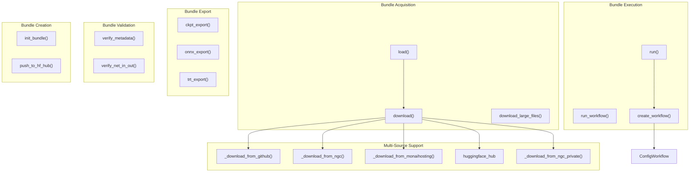
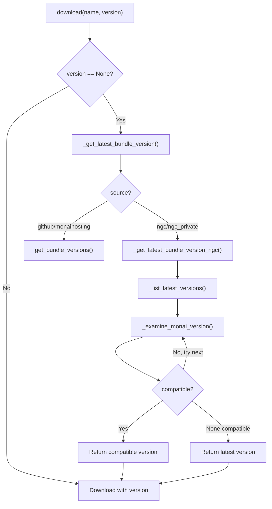
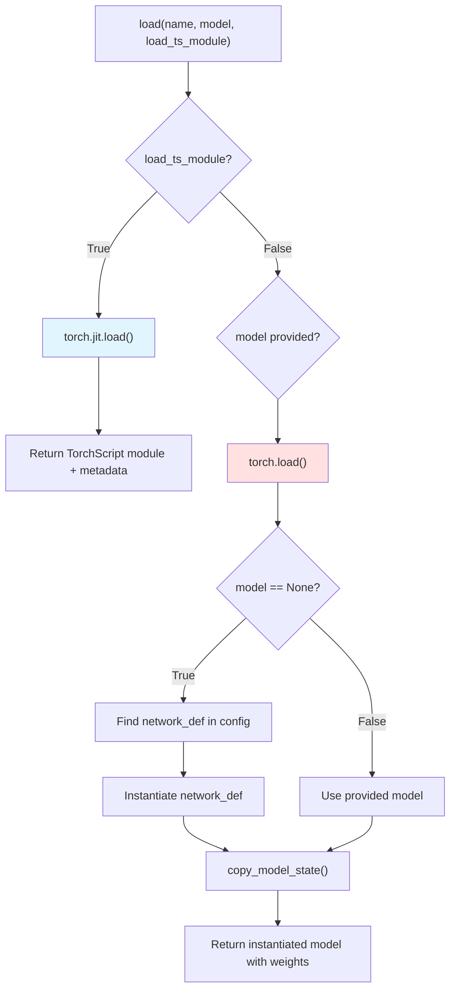
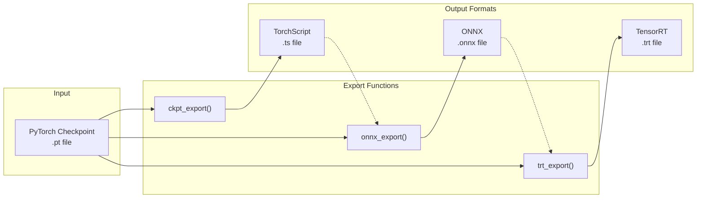
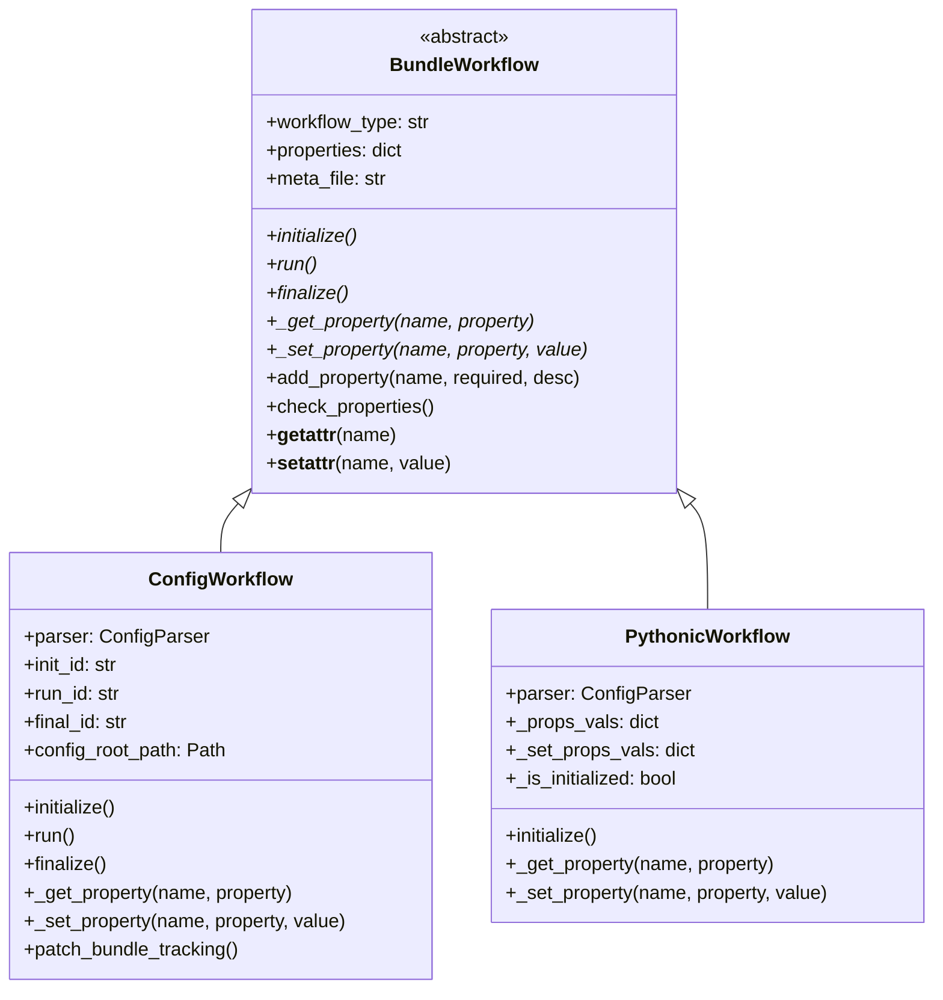
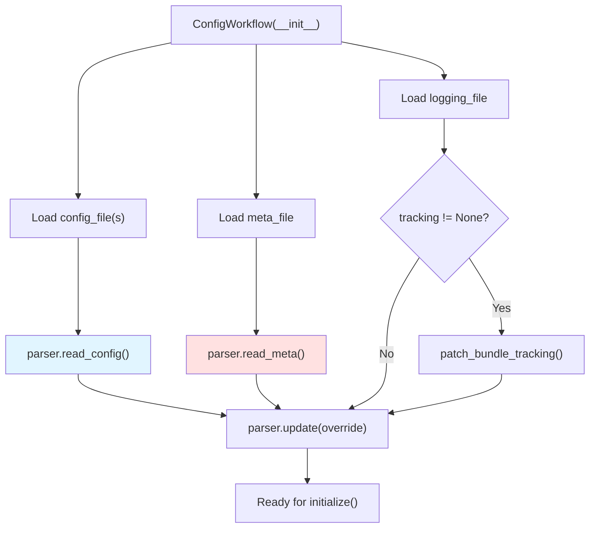
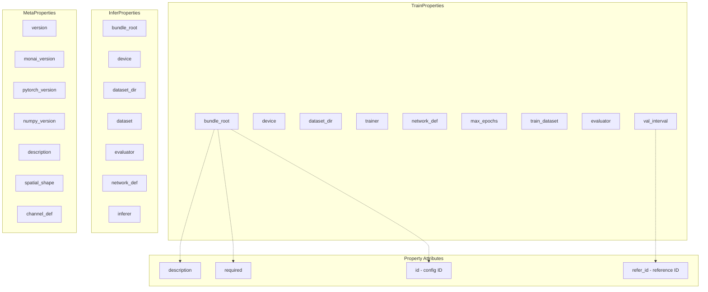
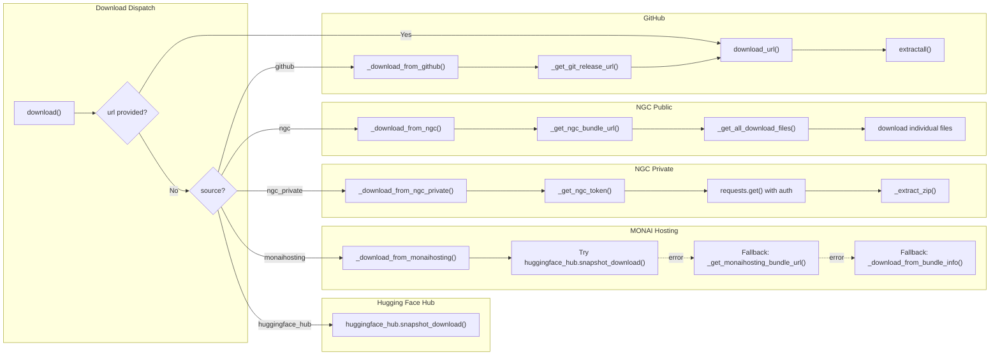

<!-- source: DeepWiki mcp.deepwiki.com · repo Project-MONAI/MONAI · extra page Bundle Scripts and Workflows · fetched 2026-10-21 -->

# Bundle Scripts and Workflows

<details>
<summary>Relevant source files</summary>

The following files were used as context for generating this wiki page:

- [docs/source/bundle.rst](docs/source/bundle.rst)
- [monai/bundle/__init__.py](monai/bundle/__init__.py)
- [monai/bundle/__main__.py](monai/bundle/__main__.py)
- [monai/bundle/properties.py](monai/bundle/properties.py)
- [monai/bundle/scripts.py](monai/bundle/scripts.py)
- [monai/bundle/workflows.py](monai/bundle/workflows.py)
- [tests/bundle/test_bundle_download.py](tests/bundle/test_bundle_download.py)
- [tests/networks/nets/test_autoencoderkl.py](tests/networks/nets/test_autoencoderkl.py)
- [tests/nonconfig_workflow.py](tests/nonconfig_workflow.py)
- [tests/testing_data/fl_infer_properties.json](tests/testing_data/fl_infer_properties.json)
- [tests/testing_data/python_workflow_properties.json](tests/testing_data/python_workflow_properties.json)
- [tests/testing_data/responsive_inference.json](tests/testing_data/responsive_inference.json)

</details>


## Purpose and Scope

This document covers the programmatic interfaces for working with MONAI Bundles, including scripts for downloading, loading, running, and exporting bundles, as well as the workflow classes that execute bundle logic. For information about the bundle format and directory structure, see [Bundle Format and Structure](#6.1.1). For the overall bundle ecosystem architecture, see [Bundle System](#6.1).

The bundle scripts module provides command-line and Python APIs for bundle operations, while the workflow classes define the execution framework for training, inference, and evaluation workflows. Together, these components enable standardized interaction with bundles across different applications.

---

## Bundle Scripts Architecture

The `monai.bundle.scripts` module provides high-level functions for bundle lifecycle management. These functions can be invoked programmatically or via CLI using Python's `fire` library.

### Core Script Functions



**Diagram: Bundle Scripts Function Organization**

Sources: [monai/bundle/scripts.py:1-2447](), [monai/bundle/__init__.py:18-36]()

---

## Download Script

The `download()` function retrieves bundles from multiple sources with automatic version resolution and compatibility checking.

### Download Sources and URL Construction

| Source | Environment Variable | URL Pattern | Use Case |
|--------|---------------------|-------------|----------|
| `monaihosting` | `BUNDLE_DOWNLOAD_SRC` (default) | `https://api.ngc.nvidia.com/v2/models/nvidia/monaihosting/{model}/versions/{version}/files` | Official MONAI model zoo bundles |
| `github` | - | `https://github.com/{owner}/{repo}/releases/download/{tag}/{filename}` | Custom repositories with GitHub releases |
| `ngc` | - | `https://api.ngc.nvidia.com/v2/models/nvidia/monaitoolkit/{model}/versions/{version}/files` | NVIDIA NGC public models |
| `ngc_private` | `NGC_API_KEY`, `NGC_ORG`, `NGC_TEAM` | `https://api.ngc.nvidia.com/v2/{repo}/models/{model}/versions/{version}/zip` | Private NGC repositories |
| `huggingface_hub` | - | Uses `huggingface_hub.snapshot_download()` | Hugging Face Hub repositories |
| `url` | - | Direct URL | Custom bundle hosting |

Sources: [monai/bundle/scripts.py:446-626](), [monai/bundle/scripts.py:67-72]()

### Version Resolution



**Diagram: Automatic Version Resolution Flow**

The version resolution system attempts to find the latest bundle version compatible with the installed MONAI version. It examines the `monai_version` field in each version's `metadata.json` and selects the most recent compatible version.

Sources: [monai/bundle/scripts.py:407-433](), [monai/bundle/scripts.py:376-404](), [monai/bundle/scripts.py:311-327]()

### Download Function Signature

```python
def download(
    name: str | None = None,
    version: str | None = None,
    bundle_dir: PathLike | None = None,
    source: str = DEFAULT_DOWNLOAD_SOURCE,  # "monaihosting" by default
    repo: str | None = None,
    url: str | None = None,
    remove_prefix: str | None = "monai_",
    progress: bool = True,
    args_file: str | None = None,
) -> None:
```

The function supports configuration via `args_file` (JSON/YAML) for reproducible downloads. The `update_kwargs()` utility merges file-based and CLI arguments.

Sources: [monai/bundle/scripts.py:446-456](), [monai/bundle/scripts.py:74-108]()

### CLI Usage Examples

```bash
# Download from monaihosting with automatic version resolution
python -m monai.bundle download --name spleen_ct_segmentation --bundle_dir ./bundles

# Download specific version from GitHub
python -m monai.bundle download --name test_bundle --version "0.1.0" \
  --source github --repo "Project-MONAI/MONAI-extra-test-data/0.8.1"

# Download from NGC with API authentication
python -m monai.bundle download --name spleen_ct_segmentation \
  --source ngc --version "0.3.7"

# Download from Hugging Face Hub
python -m monai.bundle download --name bundle_name --source huggingface_hub \
  --repo "repo_owner/repo_name"

# Use args_file for default configuration
python -m monai.bundle download --args_file download_config.json
```

Sources: [monai/bundle/scripts.py:463-493](), [monai/bundle/__main__.py:1-31]()

---

## Load Script

The `load()` function loads model weights or TorchScript modules from bundles with automatic instantiation and device placement.

### Load Modes



**Diagram: Load Function Decision Flow**

Sources: [monai/bundle/scripts.py:628-768]()

### Load Function Signature

```python
def load(
    name: str,
    model: torch.nn.Module | None = None,
    version: str | None = None,
    workflow_type: str = "train",
    model_file: str | None = None,
    load_ts_module: bool = False,
    bundle_dir: PathLike | None = None,
    source: str = DEFAULT_DOWNLOAD_SOURCE,
    repo: str | None = None,
    remove_prefix: str | None = "monai_",
    progress: bool = True,
    device: str | None = None,
    key_in_ckpt: str | None = None,
    config_files: Sequence[str] = (),
    workflow_name: str | BundleWorkflow | None = None,
    args_file: str | None = None,
    copy_model_args: dict | None = None,
    net_override: dict | None = None,
) -> object | tuple[torch.nn.Module, dict, dict] | Any:
```

Key parameters:
- `model`: Pre-instantiated network to load weights into, or `None` to auto-instantiate from bundle config
- `load_ts_module`: Load TorchScript `.ts` file instead of PyTorch `.pt` checkpoint
- `net_override`: Override network parameters (e.g., `{"out_channels": 5}`) before instantiation
- `key_in_ckpt`: Extract nested checkpoint like `checkpoint["model"]`

Sources: [monai/bundle/scripts.py:628-704]()

### Model Instantiation Flow

When `model=None` and `load_ts_module=False`, the load function attempts to instantiate the network from the bundle's configuration:

1. Load bundle config file: `{bundle_dir}/{name}/configs/{workflow_type}.json`
2. Create workflow using `create_workflow()` with `net_override` applied to `network_def`
3. Access `workflow.network_def` for the instantiated model
4. Load state dict and return the model

Sources: [monai/bundle/scripts.py:741-761]()

---

## Run Script

The `run()` function executes bundle workflows with support for config overrides and experiment tracking.

### Run Function Signature

```python
def run(
    run_id: str | Sequence[str] = "run",
    init_id: str | Sequence[str] = "initialize",
    final_id: str | Sequence[str] = "finalize",
    config_file: str | Sequence[str] | None = None,
    meta_file: str | Sequence[str] | None = None,
    logging_file: str | None = None,
    tracking: str | dict | None = None,
    args_file: str | None = None,
    **override: Any,
) -> None:
```

The function executes three stages:
1. **Initialize**: Parse config, set up logging, initialize components (ID: `init_id`)
2. **Run**: Execute main workflow logic (ID: `run_id`)
3. **Finalize**: Cleanup and post-processing (ID: `final_id`)

Sources: [monai/bundle/scripts.py:1019-1145]()

### Config Override Syntax

The `override` kwargs support hierarchical config updates using special syntax:

| Syntax | Meaning | Example |
|--------|---------|---------|
| `key#subkey` | Nested dictionary access | `network_def#out_channels 2` |
| `@key` | Reference to another config ID | `@network_def` |
| `$expression` | Python expression | `$torch.device('cuda')` |
| `%path#key` | Load from external file | `%/data/params.json#learning_rate` |

Sources: [monai/bundle/scripts.py:1058-1086](), [monai/bundle/workflows.py:401]()

### Experiment Tracking Integration

The `tracking` parameter enables experiment management with minimal config changes:

```python
# Built-in MLFlow tracking
run(config_file="train.json", tracking="mlflow")

# Custom tracking configuration
run(config_file="train.json", tracking={
    "configs": {...},
    "handlers_id": {...}
})
```

The tracking system patches the config with monitoring handlers (e.g., `MLFlowHandler`) by injecting them into the trainer's handler list.

Sources: [monai/bundle/scripts.py:1019-1034](), [monai/bundle/workflows.py:458-463](), [monai/bundle/workflows.py:628-648]()

### CLI Usage Examples

```bash
# Basic training execution
python -m monai.bundle run --config_file configs/train.json

# Override config values
python -m monai.bundle run --config_file configs/train.json \
  --network_def#out_channels 5 --train#trainer#max_epochs 100

# Enable MLFlow tracking
python -m monai.bundle run --config_file configs/train.json --tracking mlflow

# Use args_file for reproducible runs
python -m monai.bundle run --args_file run_config.yaml
```

Sources: [monai/bundle/scripts.py:1087-1145]()

---

## Export Scripts

MONAI provides three export functions to convert trained models to deployment-ready formats.

### Export Function Summary



**Diagram: Model Export Pipeline**

Sources: [monai/bundle/scripts.py:1147-1526]()

### Checkpoint Export (`ckpt_export`)

Converts PyTorch checkpoint to TorchScript format:

```python
def ckpt_export(
    net_id: str | None = None,
    filepath: str | None = None,
    ckpt_file: str | None = None,
    config_file: str | Sequence[str] | None = None,
    key_in_ckpt: str | None = None,
    use_trace: bool | None = None,
    input_shape: Sequence[int | str] | None = None,
    meta_file: str | Sequence[str] | None = None,
    args_file: str | None = None,
    **override: Any,
) -> None:
```

Key parameters:
- `use_trace`: Use `torch.jit.trace` (True) or `torch.jit.script` (False, default)
- `input_shape`: Required for tracing; supports dynamic shapes like `["32", "32 * n", "32 ** p"]`
- The function uses `convert_to_torchscript()` and `save_net_with_metadata()`

Sources: [monai/bundle/scripts.py:1147-1283]()

### ONNX Export (`onnx_export`)

Exports model to ONNX format for cross-framework compatibility:

```python
def onnx_export(
    net_id: str | None = None,
    filepath: str | None = None,
    ckpt_file: str | None = None,
    config_file: str | Sequence[str] | None = None,
    key_in_ckpt: str | None = None,
    input_shape: Sequence[int | str] | None = None,
    meta_file: str | Sequence[str] | None = None,
    args_file: str | None = None,
    **override: Any,
) -> None:
```

The function uses `convert_to_onnx()` which wraps `torch.onnx.export()` with MONAI-specific defaults.

Sources: [monai/bundle/scripts.py:1285-1403]()

### TensorRT Export (`trt_export`)

Optimizes model for NVIDIA GPU deployment:

```python
def trt_export(
    net_id: str | None = None,
    filepath: str | None = None,
    ckpt_file: str | None = None,
    config_file: str | Sequence[str] | None = None,
    key_in_ckpt: str | None = None,
    input_shape: Sequence[int | str] | None = None,
    meta_file: str | Sequence[str] | None = None,
    dynamic_batchsize: Sequence[int] | None = None,
    precision: str = "fp32",
    use_onnx: bool = True,
    args_file: str | None = None,
    **override: Any,
) -> None:
```

Key parameters:
- `precision`: "fp32" (default), "fp16", or "int8" for quantization
- `dynamic_batchsize`: Min/opt/max batch sizes like `[1, 4, 8]`
- `use_onnx`: Convert to ONNX first (True, default) or directly from TorchScript

The function uses `convert_to_trt()` which requires the `torch-tensorrt` package.

Sources: [monai/bundle/scripts.py:1405-1526]()

---

## Bundle Workflow Classes

The workflow system provides abstract interfaces for bundle execution with standardized property access patterns.

### Workflow Class Hierarchy



**Diagram: Bundle Workflow Class Hierarchy**

Sources: [monai/bundle/workflows.py:37-242](), [monai/bundle/workflows.py:361-648](), [monai/bundle/workflows.py:243-359]()

### BundleWorkflow Base Class

The `BundleWorkflow` abstract base class defines the interface for all bundle workflows:

**Core Abstract Methods:**
- `initialize()`: Setup before execution (parse config, initialize components)
- `run()`: Execute main workflow logic (training loop, inference, etc.)
- `finalize()`: Cleanup and post-processing
- `_get_property(name, property)`: Retrieve standardized properties
- `_set_property(name, property, value)`: Update standardized properties

**Property Management:**

The class implements `__getattr__` and `__setattr__` to intercept property access and delegate to the `_get_property` and `_set_property` methods. This allows workflows to expose standardized properties (defined in `TrainProperties`, `InferProperties`, `MetaProperties`) as if they were regular attributes:

```python
workflow = ConfigWorkflow(config_file="train.json", workflow_type="train")
workflow.initialize()

# Property access is automatically routed through _get_property
device = workflow.device  # Returns parsed config value for "device" ID
network = workflow.network_def  # Returns parsed "network_def" config

# Property setting is routed through _set_property
workflow.max_epochs = 200  # Updates config and marks workflow as uninitialized
```

Sources: [monai/bundle/workflows.py:37-241](), [monai/bundle/workflows.py:188-198]()

### Workflow Types and Properties

Workflows support three types specified via `workflow_type` parameter:

| Workflow Type | Supported Values | Properties Loaded |
|---------------|------------------|-------------------|
| Training | "train", "training" | `TrainProperties` + `MetaProperties` |
| Inference | "infer", "inference", "eval", "evaluation" | `InferProperties` + `MetaProperties` |
| Meta-only | `None` | `MetaProperties` only |

Properties can be loaded from:
1. **Default properties**: Built-in dictionaries in [monai/bundle/properties.py]()
2. **Custom properties file**: JSON file with structure like [tests/testing_data/fl_infer_properties.json:1-76]()

Sources: [monai/bundle/workflows.py:61-62](), [monai/bundle/workflows.py:93-134](), [monai/bundle/properties.py:30-262]()

---

## ConfigWorkflow

`ConfigWorkflow` is the primary workflow implementation for config-based bundles. It uses `ConfigParser` to load and execute JSON/YAML configurations.

### ConfigWorkflow Initialization



**Diagram: ConfigWorkflow Initialization Sequence**

Sources: [monai/bundle/workflows.py:405-464]()

### Execution Phases

```python
workflow = ConfigWorkflow(
    config_file="configs/train.json",
    meta_file="configs/metadata.json",
    workflow_type="train"
)

# Phase 1: Initialize - parse config and set up components
workflow.initialize()  # Calls parser.parse() and executes "initialize" config ID

# Phase 2: Run - execute main workflow
workflow.run()  # Executes "run" config ID (typically trainer.run())

# Phase 3: Finalize - cleanup
workflow.finalize()  # Executes "finalize" config ID if present
```

The `_run_expr()` method handles ID execution with automatic cleanup:

```python
def _run_expr(self, id: str, **kwargs: dict) -> list[Any]:
    """Execute config expression by ID and remove from resolver cache."""
    ret = []
    if id in self.parser:
        # Handle list of expressions
        if isinstance(self.parser[id], list):
            for i in range(len(self.parser[id])):
                sub_id = f"{id}::{i}"  # ID_SEP_KEY is "::"
                ret.append(self.parser.get_parsed_content(sub_id, **kwargs))
                self.parser.ref_resolver.remove_resolved_content(sub_id)
        else:
            ret.append(self.parser.get_parsed_content(id, **kwargs))
            self.parser.ref_resolver.remove_resolved_content(id)
    return ret
```

This allows repeated calls to `run()` without restarting the process, useful for streaming applications.

Sources: [monai/bundle/workflows.py:466-495](), [monai/bundle/workflows.py:521-537]()

### Property Access in ConfigWorkflow

Properties map to config IDs via the `BundlePropertyConfig.ID` field:

```python
# TrainProperties definition
TrainProperties = {
    "network_def": {
        BundleProperty.DESC: "network module for the training.",
        BundleProperty.REQUIRED: False,
        BundlePropertyConfig.ID: "network_def",
    },
    "max_epochs": {
        BundleProperty.DESC: "max number of epochs to execute the training.",
        BundleProperty.REQUIRED: True,
        BundlePropertyConfig.ID: "train::trainer::max_epochs",
    },
}

# Access in workflow
workflow = ConfigWorkflow(config_file="train.json", workflow_type="train")
workflow.initialize()

# workflow.network_def resolves to parser["network_def"]
# workflow.max_epochs resolves to parser["train::trainer::max_epochs"]
```

The `_get_property()` method retrieves parsed config values:

```python
def _get_property(self, name: str, property: dict) -> Any:
    if not self._is_initialized:
        raise RuntimeError("Please execute 'initialize' before getting any parsed content.")
    prop_id = property[BundlePropertyConfig.ID]
    return self.parser.get_parsed_content(id=prop_id) if prop_id is not None else None
```

Sources: [monai/bundle/workflows.py:548-560](), [monai/bundle/properties.py:30-155]()

### Property Validation

`check_properties()` validates required properties and optional property references:

```python
def check_properties(self) -> list[str] | None:
    """Return list of missing required properties."""
    ret = super().check_properties()  # Check required properties
    
    # Also check optional properties with references
    wrong_props = []
    for n, p in self.properties.items():
        if not p.get(BundleProperty.REQUIRED, False):
            if not self._check_optional_id(name=n, property=p):
                wrong_props.append(n)
    
    if wrong_props:
        logger.warning(f"Loaded bundle defines optional properties with wrong ID: {wrong_props}")
    
    return ret
```

The `REF_ID` field specifies where an optional property is referenced. For example, `evaluator` is optional but if `ValidationHandler` references it via `validator`, it must exist.

Sources: [monai/bundle/workflows.py:497-519](), [monai/bundle/workflows.py:598-626](), [monai/bundle/properties.py:101-106]()

---

## PythonicWorkflow

`PythonicWorkflow` is an alternative base class for workflows defined in Python code rather than JSON/YAML configs. It's useful for bundles with complex logic that's easier to express in Python.

### PythonicWorkflow Features

**Key differences from ConfigWorkflow:**
- Properties accessed via `get_<property>()` methods or direct attribute access
- Properties set via `_set_<property>()` methods or direct attribute assignment
- Can optionally use `ConfigParser` for hybrid config + Python workflows
- Stores property values in `_props_vals` dict (cached) and `_set_props_vals` dict (user-set)

**Property Resolution Order:**
1. Check `_set_props_vals` (explicitly set by user)
2. Check `_props_vals` (previously computed and cached)
3. Check `parser.config[meta_key]` if using ConfigParser
4. Call `get_<property>()` accessor method
5. Raise error if required property not found

Sources: [monai/bundle/workflows.py:243-359](), [monai/bundle/workflows.py:313-344]()

### Example Implementation

```python
class MyInferenceWorkflow(PythonicWorkflow):
    def __init__(self):
        super().__init__(
            workflow_type="infer",
            config_file="configs/inference.json"
        )
    
    def initialize(self):
        # Required: call parent to reset state
        super().initialize()
        
        # Initialize components
        self.net = UNet(spatial_dims=3, in_channels=1, out_channels=2)
        self.preprocessing = Compose([LoadImaged(keys="image")])
        self.dataset = Dataset(data=self.dataset_data, transform=self.preprocessing)
    
    def run(self):
        # Execute inference
        for data in self.dataset:
            pred = self.net(data["image"])
            # Process predictions...
    
    def finalize(self):
        pass
    
    # Property accessor methods
    def get_device(self):
        return torch.device("cuda" if torch.cuda.is_available() else "cpu")
    
    def get_inferer(self):
        return SlidingWindowInferer(roi_size=(96, 96, 96))
```

Sources: [tests/nonconfig_workflow.py:182-239]()

### Initialization Tracking

PythonicWorkflow tracks initialization state with `_is_initialized` flag:

```python
def initialize(self):
    self._props_vals = {}
    self._is_initialized = True
    # ... initialize workflow components

def _set_property(self, name: str, property: dict, value: Any):
    self._set_props_vals[name] = value
    self._is_initialized = False  # Force re-initialization before next run
```

This ensures that property changes trigger re-initialization before the next `run()` call.

Sources: [monai/bundle/workflows.py:306-311](), [monai/bundle/workflows.py:346-358]()

---

## Property System

The property system provides a standardized interface for accessing workflow components across different bundle implementations and applications (MONAI Label, Auto3DSeg, MAPs).

### Standard Property Definitions



**Diagram: Property System Organization**

Each property has:
- `description`: Human-readable purpose
- `required`: Boolean indicating if property must exist
- `id`: Config ID where value is stored (for ConfigWorkflow)
- `refer_id`: Config ID that references this property (for optional properties)

Sources: [monai/bundle/properties.py:1-262]()

### Required vs Optional Properties

| Property Category | Required | Optional with Reference | Optional without Reference |
|-------------------|----------|------------------------|---------------------------|
| **Behavior** | Must exist in bundle | Must exist if referenced in config | Can be absent entirely |
| **Examples** | `bundle_root`, `device`, `trainer` | `evaluator`, `val_interval`, `train_handlers` | `description`, `spatial_shape` |
| **Check** | Always validated | Validated if `refer_id` found in config | Never validated |

The `refer_id` field enables context-sensitive validation. For example, `evaluator` is optional, but if `ValidationHandler` references it via `validator`, it becomes required.

Sources: [monai/bundle/properties.py:12-22](), [monai/bundle/workflows.py:598-626]()

### Custom Properties

Applications can add custom properties for specialized workflows:

```python
workflow = ConfigWorkflow(config_file="train.json", workflow_type="train")

# Add custom property
workflow.add_property(
    name="optimizer_state",
    required=True,
    config_id="train::optimizer",
    desc="Optimizer state for federated learning"
)

# Access custom property
optimizer = workflow.optimizer_state
```

Sources: [monai/bundle/workflows.py:579-596]()

---

## Multi-Source Support Architecture

### Source-Specific Download Handlers



**Diagram: Multi-Source Download Routing**

Sources: [monai/bundle/scripts.py:560-623]()

### Bundle Info and Version Discovery

The `get_bundle_info()` and `get_bundle_versions()` functions retrieve bundle metadata from different sources:

```python
def get_bundle_info(
    bundle_name: str,
    version: str | None = None,
    repo: str = "Project-MONAI/model-zoo",
    tag: str = "dev",
    auth_token: str | None = None,
) -> dict[str, Any] | None:
    """Get bundle info from GitHub or Hugging Face Hub."""
```

For GitHub, it parses `model_info.json` or release assets. For Hugging Face Hub, it uses the Hub API.

Sources: [monai/bundle/scripts.py:815-929](), [monai/bundle/scripts.py:771-812]()

### NGC Prefix Handling

NGC bundles use a `monai_` prefix that doesn't exist in the model zoo. The `remove_prefix` parameter normalizes names:

```python
# NGC source uses "monai_spleen_ct_segmentation"
download(name="spleen_ct_segmentation", source="ngc", remove_prefix="monai_")
# Downloads "monai_spleen_ct_segmentation" but saves to "spleen_ct_segmentation/"

# Or explicitly use NGC name
download(name="monai_spleen_ct_segmentation", source="ngc", remove_prefix=None)
```

Helper functions manage prefixing:
- `_add_ngc_prefix(name, prefix="monai_")` - ensures prefix exists
- `_remove_ngc_prefix(name, prefix="monai_")` - strips prefix

Sources: [monai/bundle/scripts.py:217-226](), [monai/bundle/scripts.py:244-261]()

---

## Verification Scripts

### Metadata Verification

`verify_metadata()` validates bundle metadata against JSON schema:

```python
def verify_metadata(
    meta_file: str | Sequence[str] | None = None,
    filepath: PathLike | None = None,
    create_dir: bool | None = None,
    hash_val: str | None = None,
    hash_type: str | None = None,
    args_file: str | None = None,
) -> bool:
```

The function checks:
1. Required fields exist (`version`, `monai_version`, `pytorch_version`, etc.)
2. Field types match schema (strings, numbers, objects)
3. Version strings are valid
4. Optional hash validation of metadata file

Sources: [monai/bundle/scripts.py:1528-1664]()

### Network I/O Verification

`verify_net_in_out()` validates network input/output compatibility with metadata:

```python
def verify_net_in_out(
    net_id: str | None = None,
    meta_file: str | Sequence[str] | None = None,
    config_file: str | Sequence[str] | None = None,
    device: str | None = None,
    p: int = 1,
    n: int = 1,
    any: int = 1,
    args_file: str | None = None,
    **override: Any,
) -> tuple[Any, Any]:
```

The function:
1. Loads network from config
2. Generates fake input based on metadata `spatial_shape`
3. Runs forward pass
4. Compares output shape to metadata specification

Supports dynamic shape patterns:
- `"32"` - fixed dimension
- `"32 * n"` - scalable by factor n
- `"32 ** p"` - exponential scaling
- `"*"` - any size

Sources: [monai/bundle/scripts.py:1666-1845](), [monai/bundle/scripts.py:141-167]()

---

## Bundle Creation and Publishing

### Bundle Initialization

`init_bundle()` creates the standard bundle directory structure:

```python
def init_bundle(
    bundle_dir: PathLike,
    ckpt_file: str | None = None,
    bundle_version: str = "0.1.0",
) -> None:
```

Creates structure:
```
bundle_name/
├── configs/
│   ├── metadata.json
│   ├── inference.json
│   └── train.json (if ckpt_file provided)
├── models/
│   └── model.pt (if ckpt_file provided)
├── docs/
│   └── README.md
└── scripts/
```

Sources: [monai/bundle/scripts.py:2144-2253]()

### Hugging Face Hub Publishing

`push_to_hf_hub()` publishes bundles to Hugging Face Hub:

```python
def push_to_hf_hub(
    bundle_dir: PathLike,
    repo_id: str,
    version: str = "0.1.0",
    private: bool = False,
    token: str | None = None,
) -> None:
```

The function:
1. Validates bundle structure
2. Creates/updates repository
3. Uploads all bundle files
4. Tags release with version

Sources: [monai/bundle/scripts.py:2255-2359]()

### Large File Management

`download_large_files()` handles files tracked in `large_files.yaml`:

```yaml
# large_files.yaml
large_files:
  - path: models/model.pt
    url: https://example.com/model.pt
    hash_val: abc123
    hash_type: md5
```

This enables:
1. Small bundle repository size
2. Separate hosting for large model files
3. Optional downloads based on use case

Sources: [monai/bundle/scripts.py:2002-2142]()

---

## CLI Entry Point

The bundle module can be executed as a CLI using Python's `fire` library:

```python
# monai/bundle/__main__.py
if __name__ == "__main__":
    from monai.utils import optional_import
    fire, _ = optional_import("fire")
    fire.Fire()
```

This automatically exposes all public functions in `monai.bundle.scripts` as CLI commands:

```bash
# General syntax
python -m monai.bundle <function_name> --<arg1> <value1> --<arg2> <value2>

# Available commands
python -m monai.bundle download --help
python -m monai.bundle load --help
python -m monai.bundle run --help
python -m monai.bundle ckpt_export --help
python -m monai.bundle onnx_export --help
python -m monai.bundle trt_export --help
python -m monai.bundle verify_metadata --help
python -m monai.bundle verify_net_in_out --help
python -m monai.bundle init_bundle --help
```

The `fire` library automatically:
- Parses command-line arguments
- Converts to appropriate Python types
- Handles boolean flags
- Provides help documentation

Sources: [monai/bundle/__main__.py:1-31]()

---

## Integration Examples

### MONAI Label Integration

MONAI Label uses bundle workflows for annotation models:

```python
from monai.bundle import ConfigWorkflow

# Load inference workflow from bundle
workflow = ConfigWorkflow(
    config_file=f"{bundle_path}/configs/inference.json",
    workflow_type="infer"
)
workflow.initialize()

# Access standardized properties
preprocessing = workflow.preprocessing
network = workflow.network_def
inferer = workflow.inferer

# Run inference
workflow.run()
```

### Auto3DSeg Integration

Auto3DSeg generates bundles from templates and executes them:

```python
from monai.bundle import run

# Generate bundle configuration
algo_gen.generate(output_folder="work_dir/algorithm_template")

# Execute training via bundle interface
run(
    config_file="work_dir/algorithm_template/configs/train.json",
    bundle_root=work_dir,
    dataset_dir=data_dir,
    device="cuda:0"
)
```

### Federated Learning Integration

Custom properties enable federated learning workflows:

```python
workflow = ConfigWorkflow(
    config_file="train.json",
    properties_path="fl_properties.json"
)

# Add FL-specific properties
workflow.add_property(
    name="global_model",
    required=True,
    config_id="fl::global_model"
)
workflow.add_property(
    name="aggregator",
    required=True,
    config_id="fl::aggregator"
)

workflow.initialize()
global_model = workflow.global_model
aggregator = workflow.aggregator
```

Sources: [tests/testing_data/fl_infer_properties.json:1-76]()

---

## Summary

The bundle scripts and workflows system provides:

1. **Unified Download API**: Single interface for GitHub, NGC, Hugging Face Hub, and custom sources with automatic version resolution and compatibility checking

2. **Flexible Loading**: Load PyTorch checkpoints or TorchScript modules with automatic network instantiation and device placement

3. **Standardized Execution**: Config-based and Python-based workflows with consistent initialize/run/finalize pattern

4. **Export Pipeline**: Convert models to TorchScript, ONNX, and TensorRT formats with metadata preservation

5. **Property System**: Standardized interface for accessing workflow components across different applications

6. **CLI and Python APIs**: All functionality available via command-line and programmatic interfaces

7. **Extensibility**: Custom properties, workflow implementations, and tracking integrations

This architecture enables MONAI bundles to serve as portable, reproducible units of medical imaging AI that work seamlessly across research, deployment, and production environments.

Sources: [monai/bundle/scripts.py:1-2447](), [monai/bundle/workflows.py:1-648](), [monai/bundle/properties.py:1-262]()

---

