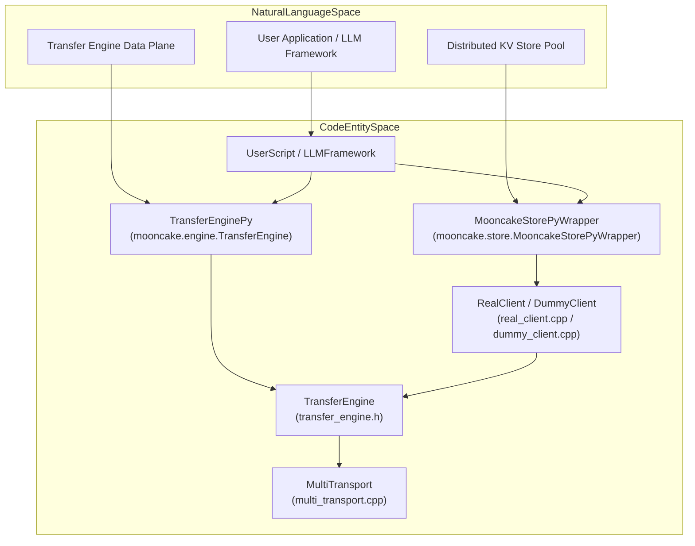
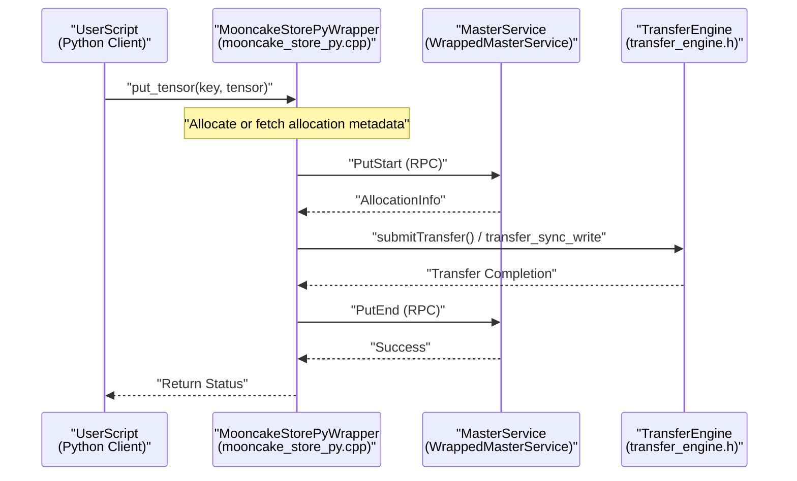

<!-- source: DeepWiki mcp.deepwiki.com · repo kvcache-ai/Mooncake · page 2.2 Quick Start Examples · fetched 2026-10-21 -->

# Quick Start Examples

<details>
<summary>Relevant source files</summary>

The following files were used as context for generating this wiki page:

- [README.md](README.md)
- [docs/source/getting_started/build.md](docs/source/getting_started/build.md)
- [docs/source/getting_started/quick-start.md](docs/source/getting_started/quick-start.md)
- [docs/source/getting_started/supported-protocols.md](docs/source/getting_started/supported-protocols.md)
- [docs/source/index.md](docs/source/index.md)
- [docs/source/zh_archive/build.md](docs/source/zh_archive/build.md)
- [docs/source/zh_archive/run-examples.md](docs/source/zh_archive/run-examples.md)
- [docs/source/zh_archive/transfer-engine-python.md](docs/source/zh_archive/transfer-engine-python.md)
- [mooncake-common/common.cmake](mooncake-common/common.cmake)
- [mooncake-store/CMakeLists.txt](mooncake-store/CMakeLists.txt)
- [mooncake-store/include/version.h.in](mooncake-store/include/version.h.in)
- [mooncake-transfer-engine/CMakeLists.txt](mooncake-transfer-engine/CMakeLists.txt)
- [mooncake-transfer-engine/include/cuda_alike.h](mooncake-transfer-engine/include/cuda_alike.h)
- [mooncake-transfer-engine/src/CMakeLists.txt](mooncake-transfer-engine/src/CMakeLists.txt)
- [mooncake-transfer-engine/src/transport/CMakeLists.txt](mooncake-transfer-engine/src/transport/CMakeLists.txt)
- [mooncake-wheel/mooncake/__init__.py](mooncake-wheel/mooncake/__init__.py)
- [mooncake-wheel/tests/test_import_structure.py](mooncake-wheel/tests/test_import_structure.py)
- [mooncake-wheel/tests/transfer_engine_initiator_test.py](mooncake-wheel/tests/transfer_engine_initiator_test.py)
- [mooncake-wheel/tests/transfer_engine_target.py](mooncake-wheel/tests/transfer_engine_target.py)

</details>


## Purpose and Scope
This page provides minimal working examples demonstrating core Mooncake functionality. These examples illustrate how to use the **Transfer Engine** for direct memory-to-memory data transfers and **Mooncake Store** for distributed KV cache operations through the Python API. Mooncake targets high-performance large language model (LLM) serving environments, focusing on KVCache disaggregation. The examples cover basic setup, tensor storage, data movement, and lightweight LLM integration patterns.

Sources: [docs/source/getting_started/quick-start.md:1-22](), [mooncake-wheel/tests/transfer_engine_initiator_test.py:10-25]()

## Prerequisites

Before running these examples, ensure the following prerequisites are met:
- Mooncake is installed via prebuilt Python wheel packages or built from source [docs/source/getting_started/quick-start.md:24-97]().
- Required system runtime libraries are installed such as `libibverbs`, `rdma-core`, and `libnuma` [docs/source/getting_started/supported-protocols.md:106-120]().
- For inter-node examples, access to at least two cluster nodes is required [mooncake-wheel/tests/transfer_engine_initiator_test.py:10-15]().
- For distributed store operations, a `mooncake_master` process or an alternative metadata handshake method (`P2PHANDSHAKE`) is configured [docs/source/getting_started/quick-start.md:75-89]().

Sources: [docs/source/getting_started/quick-start.md:12-22](), [mooncake-wheel/tests/transfer_engine_initiator_test.py:10-15]()

## System Components Overview

The following diagram maps high-level named components to their concrete code entities across the Python and C++ layers, bridging natural language system concepts to the codebase implementation.

### Diagram: Natural Language to Code Entity Space (System Architecture)

Sources: [docs/source/getting_started/quick-start.md:24-97](), [mooncake-wheel/tests/transfer_engine_initiator_test.py:10-25]()

## Transfer Engine Quick Start

The `TransferEngine` class provides a protocol-agnostic, low-level point-to-point data transfer interface supporting RDMA, TCP, NVLink, and more. It internally uses a `MultiTransport` dispatcher to select the optimal transport based on protocol and hardware topology [docs/source/getting_started/supported-protocols.md:1-24]().

### Example: Basic Transfer Engine Usage (Python)

This example demonstrates a data sender writing directly into a remote receiver's memory via the Python API [mooncake-wheel/tests/transfer_engine_initiator_test.py:10-25]().

**Initialization:**

```python
from mooncake.engine import TransferEngine

engine = TransferEngine()

# Initialize transfer engine with:
# - local_hostname: e.g., "127.0.0.1:12347"
# - metadata_server: "P2PHANDSHAKE" for direct peer discovery without etcd
# - protocol: "tcp" for TCP transport
# - device_name: "" (empty string means all devices)
ret = engine.initialize("127.0.0.1:12347", "P2PHANDSHAKE", "tcp", "")
if ret != 0:
    raise RuntimeError(f"Initialization failed with code {ret}")
```

**Memory Management and Transfer:**

The engine supports allocating managed buffers, writing data, and performing synchronous transfers [mooncake-wheel/tests/transfer_engine_initiator_test.py:36-85]().

```python
# Allocate a 64MB managed buffer
buffer_capacity = 64 * 1024 * 1024
src_addr = engine.allocate_managed_buffer(buffer_capacity)

# Write some bytes locally into the buffer
src_data = b"Hello, Transfer Engine!"
engine.write_bytes_to_buffer(src_addr, src_data, len(src_data))

# Get remote buffer address on the target node
dst_addr = engine.get_first_buffer_address("127.0.0.1:12345")

# Perform synchronous write: local buffer -> remote buffer
engine.transfer_sync_write("127.0.0.1:12345", src_addr, dst_addr, len(src_data))
```

Sources: [mooncake-wheel/tests/transfer_engine_initiator_test.py:10-85]()

## Mooncake Store Quick Start

`MooncakeStorePyWrapper` offers a distributed key-value interface backed by a MasterService and integrated with the Transfer Engine for efficient data movement.

### Distributed Store Data Flow

This sequence diagram illustrates the high-level RPC and transfer interactions during a `put` operation using the Python Store API wrapper, mapping natural language concepts to underlying classes.

### Diagram: Store Put/Get Flow and Code Entities

Sources: [docs/source/getting_started/quick-start.md:24-89](), [mooncake-wheel/tests/transfer_engine_initiator_test.py:36-85]()

### Example: Basic Store Usage (Python)

**Step 1: Start the Master Service**

The `mooncake_master` process must be running; it coordinates the store cluster and metadata management. For simple experiments, the decentralized `"P2PHANDSHAKE"` metadata server option can be used, which requires no external etcd or Redis.

**Step 2: Use Python Client**

The store Python client is initialized using configuration parameters that set up metadata, buffer sizes, and protocol.

```python
from mooncake.store import MooncakeStorePyWrapper

store = MooncakeStorePyWrapper()
store.setup(
    local_hostname="localhost",
    metadata_server="P2PHANDSHAKE",          # decentralized peer handshake
    global_segment_size=512 * 1024 * 1024,   # 512MB DRAM pool contribution
    local_buffer_size=128 * 1024 * 1024,     # 128MB Transfer Engine buffer
    protocol="tcp",
    rdma_devices="",                         # empty for default device
    master_server_addr="127.0.0.1:50051"    # default master service address
)

# Put simple binary data under key
store.put("hello_key", b"Hello, Mooncake Store!")

# Get stored data
data = store.get("hello_key")
print(data.decode())  # Should output: Hello, Mooncake Store!

store.close()
```

Sources: [docs/source/getting_started/quick-start.md:24-89]()

### Example: Tensor Storage with PyTorch

Mooncake Store supports efficient tensor storage (`put_tensor` / `get_tensor`), automatically serializing metadata and payloads. Below is an example storing and retrieving PyTorch tensors.

```python
import torch
from mooncake.store import MooncakeStorePyWrapper

store = MooncakeStorePyWrapper()
# ... call store.setup(...) as above ...

# Create a float32 tensor
tensor = torch.randn(1024, 1024, dtype=torch.float32)

# Store the tensor under a key
store.put_tensor("my_tensor", tensor)

# Retrieve the tensor back
retrieved = store.get_tensor("my_tensor")

# Verify strict equality
assert torch.allclose(tensor, retrieved)
```

Sources: [docs/source/getting_started/quick-start.md:24-89]()

## Basic LLM Framework Integration Quick Start

Mooncake enables disaggregated LLM serving and reinforcement learning scenarios via structured objects using bundle transfer abstractions. This supports efficient batch tensor and metadata transfer with selective materialization.

```python
from mooncake.store import MooncakeStorePyWrapper
import torch

store = MooncakeStorePyWrapper()
# ... setup store ...

# Structured batch metadata and tensors
data = {
    "batch": {"input_ids": torch.tensor([[1, 2, 3]], dtype=torch.long)},
    "non_tensor_batch": {"text": ["hello world"]},
    "meta_info": {"step": 1}
}

# Store the tensor data
store.put_tensor("rollout:step-1:input_ids", data["batch"]["input_ids"])

# Retrieve tensor back
retrieved_tensor = store.get_tensor("rollout:step-1:input_ids")
print(retrieved_tensor)
```

Sources: [docs/source/getting_started/quick-start.md:24-89]()

## Summary of Key CLI Tools

The following tools facilitate system interaction and development workflows:

| Command | Description | Source |
|---|---|---|
| `mooncake_master` | Central master server coordinating the distributed KV cache pool. | [docs/source/getting_started/quick-start.md:75-85]() |
| `mooncake_client` | Standalone client process implementing real-client RPC. | [docs/source/getting_started/quick-start.md:75-89]() |
| `transfer_engine_bench` | Transfer Engine benchmark tool demonstrating throughput and latency. | [mooncake-wheel/tests/transfer_engine_initiator_test.py:1-102]() |
| `mooncake_http_metadata_server` | HTTP server used for metadata discovery and peer handshake. | [docs/source/getting_started/quick-start.md:24-89]() |
| `transfer_engine_topology_dump` | Utility tool to dump and analyze hardware and network topology for optimal path selection. | [docs/source/getting_started/quick-start.md:1-22]() |

Sources: [docs/source/getting_started/quick-start.md:1-89](), [mooncake-wheel/tests/transfer_engine_initiator_test.py:1-102]()

---

