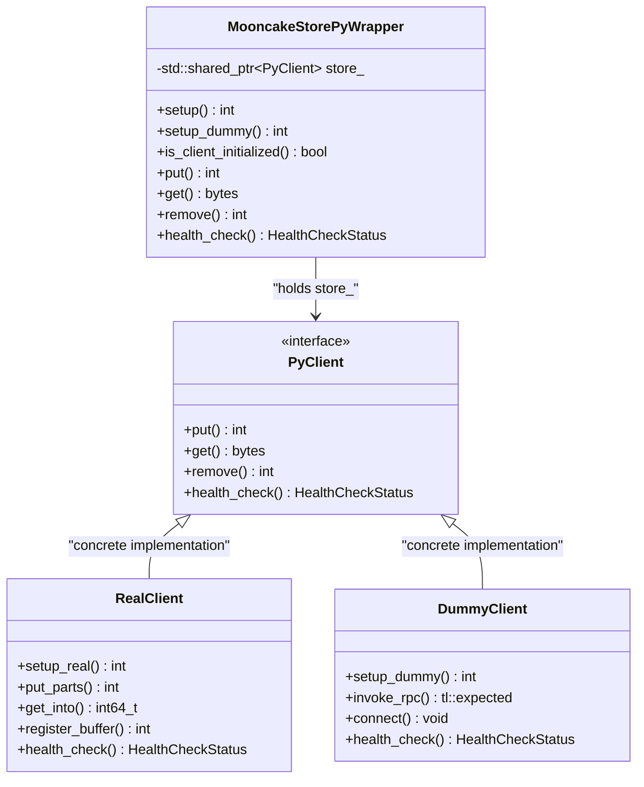
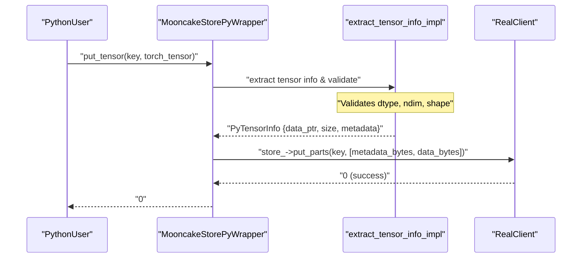
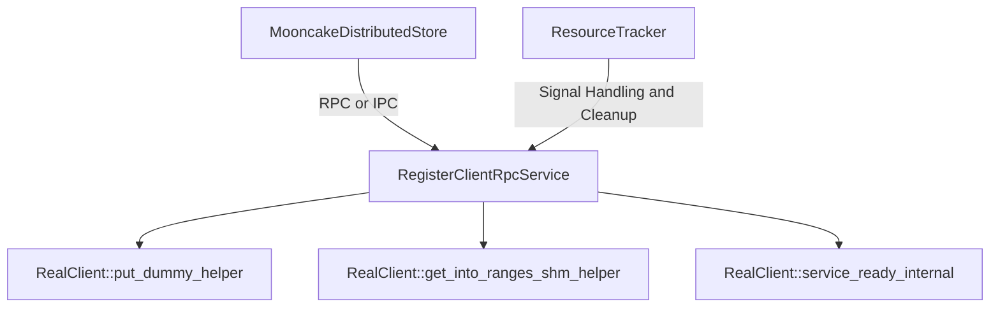

<!-- source: DeepWiki mcp.deepwiki.com · repo kvcache-ai/Mooncake · page 3.2 MooncakeStorePyWrapper API · fetched 2026-10-21 -->

# MooncakeStorePyWrapper API

<details>
<summary>Relevant source files</summary>

The following files were used as context for generating this wiki page:

- [docs/source/api-reference/python/mooncake-store.md](docs/source/api-reference/python/mooncake-store.md)
- [mooncake-integration/integration_utils.h](mooncake-integration/integration_utils.h)
- [mooncake-integration/store/store_py.cpp](mooncake-integration/store/store_py.cpp)
- [mooncake-integration/store/store_py_internal.h](mooncake-integration/store/store_py_internal.h)
- [mooncake-integration/store/store_py_parallel_read.h](mooncake-integration/store/store_py_parallel_read.h)
- [mooncake-integration/store/store_py_parallel_write.h](mooncake-integration/store/store_py_parallel_write.h)
- [mooncake-store/include/client_service.h](mooncake-store/include/client_service.h)
- [mooncake-store/include/device/cuda_ipc_buffer.h](mooncake-store/include/device/cuda_ipc_buffer.h)
- [mooncake-store/include/device/cuda_ipc_buffer_handle.h](mooncake-store/include/device/cuda_ipc_buffer_handle.h)
- [mooncake-store/include/dummy_client.h](mooncake-store/include/dummy_client.h)
- [mooncake-store/include/pyclient.h](mooncake-store/include/pyclient.h)
- [mooncake-store/include/real_client.h](mooncake-store/include/real_client.h)
- [mooncake-store/src/client_service.cpp](mooncake-store/src/client_service.cpp)
- [mooncake-store/src/device/cuda_ipc_buffer.cpp](mooncake-store/src/device/cuda_ipc_buffer.cpp)
- [mooncake-store/src/dummy_client.cpp](mooncake-store/src/dummy_client.cpp)
- [mooncake-store/src/real_client.cpp](mooncake-store/src/real_client.cpp)
- [mooncake-store/src/real_client_main.cpp](mooncake-store/src/real_client_main.cpp)
- [mooncake-store/tests/e2e/run_session_ranges_tcp_e2e.sh](mooncake-store/tests/e2e/run_session_ranges_tcp_e2e.sh)
- [mooncake-store/tests/e2e/session_ranges_tcp_e2e.py](mooncake-store/tests/e2e/session_ranges_tcp_e2e.py)
- [mooncake-store/tests/pybind_client_test.cpp](mooncake-store/tests/pybind_client_test.cpp)
- [mooncake-wheel/tests/test_dummy_client.py](mooncake-wheel/tests/test_dummy_client.py)

</details>


## Purpose and Scope

This page documents the Python-facing distributed store API, exposed via the `MooncakeDistributedStore` class implemented by `MooncakeStorePyWrapper` in the `mooncake.store` Python module. It provides comprehensive technical details about the class’s setup routines, health checking, basic put/get operations on raw and tensor data, zero-copy buffer support, and the distinction between two client implementations: `RealClient` and `DummyClient`.

The coverage assumes understanding of Mooncake’s overall KVCache-centric LLM serving platform architecture and focuses on bridging the Python API layer to the underlying C++ store client implementations.

Sources: `[mooncake-integration/store/store_py.cpp:1-1256]`, `[mooncake-store/include/pyclient.h:1-44]`, `[docs/source/api-reference/python/mooncake-store.md:1-65]`

---

## Module Layout and Bindings

The `mooncake.store` Python module is constructed via `pybind11` bindings defined in `[mooncake-integration/store/store_py.cpp:1-37]`. Within this module:

- `MooncakeDistributedStore` is the main user-facing class that internally wraps a C++ `MooncakeStorePyWrapper` instance.
- Supporting classes such as `BufferHandle`, `ReplicateConfig`, `ReplicaDescriptor`, and `QueryTaskResponse` expose underlying C++ constructs related to data buffers, replication configurations, replica metadata, and query results respectively.

Key classes and their source line references:

| Python Class / Symbol | C++ Class / Symbol | Location in Code |
| :-------------------- | :----------------- | :--------------- |
| `MooncakeDistributedStore` | `MooncakeStorePyWrapper` | `[mooncake-integration/store/store_py.cpp:1255-1445]` |
| `BufferHandle` | `BufferHandle` | `[mooncake-integration/store/store_py.cpp:1196-1231]` |
| `ReplicateConfig` | `ReplicateConfig` | `[mooncake-integration/store/store_py.cpp:1086-1099]` |
| `ReplicaDescriptor` | `Replica::Descriptor` | `[mooncake-integration/store/store_py.cpp:1118-1135]` |
| `QueryTaskResponse` | `QueryTaskResponse` | `[mooncake-integration/store/store_py.cpp:1168-1193]` |

Sources: `[mooncake-integration/store/store_py.cpp:1-37]`, `[mooncake-integration/store/store_py.cpp:1086-1445]`

---

## Client Architecture: RealClient vs DummyClient

The `MooncakeStorePyWrapper` class holds a `std::shared_ptr<PyClient>` named `store_`, which delegates all store operations to either a `RealClient` or a `DummyClient`. These represent two distinct client implementations inside Mooncake:

- **RealClient**: Implements a fully-featured client connecting directly to the Mooncake master service and transfer engine. It manages communication, buffer registration, and provides the high-performance real backend.
  - Defined in `[mooncake-store/include/real_client.h:80-185]`
  - Implements `PyClient` interface (`[mooncake-store/include/pyclient.h:20-44]`)
- **DummyClient**: Lightweight client for local IPC, typically used when the actual store client runs as a separate daemon. It uses Unix Domain Sockets or coroutine RPC to communicate with a `RealClient` server process.
  - Defined in `[mooncake-store/include/dummy_client.h:20-132]`
  - Implements the same `PyClient` interface.

### Class Diagram: Client Architecture and Code Entity Mapping

Title: Client Architecture Class Mapping



This design abstracts the underlying communication style from the Python API user: the `MooncakeStorePyWrapper` transparently dispatches to either client depending on initialization mode.

Sources: `[mooncake-integration/store/store_py.cpp:1255-1370]`, `[mooncake-store/include/pyclient.h:20-44]`, `[mooncake-store/include/real_client.h:80-185]`, `[mooncake-store/include/dummy_client.h:20-132]`, `[mooncake-store/src/dummy_client.cpp:185-206]`

---

## Initialization and Health Checks

### Setup Methods

The store instance must be initialized before use, choosing one of two modes:

#### `setup()` — Real Client Initialization

```python
setup(local_hostname: str, metadata_server: str,
      global_segment_size: int, local_buffer_size: int,
      protocol: str, rdma_devices: str,
      master_server_addr: str,
      engine: Optional[TransferEngine] = None) -> int
```

This initializes a real client (`RealClient`), establishing connections to:

- The metadata server (which may use HTTP or P2P handshake).
- The master service at `master_server_addr`.
- The underlying transfer engine, optionally specified by `engine`.
- Configures segment sizes and buffer regions.

It corresponds to calling `RealClient::setup_real` internally, which configures transport protocols, allocates memory segments, starts background threads, and registers with the master.

Refer to `[mooncake-integration/store/store_py.cpp:1269-1300]` and `[mooncake-store/include/real_client.h:87-101]` for implementation details.

#### `setup_dummy()` — Dummy Client Initialization

```python
setup_dummy(mem_pool_size: int, local_buffer_size: int,
            server_address: str,
            ipc_socket_path: str = "") -> int
```

This configures a dummy client which connects via IPC (Unix Domain Sockets) or other local mechanisms to a `RealClient` daemon running elsewhere.

Internally, it calls `DummyClient::setup_dummy` and sets up communication contexts with the remote client.

See `[mooncake-integration/store/store_py.cpp:1301-1335]` and `[mooncake-store/include/dummy_client.h:45-48]`.

### Health Check Status

`health_check()` returns an integer status code from:

```c++
enum HealthCheckStatus : int {
    HC_HEALTHY = 0,          // Fully connected and operational
    HC_NOT_INITIALIZED = 1,  // Not initialized or already closed
    HC_MASTER_UNREACHABLE = 2 // Master or RealClient unreachable
};
```

This method internally calls the corresponding `health_check()` for the active client (`RealClient` or `DummyClient`) and reports connectivity and readiness.

Defined in `[mooncake-store/include/pyclient.h:37-44]`

Sources: `[mooncake-integration/store/store_py.cpp:1269-1335]`, `[mooncake-store/include/pyclient.h:37-44]`, `[mooncake-store/include/real_client.h:87-101]`, `[mooncake-store/include/dummy_client.h:45-48]`

---

## Basic Put/Get Operations

Standard object operations are supported for raw bytes:

- `put(key: str, value: bytes, config: ReplicateConfig = ReplicateConfig()) -> int`
- `get(key: str) -> bytes`
- `remove(key: str) -> int`
- `batch_is_exist(keys: List[str]) -> List[int]`

These perform synchronous transfers of byte data to and from the store. They release the Python GIL during the operation to avoid blocking the Python interpreter during potentially slow I/O.

Example usage:

```python
store.put("hello_key", b"Hello, Mooncake Store!")
data = store.get("hello_key")
print(data.decode())  # "Hello, Mooncake Store!"
exists = store.batch_is_exist(["hello_key", "missing_key"])
```

Source and detailed implementation:

- Basic `put` and `get` are defined in `[mooncake-integration/store/store_py.cpp:1337-1380]`
- `remove` operation at `[mooncake-integration/store/store_py.cpp:1381-1400]`
- `batch_is_exist` at `[mooncake-integration/store/store_py.cpp:1401-1445]`

Sources: `[mooncake-integration/store/store_py.cpp:1337-1445]`

---

## Data Flow and Tensor Serialization

The API supports PyTorch tensor storage with metadata integration via:

- `PyTensorInfo` structure captures tensor pointer, size, and serialized metadata.
- `extract_tensor_info_impl()` validates that the Python object is a PyTorch tensor and is contiguous if required.
- The tensor metadata, length, and shape are packaged via `TensorMetadata` before transfer.

### Diagram: Tensor Put Data Flow and Code Mapping

Title: Tensor Put Data Flow and Entity Mapping



This allows applications that manage tensors (e.g. LLM KVCache states) to store large numeric arrays efficiently with associated metadata for shape and data type.

Sources: `[mooncake-integration/store/store_py.cpp:39-183]`, `[mooncake-integration/store/store_py.cpp:1255-1445]`

---

## Zero-Copy Operations

Zero-copy methods directly operate on raw memory buffers registered with the store, aiming to minimize copies and overhead in data transfers.

Key zero-copy methods:

- `register_buffer(buffer: void*, size: int) -> int`: Registers a raw memory region (e.g., pinned host memory or device memory) so the store can directly use it during transfers without staging.
- `unregister_buffer(buffer: void*) -> int`: Unregisters a previously registered buffer.
- `put_from(key: str, buffer: void*, size: int, config: ReplicateConfig) -> int`: Writes data from a registered buffer into the store.
- `get_into(key: str, buffer: void*, size: int) -> int64_t`: Reads data from the store directly into a pre-registered buffer.

For multi-key or ranged-get operations, methods support passing vectors of buffers and offsets, enabling efficient batched scatter/gather reads.

The `ScatterRangeBuilder` class `[mooncake-store/src/client_service.cpp:175-210]` organizes fragmented batch transfers into coalesced scatter-shaped transfer tasks, optimizing I/O performance.

These implementations rely on:

- Validating buffer registration
- Computing contiguous regions
- Leveraging the underlying transport engine for efficient data movement

Sources for zero-copy and scatter range mechanics:

- `[mooncake-integration/store/store_py.cpp:1522-1758]`
- `[mooncake-store/include/real_client.h:117-159]`
- `[mooncake-store/include/dummy_client.h:99-101]`
- `[mooncake-store/src/client_service.cpp:152-210]`

---

## Service Management and Daemon Operation

Real clients can run as standalone server daemons providing RPC interfaces for store operations, enabling dummy clients to communicate over IPC or network protocols.

The `real_client_main.cpp` sets up:

- A global singleton `ResourceTracker` `[mooncake-store/include/real_client.h:41-76]` to handle cleanup and signal processing early during program lifetime.
- A coroutine RPC server (`coro_rpc_server`) `[mooncake-store/src/real_client_main.cpp:38-111]` registering many RPC handlers bound to the `RealClient` instance, exposing interfaces such as `put_dummy_helper`, `get_into_ranges_shm_helper`, and health checks.

### Diagram: Daemon RPC Service Architecture

Title: Daemon RPC Service Architecture and Code Mapping



This design pattern enables multi-process or distributed deployments where the client logic is decoupled from the application using Mooncake via IPC, improving modularity and multi-tenancy support.

Sources: `[mooncake-store/src/real_client_main.cpp:34-112]`, `[mooncake-store/include/real_client.h:41-76]`

---

## Summary Table of Key Methods in MooncakeStorePyWrapper

| Method Name | Description | Return Type | Source Line Reference |
| :---------- | :---------- | :---------- | :-------------------- |
| `setup()` | Initialize real client with metadata server & transfer engine | int (status code) | `[mooncake-integration/store/store_py.cpp:1269-1300]`, `[mooncake-store/include/real_client.h:87-101]` |
| `setup_dummy()` | Initialize dummy client connecting to real client daemon | int (status code) | `[mooncake-integration/store/store_py.cpp:1301-1335]`, `[mooncake-store/include/dummy_client.h:45-48]` |
| `health_check()` | Check client connection and readiness | int (HealthCheckStatus) | `[mooncake-store/include/pyclient.h:37-44]` |
| `put(key, value)` | Store bytes under given key | int (status code) | `[mooncake-integration/store/store_py.cpp:1337-1355]` |
| `get(key)` | Retrieve bytes stored for given key | bytes | `[mooncake-integration/store/store_py.cpp:1356-1380]` |
| `remove(key)` | Remove object under given key | int (status code) | `[mooncake-integration/store/store_py.cpp:1381-1400]` |
| `batch_is_exist(keys)` | Batch check existence of multiple keys | list[int] | `[mooncake-integration/store/store_py.cpp:1401-1445]` |
| `put_tensor(key, tensor)` | Store a PyTorch tensor with metadata | int (status code) | (`extract_tensor_info_impl` calls) `[mooncake-integration/store/store_py.cpp:160-183]` |
| `register_buffer(ptr, size)` | Register a raw memory region for zero-copy transfers | int (status code) | `[mooncake-store/include/real_client.h:117-119]` |
| `put_from(key, ptr, size, config)` | Put bytes directly from registered buffer | int (status code) | `[mooncake-store/include/dummy_client.h:99-101]` |
| `get_into(key, ptr, size)` | Read data directly into registered buffer | int64_t (bytes read / error) | `[mooncake-store/include/real_client.h:140-140]` |

Sources:
`[mooncake-integration/store/store_py.cpp:1-1445]`
`[mooncake-store/include/real_client.h:80-185]`
`[mooncake-store/include/dummy_client.h:20-132]`
`[mooncake-store/include/pyclient.h:1-44]`
`[mooncake-store/src/dummy_client.cpp:185-206]`
`[mooncake-store/src/client_service.cpp:152-210]`
`[mooncake-store/src/real_client_main.cpp:34-112]`

---

